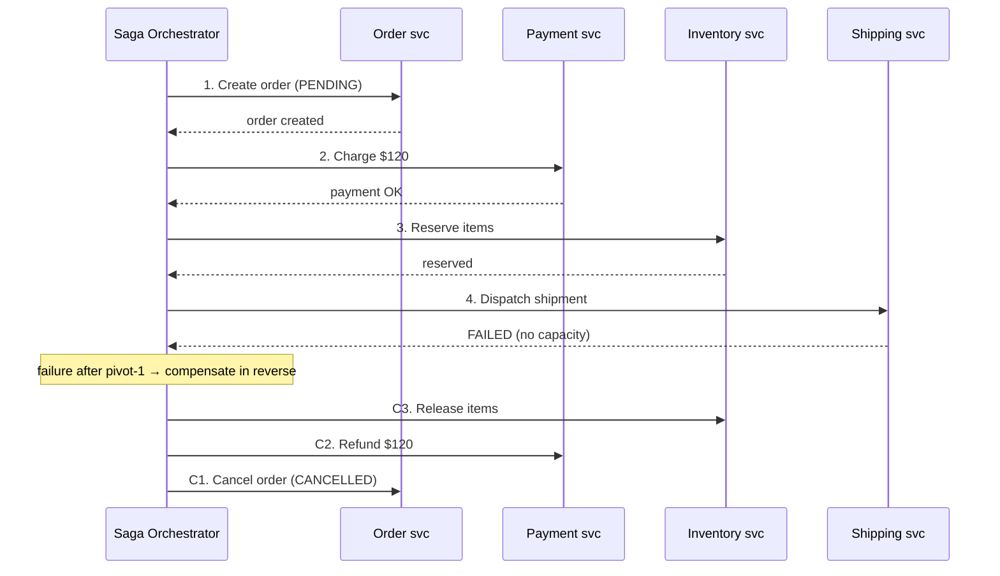
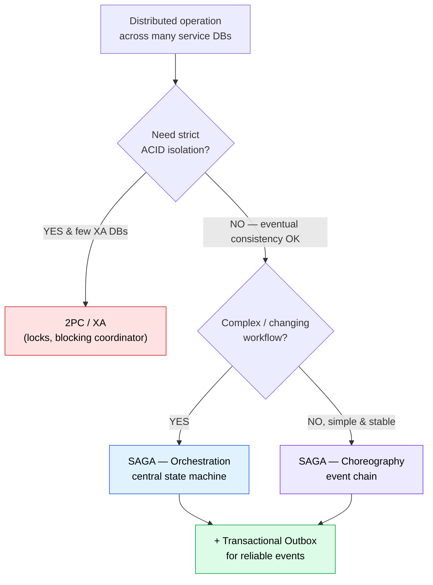

# Saga Pattern & Distributed Transactions

## 1. Why Should I Care About This?
- **It Is *The* Answer to the Hardest Microservices Question**: The moment you split one database into a database-per-service, "just wrap it in a transaction" dies. Interviewers ask "how do you keep an order consistent across Payment, Inventory, and Shipping?" and the Saga pattern is the expected answer — not `BEGIN TRANSACTION`.
- **It Explains Why Money Gets Refunded, Not "Un-charged"**: Once a local transaction commits in the Payment service, it is gone — you cannot `ROLLBACK` a committed transaction in another service's database. Sagas teach you the mental shift from *rollback* to *compensate forward* (issue a refund), which is how every real payment system actually works.
- **It Is Everywhere in Production**: Booking flights (Amadeus), e-commerce checkout (Amazon), ride matching (Uber), and workflow engines (Temporal, AWS Step Functions, Netflix Conductor) are all sagas under the hood. Knowing the vocabulary — orchestration, compensation, pivot transaction, semantic lock — signals senior-level thinking.

## 2. What Problem Does This Solve?
- **Consistency Without a Shared Database**: Each microservice owns its own database. A business operation ("place an order") must update four of them atomically-ish, but there is no single transaction manager that spans all four.
- **Long-Lived Operations**: Reserving inventory, calling a third-party payment gateway, and dispatching a courier can take seconds to minutes. You cannot hold a database lock open across a slow network call to another service without destroying throughput.
- **Partial Failure Is the Default**: In a distributed system some steps succeed and others fail. You need a *deliberate* strategy for "Payment succeeded but Shipping is out of trucks" — not an exception that leaves a customer charged for nothing.
- **Naive Approach**: Reach for **Two-Phase Commit (2PC/XA)**. A coordinator asks every participant to *prepare* (lock rows), then tells everyone to *commit*. It gives real ACID atomicity — but the coordinator is a **single point of failure that blocks**: if it dies after "prepare," every participant sits holding **locks across the network** indefinitely (the in-doubt state). Throughput collapses, availability drops, and most cloud data stores (Cassandra, DynamoDB, Kafka, sharded MySQL) do not even support XA. 2PC does not scale past a handful of tightly-coupled databases.

## 3. Core Idea (Intuition First)
Think of booking a multi-leg trip yourself with **no travel agent and no refunds-in-place**. You book the flight (paid, ticket issued). Then you book the hotel (paid). Then you try to rent a car — sold out. You cannot magically "un-book" the flight and hotel; those charges already happened. Instead you walk the steps **backward and undo each one with a new, opposite action**: cancel the car booking (nothing to do), cancel the hotel *and request a refund*, cancel the flight *and request a refund*. Each undo is itself a real transaction that leaves a trace — this is a **compensating transaction**. A Saga is exactly this: a chain of local commits, each with a matching "undo" action, run in reverse when something downstream fails.

![Side-by-side comparison of Saga coordination styles: on the left, orchestration where a central Saga Orchestrator state machine issues numbered commands to Order, Payment, Inventory, and Shipping services and receives acknowledgements back; on the right, choreography where the same four services are chained by events (OrderCreated, PaymentDone, StockReserved) with no central coordinator; and along the bottom, the compensating-transaction chain showing forward local commits in green until Shipping fails, then the reverse compensations Cancel Shipping, Release Inventory, Refund Payment, and Cancel Order flowing backward in red](../assets/saga_choreo_vs_orchestration.svg)

> A Saga is a sequence of local transactions; if any step fails, previously committed steps are undone by their compensating transactions running in reverse — orchestration puts a coordinator in charge, choreography lets events drive the chain.

## 4. How It Actually Works
### Local Transactions + Compensations
- The saga is split into **T1, T2, ... Tn** — each `Ti` is a normal ACID transaction **inside a single service's database**, so it commits locally and immediately.
- Each `Ti` has a **compensating transaction `Ci`** that *semantically* undoes it. `C` for "charge $50" is not a rollback — it is a brand-new "refund $50" transaction. Compensations must be written and tested like any other feature.
- On failure at step ` Tk`, the saga runs `C(k-1), C(k-2), ... C1` in **reverse order**.

### Orchestration (a central coordinator)
- A **Saga Orchestrator** (often a persistent **state machine**) holds the workflow. It sends a command ("reserve inventory") to a service, waits for the reply, records the new state durably, then decides the next command.
- On failure it drives the compensation sequence itself. Because state is persisted (e.g. in its own DB or an event log), a crashed orchestrator resumes exactly where it left off — no "zombie" half-orders.
- Tooling: Temporal, AWS Step Functions, Netflix Conductor, Camunda/Zeebe.

### Choreography (events, no central brain)
- No coordinator. Each service **subscribes to events and emits the next event**. `Order` emits `OrderCreated`; `Payment` consumes it, charges, emits `PaymentCompleted`; `Inventory` consumes that, and so on.
- Compensation is also event-driven: `ShippingFailed` is consumed by `Inventory` (release stock) which emits `InventoryReleased`, consumed by `Payment` (refund), and so on backward.

### The Pivot Transaction
- The **pivot** is the point of no return: the last step that can still be rolled back by compensation, or the first that guarantees the saga will complete. Steps *before* the pivot are **compensatable**; steps *after* it are **retriable** (they must eventually succeed, e.g. "send confirmation email" — you keep retrying, you never "un-send").

### Isolation, Idempotency & Retries
- Sagas are **ACD, not ACID** — they drop **Isolation**. Between `T1` committing and `Cn` running, other transactions can see intermediate state (a **dirty read**): the money is charged but the order not yet confirmed. Countermeasures: **semantic locks** (a status flag like `PENDING`/`APPROVED` that warns readers the row is in-flight), **commutative updates**, and **re-reads before compensating**.
- Every step and every compensation must be **idempotent** — messages get redelivered and steps get retried, so "reserve stock" and "refund payment" must be safe to apply twice (dedupe on a saga/request ID).



## 5. Real-World Example
**An e-commerce checkout saga for a $120 order (orchestrated):**
1. **Order service** creates the order in status `PENDING` (local commit).
2. **Payment service** charges the customer's card **$120** via Stripe (local commit — the money is really gone).
3. **Inventory service** reserves **2 units** of SKU-77, decrementing available stock from 5 to 3 (local commit).
4. **Shipping service** tries to book a courier — but the fulfillment center is at capacity, so it **FAILS**.

Now compensation runs **in reverse**:
- **C3 — Inventory**: release the 2 units, stock goes 3 → 5.
- **C2 — Payment**: issue a **$120 refund** (not a rollback — a new refund transaction that shows on the customer's statement in a few days).
- **C1 — Order**: mark the order `CANCELLED` and notify the customer.

Numbers that matter: with 2PC, steps 2–4 would hold locks for the **full end-to-end latency** (say 3–8 seconds including the Stripe round-trip) — at 1,000 checkouts/sec that is thousands of rows locked at once and a coordinator that, if it hiccups, freezes them all. With a saga, each local transaction locks its own rows for only **single-digit milliseconds** and releases immediately; the "consistency window" (charged-but-not-confirmed) is handled by the `PENDING` semantic lock, not by holding DB locks.

## 6. Code Example
Orchestrated saga with explicit steps, compensations, and idempotency (Python-ish pseudocode):
```python
class OrderSaga:
    # each step: (forward action, compensating action)
    STEPS = [
        ("create_order",     "cancel_order"),
        ("charge_payment",   "refund_payment"),
        ("reserve_inventory","release_inventory"),
        ("dispatch_shipping","cancel_shipping"),   # dispatch is the pivot-adjacent step
    ]

    def run(self, ctx):
        completed = []                     # forward steps that committed
        for forward, compensate in self.STEPS:
            try:
                # idempotency: same saga_id + step is a no-op if already applied
                self.invoke(forward, ctx, key=f"{ctx.saga_id}:{forward}")
                completed.append(compensate)
                self.persist_state(ctx.saga_id, forward)   # durable → survives crash
            except StepFailed:
                self.compensate(completed, ctx)             # unwind in REVERSE
                raise SagaAborted(ctx.saga_id)

    def compensate(self, completed, ctx):
        for compensate in reversed(completed):              # C(n-1) ... C1
            retry_with_backoff(                             # compensations MUST succeed
                lambda: self.invoke(compensate, ctx,
                                    key=f"{ctx.saga_id}:{compensate}"))

    def invoke(self, action, ctx, key):
        if self.already_done(key):     # dedupe → idempotent retries
            return
        SERVICE[action](ctx)           # local ACID txn inside the owning service
        self.mark_done(key)
```

## 7. Design Variations & Alternatives
- **Orchestration** — central coordinator/state machine. Best visibility and explicit control; risk of a "god" coordinator and coupling. Use when the workflow is complex or changes often.
- **Choreography** — pure events, no coordinator. Maximum decoupling and no single bottleneck; the flow is "invisible" and hard to trace/debug. Use for simple, stable 2–4 step flows.
- **Hybrid** — orchestrate the critical core, choreograph the peripheral reactions (emails, analytics).
- **Transactional Outbox** — the *plumbing* that makes either style reliable: write the state change **and** the outgoing event in one local transaction to an `outbox` table, then relay it — so "committed but event lost" cannot happen.
- **2PC / XA** — real atomic distributed commit; only viable for a few co-located, XA-capable databases, never across the open internet or cloud-native stores.



## 8. Pros and Cons
### Pros
- **No distributed locks, no blocking coordinator** — each step is a fast local transaction, so throughput and availability stay high even under partial failure.
- **Works with any datastore** — no XA support required; fits Cassandra, DynamoDB, Kafka, sharded SQL.
- **Explicit failure handling** — compensations are first-class, so "charged but not shipped" has a defined resolution instead of a stuck state.
- **Scales horizontally** — services stay loosely coupled and independently deployable.

### Cons
- **No isolation (ACD not ACID)** — intermediate states are visible; you must design semantic locks and tolerate dirty reads.
- **Compensation logic is hard** — every step needs a correct, tested, idempotent undo, and some actions are hard to reverse (an email is sent; a physical item shipped).
- **Harder to reason about & debug** — especially choreography, where the end-to-end flow lives across many services.
- **Eventual consistency** — the system is briefly inconsistent during the saga window.

## 9. Failure Scenarios & What Can Go Wrong
- **SYMPTOM**: Customer charged but order never confirmed and never refunded. → **CAUSE**: a compensating transaction (refund) failed and was not retried, or the event that should trigger it was lost. → **FIX**: make compensations idempotent and **retry with backoff until they succeed**; back events with durable queues + a **Dead Letter Queue** and alerting.
- **SYMPTOM**: Payment refunded *twice*, or stock released twice. → **CAUSE**: message redelivery / step retried without dedupe. → **FIX**: idempotency keys (`saga_id + step`); dedupe table so re-applying a step is a no-op.
- **SYMPTOM**: A downstream service reads a half-committed order and acts on money that is about to be refunded (**dirty read**). → **CAUSE**: lack of isolation. → **FIX**: **semantic lock** — expose a `PENDING`/`APPROVED` status; readers ignore or wait on pending rows; re-read state before compensating.
- **SYMPTOM**: Orchestrator crashes mid-saga leaving "zombie" half-orders. → **CAUSE**: workflow state kept only in memory. → **FIX**: persist saga state durably (state machine / event log); on restart, resume or compensate.
- **SYMPTOM**: Choreography event storm / infinite loop. → **CAUSE**: service A's event triggers B which re-triggers A. → **FIX**: model transitions explicitly, correlate by saga ID, and guard against re-processing completed sagas.

## 10. Impact on Scalability, Reliability & Cost
- **Scalability**: Excellent. Replacing cross-service locks with short local transactions removes the central bottleneck; services scale independently. Choreography adds zero central component; orchestration adds one coordinator you can also scale/shard.
- **Reliability**: Availability improves over 2PC (no in-doubt blocking), but *correctness* now depends on durable messaging, idempotency, and reliable compensation — a saga is only as reliable as its retry + DLQ machinery and its outbox.
- **Cost**: More engineering cost (write + test every compensation, handle idempotency, build observability across the flow) and more infra (message broker, orchestrator, outbox relay). You trade cheap-to-express strong consistency for operational complexity in exchange for scale and availability.

## 11. When NOT to Use This
- **A single service / single database** owns the whole operation — just use a local ACID transaction. A saga here is pure overhead.
- **You genuinely need strict isolation / no dirty reads** (e.g. tightly-coupled financial ledgers within one boundary) and can use a handful of XA-capable databases — 2PC may be simpler and correct.
- **Trivial two-step flows** where a lost update is harmless — the compensation/idempotency machinery costs more than the problem.
- **Operations that cannot be compensated at all** (irreversible physical actions with no undo) unless you can insert an approval/pivot gate before them.

## 12. Interview Perspective
- **What interviewers expect**: State that database-per-service kills 2PC (blocking coordinator, network-held locks, no XA in cloud stores), then define a saga as *local transactions + compensating transactions*. Contrast **orchestration vs choreography**, and mention **compensation, the pivot transaction, lack of isolation (ACD not ACID) + countermeasures (semantic locks), and idempotent retries**.
- **Common question**: *"Design a distributed transaction for an order across Payment, Inventory, and Shipping."* → Saga. Walk the forward chain, then the reverse compensation chain when Shipping fails (release inventory → refund payment → cancel order). Name whether you'd orchestrate or choreograph and why.
- **Bonus signal**: Mention the **Transactional Outbox** to avoid lost events, idempotency keys for exactly-once *effect*, and a real engine (Temporal / AWS Step Functions).

## 13. Connections to Other Topics
- [Orchestration vs Choreography](./Orchestration_vs_Choreography.md) — the two ways to coordinate a saga.
- [Distributed Transactions (2PC/3PC, DB angle)](../05_Databases_Storage/Distributed_Transactions.md) — the 2PC baseline sagas replace.
- [Transactional Outbox & Inbox Pattern](./Transactional_Outbox_Inbox_Pattern.md) — reliably publishing saga events without dual-write loss.
- [Event Sourcing Pattern](../09_Message_Queues_Event_Streaming/Event_Sourcing_Pattern.md) — a natural way to persist orchestrator/saga state as an event log.
- [Idempotency](../02_API_Interface_Design/Idempotency.md) — why every step and compensation must be safe to retry.
- [Database-per-Service & Data Ownership](./Database_per_Service_Data_Ownership.md) — the constraint that makes sagas necessary.

## 14. Visual Aids
- **The SVG above** ([saga_choreo_vs_orchestration.svg](../assets/saga_choreo_vs_orchestration.svg)): left panel = orchestration (a central Saga Orchestrator state machine issuing numbered commands 1–4 to the services and getting acks back); right panel = choreography (the same services chained by events with no central node); bottom band = the compensating-transaction chain — green forward commits until Shipping fails, then Cancel Shipping → Release Inventory → Refund Payment → Cancel Order flowing backward in red.
- **Mermaid #1 (Section 4)**: the orchestrated order saga sequence — forward commands 1–4, then the reverse compensations after Shipping fails.
- **Mermaid #2 (Section 7)**: the decision tree — 2PC vs Saga, and orchestration vs choreography, plus the outbox for reliable events.

## 15. Summary (TL;DR)
**In a database-per-service world 2PC does not scale — its coordinator blocks and its locks are held across the network — so a Saga instead models a distributed operation as a sequence of local ACID transactions, each with a compensating transaction that *semantically* undoes it (you never roll back a committed local txn, you compensate forward with a refund/release/cancel); coordinate the steps either by orchestration (a central, persistent state-machine coordinator issues commands and drives compensation) or choreography (services react to events and emit the next, with no central brain), mind the pivot transaction (compensatable before it, retriable after), and because sagas drop Isolation (ACD not ACID) defend against dirty reads with semantic locks and make every step and compensation idempotent so retries are safe — as in the e-commerce checkout where Order → Payment → Inventory → Shipping unwinds into Release Inventory → Refund Payment → Cancel Order the moment Shipping fails.**

## 16. Further Reading & Resources
- [Microservices.io — Pattern: Saga (Chris Richardson)](https://microservices.io/patterns/data/saga.html)
- [Chris Richardson — Managing data consistency in microservices using Sagas](https://www.chrisrichardson.net/post/microservices/2019/07/09/developing-sagas-part-1.html)
- [AWS Prescriptive Guidance — Saga pattern](https://docs.aws.amazon.com/prescriptive-guidance/latest/modernization-data-persistence/saga-pattern.html)
- [Temporal — Saga pattern made easy](https://temporal.io/blog/saga-pattern-made-easy)
- [Microsoft Azure Architecture Center — Saga distributed transactions pattern](https://learn.microsoft.com/en-us/azure/architecture/patterns/saga)
- [Hector Garcia-Molina & Kenneth Salem — SAGAS (the original 1987 paper)](https://www.cs.cornell.edu/andru/cs711/2002fa/reading/sagas.pdf)
