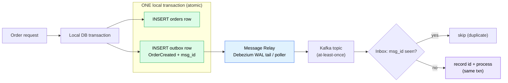
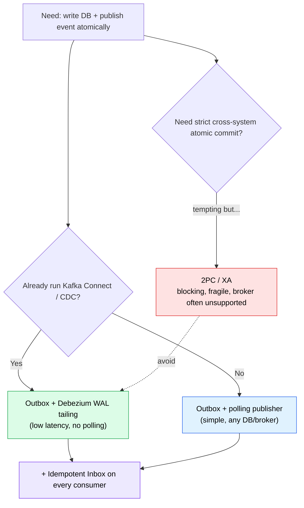

# Transactional Outbox & Inbox Pattern

## 1. Why Should I Care About This?
- **It's the #1 correctness bug in microservices**: the moment a service both updates its own database *and* tells the rest of the world "this happened" (publish an event, enqueue a job, call another service), you have two writes to two systems with no shared transaction. Get it wrong and you silently drop or duplicate events — the kind of bug that surfaces as "the customer was charged but never shipped."
- **Interviewers probe it constantly**: any event-driven design ("order service publishes OrderCreated", "notify the fraud service") invites the follow-up *"how do you guarantee the event is actually published if the service crashes?"* The outbox pattern is the expected answer, and knowing the inbox half signals real depth.
- **It's how exactly-once *feels* possible without magic**: brokers give you at-least-once. The outbox (producer side) + inbox (consumer side) combo is the practical recipe that turns at-least-once delivery into effective exactly-once *processing* — a phrase you want to be able to explain.

## 2. What Problem Does This Solve?
- **The dual-write problem**: a service must atomically do two things across two different systems — commit a row to its DB *and* publish a message to a broker (Kafka, RabbitMQ, SQS). There is no distributed transaction spanning "my Postgres" and "Kafka," so the two writes cannot be made atomic by ordinary means.
- **Any ordering fails**: if you commit the DB first then crash before publishing, the state exists but the event is lost (downstream never reacts). If you publish first then crash before committing, the event fired for a change that never persisted (a phantom event). Neither order is safe.
- **Naive Approach**: write the DB, then publish to the broker as two separate steps:
  ```python
  db.save(order)               # step 1: commits
  broker.publish(order_event)  # step 2: crash here => event lost forever
  ```
  This looks fine in the happy path and works 99.9% of the time — which is exactly why it's dangerous. The 0.1% (process crash, broker timeout, network blip between the two lines) leaves DB and broker permanently diverged, and nothing detects it.

## 3. Core Idea (Intuition First)
Think of it like **mailing a legal contract from an office**.
- The **naive dual write** is signing the contract (updating your records) and then walking to the mailbox to post the copy — as two separate acts. If you have a heart attack between signing and posting, your files say "deal done" but the other party never got the letter. Nobody can tell.
- The **outbox** is: in the *same* act of filing the signed contract in your cabinet, you also drop a stamped envelope into an **outbox tray on your desk** — one atomic motion, both or neither. A **mail clerk (the relay)** comes by later, takes everything in the tray, and posts it. Even if you die right after filing, the letter is sitting in the tray and *will* go out.
- The clerk is diligent but not perfectly careful — occasionally he posts the *same* envelope twice (at-least-once). So the recipient keeps an **inbox log of letter serial numbers**: if a serial number already appears in the log, they toss the duplicate. That's the **idempotent inbox**.

![Diagram contrasting the dual-write problem with the transactional outbox fix. The top red panel shows a service writing its database successfully then crashing before publishing to the broker, leaving database state and broker events diverged and inconsistent, and notes that 2PC/XA across a DB and broker is avoided. The bottom green panel shows the fix: one local database transaction inserts both the business row and an outbox row atomically, a message relay using CDC or polling reads the outbox and publishes the event at least once to the broker, and a consumer inbox dedupes on message id before processing to achieve effective exactly-once.](../assets/outbox_dual_write.svg)

> Top: the dual write — DB commits but the process crashes before publishing, so state and events diverge with nothing to detect it. Bottom: the fix — one local transaction writes the business row *and* an outbox row atomically; a message relay (CDC log-tailing or a poller) publishes the outbox at-least-once to the broker; the consumer's idempotent inbox dedupes by message id, yielding effective exactly-once processing.

## 4. How It Actually Works

### The single local transaction (producer side)
The service opens **one local DB transaction** and, inside it, writes both the business row and an **outbox row** describing the event. Because both are in the same DB, the local transaction guarantees atomicity — they commit together or roll back together. No distributed transaction, no broker involved yet. The event is now durably persisted *as data*, waiting to be shipped.

### The message relay
A separate process — the **relay** (a.k.a. message dispatcher) — moves outbox rows to the broker and marks them sent. It works in one of two ways:
- **Transaction-log tailing / CDC**: a tool like **Debezium** reads the database's write-ahead log (WAL / binlog) and streams every committed outbox insert to Kafka. Near-real-time, no polling load, no application code in the hot path.
- **Polling publisher**: a background job runs `SELECT ... FROM outbox WHERE published = false ORDER BY id LIMIT n`, publishes each, then marks/deletes them. Dead simple, works with any DB and any broker, but adds query load and a bit of latency.

### At-least-once and why the inbox exists
The relay can crash *after* publishing to the broker but *before* marking the outbox row as sent — so on restart it republishes. Delivery is therefore **at-least-once**: every event arrives, some may arrive twice. To make processing effectively exactly-once, the **consumer keeps an inbox (dedupe) table keyed by message id**: check if the id was already processed inside the same transaction that applies the effect; if seen, skip; if new, record the id *and* apply the effect atomically.

### Ordering & cleanup
- **Ordering**: a monotonic outbox `id` (or per-aggregate sequence) preserves order; CDC naturally emits in commit order, and Kafka keeps order within a partition (key by aggregate id).
- **Cleanup**: the outbox grows forever if untouched — either delete rows once published (poller) or run a periodic reaper / partition-drop for CDC (where rows are marked, not deleted, so Debezium can capture them first).



## 5. Real-World Example
**Order → Shipping across two services:**
- **Order Service** receives "place order." In **one Postgres transaction** it does `INSERT INTO orders (...)` **and** `INSERT INTO outbox (msg_id, aggregate_id, type='OrderCreated', payload)`. Commit. The order and its event are now atomically durable. The API returns success immediately — the customer sees "order placed."
- **Debezium** tails the Postgres WAL, sees the committed outbox insert, and streams it to the Kafka topic `orders.events`, keyed by `order_id` (so all events for one order stay ordered in one partition). Debezium marks its WAL offset; if it restarts mid-stream, it may re-emit the last event → **at-least-once**.
- **Shipping Service** consumes `orders.events`. For each message it runs a transaction: `INSERT INTO inbox (msg_id) ON CONFLICT DO NOTHING` — if 0 rows inserted, this is a **duplicate** → ack and skip. If inserted, create the shipment and commit. A redelivered `OrderCreated` therefore never creates a second shipment.
- **Net effect**: even if the Order Service crashes right after commit, or Debezium redelivers, or the Shipping Service reprocesses on rebalance, exactly **one** shipment is created for the order. State and events never diverge.

## 6. Code Example
```sql
-- Outbox table (lives in the Order Service DB, same schema as `orders`)
CREATE TABLE outbox (
  id          BIGSERIAL PRIMARY KEY,     -- monotonic => ordering
  msg_id      UUID NOT NULL,             -- idempotency key for the consumer
  aggregate_id TEXT NOT NULL,            -- e.g. order_id (Kafka partition key)
  type        TEXT NOT NULL,             -- 'OrderCreated'
  payload     JSONB NOT NULL,
  published   BOOLEAN NOT NULL DEFAULT FALSE
);

-- Inbox / dedupe table (lives in the Shipping Service DB)
CREATE TABLE inbox (msg_id UUID PRIMARY KEY, processed_at TIMESTAMPTZ DEFAULT now());
```
```python
# --- PRODUCER: one local transaction, no broker call inside ---
def place_order(cmd):
    with db.transaction():                       # atomic: both rows or neither
        order = db.insert("orders", cmd.to_row())
        db.insert("outbox", {
            "msg_id": uuid4(),                   # unique per event
            "aggregate_id": order.id,
            "type": "OrderCreated",
            "payload": order.as_event(),
        })
    return order                                 # API returns; relay ships later

# --- RELAY (polling variant; CDC/Debezium replaces this entirely) ---
def relay_loop():
    while True:
        rows = db.query("SELECT * FROM outbox WHERE published=false ORDER BY id LIMIT 100")
        for r in rows:
            broker.publish("orders.events", key=r.aggregate_id, value=r.payload, headers={"msg_id": r.msg_id})
            db.execute("UPDATE outbox SET published=true WHERE id=%s", r.id)  # may crash before this => at-least-once

# --- CONSUMER: idempotent inbox makes reprocessing safe ---
def on_message(msg):
    with db.transaction():
        inserted = db.execute("INSERT INTO inbox(msg_id) VALUES(%s) ON CONFLICT DO NOTHING", msg.msg_id)
        if inserted.rowcount == 0:
            return ack(msg)                      # duplicate: already processed, skip
        create_shipment(msg.payload)             # effect + dedupe record commit together
    ack(msg)
```

## 7. Design Variations & Alternatives
- **Polling publisher** — simplest; any DB + any broker; costs a recurring query and a little latency. Great default when you don't already run CDC.
- **CDC / log-tailing (Debezium)** — near-real-time, no app polling, no extra DB load; costs operational complexity (a Kafka Connect cluster, WAL retention tuning).
- **Listen-to-yourself / event sourcing** — the event *is* the source of truth (append to a log, derive state), sidestepping the dual write differently.
- **2PC / XA transactions** — a real distributed transaction across DB + broker. Avoided in practice: it's blocking (locks held across the prepare phase), a coordinator crash can leave participants stuck, throughput tanks, and many brokers (Kafka, SQS) don't support XA at all.



## 8. Pros and Cons
### Pros
- **Atomicity without distributed transactions**: business state and its event commit together in one local transaction — the core guarantee.
- **Crash-safe**: the event survives any producer crash because it's durable data, not an in-flight network call; the relay retries until published.
- **Broker-agnostic and reliable**: works with Kafka, RabbitMQ, SQS; the inbox makes at-least-once delivery safe to process.
- **Auditable**: the outbox is a durable, ordered log of everything the service emitted.

### Cons
- **Extra moving parts**: an outbox table, a relay (poller or Debezium), and inbox tables on every consumer.
- **At-least-once, not free exactly-once**: consumers *must* implement idempotency/inbox — the pattern doesn't eliminate duplicates, it makes them harmless.
- **Latency & cleanup**: polling adds delay; the outbox/inbox tables grow and need reaping; CDC adds Connect infrastructure to operate.

## 9. Failure Scenarios & What Can Go Wrong
- **SYMPTOM**: state exists but no event fired. **CAUSE**: still doing the naive dual write (publish outside the DB txn) and crashed between commit and publish. **FIX**: move the event into the outbox row inside the same local transaction; let the relay publish it.
- **SYMPTOM**: consumers process the same event twice (double shipment, double charge). **CAUSE**: relay republished after crashing before marking the row sent — inherent at-least-once. **FIX**: idempotent inbox — dedupe on `msg_id` inside the consumer's transaction; make the effect itself idempotent where possible.
- **SYMPTOM**: outbox table bloats, DB slows, disk fills. **CAUSE**: rows never cleaned after publish. **FIX**: delete on publish (poller), or run a reaper / time-partition + drop for CDC after Debezium has captured them.
- **SYMPTOM**: events arrive out of order downstream. **CAUSE**: parallel relay workers or wrong Kafka partition key. **FIX**: order by monotonic `id`, key Kafka by `aggregate_id` so one aggregate's events land in one partition; keep per-aggregate serialization.
- **SYMPTOM**: relay lag / events minutes late. **CAUSE**: poll interval too long or CDC connector backed up. **FIX**: tune poll frequency/batch size, scale the connector, alert on outbox `unpublished` age.
- **SYMPTOM**: inbox table grows unbounded. **CAUSE**: dedupe keys kept forever. **FIX**: retain msg_ids only as long as duplicates are plausible (broker retention window) and expire older entries.

## 10. Impact on Scalability, Reliability & Cost
- **Scalability**: CDC scales well (WAL tailing is cheap, no polling load); polling adds a steady query cost that grows with throughput. Partition Kafka by `aggregate_id` to parallelize consumers while keeping per-aggregate order.
- **Reliability**: this is the whole point — you trade the impossible "atomic across two systems" for "atomic in one DB + durable retryable relay + idempotent consumer," which is achievable and crash-safe end to end.
- **Cost**: extra storage (outbox + inbox tables), the relay's compute (poller cycles or a Kafka Connect cluster for Debezium), and engineering cost to make every consumer idempotent. Usually far cheaper than debugging silent event-loss incidents in production.

## 11. When NOT to Use This
- **No cross-system write**: if the operation only touches the DB (no event/message to publish), there's no dual write — skip it.
- **A single system already gives atomicity**: if your "broker" is a table in the same DB (a job queue as a DB table), one transaction covers everything; you don't need a relay.
- **Fire-and-forget, loss-tolerant events**: best-effort metrics, analytics pings, or cache-warming where an occasionally lost event is fine — the machinery isn't worth it.
- **Ultra-low-latency event emission** where even CDC lag is unacceptable and you've accepted a different consistency model (e.g., true event sourcing).

## 12. Interview Perspective
- **The setup question**: "Your order service saves an order and publishes OrderCreated. What if it crashes after saving but before publishing?" → Name the **dual-write problem**, reject 2PC, propose the **transactional outbox**.
- **Expected answer shape**: one local transaction writes row + outbox row; a relay (poll or Debezium CDC) publishes; delivery is at-least-once; consumers use an **idempotent inbox** for effective exactly-once.
- **Follow-ups to nail**: *"Poll vs CDC?"* (simplicity vs latency/load), *"How do you avoid duplicates downstream?"* (inbox dedupe on msg_id), *"How do you keep ordering?"* (monotonic id + partition by aggregate key), *"Why not XA?"* (blocking, fragile, broker often unsupported), *"How does the outbox not grow forever?"* (reaper / delete-on-publish).
- **Bonus signal**: mention that outbox fixes the *producer* and inbox fixes the *consumer* — you need both halves; one alone is incomplete.

## 13. Connections to Other Topics
- [Change Data Capture (CDC)](../09_Message_Queues_Event_Streaming/Change_Data_Capture_CDC.md) — the log-tailing mechanism (Debezium) the relay uses to publish outbox rows without polling.
- [Exactly-once Semantics](../09_Message_Queues_Event_Streaming/Exactly_once_Semantics.md) — outbox + inbox is the practical recipe for effective exactly-once on top of at-least-once delivery.
- [Idempotency](../02_API_Interface_Design/Idempotency.md) — the inbox is idempotent consumption; the dedupe key is an idempotency key.
- [Orchestration vs Choreography (Sagas & distributed transactions)](./Orchestration_vs_Choreography.md) — sagas rely on reliably published events; the outbox is what makes each saga step's event trustworthy.
- [Dead Letter Queues & Retry Strategies](../09_Message_Queues_Event_Streaming/Dead_Letter_Queues_Retry_Strategies.md) — where poison messages the inbox can't process go after retries.
- [Distributed Transactions](../05_Databases_Storage/Distributed_Transactions.md) — 2PC/XA, the heavyweight alternative the outbox deliberately avoids.
- [Saga Pattern & Distributed Transactions](./Saga_Pattern_Distributed_Transactions.md) — every saga step must publish its outcome reliably; the outbox is the mechanism that makes each step's event trustworthy.

## 14. Visual Aids
- **The SVG above** ([outbox_dual_write.svg](../assets/outbox_dual_write.svg)): top red panel = the dual-write problem (DB commits, publish crashes, state ≠ events); bottom green panel = the fix (one local txn writes row + outbox row → relay publishes at-least-once → consumer inbox dedupes by msg id).
- **Mermaid #1 (Section 4)**: the end-to-end pipeline — one transaction (order row + outbox row) → relay → Kafka (at-least-once) → inbox dedupe → process.
- **Mermaid #2 (Section 7)**: the decision tree — already run CDC? → Debezium, else polling; 2PC is the tempting-but-avoided branch; every consumer gets an idempotent inbox.

## 15. Summary (TL;DR)
**The dual-write problem is that a service must both update its database and publish an event, but no transaction spans the DB and the broker — so committing then crashing before publishing loses the event, and publishing then failing to commit fires a phantom event, leaving state and events silently diverged. The transactional outbox fixes the producer side by writing the business row and an "outbox" row in the *same* local DB transaction (atomic), after which a separate message relay — either CDC/transaction-log tailing (e.g. Debezium reading the WAL) or a poller — reads the outbox and publishes to the broker, marking rows sent; because the relay can republish after a crash, delivery is at-least-once, so every consumer runs an idempotent inbox that dedupes on message id to achieve effective exactly-once processing. Order events stay correct (monotonic id + partition by aggregate key), 2PC/XA is deliberately avoided as blocking and fragile, and the outbox/inbox tables are periodically reaped — giving crash-safe, broker-agnostic, atomic "change-plus-event" without distributed transactions.**

## 16. Further Reading & Resources
- [Chris Richardson — Pattern: Transactional outbox (microservices.io)](https://microservices.io/patterns/data/transactional-outbox.html)
- [Debezium — Reliable Microservices Data Exchange with the Outbox Pattern](https://debezium.io/blog/2019/02/19/reliable-microservices-data-exchange-with-the-outbox-pattern/)
- [Microsoft — Publisher/Subscriber & the Transactional Outbox pattern (Azure Architecture Center)](https://learn.microsoft.com/en-us/azure/architecture/patterns/)
- [Chris Richardson — Pattern: Idempotent consumer (inbox)](https://microservices.io/patterns/communication-style/idempotent-consumer.html)
- [Confluent — Kafka transactions & exactly-once semantics](https://www.confluent.io/blog/exactly-once-semantics-are-possible-heres-how-apache-kafka-does-it/)
