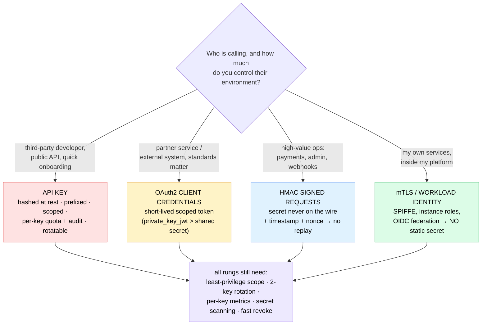

# API Keys & Service-to-Service Authentication

## 1. Why Should I Care About This?
- **Leaked Keys Are the Most Common Cloud Breach Entry Point**: GitHub's secret scanning detects **millions of leaked credentials per year** across public repos. A single AWS key in a commit has repeatedly turned into six-figure crypto-mining bills within *minutes* — automated scanners watch the public commit firehose in real time. The credential doesn't have to be phished; someone just pasted it.
- **Every System You Design Has This Layer**: The moment you draw a second box on the whiteboard, you have machine-to-machine authentication. "How does service A prove who it is to service B?" is one of the most reliably asked follow-ups in a system design interview, and "we'll use an API key" is only the *start* of a good answer.
- **It's Where "Rotation" Stops Being a Buzzword**: Almost every team has a credential nobody dares rotate because nothing tracks who uses it. Understanding **dual-key overlap**, per-key usage metrics, and hashed storage is the difference between a design that can respond to a leak in ten minutes and one that can't respond at all.

## 2. What Problem Does This Solve?
- **There's No Human to Authenticate**: Passwords, MFA, and passkeys all assume someone is present to type or tap. A cron job at 3 a.m. has nobody. It needs a credential it can present unattended, forever, without a human in the loop.
- **Attribution and Quotas, Not Just Access**: You need to know *which* caller made a request — to rate-limit them, bill them, audit them, and revoke just them when something goes wrong. An anonymous-but-allowed call is unaccountable.
- **Naive Approach**: Generate one long random string, email it to the partner, store it in plaintext in a `clients` table, check it with `==`, and never change it. Every part of that fails: the key is a **password that never expires**, and it will end up in an access log (because someone put it in a query string), a Slack message, a Postman collection, a mobile app binary, and a Git commit. Plaintext storage means a database leak hands over every customer's key. `==` comparison leaks timing. And with no per-key usage data, nobody can rotate it because nobody knows who would break.

## 3. Core Idea (Intuition First)
Think of four increasingly serious ways to prove who you are at a delivery entrance.
- **① A static API key is a shouted password.** "It's me, key `sk_live_abc123`." Anyone who overhears it — in a log, a URL, a repo, a proxy — can shout the same thing forever. Simple, and simple to steal.
- **② OAuth2 client credentials is a day pass.** You show the password *once*, at a guarded window, and receive a **badge valid for 15 minutes** with your permitted areas printed on it. Overhear the badge and you get 15 minutes; the password stayed at the window and was only ever spoken to one place.
- **③ HMAC request signing is a wax seal.** You never say the secret at all. You **stamp each parcel** with a seal computed from the secret *plus that exact parcel's contents and the current time*. The guard has the same secret, re-stamps the parcel, and compares. Intercept a parcel and you learn nothing reusable — the seal is valid for that parcel, for five minutes. **This is what AWS SigV4 does.**
- **④ mTLS / workload identity removes the secret entirely.** You don't carry a credential; **the building issues you one when you arrive**, based on hardware/platform attestation, valid for a few hours, automatically renewed. There is nothing in your pocket for a thief to find. That's SPIFFE/SPIRE, Kubernetes-projected tokens, and OIDC federation for CI.
- Every rung answers the same question: **if an attacker reads one log line, one environment variable, or one repo, what exactly do they get?**

![Three-panel diagram of service-to-service authentication. Panel A: the machine-auth ladder, showing what each option leaves exposed — a static API key is a long-lived secret sent on every call that leaks in logs, URLs and repos and is replayable forever until revoked; OAuth2 client credentials exchanges the secret once for a short-lived scoped token, shrinking the leak window to minutes; HMAC signed requests in the SigV4 style never put the secret on the wire and the signature covers method, path, body and time, preventing replay and tampering; and mTLS or workload identity via SPIFFE or OIDC federation means no static secret exists at all, with identity attested and auto-rotated hourly. Panel B: HMAC request signing in four steps — build a byte-exact canonical request from method, path, sorted query, signed headers and the SHA-256 of the body; form the string to sign including a timestamp with five-minute tolerance, a nonce and a scope; derive a signing key through an HMAC chain from secret to date to region to service so a leaked derived key is scoped; and produce the signature sent in the Authorization header, where only the key id travels and never the secret. The server looks up the secret by key id, recomputes the chain, compares in constant time, and checks timestamp skew and nonce reuse. The payoff is that intercepting the request gives nothing reusable; the cost is fiddly canonicalisation, clock-skew fragility, and every client SDK having to implement it correctly. Panel C: zero-downtime rotation, where key A is active then deprecated then revoked while key B is issued in an overlapping window, clients migrate, and B becomes primary — the overlap is the trick, watching per-key usage fall to zero before revoking, never rotating by deleting.](../assets/api_key_hmac_signing.svg)

> Panel A: pick a rung by asking what a single leaked log line yields. Panel B: signing proves possession of a secret without ever transmitting it. Panel C: rotation only works if two keys are valid at once and you can see per-key usage.

## 4. How It Actually Works
### 1. API keys done properly
Even the simplest rung has non-obvious requirements:
- **Generate from a CSPRNG**, ≥128 bits of entropy, and give it a **structured prefix**: `sk_live_<random>`, `ghp_<random>`. The prefix is not cosmetic — it lets **secret scanners** (GitHub, TruffleHog, your own CI) recognise the credential in a diff, and it lets *you* tell a live key from a test key at a glance.
- **Store only a hash.** Keys are high-entropy, so a fast hash (SHA-256) is sufficient and appropriate here — unlike passwords, there's no dictionary to attack, and you need lookup speed on every request. Show the plaintext **exactly once** at creation.
- **Keep an identifiable, indexable `key_id`** plus the last 4 characters, so the UI can show `sk_live_…f8a2` and you can look the record up without the secret.
- **Compare in constant time** (`hmac.compare_digest`) to avoid timing oracles.
- **Scope every key** — least privilege by endpoint/action/resource, plus optional IP allowlists and expiry dates. A read-only key that leaks is an incident; an admin key that leaks is a breach.
- **Transport in a header** (`Authorization: Bearer …` or `X-API-Key`), **never in a URL** — query strings land in access logs, proxy logs, browser history, `Referer` headers, and error trackers.
- **Attach per-key rate limits, quotas, and an audit trail.** This is also what makes rotation possible: you need to see usage per key.

### 2. OAuth2 client credentials — trading a long-lived secret for a short-lived token
- The caller POSTs `grant_type=client_credentials` with its `client_id`/`client_secret` (or, better, a **signed JWT assertion** — `private_key_jwt`, where the secret never leaves the client) to the token endpoint, and receives an **access token valid for minutes** with `scope` claims.
- The resource server validates the token **offline** by checking the signature against the IdP's published **JWKS**, plus `exp`, `aud`, `iss`, and scopes. No call to the IdP per request.
- **Why this is a real improvement**: the long-lived secret is presented to exactly one endpoint, rarely; the credential that flows on every request is short-lived and scoped, so a leaked token expires on its own; and scopes are enforced by a standard the whole ecosystem understands.
- **The trade-off**: an extra dependency (the IdP is now on your critical path — cache tokens and the JWKS), plus clock-skew and key-rotation handling.

### 3. HMAC request signing (AWS SigV4 style)
The mechanism, in the order that matters:
1. **Canonical request** — a byte-exact serialisation both sides can reproduce: `METHOD \n canonical_uri \n sorted_query \n signed_headers \n hash(body)`. Any disagreement about encoding, header case, or trailing slashes produces a signature mismatch, which is why canonicalisation is the hard part.
2. **String to sign** — the canonical request hash plus a **timestamp** and a **credential scope** (`date/region/service/aws4_request`).
3. **Derived signing key** — an HMAC chain: `HMAC(HMAC(HMAC(HMAC("AWS4"+secret, date), region), service), "aws4_request")`. The point is scope-limiting: a leaked *derived* key only works for that date, region, and service.
4. **Signature** — `HMAC(signing_key, string_to_sign)`, sent in the `Authorization` header alongside the **key ID** (never the secret).
The server looks up the secret by key ID, recomputes everything, compares in constant time, and additionally enforces **timestamp skew** (±5 min) and, for full replay protection, a **nonce cache**.
- **What you gain**: the secret never crosses the network (so TLS termination points, proxies, and logs never see it); the signature covers the **body**, so tampering is detected; and the timestamp bounds replay to minutes.
- **What you pay**: canonicalisation bugs, clock-skew failures for callers with bad NTP, and non-trivial client SDK work. This is why AWS provides SDKs — almost nobody should hand-roll SigV4.

### 4. mTLS and workload identity — deleting the secret
- **mTLS**: both sides present certificates; the server authenticates the client cryptographically, and the identity is the cert's SAN/SPIFFE ID. No bearer token to steal, and the credential is bound to a private key that never moves.
- **SPIFFE/SPIRE** issues each workload an **SVID** (an X.509 cert or JWT) based on **platform attestation** — "this really is the `payments` pod in this cluster, per the kubelet and node attestor" — and rotates it every few hours automatically.
- **Cloud instance identity** does the same natively: an IAM role attached to an EC2 instance / GKE service account / Azure managed identity issues short-lived credentials via the metadata service. **No secret is ever stored.**
- **OIDC federation for CI** is the modern answer to "how does GitHub Actions deploy to AWS?": the workflow presents a short-lived OIDC token whose claims (repo, branch, environment) are checked by a trust policy, and receives temporary credentials. This is how you delete the long-lived deploy key that used to live in CI secrets — and the reason it matters is that CI secrets are exfiltrated by supply-chain attacks (see the `tj-actions/changed-files` compromise in 2025, which dumped secrets from thousands of workflow runs).

### 5. Rotation, revocation, and leak response
- **Always support two active credentials.** Rotation is: issue B → deploy B to callers → watch **per-key usage metrics** for A fall to zero → deprecate A → revoke A. Rotating by *deleting* is an outage.
- **Automate it on a schedule** (90 days is a common target), because a rotation path exercised only during incidents doesn't work during incidents.
- **Instrument leak detection**: secret scanning in CI and on push, GitHub push protection, canary tokens, and provider-side anomaly alerts (a key suddenly used from a new ASN, or at 100× normal volume).
- **Have a documented revoke path** that any on-call engineer can execute in minutes, with the blast radius written down: which callers break, and who to tell.



## 5. Real-World Example
**Stripe's API keys** are the reference design for a key-based public API, and every choice is deliberate:
- **Prefixed and self-describing**: `sk_live_…` (secret, live), `pk_test_…` (publishable, test). You can tell from the string alone whether a leak is a real incident, and scanners can pattern-match it.
- **Publishable vs secret keys** separate "safe to embed in a browser" from "server-only" — a scope decision encoded in the credential's *name*, so misuse is obvious in code review.
- **Shown once, hashed at rest**, with only a truncated suffix in the dashboard. Losing it means rolling it, not recovering it.
- **Roll with an overlap window**: the dashboard lets you create the replacement and expire the old key after a grace period — the dual-key pattern as a product feature.
- **Restricted keys** grant per-resource permissions, so an integration that only needs to read charges can't create refunds.
- **Webhooks go the other direction and use HMAC**: Stripe signs each webhook body with `Stripe-Signature: t=<timestamp>,v1=<hmac>`. You verify against the **raw body** with your endpoint secret and reject stale timestamps. This is exactly rung ③ — and it's why "verify the signature" is the first line of every webhook guide. Skipping it means anyone who learns your webhook URL can post fake `payment_succeeded` events.

**The counter-example — the 2024 Internet Archive breach:** an exposed GitLab configuration file leaked API tokens, including a Zendesk support token that reportedly remained valid for **months** after the initial compromise was public. The lesson isn't "they leaked a token" — everyone eventually leaks a token. It's that there was no inventory, no expiry, and no rotation, so a known-leaked credential kept working.

## 6. Code Example
```python
import hmac, hashlib, secrets, time

# ═══════════ 1. API KEYS: issue once, store a hash, compare in constant time ═══════════
def create_api_key(db, client_id, scopes):
    raw = "sk_live_" + secrets.token_urlsafe(32)     # prefix ⇒ scanners can spot leaks
    db.insert("api_keys", {
        "key_id":      raw[:16],                      # indexable, safe to log/display
        "key_hash":    hashlib.sha256(raw.encode()).hexdigest(),  # fast hash is fine:
        "last4":       raw[-4:],                      #   the key is high-entropy already
        "client_id":   client_id,
        "scopes":      scopes,                        # least privilege, per key
        "expires_at":  time.time() + 90*86400,        # keys SHOULD expire
        "created_at":  time.time(),
    })
    return raw                                        # shown ONCE — never retrievable again

def verify_api_key(db, presented):
    row = db.find_one("api_keys", key_id=presented[:16])          # O(1) lookup by id
    if not row or row["revoked"] or row["expires_at"] < time.time():
        return None
    expected = hashlib.sha256(presented.encode()).hexdigest()
    if not hmac.compare_digest(expected, row["key_hash"]):        # constant-time!
        return None
    db.incr(f"key_usage:{row['key_id']}")   # per-key metrics = what makes rotation safe
    return row                              # caller then enforces row["scopes"]

# ═══════════ 2. HMAC SIGNING: the secret never travels ═══════════
def sign_request(key_id, secret, method, path, body: bytes, ts=None):
    ts    = ts or int(time.time())
    nonce = secrets.token_hex(8)                                  # single-use, anti-replay
    canonical = b"\n".join([method.encode(), path.encode(),
                            str(ts).encode(), nonce.encode(),
                            hashlib.sha256(body).digest()])       # body is COVERED
    sig = hmac.new(secret.encode(), canonical, hashlib.sha256).hexdigest()
    return {"X-Key-Id": key_id, "X-Timestamp": str(ts),
            "X-Nonce": nonce, "X-Signature": sig}                 # secret is absent

def verify_signature(db, nonce_cache, headers, method, path, body: bytes, skew=300):
    ts = int(headers["X-Timestamp"])
    if abs(time.time() - ts) > skew:                       # bounds replay to ±5 min
        raise Reject("timestamp outside tolerance (check the caller's NTP)")
    if nonce_cache.seen(headers["X-Nonce"]):               # closes replay inside the window
        raise Reject("nonce reuse — replay attempt")
    secret = db.secret_for(headers["X-Key-Id"])            # look up by ID, not by secret
    canonical = b"\n".join([method.encode(), path.encode(),
                            str(ts).encode(), headers["X-Nonce"].encode(),
                            hashlib.sha256(body).digest()])
    expected = hmac.new(secret.encode(), canonical, hashlib.sha256).hexdigest()
    if not hmac.compare_digest(expected, headers["X-Signature"]):
        raise Reject("bad signature — tampered body/path/method, or wrong secret")
    nonce_cache.mark(headers["X-Nonce"], ttl=skew * 2)
    return True

# ═══════════ 3. ANTI-PATTERNS ═══════════
# GET /v1/orders?api_key=sk_live_…      → logged by every proxy, CDN, and error tracker
# if presented == row["key_plaintext"]  → plaintext storage + timing oracle
# one shared key for all environments   → can never be rotated; test leak = prod breach
# hard-coded key in a mobile app        → shipped to every user; assume it's public
# rotating by DELETING the old key      → guaranteed outage; issue the new one FIRST
# verifying a webhook against the PARSED body → re-serialisation changes bytes → use RAW
```

## 7. Design Variations & Alternatives
| Mechanism | Secret on the wire? | Replay-proof? | Body integrity? | Revocation | Best for |
|---|---|---|---|---|---|
| **Static API key** | Yes, every request | ❌ | ❌ | Instant (delete/flag) | Public developer APIs, fast onboarding |
| **OAuth2 client credentials** | Only at the token endpoint | ⚠️ token valid until `exp` | ❌ | Short TTL + token revocation | Partner/enterprise integrations, standards compliance |
| **`private_key_jwt` assertion** | ❌ never | ✅ (`jti` + short `exp`) | ❌ | Rotate the public key in JWKS | High-assurance OAuth clients (open banking/FAPI) |
| **HMAC signed request (SigV4)** | ❌ never | ✅ timestamp + nonce | ✅ | Revoke the key ID | Webhooks, payments, admin APIs, untrusted networks |
| **mTLS** | ❌ never | ✅ per-connection | ✅ (channel) | Revoke/expire the cert | Internal service mesh, high-trust partners |
| **Workload identity (SPIFFE / instance role / OIDC federation)** | ❌ nothing to store | ✅ | ✅ | Automatic (hours) | Your own services and CI/CD — the end state |

- **Webhooks are the case where HMAC is non-negotiable.** You're accepting an inbound request from someone else's server, so there's no session and no user. Sign the body, check the timestamp, verify against the **raw bytes**, and support two signing secrets for rotation.
- **Combine mechanisms rather than choosing one absolutely**: mTLS for the channel *plus* a scoped token for authorization is common in zero-trust designs — the certificate says *who*, the token says *what they may do*.
- **The gateway is usually the right enforcement point** for key validation, quotas, and scope checks, so services don't each reimplement it. Just don't let "the gateway checked it" become the *only* check — defence in depth means the service validates too ([API Gateway](../02_API_Interface_Design/API_Gateway.md)).
- **Where the secret lives matters more than which scheme you pick.** A perfect SigV4 implementation whose secret sits in a `.env` file committed to Git is worse than a plain API key held in a KMS-backed secret store with automatic rotation (see [Secrets Management](../15_Security_Deep_Dive_DevSecOps/Secrets_Management_Vault_KMS.md)).

## 8. Pros and Cons
### API keys
- **Pros**: trivial to implement and to explain in docs (`curl -H "Authorization: Bearer …"` works in one line, which measurably improves developer adoption); no dependency on an identity provider; per-key attribution, quotas, and revocation come for free; ideal for public APIs where onboarding friction costs you customers.
- **Cons**: a **bearer secret with no expiry** transmitted on every request — it leaks into logs, URLs, repos, screenshots, and mobile binaries; no replay protection and no body integrity; typically coarse-grained unless you build scoping; and rotation is a social problem (you must get every caller to change) unless you designed the overlap window from day one.

### HMAC signing / mTLS / workload identity
- **Pros**: the secret never transits (or doesn't exist), so interception yields nothing reusable; signatures bind the request's method, path, and body, defeating tampering; timestamps and nonces defeat replay; workload identity eliminates the stored-secret class of incidents outright and rotates automatically.
- **Cons**: real implementation complexity — canonicalisation mismatches are the single most common integration failure, and clock skew produces confusing intermittent 401s; every client language needs a correct SDK; mTLS requires PKI you must operate ([PKI & TLS Certificates](./PKI_TLS_Certificates.md)); workload identity requires a platform (Kubernetes, cloud IAM, SPIRE) that not every caller lives inside — which is why third-party developer APIs still ship keys.

## 9. Failure Scenarios & What Can Go Wrong
- **SYMPTOM**: A crypto-mining bill appears hours after a commit. **CAUSE**: a cloud key pushed to a public repo, found by automated scanners within minutes. **FIX**: secret scanning + push protection in CI, short-lived credentials via OIDC federation instead of static keys, and billing anomaly alerts. Rotate immediately — and remember that removing the commit doesn't unpublish the key.
- **SYMPTOM**: Keys appear in access logs and your log platform is now in scope for a breach. **CAUSE**: the key was passed as a query parameter. **FIX**: headers only; scrub known key patterns at the log pipeline; rotate everything that appeared.
- **SYMPTOM**: A database leak exposes every customer's API key. **CAUSE**: plaintext (or reversibly encrypted) storage. **FIX**: store SHA-256 hashes; show the plaintext once; keep only `key_id` + last4 for display.
- **SYMPTOM**: Rotation causes an outage. **CAUSE**: the old key was deleted before all callers migrated, and nobody knew who used it. **FIX**: dual-key overlap, per-key usage metrics, and a deprecation window driven by those metrics falling to zero.
- **SYMPTOM**: Signature verification fails intermittently for one partner. **CAUSE**: clock skew beyond the tolerance window, or a canonicalisation difference (URL encoding, header case, trailing slash, or a proxy re-serialising the body). **FIX**: require NTP, return a *specific* error distinguishing skew from mismatch, verify against the raw body, and publish canonicalisation test vectors.
- **SYMPTOM**: Fake webhook events are processed as genuine. **CAUSE**: the endpoint didn't verify the HMAC signature — or verified against a re-serialised JSON body whose bytes differ. **FIX**: verify against the raw request body, enforce timestamp freshness, and reject unsigned requests outright.
- **SYMPTOM**: One compromised integration can do anything in the account. **CAUSE**: a single all-powerful key with no scoping. **FIX**: scoped/restricted keys per integration, least privilege, and separate keys per environment.
- **SYMPTOM**: A key stolen from a mobile app is used at scale. **CAUSE**: a secret shipped in a client binary — extractable by definition. **FIX**: never ship secrets in clients; use per-user tokens obtained after login, plus app attestation (Play Integrity / App Attest) if you need device assurance.
- **SYMPTOM**: A stale credential still works months after a known leak. **CAUSE**: no expiry, no inventory, no revocation drill. **FIX**: mandatory `expires_at`, a credential inventory with owners, and a rehearsed revoke runbook.
- **SYMPTOM**: The IdP has a blip and every service call fails. **CAUSE**: fetching a fresh token (or JWKS) per request with no caching or fallback. **FIX**: cache tokens until near `exp` with jitter, cache JWKS with a background refresh, and fail with backoff (see [Retry, Timeout & Backoff](../10_Microservices_Distributed_Systems/Retry_Timeout_Backoff_Patterns.md)).

## 10. Impact on Scalability, Reliability & Cost
- **Scalability**: verification cost per request differs by an order of magnitude. A hashed-key lookup is one cache/DB hit (~0.1–1 ms) — cache it, or the auth check becomes your bottleneck at high QPS. HMAC verification is pure CPU (tens of microseconds) with **no external dependency**, which is why it scales beautifully. JWT verification is also local (~µs) provided the **JWKS is cached** — fetch it per request and you've coupled every call to your IdP's availability. mTLS costs a handshake per *connection*, so it's cheap with connection reuse and expensive with connection churn.
- **Reliability**: the failure modes track the dependencies. Static keys have almost none (a local check), which is genuinely their biggest operational virtue. Token-based schemes put the IdP on the critical path — mitigate with token caching, JWKS caching, and graceful degradation. HMAC introduces a **clock dependency**: bad NTP on a caller produces 401s that look like an auth bug. And any scheme's real reliability risk is **expiry** — an unrotated credential hitting its `expires_at` at 3 a.m. is the same outage class as an expired certificate.
- **Cost**: the mechanisms are nearly free; the *incidents* are not. A leaked cloud key routinely produces four- to six-figure crypto-mining bills before detection, and a leaked customer-data key is a breach-notification event. Secret scanning and short-lived credentials cost almost nothing by comparison. Per-key metering also pays for itself commercially — it's the same data that powers usage-based billing and quota enforcement.

## 11. When NOT to Use This
- **Don't use API keys for end-user authentication.** A key identifies an *application*, not a person. User identity needs sessions or OIDC ([Session Management](./Session_Management_Cookie_Security.md), [OAuth2 & OIDC](./OAuth2_OpenID_Connect_OIDC.md)) so you get per-user authorization, MFA, and revocation.
- **Don't ship any secret to a client you don't control** — mobile apps, browsers, desktop binaries, IoT firmware. Anything in the client is public; use per-user tokens plus attestation.
- **Don't hand-roll SigV4-style signing** unless you must. Use the provider's SDK; canonicalisation bugs are subtle and produce security-relevant edge cases.
- **Don't reach for mTLS between organisations** unless both sides can operate PKI. Cert distribution, rotation, and revocation across an org boundary is a support burden that often outweighs the gain — OAuth2 client credentials is usually the pragmatic choice.
- **Don't add a static key inside your own platform** if workload identity is available. If your services run in Kubernetes or a cloud with instance roles, the correct answer is *no secret at all*.

## 12. Interview Perspective
- **What interviewers expect**: state that an API key is a **bearer credential** and enumerate the hygiene — hashed at rest, prefixed, scoped, header-only, per-key metrics and quotas, expiry, and **two-key rotation**. Then show you know the ladder above it and can justify a rung for a given context.
- **The trap question**: "Where do you store the API key?" Weak answer: "in the database." Strong answer: "I store a **hash** of it, exactly like a password — except a fast hash is correct here because the key is already high-entropy, so there's no dictionary to attack and I need per-request lookup speed. The plaintext is shown once, and I keep a `key_id` prefix plus last4 for display and lookup."
- **The design question**: "Service A calls service B — how does B know it's A?" Strong answer distinguishes contexts: *inside* your platform, workload identity/mTLS so no secret exists; *across* an org boundary, OAuth2 client credentials with short-lived scoped tokens; for *webhooks and high-value operations*, HMAC signing with timestamp and nonce because the secret never crosses the wire and the body is covered.
- **The rotation question**: "A key leaks at 2 a.m. What happens?" Strong answer: revoke it in minutes because per-key usage metrics tell you exactly whose traffic breaks; the replacement was already issued because two keys are always valid; and the leak was likely detected by secret scanning before a human noticed.
- **Bonus signals**: constant-time comparison; why webhook verification must use the **raw** body; SigV4's derived-key chain as scope limiting; `private_key_jwt` over shared client secrets; OIDC federation replacing long-lived CI credentials; and the observation that *where the secret lives* matters more than which scheme you chose.

## 13. Connections to Other Topics
- [OAuth2 & OpenID Connect (OIDC)](./OAuth2_OpenID_Connect_OIDC.md) — the client-credentials grant and JWKS validation that form rung ②.
- [JWT Basics & Best Practices](./JWT_Basics_Best_Practices.md) — the token format those short-lived credentials use, and how to verify it correctly.
- [PKI & TLS Certificates](./PKI_TLS_Certificates.md) — the certificate machinery mTLS and workload identity depend on.
- [Hashing & Salting](./Hashing_and_Salting.md) — why a *fast* hash is right for high-entropy keys and a *slow* one for passwords.
- [Authentication vs Authorization](./Authentication_vs_Authorization.md) — a key proves identity; scopes and policy decide permission.
- [Rate Limiting & DoS Protection](./Rate_Limiting_DoS_Protection.md) — the per-key quotas that make keys accountable, not just valid.
- [API Security, Scopes & mTLS](../15_Security_Deep_Dive_DevSecOps/API_Security_Scopes_mTLS.md) — the platform-level treatment of scopes and mutual TLS for service traffic.
- [Secrets Management (Vault, KMS)](../15_Security_Deep_Dive_DevSecOps/Secrets_Management_Vault_KMS.md) — where these credentials must actually live, and how dynamic secrets remove long-lived ones.
- [API Gateway](../02_API_Interface_Design/API_Gateway.md) — the usual enforcement point for key validation, quotas, and scope checks.
- [Idempotency](../02_API_Interface_Design/Idempotency.md) — the companion to replay protection: signatures stop malicious replays, idempotency keys make accidental ones safe.

## 14. Visual Aids
- **The SVG above** ([api_key_hmac_signing.svg](../assets/api_key_hmac_signing.svg)): panel A — the four-rung ladder with what each rung still exposes; panel B — HMAC signing from canonical request through derived key to signature, plus the server's verification steps; panel C — the dual-key overlap that makes rotation a non-event.
- **Mermaid #1 (Section 4)**: the decision tree — who's calling and how much of their environment you control → key vs client credentials vs HMAC vs workload identity, with the hygiene every rung still needs.

## 15. Summary (TL;DR)
**Machine-to-machine authentication is a ladder, and you pick a rung by asking what an attacker gains from one leaked log line, environment variable, or repo: a **static API key** is a password that never expires and travels on every request, so it's fine for public developer APIs *only* with full hygiene — ≥128 bits from a CSPRNG, a scanner-friendly prefix like `sk_live_`, **stored as a SHA-256 hash** (a fast hash is correct here because the key is already high-entropy, unlike a password), shown exactly once, looked up by an indexable `key_id`, **compared in constant time**, scoped to least privilege, sent in a header and never a URL, given an `expires_at`, and metered per key; **OAuth2 client credentials** shrinks the exposure by presenting the secret to one endpoint and carrying a short-lived scoped token validated offline against a cached JWKS (with `private_key_jwt` removing the shared secret entirely); **HMAC request signing** (AWS SigV4, Stripe webhooks) never puts the secret on the wire at all, because the client signs a byte-exact canonical request covering method, path, headers and body hash together with a timestamp and nonce, and the server recomputes and compares in constant time — so interception yields nothing reusable, tampering is detected, and replay is bounded to minutes, at the cost of fiddly canonicalisation and clock-skew fragility; and **mTLS / workload identity** (SPIFFE SVIDs, cloud instance roles, OIDC federation for CI) deletes the stored secret entirely by having the platform attest the workload and issue auto-rotating credentials valid for hours — the correct end state inside your own infrastructure; whatever rung you choose, the operational core is the same and is where most teams actually fail: **always keep two credentials valid at once**, rotate by issuing the new one and watching per-key usage for the old one fall to zero before revoking (never by deleting), run secret scanning with push protection, keep an inventory with owners and expiry, rehearse the revoke runbook — and remember that where the secret lives matters more than which scheme you picked.**

## 16. Further Reading & Resources
- [OWASP API Security Top 10 (API2:2023 Broken Authentication)](https://owasp.org/API-Security/editions/2023/en/0xa2-broken-authentication/)
- [AWS — Signature Version 4 signing process (canonical request, derived keys)](https://docs.aws.amazon.com/IAM/latest/UserGuide/reference_sigv.html)
- [Stripe — API keys, restricted keys, and rolling](https://docs.stripe.com/keys) · [Webhook signature verification](https://docs.stripe.com/webhooks#verify-official-libraries)
- [RFC 6749 §4.4 — OAuth 2.0 Client Credentials Grant](https://datatracker.ietf.org/doc/html/rfc6749#section-4.4)
- [RFC 7523 — JWT profile for OAuth 2.0 client authentication (`private_key_jwt`)](https://datatracker.ietf.org/doc/html/rfc7523)
- [SPIFFE — workload identity for zero-trust service-to-service auth](https://spiffe.io/docs/latest/spiffe-about/overview/)
- [GitHub Docs — secret scanning, push protection, and OIDC federation for Actions](https://docs.github.com/en/code-security/secret-scanning/about-secret-scanning)
- [NIST SP 800-204 — Security strategies for microservices-based applications](https://csrc.nist.gov/pubs/sp/800/204/final)
