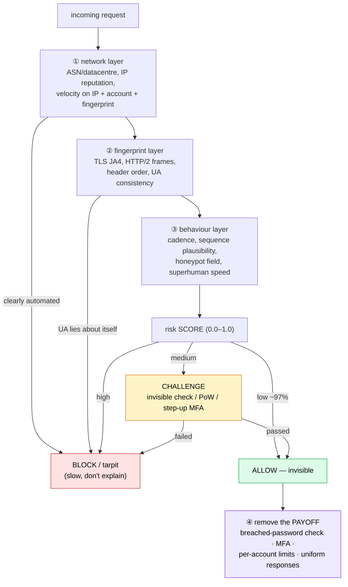

# Bot Detection & CAPTCHA Challenges

## 1. Why Should I Care About This?
- **Most of Your Login Traffic May Not Be Human**: On a consumer site, credential-stuffing runs routinely make up **the majority of login attempts** during a campaign — Akamai has reported tens of billions of stuffing attempts per year across its customers. If you've ever seen a login endpoint's QPS spike 50× with a 99% failure rate, you've watched a stuffing attack in real time.
- **Bots Cost Money in Ways Security Reviews Miss**: Scalping bots buy the entire sneaker drop in 400 ms and destroy customer trust. Scrapers lift your pricing and inflate your egress bill. Fake signups poison your funnel metrics and burn SMS credits. Ad-click fraud spends your budget. None of these are "breaches," and all of them are real losses.
- **It's a Genuinely Hard, Adversarial Design Problem**: Unlike most security controls, this one has an *economically rational, adapting* opponent. Every layer you add has a market price to bypass — CAPTCHA farms charge about **$1 per 1,000 solves**. Understanding that you're **raising a price, not building a wall** is exactly the kind of systems thinking interviewers are probing for.

## 2. What Problem Does This Solve?
- **Automation at Human Endpoints**: Your login, signup, checkout, search, and comment endpoints were designed for one human doing one thing. A script does the same thing a million times, from thousands of IPs, faster and cheaper than you can serve it.
- **Distinguishing Intent, Not Identity**: Authentication asks "who are you?" This asks something subtler and harder: "is this a legitimate use?" The requests are *individually valid* — correct credentials, well-formed payloads, real user agents. Only the aggregate pattern reveals the abuse.
- **Naive Approach**: Add rate limiting by IP and a CAPTCHA on the login page. Both fail quickly and specifically. **IP limits break against residential proxy networks** — millions of real consumer IPs rented by the gigabyte, so an attacker makes 3 requests per IP and your per-IP threshold never fires (while the shared corporate NAT of a legitimate customer *does*). And **CAPTCHAs fail because they're priced, not impossible**: solver farms and, increasingly, ML models clear them for fractions of a cent, while your real users pay in friction, abandoned carts, and outright exclusion for anyone with a visual or motor impairment. Worse, both controls are *binary* — a bot either passes or a human is blocked — when the underlying signal is a probability.

## 3. Core Idea (Intuition First)
Think of it like **airport security, not a locked door**.
- A locked door is binary — it stops everyone or nobody. Airport security is a **layered funnel** where each stage is cheaper than the next and filters most of the volume, so the expensive human screening only handles what survives. That's the architecture: **cheap passive signals first, expensive interactive challenges last.**
- **Passive signals are the metal detector everyone walks through without noticing**: does the TLS fingerprint match the claimed browser? Does the header order look like real Chrome? Is this IP a datacentre? These cost nothing and catch the overwhelming bulk of unsophisticated automation. A real user never knows they were checked.
- **The challenge is the pat-down** — reserved for the small suspicious remainder. Applied to *everyone*, it's a tax on your entire customer base; applied to 3%, it's nearly free.
- **The crucial mental shift is economic.** You cannot make the attack impossible — solver farms, residential proxies, and patched headless browsers are all commercially available. What you *can* do is make it **cost more than it earns**. Every layer adds cents per attempt; at some point the attacker's spreadsheet stops working and they move to an easier target.
- And the corollary that separates good design from bad: **every control has a false-positive rate, and false positives are paying customers you just turned away.** A defence that blocks 99% of bots and 1% of humans may be strictly worse for the business than one that blocks 90% and 0.01%.

![Three-panel diagram of bot detection. Panel A: the credential-stuffing funnel with illustrative volumes for one attack run — 1,000,000 stolen credential pairs attempted at roughly a 2% valid rate; layer one, IP and ASN reputation plus rate limits, leaves about 400,000 survivors because residential proxies defeat IP limits; layer two, TLS and HTTP/2 plus device fingerprinting, leaves about 60,000 because headless browsers get patched; layer three, behaviour analysis plus a challenge, leaves about 8,000 because solver farms charge roughly one dollar per thousand solves; layer four, MFA, means the roughly 200 correct passwords found mostly do not matter. Panel B: risk scoring — cheap passive signals (IP and ASN reputation and datacentre detection, TLS JA4 and HTTP/2 frame order, header order and user-agent consistency, canvas, WebGL and font entropy, mouse and typing cadence, and velocity per account or per fingerprint) feed a risk score from 0.0 to 1.0 that is a probability rather than a verdict, which routes to three outcomes: low risk allows silently so about 97% of real users see nothing, medium risk issues a challenge or step-up such as an invisible check, proof of work or an MFA prompt, and high risk blocks, tarpits or shadow-bans because slow responses leak less than a hard 403. Panel C: the economics — the attacker's cost sheet lists human solver farms at about one dollar per thousand CAPTCHAs and residential proxies at a few dollars per gigabyte across millions of IPs, making a CAPTCHA a toll booth rather than a wall, while the defender should spend budget on per-account rather than per-IP limits, breached-password checks via k-anonymity, MFA, proof of work and attestation, to make the attack unprofitable rather than impossible.](../assets/bot_detection_captcha.svg)

> Panel A: each layer is cheaper than the next, so the expensive one only sees survivors. Panel B: the output is a *score*, and the response is graduated — allow, challenge, block. Panel C (the key lesson): you're raising the attacker's price, not building an impenetrable wall.

## 4. How It Actually Works
### 1. The attacks you're defending against
| Attack | What it does | The signal that catches it |
|---|---|---|
| **Credential stuffing** | Replays leaked username/password pairs from dumps | Huge volume, ~0.1–2% success rate, distributed IPs, one attempt per account |
| **Password spraying** | A few common passwords against many accounts | Low per-account velocity, high per-password velocity |
| **Account enumeration** | Discovers which emails exist | Differential responses/timings on login, signup, reset |
| **Scalping / inventory hoarding** | Buys limited stock instantly | Sub-human latency, checkout-first traffic patterns, no browsing |
| **Scraping** | Copies content, prices, listings | Systematic pagination, no asset loads, high entropy of URLs per session |
| **Fake account creation** | Farms accounts for spam/fraud/promo abuse | Disposable email domains, identical fingerprints, signup velocity |
| **Carding / BIN attacks** | Tests stolen card numbers via small charges | High auth-failure ratio, sequential BINs |
| **Ad / click fraud** | Generates fake impressions and clicks | Impossible engagement patterns, datacentre origins |

### 2. Layer 1 — network and reputation signals (nearly free)
- **IP reputation and ASN classification**: is this a datacentre (AWS/Hetzner/OVH), a known VPN, a Tor exit, or a residential ISP? Datacentre traffic on a consumer login page is inherently suspicious.
- **Residential proxy detection** is the hard part and the reason IP-based defence alone fails: proxy networks resell bandwidth on real consumer devices (often via SDKs bundled in free apps), so the IP is genuinely residential. You detect them by *behaviour across* the network — the same fingerprint appearing from 50 ASNs in an hour — not by the IP itself.
- **Velocity checks on multiple keys**: per IP, per ASN, per account, per fingerprint, per email domain. Attackers optimise against whichever single key you rate-limit, so limiting on several axes at once is what actually bites.

### 3. Layer 2 — fingerprinting (invisible, high signal)
- **TLS fingerprinting (JA3/JA4)**: the exact cipher-suite list, extension order, and elliptic curves in the `ClientHello` differ per TLS library. A request claiming to be Chrome but presenting Python `requests`' fingerprint is definitively lying. This is one of the highest-value signals available because it's *below* the layer most bot authors control.
- **HTTP/2 fingerprinting**: frame ordering, `SETTINGS` values, header pseudo-order, and priority frames vary by client and are hard to spoof convincingly.
- **Header consistency**: real browsers send headers in a stable order with a consistent `Accept`/`Accept-Language`/`Sec-CH-UA` set. Mismatches between the claimed UA and the accompanying headers are cheap, reliable tells.
- **Browser/device fingerprinting**: canvas and WebGL rendering differences, installed fonts, screen metrics, timezone, `navigator` properties. Combined, these give high entropy — enough to recognise a returning device. Note the trade-off: it's also **tracking**, with real privacy and regulatory (GDPR/ePrivacy) implications, and browsers are actively reducing available entropy.
- **Headless/automation detection**: `navigator.webdriver`, missing plugin arrays, Chrome DevTools Protocol artefacts, and impossible property combinations. Understand that this is an **arms race** — `puppeteer-stealth` and patched Chromium builds exist specifically to defeat these checks, so treat any single tell as a signal, never a verdict.

### 4. Layer 3 — behavioural signals
- **Timing and cadence**: humans have variable inter-keystroke intervals, imprecise mouse paths, and scroll/pause patterns. Bots produce suspiciously uniform timings and perfect linear cursor movement (or no cursor events at all).
- **Sequence plausibility**: a real purchase involves browse → product → cart → checkout. A request stream that jumps straight to `POST /checkout` with no prior navigation is a bot, regardless of how good its fingerprint is.
- **Superhuman speed**: filling a 12-field form in 300 ms, or reading a page in 40 ms.
- **Honeypot fields**: a hidden form input real users never see or fill. Any submission with it populated is automated. Cheap, invisible, and surprisingly effective against unsophisticated bots — but trivially bypassed by anything that parses CSS.

### 5. Layer 4 — challenges, from most to least user-hostile
- **Image/text CAPTCHA** ("select all traffic lights"): high friction, an accessibility barrier, and defeated by both farms (~$1/1,000) and modern vision models — which now outperform humans on many of these. Legacy.
- **Invisible / risk-based challenges** (reCAPTCHA v3, Cloudflare Turnstile, hCaptcha): run passive checks and only escalate to interaction on a bad score. This is the modern default: most users never see anything.
- **Proof of work**: the client must compute a hash meeting a difficulty target before the request is accepted. Costs a real user ~100 ms and imposes a linear CPU cost on someone making a million attempts. Anubis and similar tools deploy this against AI scrapers today. **Caveat**: attackers have more CPU per dollar than your users have patience — it's a cost multiplier, not a barrier, and it penalises low-end devices most.
- **Cryptographic attestation** (Private Access Tokens, Play Integrity, App Attest): the device's platform vendor attests "a real, unmodified device with a signed-in user" without revealing identity. Privacy-preserving and frictionless — but it shifts trust to Apple/Google and excludes anyone on an unattested platform (custom ROMs, some Linux browsers).
- **Step-up authentication**: on a risky login, don't block — require MFA or email verification. This converts an ambiguous bot decision into a benign extra step for real users, which is usually the right business trade.

### 6. The layer that actually ends credential stuffing
Bot detection reduces volume; **these controls remove the payoff**:
- **Breached-credential checks** via **k-anonymity** (the Have I Been Pwned Pwned Passwords API model): send the first 5 hex characters of the password's SHA-1 hash, receive all matching suffixes, and check locally. You learn whether the password is in a public dump **without ever transmitting it**. Refusing known-breached passwords at signup and password change makes stuffing structurally ineffective.
- **MFA** — even a stolen, correct password doesn't complete a login ([MFA, Passwordless & WebAuthn](./MFA_Passwordless_WebAuthn.md)).
- **Per-account attempt limits with graduated response** — throttle and step up rather than lock out, because hard lockouts convert a stuffing attack into a **denial-of-service against your own users**.
- **Uniform responses** on login, signup, and password reset — same message, same status, same timing — so enumeration yields nothing. This is a correctness requirement, not a nicety: leaking "this email exists" turns one dump into a targeted list.



## 5. Real-World Example
**Cloudflare's move from CAPTCHA to Turnstile** is the clearest published case for the modern approach. Cloudflare reported serving roughly **a CAPTCHA per day for every person on Earth** at peak, and estimated the human cost at **~32 years of collective time wasted daily** — for a control that solver farms clear for about $1 per 1,000. They replaced it with **Turnstile**: run passive browser challenges (a lightweight JS probe, proof-of-space/work variants, and API-level integrity checks), score the client, and only escalate if the score is bad. Most users see a spinner and nothing else. The reasoning is exactly the funnel argument — spend the expensive interaction only on the ambiguous remainder — and the accessibility argument, since image CAPTCHAs exclude users with visual impairments outright.

**The counter-example is the lockout backfire.** A retailer facing credential stuffing enables "lock the account after 5 failed attempts." The attacker, working from a leaked dump, now needs only 5 wrong guesses per account to **lock every customer out of their own account** — a self-inflicted denial of service that generates a support flood while the actual stuffing continues elsewhere. The fix is graduated: exponential delays, step-up verification, and per-account risk scoring, never a hard lock triggered by unauthenticated input.

**And the arms race is real:** attackers rent residential proxy networks with millions of consumer IPs, patched headless browsers that pass automation checks, and CAPTCHA-solving APIs — including ML solvers that now beat humans on image challenges. This is why the durable defences are the ones that **remove the payoff** (breached-password rejection, MFA) rather than the ones that try to identify the client.

## 6. Code Example
```python
import hashlib, requests, time

# ═══════ 1. BREACHED-PASSWORD CHECK via k-ANONYMITY — the highest-leverage control ═══════
def is_breached(password: str) -> int:
    """Ask HIBP whether this password is in a public dump WITHOUT sending it.
       Only the first 5 hex chars of the SHA-1 go over the wire; ~800 suffixes come back."""
    sha1 = hashlib.sha1(password.encode()).hexdigest().upper()
    prefix, suffix = sha1[:5], sha1[5:]
    resp = requests.get(f"https://api.pwnedpasswords.com/range/{prefix}", timeout=2)
    for line in resp.text.splitlines():          # match locally — the API never learns which
        suf, count = line.split(":")
        if suf == suffix:
            return int(count)                    # times seen in breaches
    return 0

def register(email, password):
    if is_breached(password) > 0:                # refuse known-dumped passwords at the door
        raise ValidationError("This password has appeared in a public breach. Choose another.")
    ...   # credential stuffing only works because reused passwords are accepted

# ═══════ 2. RISK SCORING — a probability, and a GRADUATED response ═══════
def risk_score(req, account) -> float:
    score = 0.0
    # ── network layer (cheap) ──
    if req.asn_type == "datacenter":               score += 0.35
    if req.ip_reputation < 0.3:                    score += 0.20
    # ── fingerprint layer (invisible, high signal) ──
    if req.ja4_tls_fp not in KNOWN_BROWSER_FPS:    score += 0.30   # UA claims Chrome…
    if not headers_consistent_with_ua(req):        score += 0.25   # …but headers disagree
    # ── behaviour layer ──
    if req.form_fill_ms < 500:                     score += 0.25   # superhuman typing
    if req.honeypot_field:                         score += 0.60   # invisible to real users
    if not req.had_prior_navigation:               score += 0.15   # straight to POST /login
    # ── velocity on SEVERAL keys: attackers optimise against whichever one you use alone ──
    if velocity(f"fp:{req.fingerprint}", 300) > 20:   score += 0.30
    if velocity(f"acct:{account}", 900)      > 10:    score += 0.25
    if velocity(f"asn:{req.asn}", 60)        > 500:   score += 0.20
    # ── trust signals SUBTRACT: don't punish your regulars ──
    if req.device_seen_before_for(account):        score -= 0.40
    return max(0.0, min(1.0, score))

def on_login(req, account, password):
    s = risk_score(req, account)
    log_risk(account, s, req)                    # ALWAYS log the score — you tune on this data
    if   s < 0.30: pass                          # ~97% of real users: no friction at all
    elif s < 0.70: require_challenge(req)        # invisible check / PoW / step-up MFA
    else:          return tarpit(delay=3.0)      # slow + generic; a hard 403 teaches the attacker
    # NOTE: never a hard account lockout on unauthenticated input — that is a DoS on your users
    return authenticate(account, password)

# ═══════ 3. PROOF OF WORK — impose a linear CPU cost on mass attempts ═══════
def issue_pow_challenge(difficulty=20):          # ~1e6 hashes ≈ 100 ms for a real user
    return {"nonce": secrets.token_hex(16), "bits": difficulty, "ts": int(time.time())}

def verify_pow(chal, solution) -> bool:
    if int(time.time()) - chal["ts"] > 120:      # bound the window
        return False
    h = hashlib.sha256((chal["nonce"] + solution).encode()).digest()
    bits = int.from_bytes(h[:4], "big")
    return bits >> (32 - chal["bits"]) == 0      # leading-zero-bits target

# ═══════ 4. UNIFORM RESPONSES — stop enumeration leaking your user list ═══════
def request_password_reset(email):
    user = db.find(email)
    if user: send_reset_email(user)              # do the work only if the user exists…
    time.sleep(uniform_padding())                # …but pad timing so the difference is invisible
    return 200, "If an account exists for that address, we've sent reset instructions."
    #  ← same status, same body, same latency whether or not the account exists
```

## 7. Design Variations & Alternatives
| Control | Friction for real users | Bypass cost for attackers | Accessibility | Notes |
|---|---|---|---|---|
| **IP rate limiting** | Low, but hurts shared NAT | Near zero (residential proxies) | Fine | Necessary, never sufficient |
| **Honeypot form field** | None | Trivial (parse the CSS) | Fine | Free; catches only lazy bots |
| **Image CAPTCHA** | **High** | ~$1/1,000, or an ML model | ❌ Excludes users | Legacy; avoid |
| **Invisible risk challenge** (Turnstile/reCAPTCHA v3) | Near zero | Moderate — needs a real browser | Good | The modern default |
| **Proof of work** | ~100 ms CPU | Linear cost, no cleverness needed | Good (slow on old devices) | Good vs mass scraping |
| **Device attestation** (PAT, Play Integrity) | None | Very high | ⚠️ Excludes unattested platforms | Privacy-preserving; platform-dependent |
| **Behavioural biometrics** | None | High | Fine, but a privacy question | Needs volume to train; GDPR-relevant |
| **Breached-password rejection** | Low (one-time) | **Removes the payoff** | Fine | Highest leverage per unit of effort |
| **MFA** | Moderate | **Removes the payoff** | Good with options | The actual answer to stuffing |
| **Commercial bot management** (Cloudflare, Akamai, DataDome, HUMAN) | Low | High — shared intelligence across customers | Varies | Buy if bots are a business problem; the network effect is the product |

- **Buy vs build**: bot detection's value comes from **cross-customer intelligence** — a vendor sees the attacker's fingerprint on a hundred other sites first. That's very hard to replicate in-house, which is why most serious e-commerce and financial sites buy. Build the payoff-removal layer yourself (breached passwords, MFA, per-account limits, uniform responses) regardless of what you buy.
- **Not all bots are bad**: search crawlers, uptime monitors, accessibility tools, price-comparison partners, and AI agents acting for a user. Maintain an explicit allowlist (verify by reverse DNS or published IP ranges, **not** by `User-Agent`, which anyone can claim), honour `robots.txt` as a *cooperation* mechanism, and consider offering a **paid API** — often the cheapest way to convert an expensive scraper into a customer.
- **Tarpitting and shadow-banning beat hard blocks** for sophisticated adversaries. A crisp `403` is free feedback that tells the attacker exactly which of their signals to fix. A slow, plausible, subtly-wrong response wastes their time and teaches them nothing.
- **Cost-shifting instead of blocking** is worth considering for genuinely borderline traffic: serve cached/degraded responses, deprioritise the request, or require registration and a quota.

## 8. Pros and Cons
### Layered bot detection with risk scoring
- **Pros**: removes the bulk of automated abuse invisibly, so real users experience **no friction**; graduated responses mean an uncertain signal doesn't have to become a blocked customer; the same telemetry powers fraud detection, capacity planning, and product analytics; and it protects endpoints where you have no user identity to reason about yet.
- **Cons**: **permanent arms race** — every signal has a published bypass and a maintenance cost; fingerprinting is **user tracking** with GDPR/ePrivacy consequences and is being actively degraded by browser privacy work; false positives are invisible to you and infuriating to the user (they just leave); and the whole system is opaque and hard to test — you rarely learn about the legitimate customer you turned away.

### CAPTCHA specifically
- **Pros**: trivial to bolt onto an existing form; genuinely stops naive scripted abuse; a well-understood control that satisfies auditors and cheaply demonstrates due diligence.
- **Cons**: **priced, not impossible** (~$1/1,000 via farms, and modern vision models beat humans on image challenges); a real **conversion tax** measured in percentage points at checkout; a hard **accessibility barrier** — image and audio challenges exclude users with visual or hearing impairments, an ADA/WCAG problem as well as an ethical one; and it does nothing about the actual root cause, which is reused passwords.

## 9. Failure Scenarios & What Can Go Wrong
- **SYMPTOM**: Login QPS spikes 50× with a 99% failure rate. **CAUSE**: credential stuffing from a fresh dump. **FIX**: velocity limits on multiple keys, risk-based challenges, and — the durable fix — breached-password rejection plus MFA so correct passwords stop being enough.
- **SYMPTOM**: You add per-IP limits and the attack continues unchanged. **CAUSE**: residential proxy network, ~3 requests per IP. **FIX**: score on fingerprint and account velocity, detect one fingerprint spanning many ASNs, and add ASN-level aggregate limits.
- **SYMPTOM**: A support flood of customers locked out of their own accounts. **CAUSE**: hard lockout after N failures, triggered by unauthenticated attacker input — a self-inflicted DoS. **FIX**: exponential backoff and step-up verification instead of lockout; never let an unauthenticated party disable an account.
- **SYMPTOM**: Legitimate customers behind a corporate NAT or a mobile carrier CGNAT are blocked. **CAUSE**: IP-only reasoning against hundreds of users sharing one address. **FIX**: combine IP with fingerprint and account identity; weight trust signals (a device seen before for this account) *negatively*.
- **SYMPTOM**: Attackers adapt within days of each deployment. **CAUSE**: a single deterministic rule they can probe and solve. **FIX**: multiple independent signals, randomised thresholds, and outcomes that don't reveal which check failed (tarpit rather than a specific error).
- **SYMPTOM**: Signup conversion drops several percent after adding a CAPTCHA. **CAUSE**: the friction is paid by everyone; bots pay $0.001. **FIX**: invisible risk-based challenges, escalating only on a bad score; measure conversion as a first-class metric of the control.
- **SYMPTOM**: Blind or motor-impaired users cannot register at all. **CAUSE**: image-only challenge with no accessible alternative. **FIX**: invisible challenges/attestation as the primary path, an accessible alternative always available, and a human support route.
- **SYMPTOM**: Attackers know exactly which usernames exist. **CAUSE**: differential responses or timings across login/signup/reset. **FIX**: identical status, body, and padded timing regardless of existence.
- **SYMPTOM**: SMS or email bills spike with no new users. **CAUSE**: bots triggering verification sends (SMS pumping / mail-bombing). **FIX**: challenge *before* the expensive send, per-IP/per-number limits, and country/prefix allowlists.
- **SYMPTOM**: A partner integration or search crawler breaks after a bot-management rollout. **CAUSE**: no allowlist for known-good automation. **FIX**: verified allowlist by reverse DNS/published ranges (never `User-Agent`), plus a documented API path for partners.
- **SYMPTOM**: Egress and compute costs climb with flat user growth. **CAUSE**: scrapers, increasingly AI crawlers. **FIX**: proof of work, caching, per-client quotas, `robots.txt` plus enforcement, and a paid API tier for the traffic that has commercial value.

## 10. Impact on Scalability, Reliability & Cost
- **Scalability**: order the layers by cost per request or the defence becomes the bottleneck. Network/reputation and TLS-fingerprint checks are microseconds and belong at the **edge/CDN**, where attack traffic never reaches your origin. Behavioural scoring costs a lookup or two. A synchronous ML inference on every request is the wrong design — precompute, cache scores per fingerprint, and evaluate asynchronously where you can. Crucially, an attack is also a **capacity event**: 50× login QPS will exhaust your password-hashing CPU (Argon2/bcrypt are deliberately slow — see [Hashing & Salting](./Hashing_and_Salting.md)) long before it exhausts your web tier, so cheap filters must run *before* the hash.
- **Reliability**: this system fails in both directions. **Fail-closed** and a vendor outage takes your login page down; **fail-open** and an outage is an open window. Decide deliberately per endpoint (fail-open on browse, fail-closed on payouts), cache the last known score, and always keep a documented bypass switch. Also treat aggressive tuning as a **production risk** — shipping a stricter threshold without a canary is a good way to block 5% of real customers silently.
- **Cost**: commercial bot management typically runs from hundreds to many thousands of dollars per month depending on traffic. Weigh it against the losses it prevents — scalped inventory and customer trust, SMS pumping bills, fraudulent chargebacks, scraper egress, and support cost from lockouts. The two cheapest controls have the best ratio by a wide margin: **breached-password rejection (a free API and a k-anonymity lookup) and MFA**, both of which attack the payoff rather than the traffic. Conversely, the most expensive hidden cost is **false positives** — customers who quietly fail to convert and never tell you.

## 11. When NOT to Use This
- **Public, cacheable, low-value content**: if a scraper hitting your docs site costs you a cent of CDN bandwidth, caching is the answer, not a challenge that taxes readers.
- **Machine-facing APIs**: bot detection is the wrong frame when *all* clients are machines. Use authenticated keys, scopes, and quotas ([API Keys & Service-to-Service Auth](./API_Keys_Service_to_Service_Auth.md)).
- **Internal applications behind SSO or a VPN**: identity is already established; add rate limits, not challenges.
- **Before you've fixed the fundamentals**: MFA, breached-password rejection, per-account limits, and uniform responses come first. Bot detection on top of accepted reused passwords is treating the symptom.
- **As an accessibility-hostile gate on a critical service**: for anything a person *must* be able to use (government, healthcare, utilities), an image CAPTCHA with no accessible alternative is a compliance and ethical failure. Use invisible signals plus a human path.

## 12. Interview Perspective
- **What interviewers expect**: describe a **layered funnel** ordered by cost — network/reputation → fingerprint → behaviour → challenge — producing a **risk score** with a **graduated response** (allow / challenge / block), and state plainly that the goal is to make the attack unprofitable rather than impossible.
- **The trap question**: "Just add a CAPTCHA and rate-limit by IP, right?" Correct answer: both fail specifically. Residential proxy networks give attackers millions of consumer IPs so per-IP thresholds never fire, and CAPTCHAs cost ~$1 per 1,000 solves via farms (and modern ML solvers beat humans on image challenges) while your real users pay in conversion and accessibility.
- **The follow-up that separates candidates**: "What actually stops credential stuffing?" Removing the payoff — **reject known-breached passwords** (explain the k-anonymity hash-prefix trick, since it shows you understand you can check without transmitting the password) and **require MFA**. Bot detection reduces volume; these make the volume pointless.
- **The reliability question**: "Your bot vendor has an outage — fail open or closed?" A strong answer differentiates by endpoint, mentions cached scores and a bypass switch, and names the trade-off explicitly instead of picking one globally.
- **Bonus signals**: TLS/JA4 fingerprinting as the highest-value invisible signal (it's below the layer bot authors control); why hard account lockouts are a self-inflicted DoS; tarpitting over `403` to avoid giving attackers feedback; that cheap filters must run *before* the expensive password hash; the fingerprinting-vs-privacy/GDPR tension; and that false positives are lost customers you never hear from.

## 13. Connections to Other Topics
- [Rate Limiting & DoS Protection](./Rate_Limiting_DoS_Protection.md) — the volumetric layer this file's behavioural detection sits on top of; the two are designed together.
- [MFA, Passwordless & WebAuthn](./MFA_Passwordless_WebAuthn.md) — the control that makes a stuffed password worthless; the real end of credential stuffing.
- [Hashing & Salting](./Hashing_and_Salting.md) — why leaked dumps exist, why slow hashes make login a CPU-bound target during an attack, and why breached-password checks matter.
- [Session Management & Cookie Security](./Session_Management_Cookie_Security.md) — after a bot gets in, the session is what it abuses; device signals feed continuous session evaluation.
- [Authentication vs Authorization](./Authentication_vs_Authorization.md) — bot detection answers neither question; it asks whether the *use* is legitimate.
- [CORS & the Browser Security Model](./CORS_Browser_Security_Model.md) — why browser-side controls never bind a non-browser client, which is exactly what a bot is.
- [API Keys & Service-to-Service Auth](./API_Keys_Service_to_Service_Auth.md) — the right frame for legitimate automation: identify it, scope it, and meter it instead of challenging it.
- [Rate Limiting](../02_API_Interface_Design/Rate_Limiting.md) — the algorithms (token bucket, sliding window) and the 429/`Retry-After` client contract.
- [CDN](../06_Caching_Performance/CDN.md) — the edge is where cheap filtering belongs, and caching is often the correct answer to scrapers.
- [Alerting Strategies & On-Call Management](../12_Monitoring_Logging_Observability/Alerting_Strategies_OnCall_Management.md) — the login-failure-ratio and risk-score alerts that tell you an attack is running.

## 14. Visual Aids
- **The SVG above** ([bot_detection_captcha.svg](../assets/bot_detection_captcha.svg)): panel A — the credential-stuffing funnel with survivors per layer and why each layer leaks; panel B — passive signals → risk score → graduated allow/challenge/block; panel C — the attacker's cost sheet beside where your defence budget actually pays off.
- **Mermaid #1 (Section 4)**: the full pipeline from request through the three detection layers to the scored decision, ending on the payoff-removal layer that makes the rest matter less.

## 15. Summary (TL;DR)
**Bot defence is a layered funnel, not a wall: order the controls by cost per request so the cheap invisible ones absorb the volume and the expensive interactive one only sees survivors — network and reputation signals first (datacentre/ASN classification, IP reputation, and velocity limits on *several* keys at once because attackers optimise against whichever single key you use), then fingerprinting (**TLS JA3/JA4 and HTTP/2 frame ordering are the highest-value signals because they sit below the layer bot authors control**, so a client claiming to be Chrome while presenting Python's TLS fingerprint is definitively lying), then behaviour (keystroke cadence, sequence plausibility, honeypot fields, superhuman form-fill speed) — combining into a **risk score that is a probability, not a verdict**, driving a graduated response where ~97% of real users are allowed invisibly, the ambiguous middle gets an invisible challenge, proof of work or step-up MFA, and only the top gets tarpitted (slowly and generically, because a crisp 403 is free feedback telling the attacker which signal to fix); the two naive controls fail for specific reasons worth naming — **per-IP rate limits die against residential proxy networks** that rent millions of real consumer IPs so no threshold ever fires, and **CAPTCHAs are priced rather than impossible** at roughly $1 per 1,000 farm solves with ML solvers now beating humans, while your real users pay in conversion, and blind or motor-impaired users pay by being excluded entirely; the durable answer is therefore to **remove the payoff instead of identifying the client** — reject known-breached passwords using a k-anonymity hash-prefix lookup that never transmits the password, require MFA so a correct stolen password isn't enough, apply graduated per-account throttling (never hard lockouts, which turn an attack into a denial of service against your own customers), and return byte-identical, timing-padded responses on login, signup and reset so enumeration yields nothing — remembering throughout that this is an economic game against an adapting adversary where the objective is to make the attack unprofitable, that cheap filters must run *before* your deliberately slow password hash or an attack becomes a capacity event, that fingerprinting is also user tracking with GDPR consequences and shrinking browser entropy, and that **every control has a false-positive rate — customers you turned away who will never tell you** — so measure conversion and false positives with the same seriousness as block rate.**

## 16. Further Reading & Resources
- [OWASP Automated Threats to Web Applications (the OAT taxonomy: OAT-008 credential stuffing, OAT-005 scalping, …)](https://owasp.org/www-project-automated-threats-to-web-applications/)
- [OWASP Credential Stuffing Prevention Cheat Sheet](https://cheatsheetseries.owasp.org/cheatsheets/Credential_Stuffing_Prevention_Cheat_Sheet.html)
- [Cloudflare — "End of the CAPTCHA" / Turnstile: why they replaced interactive challenges](https://blog.cloudflare.com/turnstile-private-captcha-alternative/)
- [Have I Been Pwned — Pwned Passwords API and the k-anonymity model](https://haveibeenpwned.com/API/v3#PwnedPasswords)
- [Cloudflare — JA4 fingerprinting for TLS/HTTP client identification](https://blog.cloudflare.com/ja4-signals/)
- [Apple/Cloudflare — Private Access Tokens: attestation without tracking](https://blog.cloudflare.com/eliminating-captchas-on-iphones-and-macs-using-new-standard/)
- [NIST SP 800-63B §5.2.2 — rate limiting and throttling guidance for authenticators](https://pages.nist.gov/800-63-3/sp800-63b.html)
- [W3C — Inaccessibility of CAPTCHA (the accessibility case, with alternatives)](https://www.w3.org/TR/turingtest/)
