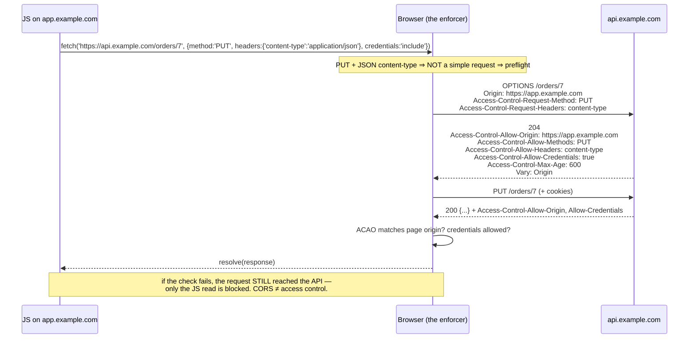
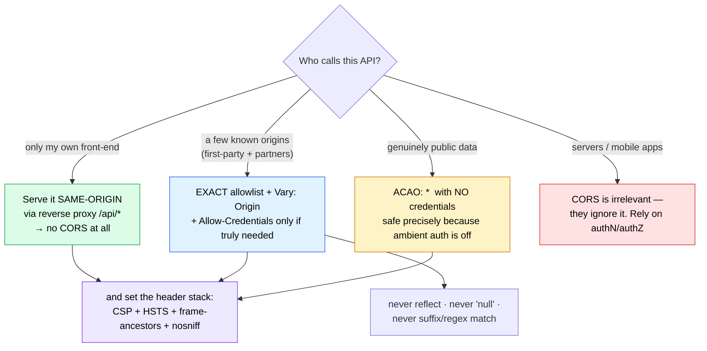

# CORS & the Browser Security Model

## 1. Why Should I Care About This?
- **You Will Hit a CORS Error This Month**: Every developer who has ever built a SPA against a separate API has stared at *"blocked by CORS policy: No 'Access-Control-Allow-Origin' header."* The universal reaction — paste `Access-Control-Allow-Origin: *` or reflect the `Origin` header — is precisely how a real vulnerability gets shipped by someone trying to unblock themselves.
- **A Misconfigured CORS Policy Is an Account-Takeover Bug**: Reflect the caller's `Origin` and set `Allow-Credentials: true`, and *any* website the victim visits can read their authenticated API responses — profile data, tokens, internal records. This has been a recurring high-severity bug bounty finding at major companies for a decade, and it always looks like a two-line config change.
- **It's the Foundation Every Web Defense Sits On**: The same-origin policy is *why* XSS is valuable to an attacker and *why* CSRF is possible at all. Understanding SOP properly makes CSP, `SameSite` cookies, clickjacking defenses, and even Spectre mitigations (COOP/COEP) click into place instead of being a list of headers to copy.

## 2. What Problem Does This Solve?
- **The Browser Runs Everyone's Code at Once**: You have your bank open in one tab and a random blog in another. Both are executing untrusted JavaScript inside the same process family, with the same cookie jar and the same network access. Something must stop the blog from reading the bank.
- **But Legitimate Cross-Origin Calls Are Now the Norm**: Modern architecture is `app.example.com` calling `api.example.com`, a CDN, a payments provider, and three SaaS APIs. A blanket "no cross-origin communication" rule would break the web.
- **Naive Approach**: Two failure directions. Turn the policy *off* (`Access-Control-Allow-Origin: *` everywhere, or reflect whatever `Origin` arrives) and you've handed every site on the internet read access to your users' authenticated data. Or misunderstand what SOP actually blocks and assume it protects your *server* — it doesn't. SOP stops JavaScript from **reading** a cross-origin response; the request itself is still **sent, with cookies attached**. That asymmetry is the entire reason CSRF exists, and why "we're safe, the browser blocks cross-origin requests" is wrong in a way that costs money.

## 3. Core Idea (Intuition First)
Think of the browser as **an apartment building where every tenant is a stranger who might be a thief**.
- The **same-origin policy** is the building rule: *you may knock on any door and slide a letter under it, but you may not enter another apartment or read what's inside.* Sending is allowed; reading is not.
- That's the counter-intuitive half. A malicious tenant *can* slide a letter under your bank's door — and the doorman helpfully attaches your ID badge (**your cookies**) because the letter is addressed to a building you're a member of. The thief never sees the reply, but the letter may already have done the damage ("transfer $1,000"). **That's CSRF**, and it exists *because* SOP only blocks reading.
- **CORS is the resident's own opt-in**: a note on the bank's door saying *"letters from apartment 4B may be answered, and 4B may read the reply."* Crucially, **the reply is what's being authorized, not the request** — the server has already processed the letter by the time the browser decides whether to let the caller read it.
- The **preflight** is the doorman calling ahead for anything unusual: "4B wants to send a *registered parcel with a custom label* — do you accept those?" Only if the bank says yes does the parcel get sent at all.
- And **CORS is a browser courtesy, not a lock**. A thief who isn't a tenant — `curl`, a script, a mobile app — ignores the building rules completely. Which means: **CORS is never your access control**. Authentication and authorization are.

![Three-panel diagram of the browser security model. Panel A: the same-origin policy — an origin is the strict triple of scheme, host and port, so https://app.example.com:443 differs from http://app.example.com and from https://api.example.com; SOP blocks reading the response so evil.com's JavaScript cannot read your bank's HTML or JSON and cannot reach across frames or read cookies, but SOP allows sending the request, so form, img and script elements fire cross-origin with cookies attached, which is exactly why CSRF exists. Panel B: the CORS preflight sequence between browser and API server — an OPTIONS request carrying Origin, Access-Control-Request-Method PUT and Access-Control-Request-Headers content-type; a 204 response carrying Access-Control-Allow-Origin, Allow-Methods, Allow-Headers and Max-Age 600; and only then the real PUT, with cookies if credentials include and Allow-Credentials true; a note explains that simple requests (GET, HEAD or POST with only form or text/plain content types and no custom headers) skip the preflight but their responses are still gated by Access-Control-Allow-Origin. Panel C: the recurring misconfiguration — reflecting whatever the Origin header says plus Allow-Credentials true, which lets any site read the victim's authenticated JSON, arising because the spec forbids the wildcard with credentials so developers reflect instead, including the null origin — versus the fix of allowlisting exact origins server-side, echoing only allowlisted origins, adding Vary Origin, never reflecting, never allowing null, and no regex suffix matching, with a reminder that CORS is not authorization and only decides who may read the reply. A footer strip lists the response-header defence stack: Content-Security-Policy with nonce and strict-dynamic, Strict-Transport-Security, frame-ancestors, X-Content-Type-Options nosniff, Referrer-Policy, Permissions-Policy, and COOP/COEP/CORP.](../assets/cors_browser_security_model.svg)

> Panel A (the key lesson): SOP blocks *reads*, not *sends* — that asymmetry is why CSRF is possible. Panel B: preflight asks permission before anything non-trivial is sent. Panel C: reflecting `Origin` with credentials is a read-anything vulnerability, not a config shortcut.

## 4. How It Actually Works
### 1. What an "origin" is, precisely
- An origin is the triple **`scheme ‖ host ‖ port`**. `https://app.example.com` and `http://app.example.com` are different origins (scheme). So are `app.example.com` and `api.example.com` (host), and `:443` vs `:8080` (port).
- **Subdomains are different origins.** `Domain`-scoped cookies are shared across subdomains, but the *origin* is not — a frequent source of confusion when people assume "same site" means "same origin." `document.domain` used to relax this and is now deprecated/disabled.
- **Origin ≠ site.** `SameSite` cookies use the looser **site** notion (registrable domain + scheme), which is why `api.example.com` and `app.example.com` are *cross-origin* but *same-site*. This distinction is exactly what trips people up when debugging cookies vs CORS.

### 2. What SOP blocks — and what it deliberately doesn't
| Action | Cross-origin? | Why |
|---|---|---|
| `fetch()`/XHR **reading** a response body | ❌ Blocked unless CORS allows | The core protection |
| Reading another frame's DOM, `localStorage`, or cookies | ❌ Blocked | Isolation between origins |
| `<form>` POST to another origin | ✅ **Allowed, with cookies** | Legacy web compatibility → **CSRF** |
| ``, `<script src>`, `<link>`, `<iframe src>` loads | ✅ Allowed | The web is built on cross-origin embedding |
| Reading pixel data from a cross-origin `` on a canvas | ❌ Blocked (canvas tainting) | Otherwise you could read what you can't fetch |
| Observing whether a cross-origin load *succeeded* (timing, `onerror`) | ⚠️ Partially observable | The basis of side-channel/XS-Leak attacks |
| A non-browser client (`curl`, server, mobile app) | ✅ No restriction at all | **SOP/CORS are browser-enforced only** |

### 3. CORS: simple requests vs preflighted requests
- A request is **"simple"** (no preflight) only if the method is `GET`, `HEAD`, or `POST`; the `Content-Type` is one of `application/x-www-form-urlencoded`, `multipart/form-data`, or `text/plain`; and there are no custom headers. This carve-out exists because those requests were already possible from HTML forms before CORS existed — CORS could not retroactively forbid them.
- Anything else — `PUT`, `DELETE`, `PATCH`, **`Content-Type: application/json`**, an `Authorization` header, a custom `X-*` header — triggers a **preflight**: the browser first sends `OPTIONS` with `Origin`, `Access-Control-Request-Method`, and `Access-Control-Request-Headers`, and only sends the real request if the server's response permits it.
- **This is why almost every JSON API needs CORS configured**: `Content-Type: application/json` alone is enough to force a preflight.
- Even for simple requests, **the response is still gated**: the browser sends it and the server processes it, but JavaScript can't read the reply without `Access-Control-Allow-Origin`. Side effects already happened — another reason CORS is not a security boundary for state-changing endpoints.

### 4. The header vocabulary
| Response header | Meaning | Gotcha |
|---|---|---|
| `Access-Control-Allow-Origin` | Which origin may read the response. One exact origin, or `*` | **`*` is invalid with credentials.** Cannot be a list |
| `Access-Control-Allow-Credentials: true` | Cookies/`Authorization` may be sent and the response read | Requires an exact origin, never `*` |
| `Access-Control-Allow-Methods` | Methods permitted (preflight reply) | Must include the method being previewed |
| `Access-Control-Allow-Headers` | Request headers permitted | Must list every custom header, exactly |
| `Access-Control-Expose-Headers` | Which **response** headers JS may read | Without it, JS sees only 7 "safelisted" headers — the reason `X-Total-Count` or a `Location` header appears missing |
| `Access-Control-Max-Age` | How long a preflight result may be cached | Browsers cap it (Chrome 2 h, Firefox 24 h). Low values mean an `OPTIONS` before nearly every call |
| `Vary: Origin` | Tells caches the response depends on `Origin` | **Omit it and a CDN can serve origin A's `ACAO` header to origin B** |

### 5. Content-Security-Policy — the second layer, done properly
- CSP tells the browser **which sources are allowed to execute or load**, so an injected `<script>` fails even if your escaping has a hole. It is the difference between "one XSS = account takeover" and "one XSS = a blocked console error."
- The modern recommendation is **nonce-based with `strict-dynamic`**, not host allowlists (host allowlists are routinely bypassable via JSONP endpoints and open redirects on allowlisted CDNs):
  ```
  Content-Security-Policy:
    script-src 'nonce-r4nd0mPerResponse' 'strict-dynamic' https: 'unsafe-inline';
    object-src 'none'; base-uri 'none'; require-trusted-types-for 'script';
    frame-ancestors 'self'; report-uri /csp-report
  ```
  (`'unsafe-inline'` and `https:` are ignored by browsers that understand nonces/`strict-dynamic` — they're there purely as fallbacks for old ones.)
- The nonce **must be freshly random per response** and never cached. A static nonce is no nonce.
- `object-src 'none'` and `base-uri 'none'` close two classic bypasses (plugin content and `<base href>` hijacking). `frame-ancestors` replaces `X-Frame-Options` for clickjacking.
- Roll out with **`Content-Security-Policy-Report-Only`** plus a report endpoint first; a strict CSP applied blind will break your own site.

### 6. The rest of the header stack
| Header | Stops | Recommended value |
|---|---|---|
| `Strict-Transport-Security` | SSL-stripping, `http://` downgrade | `max-age=31536000; includeSubDomains; preload` |
| `X-Content-Type-Options` | MIME sniffing turning an upload into script | `nosniff` |
| `frame-ancestors` (CSP) / `X-Frame-Options` | Clickjacking (your UI in an invisible iframe) | `frame-ancestors 'self'` / `DENY` |
| `Referrer-Policy` | Leaking URLs (with tokens) to third parties | `strict-origin-when-cross-origin` |
| `Permissions-Policy` | Unwanted camera/mic/geolocation, incl. in iframes | `camera=(), microphone=(), geolocation=()` |
| `Cross-Origin-Opener-Policy` (COOP) | `window.opener` cross-origin tampering, XS-Leaks | `same-origin` |
| `Cross-Origin-Embedder-Policy` (COEP) | Loading cross-origin resources without permission | `require-corp` (needed for `SharedArrayBuffer`) |
| `Cross-Origin-Resource-Policy` (CORP) | Your resources being embedded/side-channelled | `same-origin` for sensitive resources |
- **COOP + COEP together give "cross-origin isolation,"** the post-**Spectre** requirement for high-precision timers and `SharedArrayBuffer`: the browser needs proof that nothing readable in your process belongs to another origin.



## 5. Real-World Example
**The reflected-origin bug pattern, as found repeatedly in bug bounties:** an internal API needs to serve several first-party front-ends plus a few partner domains. The team writes what looks like a reasonable rule:
```python
# The bug: "if it looks like ours, allow it"
origin = request.headers.get("Origin", "")
if origin.endswith("example.com"):                      # ← suffix match
    resp.headers["Access-Control-Allow-Origin"] = origin  # ← reflection
    resp.headers["Access-Control-Allow-Credentials"] = "true"
```
An attacker registers **`notexample.com`** (or `evil-example.com`) — both end with `example.com`. Now any victim who visits the attacker's page while logged in has their authenticated API responses read cross-origin: profile, email, API tokens, internal records. There is no phishing, no XSS, no user interaction beyond loading a page. Variants of this exact pattern have produced high-severity findings at large tech and financial companies, and it's the top item in every CORS testing checklist.

Two extra twists worth knowing:
- **`Origin: null`** is sent by sandboxed iframes, `file://` pages, and some redirects. Allowlisting `null` is a common "fix" that hands access to any attacker who can create a sandboxed iframe.
- **A CDN without `Vary: Origin`** can cache the response containing `Access-Control-Allow-Origin: https://partner-a.com` and serve it to everyone — or cache the *permissive* variant and serve it to an attacker. Cache-key correctness is part of CORS correctness.

**The correct version** is boringly explicit — an exact-match allowlist, `Vary: Origin`, and no reflection of anything unvalidated.

## 6. Code Example
```python
# ─────────── SERVER: a CORS policy that isn't a vulnerability ───────────
ALLOWED = {"https://app.example.com", "https://admin.example.com"}   # exact strings

def add_cors(request, response):
    origin = request.headers.get("Origin")
    # 1. EXACT set membership. Not endswith(), not a regex, not reflection.
    if origin in ALLOWED:
        response.headers["Access-Control-Allow-Origin"] = origin
        response.headers["Access-Control-Allow-Credentials"] = "true"
        response.headers["Access-Control-Expose-Headers"] = "X-Total-Count"
    # 2. ALWAYS Vary, even when denying — or a cache will cross-serve the header.
    response.headers["Vary"] = "Origin"
    return response

def handle_preflight(request, response):                 # the OPTIONS request
    if request.headers.get("Origin") not in ALLOWED:
        return 403, {}                                   # deny loudly, don't reflect
    response.headers["Access-Control-Allow-Methods"] = "GET, POST, PUT, DELETE"
    response.headers["Access-Control-Allow-Headers"] = "content-type, authorization"
    response.headers["Access-Control-Max-Age"] = "600"    # cache the preflight
    return 204, response

# ── ANTI-PATTERNS that ship constantly ──
#  ACAO: "*"            + credentials → browser REJECTS it (spec violation), so people…
#  ACAO: reflect(Origin) + credentials → …reflect instead = ANY site reads your data
#  if origin.endswith("example.com")   → notexample.com passes
#  ALLOWED = {"null"}                  → any sandboxed iframe passes
#  re.match(r"https://.*\.example\.com", o)  → unescaped '.' + no anchor = trivial bypass
```
```python
# ─────────── The response-header defence stack, set once at the edge ───────────
def security_headers(response, nonce):     # nonce: fresh CSPRNG value PER RESPONSE
    response.headers.update({
        "Content-Security-Policy":
            f"script-src 'nonce-{nonce}' 'strict-dynamic' https: 'unsafe-inline'; "
            "object-src 'none'; base-uri 'none'; frame-ancestors 'self'; "
            "require-trusted-types-for 'script'; report-uri /csp-report",
        "Strict-Transport-Security": "max-age=31536000; includeSubDomains; preload",
        "X-Content-Type-Options":    "nosniff",
        "Referrer-Policy":           "strict-origin-when-cross-origin",
        "Permissions-Policy":        "camera=(), microphone=(), geolocation=()",
        "Cross-Origin-Opener-Policy":   "same-origin",     # COOP + COEP together give
        "Cross-Origin-Embedder-Policy": "require-corp",    # cross-origin ISOLATION (Spectre)
        "Cross-Origin-Resource-Policy": "same-origin",
    })
    return response
```
```javascript
// ─────────── CLIENT: what the fetch options actually change ───────────
await fetch("https://api.example.com/me", { credentials: "include" });
//  'omit'         → no cookies (default for cross-origin is 'same-origin')
//  'include'      → cookies sent; REQUIRES exact ACAO + Allow-Credentials: true
//                   AND the cookie itself needs SameSite=None; Secure to be sent at all
// Avoiding CORS entirely: serve the API under the SAME origin via a reverse-proxy path
//   https://app.example.com/api/*  →  api.example.com   (same origin ⇒ no CORS, no preflight)
```

## 7. Design Variations & Alternatives
| Approach | How it works | When it wins | Cost |
|---|---|---|---|
| **Same-origin via reverse proxy** (`/api/*` → API) | Front-end and API share an origin | Best default for first-party SPAs — no CORS, no preflight, cookies just work | A proxy hop; couples deploys at the edge |
| **Explicit CORS allowlist** | Server echoes only known origins | Multiple first-party front-ends, a few partners | Config to maintain and test |
| **Public read-only CORS (`*`, no credentials)** | Anyone may read | Genuinely public data (fonts, public JSON, docs) | Only safe *because* credentials are off |
| **Token in `Authorization` header, no cookies** | Nothing is sent ambiently | Cross-domain APIs, mobile + web sharing one API | Preflight on every call; token storage becomes an XSS question |
| **BFF pattern** | Browser talks only to its own-origin backend, which holds tokens | Highest security for SPAs — tokens never reach JS | An extra service ([BFF](../10_Microservices_Distributed_Systems/Backend_for_Frontend_BFF.md)) |
| **`postMessage` between frames** | Explicit, opt-in cross-origin messaging | Widgets, embeds, SSO iframes | **You must validate `event.origin`** — forgetting is the classic bug |

- **Prefer removing the cross-origin problem over configuring it.** Proxying the API under the app's origin eliminates preflights (a real latency win: an extra RTT before every non-simple request), sidesteps third-party cookie deprecation, and makes `SameSite=Strict` viable.
- **`SameSite` cookies and CORS solve different halves.** `SameSite` limits when the cookie is *sent* (CSRF); CORS limits who may *read* the response. You usually need both, plus anti-CSRF tokens for legacy paths.
- **CSP is not an XSS fix, it's a mitigation.** Escape output correctly *and* deploy CSP; treat a CSP violation report as a bug signal, not the defense working as intended.



## 8. Pros and Cons
### The same-origin policy
- **Pros**: a **secure-by-default** boundary that requires no work from developers and makes the multi-tab web possible at all; it's the assumption every other browser-side control builds on.
- **Cons**: the legacy carve-outs (forms and embeds can send cross-origin with cookies) leave **CSRF** permanently possible; the origin granularity doesn't match how teams think (subdomains are separate origins, but same site for cookies), which produces constant confusion; and side channels (timing, `onerror`, size oracles) leak information SOP intends to hide — the XS-Leaks class.

### CORS
- **Pros**: fine-grained, server-declared, per-endpoint relaxation; the preflight means the browser asks *before* sending anything unusual; and it fails **closed** — misconfiguration usually breaks your app rather than silently exposing it (unless you reflect).
- **Cons**: the error messages are famously unhelpful and drive developers to the dangerous fix; it adds a round trip for non-simple requests; **`ACAO` accepts only one origin**, forcing dynamic echo logic that's easy to get wrong; and it's **browser-only**, so it protects the *user*, never the *server* — a distinction that misleads people into treating it as authorization.

## 9. Failure Scenarios & What Can Go Wrong
- **SYMPTOM**: Any website can read a logged-in user's API data. **CAUSE**: `Access-Control-Allow-Origin` reflects the request's `Origin` with `Allow-Credentials: true`. **FIX**: exact-match allowlist; never echo an unvalidated origin.
- **SYMPTOM**: `notexample.com` passes your origin check. **CAUSE**: `endswith("example.com")` or an unanchored regex with unescaped dots. **FIX**: exact string set membership; if you must pattern-match, anchor and escape, and unit-test the bypasses.
- **SYMPTOM**: One partner's `ACAO` header is served to a different origin. **CAUSE**: missing `Vary: Origin`, so a CDN cached one variant. **FIX**: always send `Vary: Origin`, including on denials; verify the CDN cache key includes `Origin`.
- **SYMPTOM**: Requests work from Postman but fail in the browser. **CAUSE**: exactly the intended behaviour — CORS is browser-enforced. **FIX**: understand that this proves nothing about server security; fix the CORS config *and* verify the endpoint has real authentication.
- **SYMPTOM**: JS can't read `X-Total-Count` / `Location` even though DevTools shows it. **CAUSE**: not listed in `Access-Control-Expose-Headers`. **FIX**: expose it explicitly.
- **SYMPTOM**: An `OPTIONS` request precedes every single call, doubling latency. **CAUSE**: no or tiny `Access-Control-Max-Age`. **FIX**: set it (600 s+), and consider same-origin proxying to remove preflights entirely.
- **SYMPTOM**: Cookies are never sent cross-origin despite `credentials: 'include'`. **CAUSE**: the cookie lacks `SameSite=None; Secure`, or the browser blocks third-party cookies. **FIX**: set the attributes — or, better, move to a same-origin/BFF design (see [Session Management & Cookie Security](./Session_Management_Cookie_Security.md)).
- **SYMPTOM**: A strict CSP is deployed and half the site stops working. **CAUSE**: inline handlers and third-party scripts weren't inventoried. **FIX**: `Content-Security-Policy-Report-Only` with a report endpoint first, migrate inline code, then enforce.
- **SYMPTOM**: A CSP is in place but XSS still executes. **CAUSE**: `'unsafe-inline'` without nonces, a static nonce, or an allowlisted CDN hosting a JSONP endpoint. **FIX**: per-response nonces + `strict-dynamic`; drop host allowlists; add `object-src 'none'` and `base-uri 'none'`.
- **SYMPTOM**: A widget receives `postMessage` data from an unexpected sender. **CAUSE**: no `event.origin` check. **FIX**: validate `event.origin` against an exact allowlist before touching `event.data`, and specify a `targetOrigin` when posting.
- **SYMPTOM**: Your app is embedded in an attacker's page and users click things they didn't intend. **CAUSE**: no framing control. **FIX**: `frame-ancestors 'self'` (plus `X-Frame-Options: DENY` for old clients).

## 10. Impact on Scalability, Reliability & Cost
- **Scalability**: preflights are pure overhead — an extra round trip (30–150 ms depending on distance) before every non-simple request. Three levers: `Access-Control-Max-Age` to cache the decision, batching/collapsing chatty calls, and same-origin proxying to remove preflights entirely. Note that `OPTIONS` requests also consume rate-limit budget and appear in traffic bills and logs.
- **Reliability**: CORS failures are **total and immediate** — a browser blocks the read, so the feature is simply dead. That's a good failure mode security-wise and a bad one operationally: it usually means a config change went out untested against the real origin. Make CORS configuration part of automated integration tests, not something discovered by users. The same applies to CSP: a strict policy is a **deployment risk** because a missed inline script breaks the page, which is why report-only mode exists.
- **Cost**: essentially zero infrastructure cost — a few response headers. The real costs are engineering time lost to CORS debugging (recurring, and the main reason people reach for the insecure fix), plus the incident cost of a reflected-origin bug, which is a data-breach-class event. Setting the headers centrally at the gateway/edge (one config, one test suite) is far cheaper than per-service configuration drift.

## 11. When NOT to Use This
- **Don't use CORS as authorization.** It decides who may *read* a response in a browser. Non-browser clients ignore it entirely. Every endpoint still needs authentication and authorization ([Authentication vs Authorization](./Authentication_vs_Authorization.md)).
- **Don't enable CORS at all if only your own same-origin front-end calls the API** — proxy it under one origin and skip the whole mechanism.
- **Don't rely on `Origin` header checks as CSRF defense on their own**: it helps, but not all requests carry `Origin`, and some legacy clients/proxies strip it. Use `SameSite` cookies plus anti-CSRF tokens ([XSS & CSRF](./XSS_and_CSRF.md)).
- **Don't use `Access-Control-Allow-Origin: *` on anything authenticated.** Browsers reject the combination with credentials, and the temptation to "fix" that by reflecting the origin is the actual vulnerability.
- **Don't ship a strict CSP without a report-only phase** on a large existing app; you'll break production to prevent a hypothetical.

## 12. Interview Perspective
- **What interviewers expect**: define origin as `scheme ‖ host ‖ port`; state clearly that **SOP blocks reading the response, not sending the request**, and connect that to why CSRF exists; explain preflight and what triggers it (notably `Content-Type: application/json`).
- **The trap question**: "Our API has CORS locked down — can an attacker still reach it?" Correct answer: **yes**. CORS is enforced by browsers only; `curl` or a server-side script ignores it, and even in a browser the request is *sent and processed* — only the JS read is blocked. So CORS is not a server-side access control.
- **The second trap**: "Why not just reflect the `Origin` header so any of our front-ends work?" Because with `Allow-Credentials: true` that lets *every* site read authenticated responses. Mention `endswith` bypasses (`notexample.com`), `Origin: null` from sandboxed iframes, and missing `Vary: Origin` poisoning a CDN.
- **The design question**: "SPA on `app.example.com`, API on `api.example.com` — how do you wire auth?" Strong answer: prefer same-origin via a reverse proxy or a BFF so cookies stay first-party and `SameSite=Strict` is viable; otherwise exact-origin CORS with `Allow-Credentials`, `SameSite=None; Secure` cookies, anti-CSRF tokens, and a `Max-Age` on preflights.
- **Bonus signals**: nonce + `strict-dynamic` CSP and why host allowlists are bypassable; `frame-ancestors` superseding `X-Frame-Options`; COOP/COEP as the Spectre-driven route to cross-origin isolation; `Access-Control-Expose-Headers` explaining "the header is missing"; and the origin-vs-site distinction between CORS and `SameSite`.

## 13. Connections to Other Topics
- [XSS & CSRF](./XSS_and_CSRF.md) — CSRF exists because SOP permits cross-origin *sends*; CSP is the second layer against XSS. This file is the model both attacks operate inside.
- [Session Management & Cookie Security](./Session_Management_Cookie_Security.md) — `SameSite`, `Secure`, and `HttpOnly` decide when your cookie even travels; the origin-vs-site distinction lives here.
- [JWT Basics & Best Practices](./JWT_Basics_Best_Practices.md) — why tokens in headers avoid ambient credentials, and why storing them in JS-readable storage trades CSRF risk for XSS risk.
- [Authentication vs Authorization](./Authentication_vs_Authorization.md) — the controls CORS is routinely and wrongly mistaken for.
- [PKI & TLS Certificates](./PKI_TLS_Certificates.md) — HSTS and the transport guarantees the header stack assumes.
- [API Gateway & Sidecar Pattern](../10_Microservices_Distributed_Systems/API_Gateway_Sidecar_Pattern.md) — the right place to set CORS and security headers once for a whole estate.
- [Backend for Frontend (BFF)](../10_Microservices_Distributed_Systems/Backend_for_Frontend_BFF.md) — the same-origin pattern that removes cross-origin auth problems entirely.
- [REST API Design](../02_API_Interface_Design/REST_API_Design.md) — where `OPTIONS`, methods, and content types are decided, which determines whether you preflight.

## 14. Visual Aids
- **The SVG above** ([cors_browser_security_model.svg](../assets/cors_browser_security_model.svg)): panel A — the origin triple and the read/send asymmetry that creates CSRF; panel B — the preflight round trip with real headers and the simple-request carve-out; panel C — the reflected-origin vulnerability beside the exact-allowlist fix, plus the response-header defence stack.
- **Mermaid #1 (Section 4)**: the full `fetch` → preflight → real request → browser gate sequence, ending on the note that the request reached the API regardless.
- **Mermaid #2 (Section 7)**: the decision tree — who calls this API? → same-origin proxy vs exact allowlist vs public wildcard vs "CORS is irrelevant."

## 15. Summary (TL;DR)
**The same-origin policy is the browser's default isolation between `scheme ‖ host ‖ port` triples, and its single most important property is an asymmetry: it blocks JavaScript from **reading** a cross-origin response, but it still lets forms, images, scripts and `fetch` **send** cross-origin requests with the user's cookies attached — which is precisely why CSRF exists and why "the browser blocks cross-origin requests" is dangerously wrong; CORS is the server's opt-in to relax the *read* restriction, where any request beyond the legacy-compatible "simple" set (GET/HEAD/POST with form or `text/plain` content types and no custom headers — so `Content-Type: application/json` alone forces one) triggers a **preflight** `OPTIONS` carrying `Origin` and `Access-Control-Request-Method/Headers` that the server answers with `Access-Control-Allow-Origin/Methods/Headers/Max-Age`, and because `ACAO` takes exactly one origin and is invalid as `*` alongside `Allow-Credentials: true`, developers reach for dynamic echo logic — the source of the single most common real vulnerability here: **reflecting the `Origin` header (or matching it with `endswith`/an unanchored regex, or allowing `null`) with credentials enabled lets any site the victim visits read their authenticated API responses**, so the only correct implementation is exact-string allowlisting plus `Vary: Origin` (without which a CDN cross-serves the header); above all, **CORS is a browser courtesy and never an access control** — `curl` ignores it, and even in a browser the request is sent and processed before the read is blocked, so authentication and authorization remain mandatory — and the complete browser-side defence is the header stack applied once at the edge: a nonce + `strict-dynamic` CSP (host allowlists are bypassable) with `object-src`/`base-uri 'none'` as the second layer against XSS, HSTS with preload, `frame-ancestors` against clickjacking, `nosniff`, `Referrer-Policy`, `Permissions-Policy`, and COOP+COEP for the cross-origin isolation Spectre made necessary — while the cleanest architectural answer is often to delete the problem by serving the API same-origin behind a reverse proxy or BFF.**

## 16. Further Reading & Resources
- [MDN — Cross-Origin Resource Sharing (CORS)](https://developer.mozilla.org/en-US/docs/Web/HTTP/CORS)
- [MDN — Same-origin policy](https://developer.mozilla.org/en-US/docs/Web/Security/Same-origin_policy)
- [Fetch Standard — the normative CORS protocol](https://fetch.spec.whatwg.org/#http-cors-protocol)
- [PortSwigger Web Security Academy — CORS vulnerabilities (with labs)](https://portswigger.net/web-security/cors)
- [Google web.dev — Strict CSP with nonces and `strict-dynamic`](https://web.dev/articles/strict-csp)
- [OWASP Secure Headers Project — the full recommended header set](https://owasp.org/www-project-secure-headers/)
- [web.dev — Why you need cross-origin isolation (COOP/COEP and Spectre)](https://web.dev/articles/why-coop-coep)
- [XS-Leaks Wiki — the side channels SOP does not fully close](https://xsleaks.dev/)
