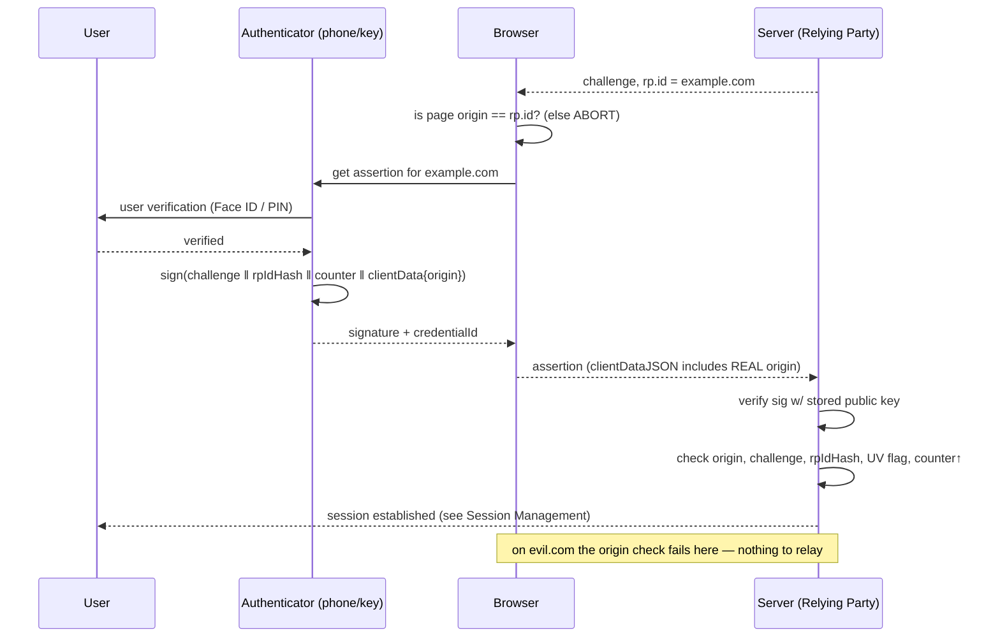
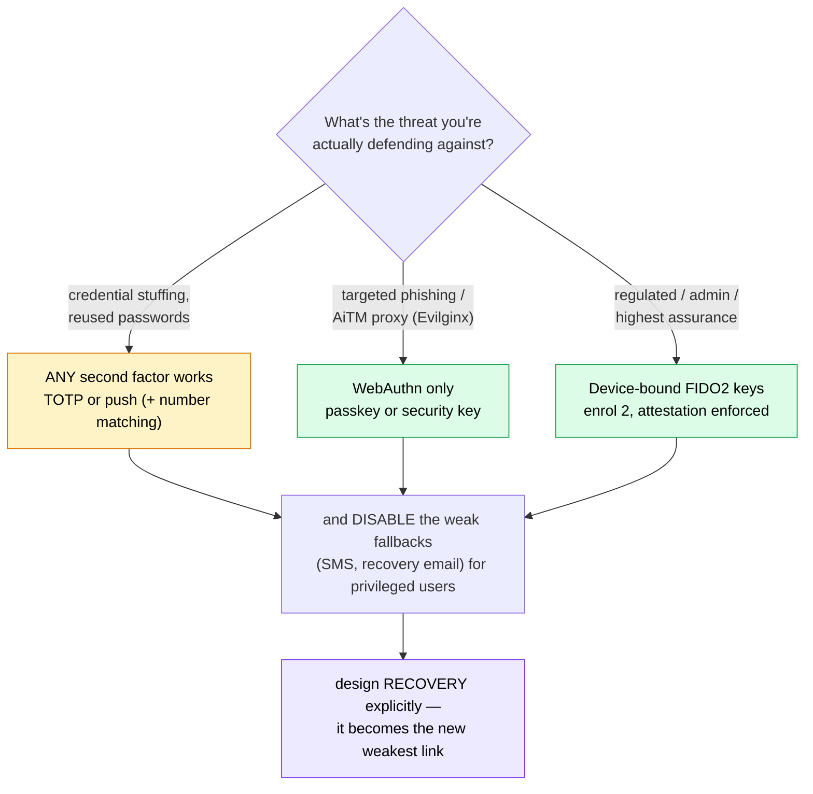

# MFA, Passwordless & WebAuthn (Passkeys)

## 1. Why Should I Care About This?
- **Passwords Are Already Breached**: Billions of credentials sit in public dumps, and people reuse them. Password *strength* rules barely matter when the attacker already has the plaintext from another site — the only durable fix is a second factor, or removing the password entirely.
- **Not All MFA Is Equal, and That's the Whole Interview**: "We have MFA" is not an answer. SMS falls to SIM swap, TOTP can be typed into a fake site, push notifications get bombed until the user taps "Approve." Microsoft's own data credits MFA with blocking >99% of automated account attacks — while the surviving 1% is exactly the targeted phishing that only origin-bound credentials stop.
- **This Is Where Login Design Is Heading**: Apple, Google, and Microsoft all ship passkeys by default now. "How would you make login phishing-resistant?" is a live design question, and the answer — a signature over the origin, from a key that never leaves the device — is a genuinely elegant piece of cryptographic engineering worth understanding properly.

## 2. What Problem Does This Solve?
- **A Single Stealable Secret**: A password is one string that grants full access, is reused across sites, can be guessed, and can be handed to a convincing fake page. Every one of those properties is a distinct failure mode.
- **The Phishing Gap**: Even a perfectly random password plus TOTP can be *relayed*: a real-time proxy shows the user the real login page, collects both the password and the code, and forwards them within the 30-second window. Any secret a human can read and retype can be phished.
- **Naive Approach**: Bolt SMS codes onto login and call it done. Three things break: the code travels over a channel an attacker can hijack (**SIM swap**, SS7 interception, or just a lock-screen preview); the user can be talked into reading it aloud or typing it into a proxy; and the code is a **shared secret** — the server stores something that, if the database leaks, lets the attacker generate valid codes forever (true for TOTP seeds especially). NIST SP 800-63B has restricted SMS as an out-of-band authenticator for exactly these reasons.

## 3. Core Idea (Intuition First)
Think of the difference between **telling a doorman a secret word** and **signing a document he hands you**.
- **Shared-secret factors (password, SMS code, TOTP)** are secret *words*. Both sides know the word, so both sides can leak it — and a con artist standing in the doorway can simply ask you for the word and repeat it to the real doorman. That's an adversary-in-the-middle proxy.
- **Public-key factors (WebAuthn/passkeys)** flip this. The doorman hands you a **fresh, unique document** (a random challenge) that says *which building you're standing in front of*. You sign it with a pen only you possess (a private key locked in your phone's secure element), and he checks the signature against your public signature-on-file. He never learns anything he could reuse, and a database breach yields only **public keys**.
- The magic is that last detail: **the document names the building**. If a con artist lures you to a fake entrance, your pen writes "signed at *evil.com*" — and the real doorman rejects it. You didn't have to be clever; the protocol made the mistake unrepresentable. That single property, **origin binding**, is what "phishing-resistant" means.
- **Passwordless** is then just the observation that if the signature is stronger than any password, why keep the password around as a weaker parallel door?

![Three-panel diagram of MFA and WebAuthn. Panel A: a factor ladder where bar length represents resistance to phishing and relay attacks — SMS or email OTP is shortest and red (SIM swap, SS7, relay, NIST deprecated), TOTP app is amber (shared secret, user can type it into a fake site), push approval is amber (MFA-fatigue bombing makes the user tap yes), push with number matching is blue and longer (forces intent, still relayable), and WebAuthn passkey or security key is the longest green bar labelled origin-bound. Panel B: the two WebAuthn ceremonies — registration, where the relying party sends a random challenge plus rp.id, the browser calls credentials.create() and checks the page origin, the authenticator generates a per-site key pair and stores the private key in a secure element, and the relying party stores only the public key and credential id so no shared secret exists; and authentication, where the relying party sends a fresh challenge, the browser builds clientDataJSON including the real origin, the authenticator performs user verification and signs challenge, origin and rpIdHash, and the relying party verifies the signature, origin match, challenge, and sign counter. Panel C: against an adversary-in-the-middle proxy on evil.com, TOTP, push, and SMS are defeated because the user enters the code at the proxy which relays it and steals the session, while a passkey is blocked because the browser puts origin evil.com in the signed data, which does not match rp.id and no key for evil.com exists.](../assets/mfa_webauthn_passkeys.svg)

> Panel A: any second factor beats a password alone, but only the bottom rung survives a real-time proxy. Panel B: the private key never leaves the device and the signature covers the origin. Panel C (the key lesson): phishing resistance isn't about user vigilance — it's the browser refusing to sign for the wrong site.

## 4. How It Actually Works
### 1. The three factor categories
- **Something you know** — password, PIN, security question. Phishable, reusable, guessable.
- **Something you have** — phone (SMS/push), TOTP app, hardware security key, smart card.
- **Something you are** — fingerprint, face, voice. Biometrics are usually used **locally** to unlock a key, not sent to the server; you can't revoke a fingerprint, so treating it as a transmittable secret is a design error.
- Real MFA requires **two different categories**. Password + security question is *not* MFA — both are "something you know."

### 2. TOTP — how the 6 digits are actually produced
- At enrolment the server generates a random secret `K` (base32, shown as a QR code) and stores it. Both sides now hold the same secret.
- Every 30 seconds both compute `T = floor(unix_time / 30)`, then `HOTP(K, T) = truncate(HMAC-SHA1(K, T))` reduced to 6 decimal digits (RFC 6238). No network call is needed — that's why an authenticator app works offline.
- The server accepts a **drift window** (typically T-1, T, T+1) to tolerate clock skew, which means each code is realistically valid for ~60–90 s.
- **The trade-offs**: the secret is *shared*, so a server-side breach lets the attacker mint codes (store seeds encrypted, ideally in an HSM/KMS); the code is human-readable, so it is phishable; and you must **rate-limit verification attempts** — a 6-digit code is only 1 in 10⁶, so unlimited guessing breaks it in hours.

### 3. Push notifications and MFA fatigue
- The server sends "Approve sign-in?" to a registered app. Better UX than typing digits, and the app can attest to device state.
- **MFA fatigue / prompt bombing**: an attacker with a valid password fires dozens of prompts, often at 3 a.m., until the user taps Approve to make it stop. This is exactly how the **Uber 2022 breach** began — repeated push requests plus a WhatsApp message from a fake IT helpdesk.
- **Fixes**: **number matching** (the login page shows a 2-digit number the user must type into the app — you can't approve by reflex), showing **context** (app, location, IP), **rate-limiting prompts** per account, and locking out after repeated denials.

### 4. WebAuthn / FIDO2 — the two ceremonies
- **Registration (`navigator.credentials.create()`)**: the relying party (your server) sends a random `challenge` and its `rp.id` (the domain). The **browser refuses to proceed unless the page's origin matches `rp.id`**. The authenticator generates a **fresh key pair scoped to that site**, keeps the private key in hardware (Secure Enclave, TPM, or the security key's chip), and returns the public key, a `credentialId`, and optionally an **attestation statement** proving what kind of authenticator it is. The server stores the public key. **There is no shared secret anywhere.**
- **Authentication (`navigator.credentials.get()`)**: the server sends a fresh challenge. The authenticator performs **user verification** (biometric or PIN — this is the "second factor" folded in), then signs a blob containing the **challenge**, the **`rpIdHash`**, a **signature counter**, and the browser-supplied `clientDataJSON` **including the true origin**. The server verifies the signature against the stored public key, and independently checks: origin matches, challenge matches the one it issued (anti-replay), `rpIdHash` matches, user-verification flag is set, and the counter has increased (clone detection).
- **Why phishing fails**: on `evil.com` the browser will not release a credential scoped to `example.com`, and any signature it does produce records `origin: evil.com` — which the real server rejects. The user cannot be tricked into overriding this; it isn't a warning dialog, it's a protocol constraint.

### 5. Passkeys — WebAuthn credentials that survive a lost phone
- A **passkey** is a **discoverable** WebAuthn credential (the authenticator can list it, so the user doesn't type a username) that is typically **synced** through a platform keychain (iCloud Keychain, Google Password Manager, 1Password).
- **Synced vs device-bound** is the central passkey trade-off: syncing solves the historical killer problem of hardware keys (lose it, lose the account) at the cost of the private key existing in more than one place, protected by the platform account's own security. **Device-bound passkeys** (FIDO2 security keys, or platform keys with `attestation`) never leave the hardware — required for the highest assurance levels, but you must enrol at least two.
- **Conditional UI / autofill** lets the browser surface passkeys directly in the username field, which is what makes the flow feel like *less* work than a password rather than more.

### 6. Recovery — the part everyone under-designs
- Recovery is the **weakest link and the real attack target**: if "lost my passkey" falls back to an emailed link, your phishing-resistant login is only as strong as the user's email.
- Design it deliberately: **enrol two authenticators**, issue **one-time recovery codes** at setup, require **multi-signal identity proofing** for reset (device history + a second registered factor + a delay), and for enterprises route recovery through a **verified helpdesk process** — social-engineering the helpdesk is how many "MFA bypass" incidents actually happen.



## 5. Real-World Example
**Google's 2017 rollout of security keys to 85,000+ employees:** Google replaced OTP-based 2FA with FIDO U2F hardware keys across the workforce and reported **zero successful phishing takeovers** of employee accounts afterwards, along with *faster* authentication and fewer support tickets than the OTP system it replaced. The lesson interviewers like: the phishing-resistant option was not just safer, it was cheaper to operate.

**The contrast case — Uber, September 2022:** an attacker with a contractor's leaked password spammed push MFA prompts, then posed as internal IT over WhatsApp; the contractor approved. From that foothold the attacker found hardcoded admin credentials in a network share and escalated. Every link in that chain is in this file: a phishable password, a push factor without number matching, no prompt rate-limiting, and a recovery/helpdesk process that could be socially engineered.

## 6. Code Example
Server-side verification for both factor styles (Python-ish pseudocode):
```python
import hmac, hashlib, struct, time, secrets

# ─────────── TOTP: shared-secret, offline, PHISHABLE ───────────
def totp(secret: bytes, t: int, digits=6) -> str:
    mac = hmac.new(secret, struct.pack(">Q", t), hashlib.sha1).digest()
    off = mac[-1] & 0x0F                       # dynamic truncation (RFC 4226)
    code = struct.unpack(">I", mac[off:off+4])[0] & 0x7FFFFFFF
    return str(code % 10**digits).zfill(digits)

def verify_totp(secret, submitted, user_id, drift=1):
    if not rate_limiter.allow(f"totp:{user_id}", max_attempts=5, per_seconds=300):
        raise TooManyAttempts()                 # 6 digits = 1e6 — MUST be rate-limited
    now = int(time.time()) // 30
    for t in range(now - drift, now + drift + 1):        # tolerate clock skew
        if hmac.compare_digest(totp(secret, t), submitted):   # constant-time compare
            if replay_cache.seen(user_id, t):   # a code must be single-use
                return False
            replay_cache.mark(user_id, t)
            return True
    return False

# ─────────── WebAuthn: public-key, ORIGIN-BOUND, phishing-resistant ───────────
EXPECTED_ORIGIN = "https://example.com"
RP_ID_HASH      = hashlib.sha256(b"example.com").digest()

def begin_login(user_id):
    challenge = secrets.token_bytes(32)         # fresh per attempt = anti-replay
    store_challenge(user_id, challenge, ttl=60)
    return {"challenge": challenge, "rpId": "example.com", "userVerification": "required"}

def verify_assertion(user_id, assertion, cred):
    client_data = json.loads(assertion["clientDataJSON"])
    # 1. THE PHISHING CHECK — the browser reported where the user actually was
    if client_data["origin"] != EXPECTED_ORIGIN:
        raise Reject("origin mismatch — this assertion was produced on another site")
    # 2. anti-replay: it must be the challenge WE just issued
    if client_data["challenge"] != b64(pop_challenge(user_id)):
        raise Reject("stale or unknown challenge")
    auth_data = assertion["authenticatorData"]
    if auth_data[0:32] != RP_ID_HASH:          raise Reject("rpIdHash mismatch")
    if not auth_data[32] & 0x04:               raise Reject("user verification not performed")
    counter = struct.unpack(">I", auth_data[33:37])[0]
    if counter != 0 and counter <= cred.last_counter:
        raise Reject("signature counter did not advance — possible cloned authenticator")
    # 3. the signature covers challenge + rpIdHash + counter + clientDataJSON
    signed = auth_data + hashlib.sha256(assertion["clientDataJSON"]).digest()
    verify_ecdsa(cred.public_key, signed, assertion["signature"])   # raises on failure
    cred.last_counter = counter                                    # persist for clone detection
    return True
```

## 7. Design Variations & Alternatives
| Factor | Secret shared with server? | Phishing-resistant? | Offline? | Cost / friction |
|---|---|---|---|---|
| **SMS / email OTP** | Yes (the channel) | ❌ relay, SIM swap, SS7 | ❌ needs signal | Per-message cost; highest support burden |
| **TOTP app** | Yes (the seed) | ❌ user can retype it | ✅ | Free; QR enrolment; users lose seeds on phone loss |
| **Push approval** | No, but approval is a yes/no | ❌ fatigue + relay | ❌ | App to build/buy; best UX of the phishable set |
| **Push + number matching** | No | ⚠️ much harder, still relayable | ❌ | Same as push; strongly recommended minimum |
| **TOTP-in-a-password-manager** | Yes | ⚠️ manager won't autofill on wrong domain | ✅ | Free; domain check helps but user can override |
| **WebAuthn platform passkey** | No — public key only | ✅ origin-bound | ✅ | Free, built into the device; recovery needs design |
| **WebAuthn security key (device-bound)** | No | ✅ origin-bound | ✅ | $25–60/key, need two per user; highest assurance |
| **Magic link / email OTP "passwordless"** | Channel-based | ❌ | ❌ | Cheap and popular, but security = the user's email |

- **Risk-based / adaptive authentication** is the orthogonal axis: don't ask for a factor on every login, ask when signals are unusual (new device, new ASN, impossible travel, sensitive action). Fewer prompts means less fatigue *and* more attention when a prompt does appear.
- **Step-up authentication** applies the same idea inside a session: browsing is free, but changing the payout account re-prompts for the strongest factor. OIDC expresses this with `acr_values` and `max_age`.
- **Passwordless ≠ passkeys-only**: most real rollouts run passkeys *alongside* passwords for a long transition. Beware the **downgrade path** — if `Forgot password?` or "use another method" still offers SMS, an attacker just picks that. Phishing resistance is only as strong as the weakest enabled method.



## 8. Pros and Cons
### MFA generally
- **Pros**: blocks the overwhelming majority of automated attacks (credential stuffing, password spraying, dump replay) for very little engineering; usually a compliance requirement (PCI DSS, SOC 2) you'd have to build anyway; per-user cost is near zero for TOTP/passkeys.
- **Cons**: real friction and real support load (lost phones, locked-out users); the weakest enabled method sets your actual security level; and it introduces new denial-of-service and social-engineering surfaces (prompt bombing, helpdesk resets).

### WebAuthn / passkeys specifically
- **Pros**: **phishing-resistant by construction**; **no shared secret to breach** — a database leak yields public keys; typically *faster* than typing a password (biometric tap); eliminates password reset volume, historically a top support cost; unlocks passwordless entirely.
- **Cons**: **recovery and account-loss design is genuinely hard** and is where most of the effort goes; synced passkeys move trust into the platform account (Apple/Google), which some enterprises won't accept; cross-ecosystem sharing (iOS ↔ Windows) still has rough edges; the server implementation has real cryptographic verification steps that are easy to skip (origin, counter, UV flag) — and skipping them silently removes the guarantee.

## 9. Failure Scenarios & What Can Go Wrong
- **SYMPTOM**: Accounts with MFA enabled are taken over anyway, with no password change. **CAUSE**: AiTM proxy relayed the OTP and stole the post-login session cookie. **FIX**: passkeys for the phishing-resistant path, plus short/bound sessions (see [Session Management & Cookie Security](./Session_Management_Cookie_Security.md)) so a stolen cookie is useless elsewhere.
- **SYMPTOM**: A user reports dozens of overnight push prompts, then a breach. **CAUSE**: MFA fatigue with an already-leaked password. **FIX**: number matching, per-account prompt rate limits, lock the account after N denials, alert on prompt storms.
- **SYMPTOM**: An attacker with no device access starts receiving the victim's codes. **CAUSE**: SIM swap or SS7/port-out fraud. **FIX**: remove SMS as an option for privileged users; if kept, add carrier port-out locks and treat a SIM change as a high-risk signal requiring re-enrolment.
- **SYMPTOM**: MFA "works" but a database breach leads to mass bypass. **CAUSE**: TOTP seeds stored in plaintext. **FIX**: encrypt seeds with a KMS/HSM-held key, or move to public-key credentials where there's nothing to steal.
- **SYMPTOM**: Passkey login is enabled and phishing continues. **CAUSE**: the weak fallback is still enabled — "use a code instead" or password-only recovery. **FIX**: for privileged accounts, disable phishable methods entirely; make recovery require another strong factor.
- **SYMPTOM**: WebAuthn verification passes for assertions produced on an attacker's page. **CAUSE**: the server didn't check `clientDataJSON.origin` (or accepted a wildcard). **FIX**: verify origin, challenge freshness, `rpIdHash`, the UV flag, and the counter — all five, server-side, every time. Use a maintained library rather than hand-rolling.
- **SYMPTOM**: Users are permanently locked out after upgrading a phone. **CAUSE**: a single device-bound credential and no recovery path. **FIX**: require two authenticators at enrolment, issue recovery codes, and offer a verified helpdesk path with a delay.
- **SYMPTOM**: Codes are accepted twice / brute-forced. **CAUSE**: no single-use marking and no attempt limit on the verify endpoint. **FIX**: mark each accepted time-step as consumed and rate-limit hard (see [Rate Limiting & DoS Protection](./Rate_Limiting_DoS_Protection.md)).

## 10. Impact on Scalability, Reliability & Cost
- **Scalability**: TOTP and WebAuthn verification are pure CPU (an HMAC or one ECDSA verify — tens of microseconds) with no external dependency, so they scale with your app tier. **SMS and push do not**: they add a third-party network call on the login path, with its own latency, quotas, and regional failure modes.
- **Reliability**: SMS is the fragile choice — carrier delays, international deliverability, and provider outages all become *login* outages. Passkeys work offline, on the device, with no vendor in the request path. Whatever you choose, MFA sits on the critical path of every login, so it needs the same availability engineering as the login service itself, plus a documented break-glass path for the day it fails.
- **Cost**: SMS is the only factor with meaningful marginal cost (roughly $0.005–$0.05 per message depending on country — at 10 M logins/month that's real money, and it's also a fraud target via **SMS pumping**, where attackers trigger millions of messages to premium numbers). TOTP and passkeys are effectively free per authentication; hardware keys are a one-off $25–60 per unit. The dominant cost either way is **support**: password resets and lockouts. Google's key rollout and Microsoft's passwordless push both report support-cost *reductions*, which is the business case that gets these projects funded.

## 11. When NOT to Use This
- **Machine-to-machine calls**: there's no human to present a factor. Use client credentials, signed requests, mTLS, or workload identity (see [API Keys & Service-to-Service Auth](./API_Keys_Service_to_Service_Auth.md)).
- **Low-value, high-churn consumer accounts** where friction directly kills conversion: consider risk-based prompts (only when signals are odd) rather than mandatory MFA on every login — but never for accounts holding money, PII, or admin rights.
- **Kiosk / shared-device or emergency-access contexts** (clinical systems, factory floors) where a locked-out user is a safety problem: design a supervised break-glass path with strong auditing instead of blanket enforcement.
- **When it would be your only control**: MFA on login doesn't help if the session, the password-reset flow, or the API behind it are unprotected. Don't let "we added MFA" substitute for session hardening and authorization.

## 12. Interview Perspective
- **What interviewers expect**: name the three factor categories and insist that two of the *same* category isn't MFA; explain TOTP as `HMAC(secret, time/30)` with a drift window; and rank the factors by **phishing resistance**, not convenience.
- **The trap question**: "We have MFA — are we phishing-proof?" Correct answer: no. Describe the AiTM proxy concretely (the user's code is relayed within its validity window and the *session cookie* is stolen), then explain that WebAuthn defeats it because the browser binds the assertion to the origin and won't release a credential for a different domain.
- **The design question**: "Roll out passwordless for 50 M users." Structure it: passkeys with conditional UI as the primary; keep passwords during transition but **disable weak fallbacks for privileged accounts**; enrol two authenticators; recovery codes plus verified helpdesk; measure enrolment and fallback-usage rates; and note that the weakest enabled method defines your real security level.
- **Bonus signals**: MFA fatigue and number matching (cite Uber 2022); why biometrics stay local and are never sent; synced vs device-bound passkeys and why enterprises care; the five server-side WebAuthn checks (origin, challenge, `rpIdHash`, UV flag, counter); SMS pumping as a cost-abuse vector.

## 13. Connections to Other Topics
- [Authentication vs Authorization](./Authentication_vs_Authorization.md) — MFA strengthens the *authentication* half; it says nothing about what the user may then do.
- [Session Management & Cookie Security](./Session_Management_Cookie_Security.md) — the session issued *after* MFA is what AiTM attacks actually steal; strong login needs bound, revocable sessions.
- [Hashing & Salting](./Hashing_and_Salting.md) — the password half of the story; MFA is what makes a leaked hash survivable.
- [OAuth2 & OpenID Connect](./OAuth2_OpenID_Connect_OIDC.md) — where step-up auth is expressed (`acr_values`, `amr`, `max_age`) and how an IdP asserts *which* factors were used.
- [SSO & SAML](./SSO_and_SAML.md) — enterprises enforce MFA once at the IdP; that's the leverage point for a whole app estate.
- [PKI & TLS Certificates](./PKI_TLS_Certificates.md) — the same public-key primitives (key pairs, signatures, attestation chains) underpin both certificates and WebAuthn.
- [Rate Limiting & DoS Protection](./Rate_Limiting_DoS_Protection.md) — the control that keeps a 6-digit code from being brute-forced and push prompts from being spammed.
- [Bot Detection & CAPTCHA Challenges](./Bot_Detection_CAPTCHA_Challenges.md) — the complementary defense against the credential stuffing that MFA is there to survive.

## 14. Visual Aids
- **The SVG above** ([mfa_webauthn_passkeys.svg](../assets/mfa_webauthn_passkeys.svg)): panel A — the factor ladder ranked by phishing resistance with the specific weakness of each rung; panel B — the WebAuthn registration and authentication ceremonies, showing the per-site key pair and the origin-covering signature; panel C — the same AiTM proxy defeating TOTP/push and failing against a passkey.
- **Mermaid #1 (Section 4)**: the assertion flow, with the browser's origin check placed exactly where phishing dies.
- **Mermaid #2 (Section 7)**: the decision tree — pick the factor by the *threat* you're defending against, then disable weak fallbacks and design recovery.

## 15. Summary (TL;DR)
**MFA requires two factors from *different* categories (know / have / are), and the whole subject turns on one distinction: shared-secret factors can be relayed, public-key factors cannot — SMS falls to SIM swap and SS7, TOTP is just `HMAC-SHA1(seed, floor(time/30))` truncated to 6 digits so the server stores a stealable seed and the user can be talked into typing the code into a pixel-perfect adversary-in-the-middle proxy, and push approvals fall to MFA fatigue (dozens of 3 a.m. prompts until someone taps Approve — the Uber 2022 breach), which number matching, prompt rate limits and context display substantially fix; WebAuthn/FIDO2 removes the phishable secret entirely by having the authenticator generate a per-site key pair whose private half never leaves the secure element and sign a server-issued random challenge together with the `rpIdHash` and the browser-reported **origin**, so on `evil.com` the browser won't release the credential and any signature it does produce records the wrong origin and is rejected — phishing resistance as a protocol constraint rather than user vigilance — while the server must verify all five things (signature, origin, challenge freshness, user-verification flag, and an advancing signature counter for clone detection); passkeys are discoverable WebAuthn credentials synced through a platform keychain, trading "lose the key, lose the account" for trust in Apple/Google, with device-bound FIDO2 keys reserved for the highest assurance; and because the weakest enabled method sets your real security level, the rollout work is disabling phishable fallbacks for privileged users and designing recovery deliberately (two enrolled authenticators, one-time codes, verified helpdesk) — recovery, not cryptography, is where the new weakest link lives.**

## 16. Further Reading & Resources
- [W3C — Web Authentication (WebAuthn) Level 3 specification](https://www.w3.org/TR/webauthn-3/)
- [passkeys.dev — implementation guides, UX patterns, and platform support](https://passkeys.dev/)
- [NIST SP 800-63B — Digital Identity Guidelines: Authentication and Authenticator Assurance Levels](https://pages.nist.gov/800-63-3/sp800-63b.html)
- [RFC 6238 — TOTP: Time-Based One-Time Password Algorithm](https://datatracker.ietf.org/doc/html/rfc6238)
- [Google security-keys study — "Security Keys: Practical Cryptographic Second Factors for the Modern Web"](https://research.google/pubs/pub45409/)
- [OWASP Multifactor Authentication Cheat Sheet](https://cheatsheetseries.owasp.org/cheatsheets/Multifactor_Authentication_Cheat_Sheet.html)
- [FIDO Alliance — Passkeys and enterprise deployment guidance](https://fidoalliance.org/passkeys/)
