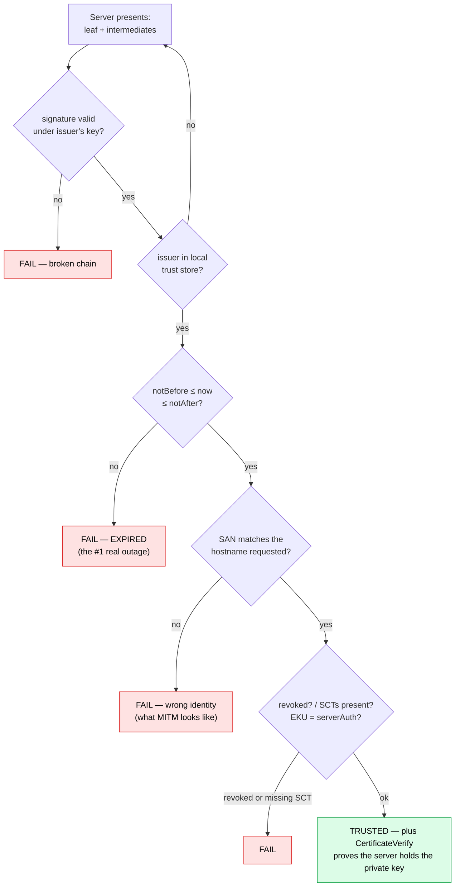

# PKI & TLS Certificates

## 1. Why Should I Care About This?
- **Encryption Without Identity Is Worthless**: You can set up a perfectly encrypted channel — to an attacker. TLS's encryption is the easy half; **PKI is the half that tells you who is on the other end**. Strip out certificate validation and TLS degrades into "encrypted conversation with a stranger," which is exactly what an interception proxy wants.
- **Expired Certificates Are a Top-Tier Outage Cause**: Not a theoretical risk — a real, recurring, self-inflicted global outage. Microsoft Teams (2020), Spotify (2020), Ericsson's expired cert knocking out LTE data for millions of O2/SoftBank subscribers (2018), Cisco, LinkedIn, and countless internal services have all gone dark because a date passed. Certificates are the only dependency in your stack that fails *on a schedule you already know*.
- **It's the Machinery Everything Else Assumes**: HTTPS, mTLS in a service mesh, code signing, SSH host keys, JWT signing keys, WebAuthn attestation, container image signing — all of it is the same chain-of-trust idea. Learn it once here and the rest stop being magic.

## 2. What Problem Does This Solve?
- **Key Distribution at Internet Scale**: Public-key crypto lets you encrypt to a public key — but *whose* key is it? You've never met `api.example.com`. Somebody trustworthy has to vouch that this key belongs to that name, and you have to be able to check that vouching offline, in milliseconds, for a name you've never seen.
- **Impersonation and Interception**: Without verified identity, anyone who can position themselves in the network path (rogue Wi-Fi, hijacked BGP route, poisoned DNS) can present their own key and read everything.
- **Naive Approach**: Trust every certificate a server presents, or pin one key per site by hand. Trusting everything means an attacker just self-signs `login.yourbank.com` and you'll never notice. Manually pinning doesn't scale past a handful of endpoints and breaks every time a key rotates. The classic mistake in code is worse still: `verify=False` / `InsecureSkipVerify: true` / `-k` to "make TLS work" — which keeps the encryption and throws away the *only* part that stops interception, usually silently and permanently.

## 3. Core Idea (Intuition First)
Think of it like **a passport system**.
- Your **passport** (the leaf certificate) states your name and includes your photo (your **public key**). You can't just print one — it's only useful because a **government** (the **Certificate Authority**) signed it, and border officials worldwide already hold that government's official seal.
- The border official doesn't need to contact the government. They **check the seal against the ones they already have on file** (the **trust store**, shipped with your OS/browser). Verification is offline arithmetic: does this signature validate under a key I already trust?
- Real passports are signed by **regional passport offices**, not the head of state — that's the **intermediate CA**. The head of state's key (the **root**) is kept in a vault offline and only ever signs the offices' credentials. If an office is caught issuing fakes, you revoke *that office*, not the head of state, and the world doesn't have to update its seal file.
- A passport also has an **expiry date** and lists **which countries it's valid for** (the SAN list — the exact hostnames). And crucially, **the border official checks the name on the passport against the name of the person standing there**. Skipping that one check — hostname verification — is the most common way real code becomes insecure while appearing to "have TLS."

![Three-panel diagram of PKI and TLS certificates. Panel A: the chain of trust — a self-signed Root CA valid 10 to 20 years, pre-installed in the OS or browser trust store with its key kept offline, signs an Intermediate CA valid 1 to 5 years that acts as the online signer and sacrificial layer revocable without burning the root, which signs the leaf server certificate, an X.509 document containing subject, SAN of api.example.com, public key, notBefore and notAfter, and EKU, typically with a 90-day Let's Encrypt lifetime; a summary bar lists what the client verifies in order — signature chain up to a trusted root, validity dates, SAN matching the hostname, revocation status, keyUsage and EKU, and Certificate Transparency SCTs. Panel B: revocation options ranked — CRL (download a big, stale, megabyte list, largely abandoned), OCSP (client asks the CA, causing a privacy leak and latency, and soft-fail makes it useless), OCSP stapling (server attaches a signed timestamped proof, no client-to-CA call), and short-lived certificates (expiry is revocation, 6 to 90 days, where the web is going), with a note that browsers soft-fail revocation checks so short lifetimes are the only reliable revocation. Panel C: the ACME lifecycle — order, challenge via HTTP-01, DNS-01 or TLS-ALPN-01, CA validates control of the name rather than identity, certificate issued with a 90-day lifetime and logged to Certificate Transparency, and renew at 60 days with a 30-day safety margin plus an alert at 21 days; a red warning notes that missing renewal makes every client hard-fail at once, as happened to Microsoft Teams, Spotify, Ericsson LTE, and Cisco.](../assets/pki_cert_chain_acme.svg)

> Panel A: verification is a chain walk that terminates at a key you already trusted. Panel B: revocation is PKI's weak spot, and short lifetimes are the industry's answer. Panel C: certificates are the one dependency that fails on a known schedule — so automate renewal or schedule your own outage.

## 4. How It Actually Works
### 1. What's actually inside an X.509 certificate
A certificate is a signed data structure (DER-encoded ASN.1, often shown as base64 PEM). The fields that matter:
| Field | What it holds | Why you care |
|---|---|---|
| **Subject** | The identity, `CN=api.example.com` | **Legacy** — modern clients ignore CN for hostname matching |
| **SAN (Subject Alternative Name)** | The authoritative list of names/IPs: `DNS:api.example.com, DNS:*.example.com` | **This** is what hostname verification checks; a cert without SAN is rejected outright by modern browsers |
| **Issuer** | Who signed it | Tells you which cert to fetch/verify next, walking up the chain |
| **Public key** | The key being vouched for (RSA-2048/3072 or ECDSA P-256) | ECDSA P-256 ≈ RSA-3072 in strength with far smaller signatures and faster handshakes |
| **notBefore / notAfter** | Validity window | The outage clock. Public TLS certs are capped at ~398 days today, dropping toward 47 days by 2029 |
| **Serial number** | Unique per issuer | The identifier used in revocation lists |
| **Basic Constraints** | `CA:TRUE/FALSE` + path length | Stops a leaf cert being used to sign other certs — the flaw behind the old "any cert is a CA" attacks |
| **Key Usage / EKU** | `digitalSignature`, `serverAuth`, `clientAuth` | A server cert shouldn't be usable for code signing; mTLS needs `clientAuth` |
| **SCTs** | Signed Certificate Timestamps | Proof the cert was logged to **Certificate Transparency**; Chrome refuses certs without them |
| **Signature** | Issuer's signature over all of the above | The whole point — tamper with any field and this breaks |

### 2. Chain verification, step by step
- The server sends the **leaf plus any intermediates** (it must — forgetting intermediates is the classic "works in my browser, fails on Android" bug, because browsers cache intermediates and other clients don't).
- The client hashes the leaf's signed portion and verifies the signature using the **issuer's public key**, taken from the next cert in the chain. It repeats upward.
- The walk ends when it reaches a certificate whose public key is **already in the local trust store** (~150 roots, shipped and curated by Mozilla/Microsoft/Apple/Google). Roots are **self-signed** — their trust comes from being pre-installed, not from a signature.
- Then the **non-cryptographic** checks, any one of which can fail a perfectly valid signature: dates in range, **SAN matches the requested hostname** (with wildcards matching exactly one label — `*.example.com` covers `api.example.com` but not `a.b.example.com`), Basic Constraints/EKU appropriate, not revoked, and SCTs present.

### 3. Where the certificate sits in the TLS handshake
In **TLS 1.3** (1-RTT), the client sends `ClientHello` with its key share; the server replies with `ServerHello` + key share, then — already encrypted — its `Certificate`, a `CertificateVerify` (a signature over the handshake transcript, proving it holds the private key, not just a copy of the cert), and `Finished`. The client validates the chain and the signature, and application data flows.
- The **`CertificateVerify` step is the anti-replay guarantee**: possessing a certificate proves nothing, since certificates are public. Only signing the live transcript proves possession of the private key.
- **SNI** (`server_name` in `ClientHello`) is how one IP serves many hostnames — the server needs to know which certificate to present *before* it can present one. Classic SNI is plaintext, which is why **Encrypted Client Hello (ECH)** exists.
- Full handshake mechanics — key exchange, cipher suites, 0-RTT, session resumption — live in [TLS/SSL Handshake](../08_Communication_Protocols/TLS_SSL_Handshake.md); this file is the identity layer that handshake depends on.

### 4. Getting a certificate: CSR, validation levels, and ACME
- You generate a **key pair** locally (the private key never leaves your server) and a **CSR** — a request containing your public key and desired names, self-signed to prove you hold the matching private key.
- The CA then validates *something* before signing:
  - **DV (Domain Validation)** — proves only that you control the name. This is what Let's Encrypt issues, and it's what TLS actually needs.
  - **OV / EV** — adds vetted organisation details. Browsers **removed the EV green bar** years ago because studies showed users ignored it; EV survives mainly as a compliance checkbox.
- **ACME** (RFC 8555) automates DV issuance. The client proves control via a challenge:
  - **HTTP-01** — serve a token at `http://host/.well-known/acme-challenge/<token>`. Simple; can't do wildcards.
  - **DNS-01** — publish a TXT record at `_acme-challenge.host`. The only way to get **wildcard** certs, and it works for servers with no inbound HTTP.
  - **TLS-ALPN-01** — prove it inside a TLS handshake on 443. Useful when port 80 is closed.
- Certificates are then **automatically renewed** well before expiry (Let's Encrypt issues 90 days; renew at 60, alert at 21). The short lifetime is deliberate: it forces automation, and automation is what prevents the outage.

### 5. Revocation, and why it barely works
- **CRL** — the CA publishes a signed list of revoked serials. Lists grew to megabytes and are always somewhat stale; browsers largely abandoned them (Chrome's **CRLite** compresses aggregated CRLs into a browser-pushed filter, a modern revival of the idea).
- **OCSP** — the client asks the CA "is serial X still good?" This leaks the user's browsing to the CA, adds a blocking round trip, and — fatally — browsers **soft-fail**: if the OCSP responder is unreachable, they proceed. An attacker who can MITM can also block OCSP, so soft-fail revocation stops nothing. (Let's Encrypt has now ended OCSP support in favour of CRLs and short lifetimes.)
- **OCSP stapling** — the *server* fetches a signed, timestamped "still good" proof periodically and staples it into the handshake. No client→CA call, no privacy leak. `Must-Staple` in the cert turns soft-fail into hard-fail, at the cost of an outage if stapling breaks.
- **Short-lived certificates are the real answer.** If a cert lives 6–90 days, the revocation window closes on its own. This is why the CA/Browser Forum has voted to cut maximum public-cert lifetimes to 47 days by 2029, and why internal PKI (SPIFFE/Istio) issues certs valid for *hours*.

### 6. Pinning — a sharp tool
**Certificate/public-key pinning** hardcodes the expected key (or its hash) in the client, so even a valid cert from a different CA is rejected. It defeats rogue-CA and corporate-MITM attacks — and it also **bricks your app when you rotate keys**. HTTP Public Key Pinning (HPKP) was so dangerous (a bad pin = a self-inflicted, un-fixable, months-long outage) that browsers **removed it**. It survives where you control both ends and the release cycle: **mobile apps** pinning their own API, IoT firmware, and mTLS between your own services. Always pin a **backup key** and pin to the intermediate or a key you control, never a single leaf.



## 5. Real-World Example
**Ericsson's expired certificate, December 2018:** a software certificate in Ericsson's SGSN-MME (core mobile packet network) equipment expired. There was no cryptographic compromise, no attack, no bug in the usual sense — a date passed. **O2 in the UK (~32 M subscribers) and SoftBank in Japan (~30 M) lost mobile data for most of a day**, with knock-on failures in transport information systems and payment terminals. O2 later pursued Ericsson for compensation reported in the tens of millions of pounds.

**The contrast — Let's Encrypt's ISRG Root X1 / DST Root CA X3 expiry, September 2021:** the *root* expired on a long-published, well-communicated schedule. Modern clients had the new root and were fine. What broke was the long tail — old Android devices, OpenSSL 1.0.2, some IoT firmware — because the fix required updating a **trust store**, which many devices can no longer do. This is the lesson interviewers like: your certificate hygiene is bounded by your oldest client's ability to update its trust anchors, and chain/trust-store rot is a *distinct* failure mode from your own cert expiring.

**Both point to the same practice:** certificate expiry is the only outage you can put on a calendar. Inventory every cert (public, internal, client, code-signing, and the ones baked into appliances), monitor days-to-expiry as a first-class metric with alerts at 30/14/7 days, and automate renewal so a human's calendar is never the control.

## 6. Code Example
Inspecting and validating a chain, plus the mistakes that silently disable it:
```bash
# ── What is this server actually presenting? (chain, names, dates) ──
openssl s_client -connect api.example.com:443 -servername api.example.com -showcerts </dev/null \
  | openssl x509 -noout -subject -issuer -dates -ext subjectAltName
#   subject=CN=api.example.com          ← ignore for matching; SAN is authoritative
#   issuer=C=US, O=Let's Encrypt, CN=R11 ← an INTERMEDIATE, not a root
#   notBefore=... notAfter=Oct 12 2026  ← put this in monitoring, not a wiki page
#   X509v3 Subject Alternative Name: DNS:api.example.com, DNS:www.example.com

# ── Did the server send the intermediates? ("works in Chrome, fails on Android") ──
openssl s_client -connect api.example.com:443 -servername api.example.com </dev/null 2>&1 \
  | grep -E "Verify return code|verify error"          # want: 0 (ok)

# ── Days until expiry — the one metric that prevents the classic outage ──
echo | openssl s_client -connect api.example.com:443 -servername api.example.com 2>/dev/null \
  | openssl x509 -noout -checkend 1814400 || echo "EXPIRES WITHIN 21 DAYS — RENEW NOW"

# ── Generate a key + CSR (the private key never leaves this machine) ──
openssl req -new -newkey ec -pkeyopt ec_paramgen_curve:P-256 -nodes \
  -keyout api.key -out api.csr -subj "/CN=api.example.com" \
  -addext "subjectAltName=DNS:api.example.com,DNS:www.example.com"
```
```python
import ssl, socket, requests

# ── CORRECT: the default context verifies chain AND hostname ──
ctx = ssl.create_default_context()            # check_hostname=True, CERT_REQUIRED
with socket.create_connection(("api.example.com", 443)) as sock:
    with ctx.wrap_socket(sock, server_hostname="api.example.com") as tls:
        cert = tls.getpeercert()              # raises on any validation failure

# ── WRONG, and depressingly common — encryption without identity ──
# requests.get(url, verify=False)             # ← accepts ANY cert: MITM is now free
# ctx.check_hostname = False                  # ← valid cert for the WRONG name passes
# ctx.verify_mode = ssl.CERT_NONE             # ← no chain check at all
# In Go: tls.Config{InsecureSkipVerify: true} · curl -k · Java: a TrustManager that returns
# an empty accepted-issuers array. All four keep the padlock and delete the security.

# ── Pinning (only when you own both ends and can ship key rotations) ──
PINS = {"sha256/AAAA…primary", "sha256/BBBB…BACKUP"}   # ALWAYS pin a backup key
def check_pin(der_pubkey_sha256_b64):
    if der_pubkey_sha256_b64 not in PINS:
        raise ssl.SSLCertVerificationError("pin mismatch — refusing to connect")
```

## 7. Design Variations & Alternatives
| Option | Trust anchor | Best for | Watch out for |
|---|---|---|---|
| **Public CA + ACME** (Let's Encrypt, ZeroSSL) | Browser/OS trust stores | Anything a browser or third party connects to | Rate limits; needs public DNS/HTTP for validation |
| **Commercial CA (OV/EV)** | Same trust stores | Compliance requirements, wildcards with support SLAs | Costs money; browsers show no EV UI benefit |
| **Private/internal CA** (`step-ca`, Vault PKI, AWS Private CA) | Your own root, distributed to your fleet | Internal services, mTLS, non-public names | **Trust distribution** is now your problem, as is root key protection |
| **SPIFFE/SPIRE + workload identity** | Platform-attested, auto-rotated | Service mesh, Kubernetes; certs valid for hours | Real platform investment |
| **Self-signed** | Nothing — must be manually trusted | Local dev only | Teaches developers to click through warnings; never in prod |
| **Cloud-managed (ACM, GCP-managed certs)** | Public CAs, renewal handled by the provider | Anything behind a managed LB/CDN | Key is provider-held; can't export for on-host use |

- **Where TLS terminates decides where certs live**: terminate at the CDN/load balancer and you manage one cert (plus, usually, a separate one for LB→origin); terminate per-pod with mTLS and you need automated issuance at scale, which is precisely why SPIFFE/mesh PKI exists.
- **mTLS** is the same machinery pointed both directions — the *client* also presents a cert, so the server authenticates it cryptographically instead of via a bearer token. See [API Security, Scopes & mTLS](../15_Security_Deep_Dive_DevSecOps/API_Security_Scopes_mTLS.md).
- **Certificate Transparency** shifted the trust model from "prevent misissuance" to "make it undeniable." Every publicly-trusted cert is appended to public append-only logs, so anyone can detect a rogue cert for their domain — and you should, via **CT monitoring** alerts on your own names. This is how the 2015 Symantec misissuance of `google.com` test certs came to light.
- **Post-quantum** is the live frontier: hybrid key exchange (X25519+ML-KEM) is already deployed in Chrome and Cloudflare, while PQ *signatures* (ML-DSA) will bloat certificate sizes significantly — the reason short lifetimes and small chains are being pushed now.

## 8. Pros and Cons
### Public PKI with automated (ACME) issuance
- **Pros**: **zero-touch trust for the entire internet** — any client can verify any server offline in milliseconds against ~150 pre-installed roots; free and fully automatable; CT gives public auditability of misissuance; short lifetimes force the automation that prevents outages.
- **Cons**: you inherit trust in **every CA in the store** — any one of them can technically issue for your domain (CT detects it, doesn't prevent it); revocation is effectively broken (soft-fail); DV proves only name control, not that the operator is honest; and validation requires publicly reachable DNS/HTTP.

### Private / internal PKI
- **Pros**: full control of policy, lifetimes (hours, not months), name space (internal DNS, non-DNS identities like SPIFFE IDs), and no external dependency or rate limit; enables mTLS everywhere.
- **Cons**: **you now run a CA** — root key protection (HSM, offline), trust-store distribution to every client and language runtime, and a rotation story. A leaked internal root means every internal connection is forgeable; a botched trust-store rollout means everything fails simultaneously.

## 9. Failure Scenarios & What Can Go Wrong
- **SYMPTOM**: Everything works, then at a precise timestamp every client fails simultaneously with `certificate has expired`. **CAUSE**: nobody renewed it; the reminder was a calendar entry belonging to someone who left. **FIX**: ACME automation, days-to-expiry as a monitored metric (alerts at 30/14/7), and an inventory that includes appliances and internal certs.
- **SYMPTOM**: Works in Chrome, fails from Android/Java/curl with "unable to get local issuer certificate." **CAUSE**: the server sent only the leaf; browsers had a cached intermediate, other clients didn't. **FIX**: serve the full chain (leaf + intermediates, not the root); verify with `openssl s_client -showcerts`.
- **SYMPTOM**: `hostname mismatch` after adding a new domain. **CAUSE**: the name isn't in the SAN (or someone relied on CN, which modern clients ignore). **FIX**: reissue with all names in the SAN; remember wildcards match exactly one label.
- **SYMPTOM**: A developer "fixed TLS" and the padlock is there, but traffic is interceptable. **CAUSE**: `verify=False` / `InsecureSkipVerify` / `-k` / a trust-all `TrustManager` shipped to production. **FIX**: ban these in code review and static analysis; for a private CA, add the CA to the trust store instead of disabling verification.
- **SYMPTOM**: Mobile app stops working for all users after a routine cert rotation. **CAUSE**: certificate pinning with no backup pin, and clients can't be updated fast enough. **FIX**: pin public keys not certs, always include a backup pin, pin to a key you control, and ship a remote kill-switch for the pin set.
- **SYMPTOM**: Old devices break while modern browsers are fine. **CAUSE**: a root expired or was distrusted and those devices can't update their trust store. **FIX**: cross-signed chains during transitions; test against your oldest supported client; treat trust-store rot as a tracked risk.
- **SYMPTOM**: A certificate for your domain exists that you never requested. **CAUSE**: CA misissuance or a hijacked validation path (DNS/BGP). **FIX**: CT log monitoring on all your names, **CAA records** restricting which CAs may issue, and DNSSEC where possible.
- **SYMPTOM**: Handshakes suddenly slow or fail intermittently. **CAUSE**: OCSP stapling expired/failed and clients fell back to live OCSP, or `Must-Staple` is set and stapling broke. **FIX**: monitor stapling freshness; prefer short-lived certs over `Must-Staple`.
- **SYMPTOM**: A private key ends up in a Git repository. **CAUSE**: keys generated on a laptop and committed with config. **FIX**: generate keys where they'll be used, store in a KMS/HSM or secrets manager, revoke and reissue immediately, and enable secret scanning (see [Secrets Management](../15_Security_Deep_Dive_DevSecOps/Secrets_Management_Vault_KMS.md)).

## 10. Impact on Scalability, Reliability & Cost
- **Scalability**: the asymmetric crypto is per-*handshake*, not per-request — which is why session resumption and connection reuse matter so much. A modern core does thousands of ECDSA P-256 handshakes/sec; RSA-2048 signing is several times more expensive, which is the practical argument for ECDSA at high volume. Verification is offline and local, so **PKI adds no per-request dependency** — the deliberate design win over asking a server "is this identity real?" on every call.
- **Reliability**: certificates are a **scheduled-failure dependency**, unique in your stack. The reliability work is inventory, monitoring, and automation, not cryptography. Note the two-sided risk: short lifetimes reduce the revocation window but increase renewal frequency, so a broken renewal pipeline fails faster — you must monitor the *automation*, not just the certs.
- **Cost**: DV certificates are free via ACME (Let's Encrypt issues for hundreds of millions of sites), so direct cost is ~$0. Commercial OV/EV run $50–$500+/year, bought mainly for compliance. Running internal PKI costs real engineering plus HSM/KMS spend (~$1–2/key/month in a cloud KMS, more for dedicated HSMs). Against all of that, a single multi-hour expiry outage in a consumer service dwarfs a decade of certificate budget — the Ericsson/O2 case ran to tens of millions.

## 11. When NOT to Use This
- **Don't roll your own CA when a public one will do**: if clients are browsers or third parties, ACME + a public CA is cheaper, safer, and already trusted. Private PKI is for internal names and mTLS, not for saving money on public certs.
- **Don't pin unless you control the client release cycle**: pinning in a web app (HPKP) is removed for good reason; pinning in firmware you can't update is a time bomb.
- **Don't rely on revocation as a security control**: soft-fail means it won't save you. Design for short lifetimes and fast reissuance instead.
- **Don't use certificates as the authorization layer**: a valid cert proves *identity*, not *permission*. Authorization is a separate decision (see [RBAC vs ABAC](./RBAC_vs_ABAC.md)) — "has a valid client cert" is not a policy.
- **Self-signed certs in production**: never. They train users and engineers to click through the exact warning that stops real attacks.

## 12. Interview Perspective
- **What interviewers expect**: explain the **chain of trust** ending at a pre-installed root; know that the **SAN, not the CN**, is what hostname verification uses; and be able to say what a certificate *proves* (this public key belongs to this name, per this CA) versus what it doesn't (that the operator is trustworthy, or that they're authorized).
- **The trap question**: "TLS is set up and the padlock shows — is the connection secure?" Correct answer: only if the client **verified** the chain, the dates, and the hostname. Encryption without verification is encryption to an unknown party; `InsecureSkipVerify`/`verify=False` keeps the padlock and deletes the guarantee.
- **The favourite follow-up**: "A CA is compromised and issues a cert for your domain. How do you find out?" Answer: **Certificate Transparency** monitoring on your names, plus **CAA records** to constrain who may issue — and note that revocation is weak, so short lifetimes limit the damage window.
- **The reliability question**: "Your cert expires at 3 a.m. Sunday — what's your plan?" Answer: it never gets that far — ACME auto-renewal at ⅔ of lifetime, days-to-expiry alerting, an inventory covering internal and appliance certs, and monitoring on the renewal pipeline itself. Cite a real outage (Teams, O2/Ericsson) to show you know it's a top real-world cause.
- **Bonus signals**: why intermediates exist (protect the offline root; revoke the intermediate instead); why `CertificateVerify` is needed at all (certs are public — you must prove key possession over the live transcript); OCSP soft-fail; the industry move to 47-day certs; and the difference between DV and OV/EV plus why the EV UI was removed.

## 13. Connections to Other Topics
- [Encryption at Rest vs Transit](./Encryption_Rest_vs_Transit.md) — that file *uses* TLS; this one is the identity machinery TLS depends on.
- [TLS/SSL Handshake](../08_Communication_Protocols/TLS_SSL_Handshake.md) — the full handshake, cipher suites, and resumption; certificates are the identity step inside it.
- [MFA, Passwordless & WebAuthn](./MFA_Passwordless_WebAuthn.md) — the same key-pair-and-signature primitives, applied to users instead of servers (and attestation is a certificate chain).
- [JWT Basics & Best Practices](./JWT_Basics_Best_Practices.md) — token signing keys need the same lifecycle discipline (rotation, JWKS distribution) as certificates.
- [API Keys & Service-to-Service Auth](./API_Keys_Service_to_Service_Auth.md) — mTLS as the strongest rung of machine-to-machine authentication.
- [API Security, Scopes & mTLS](../15_Security_Deep_Dive_DevSecOps/API_Security_Scopes_mTLS.md) — mTLS applied to service traffic at the platform level.
- [Secrets Management (Vault, KMS)](../15_Security_Deep_Dive_DevSecOps/Secrets_Management_Vault_KMS.md) — where private keys and CA keys must actually live.
- [Service Mesh (Istio, Linkerd)](../10_Microservices_Distributed_Systems/Service_Mesh_Istio_Linkerd.md) — automated per-workload certificate issuance and rotation in practice.
- [Layer 4 vs Layer 7 Load Balancing](../07_Load_Balancing_Scalability/Layer_4_vs_Layer_7_Load_Balancing.md) — where TLS terminates (L4 passthrough vs L7 termination) decides which certificates you have to manage.

## 14. Visual Aids
- **The SVG above** ([pki_cert_chain_acme.svg](../assets/pki_cert_chain_acme.svg)): panel A — root → intermediate → leaf with the client's full verification checklist; panel B — the four revocation mechanisms and why short lifetimes win; panel C — the ACME order/challenge/issue/renew loop and the expiry cliff.
- **Handshake detail**: [tls_handshake.svg](../assets/tls_handshake.svg), used in [TLS/SSL Handshake](../08_Communication_Protocols/TLS_SSL_Handshake.md) — where the `Certificate` and `CertificateVerify` messages sit in the round trips.
- **Mermaid #1 (Section 4)**: the verification decision tree, with each failure branch labelled as the real-world symptom it produces (expired, wrong identity, broken chain).

## 15. Summary (TL;DR)
**A TLS certificate is an X.509 document in which a Certificate Authority signs the statement "this public key belongs to these names," and PKI is the system that makes that statement checkable offline in milliseconds: the server presents its leaf plus intermediates, the client verifies each signature using the issuer's key while walking upward until it reaches a self-signed root already in its trust store, then applies the non-cryptographic checks that actually break in practice — validity dates, **SAN matching the requested hostname** (the CN is legacy and ignored), Basic Constraints/EKU, revocation, and Certificate Transparency SCTs — after which `CertificateVerify` proves the server holds the matching private key by signing the live handshake transcript, because certificates are public and possession of one proves nothing; intermediates exist so the root's key can stay offline and a compromised signer can be revoked without reissuing the world's trust stores, DV (what ACME/Let's Encrypt issues) proves only control of the name while OV/EV add vetting that browsers no longer surface, and revocation is PKI's broken corner — CRLs are stale and huge, OCSP leaks privacy and **soft-fails** so an attacker who can intercept can also suppress it, stapling fixes the round trip but not the fragility — which is why the industry answer is **short lifetimes** (90 days now, 47 by 2029, hours inside a service mesh) with ACME automating issuance via HTTP-01/DNS-01/TLS-ALPN-01 challenges and renewal at ⅔ of lifetime; the two failure modes that dominate reality are `verify=False`/`InsecureSkipVerify` (keeping the encryption and deleting the identity check, which is exactly what an interception proxy wants) and plain **expiry**, the only outage in your stack that arrives on a schedule you already know — so inventory every certificate, alarm on days-to-expiry, monitor the renewal automation itself, watch CT logs and set CAA records to catch misissuance, and remember that a valid certificate proves identity, never authorization.**

## 16. Further Reading & Resources
- [Let's Encrypt — How it works, and the ACME challenge types](https://letsencrypt.org/how-it-works/)
- [RFC 8555 — Automatic Certificate Management Environment (ACME)](https://datatracker.ietf.org/doc/html/rfc8555)
- [RFC 5280 — X.509 Certificate and CRL Profile](https://datatracker.ietf.org/doc/html/rfc5280)
- [Mozilla — Server Side TLS configuration guidance](https://wiki.mozilla.org/Security/Server_Side_TLS)
- [Certificate Transparency — how the logs work, and monitoring your own domains](https://certificate.transparency.dev/)
- [SSL Labs Server Test — grade your own chain, protocols, and stapling](https://www.ssllabs.com/ssltest/)
- [Bulletproof TLS and PKI (Ivan Ristić) — the definitive practitioner's book](https://www.feistyduck.com/books/bulletproof-tls-and-pki/)
- [smallstep — Everything you should know about certificates and PKI](https://smallstep.com/blog/everything-pki/)
