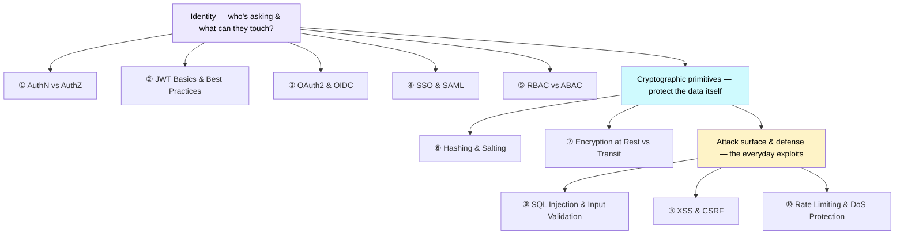
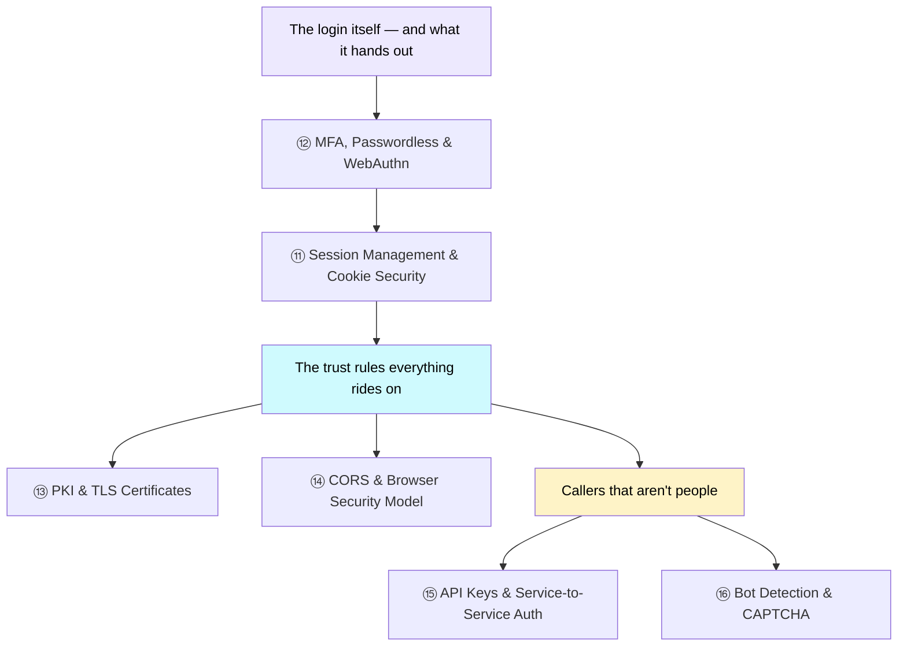
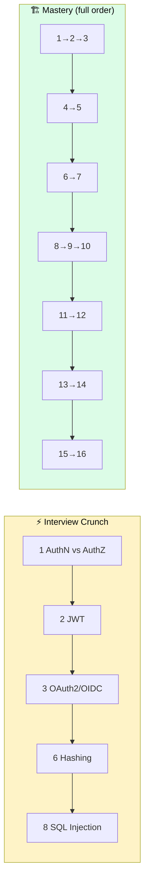

# 11 · Security & Identity 🔐

> **Prove who's asking, then prove what they're allowed to do.** Every system exposes a door to the outside world, and this section is the lock, the guard, and the alarm: identity (authentication vs authorization, JWT, OAuth2/OIDC, SSO/SAML, RBAC/ABAC) decides who gets in and what they can touch; cryptographic primitives (hashing, encryption at rest and in transit, PKI) protect the data underneath even if the door is forced; and the everyday attack surface (SQL injection, XSS/CSRF, CORS, rate limiting, bots) is where most real breaches actually happen. Get identity wrong and anyone can walk in as anyone else; get the crypto or the attack surface wrong and it doesn't matter how good the lock is — and note that modern attacks mostly skip the door entirely, stealing the *session* issued after a perfect login.

---

## 🎯 What You'll Be Able To Do

- **Draw the line between authentication and authorization** and place each check at the right layer — gateway, service, or sidecar.
- **Design token-based auth end to end** — issue, sign, verify, and rotate JWTs, and wire up OAuth2/OIDC flows without ever leaking a password.
- **Choose an authorization model deliberately** — RBAC for stable orgs, ABAC for fine-grained/dynamic policy — and defend it for a compliance audit.
- **Federate identity across an enterprise** with SSO/SAML so one login — and one kill-switch — governs access to every connected app.
- **Protect data with the right primitive** — salted, slow password hashing vs TLS-in-transit and AES-256-at-rest — and explain why fast hashes are a liability.
- **Recognize and close the everyday attack surface** — SQL injection, XSS/CSRF, and brute-force/volumetric abuse — with parameterized queries, escaping, tokens, and rate limits.
- **Manage the session, not just the login** — issue unguessable IDs, set the four cookie attributes that carry the security, rotate on privilege change, and revoke server-side so "log out everywhere" actually works.
- **Make login phishing-resistant** — rank factors by relay resistance, kill MFA fatigue with number matching, and explain why a WebAuthn passkey's origin-bound signature defeats an adversary-in-the-middle proxy that eats TOTP alive.
- **Operate PKI without outages** — read an X.509 chain, verify SAN not CN, automate ACME renewal, and know why revocation barely works so you reach for short lifetimes instead.
- **Reason inside the browser security model** — what the same-origin policy blocks (reads) versus permits (sends, hence CSRF), configure CORS without shipping a reflected-origin vulnerability, and deploy a nonce-based CSP plus the rest of the header stack.
- **Authenticate machines, not just people** — pick a rung on the ladder from static API keys through OAuth2 client credentials and HMAC-signed requests to mTLS/workload identity, and rotate with a dual-key overlap.
- **Defend against automation economically** — stack cheap passive signals before expensive challenges, score risk instead of blocking binarily, and remove the payoff with breached-password checks and MFA.

---

## 🗺️ How the 16 Topics Interlock

This section is now two layers. **Layer 1 (①–⑩)** is the *foundation* — the identity models, the cryptographic primitives, and the classic attack surface every interview starts from. **Layer 2 (⑪–⑯)** is the *hardening layer* that real systems actually get breached through: the session issued after login, the strength of the factors that produced it, the PKI and browser rules the whole thing rides on, and the non-human callers nobody authenticated.

### Layer 1 — the foundation (①–⑩)



> **The spine:** *prove identity → grant the right permission → protect the underlying data with crypto → defend the surface attackers actually hit.* JWT (②) is the token OAuth2/OIDC (③) issues and SSO/SAML (④) federates; RBAC/ABAC (⑤) is the authorization decision AuthN vs AuthZ (①) sets up. Hashing (⑥) and encryption (⑦) protect the data whether or not the front door holds; SQLi/XSS/CSRF/rate limiting (⑧⑨⑩) are the exploits that walk straight through it if identity or crypto is weak.

### Layer 2 — hardening the real attack paths (⑪–⑯)



> **The through-line:** *a perfect login is worthless if the thing it issues can be stolen.* Harden the factors (⑫ — only an origin-bound passkey survives a real-time phishing proxy), then harden what the login produces (⑪ — the session ID is a bearer credential, so `HttpOnly` + `Secure` + `SameSite` + `__Host-`, rotation on privilege change, and server-side revocation), because adversary-in-the-middle kits and infostealers **skip the factors entirely and replay the cookie**. Underneath, PKI (⑬) is what makes TLS mean *who* rather than just *encrypted* — the identity layer ⑦ assumes — and the browser security model (⑭) is the arena ⑨'s XSS and CSRF operate in, where CORS is a read permission and never an access control. Finally, the callers with no human at all: machine credentials (⑮, the ladder from static keys to workload identity) and unwanted automation (⑯, the funnel that pairs with ⑩'s rate limits and is only truly ended by ⑫'s MFA).

---

## 📚 The Complete File Index

### Foundation (①–⑩)

| # | Topic | One-line | Key takeaway |
|---|-------|----------|--------------|
| 1 | [Authentication vs Authorization](./Authentication_vs_Authorization.md) | Passport vs boarding pass | AuthN proves identity, AuthZ grants permission; AuthZ always runs after AuthN, never instead of it |
| 2 | [JWT Basics & Best Practices](./JWT_Basics_Best_Practices.md) | A digital driver's license | Signed, not encrypted — never put secrets in the payload; always verify the signature and expiry |
| 3 | [OAuth2 & OpenID Connect (OIDC)](./OAuth2_OpenID_Connect_OIDC.md) | A valet key, plus a name tag | OAuth2 grants scoped delegated access, OIDC layers identity on top; the client never sees the password |
| 4 | [SSO & SAML](./SSO_and_SAML.md) | One wristband, every ride | One IdP issues a signed assertion; disable the account once and every connected app locks instantly |
| 5 | [RBAC vs ABAC](./RBAC_vs_ABAC.md) | Club badge vs smart lock | RBAC = static role→permission for stable orgs; ABAC = policy over subject+resource+environment for fine-grained rules |
| 6 | [Hashing & Salting](./Hashing_and_Salting.md) | Turning a cow into a hamburger | Never store plaintext passwords; slow, salted hashes (Argon2/BCrypt) beat fast ones (MD5/SHA-1) |
| 7 | [Encryption at Rest vs Transit](./Encryption_Rest_vs_Transit.md) | Armored truck vs a house safe | TLS protects data moving, AES-256/TDE protects data sitting; defense in depth needs both, not either |
| 8 | [SQL Injection & Input Validation](./SQL_Injection_Input_Validation.md) | Tricking the bank teller | Never concatenate user input into a query; parameterized queries physically separate data from command |
| 9 | [XSS & CSRF](./XSS_and_CSRF.md) | Fridge note vs forged signature | XSS runs the attacker's script in the victim's browser; CSRF forges the victim's action — escape output, verify tokens |
| 10 | [Rate Limiting & DoS Protection](./Rate_Limiting_DoS_Protection.md) | The turnstile that won't rush | Cap requests by IP/user/endpoint; 429 + backoff turns a 10-minute brute force into 19 years |

### Hardening the Real Attack Paths (⑪–⑯)

| # | Topic | One-line | Key takeaway |
|---|-------|----------|--------------|
| 11 | [Session Management & Cookie Security](./Session_Management_Cookie_Security.md) | A wristband glued to your wrist | After login the session ID *is* the password: 128-bit random, `HttpOnly`+`Secure`+`SameSite`+`__Host-`, rotate on login (fixation), revoke server-side |
| 12 | [MFA, Passwordless & WebAuthn](./MFA_Passwordless_WebAuthn.md) | A secret word vs a signed document | Shared secrets (SMS/TOTP/push) can be relayed by an AiTM proxy; a passkey signs the **origin**, so phishing fails as a protocol constraint |
| 13 | [PKI & TLS Certificates](./PKI_TLS_Certificates.md) | A passport, checked against a seal you already hold | Chain to a pre-installed root, verify **SAN not CN**, automate ACME renewal; revocation soft-fails, so short lifetimes are the real answer |
| 14 | [CORS & the Browser Security Model](./CORS_Browser_Security_Model.md) | Slide a letter under any door, read none | SOP blocks *reads*, not *sends* (hence CSRF); CORS is a read permission, never access control — exact-origin allowlist + `Vary: Origin` + nonce CSP |
| 15 | [API Keys & Service-to-Service Auth](./API_Keys_Service_to_Service_Auth.md) | Shouted password → wax seal → no secret at all | Hash keys at rest, prefix + scope them, always keep two valid for rotation; climb to HMAC signing or workload identity where it matters |
| 16 | [Bot Detection & CAPTCHA Challenges](./Bot_Detection_CAPTCHA_Challenges.md) | Airport security, not a locked door | Cheap passive signals (JA4/TLS, headers, behaviour) → risk score → graduated response; CAPTCHAs are priced (~$1/1k), so remove the payoff instead |

---

## 🧭 Suggested Study Paths



| Goal | Path | Why |
|------|------|-----|
| **⚡ Interview in 48h** | 1 → 2 → 3 → 6 → 8 → 9 (+ skim 11) | Identity basics + tokens + password hashing + the two most-asked exploits = the most-asked 80%; 11 arms you for the "sessions or JWTs?" follow-up |
| **🏗️ Deep mastery** | 1 → 2 → 3 → 4 → 5 → 6 → 7 → 8 → 9 → 10 → 11 → 12 → 13 → 14 → 15 → 16 | Identity → authorization models → crypto primitives → attack surface → then the hardening layer real breaches go through |
| **🔑 Identity focus** | 1 → 2 → 3 → 4 → 5 | AuthN/AuthZ → tokens → delegated access → federation → fine-grained permissions, building up one layer at a time |
| **🛡️ Defense focus** | 6 → 7 → 8 → 9 → 10 | Hash it, encrypt it, validate it, escape it, throttle it — the checklist that stops most real-world breaches |
| **🔐 "Harden our login"** | 12 → 11 → 10 → 16 | Strong factors → the session they issue → throttling → automation defence: the full account-takeover story, in the order attackers actually walk it |
| **🌐 Browser & transport trust** | 13 → 14 → 9 → 11 | PKI makes TLS mean *who*; the browser model is the arena XSS/CSRF and cookies live in |
| **🤖 Machine-to-machine** | 15 → 13 → 3 | The key ladder, the certificates mTLS needs, and the OAuth2 grant that sits between them |

> **Study each file by** doing the 🏋️ **Practice Drills before the solutions**, rehearsing the 🎤 **Interview Q&A out loud**, and reading 🎯 **Staff+ Nuances** for senior-level depth.

---

## 🔑 The Decision Card (whole-section cheat sheet)

```
IDENTITY  AuthN = who you are (passport) · AuthZ = what you can do (boarding pass) · AuthZ ALWAYS follows AuthN
          JWT = header.payload.signature · SIGNED not encrypted · never put secrets in the payload · verify exp + sig
          OAuth2 = scoped delegated ACCESS (valet key) · OIDC = + IDENTITY on top (ID token) · client never sees the password
          SSO/SAML = one IdP, one signed assertion · kill the account once → lose every app · mandatory for enterprise sales
          RBAC = static role→permission (DEFAULT, stable orgs) · ABAC = subject+resource+environment policy (dynamic, compliance)
CRYPTO    HASH passwords, never ENCRYPT them · SLOW is good (Argon2/BCrypt) · fast hashes (MD5/SHA-1) are broken for passwords
          SALT per-user, stored alongside the hash · defeats rainbow tables even when passwords match
          ENCRYPT IN TRANSIT (TLS, the armored truck) AND AT REST (AES-256/TDE, the safe) · defense in depth needs BOTH
ATTACK    SQLi: never concatenate input into a query · PARAMETERIZED QUERIES separate data from command · validate + whitelist
          XSS: escape/encode all output · attacker's script runs as the victim's browser · CSP as a second layer
          CSRF: forges the victim's action via their own cookie · anti-CSRF tokens + SameSite cookies stop it
          RATE LIMIT by IP/user/endpoint · HTTP 429 + backoff · L3/L4 deflects volumetric floods, L7 stops logic abuse
── HARDENING THE REAL ATTACK PATHS ───────────────────────────────────────────
SESSIONS  after login the SESSION ID *is* the password · ≥128-bit CSPRNG, opaque, cookie-only (never in a URL)
          HttpOnly (XSS theft) + Secure (sniffing) + SameSite=Lax/Strict (CSRF) + __Host- (subdomain overwrite)
          REGENERATE the ID on every privilege change = the ONLY fix for session FIXATION · idle AND absolute timeout
          logout = delete the RECORD, not the cookie · sessions vs JWT is a REVOCATION choice, not "stateful vs stateless"
MFA       two DIFFERENT categories (know/have/are) · SMS = SIM swap/SS7 · TOTP = HMAC(seed, time/30), phishable
          push → MFA FATIGUE (Uber 2022) → fix with NUMBER MATCHING + prompt rate limits
          WebAuthn/passkey signs challenge + rpIdHash + ORIGIN, private key never leaves the device → AiTM proxy fails
          server MUST check all 5: signature · origin · challenge freshness · UV flag · advancing counter
          the weakest ENABLED method sets your real security level · recovery is the new weakest link
PKI/TLS   chain leaf → intermediate → pre-installed ROOT · verify SAN (not CN) against the hostname
          CertificateVerify proves KEY POSSESSION (certs are public) · serve intermediates or non-browsers fail
          revocation soft-fails (CRL stale, OCSP blockable) → SHORT LIFETIMES are the real revocation · ACME auto-renew
          EXPIRY is the #1 real TLS outage (O2/Ericsson, Teams) · verify=False/InsecureSkipVerify deletes all of it
BROWSER   origin = scheme‖host‖port · SOP blocks READING a response, NOT sending it → that's why CSRF exists
          CORS = a READ permission, never access control (curl ignores it; the request still ran)
          json content-type ⇒ PREFLIGHT · exact-origin allowlist + Vary: Origin · NEVER reflect Origin / allow "null"
          CSP: per-response NONCE + strict-dynamic (host allowlists are bypassable) + object-src/base-uri 'none'
          + HSTS preload · frame-ancestors · nosniff · Referrer-Policy · Permissions-Policy · COOP+COEP (Spectre)
MACHINE   ladder: static API key → OAuth2 client credentials → HMAC signing (SigV4) → mTLS/workload identity
          keys: CSPRNG + PREFIX (sk_live_) · store a SHA-256 HASH (high-entropy ⇒ fast hash is correct) · show once
          constant-time compare · scope least privilege · header not URL · expires_at · per-key metrics
          ALWAYS keep TWO valid → rotate by issuing, watching usage hit zero, THEN revoking (never by deleting)
          HMAC: sign canonical request + body hash + timestamp + nonce → secret never on the wire, no replay
          webhooks: verify the RAW body · workload identity (SPIFFE/OIDC federation) = no static secret at all
BOTS      layered FUNNEL, cheapest first: ASN/IP reputation → TLS JA4 + HTTP/2 + header order → behaviour → challenge
          output a risk SCORE, not a verdict → allow (~97%) / challenge / tarpit · a hard 403 teaches the attacker
          per-IP limits die to RESIDENTIAL PROXIES · CAPTCHAs cost ~$1/1,000 solves (and ML beats humans)
          remove the PAYOFF: breached-password check (k-anonymity), MFA, per-ACCOUNT throttle, uniform responses
          NEVER hard-lock on unauthenticated input = self-DoS · cheap filters must run BEFORE the slow password hash
          measure FALSE POSITIVES (lost customers) as seriously as block rate
ANTI-PATTERNS  storing plaintext passwords · rolling your own crypto · trusting client-side validation alone ·
               putting secrets in a JWT payload · one shared "admin" account for everyone · "my network is private" fallacy ·
               keeping the pre-login session ID after login · reflecting the Origin header with credentials ·
               API keys in query strings · rotating a credential by deleting it · account lockout as a bot defence
```

---

## 🎨 Conventions & Authoring

- Every file follows the root [TEMPLATE.md](../TEMPLATE.md). Animated SVGs live in [/assets](../assets/).
- Each file ends with the three mastery sections: 🏋️ Practice Drills, 🎤 Interview Q&A Bank, 🎯 Staff+ Nuances.

---

## ➡️ Where This Connects

- ⬅️ [02 · API & Interface Design](../02_API_Interface_Design/) — auth in the contract: where authentication and authorization actually get enforced at the edge.
- ⬅️ [10 · Microservices & Distributed Systems](../10_Microservices_Distributed_Systems/) — service-to-service trust, mTLS, and propagating identity across boundaries.
- ➡️ [15 · Security Deep Dive & DevSecOps](../15_Security_Deep_Dive_DevSecOps/) — threat modeling, secrets management, and security baked into the delivery pipeline.
- ➡️ [12 · Monitoring, Logging & Observability](../12_Monitoring_Logging_Observability/) — detecting the breach attempts this section teaches you to prevent.

---
*Part of the [System Design & Architecture Master Repository](../README.md). Identity decides who's at the door; cryptography and the attack-surface defenses decide whether the door actually holds.*
