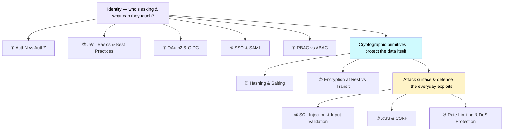
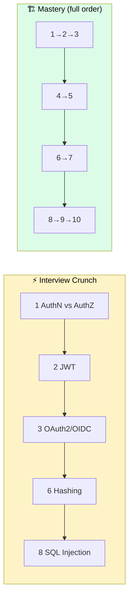

# 11 · Security & Identity 🔐

> **Prove who's asking, then prove what they're allowed to do.** Every system exposes a door to the outside world, and this section is the lock, the guard, and the alarm: identity (authentication vs authorization, JWT, OAuth2/OIDC, SSO/SAML, RBAC/ABAC) decides who gets in and what they can touch; cryptographic primitives (hashing, encryption at rest and in transit) protect the data underneath even if the door is forced; and the everyday attack surface (SQL injection, XSS/CSRF, rate limiting) is where most real breaches actually happen. Get identity wrong and anyone can walk in as anyone else; get the crypto or the attack surface wrong and it doesn't matter how good the lock is.

---

## 🎯 What You'll Be Able To Do

- **Draw the line between authentication and authorization** and place each check at the right layer — gateway, service, or sidecar.
- **Design token-based auth end to end** — issue, sign, verify, and rotate JWTs, and wire up OAuth2/OIDC flows without ever leaking a password.
- **Choose an authorization model deliberately** — RBAC for stable orgs, ABAC for fine-grained/dynamic policy — and defend it for a compliance audit.
- **Federate identity across an enterprise** with SSO/SAML so one login — and one kill-switch — governs access to every connected app.
- **Protect data with the right primitive** — salted, slow password hashing vs TLS-in-transit and AES-256-at-rest — and explain why fast hashes are a liability.
- **Recognize and close the everyday attack surface** — SQL injection, XSS/CSRF, and brute-force/volumetric abuse — with parameterized queries, escaping, tokens, and rate limits.

---

## 🗺️ How the 10 Topics Interlock



> **The spine:** *prove identity → grant the right permission → protect the underlying data with crypto → defend the surface attackers actually hit.* JWT (②) is the token OAuth2/OIDC (③) issues and SSO/SAML (④) federates; RBAC/ABAC (⑤) is the authorization decision AuthN vs AuthZ (①) sets up. Hashing (⑥) and encryption (⑦) protect the data whether or not the front door holds; SQLi/XSS/CSRF/rate limiting (⑧⑨⑩) are the exploits that walk straight through it if identity or crypto is weak.

---

## 📚 The Complete File Index

| # | Topic | One-line | Key takeaway |
|---|-------|----------|--------------|
| 1 | [Authentication vs Authorization](./Authentication_vs_Authorization.md) | Passport vs boarding pass | AuthN proves identity, AuthZ grants permission; AuthZ always runs after AuthN, never instead of it |
| 2 | [JWT Basics & Best Practices](./JWT_Basics_Best_Practices.md) | A digital driver's license | Signed, not encrypted — never put secrets in the payload; always verify the signature and expiry |
| 3 | [OAuth2 & OpenID Connect (OIDC)](./OAuth2_OpenID_Connect_OIDC.md) | A valet key, plus a name tag | OAuth2 grants scoped delegated access, OIDC layers identity on top; the client never sees the password |
| 4 | [SSO & SAML](./SSO_and_SAML.md) | One wristband, every ride | One IdP issues a signed assertion; disable the account once and every connected app locks instantly |
| 5 | [RBAC vs ABAC](./RBAC_vs_ABAC.md) | Club badge vs smart lock | RBAC = static role→permission for stable orgs; ABAC = policy over subject+resource+environment for fine-grained rules |
| 6 | [Hashing & Salting](./Hashing_and_Salting.md) | Turning a cow into a hamburger | Never store plaintext passwords; slow, salted hashes (Argon2/BCrypt) beat fast ones (MD5/SHA-1) |
| 7 | [Encryption at Rest vs Transit](./Encryption_Rest_vs_Transit.md) | Armored truck vs a house safe | TLS protects data moving, AES-256/TDE protects data sitting; defense in depth needs both, not either |
| 8 | [SQL Injection & Input Validation](./SQL_Injection_Input_Validation.md) | Tricking the bank teller | Never concatenate user input into a query; parameterized queries physically separate data from command |
| 9 | [XSS & CSRF](./XSS_and_CSRF.md) | Fridge note vs forged signature | XSS runs the attacker's script in the victim's browser; CSRF forges the victim's action — escape output, verify tokens |
| 10 | [Rate Limiting & DoS Protection](./Rate_Limiting_DoS_Protection.md) | The turnstile that won't rush | Cap requests by IP/user/endpoint; 429 + backoff turns a 10-minute brute force into 19 years |

---

## 🧭 Suggested Study Paths



| Goal | Path | Why |
|------|------|-----|
| **⚡ Interview in 48h** | 1 → 2 → 3 → 6 → 8 → 9 | Identity basics + tokens + password hashing + the two most-asked exploits = the most-asked 80% |
| **🏗️ Deep mastery** | 1 → 2 → 3 → 4 → 5 → 6 → 7 → 8 → 9 → 10 | Identity → authorization models → crypto primitives → attack surface, in dependency order |
| **🔑 Identity focus** | 1 → 2 → 3 → 4 → 5 | AuthN/AuthZ → tokens → delegated access → federation → fine-grained permissions, building up one layer at a time |
| **🛡️ Defense focus** | 6 → 7 → 8 → 9 → 10 | Hash it, encrypt it, validate it, escape it, throttle it — the checklist that stops most real-world breaches |

> **Study each file by** doing the 🏋️ **Practice Drills before the solutions**, rehearsing the 🎤 **Interview Q&A out loud**, and reading 🎯 **Staff+ Nuances** for senior-level depth.

---

## 🔑 The Decision Card (whole-section cheat sheet)

```
IDENTITY  AuthN = who you are (passport) · AuthZ = what you can do (boarding pass) · AuthZ ALWAYS follows AuthN
          JWT = header.payload.signature · SIGNED not encrypted · never put secrets in the payload · verify exp + sig
          OAuth2 = scoped delegated ACCESS (valet key) · OIDC = + IDENTITY on top (ID token) · client never sees the password
          SSO/SAML = one IdP, one signed assertion · kill the account once → lose every app · mandatory for enterprise sales
          RBAC = static role→permission (DEFAULT, stable orgs) · ABAC = subject+resource+environment policy (dynamic, compliance)
CRYPTO    HASH passwords, never ENCRYPT them · SLOW is good (Argon2/BCrypt) · fast hashes (MD5/SHA-1) are broken for passwords
          SALT per-user, stored alongside the hash · defeats rainbow tables even when passwords match
          ENCRYPT IN TRANSIT (TLS, the armored truck) AND AT REST (AES-256/TDE, the safe) · defense in depth needs BOTH
ATTACK    SQLi: never concatenate input into a query · PARAMETERIZED QUERIES separate data from command · validate + whitelist
          XSS: escape/encode all output · attacker's script runs as the victim's browser · CSP as a second layer
          CSRF: forges the victim's action via their own cookie · anti-CSRF tokens + SameSite cookies stop it
          RATE LIMIT by IP/user/endpoint · HTTP 429 + backoff · L3/L4 deflects volumetric floods, L7 stops logic abuse
ANTI-PATTERNS  storing plaintext passwords · rolling your own crypto · trusting client-side validation alone ·
               putting secrets in a JWT payload · one shared "admin" account for everyone · "my network is private" fallacy
```

---

## 🎨 Conventions & Authoring

- Every file follows the root [TEMPLATE.md](../TEMPLATE.md). Animated SVGs live in [/assets](../assets/).
- Each file ends with the three mastery sections: 🏋️ Practice Drills, 🎤 Interview Q&A Bank, 🎯 Staff+ Nuances.

---

## ➡️ Where This Connects

- ⬅️ [02 · API & Interface Design](../02_API_Interface_Design/) — auth in the contract: where authentication and authorization actually get enforced at the edge.
- ⬅️ [10 · Microservices & Distributed Systems](../10_Microservices_Distributed_Systems/) — service-to-service trust, mTLS, and propagating identity across boundaries.
- ➡️ [15 · Security Deep Dive & DevSecOps](../15_Security_Deep_Dive_DevSecOps/) — threat modeling, secrets management, and security baked into the delivery pipeline.
- ➡️ [12 · Monitoring, Logging & Observability](../12_Monitoring_Logging_Observability/) — detecting the breach attempts this section teaches you to prevent.

---
*Part of the [System Design & Architecture Master Repository](../README.md). Identity decides who's at the door; cryptography and the attack-surface defenses decide whether the door actually holds.*
