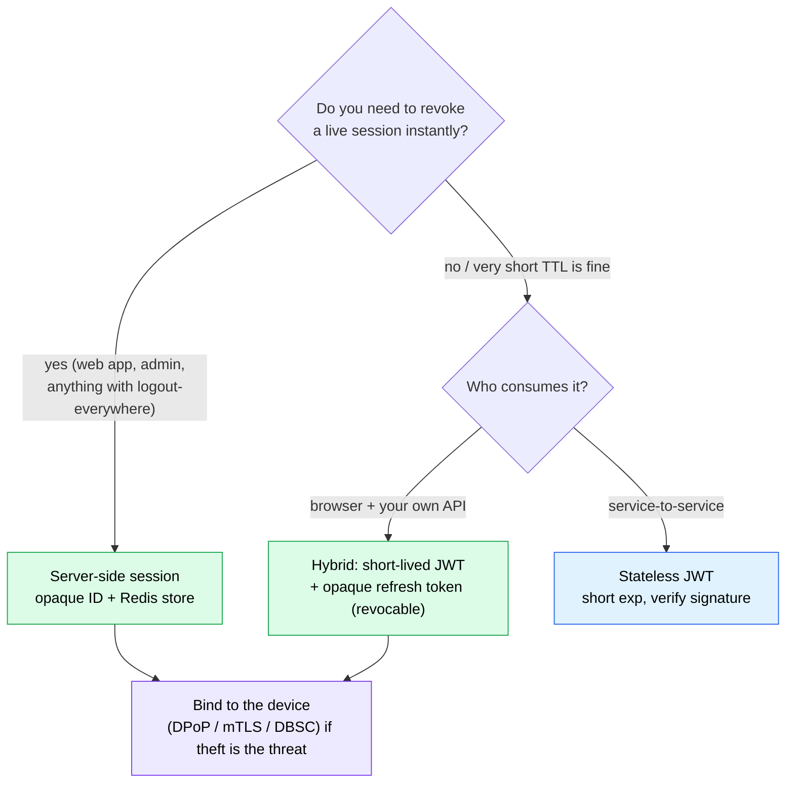

# Session Management & Cookie Security

## 1. Why Should I Care About This?
- **After Login, the Session ID *Is* the Password**: You spend enormous effort on password hashing, MFA, and rate limiting — and then hand the browser a string that grants the same access for the next 30 days. If that string leaks, every login control you built is bypassed. Attackers don't crack passwords anymore; they steal session cookies.
- **Cookie Theft Is the #1 Post-MFA Bypass**: Infostealer malware (RedLine, Raccoon) and adversary-in-the-middle phishing kits (Evilginx) don't try to defeat MFA — they grab the *post-authentication* session cookie and replay it. The user did everything right; the session was the weak link.
- **Interviewers Use It to Test Depth**: "Sessions or JWTs?" is a standard question, and the shallow answer ("JWTs, they're stateless") walks straight into the follow-up: "how do you log someone out of all devices?" Knowing session fixation, rotation, `SameSite`, and the `__Host-` prefix is what separates "I've read a blog" from "I've shipped auth."

## 2. What Problem Does This Solve?
- **HTTP Has No Memory**: HTTP is stateless — every request arrives as an anonymous stranger. Something must carry "this is Alice, already authenticated" from one request to the next without re-sending the password each time.
- **Carrying Identity Without Carrying Credentials**: You want a token that proves prior authentication but is *revocable, scoped, and short-lived* — unlike a password, which is none of those.
- **Naive Approach**: Put a plain cookie `user=alice` (or worse, `?user=alice` in the URL) and trust it. Anyone can edit a cookie or a URL and become anyone. The obvious "fix" — a random opaque ID instead — is right, but naive implementations then leak it three ways: a **predictable ID** (sequential counters, `md5(username + timestamp)`), a **readable ID** (no `HttpOnly`, so any XSS exfiltrates it), and a **fixated ID** (the same ID before and after login, so an attacker who plants it beforehand inherits the authenticated session).

## 3. Core Idea (Intuition First)
Think of it like **a nightclub wristband**.
- You show ID at the door **once** (the password / MFA) — that's authentication. Then you get a **wristband with an unguessable serial number**. Inside, nobody re-checks your ID; the bar just looks at the wristband.
- The wristband is **worthless to forge** because the serials are long random numbers the door tracks — but it's **fully valuable to steal**. A wristband on the floor works for whoever picks it up. That's why the cookie attributes matter: they're the difference between a wristband glued to your wrist and one you leave on the table.
- **Session fixation** is the subtle attack: the attacker slips *their own* blank wristband onto your wrist before you reach the door. If the door stamps your wristband instead of issuing a new one, the attacker now holds a duplicate that's authenticated as *you*. The fix is simple and absolute: **always issue a brand-new serial at the moment privilege changes**.
- The **bouncer's ledger** (a server-side session store) is what lets you *cancel* a wristband instantly. Take the ledger away — a self-contained signed token — and you gain speed but lose the ability to say "that one's void."

![Three-panel diagram of session and cookie security. Panel A: a browser posts credentials to a server, which responds with Set-Cookie containing a 128-bit random session ID, and four attribute chips explain HttpOnly (JavaScript cannot read document.cookie, blunting XSS theft), Secure (HTTPS only, no sniffing), SameSite Lax or Strict (not sent on cross-site POST, killing most CSRF), and the __Host- prefix (host-locked with Path=/, preventing subdomain overwrite). Panel B: a four-step session fixation timeline where the attacker obtains session ID ABC, the victim is made to use ABC, the victim logs in and the server keeps the same ID so ABC becomes authenticated, and the attacker replays ABC for full account takeover; a green fix bar says regenerate the session ID on every privilege change and invalidate the old one, plus a note on hijacking defenses. Panel C: server-side session (sid maps to a Redis record, revoke by deleting the key for instant logout-everywhere, cost is a lookup per request) versus stateless JWT (self-contained claims valid until exp, cannot be un-issued, needs a denylist or short TTL plus refresh).](../assets/session_cookie_security.svg)

> Panel A: the security lives in the cookie *attributes*, not the cookie. Panel B (the key lesson): without ID rotation at login, an attacker who plants a session ID inherits the authenticated one. Panel C: the session-vs-JWT choice is really a choice about whether you can revoke.

## 4. How It Actually Works
### 1. Issue an unguessable ID
- On successful authentication the server generates a **≥128-bit value from a CSPRNG** (`secrets.token_urlsafe(32)`, `crypto.randomBytes(32)`, `SecureRandom`) — never `Math.random()`, never a hash of user data, never a counter. 128 bits makes online guessing hopeless (2^128 candidates against a rate-limited endpoint).
- The ID is **opaque**: it carries no meaning. All state (`user_id`, `roles`, `created_at`, `last_seen`, `ip`, `user_agent`) lives server-side, keyed by the ID.

### 2. Transport it in a cookie, with the attributes that matter
- `HttpOnly` — JavaScript cannot read it via `document.cookie`. This is what turns "XSS = instant account takeover" into "XSS = attacker must act inside the page." Not a cure for XSS, but a huge downgrade of its impact.
- `Secure` — the browser only sends it over HTTPS, so it never crosses the wire in plaintext.
- `SameSite=Lax` (browser default today) or `Strict` — the cookie is withheld from cross-site subrequests, which removes the fuel for most **CSRF**. `Strict` also blocks it on top-level cross-site *navigations*, so a user following a link from an email arrives logged-out — hence `Lax` is the usual pick, `Strict` for banking-grade flows. `SameSite=None` (needed for genuine third-party contexts) **requires** `Secure`.
- `Path=/` + `Domain` scoping, or better: the **`__Host-` prefix** (`Set-Cookie: __Host-sid=…; Secure; Path=/`). Browsers enforce that a `__Host-` cookie has no `Domain` attribute and `Path=/`, which stops a compromised or attacker-controlled **subdomain** from overwriting your session cookie (cookie tossing).
- `Max-Age` / `Expires` — omit them for a **session cookie** (dies with the browser); set them for "remember me." Note that a cookie's expiry is a *browser* hint; the authoritative lifetime must be enforced server-side.

### 3. Rotate on privilege change
- At login, step-up MFA, password change, or role switch: **create a new session ID, copy the needed state, destroy the old ID**. This is the entire defense against **session fixation**. Frameworks expose it directly — `request.session.cycle_key()` (Django), `HttpServletRequest.changeSessionId()` (Servlet 3.1+), `session_regenerate_id(true)` (PHP).

### 4. Expire two different ways
- **Idle timeout** — invalidate after N minutes of no activity (15–30 min for sensitive apps). Bounds the window in which a stolen cookie is useful.
- **Absolute lifetime** — a hard cap regardless of activity (e.g. 12 hours, or 30 days for "remember me"). Prevents an endlessly-renewed session from living forever.
- Store both `last_seen` and `created_at` server-side and check them on every request; never trust the cookie's own expiry.

### 5. Invalidate deliberately
- **Logout** must delete the server-side record — not merely clear the cookie. Clearing only the cookie leaves a live session that a stolen copy still opens.
- **Logout everywhere** = delete every session row for that user. This is trivial with a session store (`SCAN`/index by `user_id`) and genuinely hard with stateless tokens.
- On **password reset or suspected compromise**, invalidate all sessions except (optionally) the current one.

```mermaid
sequenceDiagram
    participant B as Browser
    participant A as App Server
    participant S as Session Store (Redis)
    B->>A: POST /login (user, pass, MFA)
    A->>A: verify credentials
    A->>S: DEL old sid (fixation defence)
    A->>S: SET sid=<128-bit random> {user_id, created_at, last_seen} EX 1800
    A-->>B: Set-Cookie: __Host-sid=…; HttpOnly; Secure; SameSite=Lax; Path=/
    B->>A: GET /account (cookie sent automatically)
    A->>S: GET sid
    S-->>A: {user_id: 42, last_seen: …}
    A->>A: check idle + absolute timeout
    A->>S: touch last_seen (sliding window)
    A-->>B: 200 account page
    B->>A: POST /logout
    A->>S: DEL sid  (and all sids for user 42 = logout everywhere)
    A-->>B: Set-Cookie: __Host-sid=; Max-Age=0
```

## 5. Real-World Example
**Adversary-in-the-middle phishing that defeats MFA — and what actually stops it:**
- A user clicks a phishing link to `micros0ft-login.com`, which is an **Evilginx-style reverse proxy**. It forwards every keystroke to the real Microsoft login and relays the response, so the page is genuine, the password works, and the MFA push arrives and is approved.
- The proxy's real prize is the **`ESTSAUTH` session cookie** the real IdP issues at the end. The attacker imports it into their own browser and is inside the account with **MFA already satisfied** — no password, no second factor, no anomaly on the login page.
- What breaks this chain: **short session lifetimes** (the stolen cookie expires fast), **token binding / continuous access evaluation** (the session is tied to the device or re-validated when IP/device changes so a replay from a new machine fails), **phishing-resistant factors** (a passkey's origin check means the proxy's domain can't produce a valid assertion in the first place — see [MFA, Passwordless & WebAuthn](./MFA_Passwordless_WebAuthn.md)), and **server-side revocation** so the security team can kill every session the moment it's reported.
- The same cookie is also what **infostealer malware** exfiltrates from a browser profile — which is why "we forced a password reset" is an incomplete response. If you don't invalidate sessions too, the attacker is still logged in.

## 6. Code Example
Session issuance, verification, rotation, and revocation with a Redis-backed store (Python-ish pseudocode):
```python
import secrets, time

IDLE_TTL      = 30 * 60          # sliding: 30 min of inactivity
ABSOLUTE_TTL  = 12 * 60 * 60     # hard cap: 12 hours, however active

def new_session(redis, user_id, request, old_sid=None):
    if old_sid:                                   # ── FIXATION DEFENCE ──
        redis.delete(f"sess:{old_sid}")           # never reuse a pre-login ID
    sid = secrets.token_urlsafe(32)               # 256 bits from a CSPRNG
    now = int(time.time())
    redis.hset(f"sess:{sid}", mapping={
        "user_id": user_id, "created_at": now, "last_seen": now,
        "ua_hash": hash(request.headers["User-Agent"]),   # weak binding signal
    })
    redis.expire(f"sess:{sid}", IDLE_TTL)
    redis.sadd(f"user_sessions:{user_id}", sid)    # index → enables logout-everywhere
    return sid

# Set-Cookie: __Host- forces Secure + Path=/ + no Domain (no subdomain overwrite)
COOKIE = "__Host-sid={sid}; HttpOnly; Secure; SameSite=Lax; Path=/"

def load_session(redis, sid):
    s = redis.hgetall(f"sess:{sid}")
    if not s:                                      # unknown or revoked
        return None
    now = int(time.time())
    if now - int(s["created_at"]) > ABSOLUTE_TTL:   # absolute cap beats activity
        revoke(redis, sid, s["user_id"]); return None
    redis.hset(f"sess:{sid}", "last_seen", now)
    redis.expire(f"sess:{sid}", IDLE_TTL)          # slide the idle window
    return s

def revoke(redis, sid, user_id):                   # logout: kill the RECORD, not just the cookie
    redis.delete(f"sess:{sid}")
    redis.srem(f"user_sessions:{user_id}", sid)

def revoke_all(redis, user_id):                    # "log out everywhere" / after password reset
    for sid in redis.smembers(f"user_sessions:{user_id}"):
        redis.delete(f"sess:{sid}")
    redis.delete(f"user_sessions:{user_id}")
```

## 7. Design Variations & Alternatives
| Approach | State lives | Revocation | Per-request cost | Best for |
|---|---|---|---|---|
| **Server-side session (opaque ID + store)** | Redis/DB | Instant, exact | 1 store lookup (~0.5 ms) | Web apps, anything needing logout-everywhere |
| **Signed cookie session** (Rails/Flask style: state in the cookie, HMAC'd) | The cookie itself | None until expiry | Zero I/O, but the cookie grows and rides every request | Small, non-sensitive state (flash messages, prefs) |
| **Stateless JWT access token** | The token | Only via denylist or expiry | Signature verify (~µs) | Service-to-service, short-lived API access |
| **Hybrid: short JWT + opaque refresh token** | Refresh token in a store | Revoke the refresh token; access token dies in minutes | Verify + occasional refresh call | The pragmatic default for SPAs/mobile |
| **Sticky sessions (in-memory, LB affinity)** | App server RAM | Instant, but only on that node | Zero | Legacy single-node apps only |

- **Sticky sessions are an availability trap**: in-memory sessions force the load balancer to pin each user to one node, so losing that node logs those users out and scaling out doesn't rebalance existing traffic. Externalize to Redis and any node can serve any request.
- **Refresh-token rotation with reuse detection** is the standard hardening for the hybrid model: every refresh issues a new refresh token and voids the old one. If an old one is ever presented again, that's proof of theft — revoke the whole family.
- **Token/device binding** (DPoP, mTLS-bound tokens, or Chrome's Device Bound Session Credentials) cryptographically ties the session to a key held on the device, so an exfiltrated cookie is useless elsewhere. This is the real answer to infostealers.



## 8. Pros and Cons
### Server-side sessions
- **Pros**: **instant, exact revocation** (logout-everywhere, kill-on-compromise); the cookie stays tiny and reveals nothing; you can change permissions mid-session; you get an auditable list of "active devices" for free.
- **Cons**: a **stateful dependency** — every request touches the store, so it must be fast and highly available (Redis down = everyone logged out unless you plan for it); requires a shared store across nodes; adds ~0.3–1 ms per request.

### Stateless tokens
- **Pros**: zero I/O per request, trivially horizontally scalable, works cleanly across services and domains.
- **Cons**: **you cannot un-issue a token** — a stolen one is valid until `exp`; permission changes lag; adding a denylist to fix revocation reintroduces exactly the state you were avoiding, only worse (now you have state *and* a bigger cookie).

## 9. Failure Scenarios & What Can Go Wrong
- **SYMPTOM**: An attacker is logged in as a user who never leaked their password. **CAUSE**: session fixation — the pre-login session ID was kept after authentication. **FIX**: regenerate the session ID on every privilege change and delete the old record.
- **SYMPTOM**: One XSS bug leads to mass account takeover. **CAUSE**: the session cookie lacked `HttpOnly`, so injected JS read `document.cookie` and exfiltrated it. **FIX**: `HttpOnly` on every auth cookie, plus a CSP as the real XSS fix (see [XSS & CSRF](./XSS_and_CSRF.md)).
- **SYMPTOM**: Users perform actions they never initiated (transfers, deletes). **CAUSE**: the cookie is sent on cross-site POSTs, so any page can forge authenticated requests. **FIX**: `SameSite=Lax/Strict` **and** anti-CSRF tokens for state-changing requests — belt and braces, since `SameSite` has carve-outs and older clients ignore it.
- **SYMPTOM**: A marketing subdomain gets compromised and main-site accounts follow. **CAUSE**: the cookie was scoped `Domain=.example.com`, so any subdomain can read *or overwrite* it (cookie tossing). **FIX**: host-only cookies via the `__Host-` prefix; never share auth cookies across a subdomain boundary you don't fully control.
- **SYMPTOM**: "We reset all passwords" but the intruder is still active. **CAUSE**: password reset didn't invalidate existing sessions. **FIX**: `revoke_all(user_id)` on password change, MFA change, and any compromise response.
- **SYMPTOM**: Session IDs turn up in server logs, `Referer` headers, browser history, and shared links. **CAUSE**: the ID is carried in the URL. **FIX**: cookies only; never accept a session identifier from a query string or body.
- **SYMPTOM**: Redis restarts and every user is logged out mid-checkout. **CAUSE**: single non-persistent session store, no replication. **FIX**: replicate/persist the session store, treat it as a tier-1 dependency, and consider a graceful re-auth path rather than a hard error.
- **SYMPTOM**: A user's session works from a completely different country seconds after they used it locally. **CAUSE**: no binding or anomaly detection — a replayed stolen cookie. **FIX**: device/token binding (DPoP/DBSC), plus continuous evaluation on IP/ASN/device change with step-up re-auth.

## 10. Impact on Scalability, Reliability & Cost
- **Scalability**: sessions are the classic reason apps can't scale horizontally. In-memory sessions force LB stickiness (bad rebalancing, node loss = logouts); an external store makes every app node interchangeable and lets you autoscale freely. The store itself scales trivially — a session record is ~200–500 bytes, so 10 M active sessions is only ~2–5 GB of Redis, and lookups are O(1).
- **Reliability**: an external session store is a **hard dependency on the login-protected path** — it needs replication, persistence (or a documented "everyone re-logs-in" blast radius), and generous timeouts. The trade-off is real but usually worth it: the alternative (stateless tokens) removes the dependency and removes revocation with it.
- **Cost**: a couple of Redis nodes and sub-millisecond added latency per request — negligible next to the cost of an unrevokable session during an incident. The expensive failure mode is *not having* revocation: incident response degrades from "click revoke" to "rotate the signing key and log out the entire user base."

## 11. When NOT to Use This
- **Pure machine-to-machine APIs**: no browser, no cookies, no CSRF surface — use OAuth2 client credentials, signed requests, or mTLS instead (see [API Keys & Service-to-Service Auth](./API_Keys_Service_to_Service_Auth.md)).
- **Cross-domain / third-party contexts**: cookies are increasingly blocked in third-party contexts; a token in an `Authorization` header is the workable path.
- **Massive fan-out, latency-critical read paths** where a store lookup per request is genuinely unaffordable: use short-lived signed tokens (30–60 s) and accept the revocation lag — the short TTL *is* the revocation.
- **Truly stateless public content**: don't create a session for anonymous visitors who don't need one; it's wasted state and, ironically, the raw material for session fixation.

## 12. Interview Perspective
- **What interviewers expect**: name the four cookie attributes and *what attack each one blunts*; state that the session ID must be ≥128 bits of CSPRNG; bring up **rotation on login** unprompted (this is the fixation tell); and articulate the session-vs-JWT trade-off as **revocation vs per-request I/O**, not "stateful vs stateless."
- **The trap question**: "JWTs are stateless — how do you log a user out of all devices?" Correct answer: you can't, cleanly. Either you add a denylist/version check (reintroducing state, so you may as well use sessions) or you keep access tokens short-lived (minutes) and revoke the **opaque refresh token** instead. Say which one you'd pick and why.
- **Follow-up: "MFA is enabled, so we're safe from phishing, right?"** No — AiTM proxies steal the *post-MFA session cookie*. Mention short lifetimes, device-bound sessions, and phishing-resistant factors (passkeys).
- **Bonus signals**: the `__Host-` prefix and cookie tossing from a subdomain; the difference between idle and absolute timeouts; why clearing the cookie on logout isn't logout; refresh-token rotation with reuse detection.

## 13. Connections to Other Topics
- [Authentication vs Authorization](./Authentication_vs_Authorization.md) — the session is what carries the *result* of authentication into every subsequent authorization check.
- [JWT Basics & Best Practices](./JWT_Basics_Best_Practices.md) — the stateless alternative; this file is the "why you might still want a store" counterweight.
- [XSS & CSRF](./XSS_and_CSRF.md) — the two attacks the cookie attributes exist to blunt: `HttpOnly` for XSS theft, `SameSite` for CSRF.
- [CORS & the Browser Security Model](./CORS_Browser_Security_Model.md) — the same-origin policy and credentialed-request rules that decide when your cookie is even sent.
- [MFA, Passwordless & WebAuthn](./MFA_Passwordless_WebAuthn.md) — strong login is undone by weak session handling; passkeys plus bound sessions close the AiTM gap.
- [OAuth2 & OpenID Connect](./OAuth2_OpenID_Connect_OIDC.md) — where refresh tokens, rotation, and front-channel/back-channel logout are specified.
- [Distributed Caching (Redis, Memcached)](../06_Caching_Performance/Distributed_Caching_Redis_Memcached.md) — the store that almost always holds the sessions, and its failure modes.
- [Sticky Sessions vs Stateless Design](../07_Load_Balancing_Scalability/Sticky_Sessions_vs_Stateless_Design.md) — sticky sessions vs externalized state, and why the latter wins.

## 14. Visual Aids
- **The SVG above** ([session_cookie_security.svg](../assets/session_cookie_security.svg)): panel A — the `Set-Cookie` attributes and the attack each one blunts; panel B — the four-step session fixation timeline plus the rotation fix; panel C — session vs JWT framed as a revocation trade-off.
- **Mermaid #1 (Section 4)**: the full lifecycle — issue with rotation, verify with dual timeouts, slide the idle window, then revoke the record (and every record for that user) on logout.
- **Mermaid #2 (Section 7)**: the decision tree — do you need instant revocation? → server-side session vs hybrid vs pure JWT, with device binding layered on top.

## 15. Summary (TL;DR)
**A session turns stateless HTTP into "this is still Alice" by issuing an opaque, ≥128-bit CSPRNG identifier at login and storing the real state server-side — which means that after login the session ID is a bearer credential every bit as powerful as the password, so it must be protected by the cookie attributes (`HttpOnly` to blunt XSS exfiltration, `Secure` to keep it off plaintext wires, `SameSite=Lax/Strict` to starve CSRF, and the `__Host-` prefix to stop a subdomain from overwriting it), regenerated on every privilege change (the one and only defense against session fixation, where an attacker plants a pre-login ID and inherits the authenticated one), expired by both an idle timeout and an absolute lifetime, and invalidated *server-side* on logout, password reset, and compromise — because logout that only clears the cookie leaves a live session for a stolen copy to replay; the session-vs-JWT decision is really a revocation decision (a store gives instant, exact, logout-everywhere revocation for ~0.5 ms of I/O per request, while a stateless token is valid until `exp` and can only be "revoked" by a denylist that reintroduces the state you were avoiding), the pragmatic middle ground is a short-lived access token plus an opaque, rotating, reuse-detecting refresh token, and since modern attacks (AiTM phishing proxies, infostealer malware) bypass MFA entirely by replaying the post-authentication cookie, the real end-state is binding the session to the device (DPoP, mTLS, DBSC) so a stolen cookie is worthless anywhere else.**

## 16. Further Reading & Resources
- [OWASP Session Management Cheat Sheet](https://cheatsheetseries.owasp.org/cheatsheets/Session_Management_Cheat_Sheet.html)
- [OWASP Web Security Testing Guide — Session Fixation](https://owasp.org/www-project-web-security-testing-guide/latest/4-Web_Application_Security_Testing/06-Session_Management_Testing/03-Testing_for_Session_Fixation)
- [MDN — Using HTTP cookies (attributes, prefixes, SameSite)](https://developer.mozilla.org/en-US/docs/Web/HTTP/Cookies)
- [RFC 6265bis — Cookies: HTTP State Management Mechanism (`__Host-`/`__Secure-` prefixes, SameSite)](https://datatracker.ietf.org/doc/html/draft-ietf-httpbis-rfc6265bis)
- [Chrome — Device Bound Session Credentials (DBSC): binding sessions to hardware](https://developer.chrome.com/docs/web-platform/device-bound-session-credentials)
- [RFC 9449 — OAuth 2.0 Demonstrating Proof of Possession (DPoP)](https://datatracker.ietf.org/doc/html/rfc9449)
