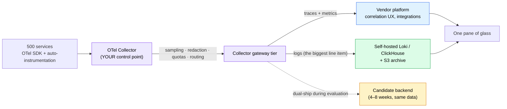
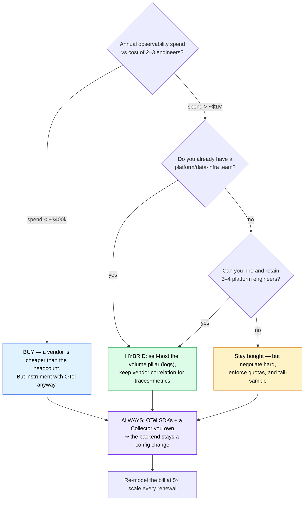

# APM & Observability Tooling Landscape

## 1. Why Should I Care About This?
- **The Bill Gets Absurd Faster Than Anyone Expects**: Datadog's own 2021 shareholder letter disclosed a **$65 M annual contract with a single customer** (widely reported as Coinbase) — a company whose entire cloud spend was a fraction of some peers'. Observability routinely lands at **10–30% of infrastructure spend**, and "our monitoring costs more than the thing it monitors" is a real conversation happening in real companies right now.
- **This Is a Decision You Make Once and Live With for Five Years**: Instrumentation touches every service. Migrating between vendors used to mean re-instrumenting the entire estate — which is exactly the lock-in the vendors were selling. Knowing how to avoid that (spoiler: OpenTelemetry, plus the collector as an abstraction layer) is a genuinely valuable architectural skill.
- **"Build or Buy?" Is a Standard Staff-Level Interview Question**: And the naive answers both fail. "Buy Datadog" ignores that at scale it becomes a seven-figure line item; "run Prometheus, it's free" ignores that a serious self-hosted platform needs 2–4 engineers permanently, which is $600 k–$1 M/year in salary before a single byte is stored.
- **Tool Choice Changes What Questions You Can Ask**: A pre-aggregated metrics-first stack cannot answer "show me all requests from tenant X with feature flag Y that were slow last Tuesday." A wide-event store can. That's an architecture decision disguised as a procurement decision.

## 2. What Problem Does This Solve?
- **Assembling Coherence From Five Systems**: Metrics in Prometheus, logs in Elasticsearch, traces in Jaeger, profiles in Pyroscope, and RUM in a fifth place means every incident starts with correlating five UIs by hand. The value of an APM platform is largely *correlation and one pane of glass*, not any single pillar.
- **Instrumentation Effort**: Hand-instrumenting 500 services is a multi-year project. Auto-instrumentation (bytecode agents, eBPF, framework hooks) is the reason commercial APM exists — and its quality per language is the single most under-evaluated purchase criterion.
- **Unpredictable, Non-Linear Cost**: Every pricing model has a cliff — per-host pricing punishes containers and autoscaling, per-GB punishes verbose logging, per-series punishes cardinality, per-user punishes democratized access. Choosing the wrong axis for *your* shape of growth is how a $200 k contract becomes $2 M.
- **Naive Approach**: Install the vendor agent everywhere with default settings, turn on all integrations, log at INFO, and don't set quotas. Six months later, finance asks a question nobody can answer, and the emergency response is a blunt sampling change that destroys the data's usefulness (see [Structured Logging & Sampling Strategies](./Structured_Logging_Sampling_Strategies.md)).

## 3. Core Idea (Intuition First)
Think of observability tooling as **three layers that vendors deliberately blur together**:

1. **Instrumentation** — the code that produces telemetry (SDKs, agents, eBPF probes).
2. **Pipeline** — collection, enrichment, filtering, sampling, routing.
3. **Backend + UX** — storage, query, dashboards, alerting, correlation.

For fifteen years vendors sold all three as one inseparable bundle, and that bundle *was* the lock-in: your instrumentation was written in their SDK, so leaving meant re-instrumenting everything. **OpenTelemetry broke the bundle.** Instrument once with OTel, run an OTel Collector as your pipeline, and the backend becomes a **swappable, competitively-priced component** — you can even dual-ship to two vendors during an evaluation, or route logs to a cheap store and traces to an expensive one.

The second intuition is about **what you're actually buying**. The software is not the expensive part; Prometheus and Grafana are free and excellent. What a vendor sells is:

- **Time-to-value** (auto-instrumentation, prebuilt dashboards, integrations that work today),
- **Operational burden transferred** (nobody gets paged because the TSDB filled its disk),
- **Correlation UX** (click a metric spike → the traces → the logs → the profile, in three seconds),
- and **scale you don't have to engineer** (a billion series without you learning how).

You should buy those things right up until the point where the money exceeds the engineers, and then buy them for the parts that matter and self-host the parts that are just *volume*. Which is exactly what mature companies converge on: **a hybrid** — cheap self-hosted storage for the high-volume pillar (usually logs), a vendor for the correlation-heavy parts, and OTel in the middle keeping the door open.

> **Hold onto this:** you are not choosing a tool, you are choosing a **cost curve** and an **exit cost**. Ask "what does this cost at 5× our current scale, and what would it take to leave?" before you ask about features.

![Three-panel diagram of the APM and observability tooling landscape. Panel A is a layered stack showing the three layers vendors bundle together and the options at each: the instrumentation layer lists OpenTelemetry SDKs and auto-instrumentation, vendor agents doing bytecode injection, and eBPF-based zero-code agents; the pipeline layer lists the OpenTelemetry Collector, Fluent Bit and Vector, and vendor agents again; the backend layer splits into an open-source column of Prometheus or Mimir and VictoriaMetrics for metrics, Loki or Elasticsearch or ClickHouse for logs, Tempo or Jaeger for traces, Pyroscope for profiles and Grafana for visualization, and a commercial column of Datadog, New Relic, Dynatrace, Splunk, Honeycomb, Grafana Cloud, Elastic Cloud and the cloud-native options CloudWatch, Azure Monitor and Google Cloud Operations. An arrow labelled the escape hatch shows that if instrumentation is OpenTelemetry then the backend is swappable. Panel B compares pricing axes and where each one bites: per host punishes containers and autoscaling; per gigabyte ingested punishes verbose logging and debug levels; per custom metric or per active series punishes cardinality; per user punishes making observability available to everyone; per session punishes real user monitoring at scale; and self-hosted trades all of that for two to four permanent engineers. Beside it a worked total cost of ownership comparison for a two hundred host, five terabyte per month, two million series estate shows a commercial platform at roughly forty to sixty thousand dollars per month versus a self-hosted stack at roughly six to twelve thousand dollars of infrastructure plus around seventy thousand dollars per month of loaded engineering time, making them close at that scale and decisively favouring self-hosting only at much larger volumes. Panel C shows the migration and hybrid pattern: applications emit OpenTelemetry to a collector, which fans out simultaneously to an incumbent vendor and a candidate backend during a dual-ship evaluation period, then after cutover routes the high-volume log pillar to cheap object storage or ClickHouse while keeping traces and metrics with the vendor, with a note that the collector is also where sampling, redaction and per-team quotas are enforced centrally.](../assets/apm_landscape_build_vs_buy.svg)

> Panel A: three layers, and OTel is the seam that makes the third one replaceable. Panel B: every pricing model has a cliff — pick the one whose cliff you won't hit. Panel C: dual-ship through the collector is how you evaluate, migrate, and hybridize without re-instrumenting anything.

## 4. How It Actually Works

### 1. How we got here — three eras, and why it matters
- **Era 1: agent-based APM (≈2008–2016).** New Relic, AppDynamics, Dynatrace pioneered **bytecode instrumentation** — attach a JVM/CLR agent, get method-level traces with zero code changes. Revolutionary, and totally proprietary: their SDK, their protocol, their backend.
- **Era 2: the OSS three-pillar stack (≈2015–2020).** Prometheus (metrics, CNCF), ELK (logs), Jaeger/Zipkin (traces), Grafana over the top. Free and powerful, but *you* assembled and operated it, and the three pillars didn't correlate with each other.
- **Era 3: OpenTelemetry + convergence (2019–now).** OpenTracing and OpenCensus merged into **OpenTelemetry**, now the **second-most-active CNCF project after Kubernetes**. Every serious vendor accepts OTLP. In parallel, the "wide events" school (Honeycomb, ClickHouse-based tools) argues the three-pillar split is itself the mistake — store one wide, high-cardinality event per unit of work and derive metrics/traces from it.
- **Why the history matters in an interview**: it explains the strategic recommendation — *instrument with OTel regardless of who you buy from*, because that decouples the expensive, sticky layer (instrumentation) from the competitive, swappable one (backend).

### 2. The map of the landscape
| Category | Players | What they're good at | Watch out for |
|---|---|---|---|
| **Full-platform commercial** | Datadog, Dynatrace, New Relic, Splunk Observability, Elastic Observability, Sumo Logic | Breadth, correlation UX, hundreds of integrations, fastest time-to-value | Cost curve, and how many separate SKUs you end up buying |
| **Trace/event-first** | Honeycomb, Lightstep (ServiceNow), Chronosphere, Coralogix | High-cardinality analysis, wide events, cost controls as a product feature | Less breadth on infra monitoring; a different mental model to learn |
| **Cloud-native** | CloudWatch, Azure Monitor / App Insights, Google Cloud Operations | Zero setup for that cloud's own resources, IAM already wired | Weak cross-cloud, clunky query UX, per-metric/per-query costs that surprise |
| **OSS metrics** | Prometheus, Thanos, Cortex, **Mimir**, VictoriaMetrics | Free, the de facto standard, PromQL everywhere | You operate it; long-term storage and cardinality are your problem |
| **OSS logs** | Loki, Elasticsearch/OpenSearch, **ClickHouse**, Quickwit | Loki = cheap ingest; ClickHouse = fast analytics at low $/GB | Elasticsearch is the operationally heaviest thing here |
| **OSS traces/profiles** | Tempo, Jaeger, Zipkin, Pyroscope, Parca | Object-storage-backed traces are genuinely cheap | Trace search UX lags the vendors |
| **All-in-one OSS** | SigNoz, Uptrace, HyperDX, Coroot | One ClickHouse-backed store for all pillars, OTel-native | Younger; you still operate ClickHouse |
| **Pipeline** | OTel Collector, Vector, Fluent Bit, Cribl | The control point for sampling, redaction, routing, quotas | Becomes critical infrastructure — it needs its own HA and monitoring |

### 3. Pricing models — and exactly where each one bites
*(List prices circa 2025–26; always re-check, and always negotiate — enterprise discounts of 30–60% are normal at commitment.)*

| Model | Example | Where the cliff is |
|---|---|---|
| **Per host/month** | Datadog Infrastructure ~$15–18; APM ~$31–40 | Containers and autoscaling. A 100-host fleet that scales to 400 at peak can be billed on the peak (or on a high percentile of hourly counts) |
| **Per custom metric** | Datadog ~$0.05 per 100 custom metrics/month | **Cardinality.** One label with 1,000 values on one metric = ~$500/month by itself (see [Metrics Design & Cardinality](./Metrics_Design_Cardinality.md)) |
| **Per GB ingested** | Datadog logs ~$0.10/GB ingest + ~$1.70–2.50 per million events indexed; New Relic ~$0.35/GB beyond a free tier; Splunk historically ~$100+/GB/year | Verbose logging. A single team turning on DEBUG can double the bill in a week |
| **Per user/seat** | New Relic full-platform users; many SIEMs | It taxes exactly the thing you want — everyone able to debug |
| **Per session** | RUM: roughly $1–2.50 per 1,000 sessions; session replay a multiple of that | Consumer-scale front ends |
| **Per event/span** | Honeycomb, Chronosphere (per series/datapoint) | Predictable, and it makes **sampling** the primary cost lever — arguably the healthiest model |
| **Self-hosted** | Prometheus + Loki + Tempo + Grafana | Storage is cheap; **2–4 FTE is $600 k–$1 M/year loaded**, plus the pager |

### 4. The build-vs-buy arithmetic, worked
Take a mid-size estate: **200 hosts, 5 TB logs/month, 2 M active metric series, 500 M spans/month, 5 M RUM sessions/month.**

**Buy (commercial platform, list, before discount):**
- Infra: 200 × $18 = **$3.6 k**
- APM: 200 × $36 = **$7.2 k**
- Custom metrics: 2 M series ≈ 2 M/100 × $0.05 = **$1.0 k**
- Logs: 5,000 GB × $0.10 ingest = $500, plus indexing ~2.5 B events… realistically **$15–25 k** depending on what you index and retain
- RUM: 5 M sessions ≈ **$5–10 k**
- **Total ≈ $35–50 k/month = $420–600 k/year** at list; call it **$250–400 k/year** after a normal enterprise discount.

**Build (self-hosted on your own cloud):**
- Storage/compute: Mimir + Loki + Tempo + Grafana across ~20 nodes plus S3 ≈ **$6–12 k/month = $70–145 k/year**
- **People: 2 FTE fully loaded ≈ $400–600 k/year** (and 3–4 FTE once you're on-call for it)
- One-off build: 6–12 engineer-months
- **Total ≈ $470–745 k/year**, with a slower start and your own outages.

**The conclusion that surprises people:** at this scale, **buying usually wins on total cost and wins decisively on time-to-value.** Self-hosting becomes compelling when (a) volume is 5–10× larger so the vendor bill outruns the salaries, (b) you already have a platform team paid for by other work, (c) data residency or air-gap requirements make SaaS impossible, or (d) you can *hybridize* — which is what actually happens.

**The hybrid that most mature teams land on:** keep metrics + traces + correlation UX with a vendor (that's where the product value is), and move **logs** — almost always the largest and least differentiated line item — to self-hosted Loki, ClickHouse, or S3+Athena. That single move commonly removes 40–70% of the bill while keeping the workflow intact.

### 5. Evaluating a platform — the criteria that actually decide it
- **Auto-instrumentation quality *for your languages*.** Java/.NET agents are excellent almost everywhere; Node, Python, Go, Rust, and PHP vary wildly. Test with *your* framework versions, not a demo app. Go in particular usually needs code changes (no bytecode injection), and eBPF-based zero-code approaches trade depth for coverage.
- **Cost controls as first-class features**: per-team quotas, cardinality limits with clear rejection semantics, tail sampling, index-vs-archive tiering, and — critically — **usage attribution**, so you can tell a team what their logging costs.
- **Query power and portability**: PromQL/LogQL are portable skills and portable dashboards; proprietary query languages are a real switching cost. Ask whether you can export dashboards and alert definitions as code.
- **Correlation depth**: metric exemplar → trace → logs of that trace → profile of that process, in one click. This is the actual product, and it's the hardest thing to replicate yourself.
- **Data governance**: residency, PII redaction in the pipeline, RBAC granularity, audit of who queried what, retention per data class.
- **The exit test**: if you left tomorrow, what would you have to rewrite? If the answer is "nothing, we're OTel end-to-end," you've kept your leverage — including at renewal negotiation, which is worth real money.

### 6. Migration and hybrid, mechanically
- **Step 1: OTel everything.** Replace vendor SDKs with OTel SDKs and auto-instrumentation. Most vendors accept OTLP natively, so this is a no-regret move you can make while staying on your current platform.
- **Step 2: put a Collector in the middle.** Now sampling, redaction, enrichment, and routing are *your* configuration, applied centrally, not scattered across 500 repos.
- **Step 3: dual-ship.** Fan out to incumbent and candidate simultaneously for 4–8 weeks. This is the only honest way to evaluate — vendor demos never look like your data — and it de-risks cutover to a config change rather than a redeployment.
- **Step 4: cut over the cheapest-to-move, highest-cost pillar first** (logs), verify, then decide about the rest.
- **Step 5: keep the collector.** Even after you settle, it's your cost-control point and your insurance policy.



## 5. Real-World Example
**The $65 M invoice.** Datadog's Q1 2021 shareholder letter disclosed a single customer contract worth **$65 M/year** — widely reported as Coinbase. Whatever the specifics, the industry lesson was immediate and durable: usage-based observability pricing compounds with growth in a way that is invisible until it isn't, and it spawned an entire category of vendors (Chronosphere, Coralogix, Cribl) whose primary pitch is **cost control** rather than features. If you take one thing from this file into a design review: **model the bill at 5× current scale before you sign.**

**Cloudflare's ClickHouse migration.** Cloudflare replaced a large portion of their log/analytics pipeline (previously PostgreSQL/Citus and Elasticsearch-shaped systems) with **ClickHouse**, publishing detailed engineering write-ups about ingesting millions of rows per second at a fraction of the prior cost. It's the canonical "build" data point — and note the precondition: they have a data-infrastructure team, and the volumes involved make salaries a rounding error against the alternative bill.

**Netflix's Atlas.** Netflix built and open-sourced **Atlas** (in-memory dimensional TSDB) plus Mantis and their own tracing, because at their scale no vendor offering existed that matched the requirements, and because their instrumentation was a competitive capability rather than a commodity. The honest caveat for interviews: **this is a "we are Netflix" decision.** Citing it as justification for a 40-engineer startup building its own TSDB is exactly the kind of reasoning that gets a design review flagged.

## 6. Code Example
The escape hatch, made concrete — one collector config that dual-ships and routes by cost:

```yaml
# otel-collector.yaml — the abstraction layer that keeps the backend swappable
receivers:
  otlp:
    protocols: {grpc: {endpoint: 0.0.0.0:4317}, http: {endpoint: 0.0.0.0:4318}}

processors:
  # ── COST CONTROL LIVES HERE, centrally, not in 500 repos ──
  memory_limiter: {check_interval: 1s, limit_percentage: 80, spike_limit_percentage: 20}
  batch: {timeout: 5s, send_batch_size: 8192}
  attributes/redact:                       # PII never reaches ANY vendor
    actions:
      - {key: user.email, action: delete}
      - {key: http.request.header.authorization, action: delete}
      - {key: user.id, action: hash}
  tail_sampling:                           # keep 100% of errors, 1% of the rest
    decision_wait: 10s
    policies:
      - {name: errors, type: status_code, status_code: {status_codes: [ERROR]}}
      - {name: slow,   type: latency,     latency: {threshold_ms: 1000}}
      - {name: base,   type: probabilistic, probabilistic: {sampling_percentage: 1}}
  resourcedetection: {detectors: [env, system, gcp, eks]}

exporters:
  otlphttp/vendor:                         # incumbent — traces + metrics stay here
    endpoint: https://otlp.vendor.example/v1
    headers: {api-key: ${env:VENDOR_KEY}}
  otlphttp/candidate:                      # DUAL-SHIP for 4–8 weeks: identical data, real comparison
    endpoint: https://otlp.candidate.example/v1
    headers: {api-key: ${env:CANDIDATE_KEY}}
  loki:                                    # logs → self-hosted: the biggest line item, moved first
    endpoint: http://loki.observability.svc:3100/loki/api/v1/push
  awss3:                                   # cheap long retention: $0.023/GB-month
    s3uploader: {region: us-east-1, s3_bucket: acme-telemetry-archive}
    marshaler: otlp_proto

service:
  pipelines:
    traces:
      receivers: [otlp]
      processors: [memory_limiter, resourcedetection, attributes/redact, tail_sampling, batch]
      exporters: [otlphttp/vendor, otlphttp/candidate]     # ← swap-out is a config change, not a redeploy
    metrics:
      receivers: [otlp]
      processors: [memory_limiter, resourcedetection, batch]
      exporters: [otlphttp/vendor, otlphttp/candidate]
    logs:
      receivers: [otlp]
      processors: [memory_limiter, attributes/redact, batch]
      exporters: [loki, awss3]                              # ← 40–70% of the bill, gone
```

Model the bill before you sign it:

```python
def monthly_cost(hosts, gb_logs, series, spans_m, rum_sessions_k, growth=1.0, discount=0.0):
    """List-price model (verify current rates). Multiply by growth to see the cliff."""
    h, g, s, sp, r = (hosts*growth, gb_logs*growth, series*growth,
                      spans_m*growth, rum_sessions_k*growth)
    buy = (h*18                       # infra host/month
         + h*36                       # APM host/month
         + (s/100)*0.05               # custom metrics — this is the CARDINALITY line
         + g*0.10                     # log ingest
         + (sp*1_000_000/1_000_000)*2.00/1000*1000   # indexed events, ~$2 per million
         + r*1.50)                    # RUM per 1k sessions
    return round(buy * (1 - discount))

base = dict(hosts=200, gb_logs=5000, series=2_000_000, spans_m=500, rum_sessions_k=5000)
for g in (1, 2, 5):
    print(f"{g}× scale:  ${monthly_cost(**base, growth=g, discount=0.35):,}/mo")
# 1× scale:  $ ~29,000/mo      ← the number in the contract
# 2× scale:  $ ~58,000/mo
# 5× scale:  $ ~145,000/mo     ← the number you should actually be negotiating against
#
# Self-hosted for comparison: infra ≈ $6–12k/mo + 2–4 FTE ≈ $33–83k/mo loaded.
# The crossover is real but it is FURTHER OUT than engineers instinctively assume.
```

## 7. Design Variations & Alternatives

| Strategy | Cost shape | Time to value | Ops burden | Lock-in | Fits |
|---|---|---|---|---|---|
| **All-in on one vendor** | Grows with usage, non-linear | Days | ~None | High (unless OTel) | < ~100 engineers; speed over spend |
| **Cloud-native (CloudWatch/Azure Monitor)** | Pay-per-use, awkward at query time | Hours | None | High to that cloud | Single-cloud shops, small estates |
| **Full self-hosted OSS** | Infra + 2–4 FTE, flat-ish | Months | High | ~None | Very large scale, regulated, or an existing platform team |
| **Hybrid (vendor + self-hosted logs)** | 40–70% cheaper than all-vendor | Weeks | Medium | Low with OTel | **The common mature answer** |
| **All-in-one OSS (SigNoz/HyperDX on ClickHouse)** | Infra + ~1 FTE | Weeks | Medium | Low | Teams wanting one store and OTel-native, without vendor pricing |
| **Wide-events (Honeycomb-style)** | Per event — sampling is the lever | Days–weeks | Low | Medium | High-cardinality debugging; microservice-heavy estates |

- **The "second tool" anti-pattern**: teams often end up with 3–4 overlapping platforms (a legacy APM, Prometheus, a SIEM, and a RUM vendor) because each was bought to solve one gap. You pay four times for overlapping data and correlate none of it. Consolidation is usually the highest-ROI observability project available to a mid-size company.
- **Open-source ≠ free, and SaaS ≠ hands-off**: self-hosting adds an on-call rotation for the observability stack itself (and the cruel irony that when it breaks, you're debugging blind). Conversely, a SaaS platform still needs a **cost owner**, quotas, and instrumentation standards, or it grows without limit.



## 8. Pros and Cons

### Buying a commercial platform
- **Pros**: days to value instead of months; auto-instrumentation you'd never build; correlation UX that genuinely shortens incidents; someone else is on-call for the storage layer; hundreds of maintained integrations; and enterprise features (RBAC, SSO, compliance attestations) out of the box.
- **Cons**: cost grows superlinearly with success and is hard to forecast; pricing models actively punish good practices (adding a useful label, giving everyone access); vendor lock-in unless you deliberately hold the OTel line; data residency and PII constraints can be blocking; and you inherit their outages, their retention limits, and their query language.

### Self-hosting the OSS stack
- **Pros**: marginal cost approaches raw storage; total control over retention, cardinality, and residency; no per-seat tax on giving everyone access; portable skills (PromQL, Grafana) that hire well; and no renewal negotiation.
- **Cons**: 2–4 engineers permanently, which usually dwarfs the infrastructure cost; you're on-call for the thing that tells you you're on-call; correlation across pillars is materially worse than the good vendors; scaling Elasticsearch/Prometheus is a specialist skill; and the "free" software has an opportunity cost measured in the features those engineers didn't build.

## 9. Failure Scenarios & What Can Go Wrong
- **SYMPTOM**: The bill triples in a quarter with no headcount growth. **ROOT CAUSE**: a new label multiplied custom metrics, or a team enabled DEBUG logging, or autoscaling raised the billed host count. **FIX**: per-team usage attribution and quotas, cardinality limits in the collector, log-level governance, and a monthly cost review that names owners — cost is an engineering metric, not a finance problem.
- **SYMPTOM**: Migration is quoted at 12 months and quietly cancelled. **ROOT CAUSE**: instrumentation written against a vendor SDK, so leaving means touching every service. **FIX**: move to OTel *before* you need to leave; the migration then becomes a collector config change.
- **SYMPTOM**: The observability platform is down and nobody notices for hours. **ROOT CAUSE**: it monitors itself, or it runs in the cluster it observes. **FIX**: external dead-man's switch, independent failure domain, and a minimal always-on backup path (a second alert route that doesn't depend on the main stack) — see [Synthetic Monitoring & Heartbeats](./Synthetic_Monitoring_Heartbeats.md).
- **SYMPTOM**: Four tools, none authoritative; every incident starts with an argument about which dashboard is right. **ROOT CAUSE**: accretion — each gap solved by a new purchase. **FIX**: declare a system of record per data type, consolidate, and delete the losers (including their dashboards, or people keep using them).
- **SYMPTOM**: A PoC looked great; production is unusable. **ROOT CAUSE**: evaluation ran on a demo app with a demo data shape. **FIX**: **dual-ship real production data** for weeks; evaluate on your worst incident, not their best demo. Insist on a cost projection using your actual telemetry volumes.
- **SYMPTOM**: Engineers can't get access, so they add print statements. **ROOT CAUSE**: per-seat pricing made access a budget decision. **FIX**: either negotiate unlimited read seats or move to a model that doesn't tax access — a tool nobody can open has zero value regardless of its features.
- **SYMPTOM**: A vendor outage takes your alerting with it. **ROOT CAUSE**: single provider for detection *and* notification. **FIX**: keep a minimal independent path (e.g. self-hosted Prometheus + Alertmanager for the top 10 critical alerts) even on a fully-bought stack. Cheap insurance.
- **SYMPTOM**: Legal blocks the rollout late in the project. **ROOT CAUSE**: telemetry containing PII crossing regions to a SaaS backend. **FIX**: redact in the collector before egress, choose a region-pinned deployment, and involve privacy review at design time, not at contract time.

## 10. Impact on Scalability, Reliability & Cost
- **Scalability**: the ceiling is rarely the vendor's — it's your **pipeline and your cardinality discipline**. A collector tier is real infrastructure (size it for peak, run it HA, monitor its own queue depth and drop counters), and tail sampling requires trace-ID-consistent routing. Self-hosted backends hit concrete walls you must plan for: a single Prometheus at ~1–10 M active series, Elasticsearch at shard/mapping limits, ClickHouse needing thoughtful partitioning.
- **Reliability**: observability must be **more available than the systems it watches** and must fail **independently** of them — a common and embarrassing failure is running Grafana/Prometheus in the same Kubernetes cluster they monitor. Whichever way you go, keep an out-of-band alert path and treat the collector as tier-0 infrastructure with its own SLO.
- **Cost**: benchmark against **5–15% of infrastructure spend** as a healthy band; above ~20% you have a governance problem, not a tooling problem. The highest-leverage levers, in order: (1) stop indexing logs you never query (archive instead), (2) tail-sample traces, (3) delete unqueried metric labels, (4) tier retention aggressively, (5) *then* renegotiate. Note that most of those are engineering changes you'd want regardless — the cheapest observability platform is the one you send less to.

## 11. When NOT to Use This
- **Don't build your own platform below ~$1 M/year of vendor spend**, unless residency/air-gap requirements force it. The salaries dominate, and you'll ship worse correlation than you bought.
- **Don't adopt a full APM suite for a 3-service startup.** Cloud-native monitoring plus structured logs plus an error tracker covers you for a long time, at near-zero cost and near-zero attention.
- **Don't run multiple overlapping platforms "for redundancy."** You get double the cost, half the trust, and an argument during every incident. The redundancy you actually need is a minimal independent *alerting* path, not a second full stack.
- **Don't pick a vendor on features alone.** Model the bill at 5× scale, and write down the exit plan. Both are shorter documents than the feature matrix and matter more.
- **Don't cite Netflix, Uber, or Cloudflare as precedent for building your own** unless you also have their scale and a platform team. "They built it" is a statement about their constraints, not a template.

## 12. Interview Perspective
- **What interviewers expect**: a structured build-vs-buy answer with **actual arithmetic** — vendor cost at your scale vs 2–4 FTE at $200–300 k loaded — landing on the recommendation that most mature teams reach: **hybrid, with OTel as the seam**. Naming the crossover as "roughly when spend exceeds the cost of the team you'd need" is the crisp version.
- **The strategic answer that scores highest**: "Instrument with OpenTelemetry regardless of vendor, run our own collector, and keep the backend a config change." It shows you're thinking about a five-year decision and about negotiating leverage, not just this quarter's tool.
- **The trap question**: "Datadog or Prometheus?" It's a false binary. Correct framing: they're different layers of the same stack (you can ship Prometheus metrics *to* Datadog), and the real question is which pillar's volume dominates your cost curve and whether you have the team to run the storage for it.
- **The cost question**: "Our observability bill is $2 M and growing 60% a year. What do you do?" Sequence it: attribute cost per team and per signal → find the top talkers (it's always a handful of services and log lines) → convert countable logs into metrics with exemplars → tail-sample traces → drop unqueried labels → tier retention to object storage → move logs self-hosted → *then* renegotiate with a credible alternative in hand, which is itself worth a large discount.
- **Bonus signals**: OTel as the second-most-active CNCF project after Kubernetes; the $65 M Datadog contract as the cautionary tale; per-host pricing breaking under autoscaling; dual-shipping as the only honest evaluation method; keeping an independent minimal alert path even on a bought stack; and the observation that pricing models punish exactly the practices you want (labels, access, retention).

## 13. Connections to Other Topics
- [Metrics Collection (Prometheus & Grafana)](./Metrics_Collection_Prometheus_Grafana.md) — the OSS metrics stack this file prices against.
- [Log Management (ELK Stack)](./Log_Management_ELK_Stack.md) — the pillar that usually dominates the bill and is therefore the first thing to self-host.
- [Distributed Tracing (OpenTelemetry)](./Distributed_Tracing_OpenTelemetry.md) — the standard that makes the backend swappable; the collector is the control point described here.
- [Structured Logging & Sampling Strategies](./Structured_Logging_Sampling_Strategies.md) — the engineering levers that shrink the bill before any negotiation.
- [Metrics Design & Cardinality](./Metrics_Design_Cardinality.md) — why "per custom metric" pricing means a label is a purchase order.
- [Real User Monitoring (RUM)](./Real_User_Monitoring_RUM.md) — the per-session SKU, and where first-party collection is most tractable.
- [Profiling & Distributed Profiling](./Profiling_Distributed_Profiling.md) — the fourth pillar, and a differentiator between platforms.
- [13 · Cloud-Native Infrastructure](../13_Cloud_Native_Infrastructure/) — where the collector runs, and why running your monitoring inside the cluster it monitors is a mistake.

## 14. Visual Aids
- **The SVG above** ([apm_landscape_build_vs_buy.svg](../assets/apm_landscape_build_vs_buy.svg)): panel A — the three layers (instrumentation / pipeline / backend) with the OSS and commercial options at each, and OTel marked as the seam; panel B — the pricing axes and where each one bites, plus the worked TCO comparison; panel C — the dual-ship migration and hybrid routing pattern through the collector.
- **Mermaid #1 (Section 4)**: the concrete hybrid topology — services → collector → vendor for traces/metrics, self-hosted for logs, with a dual-ship branch for evaluation.
- **Mermaid #2 (Section 7)**: the build-vs-buy decision tree, anchored on spend-versus-headcount, with "OTel regardless" as the terminal node on every path.

## 15. Summary (TL;DR)
**Observability tooling is three layers — instrumentation, pipeline, backend — and vendors historically sold them fused together *because the fusion was the lock-in*. OpenTelemetry broke that, so the single highest-leverage decision you can make is to **instrument with OTel and run your own collector**, which turns the backend into a config change, makes dual-shipping to two vendors a real evaluation method, and gives you actual leverage at renewal. On build-vs-buy, do the arithmetic instead of the ideology: a 200-host, 5 TB-logs/month, 2 M-series estate costs roughly $35–50 k/month at commercial list (call it $250–400 k/year after a normal discount), while self-hosting is ~$70–145 k/year of infrastructure **plus 2–4 permanent engineers at $600 k–$1 M loaded** — so buying usually wins at mid scale, and the crossover sits further out than engineers instinctively assume. What mature teams actually converge on is the **hybrid**: keep the correlation-heavy pillars (traces, metrics) with a vendor where the product value genuinely is, and move **logs** — nearly always the biggest and least differentiated line item — to self-hosted Loki/ClickHouse/S3, which routinely removes 40–70% of the bill without changing anyone's workflow. Choose your pricing model by where its cliff is (per-host breaks under autoscaling, per-GB punishes verbose logging, per-custom-metric makes a label a purchase order, per-seat taxes the very access you want, per-event at least makes sampling the lever), evaluate auto-instrumentation on *your* languages and *your* production data rather than a demo app, insist on cost attribution and quotas as features, and keep a minimal independent alerting path so a vendor outage doesn't take your pager with it. Above all, remember the $65 M annual Datadog contract Datadog itself disclosed: **model the bill at 5× your current scale before you sign, budget observability at 5–15% of infrastructure spend, and treat cost overrun as an engineering defect — because the cheapest platform is always the one you send less data to.**

## 16. Further Reading & Resources
- [OpenTelemetry — documentation and the Collector](https://opentelemetry.io/docs/collector/) — the vendor-neutral instrumentation and pipeline layer this whole strategy rests on.
- [CNCF Observability Landscape](https://landscape.cncf.io/guide#observability-and-analysis) — the current map of every project and product in the space.
- [Datadog pricing](https://www.datadoghq.com/pricing/) · [New Relic pricing](https://newrelic.com/pricing) · [Grafana Cloud pricing](https://grafana.com/pricing/) — read the *units*, then model your own volumes; the SKU list is the real product.
- [Datadog Q1 2021 shareholder letter](https://investors.datadoghq.com/) — the $65 M single-customer contract disclosure that reset the industry's cost conversation.
- [Cloudflare — "HTTP Analytics for 6M requests per second using ClickHouse"](https://blog.cloudflare.com/http-analytics-for-6m-requests-per-second-using-clickhouse/) — the canonical build-it-yourself case, and what it takes.
- [Netflix — Atlas](https://netflixtechblog.com/introducing-atlas-netflixs-primary-telemetry-platform-bd31f4d8ed9a) — why an at-scale company built its own, and the requirements that forced it.
- [Charity Majors — "The Cost Crisis in Observability Tooling"](https://charity.wtf/2024/02/29/the-cost-crisis-in-observability-tooling/) — the clearest argument about pricing models and where the industry is heading.
- [Grafana Labs — the LGTM stack (Loki, Grafana, Tempo, Mimir)](https://grafana.com/oss/) — the reference open-source alternative, including the object-storage-backed designs that make self-hosting economical.
