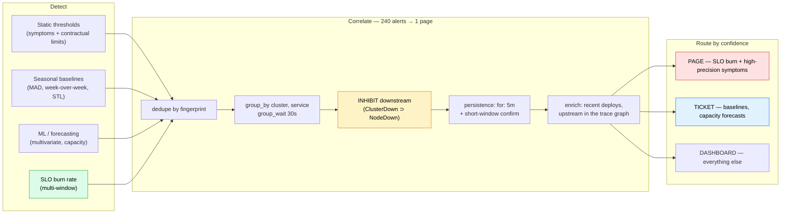
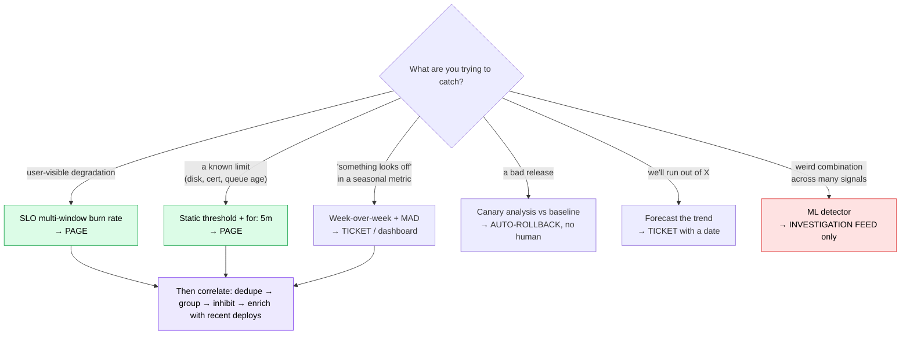

# Anomaly Detection & Alert Correlation

## 1. Why Should I Care About This?
- **Alert Fatigue Is a Safety Failure, Not an Annoyance**: When on-call receives 40 pages a night, the 41st — the real one — gets acknowledged and ignored. Every major postmortem genre includes "the alert fired and was dismissed as noise." Reducing noise is not comfort work; it is how you preserve the ability to respond at all.
- **One Failure Produces Hundreds of Alerts**: A single database failover fires the DB alert, 30 service latency alerts, 200 pod health alerts, and 12 SLO burn alerts — all describing *one* event. Without correlation, on-call spends the first 15 minutes of every incident doing manual set-theory on their phone instead of fixing anything.
- **The Math Punishes Naive Detection Brutally**: 10,000 time series checked every minute is **14.4 M checks/day**. A detector with a wonderful-sounding **99.9% specificity** still produces **14,400 false alerts per day**. This base-rate arithmetic is the single most important thing to understand here, and it's why "let's add ML anomaly detection" so often makes things worse.
- **It's the "AIOps" Question in Interviews**: "How would you detect problems you didn't think to write an alert for?" is a standard senior probe. The strong answer isn't a model name — it's knowing when a static threshold on a symptom beats every clever technique, and what it takes to make anomaly detection *actionable* rather than merely accurate.

## 2. What Problem Does This Solve?
- **The Unknown-Unknowns Gap**: Static thresholds only catch failures you anticipated. Nobody wrote an alert for "checkout conversion drops 8% when the new CDN config lands in one region."
- **The Seasonality Problem**: A threshold that is correct at 2 p.m. is wrong at 3 a.m. Traffic that halves overnight and triples on Black Friday makes any single number simultaneously too tight and too loose.
- **The Storm Problem**: Correlated failures generate correlated alerts. The information content of 200 alerts about one root cause is roughly the information content of one alert — but the cognitive load is 200×.
- **Naive Approach**: `if cpu > 80% for 5m: page`. It fires during every nightly batch job (false positive), it stays silent while the service returns 500s at 12% CPU (false negative), and it needs hand-tuning per service forever. Its replacement is often *worse*: an untuned ML detector over every metric, producing thousands of "unusual!" notifications that nobody can act on.

## 3. Core Idea (Intuition First)
Think about a **hospital ward at night**.

- **A static threshold** is a monitor that beeps when heart rate crosses 100. Simple, explainable, and right for the vitals where a number really does mean danger. But it beeps every time a patient walks to the bathroom.
- **A baseline** is a nurse who knows *this* patient: "her heart rate is always 95 after physio; 95 at 4 a.m. is the problem." That's the same measurement judged against its own history and its own time-of-day — a **seasonal baseline**, and it removes most of the false beeping.
- **Machine learning** is the specialist who spots a pattern across a hundred signals that no single threshold captures. Genuinely valuable, expensive, occasionally confidently wrong, and useless if the ward is already too noisy to hear them.

And then the part everyone underestimates: when a patient actually crashes, **every monitor in the room alarms at once**. The skill isn't detecting the crash — it's **turning 40 alarms into one page that says "bed 12, cardiac arrest."** That is alert correlation: deduplicate identical signals, group related ones into a single notification, suppress the downstream consequences of a known upstream cause (if the power is out, don't page about each dark room), and only *then* wake someone.

> **Hold onto this:** detection accuracy and alert usefulness are different problems. A detector that is 99.9% accurate over 14 M daily checks is a spam cannon. **Precision at the moment of paging** is the metric that matters — and the cheapest way to get it is to alert on a *few user-visible symptoms* with a burn-rate window, then use anomaly detection for *investigation* and *tickets*, not for pages.

![Three-panel diagram of anomaly detection and alert correlation. Panel A plots one week of a metric with a daily sine-like traffic pattern and compares three detectors against it: a flat static threshold line drawn near the daily peak, which stays silent through a real incident that occurs during the overnight trough because the absolute value never crosses the line, and which also fires spuriously during a legitimate marketing spike; a seasonal baseline band computed from the same time-of-day in previous weeks using a median plus a multiple of the median absolute deviation, which hugs the shape of the traffic and correctly flags the overnight dip as far outside the expected band; and a machine-learning forecast band which tracks the pattern most tightly but requires training data, retrains on drift, and cannot explain itself. Panel B shows the base-rate arithmetic and the correlation funnel: ten thousand series checked every minute equals fourteen point four million checks per day, so even ninety-nine point nine percent specificity yields fourteen thousand four hundred false alerts per day, which is the reason naive detection fails; then a funnel takes two hundred and forty raw alerts from a single database failover and reduces them step by step — deduplicate by fingerprint, wait and group by cluster and service, suppress downstream alerts whose upstream cause is already firing using inhibition rules, apply a for-duration so transient blips never page, and finally emit one notification that names the root cause. Panel C is the multi-window multi-burn-rate ladder for service level objective alerting, showing four rows: fourteen point four times burn over one hour consuming two percent of the monthly budget, paged immediately; six times burn over six hours consuming five percent, paged; three times burn over one day consuming ten percent, filed as a ticket; and one times burn over three days, filed as a ticket, each with a short second window used to confirm the burn is still active so the alert resolves quickly once the incident ends.](../assets/anomaly_detection_alert_correlation.svg)

> Panel A: the same data, three detectors — the static line misses the overnight incident that the seasonal band catches immediately. Panel B: the base rate is why detection alone fails, and the funnel is what makes 240 alerts into one page. Panel C: for anything with an SLO, multi-window burn rate beats every clever detector.

## 4. How It Actually Works

### 1. Static thresholds — still the right default, when applied to symptoms
- **What they're good at**: contractual limits (disk 90% full, certificate expiring in 14 days, queue older than the SLA), and **symptom** alerts tied to user experience (error ratio > 1%, p99 > 500 ms).
- **Why they fail on *causes***: CPU, memory, and connection counts vary by 10× across the day and across services, so any fixed number is both too tight and too loose. This is the deeper reason to alert on symptoms — symptoms have a *meaning* independent of load; causes don't.
- **The two cheapest noise reducers in existence**, applied to any threshold: a **`for:` duration** (must hold for 5 minutes — kills every transient blip and scrape artifact) and **hysteresis** (fire at 90%, clear at 80% — kills flapping around the boundary). Most "we need ML" complaints are solved by these two lines of YAML.
- **Trade-off**: zero infrastructure, perfectly explainable, and a runbook writes itself — but it only catches what you predicted, and it needs per-service tuning that decays as the system changes.

### 2. Statistical baselines — judge a metric against its own history
- **Z-score**: `z = (x − μ) / σ` over a rolling window; flag `|z| > 3`. Fast and simple, but **mean and standard deviation are wrecked by the outliers you're trying to detect** — one huge spike inflates σ and blinds you for the rest of the window.
- **MAD (Median Absolute Deviation)** is the robust replacement: `MAD = median(|x − median(x)|)`, flag when `|x − median| / (1.4826 × MAD) > 3`. The 1.4826 makes it comparable to σ for normal data. **Its breakdown point is 50%** — half your data can be garbage and the estimate holds. Use MAD, not z-score, essentially always.
- **Seasonality**: compare like with like. The simplest effective technique is **week-over-week at the same time of day** (`metric now vs metric 7d ago`), which handles daily *and* weekly cycles in one line of PromQL. More formally: **STL decomposition** (trend + seasonal + residual — detect on the residual), **Holt-Winters triple exponential smoothing** (Prometheus ships `holt_winters()`, renamed `double_exponential_smoothing()` in 3.x), or **Prophet** for multi-seasonality with holidays.
- **S-H-ESD (Seasonal Hybrid ESD)** — Twitter's open-sourced algorithm — is the well-known production answer: STL to remove seasonality, then Generalized ESD with a median-based robust statistic on the residual. Worth naming in an interview.
- **Change-point detection** (CUSUM, Bayesian online change-point) answers a different and often better question: not "is this value weird?" but **"did the behaviour of this series change?"** — which is exactly what you want after a deploy.
- **Quantile bands / conformal prediction**: instead of assuming a distribution, keep the empirical p1/p99 for each (metric, hour-of-week) bucket and alert outside the band. Non-parametric, trivially explainable, and it handles the fact that most latency data is not remotely Gaussian.

### 3. Machine-learning detection — when it earns its keep
- **Unsupervised** is the realistic setting (you have no labelled outages): **Isolation Forest** (anomalies need fewer random splits to isolate — fast, handles multivariate), **autoencoder reconstruction error** (train to reproduce normal, flag what it reconstructs badly), **DBSCAN/clustering** for grouping, **LSTM/transformer forecasters** for predict-then-compare.
- **When it's genuinely worth it**: (a) **thousands of series** nobody will ever hand-tune, (b) **multivariate** anomalies where each individual metric looks fine but the *combination* is impossible (traffic up, CPU down, errors flat — that's a routing bug), (c) **forecasting** for capacity ("we hit disk capacity in 11 days" is more useful than "disk is 90% full").
- **What it actually costs**: training and retraining pipelines; **concept drift** (your system changes weekly, so a model trained last month is wrong); **cold start** for new services; **holiday/deploy handling** (Black Friday, DST, a marketing email — all "anomalies" that are not incidents); and **explainability** — "the model says this is unusual" is not a runbook, and on-call cannot act on it at 3 a.m.
- **The honest positioning**: ML anomaly detection is excellent at **generating investigation leads and tickets**, and poor at **deciding to wake a human**. Route it to a dashboard, a daily digest, or an incident-enrichment step — not to the pager. The exception is well-scoped, high-signal applications: **canary analysis** (Netflix's Kayenta uses Mann-Whitney U to compare canary vs baseline metric distributions and automatically fails a rollout) and **fraud/abuse**, where labels exist and the action is automated rather than human.

### 4. The base-rate problem — the arithmetic that decides everything
- Suppose 10,000 series, checked every minute: **14.4 M checks/day**. Real incidents: say 2/day. Even at **99.9% specificity**, false positives = `0.001 × 14.4 M ≈ 14,400/day`. Precision = `2 / (2 + 14,400) ≈ **0.014%**`.
- **The consequence**: to page on anomaly detection you need specificity around **99.9999%**, which no general detector achieves. So you don't fight the base rate — you shrink it:
  1. **Reduce the number of things that can page.** Alert on a handful of user-visible SLIs per service, not on every series. This alone cuts the check count by 100–1000×.
  2. **Require persistence** (`for: 5m` + multi-window confirmation), which multiplies the false-positive probability by itself across independent windows.
  3. **Require corroboration** — page only when *two* signals agree (error rate up **and** latency up; or the anomaly coincides with a deploy).
  4. **Route by confidence**: page on high-precision detectors, ticket on medium, dashboard on the rest.

### 5. Multi-window, multi-burn-rate SLO alerting — the technique that usually wins
- Instead of detecting anomalies, detect **error-budget burn**. Burn rate = how fast you're consuming the budget relative to spending it evenly (`1×` = exactly on pace to exhaust it at period end).
- The Google SRE workbook's canonical ladder for a 30-day SLO:

| Burn rate | Long window | Budget consumed | Action | Short window (to confirm/resolve) |
|---|---|---|---|---|
| **14.4×** | 1 hour | 2% | **Page** | 5 min |
| **6×** | 6 hours | 5% | **Page** | 30 min |
| **3×** | 1 day | 10% | Ticket | 2 hours |
| **1×** | 3 days | 10% | Ticket | 6 hours |

- **Why two windows?** The long window gives precision (a brief blip can't consume 2% of a month's budget); the **short window makes the alert *resolve* quickly** once the burn stops, instead of hanging around for an hour after the incident ends. Requiring both to be over threshold gives you high precision *and* low reset time.
- **Why this beats anomaly detection for paging**: it is inherently tied to user impact, it needs no training, it self-scales with traffic (a ratio, not an absolute), it's fully explainable ("we've burned 2% of the month's budget in an hour"), and the number of alerts per service is *four*, not *four thousand*.

### 6. Correlation: turning a storm into one page
- **Deduplication** — a stable **fingerprint** (hash of alertname + key labels) means 500 repeats of the same condition are one alert with a counter, not 500 notifications.
- **Grouping** — Alertmanager's `group_by: [cluster, service]` with `group_wait: 30s` (hold briefly so siblings arrive together), `group_interval: 5m` (batch updates), and `repeat_interval: 4h` (re-notify cadence). One notification listing 200 pods beats 200 notifications.
- **Inhibition (the highest-leverage rule)** — suppress alerts whose cause is already firing: if `ClusterDown` is firing, inhibit every `NodeDown` and `PodCrashLoop` in that cluster; if the database is down, inhibit its dependents' latency alerts. This encodes your dependency graph into the alerting layer, and it's what turns 240 alerts into 1.
- **Topology/dependency-aware correlation** — derive the service graph from traces (see [Distributed Tracing (OpenTelemetry)](./Distributed_Tracing_OpenTelemetry.md)) and use it to rank candidate root causes: the alerting service *furthest upstream* in the graph is the likely cause; the rest are consequences.
- **Temporal correlation** — alerts firing within a short window across related components are probably one event. Combined with **change correlation** ("a deploy to service X happened 4 minutes before"), this is the single most useful enrichment you can attach to a page, because most incidents are caused by a change.
- **Commercial versions of exactly this**: PagerDuty Intelligent Alert Grouping, BigPanda, Moogsoft. They are correlation engines with ML for the grouping heuristic; the value is real but the majority of the benefit is available from `group_by` + `inhibit_rules` you write yourself in an afternoon.
- **Silences and maintenance windows** — a first-class requirement, not an afterthought: deploys, planned maintenance, and known-broken staging must be suppressible with an expiry (never a permanent silence — those become the reason an alert didn't fire six months later).

### 7. Measure the alerting system itself
- **Pages per on-call shift** — the Google SRE guidance is that a 12-hour shift should handle **at most ~2 incidents** to leave time for real diagnosis and a proper writeup. More than 5 is a broken system.
- **Actionability rate** — fraction of pages where the responder did something other than acknowledge and close. Below ~80%, start deleting alerts.
- **Alert-to-incident ratio** — 240:1 means your correlation is working; 240:240 means you're paging on causes.
- **Detection coverage** — fraction of incidents *first detected* by monitoring rather than by a customer. This is the number that justifies investment in anomaly detection.
- **MTTA/MTTD/MTTR** and **time-to-first-useful-signal**. Track them per alert rule; the worst rules are visible immediately.



## 5. Real-World Example
**Netflix Kayenta — ML where it actually belongs.** Netflix's automated canary analysis doesn't try to detect anomalies across their whole metric estate. It solves one narrow, high-value problem: given a canary deployment and a baseline running side by side, are the canary's metric *distributions* worse? It uses the Mann-Whitney U test per metric, aggregates into a score, and **automatically fails the rollout** below a threshold. Narrow scope, labelled comparison, automated action, no human paged — that's the profile where statistical detection pays.

**Twitter's S-H-ESD.** Twitter open-sourced `AnomalyDetection` after finding that plain ESD produced garbage on their traffic: strong daily/weekly seasonality inflated the residuals, and the extreme values they cared about broke mean/σ estimates. The fix — STL to strip seasonality, then ESD with **median and MAD** instead of mean and σ — is the canonical worked example of "robust statistics beat clever models on real production data."

**The failover storm.** A primary database fails over. Within 90 seconds: 1 database alert, 34 service-level latency alerts, 6 SLO burn alerts, 180 pod readiness alerts, 19 queue-depth alerts. Without correlation: 240 pages across 8 teams, all investigating the same thing, and the actual DBA is buried at position 87 in their notification queue. With `group_by: [cluster]`, an inhibition rule (`DatabasePrimaryDown` inhibits `HighLatency` and `PodNotReady` in the same cluster), and deploy-correlation enrichment: **one page**, to one team, titled with the root cause and the failover event that preceded it. The technical difference is about 20 lines of Alertmanager configuration.

## 6. Code Example
Robust seasonal detection (MAD + week-over-week), and the correlation config that matters more:

```python
import numpy as np

def mad_score(x, history):
    """Robust z-score. MAD survives up to 50% contaminated data; stddev does not —
       the very spike you're hunting inflates σ and blinds the detector."""
    med = np.median(history)
    mad = np.median(np.abs(history - med))
    if mad == 0:                                  # flat series: fall back to a floor
        return 0.0 if x == med else np.inf
    return abs(x - med) / (1.4826 * mad)          # 1.4826 ⇒ comparable to σ for normal data

def seasonal_detect(series, now_idx, period=7*24*60, k=4, weeks=4):
    """Compare this minute against the SAME minute-of-week in prior weeks.
       Handles daily AND weekly seasonality with no model to train or retrain."""
    same_slot = [series[now_idx - w*period] for w in range(1, weeks+1)
                 if now_idx - w*period >= 0]
    if len(same_slot) < 3:
        return None                               # cold start: refuse to judge, don't guess
    score = mad_score(series[now_idx], np.array(same_slot))
    return {"anomaly": score > k, "score": round(score, 2),
            "expected": float(np.median(same_slot)), "observed": series[now_idx]}

# ── THE BASE-RATE CHECK — run this BEFORE you ship any detector ──────────
def viability(n_series, checks_per_day_per_series, specificity, incidents_per_day):
    checks = n_series * checks_per_day_per_series
    fp = checks * (1 - specificity)
    precision = incidents_per_day / (incidents_per_day + fp)
    return {"checks/day": checks, "false_alerts/day": round(fp),
            "precision": f"{precision:.4%}"}

viability(10_000, 1440, 0.999, 2)
# {'checks/day': 14400000, 'false_alerts/day': 14400, 'precision': '0.0139%'}
#   ⇒ NEVER page on this. Ticket it, or shrink the surface: alert on 4 SLIs per
#     service instead of 10,000 series, and require two windows to agree.
```

Multi-window burn-rate alerting — the rule that should exist before any detector:

```yaml
# 99.9% availability SLO over 30 days ⇒ error budget = 0.1%
groups:
- name: slo-burn
  rules:
  - alert: ErrorBudgetBurnFast          # 2% of the monthly budget in 1 hour
    expr: |
      (error_ratio:ratio_rate1h{job="api"}  > 14.4 * 0.001)
        and
      (error_ratio:ratio_rate5m{job="api"}  > 14.4 * 0.001)   # ← short window: resolves fast
    for: 2m
    labels: {severity: page}
    annotations:
      summary: "Burning error budget 14.4× — 2% of the month gone in an hour"
      runbook: "https://runbooks/api/error-budget"

  - alert: ErrorBudgetBurnSlow          # 10% in a day → a ticket, not a 3am page
    expr: |
      (error_ratio:ratio_rate1d{job="api"} > 3 * 0.001)
        and
      (error_ratio:ratio_rate2h{job="api"} > 3 * 0.001)
    labels: {severity: ticket}
```

```yaml
# alertmanager.yml — the 20 lines that turn 240 alerts into 1 page
route:
  group_by: [cluster, service]      # one notification per (cluster, service), not per pod
  group_wait: 30s                   # hold briefly so siblings arrive in the same notification
  group_interval: 5m                # batch updates to an existing group
  repeat_interval: 4h
  routes:
    - matchers: [severity="page"]   ; receiver: pagerduty
    - matchers: [severity="ticket"] ; receiver: jira
    - matchers: [source="ml"]       ; receiver: slack-investigations   # NEVER the pager

inhibit_rules:
  # if the whole cluster is down, don't page about each node and pod in it
  - source_matchers: [alertname="ClusterDown"]
    target_matchers: [severity=~"page|ticket"]
    equal: [cluster]
  # if the database primary is down, its dependents' latency alerts are consequences
  - source_matchers: [alertname="DatabasePrimaryDown"]
    target_matchers: [alertname=~"HighLatency|HighErrorRate"]
    equal: [cluster]
```

## 7. Design Variations & Alternatives

| Technique | Catches | Explainable? | Tuning cost | Safe to page on? | Best for |
|---|---|---|---|---|---|
| **Static threshold + `for:`** | Known failure modes | ✅✅ | Per-service, ongoing | ✅ (on symptoms) | Contractual limits, disk, cert expiry, error ratio |
| **Multi-window burn rate** | Any user-visible degradation | ✅✅ | Set the SLO once | ✅✅ **the default** | Every service with an SLO |
| **Week-over-week comparison** | Seasonal deviations | ✅✅ | Near zero | ⚠️ with corroboration | Traffic, conversion, business metrics |
| **MAD / robust z-score** | Point outliers | ✅ | Choose `k` | ⚠️ | Per-series detection at moderate scale |
| **STL / Holt-Winters / S-H-ESD** | Seasonal + trend anomalies | ⚠️ | Model params, retrain | ⚠️ ticket | Strongly cyclical business metrics |
| **Change-point (CUSUM/Bayesian)** | "Behaviour changed" | ✅ | Low | ⚠️ | Post-deploy regression detection |
| **Isolation Forest / autoencoder** | Multivariate weirdness | ❌ | Training + drift | ❌ ticket/dashboard | Thousands of unattended series |
| **Forecasting (Prophet/LSTM)** | Future exhaustion | ⚠️ | High | ✅ (long horizon → ticket) | Capacity planning: "disk full in 11 days" |
| **Canary analysis (Mann-Whitney U)** | Bad releases | ✅ | Medium | ✅ (auto-rollback, no human) | Deployment gates |

**Correlation approaches:**

| Approach | How it decides "related" | Effort | Notes |
|---|---|---|---|
| **Label grouping** (`group_by`) | Shared labels | Minutes | Highest value per minute spent |
| **Inhibition rules** | Hand-written dependency edges | Hours | Encodes what your team already knows |
| **Topology from traces** | Service graph, upstream-first | Days | Automatically stays current as the architecture changes |
| **Temporal + change correlation** | Time proximity to deploys/config changes | Days | Most incidents follow a change — highest-signal enrichment |
| **ML grouping (PagerDuty/BigPanda/Moogsoft)** | Learned co-occurrence | Buy | Real value at large scale; most of the benefit is reachable without it |



## 8. Pros and Cons

### Anomaly detection
- **Pros**: catches unknown-unknowns and slow degradations no one wrote a rule for; adapts to seasonality automatically so one config works across services with 100× different traffic; scales to metric estates too large to hand-tune; forecasting converts "you're at 90%" into "you have 11 days," which is actionable planning rather than an emergency.
- **Cons**: the base rate makes paging on it nearly impossible without extreme specificity; "anomalous" ≠ "bad" (a successful marketing campaign is a huge anomaly); models drift as the system changes and need retraining infrastructure; cold start on new services; poor explainability makes runbooks hard to write; and it can create a **false sense of coverage** — the most dangerous outcome, where teams stop writing explicit alerts because "the AI will catch it."

### Alert correlation
- **Pros**: order-of-magnitude reduction in notification volume with no loss of information; puts the *root cause* at the top of the page instead of position 87; makes on-call sustainable, which is the precondition for everything else; and the basic mechanisms (dedupe, group, inhibit) are cheap, deterministic, and reviewable in code.
- **Cons**: inhibition rules are a hand-maintained dependency model that **silently goes stale** as the architecture changes — an inhibition rule pointing at a decommissioned service can suppress a real page; over-grouping can hide a *second, unrelated* incident inside an existing group; and `group_wait` adds latency to every notification (30 s is usually fine; for a payments outage it may not be).

## 9. Failure Scenarios & What Can Go Wrong
- **SYMPTOM**: On-call receives 200 pages during one incident. **ROOT CAUSE**: no grouping or inhibition; alerts on causes (pods, nodes) rather than symptoms. **FIX**: `group_by` on cluster/service, inhibition rules for known dependency edges, and delete cause-level pages — demote them to dashboard panels used during diagnosis.
- **SYMPTOM**: The anomaly detector fires every night at 02:00. **ROOT CAUSE**: a batch job is a real, recurring pattern that the baseline hasn't learned, or the baseline window is shorter than the cycle. **FIX**: seasonal comparison at the same time-of-week with ≥3 prior periods; explicitly model known schedules; or exclude maintenance windows from both training and detection.
- **SYMPTOM**: A model that worked at launch produces nonsense three months later. **ROOT CAUSE**: **concept drift** — traffic grew 4×, the architecture changed, the metric's meaning shifted. **FIX**: scheduled retraining with drift monitoring (track detector precision over time as a first-class metric), and prefer non-parametric methods (quantile bands, week-over-week) that self-adjust.
- **SYMPTOM**: A real outage produces no anomaly alert. **ROOT CAUSE**: the degradation was gradual, so the baseline *learned* it — the model adapts to the new bad normal. **FIX**: pair adaptive detection with an absolute SLO floor; burn-rate alerts don't care what the baseline thinks.
- **SYMPTOM**: Alerts flap on and off every two minutes. **ROOT CAUSE**: the value oscillates around the threshold, no hysteresis, no `for:`. **FIX**: `for: 5m`, separate fire/clear thresholds, and a minimum re-fire interval.
- **SYMPTOM**: A second, unrelated incident is missed during a big one. **ROOT CAUSE**: over-aggressive grouping or a broad silence swallowed it. **FIX**: never group across unrelated services; make silences require a scope and an expiry; alert on "new alert type inside an existing group."
- **SYMPTOM**: Everything is quiet and everyone is relaxed — during an outage. **ROOT CAUSE**: an inhibition rule for a decommissioned dependency, an expired-but-never-removed silence, or the detection pipeline itself is down. **FIX**: audit silences and inhibition rules on a schedule, alert on silences older than N days, and run a permanently-firing **watchdog alert** whose *absence* pages you (see [Synthetic Monitoring & Heartbeats](./Synthetic_Monitoring_Heartbeats.md)).
- **SYMPTOM**: Detection quality quietly degrades after a metrics change. **ROOT CAUSE**: label or cardinality changes broke the series the detector was trained on; it now scores a different (or empty) series. **FIX**: treat detector inputs as a contract; alert on "no data" as loudly as on anomalies — *absent* is a state, not a null.

## 10. Impact on Scalability, Reliability & Cost
- **Scalability**: evaluating simple rules is cheap (Prometheus evaluates thousands of rules on a 30 s interval without noticing), but per-series statistical or ML detection is **O(series)** in both compute and state — at 1 M series that's a data pipeline, not a cron job. This is a strong argument for detecting on a small number of **aggregate SLIs** rather than on everything, and for pushing anomaly detection into a batch/streaming system (Flink, Spark) instead of the alerting engine.
- **Reliability**: the detection and notification path must be *more* available than what it watches, and independent of it — hosting alerting inside the same Kubernetes cluster it monitors is a classic mistake. Add an external **dead-man's switch** (a heartbeat alert that always fires, routed to a service that pages you when it *stops*), because a silent alerting pipeline is indistinguishable from a healthy system.
- **Cost**: the dominant cost is human, not compute. At 40 pages/night with 20 minutes of attention each, you're burning ~13 hours of engineer time per night and, more expensively, the attrition and reduced incident performance that come with it. Correlation work has the best ROI in observability: a day spent writing inhibition rules can remove 90% of notification volume permanently. On the tooling side, AIOps platforms are typically priced per node/host or per event, so evaluate them against the honest baseline of "what does `group_by` + `inhibit_rules` + burn-rate alerts already give us for free?" — usually most of it.

## 11. When NOT to Use This
- **Don't deploy anomaly detection before you've fixed threshold hygiene.** If your current alerts have <80% actionability, adding a detector adds noise to noise. Delete and tune first; the payoff is larger and immediate.
- **Don't page on unsupervised ML output.** Route it to a feed, a daily digest, or incident enrichment. The base-rate arithmetic doesn't care how good the model is.
- **Don't use anomaly detection for anything with a real SLO** — burn-rate alerting is simpler, explainable, tied to user impact, and needs no training data.
- **Don't build correlation for a system with three services.** `group_by` is enough; a topology-aware correlation engine at that scale is a solution looking for a problem.
- **Don't apply seasonal baselines to low-traffic services.** With 5 requests/minute the noise dominates the signal and every window looks anomalous; use absolute thresholds or synthetic probes instead.
- **Don't let "the ML will catch it" replace explicit alerts on known critical failures.** Redundancy is the point: keep the boring threshold on "payments API returns 500s" no matter how sophisticated the rest of your stack becomes.

## 12. Interview Perspective
- **What interviewers expect**: that you reach for **symptom-based, SLO burn-rate alerting first**, and position anomaly detection as a *supplement* for unknown-unknowns rather than a replacement. Saying "multi-window multi-burn-rate" and explaining why the short window exists (fast reset) is a strong signal.
- **The killer number to have ready**: "10,000 series × 1,440 checks/day = 14.4 M checks; at 99.9% specificity that's 14,400 false alerts/day and precision under 0.02% — so we ticket on detection and page on burn rate." Producing that arithmetic unprompted separates people who've operated a system from people who've read about one.
- **The trap question**: "Should we use ML for alerting?" A weak answer is yes-or-no. A strong one is: ML earns its place in **narrow, labelled, automated-action** settings (canary analysis, capacity forecasting, fraud) and in **investigation feeds**; it does not earn a place on the pager, because of base rate, drift, and the fact that "unusual" is not "bad."
- **The design question**: "One failover produces 240 alerts. Fix it." Walk the funnel: dedupe by fingerprint → group by cluster/service with `group_wait` → **inhibit downstream alerts from known upstream causes** → require persistence → enrich with recent deploys and the upstream-most service in the trace graph → route by severity, with ML output going to Slack rather than PagerDuty. Then say how you'd measure it: pages per shift, actionability rate, alert-to-incident ratio.
- **Bonus signals**: MAD over standard deviation and why (breakdown point); S-H-ESD and STL; change-point detection as the right tool post-deploy; hysteresis and `for:` as the cheapest noise fixes in existence; the danger of a baseline *learning* a gradual degradation; the watchdog alert whose silence is the signal.

## 13. Connections to Other Topics
- [Alerting Strategies & On-Call Management](./Alerting_Strategies_OnCall_Management.md) — the human side: routing, severity, runbooks, and rotation health. This file is the detection and reduction machinery behind it.
- [SLO, SLI & Error Budgets](./SLO_SLI_Error_Budgets.md) — burn-rate alerting is the direct operationalization of the error budget, and the best alternative to anomaly detection for paging.
- [Golden Signals](./Golden_Signals_Latency_Traffic_Errors.md) — the small set of symptoms worth detecting on, which is how you shrink the base-rate problem.
- [Metrics Design & Cardinality](./Metrics_Design_Cardinality.md) — per-series detection cost scales with cardinality; detecting on aggregates is both cheaper and more precise.
- [Distributed Tracing (OpenTelemetry)](./Distributed_Tracing_OpenTelemetry.md) — the service dependency graph that powers topology-aware root-cause ranking.
- [Synthetic Monitoring & Heartbeats](./Synthetic_Monitoring_Heartbeats.md) — the dead-man's switch that catches a dead detection pipeline.
- [Audit Logging & Security Events](./Audit_Logging_Security_Events.md) — the security-side application: impossible travel, mass export, privilege escalation detection.
- [16 · AI for System Design](../16_Emerging_Trends_Miscellaneous/AI_for_System_Design.md) — the broader AIOps framing; this file is the observability-native, numbers-first treatment.

## 14. Visual Aids
- **The SVG above** ([anomaly_detection_alert_correlation.svg](../assets/anomaly_detection_alert_correlation.svg)): panel A — one seasonal time series judged by a static threshold, a robust seasonal band, and an ML forecast, with the overnight incident the flat line misses; panel B — the base-rate arithmetic and the 240-alerts-to-1-page correlation funnel; panel C — the multi-window multi-burn-rate ladder.
- **Mermaid #1 (Section 4)**: the full pipeline — four detector families feeding one correlation chain, then routed by confidence to page / ticket / dashboard.
- **Mermaid #2 (Section 7)**: pick the technique by what you're trying to catch, and note that only two of the six branches are allowed to reach the pager.

## 15. Summary (TL;DR)
**Alert on symptoms with a burn rate, detect anomalies for everything else, and correlate before you notify. The arithmetic that governs this topic is the base rate: 10,000 series checked every minute is 14.4 M checks/day, so even a 99.9%-specific detector emits ~14,400 false alerts daily and pages with a precision under 0.02% — which is why unsupervised anomaly detection belongs on a dashboard or a ticket queue, never on the pager. Shrink the surface instead: alert on a handful of user-visible SLIs per service using **multi-window, multi-burn-rate** rules (14.4× over 1 h ⇒ page, 6× over 6 h ⇒ page, 3× over 1 day ⇒ ticket, each paired with a short window so the alert resolves quickly), because burn rate is explainable, needs no training, scales with traffic, and is tied to actual user impact. Where you do detect statistically, use **robust** methods — MAD rather than standard deviation, since the outlier you're hunting is what inflates σ — and compare like with like via week-over-week or STL/S-H-ESD seasonal decomposition; use change-point detection after deploys, forecasting for capacity ("disk full in 11 days" beats "disk at 90%"), and reserve ML for narrow, labelled, automated-action problems like canary analysis, where Netflix's Kayenta fails a rollout without waking anyone. Then do the work that actually saves the on-call rotation: **deduplicate by fingerprint, group by cluster and service, inhibit downstream alerts whose upstream cause is already firing, require persistence with `for:` and hysteresis, and enrich with recent deploys and the upstream-most service in the trace graph** — roughly twenty lines of Alertmanager config that turn a 240-alert failover storm into one page naming the root cause. Measure the alerting system like a product (pages per shift ≤ 2, actionability > 80%, alert-to-incident ratio, % of incidents found by monitoring before customers), audit your silences and inhibition rules so they don't silently swallow a real outage, and keep a watchdog whose **absence** pages you — because **the failure mode of a noisy alerting system and a dead one look identical from the outside: nobody responds.**

## 16. Further Reading & Resources
- [Google SRE Workbook — "Alerting on SLOs"](https://sre.google/workbook/alerting-on-slos/) — the multi-window multi-burn-rate ladder, with the derivation of 14.4× and 6×.
- [Google SRE Book — "Monitoring Distributed Systems"](https://sre.google/sre-book/monitoring-distributed-systems/) — symptoms vs causes, and the sustainable page-volume argument.
- [Twitter — "Introducing practical and robust anomaly detection in a time series"](https://blog.x.com/engineering/en_us/a/2015/introducing-practical-and-robust-anomaly-detection-in-a-time-series) — S-H-ESD: STL plus median/MAD-based ESD.
- [Netflix — "Automated Canary Analysis at Netflix with Kayenta"](https://netflixtechblog.com/automated-canary-analysis-at-netflix-with-kayenta-3260bc7acc69) — statistical detection with an automated action instead of a page.
- [Prometheus Alertmanager — grouping, inhibition, and silences](https://prometheus.io/docs/alerting/latest/alertmanager/) — the configuration that does most of the correlation work.
- [Facebook — Prophet: forecasting at scale](https://facebook.github.io/prophet/) — multi-seasonality with holiday effects, and its honest limitations.
- [Rob Hyndman & George Athanasopoulos — *Forecasting: Principles and Practice*](https://otexts.com/fpp3/) — STL, exponential smoothing, and residual-based detection, free online.
- [Cindy Sridharan — *Distributed Systems Observability*](https://www.oreilly.com/library/view/distributed-systems-observability/9781492033431/) — why "monitoring everything" and alerting on it is the wrong instinct.
