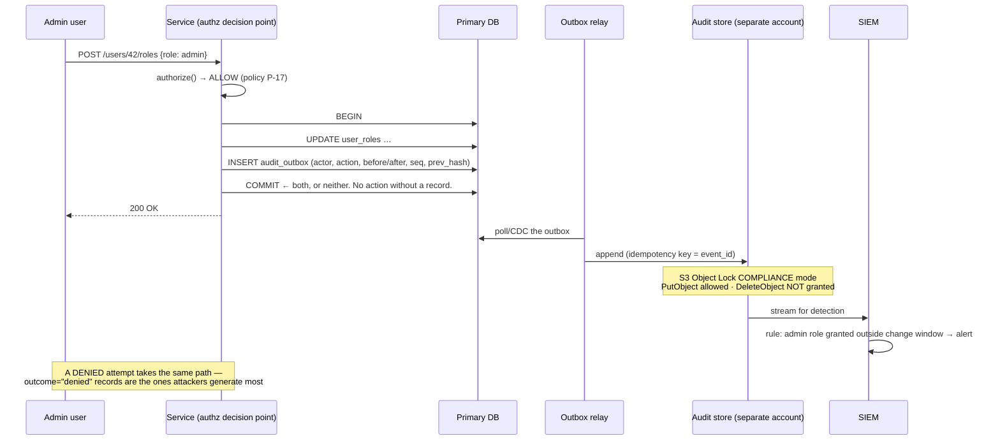
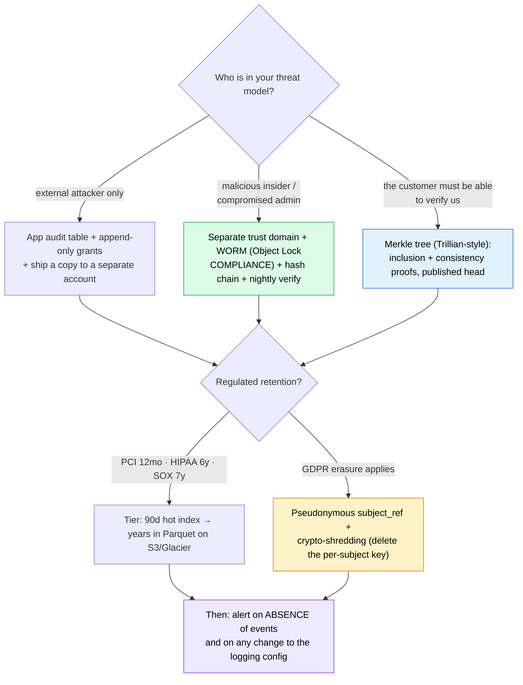

# Audit Logging & Security Events

## 1. Why Should I Care About This?
- **It's the Only Log That Is Evidence**: Application logs help you debug; audit logs decide legal and employment outcomes. "Who exported the customer table on March 3rd?" is answered by an audit record or it isn't answered at all — and in a breach investigation, a regulator's first question is what you can *prove*, not what you remember.
- **Compliance Doesn't Ask Nicely**: SOC 2 CC7, PCI DSS Requirement 10 (**12 months retention, 3 months immediately available**), HIPAA (**6 years**), and SOX all mandate audit trails with integrity protection. Your company cannot sell to enterprises without them. The compliance frameworks in [15 · Security Deep Dive](../15_Security_Deep_Dive_DevSecOps/Compliance_Frameworks_SOC2_GDPR.md) *require* this capability; this file is how you actually build it.
- **Erasing the Logs Is Step One of Every Real Attack**: MITRE ATT&CK catalogues it explicitly (T1070 Indicator Removal, T1562.008 Disable/Modify Cloud Logs). If your audit trail lives in the same account, with the same admin credentials, as the system it audits, then a successful attacker has *already* controlled your evidence. Immutability is not paranoia; it is the entire point.
- **It Is Also a Product Feature**: Every enterprise SaaS RFP asks for a tenant-visible audit log with export and streaming. Building it as an afterthought — by grepping application logs — produces something you can't ship, can't query per tenant, and can't attest to.

## 2. What Problem Does This Solve?
- **Non-Repudiation**: proving that a specific principal took a specific action at a specific time, in a way the principal cannot credibly deny and an insider cannot quietly alter.
- **Forensic Reconstruction**: after an incident, rebuilding the exact sequence — first access, privilege escalation, lateral movement, data accessed, data exfiltrated — with timestamps and blast radius.
- **Detection**: feeding a SIEM the *semantic* events (role granted, MFA disabled, 10,000 records exported) that indicate compromise, which raw HTTP logs cannot express.
- **Naive Approach**: `logger.info(f"user {uid} updated order {oid}")` into the same Elasticsearch index as everything else, sampled at 1%, retained for 14 days, deletable by anyone with cluster admin, with no record of *what changed* or of *denied* attempts. Every one of those five properties fails an audit: it's unstructured, incomplete, sampled, short-lived, and mutable.

## 3. Core Idea (Intuition First)
Think about the difference between a **security camera** and a **ship's logbook**.

- **Application logs are the security camera**: high volume, tape recycled weekly, mostly noise, great for "what was happening around 3 a.m.?" Nobody signs the tape.
- **Audit logs are the logbook**: written in ink, in order, by the officer on watch, with **who / what / when / where / outcome** on every line. Pages aren't torn out. If a page is altered, the alteration is visible — that's the whole reason it's admissible.

Three properties turn a log into a logbook, and they're the design of this topic:

1. **Completeness** — a record is written for every consequential action, *including the ones that were denied*. A trail of only successes is how you miss the attacker who tried 400 things before finding the one that worked.
2. **Immutability** — append-only, written to storage that physically refuses deletion (WORM / S3 Object Lock), under a **different identity and ideally a different account** from the system being audited. The rule: *the credentials that can perform the action must not be able to erase the record of it.*
3. **Tamper evidence** — each record carries the hash of the previous one, so the log is a chain. You cannot alter record #4,000 without invalidating every hash after it, and periodically publishing the chain's head means you can't rewrite the whole chain either. This is exactly how Certificate Transparency and Git work.

> **Hold onto this:** debug logs are *telemetry* — sample them, drop them under pressure, expire them. Audit logs are *records* — never sampled, never dropped, written durably before you tell the user "done."

![Three-panel diagram of audit logging. Panel A is the anatomy of a single audit record, showing the mandatory fields grouped into five questions: WHO (actor id, actor type, on-behalf-of for impersonation, authentication method, session id), WHAT (a stable action enum such as user.role.granted, the resource type and id, and a before-and-after diff of what changed), WHEN (a UTC timestamp from a trusted server clock plus a monotonic per-partition sequence number so gaps are detectable), WHERE (source IP, user agent, geo, request id and trace id linking to the rest of the observability stack), and OUTCOME (allowed, denied, or error — with a note that denied attempts are the most security-relevant records and are the ones teams most often forget to write). Panel B shows tamper evidence as a hash chain: each record stores the SHA-256 hash of the previous record, so records one through five form a chain; when an insider edits record three to remove an unauthorized export, its hash changes and every subsequent link breaks, which a verification job detects; alongside it, write-once-read-many storage with S3 Object Lock in compliance mode and a retention period means even the root account cannot delete the object before expiry, and periodically publishing the chain head to a separate system prevents wholesale rewriting. Panel C shows the pipeline: the application writes the audit event inside the same database transaction as the business change using the transactional outbox pattern so an action can never exist without its record, a relay ships events to an append-only store in a separate cloud account with append-only credentials, and from there they fan out to three destinations — a hot searchable index for around ninety days of investigation, WORM object storage for the multi-year compliance retention, and a SIEM for detection rules such as privilege escalation, mass export and impossible travel. A footnote covers the GDPR conflict: the right to erasure versus an immutable trail, resolved with pseudonymized subject identifiers and crypto-shredding, where deleting the per-subject encryption key renders the personal data unreadable while the record itself remains intact.](../assets/audit_log_immutable_trail.svg)

> Panel A: five questions, answered on every record, or it isn't an audit log. Panel B: immutability is enforced by storage; tamper *evidence* is enforced by hashing — you want both. Panel C: write the record in the same transaction as the action, then fan out to investigation, retention, and detection.

## 4. How It Actually Works

### 1. The record schema — five questions, always answered
| Group | Fields | Why it matters |
|---|---|---|
| **WHO** | `actor.id`, `actor.type` (user/service/system), `actor.on_behalf_of` (impersonation!), `auth.method` (password/SSO/API key/MFA level), `session.id` | Support-impersonation actions attributed to the *customer* instead of the staff member is a classic audit hole and a common finding |
| **WHAT** | `action` (stable enum: `user.role.granted`, `data.exported`), `resource.type`, `resource.id`, `changes` (before/after or a JSON-patch diff) | Free-text actions can't be alerted on; a diff is the difference between "record updated" and evidence |
| **WHEN** | `timestamp` (UTC, **server-assigned** — never trust the client), `sequence` (monotonic per partition) | Sequence numbers make *gaps* detectable, which timestamps alone do not |
| **WHERE** | `source.ip`, `user_agent`, `geo`, `request_id`, `trace_id`, `tenant_id` | `trace_id` links the audit record to the full request in your traces/logs |
| **OUTCOME** | `outcome` (allowed/denied/error), `reason`, `policy_id`, `justification` | **Denied attempts are the most security-relevant records** and the most commonly missing |

- Use a **standard schema** rather than inventing one: **OCSF** (Open Cybersecurity Schema Framework, backed by AWS/Splunk et al.) or **Elastic Common Schema** for SIEM interoperability; AWS **CloudTrail** is the best-known concrete example of the shape. A standard schema is what lets a SIEM correlate your app events with cloud and network events without a bespoke parser per source.
- **Actions must be a versioned enum.** `user.role.granted` is alertable, greppable, and stable across a UI rewrite; `"Admin changed Bob's permissions"` is not.

### 2. Where to generate the event (the layer choice)
- **Application/authorization layer (primary).** Emit at the point where the authorization decision is made, because that is the only layer that knows *intent* and *identity*: "user X granted role admin to user Y because policy P allowed it." A database trigger sees an `UPDATE` on a row by a connection-pool user; it does not know who or why.
- **Database layer (corroboration).** CDC from the binlog/WAL, or ledger/temporal tables, gives you ground truth about what data actually changed — including changes made *outside* the application (a DBA running SQL by hand, which is precisely what you most want caught). Cross-check the two layers periodically; divergence is a finding.
- **Infrastructure layer (the control plane).** CloudTrail/Azure Activity Log/GCP Audit Logs, Kubernetes audit policy, SSH session recording. This catches the actions that bypass your app entirely.
- The mature answer is **all three, with different retention** — app-level for the semantic story, DB-level for integrity of the data, infra-level for the control plane. An attacker has to defeat three independent trails, ideally in three trust domains.

### 3. Never lose one: the dual-write problem
- The trap: `db.commit(); audit.send(event)` — if the process dies between those lines, the action happened with **no record**. Reverse the order and you can log actions that never happened. Both are unacceptable for evidence.
- **The fix is the transactional outbox**: insert the audit event into an `audit_outbox` table *inside the same database transaction* as the business change. Either both commit or neither does. A relay process (or CDC on the outbox table) then ships events onward with at-least-once delivery and an idempotency key. This is the same pattern as [Transactional Outbox & Inbox](../10_Microservices_Distributed_Systems/Transactional_Outbox_Inbox_Pattern.md) — audit logging is one of its best justifications.
- **Backpressure policy flips.** For debug logs, the rule is *drop rather than block* (never let telemetry take down the app). For audit logs it is the opposite: **block, spill to local disk, or fail the request** — because an unrecorded privileged action is worse than a failed one. Say this out loud in an interview; it demonstrates you understand these are different systems with the same word attached.
- Attach a **monotonic sequence number per partition**. A verifier that sees `…, 4001, 4003, …` knows a record is missing, whether from loss or deletion. Timestamps can't tell you that.

### 4. Immutability — make deletion physically impossible
- **WORM object storage**: **S3 Object Lock in COMPLIANCE mode** with a retention period cannot be shortened or overridden **by anyone, including the root account**, until the period expires. (GOVERNANCE mode can be bypassed with a special permission — use it for internal policy, not for regulated evidence.) **Legal Hold** pins an object indefinitely, independent of the retention clock. Equivalents: Azure Blob immutable storage policies, GCS Bucket Lock.
- **Separate trust domain**: ship audit data to a *different* AWS account / Azure subscription / GCP project, with a cross-account role that grants **`s3:PutObject` but not `s3:DeleteObject`**. Production admin credentials must be insufficient to alter the record. This single control defeats the most common post-compromise behaviour.
- **Append-only at the database**: `REVOKE UPDATE, DELETE` on the audit table; or use built-in ledger features — **Azure SQL / SQL Server ledger tables** (Merkle-tree hashed, with digests you can publish), Postgres with a trigger that raises on `UPDATE`/`DELETE`, or immutable-by-construction stores. (AWS QLDB, the best-known purpose-built ledger DB, is being retired — the *pattern* it embodied lives on in ledger tables and in Trillian-style verifiable logs.)
- **Defence in depth**: MFA-delete on the bucket, versioning on, replication to a second region, and an alert on *any* configuration change to the logging pipeline itself (turning off CloudTrail should page someone within a minute — it's a textbook attacker first move).

### 5. Tamper evidence — hash chains and Merkle trees
- **Hash chain**: `record.prev_hash = SHA256(previous_record_canonical_bytes)`. Alter any historical record and every subsequent hash mismatches. Cost is one hash per write (~microseconds) and it makes *silent* edits impossible.
- **The chain's weakness**: an attacker with full write access could recompute the *entire* chain forward. Close it by **anchoring** — periodically publish the current head hash somewhere the attacker doesn't control (a different account, a customer-visible endpoint, an internal transparency page, a timestamping authority, or a public blockchain if the compliance story demands it). Once the head for Tuesday is published, Tuesday's history is frozen.
- **Merkle trees** (Certificate Transparency's design, and Google's **Trillian**) improve on the chain: they support **inclusion proofs** ("prove record R is in the log") and **consistency proofs** ("prove today's log is an append-only extension of yesterday's") in `O(log n)` — so an auditor can verify a specific record without downloading the whole log. This is the right architecture for a customer-verifiable trail.
- **Signing**: HMAC with a KMS-held key (or asymmetric signatures) over each batch gives cryptographic proof of origin; keep the signing key in an HSM so a compromised app host cannot forge batches.

### 6. Retention, and the GDPR conflict
- **Typical requirements**: PCI DSS — 12 months, with 3 months immediately searchable; HIPAA — 6 years; SOX — 7 years; SOC 2 — usually 1 year of evidence; GDPR — no fixed period, but you must justify it and minimize.
- **Tiering makes this affordable**: 30–90 days in a hot searchable index (fast investigation) → the full multi-year window in compressed Parquet on object storage (**$0.023/GB-month** on S3 Standard, **$0.004** on Glacier Instant Retrieval), queried by Athena/BigQuery when an auditor asks. Almost nobody needs seven years of *indexed* audit data.
- **The real tension**: GDPR Article 17 (right to erasure) vs an immutable trail. The resolutions, in order of preference: (a) **don't store personal data in the record** — store a pseudonymous `subject_ref` that resolves through a separate mapping table; (b) **crypto-shredding** — encrypt per-subject fields with a per-subject key and delete the key on an erasure request, leaving the chain intact but the plaintext unrecoverable; (c) rely on the **legal-obligation / legitimate-interest** basis where the record is genuinely required by law, and document it. Never "solve" it by deleting rows from an append-only log — that breaks the chain and destroys the property you built it for.

### 7. Feeding the SIEM — from record to detection
- Normalize to OCSF/ECS, then ship to Splunk / Microsoft Sentinel / Chronicle / Elastic Security. The detections that pay for themselves are semantic, not syntactic:
  - **Privilege escalation**: `role.granted` where the new role is admin, especially self-granted or outside change-window.
  - **Security-control tampering**: MFA disabled, logging disabled, a key policy widened, a new API key created for a service account.
  - **Mass export / staging**: `data.exported` where `row_count > p99` for that actor, or a first-ever export by a user.
  - **Impossible travel and anomalous session**: two authentications from geographies too far apart for the elapsed time — see [Anomaly Detection & Alert Correlation](./Anomaly_Detection_Alert_Correlation.md).
  - **Absence**: no audit events from a source that always produces them — the dead-man's switch again, and the highest-signal detection of "the attacker turned it off."
- **Cost reality**: SIEM pricing is per-GB-ingested (Splunk historically ~$100+/GB/year at list; Sentinel ~$2–5/GB ingested). So route *audit* events (low volume, high value) to the SIEM and keep *debug* logs out of it. A classic mistake is piping all application logs into the SIEM and blowing the budget on data no detection rule reads.



## 5. Real-World Example
**AWS CloudTrail as the reference implementation.** Every API call to every AWS service produces a structured record with `userIdentity` (including `sessionContext` and assumed-role chains), `eventName`, `requestParameters`, `responseElements`, `sourceIPAddress`, `errorCode`, and an `eventID`. The design details worth stealing: **denied calls are recorded** (`errorCode: AccessDenied` — this is how you catch reconnaissance), delivery is to **S3 in an account you choose** (so you can isolate it), **log file integrity validation** produces signed digest files containing hashes of each log file plus the previous digest — a hash chain — and organization trails cannot be disabled by member accounts. It is also the canonical target: "disable CloudTrail" is a documented ATT&CK technique precisely because it works when the trail lives in the same blast radius as the workload.

**Certificate Transparency.** Every publicly trusted TLS certificate must be submitted to append-only Merkle-tree logs (Google's Trillian implementation). Anyone can request an **inclusion proof** for a certificate and a **consistency proof** between two log states, so a log operator cannot retroactively remove or reorder entries without detection. CT is the proof that verifiable audit logs work at internet scale — billions of entries, public verification, no trusted operator required. When an interviewer asks "how would you make an audit log the *customer* can trust?", this is the answer.

**The failure case that defines the field.** In a long tail of breach reports (and in the ATT&CK technique catalogue), the attacker's first post-access action is to stop or clear the logs: `wevtutil cl`, deleting CloudTrail trails, or dropping rows from the app's audit table with the same DB credentials the app uses. In every case the control that would have preserved the evidence is the same: **the trail lives in a different trust domain, on storage that refuses deletion, and its absence is itself alerted on.**

## 6. Code Example
Transactional, hash-chained audit writes plus verification:

```python
import hashlib, json, uuid, datetime

CANON = lambda d: json.dumps(d, sort_keys=True, separators=(",", ":")).encode()

def audit(tx, *, actor, action, resource, outcome, before=None, after=None,
          on_behalf_of=None, reason=None, ctx=None):
    """Write the audit record in the SAME transaction as the business change.
       No commit → no action AND no record. Commit → both. Never one without the other."""
    prev = tx.query_one(                       # per-partition chain head, locked for update
        "SELECT seq, hash FROM audit_log WHERE tenant_id=%s "
        "ORDER BY seq DESC LIMIT 1 FOR UPDATE", ctx.tenant_id) or {"seq": 0, "hash": "0"*64}

    rec = {
        "event_id":  str(uuid.uuid4()),
        "seq":       prev["seq"] + 1,                       # gaps are detectable; timestamps aren't
        "ts":        datetime.datetime.now(datetime.UTC).isoformat(),   # SERVER clock, UTC, never the client's
        "actor":     {"id": actor.id, "type": actor.type, "auth": actor.auth_method,
                      "on_behalf_of": on_behalf_of},        # impersonation must be visible
        "action":    action,                                # stable enum: "user.role.granted"
        "resource":  {"type": resource.type, "id": resource.id},
        "changes":   diff(before, after),                   # WHAT changed, not just "updated"
        "outcome":   outcome,                               # "allowed" | "denied" | "error"
        "reason":    reason,
        "context":   {"ip": ctx.ip, "ua": ctx.user_agent, "trace_id": ctx.trace_id,
                      "tenant_id": ctx.tenant_id, "session_id": ctx.session_id},
        "prev_hash": prev["hash"],
    }
    rec["hash"] = hashlib.sha256(rec["prev_hash"].encode() + CANON(
        {k: v for k, v in rec.items() if k != "hash"})).hexdigest()

    tx.execute("INSERT INTO audit_log (…) VALUES (…)", rec)   # table has REVOKE UPDATE, DELETE
    tx.execute("INSERT INTO audit_outbox (event_id, payload) VALUES (%s, %s)",
               rec["event_id"], json.dumps(rec))              # relay → WORM store + SIEM
    return rec

# ── the call site: record the DENIAL too ────────────────────────────────
def grant_role(ctx, target_user, role):
    with db.transaction() as tx:
        decision = authz.check(ctx.actor, "user.role.grant", target_user)
        if not decision.allowed:
            audit(tx, actor=ctx.actor, action="user.role.granted", resource=target_user,
                  outcome="denied", reason=decision.policy_id, ctx=ctx)   # ← most teams skip this
            raise Forbidden()
        before = dict(target_user.roles)
        target_user.roles.add(role); tx.save(target_user)
        audit(tx, actor=ctx.actor, action="user.role.granted", resource=target_user,
              outcome="allowed", before=before, after=dict(target_user.roles),
              on_behalf_of=ctx.impersonating, ctx=ctx)

# ── VERIFICATION: run nightly, alert on any failure ─────────────────────
def verify_chain(tenant_id, published_head=None):
    prev_hash, expected_seq = "0"*64, 1
    for rec in stream_audit_log(tenant_id):                  # ordered by seq
        if rec["seq"] != expected_seq:
            raise Tampered(f"GAP at seq {expected_seq} — a record was deleted or lost")
        h = hashlib.sha256(prev_hash.encode() + CANON(
            {k: v for k, v in rec.items() if k != "hash"})).hexdigest()
        if h != rec["hash"] or rec["prev_hash"] != prev_hash:
            raise Tampered(f"record {rec['seq']} was ALTERED after it was written")
        prev_hash, expected_seq = rec["hash"], expected_seq + 1
    # anchoring: yesterday's published head must still be on this chain,
    # otherwise the whole history was recomputed by someone with write access
    if published_head and published_head not in chain_heads_seen:
        raise Tampered("history was rewritten — published anchor is missing")
    return prev_hash                                          # publish this: today's anchor
```

Making deletion physically impossible (Terraform-ish):

```hcl
resource "aws_s3_bucket" "audit" {
  bucket = "acme-audit-trail"           # lives in a SEPARATE account from production
}
resource "aws_s3_bucket_object_lock_configuration" "audit" {
  bucket = aws_s3_bucket.audit.id
  rule {
    default_retention {
      mode = "COMPLIANCE"               # not GOVERNANCE: even root cannot shorten this
      years = 7                         # SOX-grade retention
    }
  }
}
# the production role can APPEND and nothing else
data "aws_iam_policy_document" "producer" {
  statement {
    actions   = ["s3:PutObject"]        # note: NO s3:DeleteObject, NO s3:PutBucketPolicy,
    resources = ["${aws_s3_bucket.audit.arn}/*"]   #      NO s3:PutObjectRetention
  }
}
```

## 7. Design Variations & Alternatives

| Approach | Tamper resistance | Query ergonomics | Cost | Best for |
|---|---|---|---|---|
| **App table, append-only grants** | ⚠️ low — a DBA or SQLi can still write | ✅ excellent (SQL, joins, per-tenant) | Low | The tenant-facing product feature; pair with an external copy |
| **+ hash chain** | ✅ silent edits detectable | ✅ | Low (one hash/write) | The default upgrade — cheap, and it changes the conversation with an auditor |
| **+ external anchoring** | ✅✅ wholesale rewrite detectable | ✅ | Low | Anywhere an insider is in the threat model |
| **Merkle tree / Trillian (CT-style)** | ✅✅✅ inclusion + consistency proofs | ⚠️ needs a serving layer | Medium | Customer-verifiable logs, multi-party trust |
| **WORM object storage (S3 Object Lock COMPLIANCE)** | ✅✅✅ deletion physically refused | ❌ slow (Athena scans) | Very low storage | The multi-year regulated retention tier |
| **Managed cloud audit (CloudTrail / Activity Log)** | ✅✅ (org trail, digest chain) | ✅ | Low–medium (data events $ per 100k) | The control plane — you don't build this, you configure it |
| **SIEM (Splunk/Sentinel/Chronicle)** | ⚠️ it's a copy, not the record | ✅✅ correlation + detection | 💸 per-GB, expensive | Detection and cross-source correlation, not primary retention |
| **Ledger database / ledger tables** | ✅✅ built-in Merkle digests | ✅ | Medium | When you want the guarantee without building it (Azure SQL ledger) |

- **Push vs pull for tenant-facing delivery**: enterprises increasingly want audit events *streamed* (webhook, Kafka, or an S3 drop) into their own SIEM, not just a UI. Design the API for it early: cursor-based pagination with a stable total order (that's what `seq` is for), plus an export endpoint.
- **The under-appreciated alternative — CDC as audit**: streaming the WAL/binlog gives you a complete, application-independent record of data change. It captures the DBA-with-a-SQL-console case that application-level auditing structurally cannot. It's weaker on *intent* (no actor, no reason) — which is why the two complement rather than replace each other.



## 8. Pros and Cons
- **Pros**: it is the only artifact that answers "who did this?" with evidence rather than inference; it unblocks enterprise sales and every compliance certification; it turns insider risk from undetectable to detectable; it gives incident response a precise blast radius instead of a worst-case assumption ("we must assume all 40 M records were accessed" is what you say when you *can't* prove otherwise — and that sentence is what makes a breach expensive); and hash chaining costs microseconds.
- **Cons**: it adds latency and a hard dependency to the write path (you must commit the record before acknowledging the action); immutability means **mistakes are permanent** — log a secret or unnecessary PII and you cannot delete it for seven years; retention is a real cost and a real GDPR liability; and the trail itself becomes sensitive data (a complete record of who accessed what is a beautiful target), so it needs its own access controls, its own least-privilege model, and — recursively — **auditing of access to the audit log**.

## 9. Failure Scenarios & What Can Go Wrong
- **SYMPTOM**: An investigation finds the action happened but no audit record exists. **ROOT CAUSE**: dual write — the DB committed and the async audit publish failed (or the pod was killed between them). **FIX**: transactional outbox so the record commits with the change; monitor outbox lag and the relay's dead-letter queue; verify sequence-number continuity nightly.
- **SYMPTOM**: The attacker's activity is invisible even though they used a valid account. **ROOT CAUSE**: only successful, state-changing actions were logged — no reads, no denials. Reconnaissance and data *access* were never recorded. **FIX**: log `outcome=denied` for every authorization failure, and log **reads of sensitive resources** (exports, bulk queries, PII views) with row counts. Reads are usually the exfiltration.
- **SYMPTOM**: Audit records exist, but nobody can prove they weren't edited. **ROOT CAUSE**: mutable table, prod credentials with `DELETE`, no chain. **FIX**: hash chain + revoke DML + a copy in a separate account on WORM storage + published anchors.
- **SYMPTOM**: A record contains a fake entry attributing an action to another user. **ROOT CAUSE**: **log injection** — user-controlled input containing newlines/JSON fragments was concatenated into a log line, forging a whole record. **FIX**: structured logging with proper encoding (never string concatenation), and never derive `actor` from a client-supplied header.
- **SYMPTOM**: Timestamps are out of order; two records claim the same moment. **ROOT CAUSE**: client-supplied timestamps or unsynchronized server clocks. **FIX**: server-assigned UTC time, NTP/chrony everywhere, and a monotonic sequence for true ordering — remember wall clocks are not a total order across machines (see [Logical Clocks](../10_Microservices_Distributed_Systems/Logical_Clocks_Time_in_Distributed_Systems.md)).
- **SYMPTOM**: A GDPR erasure request cannot be honoured because the data is in an immutable log. **ROOT CAUSE**: raw personal data written directly into the record. **FIX**: pseudonymous `subject_ref` + separate mapping, or per-subject crypto-shredding — designed in from day one, because you cannot retrofit it into seven years of locked objects.
- **SYMPTOM**: Secrets (API keys, tokens, card numbers) discovered inside the immutable audit store. **ROOT CAUSE**: `changes` diff serialized the whole object including sensitive fields. **FIX**: field allowlists for diffs, a redaction pass before hashing, and a scanner over the store — and note the ugly consequence: in COMPLIANCE mode you cannot delete it, so you must rotate every exposed secret instead.
- **SYMPTOM**: Everything looks quiet; no alerts for days. **ROOT CAUSE**: log delivery was disabled or broke, and nobody alerts on silence. **FIX**: a dead-man's switch per source (expect ≥1 event per interval) plus a high-severity alert on any change to trail/pipeline configuration — see [Synthetic Monitoring & Heartbeats](./Synthetic_Monitoring_Heartbeats.md).
- **SYMPTOM**: SIEM bill triples after "we sent everything to Sentinel." **ROOT CAUSE**: debug logs routed into per-GB detection tooling. **FIX**: split the pipelines — audit + security events to the SIEM, application telemetry to the observability stack, and use a cheap archive tier for anything you only need to *retain*.

## 10. Impact on Scalability, Reliability & Cost
- **Scalability**: audit volume is proportional to *consequential actions*, not to traffic — typically **0.1–5% of request volume**, so a service doing 50 k QPS might write 500 audit events/sec. That is trivial for a database, but the `FOR UPDATE` on the chain head serializes writes per partition, so **partition the chain by tenant** (or by shard) rather than keeping one global chain, and reconcile at the tree level if you need a global proof. Also budget for the diff: storing before/after for large documents can dwarf the metadata — store a JSON-patch diff, not two full copies.
- **Reliability**: audit is on the critical write path by design (fail-closed), so it inherits your database's availability and *reduces* your effective availability slightly. Mitigate with local durable spill (write-ahead to disk, ship later) rather than by making it best-effort. For the read path, keep investigation queries off the primary — replicate to the search index. And remember the recursive requirement: the audit pipeline needs its own monitoring, because the failure mode "we stopped recording three weeks ago" is silent by nature.
- **Cost**: the records themselves are cheap — 500 events/sec × 2 KB ≈ **86 GB/day** raw, which compresses to ~10 GB in Parquet ≈ **$0.23/day** on S3 Standard, or ~$85/year for a year of retention. The expensive parts are (a) the hot searchable index (keep it to 30–90 days), (b) the SIEM at per-GB pricing (route selectively), and (c) CloudTrail **data events** at ~$0.10 per 100 k events, which at S3-object granularity can eclipse everything else — enable them selectively on sensitive buckets, not globally. The cheapest possible mistake is over-retaining in the hot tier; the most expensive is not having the record at all when a regulator asks.

## 11. When NOT to Use This
- **Don't audit-log routine reads of non-sensitive data.** Auditing every `GET /products` produces volume with no evidentiary value and hides the events that matter. Audit *sensitive* reads (PII, exports, cross-tenant access) and all writes.
- **Don't use audit logs as your debugging tool.** They're deliberately expensive, immutable, and access-restricted. Debug with application logs and traces; the two systems have opposite requirements on sampling, retention, mutability, and backpressure.
- **Don't build a verifiable Merkle log for an internal CRUD tool.** Threat-model first: if the realistic risk is "an engineer makes a mistake," an append-only table with a nightly export is proportionate. Trillian-grade infrastructure is for multi-party trust.
- **Don't put audit logging on a latency-critical hot path without thought.** For a 5 ms p99 endpoint, a synchronous cross-region audit write is a redesign. Use local durable buffering, or reconsider whether that endpoint's action is genuinely auditable-consequential.
- **Don't store raw personal data in an immutable store** in any jurisdiction with erasure rights, unless you've already designed the crypto-shredding path. Immutability plus PII equals a compliance problem you cannot fix later.

## 12. Interview Perspective
- **What interviewers expect**: the five-field anatomy (who/what/when/where/outcome) **including denied attempts**, and the sentence *"the credentials that can perform the action must not be able to delete the record of it."* That one line demonstrates you understand the threat model rather than the checkbox.
- **The design question**: "Add an audit log to our SaaS." Structure it: schema (OCSF-aligned, stable action enum, before/after diff) → generation point (authorization decision layer, plus CDC as corroboration) → **transactional outbox so an action can't exist without its record** → append-only store in a separate account, hash-chained → fan out to hot index (90 d), WORM archive (years), SIEM (detection) → tenant-facing API with cursor pagination and streaming export → verification job + dead-man's switch.
- **The trap question**: "How do you honour a GDPR deletion request against an immutable log?" Weak: "we delete the rows." Strong: don't store the personal data — use a pseudonymous reference, or encrypt per-subject and destroy the key (crypto-shredding); note that some records are retained under a legal-obligation basis and that erasure is not absolute.
- **The distinguishing question**: "How is this different from your application logs?" Answer with the four inversions: **never sampled** (vs sampled), **fail closed / block** (vs drop-on-full), **immutable with defined multi-year retention** (vs mutable index with a 14-day TTL), and **written in the same transaction as the change** (vs fire-and-forget).
- **Bonus signals**: S3 Object Lock COMPLIANCE vs GOVERNANCE mode; Certificate Transparency and inclusion/consistency proofs; MITRE ATT&CK T1562.008 as the reason for account separation; log injection as a forgery vector; alerting on the *absence* of events; sequence numbers making gaps detectable where timestamps can't.

## 13. Connections to Other Topics
- [Structured Logging & Sampling Strategies](./Structured_Logging_Sampling_Strategies.md) — the deliberate opposite: audit logs are the class you must never sample, and where backpressure blocks instead of dropping.
- [Log Management (ELK Stack)](./Log_Management_ELK_Stack.md) — the hot searchable tier for investigation; keep it separate from the immutable system of record.
- [Anomaly Detection & Alert Correlation](./Anomaly_Detection_Alert_Correlation.md) — the detections built on top: privilege escalation, mass export, impossible travel.
- [Transactional Outbox & Inbox Pattern](../10_Microservices_Distributed_Systems/Transactional_Outbox_Inbox_Pattern.md) — the mechanism that makes "no action without a record" true.
- [15 · Compliance Frameworks (SOC 2, GDPR)](../15_Security_Deep_Dive_DevSecOps/Compliance_Frameworks_SOC2_GDPR.md) — the requirements this capability satisfies; that file states the obligation, this one builds it.
- [11 · RBAC vs ABAC](../11_Security_Identity/RBAC_vs_ABAC.md) — the authorization decision point is exactly where audit records should be emitted, with the `policy_id` that produced the outcome.
- [11 · Session Management & Cookie Security](../11_Security_Identity/Session_Management_Cookie_Security.md) — `session.id` and impersonation context are what make attribution meaningful.
- [Logical Clocks & Time in Distributed Systems](../10_Microservices_Distributed_Systems/Logical_Clocks_Time_in_Distributed_Systems.md) — why wall-clock timestamps alone can't order events across machines.

## 14. Visual Aids
- **The SVG above** ([audit_log_immutable_trail.svg](../assets/audit_log_immutable_trail.svg)): panel A — the five-question record anatomy with the fields teams forget; panel B — the hash chain breaking under an edit, plus WORM storage that refuses deletion; panel C — the end-to-end pipeline from in-transaction write to the three destinations, with the GDPR crypto-shredding footnote.
- **Mermaid #1 (Section 4)**: the write sequence — authorize, commit the change and the record together, relay to a separate account, stream to the SIEM; the denied path takes the same route.
- **Mermaid #2 (Section 7)**: choose the integrity mechanism by threat model, then layer retention tiering and the erasure strategy on top.

## 15. Summary (TL;DR)
**An audit log is not a log — it's evidence, and that changes every design default: never sampled, never dropped (it blocks or spills rather than shedding), written in the same database transaction as the action it records (via the transactional outbox, so an action can never exist without its record), and retained for years rather than days. Every record answers five questions — WHO (actor, plus `on_behalf_of` so support impersonation is visible, and the auth method), WHAT (a stable action enum like `user.role.granted` plus a before/after diff, never free text), WHEN (server-assigned UTC plus a monotonic sequence number, because gaps are detectable and timestamps aren't), WHERE (IP, user agent, `trace_id`, `tenant_id`), and OUTCOME — where **`denied` records are the most security-relevant ones and the ones teams most often forget**, along with sensitive *reads*, because exfiltration is a read. Integrity comes in two independent layers: **immutability**, enforced by storage in a *different trust domain* — S3 Object Lock in COMPLIANCE mode, which even the root account cannot shorten, with credentials granting `PutObject` and not `DeleteObject`, because the credentials that can perform an action must never be able to erase the record of it (deleting logs is a catalogued attacker first move, ATT&CK T1562.008) — and **tamper evidence**, from hash-chaining each record to its predecessor, verified nightly and anchored by publishing the head somewhere the attacker doesn't control, upgrading to a Merkle tree with inclusion and consistency proofs when the customer must verify you (this is exactly Certificate Transparency). Then fan out: 30–90 days in a hot index for investigation, years of Parquet on object storage at $0.023/GB-month for compliance (PCI 12 months, HIPAA 6 years, SOX 7), and a selective stream to the SIEM for semantic detections — privilege escalation, mass export, MFA disabled, and above all the **absence** of events. Resolve the GDPR-erasure-versus-immutability conflict by never writing raw personal data into the trail: pseudonymous subject references or per-subject crypto-shredding, designed in from day one, because you cannot retrofit deletion into storage you deliberately made undeletable.**

## 16. Further Reading & Resources
- [AWS CloudTrail — log file integrity validation](https://docs.aws.amazon.com/awscloudtrail/latest/userguide/cloudtrail-log-file-validation-intro.html) — digest files as a production hash chain, and the record schema worth copying.
- [Amazon S3 Object Lock](https://docs.aws.amazon.com/AmazonS3/latest/userguide/object-lock.html) — COMPLIANCE vs GOVERNANCE mode, retention periods, and legal holds.
- [OCSF — Open Cybersecurity Schema Framework](https://schema.ocsf.io/) — the vendor-neutral event schema that makes SIEM correlation possible.
- [Certificate Transparency (RFC 6962) and Google Trillian](https://certificate.transparency.dev/) — verifiable append-only logs with inclusion and consistency proofs, at internet scale.
- [OWASP Logging Cheat Sheet](https://cheatsheetseries.owasp.org/cheatsheets/Logging_Cheat_Sheet.html) — what to log, what never to log, and log injection.
- [MITRE ATT&CK — T1562.008: Impair Defenses: Disable or Modify Cloud Logs](https://attack.mitre.org/techniques/T1562/008/) — why the trail must live outside the blast radius.
- [NIST SP 800-92 — Guide to Computer Security Log Management](https://csrc.nist.gov/pubs/sp/800/92/final) — the retention, protection, and review practices auditors are working from.
- [PCI DSS v4.0 Requirement 10](https://www.pcisecuritystandards.org/document_library/) — the concrete "12 months, 3 months immediately available" mandate and its integrity requirements.
