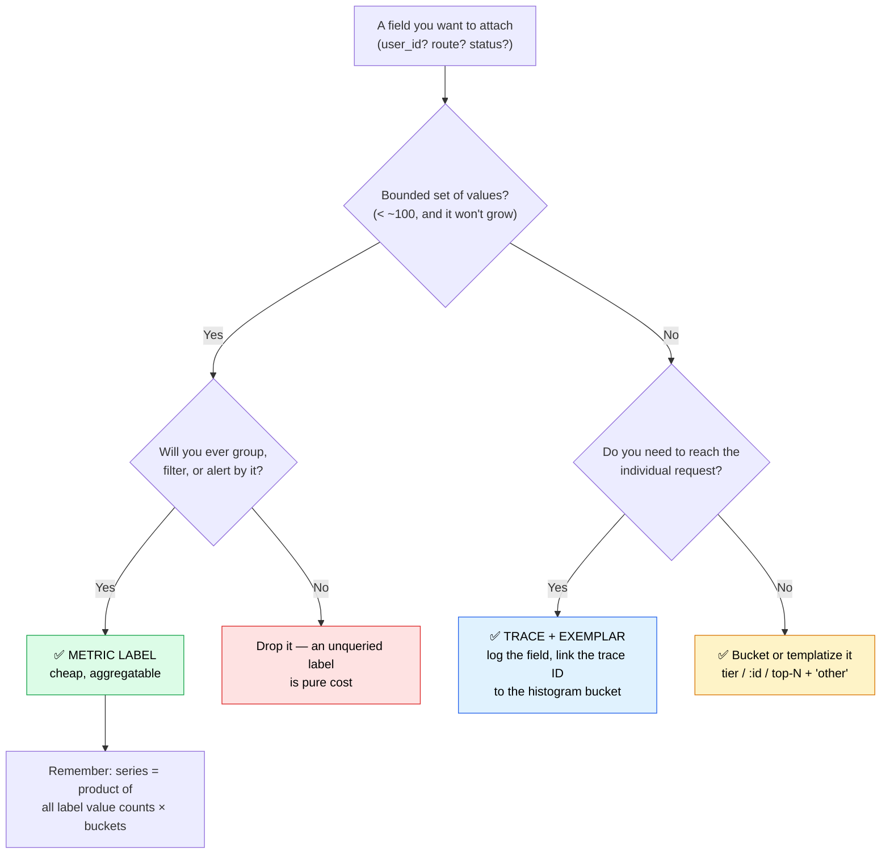

# Metrics Design & Cardinality

## 1. Why Should I Care About This?
- **One Bad Label Takes Down Your Monitoring**: Adding `user_id` to a single counter on a service with 2 M users doesn't make the dashboard richer — it creates 2 M time series, blows past your Prometheus memory limit, and OOM-kills the one system you need during an incident. "The monitoring died first" is a real and humiliating outage class, and it is almost always cardinality.
- **Cardinality Is Literally the Bill**: Datadog charges roughly **$0.05 per 100 custom metrics per month**, where a "custom metric" means *one unique combination of metric name and tag values*. A histogram with 20 buckets, 5 status codes, 40 routes and 200 pods is 800,000 series — that one instrument costs about **$400/month** all by itself. Engineers who don't understand cardinality write six-figure invoices by accident.
- **Half of "Our p99 Looks Wrong" Is a Metric-Type Mistake**: Averaging percentiles across instances, using a summary where you needed a histogram, or graphing a counter without `rate()` produces charts that are confidently wrong. Interviewers probe this because it separates people who have *read* a dashboard from people who have *built* one.
- **It's the Cheapest Pillar and You Should Use It Deliberately**: A metric sample compresses to **~1.3–2 bytes on disk**; a log line is ~1 KB and a span is ~500 B. Metrics are ~1000× cheaper per data point — which is exactly why they must stay low-cardinality, and why the high-cardinality context belongs in logs and traces instead (see [Structured Logging & Sampling Strategies](./Structured_Logging_Sampling_Strategies.md)).

## 2. What Problem Does This Solve?
- **Choosing the Wrong Instrument**: Counter vs gauge vs histogram vs summary is not stylistic. Pick wrong and the data is either unaggregatable (summaries), meaningless after a restart (a counter read as a gauge), or unable to answer the question you'll actually ask (a gauge when you needed a distribution).
- **The Combinatorial Explosion**: Series count is a **product**, not a sum. Every label you add multiplies. Humans reason additively, so this surprises people right up until the TSDB dies.
- **Metrics Nobody Can Use**: Inconsistent names (`api_latency`, `http_ms`, `RequestTime`), mixed units (some ms, some seconds), missing `_total` suffixes — and now no dashboard or alert generalizes across services.
- **Naive Approach**: "Instrument everything, label it with everything, we'll figure out what's useful later." What actually happens: 200,000 series of which ~50 are ever queried, a Prometheus that needs 64 GB of RAM, scrapes that time out, and a cardinality cleanup project a year later that nobody wants to own.

## 3. Core Idea (Intuition First)
A metric is a **spreadsheet that grows one row per unique label combination and one column per scrape**.

- The **columns** are cheap. A year of 15-second scrapes is ~2 M samples, and each compresses to under 2 bytes thanks to delta-of-delta timestamps and XOR-encoded values (Facebook's *Gorilla* paper). Columns are essentially free.
- The **rows are the cost.** Every distinct combination of label values is a new row, a new in-memory index entry, and a new chunk to write. A widely used rule of thumb is **~8 KB of RAM per active series** in Prometheus's head block. 1 M series ≈ 8 GB of RAM before you've stored a single day of history.
- And rows **multiply**: `series = |routes| × |methods| × |status| × |pods| × |buckets|`. Four innocent labels of ten values each is 10,000 rows. Add `user_id` and you've multiplied by your user count.

So the whole discipline is one question: **is this field bounded and will I ever group by it?**

- Bounded and useful for grouping (`status_code`, `route` *as a template*, `region`) → **label**.
- Unbounded (`user_id`, `order_id`, `raw URL`, `error message`, `timestamp`) → **not a label**. Put it in a log or a trace, where cardinality is free, and link the two with an **exemplar** — a trace ID attached to a histogram bucket, which is the escape hatch that gives you "which specific request was in that slow bucket?" without paying for a series per user.

> The mental image: **metrics are the smoke detector, traces and logs are the investigation.** A smoke detector with one sensor per person in the building isn't more sensitive — it's just broken.

![Three-panel diagram of metrics design and cardinality. Panel A compares the four metric types: a counter is monotonically increasing and must always be queried through rate or increase because the raw value is meaningless and resets to zero on restart; a gauge goes up and down and represents a current value such as queue depth or memory in use; a histogram records counts into cumulative buckets on the server so buckets from many instances can be summed and a quantile computed afterwards, which makes it the only correct choice for latency across a fleet, at the cost of one series per bucket; and a summary computes quantiles inside the client process, which makes it cheap and exact locally but mathematically impossible to aggregate across instances, so a fleet-wide p99 cannot be recovered from summaries. Panel B shows cardinality as a multiplication: forty route templates times five status codes times three methods times twenty pods equals twelve thousand series, which is fine, and then shows the same metric with a user id label added, multiplying by two million users to produce twenty-four billion series, annotated as a monitoring outage and with the eight kilobytes per active series memory rule of thumb. It also lists the classic cardinality bombs — user id, email, raw URL path with embedded identifiers, error message text, timestamps, and pod name churn where every deploy creates a fresh generation of series. Panel C is a decision flow for any field a developer wants to attach: if the number of distinct values is bounded and small and you will group or alert by it, make it a label; if it is unbounded but you need to reach the individual request, attach it as a trace exemplar on the histogram bucket or log it as a structured field; and if you only ever count it, convert it to a counter with no label at all.](../assets/metrics_cardinality_design.svg)

> Panel A: pick the instrument by the question you will ask, not by convenience. Panel B: series count is a product — one unbounded label ends the system. Panel C: unbounded fields belong in logs and traces, linked back by an exemplar.

## 4. How It Actually Works

### 1. Counter — monotonic, and useless unless you rate() it
- A **counter** only goes up (and resets to 0 on process restart). `http_requests_total`, `errors_total`, `bytes_sent_total`.
- **The raw value means nothing.** "This counter is at 4,812,993" tells you only how long the process has been alive. What you want is the derivative: `rate(http_requests_total[5m])` gives requests/second.
- **How `rate()` handles restarts**: Prometheus detects a decrease between samples, treats it as a reset, and adds the pre-reset value back in — which is exactly why counters must be *monotonic* and why you must never implement one as "a gauge I set to a computed total."
- **The `_total` suffix is a convention with teeth**: it tells every reader and every linting rule that this must be wrapped in `rate()`/`increase()`. OTel's Prometheus exporter appends it automatically.
- **Trade-off**: counters can't express "current value" (that's a gauge), and `rate()` over a short window on a low-traffic counter is noisy — a 5-minute window on 1 request/minute gives you a rate built from 5 data points. Rule: your range window should cover **at least 4 scrape intervals**.

### 2. Gauge — a current value, and the aggregation trap
- Goes up and down: `queue_depth`, `memory_bytes_in_use`, `active_connections`, `temperature_celsius`.
- **Aggregating gauges requires thought.** `sum(queue_depth)` across pods is meaningful; `sum(cpu_utilization_ratio)` is nonsense (you want `avg`). `max()` and `avg()` over a fleet hide the outlier that's actually broken — prefer `quantile` or `topk`, or alert on `max`.
- Gauges are **sampled**, so anything that spikes and recovers between two 15-second scrapes is invisible. If the spike matters, you need a counter of occurrences (`queue_full_events_total`) or a histogram, not a gauge.

### 3. Histogram — the only correct way to do latency across a fleet
- A **Prometheus histogram** with buckets `[0.005, 0.01, 0.025, …]` emits, per label set: one series **per bucket** (`_bucket{le="0.01"}`), plus `_sum` and `_count`. Buckets are **cumulative** — `le="0.1"` counts everything ≤ 100 ms, including everything in the smaller buckets.
- **Why cumulative matters**: cumulative buckets are *addable*. You can `sum by (le)` across 200 pods and then compute `histogram_quantile(0.99, sum by (le) (rate(..._bucket[5m])))`. **This is the property that makes fleet-wide percentiles possible at all.**
- **The precision cost**: `histogram_quantile` **linearly interpolates within the matching bucket**, so your accuracy is entirely determined by bucket layout. If your buckets jump 0.1 → 0.25 → 0.5 and the true p99 is 0.3, the reported value is an interpolation inside a 250 ms-wide bucket — it can be off by a hundred milliseconds. **Choose buckets around your SLO threshold**: if the SLO is 300 ms, you want boundaries at 0.2, 0.25, 0.3, 0.35, 0.5 — a dense cluster where the decision is made, sparse elsewhere.
- **The cardinality cost**: buckets multiply everything else. 12 buckets × 40 routes × 5 statuses × 20 pods = **48,000 series from one instrument.** This is why the default client-library latency histogram is often the single biggest series producer in a fleet.
- **Native / exponential histograms** (Prometheus ≥ 2.40, GA in 3.x; OTel calls them exponential histograms) fix this: instead of fixed buckets you store an exponential schema where bucket boundaries are `(1+2^-n)^i`, giving high relative precision across many orders of magnitude in **one series per label set** rather than one per bucket. They typically cut histogram storage by an order of magnitude and remove the "did I pick the right buckets?" problem. Migrate to them where your stack supports them.

### 4. Summary — cheap, exact, and unaggregatable (the classic trap)
- A **summary** computes quantiles **inside the client process** over a sliding window and exports `{quantile="0.99"} 0.42` directly.
- **The killer limitation**: you **cannot average or sum quantiles**. The p99 of pod A (0.4 s) and pod B (0.8 s) does not combine into a fleet p99 by any arithmetic — the true value depends on the two underlying distributions and their request counts. `avg(http_latency{quantile="0.99"})` is one of the most common wrong charts in production, and it can be off by a factor of two in either direction.
- **When summaries still win**: when you need an exact quantile for **one process** (no interpolation error, no bucket tuning) and never aggregate — e.g. a single-instance batch job, or GC pause quantiles inside a runtime. They're also more expensive in CPU (streaming quantile estimation per observation) than a histogram's bucket increment.
- **Practical rule: use histograms by default, summaries almost never.**

### 5. RED and USE — how to decide *what* to measure
- **RED (for every request-driven service)**: **R**ate (requests/sec), **E**rrors (failed requests/sec), **D**uration (latency distribution). Three instruments per service, all derivable from one histogram plus a status label. Tom Wilkie's framing; it maps onto the four [Golden Signals](./Golden_Signals_Latency_Traffic_Errors.md) minus saturation.
- **USE (for every resource: CPU, disk, pool, queue)**: **U**tilization (% time busy), **S**aturation (queued work waiting), **E**rrors. Brendan Gregg's framing. Saturation is the one people skip and the one that predicts the cliff — a thread pool at 95% utilization with a queue of 0 is fine; at 80% utilization with a queue of 400 it is already failing.
- **The pairing is the insight**: RED tells you the *symptom* users feel (alert on this); USE tells you the *cause* inside the box (page nobody, but put it on the drill-down dashboard).

### 6. Naming and units — boring, and it compounds
- `<namespace>_<subject>_<unit>_<suffix>`: `http_server_request_duration_seconds_bucket`, `db_connections_active`, `queue_messages_published_total`.
- **Base units always**: seconds (not ms), bytes (not MB), ratios 0–1 (not percent). Mixing units across services is how you get an alert that's off by 1000×.
- **Never put a value in the metric name** — `errors_404_total` should be `http_requests_total{status="404"}`, otherwise you can't sum across statuses.
- Follow **OTel semantic conventions** so a dashboard written for one service works for all of them.

### 7. Cardinality: the arithmetic, the churn, and the limits
- **Active series** = the product of label value counts, summed over metric names. Get this number from Prometheus's `/tsdb-status` page or `count({__name__=~".+"})`, and per-metric with `topk(10, count by (__name__)({__name__=~".+"}))`.
- **Churn is the hidden second dimension.** A series that stops receiving samples still occupies index space for the retention period. Kubernetes pods that restart every deploy create a *new* `pod` label value each time — 50 deploys/day × 200 pods = 10,000 new series/day *for the same metric*. Watch `prometheus_tsdb_head_series_created_total`. High churn hurts even when instantaneous cardinality looks fine.
- **Real capacity numbers**: a single Prometheus comfortably handles **1–10 M active series** (roughly 8 GB RAM at 1 M series, plus query headroom); beyond that you shard, or move to Thanos / Cortex / **Mimir** (which Grafana has demonstrated at **1 billion active series**) or Uber's M3. Vendors price on the same axis: cardinality *is* the unit of cost.
- **Defensive limits you should actually set**: `sample_limit` and `label_limit` per scrape config (a scrape that exceeds it fails loudly instead of poisoning the TSDB), `metric_relabel_configs` to drop known-bad labels at ingest, and per-tenant `max_global_series_per_user` in Mimir/Cortex. **A hard limit that fails one team's scrape is vastly better than an OOM that blinds everyone.**

### 8. Taming a high-cardinality field without losing the information
- **Templatize** the value: `/users/12345/orders/999` → `route="/users/:id/orders/:id"`. This is the single highest-value fix; unbounded URL paths are the most common bomb.
- **Bucket** it: `payment_amount_bucket` instead of `amount="49.99"`; `customer_tier="enterprise|smb|free"` instead of `customer_id`.
- **Top-N + "other"**: keep the 50 biggest tenants as labels, map the long tail to `tenant="other"`. Preserves the useful signal at a fixed cost.
- **Move it to the other pillars**: put `user_id` in the structured log and the span attributes. Then attach **exemplars** to histogram buckets so the graph itself links to a real trace. This gives you "click the slow bucket → see the actual request" with zero added series.
- **Pre-aggregate with recording rules**: if a dashboard always computes `sum by (route) (rate(...))`, materialize it — the query gets ~100× faster and you can drop the raw high-cardinality metric to a short retention.



## 5. Real-World Example
**The classic self-inflicted outage.** A team adds `customer_id` to `http_requests_total` "just for the enterprise dashboard." The service has 40 route templates, 5 status codes, and 30 pods — 6,000 series before the change. After the change, with 8,000 active customers, it's **48 M series**. Prometheus's head block needs hundreds of GB, the scrape starts timing out at 60 s, and the process is OOM-killed *during the next incident*, when it was needed most. The fix that shipped: revert the label, add `customer_tier` (3 values), and put `customer_id` in the span attributes with exemplars on the latency histogram — the enterprise dashboard was rebuilt on traces and worked better.

**Grafana Mimir at a billion series.** Grafana Labs published load tests running **1 billion active series** on a single Mimir cluster, using per-tenant series limits, sharded ingesters, and object storage for blocks. The interesting detail for a design discussion is that the architecture doesn't make cardinality *free* — it makes it **billable and bounded**, with a hard per-tenant limit that rejects writes rather than degrading everyone. That's the design pattern to copy at any scale.

**Where native histograms pay.** A fleet exporting 20-bucket latency histograms for 60 routes across 300 pods carries `20 × 60 × 300 = 360,000` bucket series. Switching to native/exponential histograms collapses this to **18,000 series** (one per label set) *and* removes bucket-boundary guesswork, while giving better relative precision at both ends of the distribution.

## 6. Code Example
Instrumenting correctly — bounded labels, SLO-aligned buckets, and an exemplar for the escape hatch:

```python
from prometheus_client import Counter, Gauge, Histogram
import re

# ── COUNTER: monotonic, _total suffix, bounded labels only ──────────────
REQUESTS = Counter(
    "http_server_requests_total", "Total HTTP requests",
    ["route", "method", "status_class"],       # 40 × 4 × 5 = 800 series. Bounded. Good.
)                                              # NOT user_id, NOT the raw path, NOT the error text

# ── HISTOGRAM: buckets clustered around the 300 ms SLO threshold ────────
LATENCY = Histogram(
    "http_server_request_duration_seconds", "Request duration",
    ["route", "method"],
    buckets=(0.01, 0.05, 0.1, 0.2, 0.25, 0.3, 0.35, 0.5, 1.0, 2.5, 5.0),
    #                      └──────── dense HERE: this is where the SLO decision is made ────┘
)                                              # 11 buckets × 40 routes × 4 methods = 1,760 series

# ── GAUGE: a current value, no labels that churn ────────────────────────
INFLIGHT = Gauge("http_server_requests_in_flight", "In-flight requests", ["route"])

# ── THE MOST IMPORTANT LINE IN THE FILE: templatize the path ────────────
_ID = re.compile(r"/\d+|/[0-9a-f]{8}-[0-9a-f]{4}-[0-9a-f]{4}-[0-9a-f]{4}-[0-9a-f]{12}")
def route_of(path: str) -> str:
    tmpl = _ID.sub("/:id", path)
    return tmpl if tmpl in KNOWN_ROUTES else "other"   # allowlist ⇒ a 404 scan can't explode us

def handle(request, span):
    route = route_of(request.path)
    INFLIGHT.labels(route).inc()
    with LATENCY.labels(route, request.method).time() as _:
        try:
            resp = dispatch(request)
        finally:
            INFLIGHT.labels(route).dec()
    REQUESTS.labels(route, request.method, f"{resp.status // 100}xx").inc()

    # ── EXEMPLAR: the escape hatch. Zero new series, but the bucket now
    #    links to a real trace where user_id/order_id live as attributes.
    LATENCY.labels(route, request.method).observe(
        resp.duration_s, exemplar={"trace_id": span.trace_id}
    )
```

Defending the TSDB at scrape time, and finding what's eating it:

```yaml
# prometheus.yml — fail one scrape loudly instead of OOM-ing everyone
scrape_configs:
  - job_name: api
    sample_limit: 20000          # reject a scrape that suddenly emits 10× the series
    label_limit: 30
    label_value_length_limit: 200
    metric_relabel_configs:
      - source_labels: [__name__]                  # drop a known cardinality bomb at ingest
        regex: 'app_request_by_user_.*'
        action: drop
      - regex: 'pod_template_hash|controller_revision_hash'   # churny k8s labels
        action: labeldrop
```

```promql
# ── CARDINALITY FORENSICS ──
count({__name__=~".+"})                                  # total active series
topk(10, count by (__name__)({__name__=~".+"}))          # which metric is the hog
topk(10, count by (job)({__name__=~".+"}))               # which service
count(count by (customer_id)(http_requests_total))       # how many values does ONE label have?
rate(prometheus_tsdb_head_series_created_total[1h]) * 3600  # CHURN: new series per hour

# ── THE CORRECT vs WRONG PERCENTILE ──
# ✅ sum the buckets first, THEN take the quantile — this is fleet-wide and correct
histogram_quantile(0.99, sum by (le, route) (rate(http_server_request_duration_seconds_bucket[5m])))
# ❌ never do this — you cannot average or sum quantiles
avg(http_server_request_duration_seconds{quantile="0.99"})
```

## 7. Design Variations & Alternatives

| Instrument | Answers | Aggregates across instances? | Series cost per label set | Use when |
|---|---|---|---|---|
| **Counter** | "How many? How fast?" | ✅ `sum(rate(...))` | 1 | Anything countable: requests, errors, retries, bytes |
| **Gauge** | "What is it right now?" | ⚠️ sum/avg depending on semantics | 1 | Queue depth, connections, memory, config values |
| **Classic histogram** | "What's the distribution / p99?" | ✅ sum buckets, then quantile | **1 per bucket + 2** | Latency, payload size — the default for anything with a tail |
| **Native/exponential histogram** | Same, higher precision | ✅ | **1** | Latency at scale, once your stack supports it |
| **Summary** | "Exact p99 for *this process*" | ❌ **mathematically cannot** | 1 per quantile + 2 | Single-instance quantiles only; avoid otherwise |
| **Exemplar (on a histogram)** | "Which *specific* request was slow?" | n/a | 0 extra series | The bridge from a metric spike to a trace |

**Push vs pull, and delta vs cumulative:**

| Axis | Prometheus (pull, cumulative) | OTel/StatsD/Datadog (push, often delta) |
|---|---|---|
| Discovery | Scrapes targets it discovers; a missing target is *visible* (`up == 0`) | Agent receives whatever arrives; a dead service is silence |
| Restarts | Counter resets handled by `rate()` | Deltas are naturally restart-safe |
| Short-lived jobs | Awkward — needs a Pushgateway | Natural fit |
| Firewalls/NAT | Needs reachability to every target | Works outbound-only |
| Cardinality control | Enforced at scrape (`sample_limit`, relabeling) | Enforced at the agent/collector or by the vendor's bill |

- **StatsD's aggregation model** (client sends every event as a UDP packet; the daemon aggregates) trades cardinality safety for simplicity — it will happily accept a million tag combinations and forward them all.
- **Collector-side derivation** is a strong middle path: OTel's `spanmetrics` connector generates RED metrics *from traces*, so the metric label set is defined centrally in the collector config (where one person controls cardinality) rather than in 500 application repos.

## 8. Pros and Cons

### Metrics as a pillar
- **Pros**: ~1.3–2 bytes/sample compressed makes them the cheapest telemetry by three orders of magnitude; constant-time queries over long windows (a year of data answers in milliseconds); the only pillar cheap enough to keep at 100% with no sampling, which is why alerts and SLOs are built on them.
- **Cons**: they are **pre-aggregated by design**, so you can only ask questions you decided to ask when you instrumented — no "show me requests where `feature_flag=X` and `region=Y`" unless both were already labels. They cannot explain *why*, only *how much*. And cardinality makes the cost superlinear in curiosity.

### High-cardinality labels specifically
- **Pros**: genuinely powerful for the few dimensions that matter (per-tenant SLOs for 20 enterprise customers is a legitimate, bounded use).
- **Cons**: multiplies every other label; costs RAM, disk, query time, and money simultaneously; the damage is delayed (it grows with your user base, so it ships fine and dies in six months); and it degrades the *whole* TSDB, not just the offending metric — one team's mistake blinds everyone.

## 9. Failure Scenarios & What Can Go Wrong
- **SYMPTOM**: Prometheus OOM-kills during an incident; dashboards go blank exactly when you need them. **ROOT CAUSE**: active series exceeded RAM — usually one new unbounded label, or a 404 scanner generating infinite `path` values. **FIX**: templatize/allowlist path labels, set `sample_limit` per scrape, `metric_relabel_configs` to drop the offender, and alert on `prometheus_tsdb_head_series` crossing 70% of budget. Run Prometheus with more memory than you think and a series *limit*, so it rejects rather than dies.
- **SYMPTOM**: The p99 chart looks fine but users report slowness. **ROOT CAUSE**: `avg()` over a summary's `quantile` label — averaged percentiles hide the bad instance entirely. **FIX**: switch to histograms and `histogram_quantile(0.99, sum by (le)(rate(..._bucket[5m])))`. Grep your dashboards for `quantile=` inside an `avg()`.
- **SYMPTOM**: p99 latency reads exactly 1.0 s or exactly 10 s, suspiciously flat. **ROOT CAUSE**: the true value is above your largest finite bucket, so it lands in `+Inf` and `histogram_quantile` clamps/extrapolates at the last boundary. **FIX**: extend bucket range above your timeout, and always keep a bucket above the SLO threshold plus headroom.
- **SYMPTOM**: A graph shows a huge negative spike or a cliff to zero. **ROOT CAUSE**: a counter reset (deploy/restart) queried without `rate()`/`increase()`, or a gauge implemented as a "total." **FIX**: always `rate()` counters; never model a total as a gauge.
- **SYMPTOM**: Memory grows steadily even though instantaneous series count is flat. **ROOT CAUSE**: **churn** — pod names, container IDs, or a `version` label creating fresh series on every deploy. **FIX**: drop churny labels (`pod_template_hash`, container ID) with `labeldrop`; measure `head_series_created_total`; prefer stable identity labels (`deployment`, `service`) over ephemeral ones.
- **SYMPTOM**: Scrapes intermittently fail with "context deadline exceeded." **ROOT CAUSE**: the target's `/metrics` page has grown to tens of MB (usually cardinality again) and can't be rendered/transferred within `scrape_timeout`. **FIX**: measure your own `/metrics` payload size in CI and fail the build if it grows past a threshold — a genuinely effective guardrail.
- **SYMPTOM**: Alert thresholds behave differently on two services. **ROOT CAUSE**: one exports seconds, the other milliseconds, both named `..._latency`. **FIX**: base units enforced by a shared instrumentation library and a naming lint in CI.
- **SYMPTOM**: The observability bill grows 40% after a "small dashboard improvement." **ROOT CAUSE**: a new tag on a high-traffic custom metric multiplied the billable series count. **FIX**: put cardinality in code review (any new label needs a stated value-count bound), and give each team a **series budget** with visibility into its usage.

## 10. Impact on Scalability, Reliability & Cost
- **Scalability**: the scaling axis is series count, not sample rate. Halving your scrape interval doubles samples (cheap, ~2 bytes each); adding one 100-value label multiplies series by 100 (expensive on every axis at once — index memory, chunk writes, query fan-out). One Prometheus handles ~1–10 M active series; past that, functional sharding (by service) is simpler than a distributed TSDB, and Thanos/Mimir/Cortex give you global query and cheap object-storage retention when you actually need them.
- **Reliability**: metrics are the substrate of every alert and SLO, so the TSDB must be *more* reliable than the systems it watches — which means hard ingest limits (fail one tenant, not the cluster), separate Prometheus instances for critical vs exploratory metrics, and a dead-man's switch that fires when metrics *stop* arriving (see [Synthetic Monitoring & Heartbeats](./Synthetic_Monitoring_Heartbeats.md)). Also remember scrape-based monitoring has a resolution floor: a 15 s interval cannot see a 3 s spike.
- **Cost**: storage is trivial (1 M series × 4 samples/min × 2 bytes ≈ **11 GB/day** — a rounding error), but hosted pricing is per-series and brutal: at Datadog's ~$0.05 per 100 custom metrics/month, 1 M series ≈ **$500/month**, and it's the *product* of your labels, so a single well-meaning tag can triple it. The cheapest optimization in all of observability is deleting labels nobody queries — audit which series are actually referenced by a dashboard or alert (Grafana's usage insights, or parse your rule files) and drop the rest.

## 11. When NOT to Use This
- **Don't use metrics for anything you need per-entity**: "did *this* order succeed?", "what happened to *this* user's session?" Those are log and trace questions. Forcing them into metrics is precisely how cardinality explodes.
- **Don't use metrics for exact accounting** (billing, financial totals, audit counts). Scrape gaps, counter resets, rate() extrapolation, and retention downsampling all make metrics *approximately* right — which is fine for alerting and fatal for invoices. Use an event stream or ledger (see [Audit Logging & Security Events](./Audit_Logging_Security_Events.md)).
- **Don't add a label "in case we need it later."** Adding a label later is a one-line change; removing one means rewriting dashboards, alerts, and recording rules while the historical series linger for the whole retention window. Default to fewer.
- **Don't use summaries when more than one process reports the metric** — which, in any modern deployment, is always.
- **Don't build a per-customer metric fleet for thousands of customers.** Per-tenant SLOs are legitimate for tens of tenants; past that, use log/trace aggregation or a purpose-built analytics store (ClickHouse, Druid) where high cardinality is the design point rather than the failure mode.

## 12. Interview Perspective
- **What interviewers expect**: crisp instrument selection (counter/gauge/histogram/summary) *with* the aggregation consequence, and the sentence **"series = the product of label value counts, so one unbounded label ends the system."** Say the word *cardinality* and then immediately give the arithmetic.
- **The trap question**: "How would you track per-user request latency?" The wrong answer adds a `user_id` label. The right answer: keep a low-cardinality histogram, attach **exemplars** with trace IDs, put `user_id` on the span and in the structured log, and query per-user questions from traces/logs — then note that if per-tenant SLOs are genuinely required, you bound it with a top-N-plus-`other` scheme.
- **The math question**: "Estimate the cost of this instrument." Walk it: 12 buckets × 40 routes × 5 statuses × 200 pods = 480,000 series → ~8 KB/series ≈ **3.8 GB RAM**, and at $0.05/100 series/month ≈ **$240/month** for one histogram. Then propose the fix (drop `pod` via aggregation, use native histograms) and re-do the arithmetic. Showing the *before and after number* is what lands.
- **The subtle question**: "Why can't you average p99s?" Because a quantile is a property of a distribution, not a value that composes; the fleet p99 depends on both distributions and their relative weights. Histograms work because *counts per bucket* are additive and the quantile is computed **after** summing.
- **Bonus signals**: churn as distinct from instantaneous cardinality; native/exponential histograms; RED vs USE and why saturation is the leading indicator; `sample_limit` as a blast-radius control; the fact that metrics are pre-aggregated so they can only answer pre-decided questions — which is the argument for wide events alongside them.

## 13. Connections to Other Topics
- [Metrics Collection (Prometheus & Grafana)](./Metrics_Collection_Prometheus_Grafana.md) — the collection and storage mechanics; this file is the *design* discipline that keeps that system alive.
- [Golden Signals](./Golden_Signals_Latency_Traffic_Errors.md) — RED and USE are the concrete instrument sets that implement the golden signals.
- [Structured Logging & Sampling Strategies](./Structured_Logging_Sampling_Strategies.md) — the mirror image: unbounded fields are free in logs and fatal in metrics. Deciding which pillar carries a field is one decision made twice.
- [Distributed Tracing (OpenTelemetry)](./Distributed_Tracing_OpenTelemetry.md) — where exemplars point, and the source for collector-generated RED metrics (`spanmetrics`).
- [SLO, SLI & Error Budgets](./SLO_SLI_Error_Budgets.md) — SLIs are built from these instruments; bucket boundaries must straddle the SLO threshold or your error budget is measured with a blunt instrument.
- [Centralized Dashboard Design](./Centralized_Dashboard_Design.md) — recording rules and pre-aggregation are what make hierarchical dashboards load fast.
- [14 · Performance Optimization & Scalability](../14_Performance_Optimization_Scalability/) — these metrics are the evidence base for every optimization claim.

## 14. Visual Aids
- **The SVG above** ([metrics_cardinality_design.svg](../assets/metrics_cardinality_design.svg)): panel A — the four instrument types and their aggregation properties; panel B — cardinality as a multiplication, with the classic bombs and the 8 KB/series rule; panel C — the "should this be a label?" decision flow, ending at exemplars.
- **Mermaid (Section 4)**: the same decision flow in queryable form — bounded and grouped-by → label; unbounded but needed per-request → trace + exemplar; otherwise bucket it or drop it.
- **Tables (Section 7)**: instrument-selection matrix, and the push/pull, delta/cumulative comparison that decides how cardinality gets *enforced* in your stack.

## 15. Summary (TL;DR)
**Metrics are the cheapest pillar per data point (~1.3–2 bytes/sample compressed) and the most expensive per *dimension*, because a time series database stores one series per unique label combination and series count is a **product** — 40 routes × 5 statuses × 4 methods × 200 pods × 12 histogram buckets is 1.9 M series at roughly 8 KB of RAM each, and adding a single unbounded label like `user_id` multiplies that by your user count and OOM-kills the monitoring in the middle of the incident it was supposed to explain. So choose the instrument by the question — counters are monotonic and meaningless until you `rate()` them; gauges are point-in-time and hide anything faster than your scrape interval; **histograms are the only correct latency instrument across a fleet** because cumulative buckets are additive, so you `sum by (le)` first and take `histogram_quantile` second (accuracy is set entirely by whether your buckets cluster around the SLO threshold, which is why native/exponential histograms — one series instead of one per bucket — are the upgrade to make); and **summaries compute quantiles client-side and cannot be aggregated at all**, making `avg(p99)` the most common wrong chart in production. Structure what you measure with RED for services and USE for resources, name in base units with `_total` suffixes and OTel conventions, and treat every proposed label as a cardinality bill: bounded and grouped-by → label; unbounded → templatize it (`/users/:id`), bucket it, or top-N-plus-`other`; genuinely per-request → put it in the trace and the log and link back with an **exemplar**, which costs zero series. Then defend the TSDB the way you'd defend any shared resource — `sample_limit` and relabel drops at scrape time, per-tenant series budgets, churn monitoring, and an alert on your own head-series count — because **the only monitoring failure that matters is the one where the monitoring is what failed.**

## 16. Further Reading & Resources
- [Prometheus — Metric types and naming best practices](https://prometheus.io/docs/practices/naming/) — the canonical conventions: base units, `_total`, no values in names.
- [Prometheus — Histograms and summaries](https://prometheus.io/docs/practices/histograms/) — why quantiles can't be averaged, and how `histogram_quantile` interpolation works.
- [Prometheus — Native histograms](https://prometheus.io/docs/specs/native_histograms/) — the exponential-bucket design that collapses bucket series.
- [Tom Wilkie — "The RED Method"](https://grafana.com/blog/2018/08/02/the-red-method-how-to-instrument-your-services/) — rate, errors, duration as the default service instrument set.
- [Brendan Gregg — "The USE Method"](https://www.brendangregg.com/usemethod.html) — utilization, saturation, errors for every resource.
- [Facebook — "Gorilla: A Fast, Scalable, In-Memory Time Series Database"](https://www.vldb.org/pvldb/vol8/p1816-teller.pdf) — the compression that makes samples ~1.3 bytes.
- [Grafana Labs — "Scaling Mimir to 1 billion active series"](https://grafana.com/blog/2022/04/08/how-we-scaled-our-new-prometheus-tsdb-grafana-mimir-to-1-billion-active-series/) — what industrial-scale cardinality management actually looks like.
- [Robust Perception — "Cardinality is key"](https://www.robustperception.io/cardinality-is-key/) — the short, blunt version of this entire file.
