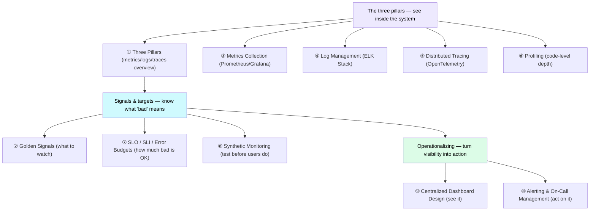
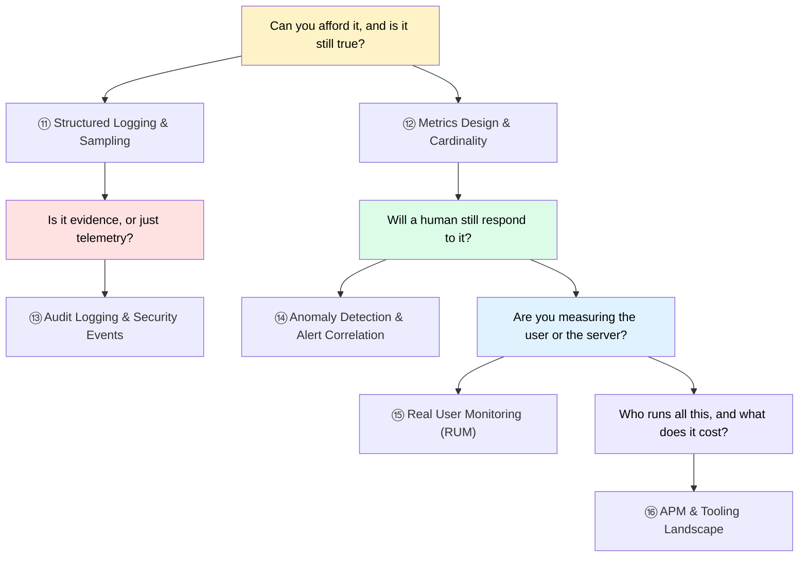
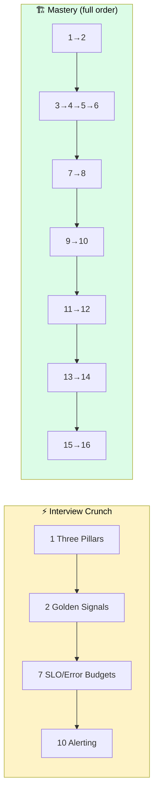

# 12 · Monitoring, Logging & Observability 📊

> **Seeing inside the machine.** A distributed system is a black box until you instrument it — metrics, logs, and traces are the three pillars that turn "it feels slow" into "this exact query on this exact shard took 4.2s." The golden signals (latency, traffic, errors, saturation) tell you *something* is wrong; SLOs and error budgets tell you *how much* wrong is acceptable; and dashboards plus alerting turn that visibility into a human actually waking up and fixing it. Build this layer badly and every incident becomes archaeology — and build it *naively* and you get the other failure mode nobody warns you about: an observability bill larger than the infrastructure it watches, a Prometheus that OOMs during the incident it was meant to explain, and a pager so noisy the real alert gets dismissed.

---

## 🎯 What You'll Be Able To Do

- **Instrument a system with the three pillars** — emit metrics, structured logs, and distributed traces, and know which pillar answers which question.
- **Watch the signals that actually matter** — the four Golden Signals instead of a wall of CPU/RAM graphs nobody reads.
- **Stand up a real observability stack** — Prometheus + Grafana for metrics, the ELK stack for logs, OpenTelemetry for traces, and profilers for hot-line-level detail.
- **Turn visibility into a contract** — define SLIs, set SLOs, and spend an error budget to arbitrate the dev-velocity vs. stability trade-off with data, not opinions.
- **Catch failures before users report them** — synthetic monitoring and heartbeats test critical flows and detect total silence.
- **Design dashboards and alerts that get acted on** — hierarchical "space-to-earth" dashboards and symptom-based, runbook-backed alerts that don't burn out on-call.
- **Log at a million QPS without going bankrupt** — structured wide events with a propagated `trace_id`, and head vs tail sampling that keeps 100% of errors while retaining ~1% overall (and always records its own sample rate).
- **Design metrics that don't kill the TSDB** — counter/gauge/histogram/summary chosen by the question, RED and USE, and the cardinality arithmetic that explains why one `user_id` label ends the system.
- **Build an audit trail that survives an attacker** — who/what/when/where/outcome, written in the same transaction as the change, hash-chained, and stored where the credentials that took the action cannot delete the record of it.
- **Cut alert noise by an order of magnitude** — multi-window burn-rate alerting instead of anomaly detection on the pager, plus dedupe/group/inhibit correlation that turns a 240-alert storm into one page.
- **Measure the experience you actually ship** — Core Web Vitals at p75, segmented by device, network and geography, with attribution that names the element to fix.
- **Choose (and price) the tooling** — the build-vs-buy arithmetic, the pricing cliff behind each model, and OpenTelemetry as the seam that keeps your backend swappable.

---

## 🗺️ How the 16 Topics Interlock

This section is now two layers. **Layer 1 (①–⑩)** is the *foundation* — the three pillars, the signals worth watching, the targets, and the operational surface. **Layer 2 (⑪–⑯)** is the *engineering-judgment layer*: the decisions that determine whether all of that stays affordable, stays honest, stays admissible as evidence, and stays quiet enough that a human still responds to it.

### Layer 1 — the foundation (①–⑩)



> **The spine:** *instrument with the three pillars → decide which signals matter and how much deviation is tolerable → surface it on a dashboard and page a human only when it's real.* Golden Signals (②) are the lens that makes the raw metrics/logs/traces (①③④⑤⑥) actionable; SLOs (⑦) put a number on "acceptable," which synthetic checks (⑧) verify even with zero real traffic; dashboards (⑨) and alerting (⑩) are the last mile where all of it either gets seen or gets ignored.

### Layer 2 — the judgment calls that decide whether it works (⑪–⑯)



> **The through-line:** *everything in layer 1 is affordable at small scale and ruinous at large scale unless you make these six decisions on purpose.* Logging (④) becomes 86 TB/day at 1M QPS until you adopt wide events and error-biased sampling (⑪ — and record the sample rate, or every count you compute is wrong); metrics (③) are the cheapest pillar per sample and the most expensive per *dimension*, because series multiply (⑫ — one unbounded label OOMs the TSDB mid-incident). Some logs aren't telemetry at all: audit records (⑬) are never sampled, never dropped, written in the same transaction as the change, and stored where the actor can't delete them. On the output side, alerting (⑩) only survives contact with reality if you correlate the storm and page on burn rate rather than on "unusual" (⑭ — 14.4M daily checks means a 99.9%-specific detector is a spam cannon). RUM (⑮) is the reality check on all of it — server p99 and user experience differ by 10–50× — and pairs with synthetic (⑧) as field-vs-lab. Finally ⑯ prices the whole stack and names the seam (OpenTelemetry) that keeps the backend a config change instead of a re-instrumentation project.

---

## 📚 The Complete File Index

### Foundation (①–⑩)

| # | Topic | One-line | Key takeaway |
|---|-------|----------|--------------|
| 1 | [Monitoring, Logging & Tracing — Three Pillars](./Monitoring_Logging_Tracing_Three_Pillars.md) | The plane's blind-flying problem | Metrics=what, Logs=why, Traces=where; you need all three, none substitutes for another |
| 2 | [Golden Signals](./Golden_Signals_Latency_Traffic_Errors.md) | The busy restaurant's four vitals | Latency/Traffic/Errors/Saturation — a universal health language that kills alert fatigue |
| 3 | [Metrics Collection (Prometheus & Grafana)](./Metrics_Collection_Prometheus_Grafana.md) | The robot nurse and the ER screen | Pull-based scraping into a time-series DB; Grafana turns numbers into a glance-able story |
| 4 | [Log Management (ELK Stack)](./Log_Management_ELK_Stack.md) | The librarian, the shelves, the desk | Logstash/Beats parse, Elasticsearch indexes, Kibana searches billions of lines in seconds |
| 5 | [Distributed Tracing (OpenTelemetry)](./Distributed_Tracing_OpenTelemetry.md) | UPS tracking for a user request | Trace ID + spans stitch one request across 50 services; OTel is the vendor-neutral standard |
| 6 | [Profiling & Distributed Profiling](./Profiling_Distributed_Profiling.md) | The medical stress test for code | Finds the 10 hot lines doing 90% of the work; continuous profiling catches production Heisenbugs |
| 7 | [SLO, SLI & Error Budgets](./SLO_SLI_Error_Budgets.md) | Thermometer, goal, and allowance | The error budget arbitrates dev-velocity vs. stability with math instead of arguments |
| 8 | [Synthetic Monitoring & Heartbeats](./Synthetic_Monitoring_Heartbeats.md) | The robot mystery shopper | Tests critical flows 24/7 even at zero traffic; heartbeats catch total silence, not just errors |
| 9 | [Centralized Dashboard Design](./Centralized_Dashboard_Design.md) | Mission control, space to Earth | Hierarchical drill-down (exec → service → debug) beats one giant page of everything |
| 10 | [Alerting Strategies & On-Call Management](./Alerting_Strategies_OnCall_Management.md) | The smoke alarm, not a cried wolf | Alert on symptoms with a runbook, route by severity, protect on-call from burnout |

### The Judgment Calls (⑪–⑯)

| # | Topic | One-line | Key takeaway |
|---|-------|----------|--------------|
| 11 | [Structured Logging & Sampling Strategies](./Structured_Logging_Sampling_Strategies.md) | A shoebox of notes vs a filled-in form | One wide event per request with `trace_id`; head sampling is cheap and blind, tail keeps 100% of errors — and **always write `sample_rate`, then aggregate with `SUM(1/p)`** |
| 12 | [Metrics Design & Cardinality](./Metrics_Design_Cardinality.md) | A spreadsheet where rows cost 8 KB each | Series = the **product** of label values; histograms aggregate and summaries never can; unbounded fields belong in traces/logs with an exemplar |
| 13 | [Audit Logging & Security Events](./Audit_Logging_Security_Events.md) | A ship's logbook, not a security camera | Who/what/when/where/outcome (**including denied**), committed with the change, hash-chained, on WORM storage in a different account |
| 14 | [Anomaly Detection & Alert Correlation](./Anomaly_Detection_Alert_Correlation.md) | Every monitor in the room alarms at once | 14.4M checks/day makes 99.9% specificity a spam cannon — page on multi-window **burn rate**, then dedupe → group → inhibit → enrich |
| 15 | [Real User Monitoring (RUM)](./Real_User_Monitoring_RUM.md) | The inspector vs every actual diner | LCP ≤ 2.5s · INP ≤ 200ms · CLS ≤ 0.1 at **p75, per segment**; `sendBeacon` on `visibilitychange`, never `unload` |
| 16 | [APM & Observability Tooling Landscape](./APM_Tools_Landscape.md) | You're buying a cost curve and an exit cost | Instrument with **OTel** so the backend is a config change; hybrid (vendor + self-hosted logs) cuts 40–70% of the bill |

---

## 🧭 Suggested Study Paths



| Goal | Path | Why |
|------|------|-----|
| **⚡ Interview in 48h** | 1 → 2 → 7 → 10 (+ skim 3, 5, 12) | Pillars + what to watch + how much is OK + who gets paged = the most-asked 80%; 12 arms you for the guaranteed cardinality follow-up |
| **🏗️ Deep mastery** | 1 → 2 → 3 → 4 → 5 → 6 → 7 → 8 → 9 → 10 → 11 → 12 → 13 → 14 → 15 → 16 | Pillars → tooling per pillar → targets → proactive checks → operational surface → then the judgment calls that decide whether any of it survives scale |
| **🛠️ Build the stack** | 3 → 4 → 5 → 9 (+ 11, 12, 16) | Stand up metrics, logs, and traces, put them on one dashboard — then design the volume, the labels, and the bill before they design themselves |
| **🚨 On-call readiness** | 2 → 7 → 8 → 10 → 14 | Know the signals, the acceptable threshold, how it's tested, how it pages you — and how to make it page you *once* |
| **💸 "Our observability bill exploded"** | 11 → 12 → 16 | Log volume, metric cardinality, and pricing models — in the order the money actually leaks |
| **🔐 Security & compliance** | 13 → 14 (+ [15 · Compliance](../15_Security_Deep_Dive_DevSecOps/Compliance_Frameworks_SOC2_GDPR.md)) | Build the evidence trail, then the detections that read it |
| **🖥️ Front-end / user experience** | 15 → 8 → 2 | Field data first, lab probes second, and the golden signals measured where the user is |

> **Study each file by** doing the 🏋️ **Practice Drills before the solutions**, rehearsing the 🎤 **Interview Q&A out loud**, and reading 🎯 **Staff+ Nuances** for senior-level depth.

---

## 🔑 The Decision Card (whole-section cheat sheet)

```
PILLARS   Metrics = WHAT (numeric, cheap, alertable) · Logs = WHY (detailed, expensive, searchable) ·
          Traces = WHERE (per-request path across services) · use all three, never just one
TOOLING   Prometheus (pull, scrape, TSDB, alerts) + Grafana (visualize) ·
          ELK (Logstash/Beats parse → Elasticsearch index → Kibana search) ·
          OpenTelemetry (Trace ID + Span ID, vendor-neutral, works with Jaeger/Honeycomb/New Relic) ·
          Profiling (CPU/memory hot paths; continuous profiling in prod, not just console.time)
SIGNALS   the FOUR golden signals: Latency · Traffic · Errors · Saturation — alert on SYMPTOMS not causes
TARGETS   SLI = the measured number · SLO = the promised threshold · ERROR BUDGET = 100% - SLO,
          spend it on releases, freeze features when it hits zero — turns Dev vs Ops into math
PROACTIVE synthetic monitoring = scripted user journeys, catches zero-traffic blindness ·
          heartbeats = dead man's switch, alerts on SILENCE not on an explicit failure signal
OPERATE   dashboards: hierarchical space-to-earth (exec → service → debug), signal over sprawl ·
          alerting: symptom-based + runbook-linked + severity-routed · protect on-call, avoid alert fatigue
RECURRING you can't fix what you can't see, and you can't act on what you can't triage —
          instrumentation without a target (SLO) and a human path (on-call) is just noise
── THE JUDGMENT CALLS ────────────────────────────────────────────────────────
LOGGING   structured key-value events, OTel semantic conventions, base units, trace_id on EVERY line
          ONE CANONICAL WIDE EVENT per request ⇒ volume = traffic, not developer habits
          1M QPS × 1KB = 86 TB/day ≈ $8.6k/day to ingest — sampling is not optional at scale
          HEAD sampling: hash(trace_id) at the root, consistent across services, cheap, BLIND to outcome
          TAIL sampling: buffer 10–30s, keep 100% errors + 100% slow + ~1% rest ≈ same bill, ~100× value
              requires routing every span of a trace to ONE collector (loadbalancing exporter, routing_key: traceID)
          NEVER sample ERROR/audit/billing · token-bucket dedup by message shape + a "skipped" count
          ALWAYS write sample_rate and aggregate with SUM(1/p) — sampled data without its rate is an anecdote
          pipeline must DROP not block (an observability outage must never become a product outage)
CARDINALITY  series = the PRODUCT of label value counts × histogram buckets · ~8 KB RAM per active series
          counter (monotonic, always rate()) · gauge (now, hides sub-scrape spikes) ·
          HISTOGRAM = the only correct fleet latency instrument (cumulative buckets ADD: sum by(le) → quantile)
          SUMMARY quantiles are computed client-side and CANNOT be aggregated — avg(p99) is the classic wrong chart
          buckets must straddle the SLO threshold · native/exponential histograms = 1 series instead of 1 per bucket
          RED for services (Rate/Errors/Duration) · USE for resources (Utilization/Saturation/Errors)
          bombs: user_id, email, raw URL, error text, pod-name CHURN · fixes: /users/:id, tier not id, top-N + "other"
          unbounded + need the request? → trace + EXEMPLAR (zero extra series) · sample_limit at scrape = blast radius
AUDIT     evidence, not telemetry: never sampled, never dropped (block or spill), years not days
          WHO (+ on_behalf_of) · WHAT (stable enum + before/after diff) · WHEN (server UTC + seq) · WHERE · OUTCOME
          log DENIED attempts and sensitive READS — exfiltration is a read, recon is a denial
          write it in the SAME TRANSACTION as the change (outbox) ⇒ no action can exist without its record
          hash-chain each record + publish an anchor · S3 Object Lock COMPLIANCE (root can't delete) in a SEPARATE account
          the rule: the credentials that can perform the action must NOT be able to erase the record of it
          GDPR erasure vs immutability → pseudonymous subject_ref or per-subject crypto-shredding, never row deletes
DETECTION 10k series × 1440 min = 14.4M checks/day ⇒ 99.9% specificity = 14,400 false alerts/day ⇒ NEVER page on it
          page on MULTI-WINDOW BURN RATE: 14.4×/1h (2% budget) · 6×/6h (5%) · 3×/1d + 1×/3d → ticket
              the short second window exists so the alert RESOLVES fast
          use MAD not σ (the outlier you're hunting inflates σ) · week-over-week/STL/S-H-ESD for seasonality
          ML belongs in canary analysis (Kayenta), capacity forecasting, and investigation feeds — not the pager
          correlate: dedupe by fingerprint → group_by cluster/service → INHIBIT downstream → for: 5m → enrich with deploys
          measure the alerting: ≤2 pages/12h shift · >80% actionable · alert:incident ratio · % found before customers
RUM       field vs lab: server p99 and lived experience differ 10–50× · LCP ≤2.5s · INP ≤200ms (replaced FID 2024) · CLS ≤0.1
          p75, BY SEGMENT (route template · device · country · ECT · build) — aggregates hide the suffering fifth
          web-vitals WITH attribution (which element, which event) · sendBeacon on visibilitychange (unload kills bfcache)
          errors at 100% + source maps + crossorigin="anonymous" · ad blockers and abandonment bias you OPTIMISTIC
TOOLING   3 layers: instrumentation / pipeline / backend — vendors fused them, OTel broke the fusion
          instrument with OTel + own the Collector ⇒ backend is a config change, and dual-shipping is a real eval
          pricing cliffs: per-host (autoscaling) · per-GB (DEBUG) · per-metric (cardinality) · per-seat (access) · per-session
          200 hosts/5TB logs/2M series ≈ $35–50k/mo list vs self-host $6–12k infra + 2–4 FTE ($33–83k/mo loaded)
          HYBRID wins: vendor for traces+metrics correlation, self-hosted logs → 40–70% off · budget 5–15% of infra spend
```

---

## 🎨 Conventions & Authoring

- Every file follows the root [TEMPLATE.md](../TEMPLATE.md). Animated SVGs live in [/assets](../assets/).
- Each file ends with the three mastery sections: 🏋️ Practice Drills, 🎤 Interview Q&A Bank, 🎯 Staff+ Nuances.

---

## ➡️ Where This Connects

- ⬅️ [01 · Planning & Foundations](../01_Planning_Foundations/) — SLA/SLO/SLI are first defined there; this section operationalizes them into real dashboards and alerts.
- ⬅️ [10 · Microservices & Distributed Systems](../10_Microservices_Distributed_Systems/) — the many-services-per-request problem that makes distributed tracing necessary in the first place, and the [transactional outbox](../10_Microservices_Distributed_Systems/Transactional_Outbox_Inbox_Pattern.md) that guarantees an action can't happen without its audit record.
- ⬅️ [11 · Security & Identity](../11_Security_Identity/) — the authorization decision point is exactly where audit events should be emitted, with the policy that produced the outcome.
- ➡️ [13 · Cloud-Native Infrastructure](../13_Cloud_Native_Infrastructure/) — the platform (containers, orchestration, service mesh) that this instrumentation runs on and integrates with — and the reason your monitoring must **not** live in the cluster it monitors.
- ➡️ [14 · Performance Optimization & Scalability](../14_Performance_Optimization_Scalability/) — the metrics and profiles gathered here are the evidence that drives every optimization decision.
- ➡️ [15 · Security Deep Dive & DevSecOps](../15_Security_Deep_Dive_DevSecOps/) — the compliance frameworks that *require* the audit trail built here, and the SIEM that consumes it.

---
*Part of the [System Design & Architecture Master Repository](../README.md). You cannot fix, scale, or trust a system you cannot see — this is where the machine becomes legible.*
