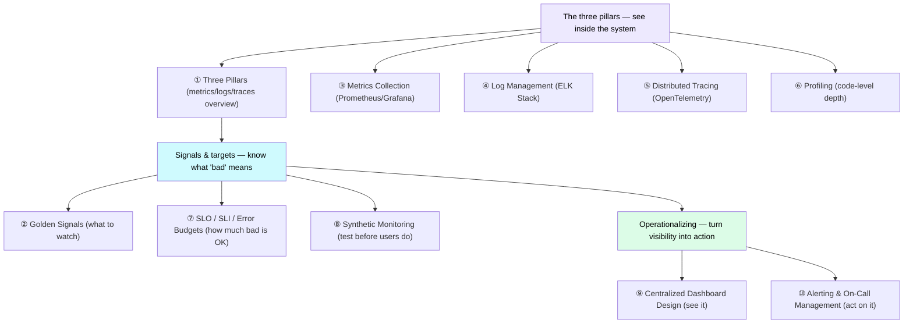
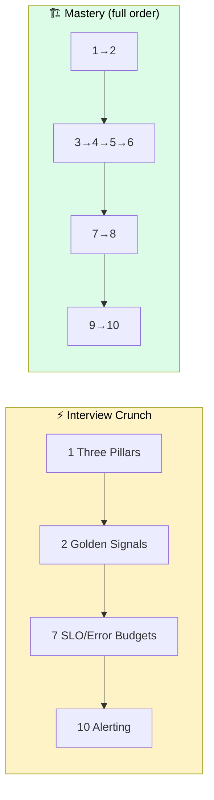

# 12 · Monitoring, Logging & Observability 📊

> **Seeing inside the machine.** A distributed system is a black box until you instrument it — metrics, logs, and traces are the three pillars that turn "it feels slow" into "this exact query on this exact shard took 4.2s." The golden signals (latency, traffic, errors, saturation) tell you *something* is wrong; SLOs and error budgets tell you *how much* wrong is acceptable; and dashboards plus alerting turn that visibility into a human actually waking up and fixing it. Build this layer badly and every incident becomes archaeology.

---

## 🎯 What You'll Be Able To Do

- **Instrument a system with the three pillars** — emit metrics, structured logs, and distributed traces, and know which pillar answers which question.
- **Watch the signals that actually matter** — the four Golden Signals instead of a wall of CPU/RAM graphs nobody reads.
- **Stand up a real observability stack** — Prometheus + Grafana for metrics, the ELK stack for logs, OpenTelemetry for traces, and profilers for hot-line-level detail.
- **Turn visibility into a contract** — define SLIs, set SLOs, and spend an error budget to arbitrate the dev-velocity vs. stability trade-off with data, not opinions.
- **Catch failures before users report them** — synthetic monitoring and heartbeats test critical flows and detect total silence.
- **Design dashboards and alerts that get acted on** — hierarchical "space-to-earth" dashboards and symptom-based, runbook-backed alerts that don't burn out on-call.

---

## 🗺️ How the 10 Topics Interlock



> **The spine:** *instrument with the three pillars → decide which signals matter and how much deviation is tolerable → surface it on a dashboard and page a human only when it's real.* Golden Signals (②) are the lens that makes the raw metrics/logs/traces (①③④⑤⑥) actionable; SLOs (⑦) put a number on "acceptable," which synthetic checks (⑧) verify even with zero real traffic; dashboards (⑨) and alerting (⑩) are the last mile where all of it either gets seen or gets ignored.

---

## 📚 The Complete File Index

| # | Topic | One-line | Key takeaway |
|---|-------|----------|--------------|
| 1 | [Monitoring, Logging & Tracing — Three Pillars](./Monitoring_Logging_Tracing_Three_Pillars.md) | The plane's blind-flying problem | Metrics=what, Logs=why, Traces=where; you need all three, none substitutes for another |
| 2 | [Golden Signals](./Golden_Signals_Latency_Traffic_Errors.md) | The busy restaurant's four vitals | Latency/Traffic/Errors/Saturation — a universal health language that kills alert fatigue |
| 3 | [Metrics Collection (Prometheus & Grafana)](./Metrics_Collection_Prometheus_Grafana.md) | The robot nurse and the ER screen | Pull-based scraping into a time-series DB; Grafana turns numbers into a glance-able story |
| 4 | [Log Management (ELK Stack)](./Log_Management_ELK_Stack.md) | The librarian, the shelves, the desk | Logstash/Beats parse, Elasticsearch indexes, Kibana searches billions of lines in seconds |
| 5 | [Distributed Tracing (OpenTelemetry)](./Distributed_Tracing_OpenTelemetry.md) | UPS tracking for a user request | Trace ID + spans stitch one request across 50 services; OTel is the vendor-neutral standard |
| 6 | [Profiling & Distributed Profiling](./Profiling_Distributed_Profiling.md) | The medical stress test for code | Finds the 10 hot lines doing 90% of the work; continuous profiling catches production Heisenbugs |
| 7 | [SLO, SLI & Error Budgets](./SLO_SLI_Error_Budgets.md) | Thermometer, goal, and allowance | The error budget arbitrates dev-velocity vs. stability with math instead of arguments |
| 8 | [Synthetic Monitoring & Heartbeats](./Synthetic_Monitoring_Heartbeats.md) | The robot mystery shopper | Tests critical flows 24/7 even at zero traffic; heartbeats catch total silence, not just errors |
| 9 | [Centralized Dashboard Design](./Centralized_Dashboard_Design.md) | Mission control, space to Earth | Hierarchical drill-down (exec → service → debug) beats one giant page of everything |
| 10 | [Alerting Strategies & On-Call Management](./Alerting_Strategies_OnCall_Management.md) | The smoke alarm, not a cried wolf | Alert on symptoms with a runbook, route by severity, protect on-call from burnout |

---

## 🧭 Suggested Study Paths



| Goal | Path | Why |
|------|------|-----|
| **⚡ Interview in 48h** | 1 → 2 → 7 → 10 (+ skim 3, 5) | Pillars + what to watch + how much is OK + who gets paged = the most-asked 80% |
| **🏗️ Deep mastery** | 1 → 2 → 3 → 4 → 5 → 6 → 7 → 8 → 9 → 10 | Pillars → tooling per pillar → targets → proactive checks → the operational surface, in dependency order |
| **🛠️ Build the stack** | 3 → 4 → 5 → 9 | Stand up metrics, logs, and traces, then put them all on one dashboard |
| **🚨 On-call readiness** | 2 → 7 → 8 → 10 | Know the signals, the acceptable threshold, how it's tested, and how it pages you |

> **Study each file by** doing the 🏋️ **Practice Drills before the solutions**, rehearsing the 🎤 **Interview Q&A out loud**, and reading 🎯 **Staff+ Nuances** for senior-level depth.

---

## 🔑 The Decision Card (whole-section cheat sheet)

```
PILLARS   Metrics = WHAT (numeric, cheap, alertable) · Logs = WHY (detailed, expensive, searchable) ·
          Traces = WHERE (per-request path across services) · use all three, never just one
TOOLING   Prometheus (pull, scrape, TSDB, alerts) + Grafana (visualize) ·
          ELK (Logstash/Beats parse → Elasticsearch index → Kibana search) ·
          OpenTelemetry (Trace ID + Span ID, vendor-neutral, works with Jaeger/Honeycomb/New Relic) ·
          Profiling (CPU/memory hot paths; continuous profiling in prod, not just console.time)
SIGNALS   the FOUR golden signals: Latency · Traffic · Errors · Saturation — alert on SYMPTOMS not causes
TARGETS   SLI = the measured number · SLO = the promised threshold · ERROR BUDGET = 100% - SLO,
          spend it on releases, freeze features when it hits zero — turns Dev vs Ops into math
PROACTIVE synthetic monitoring = scripted user journeys, catches zero-traffic blindness ·
          heartbeats = dead man's switch, alerts on SILENCE not on an explicit failure signal
OPERATE   dashboards: hierarchical space-to-earth (exec → service → debug), signal over sprawl ·
          alerting: symptom-based + runbook-linked + severity-routed · protect on-call, avoid alert fatigue
RECURRING you can't fix what you can't see, and you can't act on what you can't triage —
          instrumentation without a target (SLO) and a human path (on-call) is just noise
```

---

## 🎨 Conventions & Authoring

- Every file follows the root [TEMPLATE.md](../TEMPLATE.md).
- Each file ends with the three mastery sections: 🏋️ Practice Drills, 🎤 Interview Q&A Bank, 🎯 Staff+ Nuances.

---

## ➡️ Where This Connects

- ⬅️ [01 · Planning & Foundations](../01_Planning_Foundations/) — SLA/SLO/SLI are first defined there; this section operationalizes them into real dashboards and alerts.
- ⬅️ [10 · Microservices & Distributed Systems](../10_Microservices_Distributed_Systems/) — the many-services-per-request problem that makes distributed tracing necessary in the first place.
- ➡️ [13 · Cloud-Native Infrastructure](../13_Cloud_Native_Infrastructure/) — the platform (containers, orchestration, service mesh) that this instrumentation runs on and integrates with.
- ➡️ [14 · Performance Optimization & Scalability](../14_Performance_Optimization_Scalability/) — the metrics and profiles gathered here are the evidence that drives every optimization decision.

---
*Part of the [System Design & Architecture Master Repository](../README.md). You cannot fix, scale, or trust a system you cannot see — this is where the machine becomes legible.*
