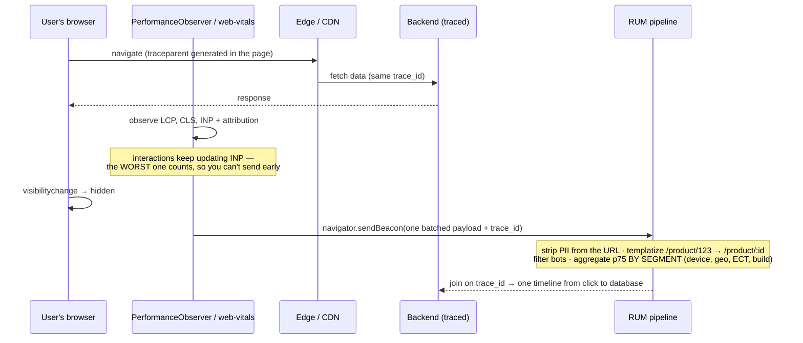
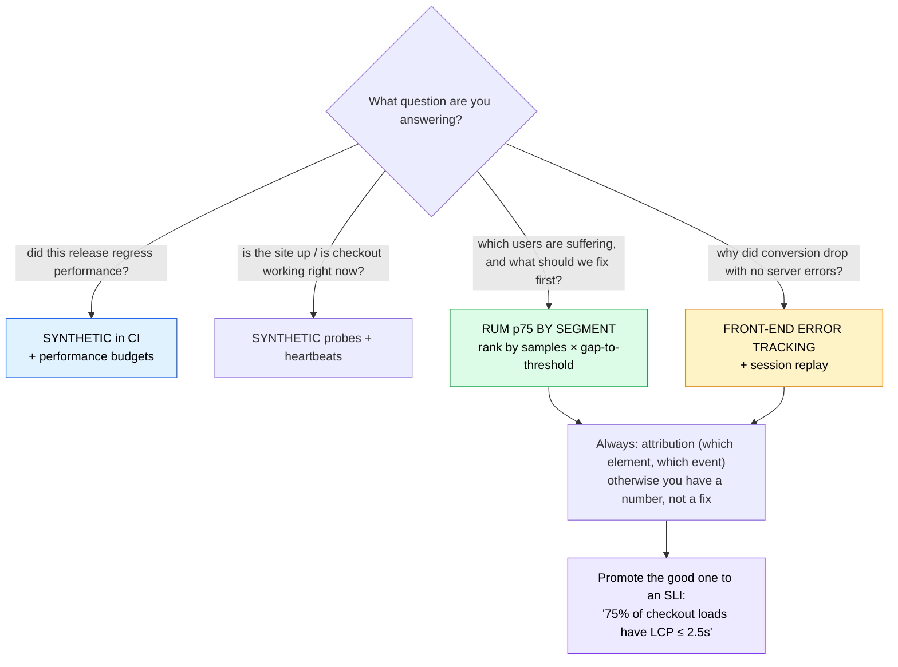

# Real User Monitoring (RUM)

## 1. Why Should I Care About This?
- **Your Server Metrics Say 40 ms and Your Users Say "It's Slow"**: Server-side p99 measures the time between the first byte in and the last byte out. It does not include DNS, TLS, a 3G radio waking up, 800 KB of JavaScript parsing on a four-year-old Android, or the layout shift that made someone tap the wrong button. **RUM is the only pillar that measures what the human experienced**, and the gap between it and your backend metrics is routinely 10–50×.
- **Speed Is Revenue, With Published Numbers**: Vodafone improved LCP by 31% and saw an **8% increase in sales**; Deloitte's *Milliseconds Make Millions* found a 0.1 s mobile-speed improvement lifted retail conversion **8.4%**; Amazon's classic finding was 100 ms → 1% of sales. These are the numbers that get frontend performance work funded, and interviewers like candidates who can quote them.
- **Google Ranks You On Field Data, Not Lab Data**: Core Web Vitals are part of Google's page-experience signals, and they're evaluated from the **Chrome User Experience Report (CrUX)** — real Chrome users, at the **75th percentile**, over a 28-day window. Your Lighthouse score on a MacBook is irrelevant to that.
- **It Closes the Last Mile of Observability**: Traces stop at your load balancer. RUM extends the same request into the browser, and when you propagate a trace ID from the page into the backend you finally get **one timeline from click to database and back**.

## 2. What Problem Does This Solve?
- **The Lab/Field Gap**: Synthetic tests run on a known machine, on a fast network, from a datacenter, with an empty cache and no extensions. Real users are on a mid-range Android over congested LTE, with an ad blocker, a warm cache, and 30 tabs open. Both are useful; only one is the truth.
- **Averages That Hide Everyone Who Suffers**: A 1.2 s average page load can easily mean half your users at 0.6 s and a tail at 8 s. Aggregate mean is the single most misleading number in web performance.
- **Front-End Failures Your Backend Never Sees**: A JavaScript exception that breaks the checkout button produces **zero** server errors — traffic simply stops, and your dashboards look fine. Same for a broken third-party script, a CSP violation, or a failed CDN asset.
- **Naive Approach**: Watch server p99 and run a nightly Lighthouse audit. This misses device and network diversity entirely, misses interaction latency completely (Lighthouse can't click), and cannot tell you that Safari-on-iOS users in Brazil have a 6 s LCP while everyone else is at 1.8 s.

## 3. Core Idea (Intuition First)
Two ways to know whether a restaurant is good.

- **Synthetic monitoring is a professional inspector**: shows up on schedule, orders the same dish every time, uses a checklist. Perfectly repeatable, catches problems at 3 a.m. when there are no customers, and tells you exactly what changed between Tuesday and Wednesday because everything else was held constant. But the inspector always arrives by car, at 2 p.m., and never orders the special.
- **RUM is every diner's actual experience**: thousands of them, on different nights, ordering different things, some in a hurry, some on a bad table by the kitchen. Messy and unrepeatable — but it's the only data that includes the customer who waited 40 minutes and left.

You need both, for opposite reasons: **synthetic gives you a controlled signal with zero traffic; RUM gives you the truth with no control.** Synthetic catches the regression before users hit it; RUM tells you what your users are actually living through and which segment of them is suffering.

And the second idea, which is where most teams go wrong: **RUM data is a distribution, not a number.** The convention that matters — the one Google uses for Core Web Vitals — is the **75th percentile**, chosen deliberately: it's high enough that a majority of experiences must be good, low enough that a handful of pathological devices can't dominate. Report p75 per *segment* (device class, country, connection type, page template), because "our p75 LCP is 2.4 s" can hide "Android in India is at 7.1 s."

![Three-panel diagram of real user monitoring. Panel A defines the three Core Web Vitals with their thresholds measured at the seventy-fifth percentile: Largest Contentful Paint measures loading, good at or under two point five seconds, needs improvement up to four seconds, poor beyond that, and it is usually caused by a slow server response, render-blocking resources, or an unoptimized hero image; Interaction to Next Paint measures responsiveness and replaced First Input Delay in March 2024 by measuring the full input-to-paint latency of the worst interaction rather than only the delay before the first one, good at or under two hundred milliseconds and poor beyond five hundred, usually caused by long main-thread tasks; and Cumulative Layout Shift measures visual stability as a unitless score, good at or under zero point one and poor beyond zero point two five, usually caused by images without dimensions, injected banners, and late-loading web fonts. Panel B contrasts lab and field data: a synthetic test produces a single repeatable point on a fast datacenter connection with a modern CPU and a cold cache, whereas real user monitoring produces a right-skewed histogram of thousands of page loads where the mean sits well left of the seventy-fifth percentile marker, and a callout notes that the mean hides the tail while segmenting by device class, country and connection type reveals that one segment can be three times worse than the aggregate. Panel C shows the collection pipeline: the browser's PerformanceObserver and Event Timing APIs plus the web-vitals library gather metrics with attribution such as which element was the LCP and which event caused the worst INP, along with JavaScript errors, unhandled promise rejections and content security policy violations; these are batched and sent with navigator.sendBeacon on the visibilitychange event rather than on unload so that back-forward cache restores are not lost; the pipeline then strips personal data from URLs, templatizes paths, filters bots, and aggregates to per-segment percentiles, with a note that beacons must be small and sampled since one beacon per page view at a million page views a day is a real cost.](../assets/rum_core_web_vitals.svg)

> Panel A: three vitals, three failure modes — loading, responsiveness, stability. Panel B: synthetic gives you one controlled point; RUM gives you the distribution, and the p75 is where the decision lives. Panel C: collect with attribution, send on `visibilitychange`, and segment before you conclude anything.

## 4. How It Actually Works

### 1. The Core Web Vitals — what each one actually measures
| Metric | Measures | Good (p75) | Poor (p75) | Typical cause when bad |
|---|---|---|---|---|
| **LCP** — Largest Contentful Paint | Loading: when the biggest above-the-fold element renders | **≤ 2.5 s** | > 4.0 s | Slow TTFB, render-blocking CSS/JS, unoptimized hero image, client-side rendering |
| **INP** — Interaction to Next Paint | Responsiveness: the worst input→paint latency across the visit | **≤ 200 ms** | > 500 ms | Long main-thread tasks, heavy event handlers, giant DOM, hydration |
| **CLS** — Cumulative Layout Shift | Visual stability: how much content jumps (unitless) | **≤ 0.1** | > 0.25 | Images without `width`/`height`, injected banners, late web fonts (FOUT), async ads |

- **INP replaced FID in March 2024**, and the change matters: FID measured only the *delay before* the first interaction was processed, which almost everyone passed. INP measures **the full latency from input to the next paint, for the worst interaction of the session** — a much harder, much more honest metric that actually correlates with "this app feels sluggish."
- **Supporting metrics** you should collect alongside: **TTFB** (server + network, the floor under LCP), **FCP** (first pixel of anything), **long tasks / Total Blocking Time** (the main-thread work that ruins INP), and resource timings for third-party scripts.
- **The p75-over-28-days convention** comes from CrUX and is what Search uses. Internally you'll want faster feedback (p75 over 1 hour, per release) — just don't compare your 1-hour number to CrUX's 28-day number and conclude Google is wrong.

### 2. How the browser exposes it
- **`PerformanceObserver`** is the collection primitive; the `web-vitals` library from Google wraps the sharp edges (buffered entries, bfcache restores, the exact spec-compliant definitions) and is what you should actually ship.
- The underlying APIs: **Navigation Timing L2** (`navigationStart` → `loadEventEnd`, DNS/TCP/TLS/TTFB breakdown), **Resource Timing** (every asset, with `transferSize` so you can spot cache misses), **Paint Timing** (FCP), **Largest Contentful Paint API**, **Event Timing API** (INP), **Layout Instability API** (CLS), and **Long Animation Frames**.
- **Attribution is the difference between a number and a fix.** `web-vitals/attribution` tells you *which element* was the LCP and how its time splits into TTFB / resource load delay / render delay; *which event target* produced the worst INP and how much was input delay vs processing vs presentation; *which DOM nodes* shifted for CLS. Without attribution you get "LCP is 3.8 s" and no next step.

### 3. Getting the data off the page without losing it
- **Send on `visibilitychange` → `hidden`, not on `unload`.** `unload` and `beforeunload` are unreliable on mobile and — critically — **disable the back/forward cache**, which makes your site slower in the name of measuring it. The modern pattern is: listen for `visibilitychange`, flush with **`navigator.sendBeacon()`** (fire-and-forget, survives page teardown, ~64 KB limit) or `fetch(..., {keepalive: true})`.
- **Batch and compress.** One beacon per page view containing all vitals plus context beats one request per metric. Keep it small — this is a request on every page view of your site, so its own cost is real.
- **bfcache restores count as new page views** for vitals purposes; the `web-vitals` library handles resetting state on `pageshow` with `event.persisted`.
- **Sample, but sample smartly**: 100% for errors, a percentage for vitals, and consider **higher sampling for low-traffic pages** so you get enough samples for a stable p75 (rule of thumb: you want **≥1,000 samples** per segment before you trust a p75, and far more before you trust a p95).

### 4. The context that makes it actionable
Every beacon should carry: **page template** (`/product/:id`, never the raw URL — same cardinality discipline as [Metrics Design & Cardinality](./Metrics_Design_Cardinality.md)), **device class** (from `navigator.hardwareConcurrency`, `deviceMemory`, UA-CH), **effective connection type** (`navigator.connection.effectiveType`: `4g`/`3g`/`2g`), **country/region**, **browser + version**, **release/build ID**, **A/B experiment buckets**, **cache status**, and a **`trace_id`** so the page load joins your backend traces.

Without segmentation, RUM tells you a number. With it, RUM tells you *"LCP regressed 900 ms, only on Android, only in the checkout template, only since build 4821, and the attribution says render delay"* — which is a fixable statement.

### 5. Front-end error tracking
- Hook **`window.onerror`** (or `addEventListener('error')` — needed for resource load failures) and **`unhandledrejection`** for async errors. Add **`crossorigin="anonymous"`** on your script tags or every third-party error arrives as the useless `"Script error."`
- **Source maps** are mandatory: upload them at build time to your error tracker (privately — don't serve them publicly) so a minified stack becomes a real one.
- **Grouping/fingerprinting**: cluster by normalized stack + message so "one bug" is one issue with a count, not 40,000 separate events. Track **users affected**, not just occurrences — 40,000 errors from one bot is not the same as 400 errors from 400 people.
- **Breadcrumbs** (recent clicks, navigations, XHRs) turn an exception into a reproduction path. **Session replay** goes further and is genuinely powerful for "how did they get into that state?" — but it is a privacy minefield: mask inputs by default, block PII selectors, get consent, and be aware you are recording your users' screens.
- **CSP violation reports** (`report-to` / the Reporting API) tell you about injected scripts and misconfigurations — the same channel catches attacks and your own broken deploys.
- **Crash-free sessions** is the headline mobile metric (target **≥99.9%** for a mature app), alongside **cold start time**, **ANR rate** (Android Not Responding; Google Play flags apps above 0.47% of daily sessions), and **frozen/janky frames**.

### 6. RUM as an SLI, and the segmentation trap
- RUM metrics make excellent **user-centric SLIs** — "75% of checkout page loads have LCP ≤ 2.5 s" is a far better objective than "p99 server latency ≤ 200 ms," because it's the thing the user actually experiences (see [SLO, SLI & Error Budgets](./SLO_SLI_Error_Budgets.md)).
- **Beware survivorship bias**: users who bounce at 8 s may leave before the beacon fires, biasing your data *optimistic*. Mitigations: send an early partial beacon (TTFB/FCP) rather than only a complete one at the end, and cross-check against server-side request counts and bounce rate.
- **Beware traffic-mix shifts**: your p75 can "improve" because a marketing campaign brought in desktop users on fast connections, not because you changed anything. Always compare **within segment**, and treat aggregate movements as a prompt to segment, never as a conclusion.
- **Filter bots** aggressively — headless Chrome, synthetic checks, and scrapers will otherwise be a large, weirdly-fast slice of your "real users."



## 5. Real-World Example
**Vodafone's 31% LCP improvement → 8% more sales.** Vodafone ran an A/B test on their landing page where the only difference was performance work targeting LCP (image optimization, preloading the hero, removing render-blocking resources). The measured result in the field: **31% better LCP, +8% total sales, +15% lead-visit rate, +11% cart-to-visit rate.** It's the cleanest published causal link between a Core Web Vital and revenue, and it exists because they measured with RUM and ran it as an experiment rather than comparing before/after (which traffic-mix shifts would have confounded).

**The segmentation story that repeats everywhere.** An e-commerce team sees aggregate p75 LCP of 2.4 s — "passing." Segmenting reveals: desktop 1.4 s, iOS 2.1 s, **Android on 3G in South-East Asia 7.8 s** — and that segment is 22% of traffic and converts at a third of the rate. The aggregate was passing because the good segments were large enough to carry it. Nothing about this is visible in a Lighthouse run or in server metrics; it required field data plus device/geo/network dimensions on every beacon.

**The invisible outage.** A deploy ships a JavaScript bundle that throws on Safari 15 during checkout initialization. Server metrics: **flat 200s, no errors, slightly lower traffic** (which looks like normal variance). Conversion drops 6%. The only systems that see it are front-end error tracking (a spike of one fingerprint, 100% Safari 15) and RUM (INP unmeasurable because the page never becomes interactive for that segment). This class of failure — where the backend is perfectly healthy and the product is broken — is the single strongest argument for RUM's existence.

## 6. Code Example
Collecting vitals with attribution and shipping them safely:

```javascript
import {onLCP, onINP, onCLS, onTTFB, onFCP} from 'web-vitals/attribution';

const buffer = [];
const ctx = {
  build:   __BUILD_ID__,
  route:   templatize(location.pathname),       // /product/8213 → /product/:id  (cardinality!)
  ect:     navigator.connection?.effectiveType, // '4g' | '3g' | 'slow-2g'
  cores:   navigator.hardwareConcurrency,       // crude but effective device class
  mem:     navigator.deviceMemory,
  trace_id: window.__TRACE_ID__,                // propagated from the server-rendered page
};

function queue(metric) {
  buffer.push({
    name:   metric.name,                        // LCP | INP | CLS | TTFB | FCP
    value:  Math.round(metric.value),
    rating: metric.rating,                      // 'good' | 'needs-improvement' | 'poor'
    // ── ATTRIBUTION: this is what turns a number into a fix ──
    target: metric.attribution?.element ||      // which element was the LCP
            metric.attribution?.interactionTarget ||  // which control was slow (INP)
            metric.attribution?.largestShiftTarget,   // which node jumped (CLS)
    detail: metric.name === 'LCP' ? {
              ttfb:          Math.round(metric.attribution.timeToFirstByte),
              resourceDelay: Math.round(metric.attribution.resourceLoadDelay),
              renderDelay:   Math.round(metric.attribution.elementRenderDelay),
            } : metric.name === 'INP' ? {
              input:      Math.round(metric.attribution.inputDelay),
              processing: Math.round(metric.attribution.processingDuration),
              present:    Math.round(metric.attribution.presentationDelay),
            } : undefined,
  });
}

onTTFB(queue); onFCP(queue); onLCP(queue); onCLS(queue); onINP(queue);

// ── FLUSH: visibilitychange, NOT unload — unload kills the back/forward cache ──
addEventListener('visibilitychange', () => {
  if (document.visibilityState !== 'hidden' || !buffer.length) return;
  navigator.sendBeacon('/rum', JSON.stringify({...ctx, metrics: buffer.splice(0)}));
  //        ↑ fire-and-forget, survives page teardown, ~64KB cap, no CORS preflight for text/plain
});

// ── ERRORS: 100% sampled, always. A broken button produces ZERO server errors. ──
addEventListener('error', e => report({
  kind: 'js', msg: e.message, stack: e.error?.stack,      // needs crossorigin="anonymous"
  src: e.filename, line: e.lineno, col: e.colno, ...ctx,  // + source maps uploaded at build time
}), true);                                                 // capture:true ⇒ also resource load failures
addEventListener('unhandledrejection', e => report({
  kind: 'promise', msg: String(e.reason), stack: e.reason?.stack, ...ctx,
}));
```

Aggregation — the query shape that actually answers questions:

```sql
-- p75 per segment, per build: the ONLY view that tells you whether to roll back
SELECT route, device_class, country, ect, build,
       COUNT(*)                                              AS samples,
       APPROX_QUANTILES(lcp_ms, 100)[OFFSET(75)]             AS lcp_p75,
       APPROX_QUANTILES(inp_ms, 100)[OFFSET(75)]             AS inp_p75,
       APPROX_QUANTILES(cls_x1000, 100)[OFFSET(75)] / 1000.0 AS cls_p75,
       COUNTIF(lcp_ms <= 2500) / COUNT(*)                    AS pct_good_lcp  -- ← the SLI
FROM rum_events
WHERE event_date >= CURRENT_DATE() - 7 AND NOT is_bot
GROUP BY route, device_class, country, ect, build
HAVING samples >= 1000            -- don't trust a p75 built from 40 page views
ORDER BY samples * (2500 - lcp_p75) ASC;   -- rank by IMPACT: slow × popular first
```

## 7. Design Variations & Alternatives

| Dimension | RUM (field) | Synthetic (lab) |
|---|---|---|
| **Data source** | Real users, real devices, real networks | A controlled agent on a schedule |
| **Traffic needed** | Yes — no users, no data | None (works at 3 a.m., pre-launch, on a staging env) |
| **Repeatability** | ❌ noisy, confounded by traffic mix | ✅ change one variable at a time |
| **Coverage** | Only pages users visit | Any page/flow you script, including rare ones |
| **Catches** | Device/network/geo/browser diversity, third-party regressions in the wild | Regressions before release, availability, cert expiry, multi-step flows |
| **Misses** | The users who bounced before the beacon | Everything about real-world diversity |
| **Best use** | Prioritization, SLIs, "who is suffering?" | Regression gates in CI, uptime, alerting |

- **The correct architecture is both, wired together**: synthetic in CI as a **performance budget gate** (fail the build if the bundle grows past X KB or lab LCP regresses), and RUM in production as the **SLI and prioritizer**. Synthetic answers "did we break it?"; RUM answers "who does it hurt, and how much?"
- **Server-timing header** is an underused bridge: emit `Server-Timing: db;dur=42, cache;dur=3` and the browser exposes it in Resource Timing, so your RUM beacon can carry a backend breakdown without a separate join.
- **CrUX vs your own RUM**: CrUX is free, covers competitors, and is what Search uses — but it's Chrome-only, 28-day-lagged, origin- or URL-level, and only includes users opted into reporting. Your own RUM is real-time, covers all browsers, and can segment however you like. Use CrUX as the external scoreboard and first-party RUM as the operational tool.
- **Build vs buy**: a first-party RUM endpoint plus ClickHouse/BigQuery is genuinely tractable (the collection code above is most of the client side) and avoids per-session vendor pricing. What you're buying from Datadog RUM / New Relic Browser / Sentry / SpeedCurve is session replay, error grouping, source-map management, and dashboards — see [APM & Observability Tooling Landscape](./APM_Tools_Landscape.md).



## 8. Pros and Cons
- **Pros**: it is the **only** measurement of actual user experience, including the device/network/geography diversity no lab reproduces; it catches front-end-only failures that are completely invisible server-side; it provides business-aligned SLIs and directly supports revenue arguments with published elasticity numbers; and segmenting it turns "the site is slow" into a prioritized, funded work queue.
- **Cons**: it needs traffic (useless pre-launch and on low-volume pages, where you can't get a stable p75); it's **noisy and confounded** — traffic mix, a viral post, or a bot wave will move your numbers without any code change; the collection script is itself a performance and privacy cost on every page; **ad blockers and consent rejections silently remove 10–30% of your sample** (and disproportionately the technical users); it carries real privacy obligations (URLs with tokens, session replay, GDPR consent, IP handling); and survivorship bias makes the data optimistic exactly where it hurts most.

## 9. Failure Scenarios & What Can Go Wrong
- **SYMPTOM**: RUM says everything is fast, users complain. **ROOT CAUSE**: survivorship bias — the slowest sessions abandoned before the beacon fired; or the RUM script itself is blocked for the affected users. **FIX**: send an early partial beacon (TTFB/FCP) as well as the final one; reconcile RUM page-view counts against server request counts and investigate the delta.
- **SYMPTOM**: p75 LCP improved 20% overnight with no deploy. **ROOT CAUSE**: traffic-mix shift (a campaign, a bot wave, a geography change), not a real improvement. **FIX**: always compare within segment; alert on segment-level changes; track sample counts alongside every percentile so a composition change is visible.
- **SYMPTOM**: All JS errors read `"Script error."` with no stack. **ROOT CAUSE**: the script is served cross-origin without `crossorigin="anonymous"` and/or without `Access-Control-Allow-Origin`, so the browser censors the details. **FIX**: add the attribute and the header; upload source maps at build time.
- **SYMPTOM**: Adding RUM made the site *slower* and hurt bfcache hit rate. **ROOT CAUSE**: a synchronous, render-blocking RUM script, and/or an `unload`/`beforeunload` listener (which disqualifies the page from the back/forward cache). **FIX**: load async/deferred, keep the payload tiny, and flush on `visibilitychange` with `sendBeacon`.
- **SYMPTOM**: Cardinality explosion / query costs in the RUM backend. **ROOT CAUSE**: raw URLs (with IDs, tokens, and query strings) used as the page dimension. **FIX**: templatize paths client-side before sending, strip query params to an allowlist, and cap distinct route values.
- **SYMPTOM**: A security review finds session tokens and email addresses in RUM data. **ROOT CAUSE**: full URLs and form values captured indiscriminately (session replay is the usual culprit). **FIX**: redact at the client before the beacon leaves, mask all inputs by default in replay, allowlist query params, and treat the RUM store as PII-bearing with real retention limits.
- **SYMPTOM**: INP looks great in the lab and terrible in the field. **ROOT CAUSE**: this is *expected* — the lab has a fast CPU and doesn't interact; INP is a real-interaction, worst-case metric dominated by main-thread contention on mid-range mobile. **FIX**: use Total Blocking Time / long-task counts as the lab proxy, throttle CPU 4× in lab runs, and treat field INP as the source of truth.
- **SYMPTOM**: A regression is invisible for days. **ROOT CAUSE**: no per-build dimension, so a bad release is averaged with good traffic across a 7-day window. **FIX**: tag every beacon with the build/release ID and alert on per-build p75 deltas during rollout — this is also what makes automatic rollback possible.

## 10. Impact on Scalability, Reliability & Cost
- **Scalability**: RUM volume is **one beacon per page view** (plus errors). At 10 M page views/day and a 1 KB beacon that's **10 GB/day** of raw events — trivially handled by an edge endpoint writing to a columnar store, and dramatically cheaper than logging each page view server-side. The client-side cost is the number to watch: the `web-vitals` library is ~2 KB gzipped; full vendor RUM agents with session replay run 30–100 KB+ and add main-thread work — which can measurably worsen the very INP you're measuring.
- **Reliability**: the RUM endpoint must be **fail-open and non-blocking** — never let telemetry collection break page rendering, and never make it a same-origin dependency that a failure can cascade through. Because a chunk of users block it, treat RUM as a **sampled estimate**, never as an exact count, and keep server-side counters as the source of truth for traffic.
- **Cost**: vendor RUM is usually priced per 1,000 sessions (roughly $1–2.50 per 1,000 sessions at list, with session replay a large multiplier), so at 10 M sessions/month you are into five figures monthly — which is why sampling policy is a real design decision (e.g. 100% of errors, 10% of vitals, 1% of replays, 100% of a canary cohort). First-party collection into ClickHouse/BigQuery costs cents per GB and is a very reasonable build-vs-buy call once volume is high; what you give up is the tooling around the data, not the data.

## 11. When NOT to Use This
- **Don't rely on RUM for a low-traffic page or a pre-launch product.** Below ~1,000 samples per segment per period, your p75 is noise. Use synthetic monitoring there.
- **Don't use RUM as an availability alert.** "No beacons arriving" is ambiguous — it could be an outage, an ad-blocker rollout, a CDN change, or 3 a.m. Availability belongs to [Synthetic Monitoring & Heartbeats](./Synthetic_Monitoring_Heartbeats.md).
- **Don't deploy session replay without a privacy review**, and never on pages with payment, health, or credential data. The regulatory exposure (GDPR, HIPAA, and the wave of session-replay wiretapping claims) is not worth an unexamined default-on rollout.
- **Don't A/B-compare RUM numbers across time periods** and call it causation. Run an actual experiment (like Vodafone did) or compare within tightly matched segments.
- **Don't instrument an internal admin tool used by 20 people on corporate laptops** with a full RUM stack — the population has no diversity and the sample will never be statistically meaningful. Watch errors, skip vitals.

## 12. Interview Perspective
- **What interviewers expect**: the **field vs lab** distinction stated crisply, the three Core Web Vitals with their p75 thresholds (**LCP ≤ 2.5 s, INP ≤ 200 ms, CLS ≤ 0.1**), and the fact that **INP replaced FID in March 2024** because FID only measured the delay before the first interaction and almost everyone passed it.
- **The design question**: "Design monitoring for a global e-commerce front end." Structure it: RUM beacon (web-vitals + attribution, errors at 100%, `sendBeacon` on `visibilitychange`) → context on every event (route template, device class, ECT, country, build, `trace_id`) → edge collector → columnar store → **p75 by segment** dashboards and SLIs → synthetic probes in CI as regression gates and for availability → alert on per-build segment deltas during rollout, with error-rate spikes gating automatic rollback.
- **The trap question**: "Your p75 LCP is 2.3 s — are you fine?" No. Segment it. The aggregate can pass while a fifth of your traffic (mid-range Android, emerging markets, 3G) is at 7 s. Then add: rank fixes by `samples × gap-to-threshold`, not by worst absolute value, because impact is the product of severity and population.
- **The systems-thinking question**: "How do RUM and traces connect?" Propagate a trace ID from the server-rendered page into both the RUM beacon and the browser's outbound fetches, and you get a single timeline from user click through CDN, gateway, services, and database — which is how you prove whether a slow LCP is backend TTFB or front-end render delay (LCP attribution splits exactly that way).
- **Bonus signals**: `unload` breaks bfcache; ad blockers remove 10–30% of your sample; survivorship bias makes RUM optimistic; the `Server-Timing` header as a cheap backend-to-browser bridge; CrUX's 28-day p75 window vs your real-time internal data; Vodafone's 31% LCP → 8% sales as the funding argument.

## 13. Connections to Other Topics
- [Synthetic Monitoring & Heartbeats](./Synthetic_Monitoring_Heartbeats.md) — the deliberate complement: controlled and always-on vs real and uncontrolled. Neither replaces the other.
- [Golden Signals](./Golden_Signals_Latency_Traffic_Errors.md) — RUM is the golden signals measured at the only place that counts: the user's device.
- [SLO, SLI & Error Budgets](./SLO_SLI_Error_Budgets.md) — "75% of checkout loads under 2.5 s LCP" is a better SLI than any server-side latency target.
- [Distributed Tracing (OpenTelemetry)](./Distributed_Tracing_OpenTelemetry.md) — propagate the trace ID into the browser and the timeline becomes end-to-end.
- [Metrics Design & Cardinality](./Metrics_Design_Cardinality.md) — the same discipline applies to RUM dimensions: templatize routes, bound device classes, or your analytics store pays for it.
- [APM & Observability Tooling Landscape](./APM_Tools_Landscape.md) — where RUM sits in the vendor stack and what the per-session pricing looks like.
- [06 · Caching & Performance](../06_Caching_Performance/) and [14 · Performance Optimization](../14_Performance_Optimization_Scalability/) — RUM is the evidence base that says which optimization is worth doing.
- [11 · CORS & the Browser Security Model](../11_Security_Identity/CORS_Browser_Security_Model.md) — why cross-origin scripts report `"Script error."` and how CSP violation reports reach your collector.

## 14. Visual Aids
- **The SVG above** ([rum_core_web_vitals.svg](../assets/rum_core_web_vitals.svg)): panel A — the three Core Web Vitals with p75 thresholds and their usual causes; panel B — one repeatable synthetic point vs a real right-skewed distribution with the mean sitting far left of p75; panel C — the collection pipeline from `PerformanceObserver` to segmented percentiles, with the `sendBeacon`/`visibilitychange` rule.
- **Mermaid #1 (Section 4)**: the page-load sequence, showing why INP can only be sent at the end and where the trace ID joins browser data to backend traces.
- **Mermaid #2 (Section 7)**: pick RUM or synthetic by the question you're answering — and note that attribution is what converts either into a fix.

## 15. Summary (TL;DR)
**RUM measures what your users actually experienced; everything else measures what your servers did. The two are routinely 10–50× apart, because your p99 backend latency excludes DNS, TLS, a slow radio, 800 KB of JavaScript parsing on a mid-range Android, and the layout shift that made someone mis-tap. Collect the three Core Web Vitals at the **75th percentile** — **LCP ≤ 2.5 s** (loading), **INP ≤ 200 ms** (responsiveness; it replaced FID in March 2024 because FID only measured the delay before the first interaction and nearly everyone passed), **CLS ≤ 0.1** (visual stability) — plus TTFB, long tasks, JavaScript exceptions, unhandled rejections, and CSP reports, using `PerformanceObserver` via the `web-vitals` library **with attribution**, because "LCP is 3.8 s" is a number while "the hero image's render delay is 2.1 s on Android in the checkout template since build 4821" is a fix. Ship it with `navigator.sendBeacon` on `visibilitychange` — never `unload`, which disables the back/forward cache and makes your site slower in the act of measuring it — and stamp every beacon with route *template*, device class, effective connection type, country, build ID and `trace_id` so page loads join your backend traces into one timeline. Then the discipline that decides whether any of it matters: **RUM is a distribution and it must be read per segment**, because an aggregate p75 of 2.4 s routinely hides a fifth of your traffic sitting at 7 s, and improvements often turn out to be traffic-mix shifts rather than engineering wins. Pair it permanently with synthetic monitoring — lab for repeatable regression gates in CI and for availability at zero traffic, field for prioritization and SLIs — remember that ad blockers and abandonment silently bias your sample optimistic, rank fixes by `population × gap-to-threshold` rather than by worst absolute number, and keep the business elasticity handy (**Vodafone: 31% better LCP → 8% more sales**) because **RUM is the only telemetry that converts directly into revenue arguments, which is exactly why it is the one that gets the work funded.**

## 16. Further Reading & Resources
- [web.dev — Core Web Vitals](https://web.dev/articles/vitals) — the definitions, thresholds, and the p75 methodology.
- [web.dev — Interaction to Next Paint (INP)](https://web.dev/articles/inp) — why FID was replaced and how INP is computed across a visit.
- [GoogleChrome/web-vitals](https://github.com/GoogleChrome/web-vitals) — the reference library, including the attribution build.
- [Chrome UX Report (CrUX)](https://developer.chrome.com/docs/crux) — the public field dataset behind Search's page-experience signals.
- [web.dev — Vodafone case study](https://web.dev/case-studies/vodafone) — 31% LCP improvement, +8% sales, run as an A/B test.
- [Deloitte — *Milliseconds Make Millions*](https://www.deloitte.com/ie/en/services/consulting/research/milliseconds-make-millions.html) — 0.1 s mobile-speed improvement vs conversion, across retail/travel/lead-gen.
- [MDN — `navigator.sendBeacon()` and the Page Lifecycle API](https://developer.mozilla.org/en-US/docs/Web/API/Navigator/sendBeacon) — the correct flush pattern, and why `unload` is deprecated.
- [Tammy Everts — *Time Is Money*](https://www.oreilly.com/library/view/time-is-money/9781491928783/) — the business case for web performance, with the elasticity research.
