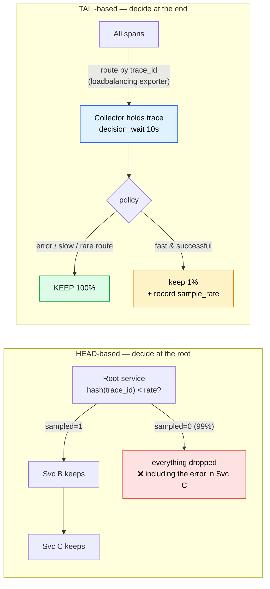
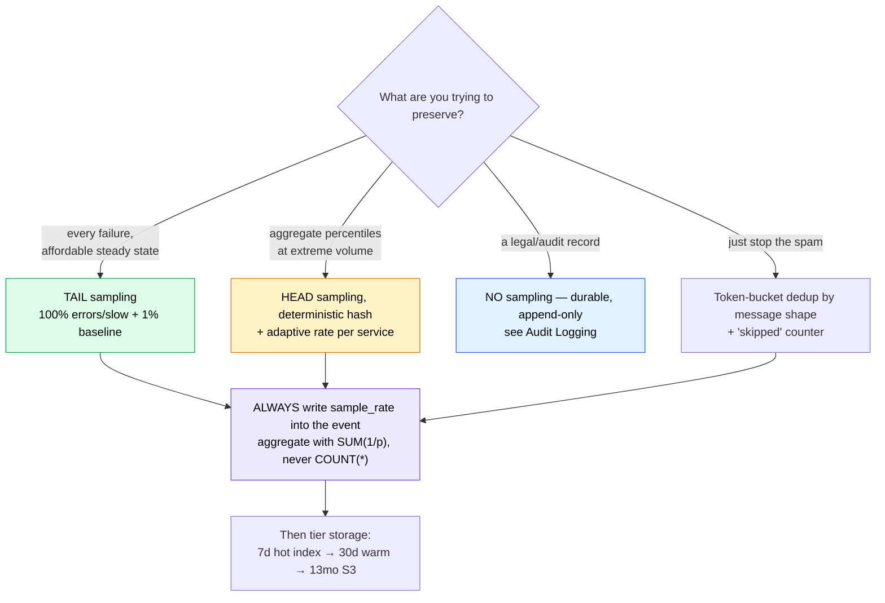

# Structured Logging & Sampling Strategies

## 1. Why Should I Care About This?
- **Logging Is the Line Item That Bankrupts Observability**: At 1M requests/sec with a modest 1 KB of log per request you generate **86 TB/day**. At a typical SaaS list price of ~$0.10/GB to ingest plus ~$2 per million indexed events, that is roughly **$8,600/day in ingest alone** — before retention. Nobody gets fired for a slow query; people absolutely get pulled into a "why is our observability bill larger than our EC2 bill?" meeting. That meeting is this file.
- **`grep` Does Not Scale to 500 Services**: A human-readable line like `Failed to process order 12345 after 3 retries` is unqueryable at scale. You cannot ask "p99 latency by merchant for retried orders" of a text file. **Structure is what turns logs from a diary into a database.**
- **Sampling Is a Correctness Problem, Not Just a Cost Problem**: Sample naively and your dashboards lie — you count 1,000 errors when 100,000 happened, or you throw away the one trace that contained the outage. Sampling *correctly* (consistent, sample-rate-aware, error-biased) is a genuinely interesting distributed-systems problem and a favourite senior-level probe.
- **It's the Join Key Between the Three Pillars**: A `trace_id` in every log line is what lets you jump from a spiking latency metric → the exact trace → the exact log lines of that request. Without it you have three disconnected tools and an incident that takes three times as long.

## 2. What Problem Does This Solve?
- **Unqueryable Text**: Free-form strings force regex archaeology. Every new question requires a new parser, and parsers break silently whenever a developer rewords a message.
- **Unbounded Volume vs Finite Budget**: Log volume grows with traffic *and* with the number of services *and* with each new debug line a developer adds. Left alone it grows superlinearly against a fixed budget.
- **The Needle in a 100% Haystack vs the Missing Needle**: Keeping everything is unaffordable; keeping a random 1% loses exactly the rare failures you needed. Both extremes are wrong.
- **Naive Approach**: `console.log("something broke: " + err)` at `INFO`, shipped 100% to a hosted index, with retention set to "whatever the default was." This fails in four ways at once — it can't be queried by field, it can't be correlated to a request, it costs the most possible money, and when the bill lands the fix chosen in a panic ("sample 1%") silently destroys the data's statistical meaning.

## 3. Core Idea (Intuition First)
Think of two ways to run a hospital's records room.

- **Unstructured logging** is a shoebox of handwritten notes. Every doctor phrases things differently ("pt. febrile", "patient has fever", "temp high"). To answer "how many diabetics over 60 had a fever last March?" you must read every note. That is `grep`.
- **Structured logging** is a form: every note is `{patient_id, age, condition, temp, timestamp}`. Now the question is a query, answered in milliseconds, and it keeps working when a new doctor joins.

Then the volume problem. You cannot keep every note forever, so you triage — and the two triage strategies are the whole of sampling:

- **Head-based sampling** decides *at the door*: "we'll file every 100th patient's full chart." Cheap and simple, decided before you know anything. Its flaw is obvious — a coin flip at intake can't know this patient is the one who codes an hour later.
- **Tail-based sampling** decides *at discharge*: hold the whole chart in a tray, and once you know the outcome, file **100% of the deaths, 100% of the surprises, and 1% of the routine checkups**. Far better data for the same storage, at the cost of a tray big enough to hold every in-flight patient.

And the subtle third idea that makes sampled data honest: **write the sample rate on the form**. A filed chart that says "I represent 100 patients" lets you reconstruct true counts by multiplying. A chart with no rate on it is an anecdote.

![Three-panel diagram of structured logging and sampling. Panel A contrasts an unstructured log line, shown as a red block of free text that requires a regex to parse and cannot be aggregated, with a structured JSON event containing timestamp, level, service, trace_id, user_id, route, status and duration_ms fields, shown as a green block that supports field queries, aggregation and alerting; a note explains that trace_id is the join key linking the log to its trace and to metric exemplars. Panel B compares head-based and tail-based sampling pipelines. In head-based sampling the root service makes a probabilistic decision using a deterministic hash of the trace id, sets the sampled flag in the W3C traceparent header, and every downstream service obeys it, so the decision is cheap and consistent but blind to the outcome — an error that happens later in an unsampled trace is lost forever. In tail-based sampling all spans of a trace are routed by trace id to the same collector instance using a load-balancing exporter, buffered in memory for a decision window of roughly ten to thirty seconds, and then a policy engine keeps one hundred percent of traces that contain an error or exceed a latency threshold and only a small percentage of successful ones, at the cost of memory and routing complexity. Panel C shows a cost and correctness ladder: keeping one hundred percent of eighty-six terabytes per day, versus a blind one percent sample that is cheap but loses rare failures and undercounts, versus an outcome-biased sample that keeps all errors and slow requests plus a small share of the rest, annotated with the rule that every retained event must carry its sample rate so counts can be reconstructed by multiplying by one over the rate.](../assets/log_structured_sampling.svg)

> Panel A: structure turns logs into a queryable dataset. Panel B: head-based sampling is cheap and blind; tail-based sampling is outcome-aware and expensive. Panel C: the only sampling that keeps your dashboards honest is sampling that records its own rate.

## 4. How It Actually Works

### 1. What "structured" actually means
- Emit **key–value events**, serialized as JSON (or a binary format like protobuf/Avro for high volume), not interpolated strings. `log.info("order failed", order_id=12345, retries=3, merchant="acme")` — never `log.info(f"order {id} failed after {n} retries")`.
- **Field names must be stable and shared**, or you get `user_id`, `userId`, `uid`, and `customer` all meaning the same thing across four teams. Adopt the **OpenTelemetry semantic conventions** (`service.name`, `http.request.method`, `http.response.status_code`, `url.path`, `error.type`) so that queries and dashboards written once work everywhere.
- **The message stays constant, the fields vary.** This is the property that makes `count by message` meaningful and lets a log platform group 40 M lines into 200 distinct event types.
- **Types matter.** `duration_ms: 43` (number) is aggregatable; `duration: "43ms"` (string) is not. A surprising share of "we can't chart this" tickets are a number that got logged as a string.
- **Nesting is a trap at scale.** Deeply nested JSON blows up index mappings; prefer flat, dotted keys (`db.statement`, `db.rows_returned`). Elasticsearch has a default `index.mapping.total_fields.limit` of **1,000 fields** — a service that logs arbitrary user-supplied keys will hit a **mapping explosion** and start rejecting documents.

### 2. Log levels, done right
- **ERROR** — a human must eventually look; something failed that we cannot recover from at this layer. If nobody would act on it, it is not an ERROR (this is the single most abused level).
- **WARN** — degraded but handled: a retry succeeded, a fallback fired, a deprecated path was used. Useful as a *rate* signal, not as a page.
- **INFO** — business-meaningful state transitions: request completed, payment captured, job finished. This is your steady-state volume driver, so keep it to roughly **one event per unit of work**, not one per function call.
- **DEBUG/TRACE** — off in production by default, because they are 10–100× the volume.
- The power move is **dynamic levels**: ship a config (feature flag, `SIGHUP`, admin endpoint) that flips one logger to DEBUG for one service, one route, or **one user** for 15 minutes. Combined with a per-request `debug=true` propagated in baggage, you get full-fidelity logs for the one customer complaining, at ~0% steady-state cost.

### 3. Correlation: the IDs that make logs navigable
- **`trace_id`** (16 bytes, hex) — identifies the whole distributed request; propagated in the W3C `traceparent` header. **Every log line emitted while handling a request must carry it.** This is non-negotiable; it is the join key across all three pillars.
- **`span_id`** — the specific operation within the trace, so you know *which* hop logged it.
- **Business IDs** — `user_id`, `tenant_id`, `order_id`. These are high-cardinality and that is *fine in logs* — unlike metrics, where cardinality kills the TSDB (see [Metrics Design & Cardinality](./Metrics_Design_Cardinality.md)). Logs are the right home for the unbounded stuff.
- Implementation: stuff the IDs into a **context-local** (Go `context.Context`, Java MDC, Python `contextvars`, Node `AsyncLocalStorage`) and have the logger read them automatically. If developers must remember to pass `trace_id` by hand, half the lines won't have it.

### 4. The canonical log line — one wide event per request
- Instead of scattering 12 small lines per request, accumulate facts into a per-request context object and emit **one wide event at the end**, containing everything: route, status, duration, DB time, cache hits, rate-limit bucket, auth method, user, feature flags, error type. Stripe popularized this as **canonical log lines**; Honeycomb calls the same idea **wide events**.
- **Why it wins**: one event per request makes volume trivially predictable (`events/day = requests/day`), it makes every question a single-table query with no joins, and it makes sampling coherent — you keep or drop *the whole story of one request*, never half of it.
- **The trade-off**: you lose intra-request chronology (which of the 12 things happened first) unless you also keep a duration or ordering field, and a crash mid-request loses the event entirely — so keep a small number of genuinely narrative ERROR lines alongside it, and emit the canonical line from a `defer`/`finally` so panics still produce one.

### 5. Head-based sampling — decide at the start
- The root service makes the call: `keep = (hash(trace_id) mod 1e6) < rate * 1e6`. It records the decision in the **`sampled` flag** of the `traceparent` header, and every downstream service obeys it (`ParentBased` sampler in OTel).
- **Why hash the trace ID rather than call `random()`?** Because the decision must be **consistent** — every service, and every independent decision-maker, must reach the *same* verdict for the same trace. Otherwise you get partial traces: service A kept its span, service C dropped its own, and your waterfall has holes. Hash-based ("deterministic" or "consistent probability") sampling also lets a downstream service sample *at a lower rate* coherently: anything kept at 1% is a strict subset of what was kept at 10%.
- **Rate limiting sampler**: instead of a fixed percentage, "keep at most N traces/sec per service" (Jaeger's default is a rate limiter of 1 trace/sec plus a probability). This bounds cost under a traffic spike, which a plain percentage does not.
- **Cost**: nearly zero — one hash, decided before any work is done, so unsampled requests never allocate span objects at all.
- **The fatal flaw**: the decision is made before the outcome is known. With 1% head sampling you keep 1% of your errors too — and if an endpoint sees 50 errors/day, you'll capture roughly *one every two days*. Google's Dapper shipped at **1/1024** for exactly the cost reason, and explicitly noted that low rates hide low-frequency events.

### 6. Tail-based sampling — decide once you know the outcome
- All spans of a trace are buffered until the trace completes (or a timeout fires), then a policy decides. Typical policy set: **keep 100% of traces containing an error**, **100% over a latency threshold**, **100% touching a rare/critical route**, and **1–5% of everything else**, with an overall rate cap.
- **The hard requirement most people miss**: every span of a trace must land on the **same collector instance** to be evaluated together. In the OTel Collector this means a two-tier deployment — a first tier of agents fans out to a second tier using the **`loadbalancing` exporter keyed by `trace_id`**, and only the second tier runs the `tail_sampling` processor. Get this wrong and you make decisions on fragments.
- **The cost is memory and latency**: you hold every in-flight trace for a `decision_wait` window (typically 5–30 s). At 50 k traces/sec × 10 spans × ~500 bytes × 10 s ≈ **2.5 GB of resident buffer**. Traces longer than the window get judged on partial data, so a 60-second batch job's trace is a poor fit for a 10-second window.
- **The payoff is enormous**: with an error rate of 0.1%, keeping 100% of errors costs 0.1% of traffic — you can capture *every single failure* and still sample the boring 99.9% at 1%, for a total retention of ~1.1%. Same bill as blind 1% sampling, roughly 100× the diagnostic value.

### 7. Log sampling — the same ideas, applied to lines
- **Never sample ERROR** (or audit/security events — see [Audit Logging & Security Events](./Audit_Logging_Security_Events.md)). Sample the boring high-volume success path.
- **Deduplicate by shape**: key on `(logger, message_template, error_type)` and use a **token bucket** — log the first N per second at full fidelity, then 1-in-M, with a `"skipped": 4213` count attached. Go's `zap` sampler and Envoy do exactly this. The pattern turns a retry storm that would emit 4 M identical lines into ~100 lines plus an accurate counter.
- **Inherit the trace decision**: if the trace was sampled, keep its logs at 100% — that's the "full story for the requests we chose to keep" property.
- **Always record the rate.** Attach `sample_rate: 100` to the event. Every aggregation then multiplies by the rate (`SUM(1/p)` rather than `COUNT(*)`) and your counts stay statistically unbiased. This one field is the difference between "we saw 47 errors" and "we saw 4,700 errors."

### 8. The pipeline: where events actually die
- App → **async buffered logger** (never block the request thread on I/O) → local agent/sidecar (Fluent Bit, Vector, OTel Collector) → aggregation tier → storage (Elasticsearch/OpenSearch, Loki, S3+Athena, or a vendor).
- **Backpressure policy is a design decision you must make explicitly**: when the buffer fills, do you *drop* (protect the app, lose data) or *block* (keep data, take the app down with the logging system)? For almost everything the answer is **drop, and emit a metric counting drops** — an observability outage must never become a product outage. For audit logs the answer flips to block-or-spill-to-disk, because losing them is a compliance event.
- **Tiering is where the real savings are**: hot searchable index for 7 days, warm for 30, then compressed objects in S3/GCS queried by Athena/BigQuery for a year. Indexed storage runs ~$0.10–2.00/GB/month all-in; S3 is **$0.023/GB/month**. Most "we need 13 months of logs" requirements are satisfied by cheap, slow, unindexed storage.



## 5. Real-World Example
**Stripe's canonical log lines.** Stripe emits exactly one wide, structured line per API request containing the route, HTTP status, API version, merchant, auth type, latency broken down by dependency, and error class. Because the volume is *one event per request*, capacity planning is arithmetic rather than guesswork, and almost every operational question ("which merchants are seeing 429s on this new API version?") is a single filter-and-group query with no joins. Their public write-up frames it as the highest-leverage logging change they made.

**Google's Dapper (the paper that started tracing).** Dapper ran production at a **1/1024** head sampling rate, and the paper is candid about the consequence: aggregate performance analysis works fine, but rare events are invisible, so they added an **adaptive** sampler that raises the rate for low-traffic services (a service seeing 10 QPS gets sampled far more heavily than one seeing 100 k QPS — otherwise the small service is statistically absent).

**The contrast case — the 1% sampling incident pattern.** A team hits a cost cliff, drops head sampling from 100% to 1%, and three weeks later an intermittent 0.05%-of-requests failure is reported by a customer. Expected captured traces: 0.05% × 1% × 20 M requests/day ≈ **10/day**… except the failure is concentrated on one tenant with 0.1% of traffic, so the real capture rate is ~0. The fix is not "sample more"; it is *tail sampling on error* plus a per-tenant minimum rate.

## 6. Code Example
Structured logging with correlation, a canonical line, and rate-aware sampling:

```python
import json, hashlib, sys, time, contextvars
from contextlib import contextmanager

_ctx = contextvars.ContextVar("logctx", default={})   # trace_id, user_id, … flow implicitly

def emit(level, message, **fields):
    """One structured event. Fields are typed; context is attached automatically."""
    rec = {"ts": time.time(), "level": level, "msg": message,
           **_ctx.get(), **fields}
    sys.stdout.write(json.dumps(rec, separators=(",", ":")) + "\n")   # stdout → agent → pipeline

# ── HEAD SAMPLING: deterministic, so every service agrees on the same trace ──
def head_sample(trace_id: str, rate: float) -> bool:
    # hash, NOT random(): consistent across services, and 1% ⊂ 10% ⊂ 100%
    h = int(hashlib.sha256(trace_id.encode()).hexdigest()[:8], 16) / 0xFFFFFFFF
    return h < rate

# ── LOG SAMPLING: token bucket per message shape, with a skipped counter ──
class ShapeSampler:
    def __init__(self, first_n=5, thereafter=100):   # 5 free/sec, then 1-in-100
        self.first_n, self.thereafter = first_n, thereafter
        self.counts = {}
    def allow(self, key):
        sec = int(time.time())
        n = self.counts.get((key, sec), 0) + 1
        self.counts[(key, sec)] = n
        if n <= self.first_n:            return True, 1
        if n % self.thereafter == 0:     return True, self.thereafter   # ← the WEIGHT
        return False, 0

sampler = ShapeSampler()

def log_warn(message, **fields):
    keep, weight = sampler.allow(message)
    if keep:
        emit("WARN", message, sample_rate=weight, **fields)   # sample_rate makes counts recoverable

def log_error(message, **fields):
    emit("ERROR", message, sample_rate=1, **fields)           # errors are NEVER sampled

# ── THE CANONICAL LINE: accumulate, emit once, even on crash ──
@contextmanager
def request_log(trace_id, route, user_id):
    _ctx.set({"trace_id": trace_id, "route": route, "user_id": user_id})
    canon = {"db_ms": 0, "cache_hits": 0, "retries": 0}
    t0 = time.perf_counter()
    try:
        yield canon                                   # handler enriches it as it works
    except Exception as e:
        canon["error_type"] = type(e).__name__        # the outcome the tail sampler will key on
        raise
    finally:
        canon["duration_ms"] = round((time.perf_counter() - t0) * 1000, 2)
        # keep 100% of errors and slow requests; 1% of the boring ones — and SAY the rate
        interesting = "error_type" in canon or canon["duration_ms"] > 1000
        if interesting:
            emit("INFO", "request", sample_rate=1, **canon)
        elif head_sample(trace_id, 0.01):
            emit("INFO", "request", sample_rate=100, **canon)
```

Tail sampling in the OpenTelemetry Collector — note the two-tier requirement:

```yaml
# TIER 1 (agent): fan out to tier 2, keyed by trace ID so a whole trace lands on one instance
exporters:
  loadbalancing:
    routing_key: traceID          # ← without this, tail sampling judges fragments
    protocol: { otlp: { tls: { insecure: true } } }
    resolver: { dns: { hostname: otel-gateway.observability.svc.cluster.local } }

# TIER 2 (gateway): the actual decision
processors:
  tail_sampling:
    decision_wait: 10s            # memory ≈ traces/s × spans × size × decision_wait
    num_traces: 100000
    policies:
      - name: all-errors
        type: status_code
        status_code: { status_codes: [ERROR] }        # 100% of failures
      - name: slow-requests
        type: latency
        latency: { threshold_ms: 1000 }               # 100% of the tail
      - name: critical-routes
        type: string_attribute
        string_attribute: { key: http.route, values: ["/v1/payments.*"], enabled_regex_matching: true }
      - name: baseline
        type: probabilistic
        probabilistic: { sampling_percentage: 1 }     # 1% of everything else
```

## 7. Design Variations & Alternatives

| Strategy | Decides when | Keeps rare failures? | Cost | Complexity | Best for |
|---|---|---|---|---|---|
| **Log everything, index everything** | n/a | ✅ all of it | 💸💸💸 highest | Lowest | < ~100 GB/day, or regulated data you must keep |
| **Head sampling (fixed %)** | At the root, before work | ❌ misses ~(1-rate) of them | Lowest | Lowest | Very high volume where aggregate stats are the goal |
| **Head sampling (rate-limited)** | At the root | ❌ same blindness | Bounded (predictable) | Low | Protecting the pipeline from traffic spikes |
| **Adaptive/dynamic head sampling** | At the root, rate per route/service | ⚠️ better for low-traffic services | Low | Medium | Fleets where service QPS varies by 1000× (Dapper, Jaeger remote sampler) |
| **Tail sampling** | After the trace ends | ✅ 100% of errors/slow | Medium (memory + a gateway tier) | High (trace-ID routing) | The default answer for mature setups |
| **Canonical line + wide events** | n/a (volume = 1/request) | ✅ | Medium, and *predictable* | Medium (a code convention) | Making volume a function of traffic, not of developer habits |
| **Shape dedup / token bucket** | Per log line | ✅ first N kept | Low | Low | Killing retry-storm and hot-loop spam |
| **Index-free logs (Loki, S3+Athena)** | n/a | ✅ | Low storage, higher query latency | Medium | Long retention where you query rarely |
| **Metrics-first, logs on demand** | n/a | Depends | Lowest | Medium | Convert countable log lines into counters; log only exemplars |

- **The under-used option is "convert it to a metric."** If you only ever `count` a log line, it should have been a counter with a small label set; keep one **exemplar** log/trace per bucket for drill-down. This is the single biggest structural saving available, because the log line costs ~$0.10/GB and the counter costs ~nothing.
- **Loki's trade-off is worth naming**: it indexes only labels, storing the log body as compressed chunks in object storage. Ingest is dramatically cheaper than Elasticsearch; full-text queries are brute-force scans, so they're slower but parallelized. If your access pattern is "filter by service+trace_id, then read," Loki is the better economics.



## 8. Pros and Cons

### Structured logging
- **Pros**: every question becomes a query instead of a regex; fields are typed and aggregatable; correlation IDs stitch logs to traces and metrics; machine-parseable means alerting and anomaly detection can consume logs directly; schema conventions make dashboards portable across services.
- **Cons**: JSON is 2–5× larger on the wire than a terse text line (mitigate with compression, or protobuf at extreme volume); it's less pleasant to read raw in a terminal (mitigate with a pretty-printer like `jq` or `humanlog` in dev); it requires **discipline and a shared schema**, which is a social problem, not a technical one; and unbounded field keys can trigger index mapping explosions.

### Sampling
- **Pros**: the only way to make high-volume observability affordable — 1–5% retention with error bias delivers ~95% of the diagnostic value at ~2% of the cost; it also protects the *pipeline* (an unsampled traffic spike can take down your logging cluster before it takes down your app).
- **Cons**: sampled data is **statistical, not forensic** — "show me every request from user X" may return nothing; naive sampling silently biases every count and percentile you compute from it; tail sampling adds a stateful, memory-hungry tier with a real routing requirement; and the rules themselves become a thing that can be misconfigured in a way nobody notices until an incident.

## 9. Failure Scenarios & What Can Go Wrong
- **SYMPTOM**: Dashboards show 47 errors; the customer-facing impact was clearly thousands. **ROOT CAUSE**: sampled events counted with `COUNT(*)` instead of weighted by their sample rate. **FIX**: write `sample_rate` on every event and aggregate with `SUM(1/sample_rate)`; make this the default in your query templates and alert definitions.
- **SYMPTOM**: Traces have holes — service B's spans are missing from an otherwise complete trace. **ROOT CAUSE**: each service made its own independent `random()` sampling decision, or a service didn't propagate the `traceparent` sampled flag. **FIX**: deterministic hash-of-trace-ID sampling plus `ParentBased` samplers everywhere; audit propagation across every protocol boundary (especially queues and gRPC-to-HTTP hops).
- **SYMPTOM**: Tail sampling is enabled but errors still go missing. **ROOT CAUSE**: spans of one trace were spread across multiple collector replicas, so the policy engine only ever saw fragments; or `decision_wait` (10 s) is shorter than the trace duration. **FIX**: `loadbalancing` exporter with `routing_key: traceID` in front of the tail-sampling tier; raise `decision_wait` above your p99.9 trace duration and alert on the collector's dropped-trace metric.
- **SYMPTOM**: The logging cluster falls over and the *application* starts timing out. **ROOT CAUSE**: synchronous or blocking log writes, so pipeline backpressure propagated into request handling. **FIX**: async, bounded, drop-on-full buffers; a `logs_dropped_total` counter you alert on; never let the observability path be a hard dependency of the serving path.
- **SYMPTOM**: Elasticsearch starts rejecting documents with "limit of total fields [1000] has been exceeded." **ROOT CAUSE**: a service logged user-controlled or unbounded keys (e.g. spreading a request body into fields). **FIX**: never spread untrusted objects into log fields; put them in a single `payload` string field; set explicit mappings and `mapping.ignore_malformed`.
- **SYMPTOM**: A security review finds card numbers / access tokens in the log index. **ROOT CAUSE**: an object with sensitive attributes was logged wholesale, or an error message embedded a query string containing a token. **FIX**: redaction at the logger (allowlist fields, or a `Secret`/`Redacted` wrapper type that refuses to serialize), a second redaction pass in the collector as defence-in-depth, and an automated scanner over the index. Remember GDPR: an indexed log with PII is personal data with retention obligations.
- **SYMPTOM**: One retry storm produces 40 M identical lines and blows a month's budget in an hour. **ROOT CAUSE**: an error logged inside a retry loop, unsampled and undeduplicated. **FIX**: token-bucket sampling by message shape with a `skipped` count, plus a per-service ingest quota in the collector so no single service can consume the whole budget.
- **SYMPTOM**: Two teams' dashboards disagree about the same metric derived from logs. **ROOT CAUSE**: divergent field names/semantics (`status` vs `http.response.status_code`; one counts 4xx as errors, one doesn't). **FIX**: enforce OTel semantic conventions in a shared logging library and lint them in CI.

## 10. Impact on Scalability, Reliability & Cost
- **Scalability**: log volume scales with `QPS × lines/request × bytes/line`, and the middle term is the one under your control. Canonical log lines pin it to ~1, converting an O(developers) growth curve into an O(traffic) one. On the write path, structured JSON serialization costs roughly 1–5 µs per event — negligible — but *synchronous* I/O is not, so batching and async are mandatory above a few thousand QPS.
- **Reliability**: the observability pipeline must fail **open** for the application (drop logs, keep serving) and be independently monitored — a dead-man's switch on log arrival (see [Synthetic Monitoring & Heartbeats](./Synthetic_Monitoring_Heartbeats.md)) catches the classic "everything looks green because nothing is reporting" failure. Conversely, sampling *improves* reliability by capping the load your own telemetry can impose during an incident, which is exactly when log volume spikes 10–100×.
- **Cost**: the arithmetic that wins arguments — 1 M QPS × 1 KB = 1 GB/s = **86 TB/day**. At $0.10/GB ingest that's **~$8,600/day**; add indexed-event pricing (~$1.70–$2.50 per million events at 15-day retention) and the true figure is several times higher. Move to one canonical 2 KB event per request and keep 100% of errors + 1% of successes: `86 TB → ~2 TB/day` of *stored* data, roughly a **40× reduction** with better diagnostic coverage than blind full retention gave you. Tier the survivors (7 d hot @ ~$1/GB-mo, then S3 @ $0.023/GB-mo) and the retention line item almost disappears.

## 11. When NOT to Use This
- **Don't sample audit, security, billing, or compliance events** — ever. They are records, not telemetry; losing one is a legal problem. Route them to a separate, unsampled, append-only pipeline (see [Audit Logging & Security Events](./Audit_Logging_Security_Events.md)).
- **Don't sample in low-volume systems.** Under a few hundred GB/month, sampling buys you pocket change and costs you the ability to answer "show me exactly what happened to this user." Keep 100% until the bill actually hurts.
- **Don't tail-sample when traces run longer than your decision window** — long-running batch jobs, streaming sessions, and workflows measured in minutes will be judged on partial data. Use head sampling with a high rate, or emit a summary event at completion.
- **Don't reach for structure in a throwaway CLI or a local script.** Human-readable output is the right choice when the consumer is a human eye and the lifetime is minutes. (A good library gives you both: pretty in a TTY, JSON when piped.)
- **Don't replace metrics with log aggregation.** Computing a p99 by scanning logs is 100–1000× more expensive than reading a histogram. Logs answer *why*; metrics answer *how much* (see [Metrics Design & Cardinality](./Metrics_Design_Cardinality.md)).

## 12. Interview Perspective
- **What interviewers expect**: that you distinguish head from tail sampling *and can state the trade-off in one sentence* — head is cheap and blind, tail is outcome-aware and needs trace-ID-consistent routing plus memory. Bonus for naming the two-tier collector requirement unprompted.
- **The trap question**: "We're spending $2M/year on logs. Cut it 90%." A weak answer says "sample 10%." A strong answer sequences it: (1) find the top talkers — usually 3 services and 5 log lines are 60% of volume; (2) convert countable lines into metrics with exemplars; (3) adopt one canonical event per request; (4) tail-sample with 100% error retention; (5) tier storage to object store beyond 7 days; (6) **only then** discuss rates — and note that every retained event must carry `sample_rate` so counts stay honest.
- **The correctness question**: "You sample 1%. How do you report accurate error counts?" Answer: record the sampling probability on the event and aggregate with `SUM(1/p)` (a Horvitz–Thompson estimator); mention that variance grows as p shrinks, so rare-event counts get noisy — which is itself the argument for biasing the sample toward errors instead of sampling uniformly.
- **The design question**: "Design logging for a 500-service platform." Structure it as: shared logging library (context-propagated `trace_id`, OTel semantic conventions, redaction by default) → canonical wide event per request → local agent → collector tier with per-service quotas and tail sampling → tiered storage → dynamic per-user DEBUG for support escalations.
- **Bonus signals**: mapping explosion as a real Elasticsearch failure mode; drop-vs-block backpressure as an explicit choice; Dapper's 1/1024 and its adaptive fix for low-traffic services; the fact that logs are the correct home for high-cardinality IDs precisely because metrics are not.

## 13. Connections to Other Topics
- [Log Management (ELK Stack)](./Log_Management_ELK_Stack.md) — the pipeline and storage this file's events flow into; that file is the tooling, this one is the *content and volume* decision.
- [Distributed Tracing (OpenTelemetry)](./Distributed_Tracing_OpenTelemetry.md) — where `trace_id` comes from, and where head/tail samplers are configured.
- [Metrics Design & Cardinality](./Metrics_Design_Cardinality.md) — the mirror image: logs welcome high cardinality, metrics are destroyed by it. Deciding which pillar carries a field is the same decision made twice.
- [Monitoring, Logging & Tracing — Three Pillars](./Monitoring_Logging_Tracing_Three_Pillars.md) — the overview; `trace_id` is the join key that makes the three actually one dataset.
- [Audit Logging & Security Events](./Audit_Logging_Security_Events.md) — the class of logs that must never be sampled, and why they need a separate pipeline.
- [Alerting Strategies & On-Call Management](./Alerting_Strategies_OnCall_Management.md) — alerts built on sampled data must be rate-weighted, or they fire late and understate impact.
- [09 · Message Queues & Event Streaming](../09_Message_Queues_Event_Streaming/) — Kafka is the usual buffer between producers and the indexing tier, and the reason a log spike doesn't become data loss.

## 14. Visual Aids
- **The SVG above** ([log_structured_sampling.svg](../assets/log_structured_sampling.svg)): panel A — unstructured vs structured events and the `trace_id` join key; panel B — head vs tail sampling pipelines, including the trace-ID routing requirement; panel C — the cost/correctness ladder and the `sample_rate` rule.
- **Mermaid #1 (Section 4)**: side-by-side head and tail flows, with the dropped error highlighted in the head-based path — the single clearest argument for tail sampling.
- **Mermaid #2 (Section 7)**: the decision tree — choose the strategy by what you must preserve, then always record the rate and tier the storage.

## 15. Summary (TL;DR)
**Log events, not sentences: emit typed key–value JSON with a context-propagated `trace_id` and OTel semantic-convention field names, ideally as one wide *canonical* event per request so your volume equals your traffic instead of your developers' habits — that single change makes every question a query and makes capacity planning arithmetic. Then accept that at scale you cannot keep it all (1 M QPS × 1 KB = 86 TB/day ≈ $8,600/day just to ingest) and sample deliberately: head-based sampling hashes the trace ID at the root so every service agrees and unsampled work costs nothing, but it decides before the outcome is known and therefore throws away the same 99% of your errors as of your successes; tail-based sampling buffers each trace for a 10–30 s decision window and keeps 100% of errors, 100% of the slow tail, and ~1% of the boring remainder — roughly the same bill for ~100× the diagnostic value — at the price of memory and a mandatory two-tier collector that routes every span of a trace to the same instance by `trace_id`. Never sample ERROR, audit, or billing events; kill log spam with a token bucket keyed on message shape plus a `skipped` counter; keep high-cardinality IDs in logs where they're free rather than in metrics where they're fatal; make the pipeline drop rather than block so an observability outage never becomes a product outage; and above all **write `sample_rate` into every retained event and aggregate with `SUM(1/p)`, because sampled data without its sampling probability isn't cheaper telemetry — it's an anecdote with a dashboard around it.**

## 16. Further Reading & Resources
- [Stripe — "Canonical log lines"](https://stripe.com/blog/canonical-log-lines) — the one-wide-event-per-request pattern, from the team that popularized it.
- [Google — "Dapper, a Large-Scale Distributed Systems Tracing Infrastructure"](https://research.google/pubs/pub36356/) — the original head-sampling analysis, including 1/1024 and adaptive rates.
- [OpenTelemetry — Sampling documentation](https://opentelemetry.io/docs/concepts/sampling/) — head vs tail, consistent probability sampling, and the collector's `tail_sampling` processor.
- [OpenTelemetry — Semantic Conventions](https://opentelemetry.io/docs/specs/semconv/) — the shared field names that make cross-service queries possible.
- [Charity Majors, Liz Fong-Jones & George Miranda — *Observability Engineering*](https://www.oreilly.com/library/view/observability-engineering/9781492076438/) — wide events, high cardinality, and dynamic sampling (chapter 17 is the sampling reference).
- [Honeycomb — "Dynamic Sampling by Example"](https://www.honeycomb.io/blog/dynamic-sampling-by-example) — sample-rate-aware aggregation and key-based dynamic rates, with the math.
- [Grafana Loki — architecture and the index-free design](https://grafana.com/docs/loki/latest/get-started/architecture/) — the cheap-ingest, scan-on-query alternative to Elasticsearch.
