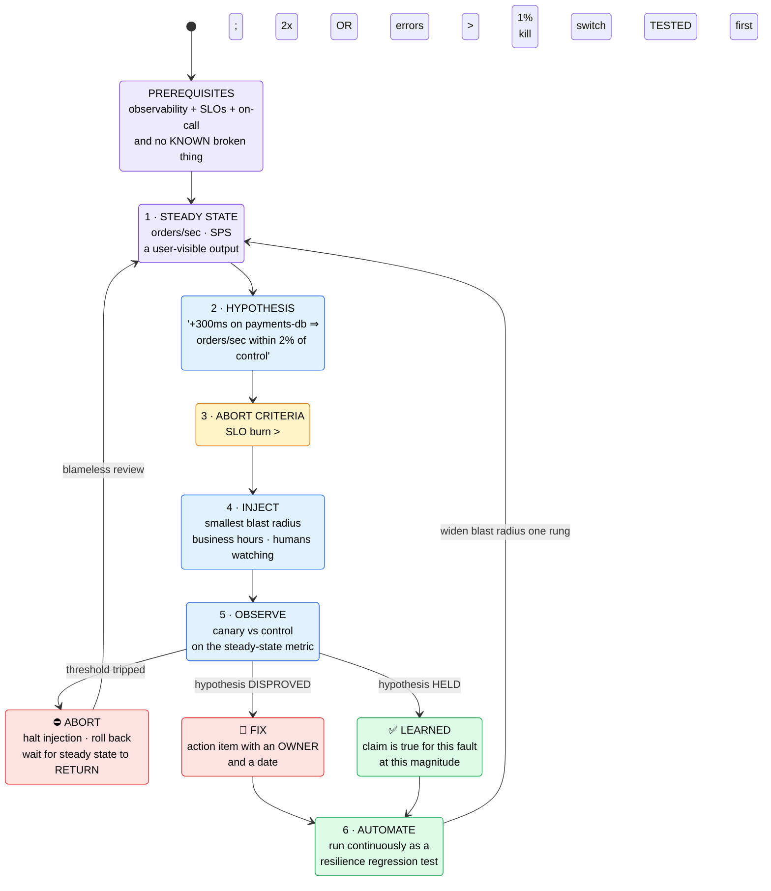
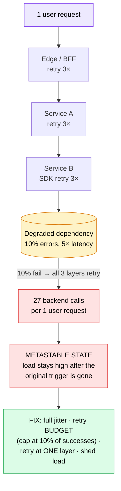

# Chaos Engineering — Breaking Production on Purpose

## 1. Why Should I Care About This?
- **Your Failover Code Is the Least-Tested Code You Own**: the retry policy, the circuit breaker, the standby replica, the DNS failover record — none of it runs on a normal Tuesday. It runs for the first time at 3 AM during an incident, in front of customers, with everyone watching. A code path that executes 0.001% of the time gets 0.001% of the debugging. Chaos engineering is the only practice that deliberately exercises it while you are calm and it is daylight.
- **Netflix Ran This as a Standing Policy, Not a Project**: Chaos Monkey — announced publicly in Netflix's July 2011 *Simian Army* post and open-sourced in 2012 — terminated production instances during business hours **continuously**, which forced every team to build stateless, replaceable services or be woken up until they did. Chaos Monkey 2.0 (2016) rebuilt it on Spinnaker so it rode the deployment pipeline. The point was never the monkey; it was that "the instance can die" stopped being a debate.
- **The Failures That Actually Take You Down Are Emergent, Not Component Failures**: a single dead pod is handled by Kubernetes in seconds. What kills you is a **slow** dependency saturating a 200-thread pool, retries amplifying offered load 3–5× on the way down, a health check reporting `200 OK` from a process that can no longer serve, and a DNS TTL turning a 30-second failover into a 30-minute outage. None of these appear in a unit test, an architecture diagram, or a load test — they only appear under fault.
- **It Is Cheap to Run and Absurdly Cheap Relative to an Outage**: AWS Fault Injection Service bills **$0.10 per action-minute**, so a 30-minute experiment with two simultaneous actions costs **$6.00**. Chaos Mesh and LitmusChaos are CNCF projects and free. The comparison is not $6 vs $0 — it is $6 vs the revenue you lose in the first ten minutes of an unplanned regional failover you have never rehearsed.

## 2. What Problem Does This Solve?
- **Untested Resilience Claims**: every timeout value, retry count, bulkhead size, replica count, and failover path in your design document is a **claim**. "If the recommendation service dies, the page still renders" is a hypothesis, and until something kills that service in production, it is an unfalsified belief that everyone quotes as a fact.
- **Configuration That Diverges From Design Silently**: the circuit breaker was configured correctly two years ago; then someone raised the timeout to fix a flaky test, and now the breaker never opens because the timeout exceeds the caller's own timeout. Nothing alerts on this. Only injection reveals it.
- **Hidden Coupling in the "Non-Critical" Path**: teams routinely believe an enrichment call is asynchronous, best-effort, and non-blocking. Then you inject 5 seconds of latency into it and checkout latency rises 5 seconds, because somewhere it is `await`-ed on the synchronous path with no timeout. This is the single most common finding and it is invisible in code review across service boundaries.
- **Runbooks and Kill Switches That Have Never Been Executed**: the documented failover procedure references a script that no longer exists, or a dashboard that was migrated, or requires a permission the on-call doesn't have. You find this during the drill or during the outage; there is no third option.
- **Naive Approach**: "We do load testing and we have a staging environment, so we're covered." Load testing tells you the shape of your happy path at high volume — it does not tell you what happens when one of eleven dependencies gets slow. And staging has 1/100th of the traffic, a different data volume, no real cache warmth, mocked third parties, and often a single AZ. The failure modes you care about are **emergent properties of production scale and production topology**, so a green staging run is weak evidence. What actually happens: teams feel covered, ship, and discover in the first real regional event that the "warm standby" had a stale replica and an unpromotable primary.

## 3. Core Idea (Intuition First)
A fire drill is not arson. Nobody accuses the fire marshal of vandalism, because a drill has a **hypothesis** ("the building empties in under 4 minutes"), a **measurement** (a stopwatch), a **bounded scope** (one floor, announced, in daylight), and an **abort** (stop the drill if someone is actually hurt). Chaos engineering is a fire drill for a distributed system — and the reason it is science rather than sabotage is entirely those four things.

- You start from a **steady state**: a measurable, user-visible output that is normally boringly stable — orders per second, stream starts per second, successful logins per minute. Not CPU, not memory, not pod count.
- You state a **falsifiable hypothesis** about it: "*if the payments database p99 rises by 300 ms, orders/sec stays within 2% of the control group.*"
- You **inject the smallest fault that could disprove it** into the **smallest slice of production** that can still produce a signal.
- You **watch the steady-state metric**. If it holds, you learned your resilience claim is true *for that fault at that magnitude*. If it moves, you found a real weakness before a customer did.
- And the whole thing sits behind an **abort criterion you wrote down before you started** and a **kill switch you tested before you injected**.

> The mental image: **chaos engineering is an experiment about your assumptions, not a tool that kills servers.** The monkey is the instrument; the hypothesis is the science. If you cannot say what you expect to happen and what number would prove you wrong, you are not running an experiment — you are causing an incident with extra steps.

![Three-panel diagram of chaos engineering as a scientific experiment. Panel A lays out the experiment loop as six boxes: define a steady state as a user-visible business output such as orders per second rather than CPU; state a falsifiable hypothesis such as "p99 holds if X dies"; declare the abort rule before you inject anything, expressed as an SLO burn rate or an error-rate threshold; inject the fault with the smallest blast radius, in daylight, with humans watching; observe whether the business metric actually moved relative to a control group; and then either learn or fix, and afterwards automate the experiment. A prominent dashed red abort branch runs from the observe box down into a red box reading that the pre-declared threshold has tripped, noting that the kill switch must be verified before injection and must not depend on the thing being broken, and that branch loops all the way back to the steady-state box. A green strip underneath shows that the final step feeds back into the first, because a weakness you fixed but never re-test will regress. Panel B is the fault taxonomy, twelve faults each mapped to the specific weakness it uniquely reveals: latency injection is highlighted as the highest-yield fault because a slow dependency exhausts thread and connection pools and cascades whereas a dead one fails fast; instance and pod kill tests whether the replacement actually comes up and whether state is truly externalised; error injection tests whether callers degrade or pass the 500 through; resource pressure on CPU, memory, disk and IO exposes health checks that report healthy while the process is useless; network partition and packet loss expose split brain, quorum loss and retransmit stalls that look like hangs rather than errors; DNS failure exposes TTLs and negative caching that turn a thirty-second failover into a thirty-minute outage; brownout versus blackout shows that ten percent errors is harder than a hundred percent because retries stay alive and amplify load three to five times; clock skew breaks token expiry, TLS validity windows and leases; certificate expiry tests whether renewal is really automated; AZ and region evacuation tests the capacity arithmetic of whether two surviving availability zones can absorb all the traffic; cache flush tests whether the database survives a zero percent hit rate; and a supposedly non-critical dependency turns out to sit in the synchronous critical path. A footer notes that one second of added latency on a two-hundred-thread pool at three hundred requests per second fully occupies the pool. Panel C is the blast-radius ladder, a rising staircase of seven rungs from dev and local with synthetic load, to staging with zero real users, to one canary pod, to one percent of traffic with a canary and a control, to one availability zone, to one cell with a bounded tenant set, to one full region as an evacuation drill. Underneath, a guardrail strip states that every rung needs a kill switch tested first, abort criteria pre-declared as an SLO burn rate, and an automatic halt such as an AWS FIS stop condition on a CloudWatch alarm, and that from the fourth rung upward you also need a canary plus an identical control because without a control group you cannot distinguish your injected fault from ordinary variance. A final box explains Netflix ChAP, the Chaos Automation Platform, which routes a small percentage of traffic into a canary cluster and an identical control cluster, injects the fault only into the canary, and then compares the business metric of stream starts per second between the two, making the result statistically interpretable while bounding exposure to that slice.](../assets/chaos_engineering_experiment.svg)

> Panel A: the abort branch is what makes this engineering — write the threshold and test the kill switch before you inject. Panel B: pick the fault that tests your actual hypothesis, and reach for **latency** before termination. Panel C: exposure grows one rung at a time, and each rung has a mandatory guardrail; a canary-plus-control is what makes production experiments readable.

## 4. How It Actually Works

### 1. Steady state must be a user-visible output, not a resource metric
- A **steady state** is a metric that is normally stable within a tight, known band during normal operation, and whose movement means *users are affected*. Netflix uses **SPS — stream starts per second** — precisely because it is stable enough to have a predictable diurnal shape and it directly represents "people are successfully watching."
- **Why not CPU?** Because CPU is a *cause*, not a *symptom*, and it moves for a hundred reasons unrelated to your fault. Worse, resource metrics behave counter-intuitively under fault: killing a pod *reduces* fleet CPU; a slow dependency *reduces* CPU while queues fill. If you hypothesise about CPU, you will pass experiments that broke customers and fail experiments that were fine.
- **Mechanically**, you need the metric to be (a) queryable at 10–60 s resolution, (b) low-cardinality enough to slice by canary/control, and (c) stable enough that a 2% deviation is detectable above noise. If your orders/sec has a 15% minute-to-minute variance, you cannot detect a 5% regression in a 10-minute experiment — you need a control group (§5) or a longer run.
- **Trade-off / when the other choice wins**: for a pure infrastructure experiment where there is no meaningful business metric — say, testing whether an etcd quorum survives losing one member in a non-production cluster — a system-level SLI (write latency, quorum health) is legitimate. But the moment real users are in scope, the hypothesis must name their experience.
- Build the SLI first. See [SLO, SLI & Error Budgets](../12_Monitoring_Logging_Observability/SLO_SLI_Error_Budgets.md) — the SLO threshold you already defined *is* the natural abort criterion, which is why chaos and SLOs are the same investment.

### 2. Latency injection finds more real bugs than termination — this is the highest-yield fault
- **Termination fails fast.** Kill a pod and its TCP connections reset immediately; callers get `ECONNREFUSED`, fail in microseconds, and the load balancer removes the endpoint. The system's *error* path runs, which is usually the path someone actually wrote.
- **Slowness holds resources hostage.** Add 1 s of latency to a dependency and nothing errors — every request simply occupies a worker for 1 s longer. By **Little's Law** (`concurrency = arrival_rate × latency`), a service at **300 rps** whose downstream call goes from 20 ms to 1 s needs `300 × 1.02 ≈ 306` concurrent workers. If your thread pool is **200**, the pool is 100% occupied, the accept queue fills, and the service stops answering *everything* — including the health check and the endpoints that never touched the slow dependency. **A dead dependency degrades one feature; a slow dependency takes down the whole process.**
- The same arithmetic applies to **connection pools**: a HikariCP pool of 20 connections against a database whose p99 went from 5 ms to 500 ms drops from ~4,000 to ~40 queries/sec of throughput. Callers then hit the pool's `connectionTimeout` and *retry*, which makes it worse.
- **How to inject it**: at the mesh (Envoy `fault.delay` with a percentage), at a TCP proxy (Toxiproxy `latency` toxic), at the kernel (`tc qdisc add dev eth0 root netem delay 300ms 100ms distribution normal`), or at the platform (Chaos Mesh `NetworkChaos` with `action: delay`, AWS FIS `aws:eks:pod-network-latency`). **Always inject jitter as well as a fixed delay** — a constant 300 ms is unrealistically kind; real degradation has a fat tail, and a fat tail is what exhausts pools.
- **Trade-off**: latency experiments are slower to run and harder to attribute (nothing errors, so your dashboards look "fine" while users suffer), and they can be genuinely dangerous because the failure is a *cascade* rather than a bounded loss. That is exactly why they belong on a small, controlled slice — and exactly why they are worth running.

### 3. Abort criteria and the kill switch — built before anything is broken
- **Abort criteria are pre-declared, quantitative, and automatic.** "We'll stop if it looks bad" is not an abort criterion; a human watching a dashboard has a 30–120 s reaction time and will rationalise the first three minutes of a cascade. Express it as an **SLO burn rate** — e.g. halt if the 5-minute burn rate exceeds **2× budget** — or a hard threshold (`error_rate > 1%`, `p99 > 800 ms`).
- **The platform should enforce it.** AWS FIS makes this a first-class field: an experiment template carries up to **five `stopConditions`**, each pointing at a CloudWatch alarm ARN; when an alarm goes to `ALARM`, FIS stops the experiment and rolls back its actions itself. Chaos Mesh (2.5+) added a `StatusCheck` CRD that halts a workflow when an HTTP probe fails. Every experiment also needs a hard `duration` so it self-terminates if everything else fails.
- **The kill switch must be verified before injection, and must not depend on the thing you are breaking.** If your abort path is "the operator applies a Kubernetes manifest," and your experiment is a network partition of the control plane, you have no abort path. If it is "flip the feature flag," and the flag service reads from the cache you just flushed, you have no abort path. Test the switch on a no-op experiment *first*, and keep an out-of-band route (a second cluster, a break-glass CLI, a manual DNS change) documented and rehearsed.
- **The subtle trap**: rolling back the *injection* is not the same as recovering the *system*. Removing 300 ms of latency does not drain the 50,000 queued retries it created, refill a cold cache, or un-trip a breaker whose half-open probe interval is 60 s. Budget recovery time into the experiment window and observe until the steady state actually returns.



### 4. Minimising blast radius — and why "in production" is defensible
- The **ladder** is: dev → staging → **one canary instance** → **1% of traffic** → one AZ → one cell → one region. You climb a rung only after the current rung's guardrails have actually fired at least once.
- **Bounding techniques, in order of preference**: (a) scope by *request* — inject only for requests carrying a chaos header, so exposure is exactly your synthetic traffic; (b) scope by *percentage* — Envoy's fault filter takes a `percentage` so 0.1% of calls get the fault; (c) scope by *instance* — Chaos Mesh `mode: one` or `fixed-percent: 10`; (d) scope by *partition* — one AZ, or one **cell** (see [Cell-Based Architecture](../03_High_Level_Design/Cell_Based_Architecture.md)), which is the strongest form because the cell boundary already bounds every other failure too.
- **Why production, honestly stated**: staging differs in traffic volume, data volume, cache warmth, connection-pool saturation, third-party behaviour, DNS and certificate configuration, node types, AZ spread, and the exact set of deployed versions. The failure modes worth finding are *emergent from those differences*. A staging chaos experiment is a cheap, useful smoke test of the tooling — it is not evidence about production. **The honest framing for an interview: "production is where the hypothesis lives, so production is where it has to be tested — which is why the blast radius and the abort criteria are the engineering, not the injection."**
- **Trade-off / when staging wins**: while you are learning the tool, while your abort path is unproven, when the workload is irreversible (a payment capture, a physical shipment, an email send), or when you are regulated and need a change-control record before touching production. Also: if you have no canary/control mechanism, a low-traffic service in production may not give you a statistically readable result at 1% anyway — run it at a bigger slice in staging first, then a small slice in production.

### 5. Canary + control is what makes a production experiment readable — Netflix ChAP
- The problem with "inject into 1% and look at the dashboard": production is noisy. Diurnal traffic, a concurrent deploy, a partner outage, a marketing email — any of these move your steady-state metric more than your fault does. You cannot attribute the change.
- **ChAP (Chaos Automation Platform)** solves this by construction. It provisions **two clusters** for the service under test: a **canary** and an **identical control**, each receiving the same small, randomly-assigned slice of live traffic. The fault is injected **only into the canary**. Then it compares the **business metric (SPS)** between canary and control. Because both slices experience the same diurnal curve, the same deploys, and the same partner behaviour, the *difference* is attributable to the injection — and the exposure is bounded to the canary slice, which is a fraction of a percent of users.
- **Why this is the mature form**: it converts "did something look bad?" into a statistical comparison with a control, which means it can run **automatically and continuously** without a human interpreting a graph. Netflix layered a "Monocle" style inventory on top to enumerate which timeouts/retries/fallbacks each service declared, so experiments could be *generated* from the configuration rather than hand-written.
- **Trade-off**: it costs double capacity for the service under test during the experiment, requires request-level traffic steering (a mesh or a smart client), and requires enough traffic in the slice for the comparison to have power. At 100 rps total you cannot get a readable 1% canary; at 100,000 rps you can.
- The mechanics are the same ones from [Deployment Strategies: Blue-Green & Canary](./Deployment_Strategies_Blue_Green_Canary.md) — a chaos experiment is a canary analysis where the independent variable is a fault instead of a new version.

### 6. Brownout vs blackout, and the retry amplification it exposes
- A **blackout** is total loss: the dependency is gone, connections refuse, and your error path runs cleanly. A **brownout** is partial degradation: 10% of calls fail, or latency is 5× normal. **Brownouts are much harder**, and they are what actually happens in production.
- Why: at 100% failure, circuit breakers trip and *stay* tripped, retries quickly exhaust and stop, and load shedding engages. At 10% failure, the breaker's error-rate threshold (often 50%) is never crossed, so it never opens; 90% of calls succeed so the system looks alive; and every failed call is **retried**, adding load to a dependency that is already struggling.
- **The amplification arithmetic**: if each of three layers retries up to 3 times, a single user request can become `3³ = 27` backend calls. Even modest defaults compound — Istio applies a default of **2 retries** per hop, and AWS SDKs default to **3 total attempts** in standard mode, so a 3-hop path with a client SDK at the bottom can easily be a 3–5× multiplier before anyone wrote a line of retry code. The dependency at 10% degradation now receives 3–5× its normal load, degrades to 50%, and the system enters a **metastable failure state** it cannot exit even after the original trigger is removed.
- **The fixes this experiment forces**: exponential backoff **with full jitter**, a **retry budget** (cap retries at e.g. 10% of successful requests — the approach Google's SRE book and Envoy's `retry_budget` both use) rather than a per-call count, **retry only at one layer** (usually the outermost), and **load shedding** at the victim so it fails fast instead of queueing. See [Retry, Timeout & Backoff Patterns](../10_Microservices_Distributed_Systems/Retry_Timeout_Backoff_Patterns.md) and [Load Shedding & Graceful Degradation](../07_Load_Balancing_Scalability/Load_Shedding_Graceful_Degradation.md).



### 7. Prerequisites and the maturity gate — the real interview differentiator
- **You need three things before chaos is anything but vandalism**: (1) **observability** good enough to detect the effect — if you cannot see a 2% drop in orders/sec within 2 minutes, you cannot run an experiment, you can only run an outage; (2) **SLOs**, because the SLO is where your abort criterion comes from and where "did this matter?" gets answered; (3) a **working on-call**, because some experiments will page someone and that has to be a functioning process, not a surprise.
- **Do not chaos-test what you already know is broken.** If your postmortems say the cache has no fallback, go add the fallback — injecting a cache failure only reproduces a known bug at customer expense. Chaos is for the **unknown unknowns**: the coupling nobody documented, the timeout nobody reconciled, the pool nobody sized for the bad case.
- **Organisational buy-in is a hard prerequisite, not a nicety.** The experiment must be announced, the owning team must consent, the on-call must know it is happening, and the review must be **blameless** — otherwise the first surprising result gets someone in trouble and the practice dies within a quarter. Put the experiment on the change calendar so an unrelated incident during your window isn't misattributed to you (and so you halt if one occurs).
- **A practical maturity gate**: can you (a) name your steady-state metric, (b) show the dashboard that displays it at 1-minute resolution, (c) name the number that aborts, (d) demonstrate the kill switch working, and (e) name who owns the fix if it fails? Five yeses → run it. Any no → fix that first.
- **Trade-off**: this gate is genuinely conservative and a team can hide behind it forever ("we're not mature enough"). The counter is to start at rung 1 of the ladder with a `dev`-namespace pod kill on day one — the gate is about *production* exposure, not about starting.

### 8. GameDays and automation — the human protocol, then the machine
- A **GameDay** is a scheduled, timeboxed, human-run exercise around one or more experiments. The industrial ancestors: **Amazon's GameDays** (created by Jesse Robbins, who held the internal title "Master of Disaster"), which deliberately failed infrastructure to test people and process as much as systems; and **Google's DiRT** (Disaster Recovery Testing), a long-running company-wide program that injects multi-day, multi-system disasters including deliberately unavailable *people*. Netflix's **Chaos Kong** exercise took an entire AWS region out of rotation, and their later region-evacuation work drove failover from tens of minutes down to single-digit minutes.
- **The artefacts that make a GameDay work**: a **written experiment doc** before the day (steady state, hypothesis, fault, blast radius, abort criteria, kill switch, rollback, expected duration); named **roles** — a *conductor* who is the only person who injects and aborts, one or more *observers* watching specific dashboards, and a **scribe** keeping a timestamped log (which becomes the timeline in the review); **stakeholder notification** before and after; **daylight, mid-week** scheduling so the experts are awake and available; a hard **timebox**; and an output that is **action items with owners and dates**, not a vibe.
- **A useful variant**: run it as a *drill of the humans* — don't tell the on-call it is an exercise (but do tell their manager and the conductor), and measure time-to-detect, time-to-page, time-to-mitigate. This is often where you learn that the alert exists but routes to a deprecated rotation. See [Alerting Strategies & On-Call Management](../12_Monitoring_Logging_Observability/Alerting_Strategies_OnCall_Management.md).
- **Then automate.** A GameDay finding that gets fixed and never re-tested will regress with the next refactor. Promote each validated experiment into a **continuous resilience regression test** — a Chaos Mesh `Schedule`, a scheduled FIS experiment, a ChAP-style run generated from service configuration. This is the fifth principle, and it is the difference between a team that *did* chaos engineering once and a team that *has* it.

## 5. Real-World Example
**Netflix — from Chaos Monkey to ChAP.** The 2011 *Simian Army* post described Chaos Monkey terminating production instances during business hours, plus Latency Monkey (artificial delays and error responses to test degradation), Conformity/Doctor/Janitor Monkeys, and **Chaos Gorilla**, which simulated the loss of an entire availability zone. Chaos Kong extended this to a whole region. Chaos Monkey 2.0 (2016) was rewritten to integrate with **Spinnaker** so termination followed the deployment pipeline. **ChAP** then moved the practice from "terminate and hope someone notices" to a canary-versus-control experiment measured on **SPS (stream starts per second)**, which is what allowed it to run continuously and automatically. The trajectory is the maturity model: *random termination → targeted fault injection → controlled experiment with a control group → generated experiments*.

**AWS Fault Injection Service — abort criteria as a platform primitive.** FIS (GA March 2021 as Fault Injection Simulator) models an experiment as a template with `actions`, `targets`, and **`stopConditions`** — up to five CloudWatch alarms that automatically halt and roll back the experiment. Its action library includes `aws:ec2:stop-instances`, `aws:ssm:send-command` running `AWSFIS-Run-CPU-Stress`, `aws:eks:pod-network-latency`, `aws:network:disrupt-connectivity` (for AZ- and subnet-level partitions), `aws:fis:inject-api-internal-error` for control-plane API errors, and pre-built **AZ availability power interruption** and **cross-region connectivity** scenarios. Pricing is **$0.10 per action-minute**. The design lesson worth stealing: the abort condition is a *required part of the experiment definition*, not a runbook step someone might follow.

**The classes of failure this reliably finds.** Public postmortems across the industry keep landing on the same small set: **retry amplification** driving a degraded dependency into a metastable state it cannot exit without shedding load; **thundering herd** onto a cold cache or a just-restarted service, where synchronised clients (all reconnecting at the same instant, all with no jitter) generate a load spike far above steady state; **DNS/TTL-bound failover**, where the mechanism worked but clients kept resolving the old address for tens of minutes (JVM DNS caching being a classic offender); and **health checks that pass while the process is useless**, so a broken instance stays in rotation. These are failure *classes*, well documented in Google's SRE book chapters on cascading failures and overload — and every one of them is directly reachable by a latency, brownout, or cache-flush experiment.

## 6. Code Example
A Chaos Mesh experiment. The load-bearing parts are `duration`, the narrow `selector`, and the `mode` — those three are the blast radius:

```yaml
# chaos-mesh.org/v1alpha1 — inject 300ms ± 100ms into ONE payments pod's egress
apiVersion: chaos-mesh.org/v1alpha1
kind: NetworkChaos
metadata:
  name: payments-db-brownout
  namespace: chaos-testing            # experiments live in their own namespace, RBAC-scoped
spec:
  action: delay
  mode: one                           # ◀── BLAST RADIUS: exactly ONE matching pod.
                                      #     'all' | 'fixed: 3' | 'fixed-percent: 10' widen it.
  selector:
    namespaces: ["prod"]
    labelSelectors:
      app: payments-api
      chaos-eligible: "true"          # ◀── opt-in label: a pod cannot be targeted by accident
  direction: to
  target:                             # only traffic toward the DB, not all egress
    mode: all
    selector:
      namespaces: ["prod"]
      labelSelectors: { app: payments-db }
  delay:
    latency: "300ms"
    jitter: "100ms"                   # ◀── JITTER MATTERS: a constant delay is unrealistically
    correlation: "50"                 #     kind. Fat tails are what exhaust connection pools.
  duration: "300s"                    # ◀── THE MOST IMPORTANT LINE: self-terminates in 5 min
                                      #     even if the operator, the API server, or you are gone.
---
# Continuous regression test: the same experiment, every weekday at 14:05 local.
apiVersion: chaos-mesh.org/v1alpha1
kind: Schedule
metadata: { name: payments-db-brownout-weekly, namespace: chaos-testing }
spec:
  schedule: "5 14 * * 1-5"            # DAYLIGHT, mid-week — humans awake, experts available
  historyLimit: 20
  concurrencyPolicy: Forbid           # never let two experiments overlap
  type: NetworkChaos
  networkChaos: { action: delay, mode: one, duration: "300s", delay: { latency: "300ms", jitter: "100ms" }, selector: { namespaces: ["prod"], labelSelectors: { app: payments-api, chaos-eligible: "true" } } }
```

Istio/Envoy HTTP fault injection — percentage-scoped, and note the retry interaction:

```yaml
apiVersion: networking.istio.io/v1beta1
kind: VirtualService
metadata: { name: recommendations }
spec:
  hosts: ["recommendations"]
  http:
  - match:
    - headers:
        x-chaos-experiment: { exact: "rec-brownout-2024-11" }   # ◀── SMALLEST possible radius:
    fault:                                                       #     only requests we tag
      delay:
        percentage: { value: 100.0 }
        fixedDelay: 3s
      abort:
        percentage: { value: 10.0 }      # 10% error rate = a BROWNOUT, the hard case
        httpStatus: 503
    route: [{ destination: { host: recommendations } }]
    timeout: 1s                          # ◀── TEACHING POINT: a 3s injected delay behind a 1s
                                         #     timeout tests the TIMEOUT, not the slow dependency.
                                         #     Envoy applies delay first, then abort.
    retries:
      attempts: 2                        # ◀── your injected 503 will be RETRIED. You are really
      retryOn: 5xx,connect-failure       #     testing 3 requests, and 10% abort × 3 attempts is
      perTryTimeout: 1s                  #     ~27% of user-visible failures. Do this maths first.
  # Unmatched (untagged) traffic falls through to a normal route — 99.99% of users see nothing.
  - route: [{ destination: { host: recommendations } }]
```

AWS FIS experiment template — the stop condition is the load-bearing field:

```json
{
  "description": "Stop 1 of 6 checkout instances; halt automatically if the SLO burns",
  "roleArn": "arn:aws:iam::111122223333:role/FISExperimentRole",
  "targets": {
    "OneCheckoutHost": {
      "resourceType": "aws:ec2:instance",
      "resourceTags": { "App": "checkout", "ChaosEligible": "true" },
      "selectionMode": "COUNT(1)"
    }
  },
  "actions": {
    "StopOne": {
      "actionId": "aws:ec2:stop-instances",
      "parameters": { "startInstancesAfterDuration": "PT5M" },
      "targets": { "Instances": "OneCheckoutHost" }
    }
  },
  "stopConditions": [
    { "source": "aws:cloudwatch:alarm",
      "value": "arn:aws:cloudwatch:us-east-1:111122223333:alarm:CheckoutSLOBurnRate2x" },
    { "source": "aws:cloudwatch:alarm",
      "value": "arn:aws:cloudwatch:us-east-1:111122223333:alarm:Orders5xxAbove1Pct" }
  ]
}
```

```bash
# The primitives underneath every tool above — worth knowing so you can debug them.
tc qdisc add dev eth0 root netem delay 300ms 100ms distribution normal   # latency + jitter
tc qdisc change dev eth0 root netem loss 5%                              # packet loss
tc qdisc del  dev eth0 root                                              # ◀── the KILL SWITCH.
#   Test THIS command before you run the one above. And note it is per-namespace and lost on
#   reboot — which is itself a crude dead-man's switch, but not one you should rely on.
stress-ng --vm 4 --vm-bytes 90% --timeout 60s     # memory pressure, with a built-in timeout
```

## 7. Design Variations & Alternatives

| Tool / approach | Layer it injects at | Faults | Abort mechanism | Use when |
|---|---|---|---|---|
| **Chaos Monkey (+ Spinnaker)** | Cloud instance | Termination only | Schedule + opt-out config | You want a standing forcing-function that instances must be replaceable |
| **Chaos Mesh** (CNCF) | Kubernetes CRDs | Pod, network, IO, stress, time, DNS, HTTP, kernel | `duration`, `StatusCheck` probe in a Workflow | You are on Kubernetes and want experiments in Git alongside manifests |
| **LitmusChaos** (CNCF) | Kubernetes CRDs + hub | Large experiment hub, ChaosCenter UI, GitOps | Probes as pass/fail gates in the ChaosEngine | You want a curated experiment catalogue and a portal for many teams |
| **AWS FIS** | AWS control plane + agent | EC2/ECS/EKS/RDS, network disruption, API errors, AZ power, cross-region | **`stopConditions`** on CloudWatch alarms (native) | Your blast radius is AWS-shaped: AZ, subnet, RDS failover, IAM/API faults |
| **Gremlin** (SaaS) | Agent + host/container | Latency, blackhole, packet loss, CPU/IO, shutdown, certificate expiry | Halt-all button, automatic health checks | You want a managed product, RBAC, audit trail, and no tooling to maintain |
| **Istio / Envoy fault filter** | L7, in the sidecar | `delay` + `abort` by percentage or header | Remove the VirtualService rule (fast, control-plane push) | You already run a mesh and want per-request, per-route precision with zero app changes |
| **Toxiproxy** (Shopify) | TCP proxy | latency, bandwidth, timeout, `down`, slicer | HTTP API to remove the toxic | Deterministic faults in **integration tests and CI**, not production |
| **`tc netem` / `stress-ng` / `iptables`** | Kernel / host | The raw primitives | `tc qdisc del`, process timeout | You need something now, on one box, with no platform — and to understand what the tools do |

- **Fault injection in tests vs chaos in production are different practices.** Toxiproxy in CI gives you a *deterministic regression test* for "does the client time out correctly" — fast, repeatable, no risk, but it only tests what you thought to write. Production chaos gives you *emergent* findings at real scale but is slower, noisier, and needs guardrails. Do both; they answer different questions.
- **The middle paths are underrated.** **Game-day-only chaos** (quarterly, human-run, no automation) is a legitimate stopping point for a small team — most of the learning with a fraction of the platform investment. **Failure-flag / application-level injection** (a library that throws or sleeps when a flag is set) needs no infrastructure and gives you in-process faults a network-level tool cannot reach — e.g. "what if the cache client returns stale data?" **Dependency-inventory-driven generation** (ChAP/Monocle style) is the top of the ladder: enumerate every declared timeout/retry/fallback and generate an experiment per claim.
- **Progressive delivery is the adjacent practice, not a substitute.** A canary deploy with automated analysis tests *your new code* under real traffic; chaos tests *your resilience configuration* under real faults. They share the same traffic-splitting and metric-comparison machinery, which is why teams that have one can build the other cheaply.

## 8. Pros and Cons

### Chaos engineering as a practice
- **Pros**: converts resilience from an assertion into evidence; finds emergent, cross-service coupling that no unit test, code review, or architecture diagram can reach; validates runbooks, alerts, and *people* alongside systems; creates a forcing function — once "the instance can die" is a standing fact, teams design for it by default; and it is cheap (FIS at $0.10/action-minute; Chaos Mesh and Litmus free) relative to a single unrehearsed failover.
- **Cons**: it can cause real customer impact, so it is only as safe as your weakest guardrail; it requires observability and SLOs you may not have, making it a *second*-order investment; a null result is genuinely hard to interpret without a control group; and it consumes engineering time on failures that may never occur while known bugs sit in the backlog.

### Running experiments in production vs staging only
- **Production pros**: real traffic volume, real data sizes, warm caches, real third parties, real DNS and certificates, real node/AZ topology — which is where the interesting failure modes actually live. It is also the only place a finding is *evidence* about production.
- **Production cons**: user-visible risk; needs traffic steering and canary/control to be interpretable; needs change management, notification, and organisational consent; and an abort path that is itself a distributed system that can fail.
- **Staging pros/cons**: zero customer risk and a fine place to debug the tooling and the kill switch — but a green result is weak evidence, because the differences between staging and production *are* the failure modes, and low staging traffic means many saturation-driven faults simply cannot manifest.

## 9. Failure Scenarios & What Can Go Wrong
- **SYMPTOM**: The experiment ran, dashboards stayed green, everyone declared success — and the same fault caused an outage two weeks later. **ROOT CAUSE**: the hypothesis was on a resource metric (CPU, pod count) that is insensitive to the user-visible failure, or the blast radius was so small the effect was below noise. **FIX**: hypothesise on a business SLI, and use a canary-plus-control comparison so a 2% deviation is detectable; if the service has too little traffic for that, increase the slice or lengthen the run rather than declaring a pass.
- **SYMPTOM**: You injected latency into one dependency and the *entire* service — including unrelated endpoints — stopped responding. **ROOT CAUSE**: a shared thread or connection pool: by Little's Law, 300 rps × 1 s needs ~300 workers and your pool has 200, so every caller queues. **FIX**: **bulkhead** the pools per dependency, set a per-call timeout well below the caller's own budget, and shed load at the boundary. See [Circuit Breaker & Bulkhead](../10_Microservices_Distributed_Systems/Circuit_Breaker_Bulkhead.md).
- **SYMPTOM**: The experiment could not be stopped; the "stop" command hung. **ROOT CAUSE**: the abort path depended on the thing being broken — a control-plane partition, a flushed config cache, a mesh whose xDS push route you had just severed. **FIX**: verify the kill switch on a no-op experiment first; keep an out-of-band break-glass path (second cluster, direct host access, manual DNS); and always set a hard `duration`/`stopConditions` so the platform terminates the experiment without you.
- **SYMPTOM**: You aborted within 30 seconds, but error rates stayed elevated for 20 minutes afterwards. **ROOT CAUSE**: the injection created state the rollback does not undo — a backlog of queued retries, a cold cache, a half-open breaker with a 60 s probe interval, an autoscaler that scaled down during the outage. **FIX**: treat recovery as part of the experiment: observe until the steady state genuinely returns, and record time-to-recover as a result. Long recovery *is* the finding.
- **SYMPTOM**: A real, unrelated incident started during your chaos window and 40 minutes were spent arguing about whether the experiment caused it. **ROOT CAUSE**: no change-calendar entry, no clear ownership, no automatic halt. **FIX**: register the window, announce it, and make "halt all chaos immediately" the first step of every incident response — a global kill switch that any responder can hit without approval.
- **SYMPTOM**: A "non-critical" dependency was killed and checkout latency rose by exactly the injected delay. **ROOT CAUSE**: the call is on the synchronous critical path with no timeout and no fallback, despite being documented as best-effort. **FIX**: add a timeout shorter than the user-facing budget plus a static fallback, then re-run the *same* experiment as a permanent regression test. This is the highest-frequency finding in the whole practice.
- **SYMPTOM**: Killing a pod caused a burst of 502s even though the replacement started in 4 seconds. **ROOT CAUSE**: the endpoint was not removed from the load balancer before the process died — no `preStop` hook, no connection draining, and a readiness probe interval longer than the shutdown. **FIX**: `preStop` sleep longer than the LB's deregistration delay, graceful shutdown honouring `terminationGracePeriodSeconds`, and readiness probes that fail *before* the process stops accepting. See [Health Checks & Failover](../07_Load_Balancing_Scalability/Health_Checks_Failover.md).
- **SYMPTOM**: Everyone dreads chaos day; teams quietly stop labelling their workloads eligible. **ROOT CAUSE**: results were used to assign blame, experiments were unannounced, or findings produced tickets with no owner and no time allocated to fix them. **FIX**: blameless reviews, explicit opt-in labels plus consent from the owning team, and a hard rule that every finding leaves the review with a named owner and a date — otherwise you are generating anxiety instead of reliability.

## 10. Impact on Scalability, Reliability & Cost
- **Scalability**: chaos experiments directly validate the capacity arithmetic that scaling plans assume. A three-AZ deployment sized so each AZ runs at 66% utilisation *cannot* survive losing one AZ — the remaining two need to absorb 150% of their current load, which means each must be able to reach 99% utilisation with zero headroom. An AZ-evacuation experiment either proves the autoscaler adds capacity fast enough (HPA reacts on a ~15 s metrics window but new nodes take 1–3 minutes to join and pull images) or proves you must pre-provision at ~50% per AZ instead of 66%. That difference is a **50% capacity increase** on the service, and it is a number you should discover in a drill rather than an outage. See [Kubernetes Scheduling & Autoscaling (HPA/VPA)](./Kubernetes_Scheduling_Autoscaling_HPA_VPA.md).
- **Reliability**: the value is a shift in *where* you discover defects. If an unrehearsed regional failover takes 40 minutes and a rehearsed one takes 7, then for a service with a 99.95% target — a budget of **21.9 minutes of downtime per month** — a single unrehearsed regional event blows the entire quarterly budget while a rehearsed one costs about a third of one month's. Chaos does not increase availability directly; it converts *unknown* MTTR into *measured* MTTR, and measured MTTR is the only kind you can shorten. Pair this with [Disaster Recovery (RPO/RTO)](./Disaster_Recovery_RPO_RTO.md) — a declared RTO you have never tested is a wish.
- **Cost**: the direct cost is small and easy to bound — AWS FIS at **$0.10 per action-minute** means a weekly 30-minute two-action experiment is `30 × 2 × 0.10 × 4 ≈ $24/month`; Chaos Mesh/Litmus are free apart from the operator's few hundred MB of memory. The real costs are **engineering time** (a proper GameDay is ~4 engineer-hours to prepare, 2 to run, 2 to review ≈ 1 engineer-day) and **duplicate capacity** for a canary+control run (2× the service under test, for the experiment's duration only — at 1% of traffic that is a rounding error on the bill). Weigh that against the cost of the outage class you are hunting: for most revenue-carrying services, a single hour of degraded checkout exceeds a year of chaos programme cost.

## 11. When NOT to Use This
- **Don't run chaos before you have observability, SLOs, and a functioning on-call.** Without a steady-state metric you can see at 1-minute resolution and a threshold that means "stop," you are not running an experiment — you are running an unmonitored outage, and you will learn nothing from it.
- **Don't chaos-test a weakness you already know about.** If the last three postmortems all say "the cache has no fallback," the correct next action is to build the fallback. Reproducing a known bug in production costs customers and teaches you nothing; chaos is for the unknown unknowns.
- **Don't inject into irreversible or externally-visible side effects.** Payment captures, physical fulfilment, outbound email/SMS, third-party API calls that cost money or violate a partner's terms, and anything touching a regulated audit trail. Use a sandbox, a synthetic tenant, or inject on the *read* path instead.
- **Don't run experiments on a service with too little traffic to interpret.** At 20 rps, a 1% canary is 0.2 rps — you cannot distinguish your fault from noise in any reasonable window. Either widen the slice deliberately (accepting the exposure) or run it in a load-tested staging environment where you control the traffic.
- **Don't run production chaos during a freeze, an active incident, a peak event, or without the owning team's consent.** Black Friday, a migration cutover, quarter-end close, or a live Sev-2 are all times when the marginal information is low and the marginal risk is enormous — and an experiment nobody agreed to is an incident you caused, regardless of what you learn.

## 12. Interview Perspective
- **What interviewers expect**: that you frame this as an experiment, not a tool. Say: **"Chaos engineering is the empirical test of a resilience hypothesis. Every retry, timeout, circuit breaker and failover in the design is an untested claim until something exercises it — so I'd define a steady state on a user-visible metric like orders per second, state a falsifiable hypothesis, write the abort criteria and test the kill switch *before* injecting, then run it on the smallest slice of production that still gives a readable signal."** Then name the five principles: steady-state hypothesis, vary real-world events, run in production, automate to run continuously, minimise blast radius.
- **The trap question**: *"So you'd just run Chaos Monkey in production and kill random instances?"* The **wrong** answer says yes and talks about how Netflix does it. The **right** answer: "Termination is the easiest fault and the least informative one — Kubernetes already handles a dead pod in seconds. **Latency injection finds more real bugs**, because a slow dependency exhausts thread and connection pools and cascades, whereas a dead one fails fast. And I wouldn't run anything before I had the steady-state metric, the pre-declared abort threshold, and a kill switch that doesn't depend on the thing I'm breaking." Then add the maturity gate: don't chaos-test a known-broken thing; fix it first.
- **The math question**: *"You add 1 second of latency to a downstream call. What happens?"* Walk it with Little's Law: at **300 rps** with the call going from 20 ms to 1.02 s, required concurrency is `300 × 1.02 ≈ 306` workers. A **200**-thread pool is 100% occupied, so the accept queue fills and the service stops serving *every* endpoint — including its own health check, which means the load balancer pulls it out and the remaining instances inherit its traffic and fall over too. Then layer retries: three hops at 3 attempts each is `3³ = 27` backend calls per user request, so the degraded dependency now receives 3–5× normal load and cannot recover even after you remove the fault — a **metastable failure state**. Fixes: bulkhead the pool, timeout below the caller's budget, full jitter, a **retry budget** capped at ~10% of successes, and load shedding.
- **The subtle question**: *"Why do you need a control group?"* Because production is non-stationary — diurnal traffic, concurrent deploys, partner behaviour and marketing events all move your steady-state metric more than your fault does, so a before/after comparison is unattributable. Netflix's **ChAP** answers it structurally: a canary cluster and an identical control cluster take the same small traffic slice, the fault goes only into the canary, and you compare the business metric between them. That makes the result statistically interpretable *and* bounds exposure — which is precisely what lets the experiment run automatically and continuously instead of needing a human to squint at a graph.
- **Bonus signals**: brownout being harder than blackout (a 50% error-rate breaker threshold never trips at 10% errors); that rolling back the injection does not roll back the *system* (queued retries, cold caches, half-open breakers, a scaled-down autoscaler); AWS FIS `stopConditions` as abort criteria promoted to a platform primitive; the GameDay roles (conductor / observer / scribe) and that findings must leave with an owner and a date; Amazon GameDays and Google DiRT as the industrial ancestors; and the honest note that the failure your experiment *doesn't* find is still unknown — chaos raises your floor, it does not prove correctness.

## 13. Connections to Other Topics
- [Disaster Recovery (RPO/RTO)](./Disaster_Recovery_RPO_RTO.md) — a declared RTO is a hypothesis; a region-evacuation GameDay is the only way to turn it into a measured number.
- [Deployment Strategies: Blue-Green & Canary](./Deployment_Strategies_Blue_Green_Canary.md) — chaos reuses the exact traffic-splitting and canary-analysis machinery; the independent variable is a fault instead of a new version.
- [Service Mesh Deep Dive (Istio)](./Service_Mesh_Deep_Dive_Istio.md) — Envoy's fault filter gives you `delay` and `abort` by percentage or header with no application change, and its retry defaults are themselves worth an experiment.
- [Kubernetes Objects (Pods & Services)](./Kubernetes_Objects_Pods_Services.md) — pod-kill experiments test exactly this contract: readiness/liveness probes, `preStop`, `terminationGracePeriodSeconds`, and whether state is really externalised.
- [Kubernetes Scheduling & Autoscaling (HPA/VPA)](./Kubernetes_Scheduling_Autoscaling_HPA_VPA.md) — AZ-evacuation experiments are how you find out whether the autoscaler adds capacity faster than the surviving zones saturate.
- [Retry, Timeout & Backoff Patterns](../10_Microservices_Distributed_Systems/Retry_Timeout_Backoff_Patterns.md) — retry amplification and missing jitter are the single most common chaos finding; this is the fix.
- [Circuit Breaker & Bulkhead](../10_Microservices_Distributed_Systems/Circuit_Breaker_Bulkhead.md) — the untested code that latency injection exists to exercise, including breakers that never open under a brownout.
- [SLO, SLI & Error Budgets](../12_Monitoring_Logging_Observability/SLO_SLI_Error_Budgets.md) — supplies both the steady-state metric and the abort criterion (a burn-rate threshold), which is why chaos and SLOs are one investment.
- [Health Checks & Failover](../07_Load_Balancing_Scalability/Health_Checks_Failover.md) — "healthy but useless" is a top-three finding; resource-pressure experiments are how you catch it.
- [Load Shedding & Graceful Degradation](../07_Load_Balancing_Scalability/Load_Shedding_Graceful_Degradation.md) — the mitigation that lets a brownout stay bounded instead of going metastable.
- [Cell-Based Architecture](../03_High_Level_Design/Cell_Based_Architecture.md) — the strongest blast-radius primitive: if the cell already bounds real failures, it bounds your experiments for free.
- [Availability & Reliability Math](../01_Planning_Foundations/Availability_Reliability_Math.md) — the arithmetic that turns a measured MTTR from a GameDay into an availability number you can commit to.

## 14. Visual Aids
- **The SVG above** ([chaos_engineering_experiment.svg](../assets/chaos_engineering_experiment.svg)): **Panel A** — the six-step experiment loop with the abort branch drawn as a prominent animated path back to steady state, plus the two rules that make the switch trustworthy (verified before injection, independent of the thing being broken); takeaway: *the abort path, not the injection, is the engineering.* **Panel B** — twelve faults mapped to the specific weakness each uniquely reveals, with latency injection highlighted; takeaway: *pick the fault that tests your hypothesis, and reach for latency before termination.* **Panel C** — the seven-rung blast-radius ladder with the guardrails required at every rung and the ChAP canary-plus-control construction; takeaway: *exposure grows one rung at a time, and a control group is what makes a production result readable.*
- **Mermaid — the lifecycle `stateDiagram-v2` (Section 4.3)**: the same loop as a state machine, including the prerequisite gate at the entrance and the abort transition back to safety with a blameless review; takeaway: *there are three exits from "observe" — abort, held, disproved — and all three end at "automate."*
- **Mermaid — retry amplification (Section 4.6)**: three retry layers turning one user request into 27 backend calls and driving a 10%-degraded dependency into a metastable state; takeaway: *the brownout is worse than the blackout because retries stay alive.*
- **The tooling table (Section 7)**: eight approaches by injection layer, fault set, and — the column that matters — the **abort mechanism** each one gives you natively; takeaway: *choose the tool by the guardrail it provides, not by the faults it can cause.*

## 15. Summary (TL;DR)
**Chaos engineering is an experiment about your assumptions, not a tool that kills servers** — because every retry, timeout, circuit breaker, replica and failover in your architecture is an untested claim, and failover code is the least-tested code in production while being the only code that runs when you are already in trouble. The five principles are: build a hypothesis around a **steady state** that is a user-visible business output (orders per second, Netflix's stream starts per second) and never a resource metric like CPU, which moves for a hundred unrelated reasons and can fall when things break; vary **real-world** events; run in **production**, defensibly, because staging differs in traffic, data, cache warmth, third parties, DNS and topology and those differences *are* the failure modes; **automate** so a fixed weakness cannot silently regress; and **minimise blast radius**. Reach for **latency injection before termination** — Kubernetes handles a dead pod in seconds, but by Little's Law a service at 300 rps whose downstream call goes from 20 ms to 1 s needs ~306 workers against a 200-thread pool, so it stops answering *everything*, including its own health check. A **brownout is harder than a blackout**: at 10% errors a 50%-threshold breaker never opens, every failure is retried, and three hops at three attempts each is 3³ = 27 calls per request, pushing the victim into a **metastable state** it cannot leave after the trigger is gone. So **write the abort criteria and test the kill switch before you inject anything** — express the threshold as an SLO burn rate, make the platform enforce it (AWS FIS `stopConditions` on CloudWatch alarms, a hard `duration` on every Chaos Mesh object), and make sure the switch does not depend on the thing you are breaking. Climb the blast-radius ladder one rung at a time — dev → staging → one canary pod → 1% of traffic → one AZ → one cell → one region — and from 1% upward use a **canary plus an identical control**, the way Netflix ChAP does, because production is non-stationary and without a control you cannot separate your fault from diurnal noise. Gate the whole thing on maturity: observability, SLOs and a working on-call first; never chaos-test a weakness you already know about, since chaos is for the unknown unknowns; get explicit consent and run blameless reviews. Run it as a **GameDay** — written experiment doc, a conductor who alone injects and aborts, observers, a scribe, stakeholder notification, daylight and a timebox — the way Amazon's GameDays and Google's DiRT do it, and finish with action items that have owners and dates. Expect to find retry storms without jitter, missing or infinite timeouts, a "non-critical" dependency sitting in the synchronous critical path, pools sized only for the happy path, health checks that report healthy from a useless process, DNS TTLs that stretch failover to 30 minutes, a replica that was never promotable, and caches that cannot survive the herd — and remember that **rolling back the injection is not the same as recovering the system**, so measure time-to-recover too.

## 16. Further Reading & Resources
- [Principles of Chaos Engineering](https://principlesofchaos.org/) — the canonical five principles, in about 400 words; the source for the steady-state/hypothesis framing.
- [Netflix Tech Blog — "The Netflix Simian Army" (2011)](https://netflixtechblog.com/the-netflix-simian-army-16e57fbab116) — the origin document: Chaos Monkey, Latency Monkey, Chaos Gorilla and why business hours were the point.
- [Netflix Tech Blog — "ChAP: Chaos Automation Platform"](https://netflixtechblog.com/chap-chaos-automation-platform-53e6d528371f) — the canary-plus-control design that makes production experiments statistically interpretable.
- [Netflix Tech Blog — "Chaos Monkey 2.0" / Chaos Engineering upgraded](https://netflixtechblog.com/chaos-engineering-upgraded-878d341f15fa) — the Spinnaker rewrite and how chaos became part of the deployment pipeline.
- [AWS — Fault Injection Service user guide: stop conditions](https://docs.aws.amazon.com/fis/latest/userguide/stop-conditions.html) — abort criteria as a required, platform-enforced part of an experiment template.
- [Casey Rosenthal & Nora Jones — *Chaos Engineering* (O'Reilly, 2020)](https://www.oreilly.com/library/view/chaos-engineering/9781492043850/) — the book-length treatment, including maturity models and the human factors.
- [Google SRE Book — "Addressing Cascading Failures"](https://sre.google/sre-book/addressing-cascading-failures/) — the failure classes chaos experiments hunt: retry amplification, thundering herd, metastable overload.
- [Google — "Weathering the Unexpected" (DiRT)](https://queue.acm.org/detail.cfm?id=2371516) — Kripa Krishnan on Google's company-wide disaster-recovery testing programme, including failing *people* as well as systems.
- [Chaos Mesh documentation](https://chaos-mesh.org/docs/) — the Kubernetes CRD reference for `NetworkChaos`, `PodChaos`, `StressChaos`, `Schedule` and `StatusCheck`.
- [Istio — HTTP fault injection reference](https://istio.io/latest/docs/reference/config/networking/virtual-service/#HTTPFaultInjection) — `delay` and `abort` semantics, percentages, and how they interact with retries and timeouts.
