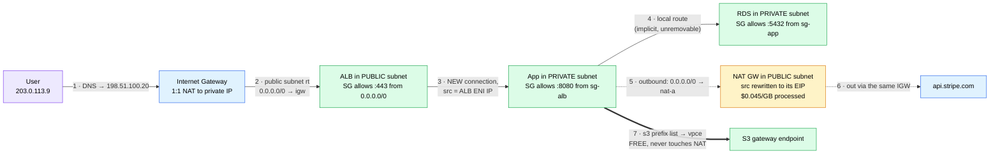

# Cloud Networking — VPCs, Subnets, Security Groups & Private Connectivity

## 1. Why Should I Care About This?
- **The CIDR You Type in Minute One Is Permanent**: An AWS VPC's primary CIDR block **cannot be changed or shrunk** after creation — you can only add secondary blocks. Pick `10.0.0.0/16` for three teams and two of them will pick it too, and now those VPCs can *never* peer, because VPC peering and Transit Gateway both hard-refuse overlapping ranges. The remediation is re-IP-ing production, which means new subnets, new ENIs, new database endpoints, and a maintenance window nobody will approve. This is the single most expensive irreversible decision in cloud infrastructure and it takes 30 seconds to get wrong.
- **NAT Gateway Is a Metered Toll Booth on Your Own Traffic**: ~**$0.045/hour** (≈ **$32/month idle, per AZ**) *plus* ~**$0.045 per GB of data processed** — in *both* directions. A fleet pulling a 500 MB container image onto 200 nodes ten times a day pushes ~30 TB/month through NAT: **~$1,350/month** for bytes you already paid AWS to store. A free **S3/DynamoDB gateway endpoint** deletes most of that line item. Corey Quinn's ["The AWS Managed NAT Gateway is Unpleasant and Not Recommended"](https://www.lastweekinaws.com/blog/the-aws-managed-nat-gateway-is-unpleasant-and-not-recommended/) exists because this catches serious teams.
- **Cross-AZ Chatter Is $0.01/GB in *Each* Direction**: A chatty service mesh sustaining 10 Gbps across AZs moves ~108 TB/day; at $0.02/GB round trip that's **~$2,160/day ≈ $65,000/month** — for traffic that never leaves the region. AZ spread is how you survive a data-center failure, so this is a real reliability-vs-cost trade, not a bug to eliminate.
- **"The Request Goes Out but Nothing Comes Back" Has One Usual Cause**: a Network ACL is **stateless**, so the return packet's destination is an *ephemeral port* (1024–65535) and needs its own explicit outbound rule. Security groups are **stateful** and don't. Interviewers ask SG-vs-NACL constantly because it separates people who have drawn a VPC from people who have debugged one at 3 AM.

## 2. What Problem Does This Solve?
- **Isolation Without Physical Wires**: You need your database unreachable from the internet while still reachable from your app tier, and you need that guarantee to hold across thousands of ephemeral instances. A VPC is a software-defined L2/L3 domain that makes "unroutable from outside" a configuration fact rather than a firewall rule you hope is right.
- **Blast-Radius Containment for Compromise**: Flat networks mean one compromised web server can scan and reach everything. Subnet tiers plus per-ENI security groups make lateral movement a policy question — the network layer of [Zero Trust Architecture](../15_Security_Deep_Dive_DevSecOps/Zero_Trust_Architecture.md).
- **Private Paths to Managed Services**: Without endpoints, your private instances must egress to the public internet (via NAT, paying per GB) to call S3, ECR, Secrets Manager, or Kinesis — services that live in the same region, metres away. Endpoints keep that traffic on the AWS backbone and off your NAT bill and your threat surface.
- **Address-Space Arithmetic That Survives Kubernetes**: Modern workloads consume IPs at pod granularity, not instance granularity. Networks sized for VMs run out of addresses the week you adopt EKS.
- **Naive Approach**: accept the default VPC, put everything in one `10.0.0.0/16` with public subnets because "private subnets are annoying," open `0.0.0.0/0` on port 22 "temporarily," and route all egress through one NAT Gateway in one AZ. This works perfectly for eighteen months. Then: the AZ with the NAT dies and *both* AZs lose egress; the CIDR collides with the company you just acquired; the security auditor finds the SSH rule; and the EKS migration stalls because a /24 subnet cannot hold 400 pods.

## 3. Core Idea (Intuition First)
A VPC is **a building you lease in someone else's data centre, and you own the floor plan.**

- The **lease is the CIDR block** — the range of private addresses that are yours (`10.0.0.0/16` = 65,536 of them). You cannot renegotiate the footprint later, only bolt on annexes.
- A **subnet is one floor in one wing** — it lives in exactly **one Availability Zone**, and that binding is what makes "spread across AZs" and "spread across subnets" the same sentence in AWS.
- A **route table is the wayfinding signage on that floor.** A subnet is "public" *only* because its route table says `0.0.0.0/0 → internet-gateway`. There is no `public: true` checkbox. Remove that route and the same subnet, same instances, becomes private.
- A **security group is the badge reader on each individual door** (per-ENI, stateful, allow-only). A **NACL is the guard at the stairwell** (per-subnet, stateless, ordered allow *and* deny) who inspects each person in each direction independently and therefore has to be told that people are allowed to walk *back down*.
- **NAT, endpoints, peering, and Direct Connect are the loading docks** — the ways things get in and out, each with a different price, a different direction, and a different rule about whether traffic can pass *through* to somewhere else.

> The mental image: **the VPC is the address space, the route table is the intent, and the security group is the door — three separate layers that all have to agree before a single packet moves.**

![Three-panel diagram of AWS VPC networking. Panel A shows one VPC with CIDR 10.0.0.0/16 and 65,536 addresses, annotated that the CIDR can never be shrunk or moved, spanning two Availability Zones. An Internet Gateway sits above the VPC, described as free, horizontally scaled, and performing one-to-one NAT for public IPs. Each AZ contains a public subnet holding an Application Load Balancer and a NAT Gateway, and a private subnet holding application or EKS pods and an RDS instance. The public subnet in us-east-1a is 10.0.0.0/24 with 251 usable addresses because AWS reserves five, and its route table entry 0.0.0.0/0 pointing at the internet gateway is called out as the thing that actually makes the subnet public. The private subnet is 10.0.16.0/20 with 4,091 usable addresses and routes 0.0.0.0/0 to the NAT Gateway in its own AZ plus an S3 prefix list to a free gateway endpoint; the second AZ is annotated that it must point at its own NAT Gateway, not the other AZ's, because cross-AZ traffic costs a cent per gigabyte. An animated blue dot traces an inbound packet from the internet gateway down to the load balancer and on to the private app tier, and an animated amber dot traces an outbound packet from the app tier through the NAT Gateway and out the internet gateway. Panel B contrasts a stateful security group against a stateless network ACL as two request-response traces. On the green security group side, an inbound rule allows TCP 443 from another security group by reference rather than by CIDR, the SYN from source port 51922 to destination 443 is accepted, and the SYN-ACK from source 443 back to port 51922 is automatically allowed because the connection is tracked, so the reply needs no rule at all; it notes security groups are allow-only, attached to the ENI, and default to 60 rules with five groups per ENI. On the red network ACL side, rule 100 inbound and rule 100 outbound both allow TCP 443, which looks correct, the SYN is accepted, but the return SYN-ACK is denied with a flashing dashed red arrow because its destination is an ephemeral port that no outbound rule matches; the fix given is an outbound allow for TCP ports 1024 to 65535. Panel C is a five-row connectivity ladder comparing VPC peering, Transit Gateway, PrivateLink endpoints, Site-to-Site VPN, and Direct Connect across three columns: whether the option is transitive, whether it tolerates overlapping CIDRs, and its cost or ceiling. Peering is free per hour but never transitive and blocked by overlap; Transit Gateway is transitive hub-and-spoke at five cents per attachment-hour plus two cents per gigabyte but still blocked by overlap; a PrivateLink endpoint exposes a single service unidirectionally, tolerates overlapping CIDRs, and costs about a cent per hour per AZ plus a cent per gigabyte; Site-to-Site VPN is five cents per connection-hour with a hard ceiling of roughly 1.25 Gbps per tunnel; and Direct Connect is a port fee plus the lowest and most predictable egress rates at 1, 10, or 100 Gbps but takes weeks to provision.](../assets/vpc_networking_anatomy.svg)

> Panel A: "public" is a route-table property, and each AZ needs its own NAT Gateway for HA *and* to avoid cross-AZ charges. Panel B: security groups track connections so replies are free; NACLs judge every packet alone, so you must open the ephemeral range. Panel C: climb the connectivity ladder only when transitivity or a CIDR overlap actually forces you to.

## 4. How It Actually Works

### 1. CIDR planning — the decision you cannot take back
- A VPC gets a **primary IPv4 CIDR between /16 (65,536 addresses) and /28 (16)**, immutable for the life of the VPC. You may attach **up to 5 CIDR blocks** (raisable to 50), but secondary blocks must not overlap and cannot be removed while subnets use them.
- Use **RFC 1918** space: `10.0.0.0/8`, `172.16.0.0/12`, `192.168.0.0/16`. In practice, allocate from `10/8` and treat it as a **company-wide registry**: e.g. `10.0.0.0/12` prod, `10.16.0.0/12` staging, `10.32.0.0/12` dev, one /16 per account-region. The registry is the artifact that prevents the collision — not anyone's memory.
- **AWS reserves 5 addresses in every subnet**: `.0` network address, `.1` VPC router, `.2` the Amazon DNS resolver, `.3` reserved for future use, and the **last** address as broadcast (even though VPCs don't support broadcast). So a **/24 gives 251 usable, not 256**, and a /20 gives **4,091**. Every capacity calculation you do must subtract 5 per subnet, which is why carving a /16 into 256 /24s wastes 1,280 addresses on overhead alone.
- **Reserve room for the accounts you don't have yet.** Peering, Transit Gateway, and VPN all break on overlap; PrivateLink is the *only* option that tolerates it, and it only exposes one service. Leaving half your `10/8` unallocated costs nothing — private addresses are free — while a collision costs a re-IP project.
- **Vendor divergence that matters**: in **GCP a VPC is global and subnets are regional** (spanning every zone in the region), so per-zone address arithmetic simply doesn't exist and you can expand a subnet's range in place. **Azure VNets** are regional with regional subnets and let you add address space too. AWS is the strict one: subnet = AZ, and the primary CIDR is frozen.

### 2. Subnet = AZ, and "public" is a property of the route table
- A subnet lives in **exactly one AZ**. That is why "deploy across 3 AZs" always means "create 3 subnets per tier," and why an ALB requires subnets in ≥ 2 AZs with ≥ 8 free IPs each.
- A subnet is **public if and only if** its associated route table contains `0.0.0.0/0 → igw-xxxx`. Every route table also carries an implicit, unremovable **local route** for the VPC CIDR — which is why *everything inside a VPC can reach everything else at L3 by default*, and why security groups, not routes, are your isolation mechanism inside the VPC.
- Route selection is **most-specific-prefix wins** (longest prefix match), so a `10.1.0.0/16 → pcx-…` route beats `0.0.0.0/0 → nat-…`. Default quota is **50 routes per route table** (raisable to 1,000).
- **An instance in a public subnet with no public IP still cannot be reached from the internet**, and cannot reach it either — the IGW performs 1:1 NAT between the private IP and the public/Elastic IP, so no public IP means no translation. "Public subnet" and "public instance" are two separate conditions that must both hold.
- **The inbound path**: client → DNS resolves to the ALB's public IP → IGW rewrites destination to the ALB's private IP → ALB's SG inbound rule allows :443 → ALB terminates TLS and opens a **new** connection to a target in the private subnet, sourced from the ALB's own ENI IP (which is exactly why the app SG should reference the ALB's SG, not a CIDR). See [Layer 4 vs Layer 7 Load Balancing](../07_Load_Balancing_Scalability/Layer_4_vs_Layer_7_Load_Balancing.md).
- **The outbound path** from a private instance: route table `0.0.0.0/0 → nat-a` → NAT Gateway rewrites the source to its Elastic IP and records the mapping → public subnet's table sends it to the IGW → reply returns to the NAT's EIP, which reverses the translation. **Three separate hops, three separate places to misconfigure.**



### 3. NAT, egress-only IGW, and the endpoints that make NAT unnecessary
- A private instance has no public IP, so the IGW has nothing to translate — it needs a **NAT device** to borrow one. NAT is **outbound-initiated only**: it creates no inbound reachability, which is the whole point.
- **One NAT Gateway per AZ, always.** Two reasons, and interviewers want both: (a) **availability** — a NAT Gateway is a zonal resource, so a single shared NAT means an AZ failure kills egress for *every* AZ; (b) **cost** — traffic from AZ-b to a NAT in AZ-a is billed as cross-AZ transfer at $0.01/GB *on top of* the NAT data-processing charge.
- **The real pricing**: ~$0.045/hour ⇒ **~$32/month per NAT, idle**, plus ~**$0.045/GB processed** ⇒ **~$46 per TB**. Three AZs of NAT is ~$96/month before a single byte moves. Throughput scales automatically from 5 Gbps to **100 Gbps**, and each NAT supports **~55,000 simultaneous connections per unique destination** (IP + port + protocol) — exceed that and you see the `ErrorPortAllocation` CloudWatch metric and connection failures that look like the *remote* service is down. Watch `ErrorPortAllocation` and `PacketsDropCount`.
- **Gateway VPC endpoints for S3 and DynamoDB are FREE** — no hourly charge, no data-processing charge. They work by injecting a **prefix-list route** into your route table (`pl-xxxxxxxx → vpce-xxxx`), so traffic never reaches the NAT at all. This is the highest-ROI ten-minute change in AWS networking. **Interface endpoints (PrivateLink)** cover ~200 other services and cost ~$0.01/hour per AZ per endpoint (~$7.30/month/AZ) plus ~$0.01/GB — still ~4× cheaper per GB than NAT, and they work by planting an ENI with a private IP in your subnet and overriding the service's DNS name to resolve to it (private DNS).
- **Container image pulls are the classic bill shock** and the fix is subtle: ECR stores layers in **S3**, so an **S3 gateway endpoint** removes the bulk of the bytes for free, while `ecr.api` and `ecr.dkr` interface endpoints handle the (tiny) control-plane calls. Getting this wrong is how a deploy becomes a line item — see [Container Registry & Image Security](./Container_Registry_Image_Security.md).
- **IPv6 changes the shape**: IPv6 addresses are globally routable, so there is no NAT. To get outbound-only IPv6 you attach an **egress-only internet gateway** (`::/0 → eigw-…`) — free, stateful, and it enforces "no unsolicited inbound." Dual-stack with an EIGW is a legitimate way to sidestep NAT data-processing charges entirely for IPv6-capable destinations.
- **Elsewhere**: **GCP Cloud NAT** is a distributed SDN function with no instance or bandwidth bottleneck (billed per VM-hour plus per GB); **Azure NAT Gateway** is subnet-attached and its characteristic failure is **SNAT port exhaustion** (64,512 ports per public IP, pre-allocated per VM) — same class of problem, different knob.

### 4. Security Groups vs NACLs — stateful vs stateless, and the ephemeral-port trap
- A **security group** attaches to an **ENI** (so it follows the instance, the pod's ENI, the ALB, the RDS endpoint). It is **allow-only** (no deny rules), **all rules are evaluated as a union**, and it is **stateful**: the return traffic of any allowed flow is automatically permitted because the connection is tracked. Default: **all inbound denied, all outbound allowed**.
- **The idiom that makes microservices maintainable is referencing another SG as the source.** `allow tcp/5432 from sg-app` means "any ENI carrying the app's SG, forever, at any IP, at any scale." No CIDR to update when you add a subnet, no IP list to maintain when the ASG scales, and the rule reads like the architecture diagram. This is the single most under-used AWS networking feature.
- **Default quotas**: **60 inbound + 60 outbound rules per SG**, **5 SGs per ENI** (raisable to 16), with the constraint that *SGs per ENI × rules per SG ≤ 1,000*. A rule that references another SG counts as one rule regardless of how many instances it matches — another reason to prefer references over CIDRs.
- A **network ACL** attaches to a **subnet**, has **numbered rules evaluated in ascending order, first match wins**, supports both **ALLOW and DENY**, and is **stateless**. The default NACL allows everything; a *custom* NACL denies everything until you write rules. Quota: **20 rules per direction** (raisable to 40).
- **The trap, precisely**: a client connects from ephemeral source port 51922 to your port 443. Inbound rule 100 `ALLOW tcp/443` accepts the SYN. The SYN-ACK leaves with **source 443 and destination 51922** — and because the NACL is stateless, it is matched against the *outbound* rules as a brand-new packet. An outbound rule allowing only tcp/443 does not match. The connection hangs. **Fix: outbound `ALLOW tcp 1024–65535 → 0.0.0.0/0`** (and symmetrically inbound on the client side). Linux uses 32768–60999, Windows 49152–65535, and ELBs 1024–65535, so AWS's own guidance is to open the full 1024–65535.
- **Guidance**: SGs are the **primary** control — expressive, stateful, per-workload, and referenceable. NACLs are a **coarse blast-radius backstop**: block a hostile CIDR, hard-deny a protocol at a subnet boundary, satisfy an auditor who wants a second independent layer. Do not try to express application policy in NACLs; you have 20 ordered rules and no state.
- **Vendor note**: **Azure NSGs** collapse the two ideas — they support allow *and* deny with priorities 100–4096, attach to a **subnet or a NIC**, and are **stateful in both cases**, so Azure has no ephemeral-port trap. **GCP firewall rules** are stateful, VPC-scoped, priority-ordered, and target workloads by **network tag or service account** — the closest analogue to AWS's SG-referencing idiom.

### 5. The connectivity ladder — transitivity, overlap, and price
- **VPC Peering**: a 1:1 SDN route between two VPCs (same or different region/account). No hourly charge; you pay only normal data-transfer rates. **Non-transitive** — if A↔B and B↔C, A cannot reach C, and there is no route you can write to fix it. **Overlapping CIDRs are rejected outright.** Fine up to a handful of VPCs; a full mesh of *n* VPCs needs *n(n−1)/2* peerings, which is 190 connections at n=20 and unmanageable.
- **Transit Gateway**: a regional hub. Every VPC/VPN/Direct Connect attaches once and TGW route tables decide who reaches whom — **transitive by design**, with route-table segmentation to keep prod and dev isolated on the same hub. Cost: **~$0.05 per attachment-hour (~$36/month per VPC) + ~$0.02/GB**. Still refuses overlapping CIDRs. Supports **8,500-byte MTU** for VPC-to-VPC.
- **PrivateLink / interface endpoints**: exposes **one service** (behind an NLB) into a consumer VPC as an ENI. **Unidirectional** (consumer → provider only), no route-table coupling, **works fine with overlapping CIDRs** because the consumer talks to a local private IP. This is the correct answer to "how do we expose an API to a partner/acquired company whose network overlaps ours?" ~$0.01/hour/AZ + ~$0.01/GB.
- **Site-to-Site VPN**: IPsec over the public internet, ~$0.05/connection-hour, **up to ~1.25 Gbps per tunnel** — a hard ceiling that surprises people; you scale it with ECMP over multiple tunnels via TGW. Minutes to provision, internet-quality jitter, 1500-byte MTU.
- **Direct Connect**: a dedicated physical cross-connect at 1/10/100 Gbps (or sub-1G hosted). **Weeks to months** to provision, and its real value is **lower *and predictable* egress pricing** plus stable latency — the reason it anchors most hybrid designs. See [Hybrid & Multi-Cloud Strategies](./Hybrid_Multi_Cloud_Strategies.md) and [Multi-Cloud & Inter-Cloud Networking](../16_Emerging_Trends_Miscellaneous/Multi_Cloud_Inter_Cloud_Networking.md).

### 6. DNS inside a VPC — including the limit nobody expects
- Two VPC attributes control everything: **`enableDnsSupport`** (does the Amazon resolver at **VPC-base + 2** answer at all — e.g. `10.0.0.2`, also reachable at the link-local `169.254.169.253`) and **`enableDnsHostnames`** (do instances get public DNS names). **Private hosted zones and interface-endpoint private DNS both silently fail unless *both* are enabled** — a genuinely common half-hour of confusion.
- **The Amazon resolver is limited to ~1,024 packets per second per network interface, and this quota cannot be raised.** Do the arithmetic: Kubernetes' default `ndots:5` makes a lookup of `api.stripe.com` expand through the search domains, and each attempt is issued for both A and AAAA — up to ~10 packets per logical lookup. A node whose pods make **~100 external calls/second** is already at the ceiling, and the symptom is intermittent `EAI_AGAIN` / 5-second DNS timeouts that look like the *remote* service flapping. Fixes: **NodeLocal DNSCache**, `ndots:2` in the pod's `dnsConfig`, connection reuse, and fully-qualified names with a trailing dot.
- **Private hosted zones** (Route 53) give internal names resolvable only from associated VPCs. **Split-horizon DNS** is the same name resolving to a private IP inside and a public IP outside — exactly how interface endpoints work (private DNS overrides `s3.us-east-1.amazonaws.com` to the endpoint ENI without changing a line of application config).
- For hybrid, **Route 53 Resolver endpoints**: *inbound* endpoints let on-prem resolvers query your private zones; *outbound* endpoints plus forwarding rules let VPC workloads resolve on-prem zones. Full depth in [DNS Deep Dive](../08_Communication_Protocols/DNS_Deep_Dive.md).

### 7. The Kubernetes collision — pods take *real* VPC IPs
- The **AWS VPC CNI** gives every pod a genuine, routable **secondary IP from the node's subnet**. This is beautiful (no overlay, no encapsulation overhead, security groups and flow logs work at pod granularity, VPC-native routing to RDS) and it is a **capacity time bomb**: a **/24 subnet holds ~251 pods, total, including node primary IPs and the CNI's warm pool.**
- **IP exhaustion presents as pods stuck in `ContainerCreating`** with `failed to assign an IP address to container` in the kubelet events — not as a networking error, which is why it wastes an hour. Check the subnet's available-IP count first.
- **ENI-per-node limits are per instance type**: max pods ≈ `(ENIs × (IPs per ENI − 1)) + 2`. An `m5.large` gets 3 ENIs × 10 IPs ⇒ **29 pods**; a `t3.medium` gets 3 × 6 ⇒ **17**. You can hit the *node* limit long before the subnet limit, which distorts bin-packing — see [Kubernetes Scheduling & Autoscaling](./Kubernetes_Scheduling_Autoscaling_HPA_VPA.md).
- **The four fixes, in order of preference**:
  1. **Prefix delegation** (VPC CNI ≥ 1.9, Nitro instances): the ENI is assigned **/28 prefixes** instead of single IPs, raising `m5.large` from 29 to the **110-pod** kubelet cap. It also makes pod launches faster (no per-pod EC2 API call) — but it allocates in 16-IP chunks, so you need *more* subnet headroom, not less, and fragmentation is real.
  2. **Larger subnets from the start**: a **/19 per AZ (8,187 usable)** for the pod tier is not extravagant.
  3. **Secondary VPC CIDR from the CGNAT range `100.64.0.0/10`** ([RFC 6598](https://datatracker.ietf.org/doc/html/rfc6598)): pods get addresses from space that will never collide with corporate `10/8`, configured via `ENIConfig` + `AWS_VPC_K8S_CNI_CUSTOM_NETWORK_CFG`. Caveat: those pod IPs are not routable outside the VPC, so egress must be SNAT'd.
  4. **An overlay CNI** (Calico or Cilium in VXLAN/IPIP mode): pods live in a private overlay range and IP planning is decoupled from the VPC entirely. The trade: you lose per-pod security groups and VPC flow-log visibility, encapsulation costs ~50 bytes of MTU and some CPU, and traffic to VPC-native services must be SNAT'd at the node. **Cilium's ENI/native-routing mode is the middle path** — no encapsulation, but the eBPF datapath instead of iptables.
- Pod networking basics live in [Kubernetes Objects — Pods & Services](./Kubernetes_Objects_Pods_Services.md); the mesh layer that multiplies east-west traffic is in [Service Mesh Deep Dive (Istio)](./Service_Mesh_Deep_Dive_Istio.md).

### 8. Cross-AZ cost, MTU, and how to actually debug "I can't connect"
- **Cross-AZ data transfer is $0.01/GB *each way*** (same-AZ traffic between instances using private IPs is free). Same-region cross-AZ is where mesh-heavy architectures quietly burn money: a sidecar mesh can turn one user request into 8 internal hops, each with a ~50% chance of crossing an AZ boundary under naive round-robin.
- **Mitigations**: Kubernetes **Topology Aware Routing** (`service.kubernetes.io/topology-mode: Auto`) biases Service endpoints toward same-zone pods; Istio **locality-aware load balancing** does the same at the mesh layer; **AZ-local read replicas** keep read traffic zonal; Kafka's **fetch-from-follower** (KIP-392) lets consumers read the in-zone replica. **The trade-off is explicit**: perfect zonal affinity means a zone's failure has no pre-warmed capacity elsewhere, so keep enough cross-zone spillover to survive losing one AZ.
- **MTU**: **9001 bytes (jumbo) inside a VPC**, but **1500 through an IGW to the internet**, 1500 over Site-to-Site VPN, and 8500 over TGW VPC attachments. When a path's MTU drops and the ICMP "fragmentation needed" message (**Type 3, Code 4**) is dropped by a NACL or an on-prem firewall, **Path MTU Discovery black-holes**: the TCP handshake and small requests succeed, then anything large — a big POST, a TLS handshake with a long certificate chain, a database result set — hangs forever. It is one of the most memorable failure modes in networking precisely because "small things work" misleads you. Fixes: allow ICMP type 3, or clamp TCP MSS on the tunnel device. Background in [OSI Model & TCP/IP Stack](../08_Communication_Protocols/OSI_Model_TCP_IP_Stack.md) and [TCP vs UDP](../08_Communication_Protocols/TCP_vs_UDP.md).
- **VPC Flow Logs** record, per ENI (or subnet, or VPC), the 5-tuple plus `packets`, `bytes`, `start`, `end`, **`action` (ACCEPT/REJECT)**, and `log-status`, aggregated over 1- or 10-minute windows, to CloudWatch Logs, S3, or Kinesis Firehose. Custom formats add `pkt-srcaddr`/`pkt-dstaddr` (the pre-NAT addresses — essential when a NAT or ALB is in the path), `flow-direction`, and `traffic-path`. **What they cannot tell you**: payloads; traffic to the Amazon DNS resolver; DHCP, instance-metadata (169.254.169.254), and Amazon Time Sync traffic; *which* rule caused a REJECT; and — critically — **a security-group deny appears as no log line at all in the inbound direction on the ENI in many cases, whereas NACL denies show as REJECT**, so "silence" and "REJECT" mean different things.
- **The ordered checklist** — always in this order, because each step is cheaper than the next: **route table** (is there a path *both ways*?) → **security group** (inbound on the destination, outbound on the source) → **NACL** (both directions, including ephemeral ports) → **OS firewall** (`iptables`/`ufw`/Windows Firewall/`nftables`) → **is anything listening?** (`ss -ltnp` — bound to `127.0.0.1` instead of `0.0.0.0` is the most common "the network is broken") → **DNS** (`dig +short` from inside) → **MTU** (`ping -M do -s 8972`). **Reachability Analyzer** ($0.10 per analysis) does steps 1–3 statically from the config, without sending a packet, and names the blocking component — run it before you SSH anywhere.

## 5. Real-World Example
**NAT Gateway data processing as an accidental line item.** The pattern is well documented enough that Corey Quinn wrote ["The AWS Managed NAT Gateway is Unpleasant and Not Recommended"](https://www.lastweekinaws.com/blog/the-aws-managed-nat-gateway-is-unpleasant-and-not-recommended/) about it: the ~$0.045/GB *processing* fee applies on top of any transfer charge, and it applies to traffic that never leaves AWS. Work the arithmetic for a mid-size EKS platform: 200 nodes, a 500 MB image, 10 deploys/day ⇒ 200 × 0.5 GB × 10 = **1 TB/day = ~30 TB/month = ~$1,350/month**, plus another 20 TB/month of S3 reads at ~$920. Adding an **S3 gateway endpoint (free)** plus `ecr.api`/`ecr.dkr` interface endpoints (~$44/month across 3 AZs) removes the overwhelming majority of both. The general lesson: *your NAT bill is a measurement of how much of your traffic is talking to AWS services the long way round.*

**EKS IP exhaustion and prefix delegation.** AWS's own [EKS Best Practices Guide](https://aws.github.io/aws-eks-best-practices/networking/vpc-cni/) exists largely because VPC-native pod IPs collide with VM-era subnet sizing. The documented numbers are stark: an `m5.large` on default VPC CNI settings supports **29 pods** (3 ENIs × 10 IPs, minus 1, plus 2); with **prefix delegation** (VPC CNI 1.9+, Nitro) the same instance supports **110** — a ~3.8× density improvement with no instance change, at the cost of allocating IPs in /28 chunks. AWS also documents attaching a **`100.64.0.0/10` secondary CIDR** specifically so pod addressing stops competing with enterprise `10/8` space. Teams that plan pod-tier subnets at /19 or larger never meet the `ContainerCreating` wall in the first place.

**Cross-AZ traffic as a first-class design constraint.** Two upstream projects added features purely to avoid this charge, which is the strongest evidence it matters. Kubernetes shipped [Topology Aware Routing](https://kubernetes.io/docs/concepts/services-networking/topology-aware-routing/) (Topology Aware Hints in 1.23, promoted through 1.27) so `kube-proxy` prefers same-zone endpoints. Apache Kafka shipped [KIP-392 "Allow consumers to fetch from closest replica"](https://cwiki.apache.org/confluence/display/KAFKA/KIP-392%3A+Allow+consumers+to+fetch+from+closest+replica) so consumers read from an in-zone follower instead of a possibly-remote leader — for a high-throughput cluster this is the difference between paying $0.02/GB on nearly all consumer traffic and paying nothing. Both features come with the same caveat in their own docs: *zonal affinity degrades gracefully only if you have headroom elsewhere.*

## 6. Code Example
A two-AZ VPC with the load-bearing lines marked. This is the shape of essentially every production `main.tf` — see [Infrastructure as Code (Terraform)](./Infrastructure_as_Code_Terraform.md) for the workflow around it.

```hcl
locals {
  azs = ["us-east-1a", "us-east-1b"]
}

# ── THE IRREVERSIBLE LINE IN THIS ENTIRE FILE ───────────────────────────
resource "aws_vpc" "main" {
  cidr_block           = "10.42.0.0/16"   # from a COMPANY-WIDE registry. Cannot be changed. Ever.
  enable_dns_support   = true             # ← without BOTH of these, private hosted zones and
  enable_dns_hostnames = true             #   interface-endpoint private DNS silently do nothing
  tags = { Name = "prod" }
}

resource "aws_internet_gateway" "igw" { vpc_id = aws_vpc.main.id }

# Public subnets: small (/24 = 251 usable) — they only hold ALB ENIs + NAT GWs
resource "aws_subnet" "public" {
  for_each                = { for i, az in local.azs : az => i }
  vpc_id                  = aws_vpc.main.id
  availability_zone       = each.key                                     # subnet = EXACTLY ONE AZ
  cidr_block              = cidrsubnet(aws_vpc.main.cidr_block, 8, each.value)       # 10.42.0.0/24, 10.42.1.0/24
  map_public_ip_on_launch = true
}

# Private subnets: BIG (/19 = 8,187 usable) because the VPC CNI gives every POD a real VPC IP
resource "aws_subnet" "private" {
  for_each          = { for i, az in local.azs : az => i }
  vpc_id            = aws_vpc.main.id
  availability_zone = each.key
  cidr_block        = cidrsubnet(aws_vpc.main.cidr_block, 3, each.value + 1)         # 10.42.32.0/19, 10.42.64.0/19
}

# ── ONE NAT PER AZ: (a) an AZ failure must not kill egress everywhere,
#    (b) sending AZ-b traffic to a NAT in AZ-a adds $0.01/GB cross-AZ ──────
resource "aws_eip" "nat" {
  for_each = aws_subnet.public
  domain   = "vpc"
}
resource "aws_nat_gateway" "ngw" {
  for_each      = aws_subnet.public
  allocation_id = aws_eip.nat[each.key].id
  subnet_id     = each.value.id                 # a NAT GW lives in the PUBLIC subnet…
}

resource "aws_route_table" "public" {
  vpc_id = aws_vpc.main.id
  route {
    cidr_block = "0.0.0.0/0"
    gateway_id = aws_internet_gateway.igw.id    # ← THIS ROUTE, and only this route, makes a subnet "public"
  }
}
resource "aws_route_table_association" "public" {
  for_each = aws_subnet.public
  subnet_id      = each.value.id
  route_table_id = aws_route_table.public.id
}

# One private route table PER AZ — a single shared table cannot point at two different NATs
resource "aws_route_table" "private" {
  for_each = aws_subnet.private
  vpc_id   = aws_vpc.main.id
  route {
    cidr_block     = "0.0.0.0/0"
    nat_gateway_id = aws_nat_gateway.ngw[each.key].id    # ← SAME-AZ NAT. Getting this wrong is a silent 2× bill.
  }
}
resource "aws_route_table_association" "private" {
  for_each = aws_subnet.private
  subnet_id      = each.value.id
  route_table_id = aws_route_table.private[each.key].id
}

# ── THE FREE MONEY: a gateway endpoint injects a prefix-list route, so S3
#    traffic never touches the NAT and never incurs $0.045/GB processing ──
resource "aws_vpc_endpoint" "s3" {
  vpc_id            = aws_vpc.main.id
  service_name      = "com.amazonaws.us-east-1.s3"
  vpc_endpoint_type = "Gateway"                              # Gateway = FREE (S3 + DynamoDB only)
  route_table_ids   = [for rt in aws_route_table.private : rt.id]   # must be attached to every private RT
}
```

```hcl
# ── SG-REFERENCES-SG: the idiom that keeps microservice rules maintainable ──
resource "aws_security_group" "alb" {
  name   = "alb"
  vpc_id = aws_vpc.main.id
  ingress {
    from_port   = 443
    to_port     = 443
    protocol    = "tcp"
    cidr_blocks = ["0.0.0.0/0"]
  }
  egress {
    from_port   = 0
    to_port     = 0
    protocol    = "-1"
    cidr_blocks = ["0.0.0.0/0"]
  }
}

resource "aws_security_group" "app" {
  name   = "app"
  vpc_id = aws_vpc.main.id
  ingress {
    from_port       = 8080
    to_port         = 8080
    protocol        = "tcp"
    security_groups = [aws_security_group.alb.id]  # ← NOT a CIDR. This means "whatever wears the
  }                                                #   ALB's badge" — any IP, any scale, forever.
  egress {                                         #   And because SGs are STATEFUL, the HTTP
    from_port   = 0                                #   response needs no rule at all.
    to_port     = 0
    protocol    = "-1"
    cidr_blocks = ["0.0.0.0/0"]
  }
}

resource "aws_security_group" "db" {
  name   = "db"
  vpc_id = aws_vpc.main.id
  ingress {
    from_port       = 5432
    to_port         = 5432
    protocol        = "tcp"
    security_groups = [aws_security_group.app.id]  # one rule, regardless of how many app instances exist
  }
  # deliberately no egress rule: nothing should ever originate from the database
}

# NACL as a COARSE backstop only. Note the ephemeral range — without it,
# every reply to an outbound connection is dropped and requests hang.
resource "aws_network_acl" "private" {
  vpc_id     = aws_vpc.main.id
  subnet_ids = [for s in aws_subnet.private : s.id]
}

resource "aws_network_acl_rule" "private_out_ephemeral" {
  network_acl_id = aws_network_acl.private.id
  rule_number    = 120
  egress         = true
  protocol       = "tcp"
  rule_action    = "allow"
  cidr_block     = "0.0.0.0/0"
  from_port      = 1024          # ← THE #1 CAUSE OF "it goes out but nothing comes back"
  to_port        = 65535         #   NACLs are STATELESS: the reply is judged as a brand-new packet
}
```

## 7. Design Variations & Alternatives

| Option | Transitive? | Overlapping CIDRs? | Direction | Rough cost | Use when |
|---|---|---|---|---|---|
| **VPC Peering** | ❌ never | ❌ rejected | bidirectional | $0/hr + normal transfer | 2–6 VPCs, stable topology, same org, no overlap |
| **Transit Gateway** | ✅ hub-and-spoke | ❌ rejected | bidirectional | ~$0.05/attachment-hr + $0.02/GB | >6 VPCs, multi-account, or VPN/DX must reach many VPCs |
| **PrivateLink / interface endpoint** | n/a — one service | ✅ **yes** | **consumer → provider only** | ~$0.01/hr/AZ + ~$0.01/GB | Expose *one* API to a partner or an acquired network; reach AWS services privately |
| **Gateway endpoint (S3/DynamoDB)** | n/a | ✅ | egress to the service | **free** | Always. There is no reason not to. |
| **Site-to-Site VPN** | via TGW | ⚠️ only with NAT | bidirectional | ~$0.05/hr, **~1.25 Gbps/tunnel** | Hybrid in minutes; DX backup; low/medium bandwidth |
| **Direct Connect** | via DXGW/TGW | ⚠️ only with NAT | bidirectional | port-hr + lowest, *predictable* egress | Sustained multi-Gbps hybrid, regulated data, latency SLAs — accept weeks of lead time |
| **Public internet + mTLS** | n/a | ✅ | either | egress rates only | Cross-cloud or SaaS where a private path isn't worth the complexity |

| Pod networking model | Pod IP source | Density ceiling | You gain | You lose |
|---|---|---|---|---|
| **AWS VPC CNI (default)** | real subnet IP | ENI limit (29 on `m5.large`) | VPC-native routing, per-pod SGs, flow logs | subnet IPs, fast |
| **VPC CNI + prefix delegation** | /28 prefixes | 110 (kubelet cap) | ~4× density, faster pod start | more subnet headroom needed; fragmentation |
| **VPC CNI + `100.64.0.0/10`** | secondary CGNAT CIDR | large | no collision with corporate `10/8` | pod IPs not routable outside the VPC |
| **Overlay CNI (Calico/Cilium VXLAN)** | private overlay | ~unlimited | total IP independence | per-pod SGs, flow-log visibility, ~50 B MTU, CPU |

**The middle paths that matter.** Most organisations end up at **Transit Gateway as the backbone + PrivateLink for anything that overlaps or must stay unidirectional + free gateway endpoints everywhere** — peering survives only for a couple of high-volume pairs where TGW's $0.02/GB would dominate. On the Kubernetes side, **prefix delegation plus generous subnets** beats an overlay for most teams because per-pod security groups and pod-granular flow logs are worth more than IP independence — until you're running many clusters in constrained enterprise address space, at which point Cilium in native-routing mode is the pragmatic answer.

## 8. Pros and Cons

### VPC-native networking (real IPs, route tables, security groups)
- **Pros**: no encapsulation, so full 9001-byte MTU and no CPU tax; every AWS-native tool works — flow logs, Reachability Analyzer, per-ENI security groups, RDS/ElastiCache reachability without a gateway; policy is expressed once as `sg-app → sg-db` and holds at any scale; the local route makes intra-VPC L3 connectivity free and instant.
- **Cons**: address space becomes a scarce, centrally-planned, non-renewable resource; the primary CIDR is immutable; subnets are AZ-pinned so every tier multiplies by AZ count; the *implicit local route* means intra-VPC isolation depends entirely on getting security groups right; and IP consumption scales with **pods**, not instances.

### Managed NAT Gateway
- **Pros**: zero operational work, automatic 5→100 Gbps scaling, no instance to patch or fail over, an Elastic IP you can allowlist with a partner, and 99.99%-class zonal availability.
- **Cons**: ~$32/month per AZ before any traffic, and **~$0.045/GB processed** that stacks on top of transfer charges; ~55,000 connections per unique destination, with exhaustion surfacing as `ErrorPortAllocation` and looking like a remote outage; zonal, so it must be replicated per AZ; and it silently launders *avoidable* traffic (S3, ECR, DynamoDB) into a metered path.

### NACLs as a second enforcement layer
- **Pros**: the only place you can express an explicit **DENY** (block a hostile CIDR at the subnet edge in seconds); subnet-scoped so it cannot be bypassed by a workload that attaches the wrong SG; gives auditors an independent second layer; NACL denies are visible as `REJECT` in flow logs.
- **Cons**: **stateless**, so every rule must be written twice and the ephemeral range 1024–65535 must be open — an enormous foot-gun and the #1 cause of hung connections; only 20 rules per direction by default; first-match-wins ordering makes edits risky (leave gaps of 10 between rule numbers); and no ability to reference a security group, so rules are CIDRs that drift.

## 9. Failure Scenarios & What Can Go Wrong
- **SYMPTOM**: The request leaves the client but no response ever arrives; `curl` hangs until timeout, and flow logs show an ACCEPT outbound and a REJECT inbound. **ROOT CAUSE**: a stateless NACL with no outbound (or inbound) rule covering the **ephemeral port range** used by the reply. **FIX**: add `ALLOW tcp 1024–65535` in the return direction on both subnets' NACLs; better, delete the custom NACL and express policy in stateful security groups instead.
- **SYMPTOM**: Pods sit in `ContainerCreating` forever; kubelet logs `failed to assign an IP address to container`; the cluster autoscaler adds nodes and it doesn't help. **ROOT CAUSE**: the pod subnet is out of free IPs (a /24 holds ~251 pods total) or the node hit its ENI/IP ceiling. **FIX**: check `DescribeSubnets` available-IP count; enable **prefix delegation**; add a `100.64.0.0/10` secondary CIDR with `ENIConfig`; long term, size pod subnets at /19+ and alert on subnet IP utilisation crossing 80%.
- **SYMPTOM**: Small API calls succeed; large POSTs, TLS handshakes with long cert chains, and big query results hang forever — over VPN or a peering link. **ROOT CAUSE**: **PMTUD black hole** — the path MTU drops (9001 inside the VPC → 1500 over VPN) and the ICMP Type 3 Code 4 "fragmentation needed" message is being dropped by a NACL or an on-prem firewall. **FIX**: allow ICMP type 3 end to end, or clamp TCP MSS (`iptables -t mangle -A FORWARD -p tcp --tcp-flags SYN,RST SYN -j TCPMSS --clamp-mss-to-pmtu`). Verify with `ping -M do -s 1472`.
- **SYMPTOM**: An entire AZ's workloads lose all internet egress during an AZ event, even though the workloads themselves are healthy in other AZs. **ROOT CAUSE**: every private route table points at **one shared NAT Gateway**, which is a zonal resource. **FIX**: one NAT per AZ and one private route table per AZ; this also removes the $0.01/GB cross-AZ surcharge you were paying on all NAT traffic.
- **SYMPTOM**: Intermittent `EAI_AGAIN`, DNS lookups that take exactly 5 seconds, errors that look like a third-party API flapping. **ROOT CAUSE**: the Amazon resolver's **~1,024 packets/second per ENI** limit, amplified ~10× by Kubernetes `ndots:5` search-domain expansion plus dual A/AAAA lookups. **FIX**: deploy **NodeLocal DNSCache**, set `ndots: 2` in pod `dnsConfig`, use fully-qualified names with a trailing dot, and reuse connections instead of re-resolving.
- **SYMPTOM**: A new VPC peering request fails immediately, or a Transit Gateway attachment refuses to accept a route. **ROOT CAUSE**: overlapping CIDR blocks between the two networks. **FIX**: there is no fix at the peering layer — use **PrivateLink** (which tolerates overlap because the consumer talks to a local ENI) as the bridge, and start a CIDR registry so it never happens again. Re-IP-ing is the only structural remedy.
- **SYMPTOM**: Outbound connections to one specific partner API start failing under load while everything else is fine; NAT metrics show `ErrorPortAllocation` climbing. **ROOT CAUSE**: **~55,000 simultaneous connections per unique destination** through one NAT Gateway. **FIX**: enable HTTP keep-alive and connection pooling, spread across additional NAT Gateways or destination IPs, and alert on `ErrorPortAllocation > 0`.
- **SYMPTOM**: The AWS bill shows tens of thousands of dollars of "regional data transfer" and nobody can attribute it. **ROOT CAUSE**: cross-AZ chatter at $0.01/GB *each direction*, usually a service mesh or a database read path with no zonal affinity. **FIX**: enable **Topology Aware Routing** / mesh locality LB, add AZ-local read replicas, use Kafka fetch-from-follower, and turn on flow logs with `pkt-srcaddr`/`pkt-dstaddr` plus Athena queries to attribute bytes to ENI pairs. See [Cost Estimation & FinOps](../01_Planning_Foundations/Cost_Estimation_FinOps.md).
- **SYMPTOM**: An interface-endpoint or private-hosted-zone name resolves to a public IP (or doesn't resolve at all) from inside the VPC. **ROOT CAUSE**: `enableDnsSupport` and/or `enableDnsHostnames` is false, or private DNS is disabled on the endpoint. **FIX**: enable both VPC attributes and `private_dns_enabled = true`; verify with `dig` from an instance, not from your laptop.

## 10. Impact on Scalability, Reliability & Cost
- **Scalability**: your scaling ceiling is **addresses**, and the arithmetic is unforgiving. A `10.42.0.0/16` split into two /19 pod subnets gives 2 × 8,187 = **16,374 pod slots**; at 30 pods/node that's ~545 nodes, which sounds infinite until a second cluster shares the VPC. Compare the naive layout — /24 per AZ — at 2 × 251 = **502 pods**, i.e. ~17 `m5.large` nodes. That's a **32× difference from one character in a Terraform file.** Route tables cap at 50 routes (raisable to 1,000) and VPC peering at 125 peers, which is why a mesh becomes a Transit Gateway hub somewhere around 6–10 VPCs.
- **Reliability**: subnets are AZ-scoped, so *every* stateful and stateless component must be replicated per AZ or the AZ becomes a single point of failure — most commonly via a shared NAT Gateway. Availability composes multiplicatively: three independent per-AZ egress paths at 99.99% each give ~99.999999% that *some* path survives, versus 99.99% for one shared NAT. Against that, IGW, Transit Gateway, and gateway endpoints are regional and horizontally scaled, so they are not yours to make redundant. Feed these choices into [Disaster Recovery (RPO/RTO)](./Disaster_Recovery_RPO_RTO.md), and rehearse them with [Chaos Engineering](./Chaos_Engineering.md) — "kill the AZ-a NAT" is a five-minute, high-yield game day.
- **Cost**: the fixed floor is small and the variable part is everything. 3 NAT Gateways = 3 × $32.85 = **$98.55/month idle**; 30 TB/month through them = **$1,382**; the same 30 TB via an **S3 gateway endpoint = $0**; via an interface endpoint = ~$307 + ~$22 of hourly charges. Cross-AZ at 1 Gbps sustained = 10.8 TB/day × $0.02/GB = **~$216/day ≈ $6,500/month**; at 10 Gbps it is **~$65,000/month**. A Transit Gateway with 20 VPC attachments = 20 × $36 = **$720/month** before data. **The pattern: hourly charges are rounding errors and per-GB charges are the bill — so the highest-leverage cost work in cloud networking is changing which *path* bytes take, not how many bytes there are.**

## 11. When NOT to Use This
- **Don't hand-build VPCs per environment.** Use a vetted module (`terraform-aws-modules/vpc`), a Landing Zone / Control Tower blueprint, or your platform team's shared module. Hand-rolled VPCs are where the shared-NAT and missing-ephemeral-port mistakes live, and they diverge across accounts within a quarter.
- **Don't put every workload in one giant VPC to "keep networking simple."** The implicit local route means everything can reach everything at L3, so isolation rests entirely on security groups; account-per-environment with a Transit Gateway gives you an IAM blast-radius boundary as well as a network one ([IAM Policies & Cloud Security](../15_Security_Deep_Dive_DevSecOps/IAM_Policies_Cloud_Security.md)).
- **Don't use NACLs to express application policy.** 20 ordered stateless rules per direction cannot encode "these 40 services may talk to these 12 databases." Use security groups referencing security groups, and keep NACLs for coarse deny.
- **Don't reach for Direct Connect for a proof of concept.** It takes weeks to months and involves a colocation provider. Start with Site-to-Site VPN (minutes, ~1.25 Gbps/tunnel), and migrate to DX when sustained bandwidth or predictable egress pricing justifies it — keeping the VPN as the DX backup.
- **Don't build private connectivity you don't need.** Two services communicating over the public internet with mTLS and short-lived certificates is often simpler, cheaper, and *more* auditable than a peering mesh — especially across clouds, where every private option is bespoke. Zero Trust says the network was never the trust boundary anyway.

## 12. Interview Perspective
- **What interviewers expect**: that you can draw a two-or-three-AZ VPC from memory — IGW, public subnets with the ALB and one NAT *per AZ*, private subnets for app and data, route tables annotated — and that you volunteer the sentence **"a subnet is public only because its route table has a `0.0.0.0/0` route to the internet gateway; there's no such flag on the subnet itself."** Then name your CIDR out loud and say *why* you left room: "one /16 per account-region from a company registry, because overlapping CIDRs permanently block peering."
- **The trap question**: *"Traffic reaches my instance but the response never gets back. What's wrong?"* The wrong answer is "check the security group" and stop — a security group is **stateful**, so if the request was allowed, the response is allowed by definition. The right answer: because the request arrived, the SG inbound rule is fine, so suspect the **stateless NACL** missing an outbound rule for the **ephemeral range 1024–65535**; then check asymmetric routing, then the OS firewall, then whether the app is bound to `127.0.0.1`. Naming statefulness as the *reason* is the signal.
- **The math question**: *"Size the subnets for an EKS cluster that must run 1,500 pods across 3 AZs."* Walk it: 500 pods/AZ, but the VPC CNI needs a warm IP pool and prefix delegation allocates in /28 chunks, so budget ~2× ⇒ ~1,000 addresses/AZ. A /24 gives 251 — **fails**. A /23 gives 507 — fails under headroom. **A /22 gives 1,019 — works**, and a **/21 (2,043) is the comfortable choice** for a cluster you expect to double. Three /21s = 6 K addresses; from a /16 that leaves plenty. Then close the loop: *"and if enterprise `10/8` space is tight, I'd put the pod subnets on a `100.64.0.0/10` secondary CIDR instead."*
- **The subtle "why" question**: *"Why one NAT Gateway per AZ rather than one shared?"* Two independent reasons, and strong candidates give both: **availability** (a NAT Gateway is zonal, so a shared one makes one AZ's failure a total egress outage) and **cost** (traffic crossing an AZ boundary to reach it is billed at $0.01/GB on top of the $0.045/GB processing fee). Then add the third-order point: the *cheapest* NAT traffic is the traffic you delete with a free S3/DynamoDB gateway endpoint.
- **Bonus signals**: naming the 5 reserved addresses per subnet; knowing PrivateLink is the one option that works with overlapping CIDRs and that it's unidirectional; the ~1,024 packets/s per-ENI DNS resolver limit and `ndots:5`; MTU 9001 vs 1500 and the PMTUD black hole; that flow logs show NACL rejects but not payloads and not Amazon-DNS traffic; Reachability Analyzer as the static-analysis shortcut; and translating fluently — "GCP VPCs are global with regional subnets, and Azure NSGs are stateful even when subnet-attached, so the ephemeral-port trap is AWS-specific."

## 13. Connections to Other Topics
- [Kubernetes Objects — Pods & Services](./Kubernetes_Objects_Pods_Services.md) — the VPC CNI turns every pod into a VPC IP consumer, which is where subnet sizing stops being a networking detail and becomes a capacity limit.
- [Service Mesh Deep Dive (Istio)](./Service_Mesh_Deep_Dive_Istio.md) — a mesh multiplies east-west hops, and locality-aware load balancing is the mesh-side lever against $0.01/GB cross-AZ charges.
- [Infrastructure as Code (Terraform)](./Infrastructure_as_Code_Terraform.md) — a VPC is the canonical thing you must never click together by hand, because the CIDR is immutable and the layout must be identical across environments.
- [Hybrid & Multi-Cloud Strategies](./Hybrid_Multi_Cloud_Strategies.md) — Direct Connect / ExpressRoute / Cloud Interconnect are the top of the connectivity ladder, and CIDR planning is what makes hybrid possible at all.
- [Disaster Recovery (RPO/RTO)](./Disaster_Recovery_RPO_RTO.md) — subnets are AZ-pinned and NAT is zonal, so DR posture is largely a question of what you replicated per AZ and per region.
- [DNS Deep Dive](../08_Communication_Protocols/DNS_Deep_Dive.md) — the VPC resolver at base+2, private hosted zones, split-horizon resolution, and the packets-per-second limit that surprises chatty services.
- [OSI Model & TCP/IP Stack](../08_Communication_Protocols/OSI_Model_TCP_IP_Stack.md) — routes are L3, security groups are L3/L4 stateful, and MTU/PMTUD is why "small requests work but big ones hang."
- [Layer 4 vs Layer 7 Load Balancing](../07_Load_Balancing_Scalability/Layer_4_vs_Layer_7_Load_Balancing.md) — an ALB opens a *new* connection from its own ENI, which is precisely why the app's security group should reference the ALB's security group.
- [Zero Trust Architecture](../15_Security_Deep_Dive_DevSecOps/Zero_Trust_Architecture.md) — subnet tiers and security groups are defence in depth, not the trust boundary; identity is.
- [Multi-Cloud & Inter-Cloud Networking](../16_Emerging_Trends_Miscellaneous/Multi_Cloud_Inter_Cloud_Networking.md) — the same peering/transit/overlap problems once more than one provider is involved.
- [Cost Estimation & FinOps](../01_Planning_Foundations/Cost_Estimation_FinOps.md) — NAT data processing and cross-AZ transfer are two of the top unattributed line items on almost every AWS bill.

## 14. Visual Aids
- **The SVG above** ([vpc_networking_anatomy.svg](../assets/vpc_networking_anatomy.svg)): **Panel A** — one VPC across two AZs with the route-table lines that make each subnet public or private, plus animated inbound and outbound packets; the takeaway is that "public" is a route, and each AZ needs its own NAT for HA *and* cost. **Panel B** — the same request/response trace run through a stateful security group (reply auto-allowed) and a stateless NACL (reply denied, highlighted), delivering the ephemeral-port lesson in one picture. **Panel C** — the connectivity ladder scored on transitivity, CIDR-overlap tolerance, and price, so the takeaway is *climb only when forced*.
- **Mermaid (Section 4)**: the numbered packet path — DNS → IGW → ALB → new connection to the private app → local route to RDS, then the outbound branch through NAT and the free S3-endpoint branch that bypasses it. Its takeaway is that inbound and outbound use *different* mechanisms and cost *different* amounts.
- **Tables (Section 7)**: the connectivity matrix (the "Use when" column is the interview answer in tabular form) and the pod-networking matrix, which makes explicit that overlay CNIs buy IP independence by giving up per-pod security groups and flow-log visibility.

## 15. Summary (TL;DR)
**A VPC is an address space plus a set of intents, and the address space is permanent — the primary CIDR cannot be changed, so pick it from a company-wide registry (`10/8` carved one /16 per account-region) and leave room for accounts that don't exist yet, because overlapping CIDRs permanently block VPC peering, Transit Gateway, and VPN, and the only remedy is re-IP-ing production.** A subnet lives in exactly one AZ, AWS reserves 5 addresses in each one (so a /24 is 251 usable, not 256), and a subnet is **public only because its route table contains `0.0.0.0/0 → igw`** — there is no flag; remove the route and it's private. Every route table also carries an unremovable local route for the VPC CIDR, which is why intra-VPC isolation rests entirely on **security groups: stateful, allow-only, attached per-ENI, and able to reference another security group as a source** — the `sg-app → sg-db` idiom that keeps microservice rules readable at any scale (60 rules per SG, 5 SGs per ENI by default). **NACLs are stateless**, ordered, subnet-scoped, and support DENY, which makes them a coarse blast-radius backstop and the reason you must open the **ephemeral range 1024–65535** in the return direction — the single most common cause of "the request goes out but nothing comes back." Private subnets reach the internet through a **NAT Gateway, one per AZ** for both availability (it's zonal) and cost (cross-AZ adds $0.01/GB on top of ~$0.045/hour and ~$0.045/GB processed ≈ $32/month idle plus $46/TB), and the highest-ROI change in AWS networking is a **free S3/DynamoDB gateway endpoint** so image pulls and object reads stop paying a NAT toll; IPv6 skips NAT entirely via an egress-only IGW. Climb the connectivity ladder only when forced: peering (free, non-transitive, no overlap) → Transit Gateway (transitive hub, ~$0.05/attachment-hour + $0.02/GB) → **PrivateLink, the only option that tolerates overlapping CIDRs, at the price of being unidirectional and one-service** → VPN (~1.25 Gbps/tunnel, minutes) → Direct Connect (weeks, but the lowest and most *predictable* egress). Remember the two limits that bite hardest in Kubernetes: the VPC CNI hands every pod a real subnet IP, so a /24 exhausts at ~250 pods and the symptom is pods stuck in `ContainerCreating` (fix with prefix delegation, a `100.64.0.0/10` secondary CIDR, /19-or-larger subnets, or an overlay CNI that trades per-pod security groups for IP independence); and the Amazon resolver caps at ~1,024 packets/s **per ENI**, which `ndots:5` amplifies into 5-second DNS timeouts unless you run NodeLocal DNSCache. Cross-AZ transfer at $0.01/GB *each direction* turns 10 Gbps of mesh chatter into ~$65 K/month, so use topology-aware routing and AZ-local replicas while keeping enough spillover to survive losing a zone. And when something can't connect, debug in cost order — **route table → security group → NACL → OS firewall → is anything listening → DNS → MTU** — remembering that MTU 9001 inside the VPC versus 1500 over VPN/IGW plus a dropped ICMP Type 3 Code 4 gives you the unforgettable signature where small requests succeed and large ones hang forever. **Run Reachability Analyzer before you SSH anywhere, and treat the CIDR plan as the one document you write before you write any Terraform at all.**

## 16. Further Reading & Resources
- [AWS — VPC User Guide: subnet sizing and reserved addresses](https://docs.aws.amazon.com/vpc/latest/userguide/subnet-sizing.html) — the canonical statement of the /16-to-/28 range and the 5 addresses AWS reserves in every subnet.
- [AWS — Control traffic with network ACLs](https://docs.aws.amazon.com/vpc/latest/userguide/vpc-network-acls.html) — the stateless model, ordered rule evaluation, and AWS's own guidance to open 1024–65535 for ephemeral return traffic.
- [AWS — DNS attributes and the Route 53 Resolver in your VPC](https://docs.aws.amazon.com/vpc/latest/userguide/vpc-dns.html) — `enableDnsSupport`/`enableDnsHostnames`, the base+2 resolver, and the per-ENI packets-per-second limit.
- [Amazon EKS Best Practices Guide — VPC CNI networking](https://aws.github.io/aws-eks-best-practices/networking/vpc-cni/) — max-pods arithmetic, prefix delegation, custom networking, and the `100.64.0.0/10` pattern, with the numbers.
- [AWS — VPC Flow Logs](https://docs.aws.amazon.com/vpc/latest/userguide/flow-logs.html) — every field, the ACCEPT/REJECT semantics, and the explicit list of traffic flow logs do *not* capture.
- [AWS — VPC Reachability Analyzer](https://docs.aws.amazon.com/vpc/latest/reachability/what-is-reachability-analyzer.html) — static configuration analysis that names the blocking component without sending a packet.
- [Corey Quinn — "The AWS Managed NAT Gateway is Unpleasant and Not Recommended"](https://www.lastweekinaws.com/blog/the-aws-managed-nat-gateway-is-unpleasant-and-not-recommended/) — the clearest published articulation of why NAT data-processing charges surprise competent teams.
- [Kubernetes — Topology Aware Routing](https://kubernetes.io/docs/concepts/services-networking/topology-aware-routing/) — how zonal endpoint preference works, and the safety caveats about losing a zone.
- [Apache Kafka KIP-392 — Allow consumers to fetch from closest replica](https://cwiki.apache.org/confluence/display/KAFKA/KIP-392%3A+Allow+consumers+to+fetch+from+closest+replica) — a production system redesigning its read path specifically to avoid cross-AZ charges.
- [RFC 1918 (private address space)](https://datatracker.ietf.org/doc/html/rfc1918) and [RFC 6598 (100.64.0.0/10, shared CGNAT space)](https://datatracker.ietf.org/doc/html/rfc6598) — the two allocations every cloud CIDR plan is built from.
