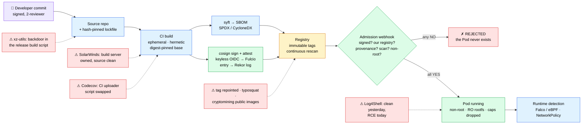

# Container Registries & Image Supply-Chain Security

## 1. Why Should I Care About This?
- **The Deploy Artifact Is the Attack Surface**: In December 2020, attackers who had compromised SolarWinds' *build system* — not its source repository — inserted the SUNBURST backdoor into an Orion DLL that was then signed with SolarWinds' own legitimate code-signing certificate and shipped to roughly **18,000 customer organizations**. Every signature check passed. That single incident is the reason *provenance* (who built this, from which commit, on which builder) exists as a discipline separate from signing.
- **A `rm` in a Dockerfile Deletes Nothing**: Layers are append-only tarballs. `RUN echo $NPM_TOKEN > .npmrc && npm ci` followed by `RUN rm .npmrc` in a later layer leaves the token sitting in the earlier layer, extractable in about ten seconds with `docker save … | tar -x`. This is the single most-repeated real credential leak in container history, and it survives every scanner that only looks at the final filesystem.
- **A Tag Is a Mutable Pointer**: `app:1.4` is a *name*, not an identity. It can be repointed to different bytes after you scanned it, after you approved it, and after you wrote the change ticket. `app@sha256:9f2c…` cannot. Deploying by tag means your security review applies to bytes that may no longer be the bytes that run.
- **New CVEs Make Yesterday's Clean Image Vulnerable Without Anything Changing**: On 9 December 2021 CVE-2021-44228 (Log4Shell, CVSS 10.0) turned every Java image built in the previous eight years into a remote-code-execution risk. Teams with an **SBOM per image** answered "which of our images are affected?" with a database query in minutes. Teams without one spent a weekend running `find / -name '*log4j*'` across thousands of containers.

## 2. What Problem Does This Solve?
- **You Cannot Prove What You Are Running**: Without digests, signatures, and attestations, "production is running the code that passed review" is a *belief*, supported by a chain of mutable names and trusted humans. Supply-chain security replaces that belief with a cryptographic check performed by the cluster.
- **The Base Image You Inherited Is Most of Your Vulnerability Report**: A typical `FROM ubuntu:22.04` service inherits a few hundred OS packages that the application never calls, and with them a continuously refreshed backlog of CVEs. Your own code is often a small minority of the findings.
- **Secrets Baked Into Artifacts**: Build-time credentials (registry tokens, private-repo SSH keys, cloud keys) leak through `ARG`, `ENV`, and orphaned layers. Once pushed to a registry that any CI job can pull, a build secret is effectively published.
- **No Blast-Radius Control at the Boundary**: Kubernetes will cheerfully run `docker.io/somebody/thing:latest` as root with `CAP_SYS_ADMIN`. Nothing in the default control plane asks where the image came from.
- **Naive Approach**: "We added Trivy to the pipeline with `--exit-code 1 --severity HIGH,CRITICAL` and called it done." What actually happens: within two weeks a base-image CVE with no available fix blocks every release, someone adds `|| true` or an `--ignore-unfixed` blanket, the gate becomes decorative, and nobody rescans the 4,000 images already sitting in the registry — so the real exposure is invisible while the dashboard is green.

## 3. Core Idea (Intuition First)
A container image is not a file — it is a **Merkle tree of tarballs**, and a registry is a **content-addressed store with human-friendly nicknames bolted on the side**.

- Every **layer** is a gzipped tar archive identified by the SHA-256 of its bytes. Change one byte, get a different digest, get a different layer.
- The **config** blob lists those layer digests in order, plus the entrypoint, environment, and user. The **manifest** lists the config digest and the layer digests. The **image digest** is the SHA-256 of the manifest bytes — so it transitively commits to every layer.
- A **tag** is a mutable database row mapping `app:1.4 → sha256:9f2c…`. Anyone with push rights can update that row. A **digest** is derived from the content itself and cannot be forged without breaking SHA-256.
- Therefore all of image security reduces to two moves: **name things by digest**, and **attach signed statements to that digest** — "I built this", "here is what's inside it", "here is the commit it came from" — then have the cluster refuse anything without them.

> The mental image: **a tag is a promise, a digest is a fact.** Sign the fact, attest how you produced it, and make the admission controller refuse promises.

![Three-panel diagram of container image and registry supply-chain security. Panel A explains that an image is a content-addressed data structure. On the left it contrasts a tag with a digest: the tag app colon 1.4 is drawn as a mutable pointer that first resolves to digest sha256 9f2c which was scanned and approved, and then a dashed red arrow shows the same tag being repushed to point at a completely different digest sha256 b4d0, so one tag now names two different sets of bytes and yesterday's scan result is void, whereas the digest form app at sha256 9f2c is an immutable identity because the digest is the hash of the manifest bytes. On the right it shows the anatomy of an image: a manifest containing the config digest and the layer digests, pointing to a config blob containing the entrypoint, environment variables, build arguments and layer diff ids, alongside a stack of four layers. Layer one is the base image, layer two is highlighted in red because a RUN command wrote a token into a dot npmrc file, layer three installs dependencies, and layer four is highlighted in amber because the RUN rm of the npmrc file only writes an overlay whiteout marker rather than erasing anything, with a dashed arrow pointing back from layer four to layer two to show the secret is still there; the caption notes that docker save piped into tar recovers the token forever and that the fix is a multi-stage build with a BuildKit secret mount and never passing a secret as a build ARG. Panel B lays out the six hops of the supply chain — source, build, sign and attest, registry, admission, runtime — with an animated dot travelling along the chain. Under each hop is a green box of the control that belongs there: signed commits and hash-pinned dependencies at source; an ephemeral hermetic runner with a digest-pinned base at build; cosign keyless OIDC signing, in-toto provenance and a Rekor transparency-log entry at the attest step; immutable tags, a private registry with a pull-through cache and continuous rescanning at the registry; Kyverno verifyImages accepting only digest-pinned images from our own registry at admission; and non-root, read-only root filesystem, dropped capabilities and Falco eBPF detection at runtime. Under each control is a red box naming the real attack it blocks: the xz-utils backdoor CVE-2024-3094 hidden in release build scripts, the SolarWinds 2020 build-server compromise where the source stayed clean, the Codecov 2021 swapped CI uploader script, typosquatted and cryptomining public images plus tags repointed after scanning, an unsigned latest tag from Docker Hub reaching production unchecked, and Log4Shell as proof that a signed image that was clean yesterday is exploitable today. A footer states the SLSA ladder: level one means provenance exists, level two means a hosted builder signs it, level three means a hardened builder produces non-falsifiable provenance, and the old version 0.1 level four added two-party review with hermetic reproducible builds. Panel C is the admission-gate decision flow: a Pod spec reaches the API server, a validating webhook such as Kyverno, Gatekeeper or the Sigstore policy-controller asks five questions in order — is it signed by our OIDC identity and present in Rekor, was it pulled from our registry rather than Docker Hub, does the provenance attest this builder, repository and commit, does it satisfy the scan policy with no fixable critical findings after VEX adjustment, and is it digest-pinned running as non-root with capabilities dropped — where any single no rejects the Pod so it never exists, and all yes admits it with the tag mutated to its digest on the way in. A warning box notes that a fail-closed webhook that is itself down blocks every write, so bootstrap namespaces need an exemption.](../assets/image_supply_chain_security.svg)

> Panel A: an image is a Merkle tree — the digest commits to every layer, and a layer never forgets. Panel B: each hop has one control and one famous attack that control exists to stop. Panel C: the admission webhook is the only place where policy becomes enforcement rather than advice.

## 4. How It Actually Works

### 1. The OCI image: manifest, config, layers — and why the digest is the only real name
- Pull `app:1.4` and the client does two HTTP calls: `GET /v2/app/manifests/1.4` returns a JSON **manifest** (`application/vnd.oci.image.manifest.v1+json`) naming a config digest and an ordered list of layer digests; then `GET /v2/app/blobs/sha256:…` for each blob it doesn't already have.
- The **config** blob holds `Entrypoint`, `Cmd`, `Env`, `User`, `WorkingDir` and `rootfs.diff_ids` (the uncompressed layer hashes). **Everything in `ENV` and every `ARG` value that ended up in the config is readable by anyone who can pull the image** — `docker inspect` and `docker history --no-trunc` print it.
- The **image digest** = SHA-256 over the manifest bytes. Because the manifest contains the layer digests, the digest transitively fixes the whole image. This is what makes `image@sha256:…` a genuine identity and what lets a registry deduplicate: two images sharing a base share the blob.
- **Multi-arch complicates the "one digest" story.** A multi-platform image is an **image index** / manifest list (`…image.index.v1+json`) whose digest points at per-platform manifests, each with *its own* digest. If you pin the index digest you get all platforms; if a colleague runs `docker pull --platform linux/arm64` and copies the digest they see, they may have pinned the arm64 manifest instead. Sign the **index** digest and verify against that, or you get "signature not found" on one architecture only.
- **`imagePullPolicy` semantics differ by reference form.** Kubernetes defaults to `IfNotPresent`, except when the tag is `:latest` or omitted, where it defaults to `Always`. With `Always` the kubelet still contacts the registry to resolve the tag to a digest on every pod start — which is how a repointed tag silently changes what runs after a node reboot. With a digest reference `IfNotPresent` is safe *by construction*: the local content either matches the digest or it isn't that image.
- **Trade-off**: digests are unreadable and make manifests churn on every build, which is exactly why teams reach for tags. The resolution is not "use tags" but "let a tool write the digest" — Kustomize/Flux image automation, `kyverno mutateDigest`, or a CI step that rewrites the manifest.

### 2. Layers are append-only, so a deleted secret is not deleted
- Each `RUN`, `COPY`, `ADD` in a Dockerfile produces a layer. Deleting a file in a later layer writes an **overlayfs whiteout** — for OverlayFS a character device with 0/0, and in the OCI tar format a `.wh.<name>` entry. The whiteout hides the file at *mount* time. The original bytes remain in the earlier layer's tarball, which the registry still stores and still serves.
- **The extraction is trivial**: `docker save img -o img.tar && tar xf img.tar` gives you every layer; `docker history --no-trunc img` shows the command that wrote it; `dive` or `crane export` do it more comfortably. Any developer with pull access to the repo has the secret.
- **`ARG` is not a secret mechanism.** `--build-arg NPM_TOKEN=…` lands in the build history and, for `ENV`, in the image config. It is documented as not secret and it never has been.
- **The three real fixes, in order of preference**:
  1. **BuildKit secret mounts** — `RUN --mount=type=secret,id=npmtoken …` exposes the value as a tmpfs file at `/run/secrets/npmtoken` *for that RUN only*; it is not part of any layer and not in the history. This is the correct answer for build-time credentials.
  2. **Multi-stage builds** — do the credentialed work in a `build` stage and `COPY --from=build /out/app /app` into a fresh final stage. Nothing from the build stage's layers is in the shipped image, because the shipped image's manifest simply doesn't reference them.
  3. **SSH agent forwarding** — `RUN --mount=type=ssh` for private Git dependencies, so no key ever enters the build context.
- **Trade-off**: `--mount=type=secret` requires BuildKit (default in Docker ≥ 23 / `docker buildx`), which some older CI images and some in-cluster builders don't have; a multi-stage build always works and is the portable floor.
- **If a secret already shipped, rotate it.** You cannot un-publish a layer that other people have pulled and that intermediate caches hold. Deleting the tag deletes the pointer, not the blob — and until garbage collection runs, not even the blob.

### 3. Base images: the CVE count *is* the argument
- A scanner's finding count is roughly proportional to the number of packages it can see. A general-purpose `debian:12` or `ubuntu:22.04` base carries on the order of **100–400 packages** including a shell, coreutils, a package manager, and often a libc-linked long tail your service never invokes; expect a continuously replenished set of open CVEs, mostly low/medium but reliably including a few HIGHs at any moment.
- **`alpine`** (~5 MB) cuts that dramatically by using musl libc and BusyBox. The catch is real: musl's resolver historically behaves differently from glibc on `search` domains and on truncated UDP responses, which produces the classic "DNS is slow/flaky only on Alpine in Kubernetes" bug; Python needs `musllinux` wheels (PEP 656) or it compiles from source and your image balloons; and CGO-enabled Go or any glibc-linked binary simply won't run.
- **Distroless** (`gcr.io/distroless/static`, `base`, `java*`) ships the language runtime, CA certificates and timezone data — **no shell, no package manager, no coreutils**. `distroless/static:nonroot` regularly scans with **zero known CVEs** because there is almost nothing there to have a CVE. **Chainguard Images / Wolfi** take the same idea further with daily rebuilds and per-image SBOMs and signatures, marketing (accurately, most days) zero known CVEs.
- **`scratch`** is the endpoint: a statically linked Go or Rust binary plus `/etc/ssl/certs/ca-certificates.crt` and nothing else. Attack surface approaches the binary itself.
- **The operational trade-off is the shell.** No shell means `kubectl exec -it pod -- sh` fails, and so do `curl`, `ps`, `nslookup` and every muscle-memory debugging move. The answer is **ephemeral debug containers**: `kubectl debug -it pod/api --image=busybox:1.36 --target=api` attaches a throwaway container sharing the target's process and network namespaces (GA since Kubernetes 1.25). Teams that don't teach this command before mandating distroless get the mandate reverted.
- **Do not confuse "zero CVEs" with "secure".** A distroless image with an SSRF bug in your handler is fully exploitable. Minimal bases reduce the *inherited* surface and the *patch treadmill*; they do nothing for your own code.

### 4. Building the image so the hardening is structural, not aspirational
- **Multi-stage is the load-bearing pattern**: compiler, headers, test fixtures, `.git`, and build credentials all stay in a stage that never ships. It usually shrinks images by 5–20× (a 900 MB `golang:1.22` build stage → a 15 MB distroless final image) *and* removes the toolchain an attacker would otherwise use for post-exploitation.
- **Layer-cache ordering is a build-time and a security concern**: `COPY go.mod go.sum ./ && RUN go mod download` *before* `COPY . .`, so a source-only change reuses the dependency layer. Cache hits turn a 4-minute build into 30 seconds, and short builds are what make "rebuild everything nightly to pick up base-image patches" politically possible.
- **`USER` a numeric UID**, e.g. `USER 10001:10001`. Numeric matters because Kubernetes' `runAsNonRoot: true` check must resolve the user *without* reading `/etc/passwd` — a symbolic `USER app` in an image with no passwd entry fails admission with `CreateContainerConfigError`.
- **The Pod spec has to finish the job.** The image cannot enforce `readOnlyRootFilesystem: true`, `allowPrivilegeEscalation: false`, `capabilities.drop: ["ALL"]`, `seccompProfile: RuntimeDefault` — those are `securityContext` fields, and together they are exactly the Pod Security Standards **restricted** profile. Ship them with the image as a matched pair (a Helm library chart or a Kyverno mutating policy), or the hardened image runs with root capabilities anyway.
- **Never `:latest`.** Beyond the mutability problem it destroys rollback: "roll back to the previous image" is undefined when both versions were called `latest`.
- **`.dockerignore` is a security control**, not a build optimization: without it `COPY . .` sweeps in `.git` (full history, including the secret someone force-pushed away), `.env`, `node_modules`, and local kubeconfigs.

### 5. Registries: a content store, a rate limiter, and a general-purpose artifact host
- The **OCI Distribution Spec** is a small HTTP API: `/v2/<name>/manifests/<ref>`, `/v2/<name>/blobs/<digest>`, chunked blob uploads, and a `/v2/<name>/tags/list`. Every registry — ECR, Google Artifact Registry, ACR, Harbor, Quay, Docker Hub, GitHub Packages — speaks it, which is why `crane`, `oras`, `skopeo` and `cosign` work everywhere.
- **Docker Hub's pull limits broke CI globally.** The limit the ecosystem was built around was **100 pulls per 6 hours per source IP for anonymous users and 200 per 6 hours for authenticated free accounts** — and because a NAT'd CI fleet or a Kubernetes cluster shares one egress IP, a hundred nodes pulling `alpine` exhausted it in minutes, producing `toomanyrequests: You have reached your pull rate limit`. Docker has revised the scheme since (2025 changes moved unauthenticated pulls to a much smaller per-hour allowance), so treat the exact number as a moving target and the architectural consequence as permanent: **never let production pull from a public registry.** Use a **pull-through cache** (ECR pull-through cache rules, Artifact Registry remote repositories, Harbor proxy cache) so the first pull is upstream and every subsequent one is local.
- **Immutable tags** are a per-repository setting (ECR `imageTagMutability: IMMUTABLE`, Harbor immutable-tag rules, ACR `--repository-tag-mutability`). Turning it on means a push to an existing tag fails, which converts "someone repointed the tag" from an invisible risk into a build error. Combine with digest deploys; belt and braces.
- **Lifecycle and garbage collection**: registries grow monotonically unless told otherwise. ECR lifecycle policies expire images by tag pattern and count/age ("keep the last 10 `prod-*`, expire untagged after 7 days"). Self-hosted Docker Distribution needs an explicit `registry garbage-collect` — and it only deletes blobs unreferenced by any manifest, which is why deleting a tag reclaims nothing until GC runs, traditionally with the registry read-only.
- **Private registries and the pull path**: a Pod pulls with credentials from an `imagePullSecrets` reference (a `kubernetes.io/dockerconfigjson` Secret) or, better, from the node's ambient cloud identity — ECR via the instance/IRSA role, GAR via the node service account — so there is no long-lived registry password in the cluster at all.
- **The registry is now a general artifact store.** OCI Image Spec 1.1 (2023) added `subject` + `artifactType` and the **Referrers API**, which is how a signature, an SBOM, and a provenance attestation *attach to* an image digest rather than living in a side-channel. Helm charts (Helm ≥ 3.8), Terraform modules, WASM modules and ML models all ship as OCI artifacts via `oras`. One access-controlled, replicated, content-addressed store for everything you distribute.

### 6. Scanning: what it actually does, and why you must rescan
- A scanner does **not** analyse your code for vulnerabilities. It performs **package enumeration + database matching**. It reads OS package databases (`/var/lib/dpkg/status`, the RPM DB, `/lib/apk/db/installed`) and language manifests/lockfiles (`package-lock.json`, `go.sum` or the Go binary's embedded build info, `poetry.lock`, JAR `MANIFEST.MF`, `*.gemspec`), builds a package list with versions, and matches it against feeds: NVD/CVE, GitHub Security Advisories, and distro trackers (Debian Security Tracker, Alpine secdb, RHSA).
- **Two consequences follow directly.** (a) It finds only **known** vulnerabilities in **identified** packages — a vendored C library copied into `/opt` with no package metadata, or a shaded fat JAR, is invisible. (b) It is **only as current as its feed**, which is why the same image scans clean on Monday and CRITICAL on Tuesday.
- **Distro-aware matching matters more than people expect.** Debian and Red Hat backport fixes without bumping upstream versions and mark CVEs "not affected" in their own trackers. A naive version-comparison scanner reports these as vulnerable. This is a large share of the false positives that destroy trust in scanning — and the reason Trivy/Grype consult distro feeds rather than NVD alone.
- **The tools**: **Trivy** (Aqua) — fast, single binary, scans images, filesystems, IaC and Kubernetes; **Grype** (Anchore) — pairs with `syft`; **Clair** (Quay) — server-side, indexes on push; **Snyk** and **Docker Scout** — commercial, stronger on reachability and fix advice; **ECR enhanced scanning** — Amazon Inspector, which continuously rescans images already in the registry.
- **SCA vs OS findings are different problems with different owners.** OS-package findings are fixed by rebuilding on a newer base — a platform team's job, mechanisable with a nightly rebuild. Language-dependency (SCA) findings need a version bump in the application's lockfile and a test run — an application team's job. A policy that treats them identically routes half the tickets to the wrong team.
- **VEX is how you say "not exploitable here" without lying.** A **Vulnerability Exploitability eXchange** document (OpenVEX, or CycloneDX/CSAF VEX) states, per CVE per product, a status of `not_affected` / `affected` / `fixed` / `under_investigation`, and for `not_affected` a machine-readable justification such as `vulnerable_code_not_in_execute_path` or `component_not_present`. Trivy consumes `--vex`. The point is that the exemption is a reviewed, signed, versioned artifact attached to the image — not a line in `.trivyignore` that nobody can explain six months later.
- **You must rescan what is already in the registry.** Build-time scanning answers "was this clean when we built it?", which stops being the interesting question the moment the feed updates. Continuous registry rescanning + an SBOM index is what answers "what is exposed *right now*", and it is the control that would have collapsed Log4Shell from a weekend to an afternoon.
- **Policy design is a political problem.** A blanket "fail on any HIGH" gate gets bypassed within a month, because the first unfixable base-image HIGH blocks every release and someone reaches for `|| true`. A gate that survives has three axes: **severity × fix-availability × reachability** — e.g. *fail* on CRITICAL/HIGH **with a fix available** in a package that is actually loaded; *warn and file a ticket* on everything else; and `--ignore-unfixed` as a deliberate, documented, time-boxed choice rather than a default.

### 7. SBOM, signing, provenance — climbing the SLSA ladder
- An **SBOM** is the inventory: every package, version, license and (ideally) purl/CPE identifier, in **SPDX** (ISO/IEC 5962:2021) or **CycloneDX** (OWASP, now ECMA-424). Generate it *at build time* with `syft` or BuildKit's `--attest=type=sbom`, because that is the only moment you know the full dependency graph. Store it in the registry attached to the image digest. Its value is a query: "which of our images contain `log4j-core < 2.17`?" answered against a database in minutes instead of a fleet-wide filesystem scan over days.
- **Signing answers "who produced this?" — and `cosign` made it practical by removing the key.** In **keyless (Sigstore) mode**: the CI job obtains a short-lived **OIDC token** proving its workload identity (for GitHub Actions, the subject is `repo:acme/api:ref:refs/heads/main` plus the workflow path); **Fulcio** exchanges that token for an X.509 certificate valid for about **10 minutes** that binds the public key to that identity; cosign signs the image digest; and the certificate plus signature are published to **Rekor**, an append-only, Merkle-tree **transparency log** that returns an inclusion proof and a signed entry timestamp. Because the certificate is expired by the time anyone reads it, the *log entry* is what proves the signature existed while the cert was valid.
- **Why keyless is a genuine improvement**: there is no long-lived private key in a CI secret to steal, no key rotation ceremony, and the log is publicly auditable — if someone did sign a malicious artifact as you, the evidence is permanent and discoverable. The trade-off: verification requires the identity you expect, so **`cosign verify` without `--certificate-identity` and `--certificate-oidc-issuer` verifies almost nothing** — it proves *somebody* signed it. That flag pair is the single most commonly omitted, most load-bearing detail in this entire topic.
- **Provenance is a different claim from a signature.** An **in-toto attestation** is a signed statement `{subject: [{digest}], predicateType: …, predicate: {…}}`. A SLSA provenance predicate asserts: *this artifact was produced by this builder, from this source repository at this commit, with these parameters and these resolved dependencies*. A signature says "SolarWinds built this"; provenance says "built by GitHub-hosted runner from commit abc123 of acme/api" — and SolarWinds is precisely the case where the signature was true and useless.
- **The SLSA ladder** (be precise about versions in an interview): **SLSA 0.1** defined four levels, where L1 = a scripted, documented build with provenance available; L2 = a hosted build service producing signed provenance; L3 = a hardened, isolated builder whose provenance is **non-falsifiable** by the build steps themselves; L4 = **two-person review of all changes plus hermetic, reproducible builds**. **SLSA v1.0** (April 2023) restructured this into tracks and kept **Build L1–L3**, moving the review/hermeticity requirements out of the Build track. Practical reading: L2 is "use a real CI service and sign the provenance" and is achievable in a sprint; **L3's non-falsifiability is the hard step** — it requires the provenance to be generated by the platform *outside* the tenant's control, which is what `slsa-github-generator`'s reusable workflow or a hosted builder gives you, and why "we generate provenance in our own build script" is L2 at best.
- **Hermeticity is the underrated half.** A build that resolves `latest` from the network is not reproducible and its provenance can't be verified by rebuilding. Hash-pinned lockfiles, a digest-pinned base image, and `--network=none` for the build step are what make the claim checkable — and are exactly the controls that would have caught the **xz-utils** payload, which lived in release-tarball build scripts that were absent from the Git repository.

### 8. The admission gate: where policy becomes enforcement
- Everything above is advice until something *refuses to run*. In Kubernetes that something is a **ValidatingAdmissionWebhook** invoked by the API server between authentication/authorization and persistence to etcd. **Kyverno** (`verifyImages`), **OPA Gatekeeper** (+ Ratify for signature data), and the **Sigstore policy-controller** are the three mainstream implementations.
- **What a good policy set actually checks**: signature by an expected identity; registry allow-list (`registry.acme.io/*` only); a valid SLSA provenance attestation whose predicate names your repo; a scan/attestation freshness bound; digest-pinned references and no `:latest`; `runAsNonRoot`, dropped capabilities, `readOnlyRootFilesystem`.
- **Kyverno's `mutateDigest: true` is the quiet hero**: on admission it resolves the tag to a digest and rewrites the Pod spec, so even a tag-based deployment is pinned to the bytes that existed at admission time. `verifyDigest: true` requires callers to supply one.
- **Fail-open vs fail-closed is the operational fork.** `failurePolicy: Ignore` means a down webhook silently admits everything — your control disappears exactly when the cluster is unhealthy. `failurePolicy: Fail` means a down webhook **blocks every matching API write**, and if your policy engine's own Pods match the policy, you have a cluster that cannot restart its own admission controller. Mitigations are mandatory, not optional: `namespaceSelector`/`objectSelector` exemptions for `kube-system` and the policy engine's own namespace, at least 3 webhook replicas with a PodDisruptionBudget and anti-affinity, a `timeoutSeconds` well under the 30 s maximum, and a documented break-glass procedure (delete the `ValidatingWebhookConfiguration`) that is itself audited.
- **Signature verification costs a network round trip.** The webhook fetches the signature/attestation from the registry and may consult Rekor, so cache aggressively (Kyverno caches verified digests) and make sure the cluster can reach the registry and `rekor.sigstore.dev` — or run a private Rekor/Fulcio and mirror the trust root, because "the internet is down so no Pods can start" is a bad failure mode.
- **Audit before you enforce.** Run the policy in `Audit`/`warn` mode for a release cycle, count the violations, fix or exempt them explicitly, *then* flip to `Enforce`. A policy switched straight to enforce on a live cluster is how platform teams lose the mandate.



## 5. Real-World Example
**SolarWinds / SUNBURST (2020) — why a signature is not provenance.** Attackers gained access to SolarWinds' Orion build environment and injected a backdoor into `SolarWinds.Orion.Core.BusinessLayer.dll` during compilation. The resulting DLL was signed with SolarWinds' genuine code-signing certificate and distributed through normal update channels; roughly **18,000 organizations** received the tainted build, and a subset were then actively exploited. Every downstream integrity check — publisher signature, checksum against the vendor's published value — passed, because the vendor really had built and signed it. The only control that meaningfully addresses this class is **provenance you can compare against the source**: an attestation naming the builder, the repo and the commit, produced by a platform the build steps cannot influence. That is SLSA Build L3, and SolarWinds is the canonical argument for it.

**xz-utils, CVE-2024-3094 (2024) — the multi-year social-engineering build-script backdoor.** A maintainer identity operating over roughly two years gained commit and release authority over `xz`/`liblzma` and, in versions **5.6.0 and 5.6.1**, shipped a backdoor whose activation logic lived in **build-time m4/configure machinery present only in the release tarballs, not in the Git repository**. Built into `liblzma`, it hooked RSA verification in `sshd` (which links `libsystemd`, which links `liblzma` on systemd distros) to allow authentication by an attacker-held key. CVSS 10.0. It was found by Andres Freund chasing a **~500 ms** slowdown and odd Valgrind output in SSH logins — essentially by accident, days before the affected versions reached stable distributions. The lessons are precise: **build the artifact from the Git source, not the maintainer's tarball; make builds hermetic and reproducible so the two can be compared; and understand that "trusted maintainer" is an identity claim, not an integrity guarantee.**

**Log4Shell (CVE-2021-44228, December 2021) — the incident that sold SBOMs.** A JNDI lookup in `log4j-core` 2.x allowed remote code execution from a single crafted log string (`${jndi:ldap://…}`), CVSS 10.0, in a library transitively present in a very large fraction of the Java ecosystem — usually as a dependency of a dependency, frequently shaded inside a fat JAR where a filesystem search for `log4j*.jar` finds nothing. Organizations with per-image SBOMs indexed in a queryable store produced an accurate affected-image list in minutes and patched by severity; organizations without spent days building the inventory before they could even start remediating. **Codecov (April 2021)** is the smaller companion case: attackers modified the widely used `bash-uploader` script so that CI jobs curl-piping it into a shell exfiltrated their environment variables — i.e. their cloud and registry credentials — for roughly two months before detection. Nothing in the typical pipeline verified the script's integrity. And the mundane background hum: security vendors have repeatedly found public Docker Hub accounts serving images whose entrypoint mines Monero — one 2018 report (Kromtech) covered 17 images on a single account with on the order of **5 million pulls** before removal — alongside steady typosquatting and namespace-confusion attempts against popular image and package names.

## 6. Code Example
A hardened multi-stage Dockerfile. Every line marked `←` is load-bearing:

```dockerfile
# syntax=docker/dockerfile:1.7                 # ← enables --mount=type=secret / =ssh

# ─────────── STAGE 1: build (never shipped) ───────────
# Pin the base by DIGEST, not tag. Get it with:  crane digest golang:1.22-alpine
FROM golang:1.22-alpine@sha256:ace6c9e0e2d0f3d40cbd9c5d9d3f5ea9e1b7b8e0c4b21b9a0d5f4c3e2b1a0908 AS build
WORKDIR /src

# ← CACHE ORDER: deps before source, so a code change doesn't re-download the module graph
COPY go.mod go.sum ./
RUN --mount=type=cache,target=/go/pkg/mod \
    --mount=type=secret,id=goprivate_netrc,target=/root/.netrc \
    go mod download                            # ← the token lives in tmpfs for THIS RUN only.
                                               #   It is in no layer and in no `docker history`.
COPY . .
# static binary: no libc dependency, so it can run on scratch/distroless-static
RUN CGO_ENABLED=0 GOFLAGS=-trimpath go build -ldflags="-s -w" -o /out/api ./cmd/api

# ─────────── STAGE 2: the shipped image ───────────
# distroless/static:nonroot — no shell, no package manager, no coreutils, UID 65532
FROM gcr.io/distroless/static-debian12:nonroot@sha256:1b1b0dcb5f0b1ea2b0e2c5f7d3a9c8e4f6b2a1d0c9e8f7a6b5c4d3e2f1a09876
COPY --from=build /out/api /api                # ← ONLY the binary crosses the stage boundary.
                                               #   Compiler, .git, netrc, test data stay behind.
USER 65532:65532                               # ← NUMERIC uid: k8s runAsNonRoot must resolve it
                                               #   without reading /etc/passwd (there isn't one)
EXPOSE 8080
ENTRYPOINT ["/api"]                            # exec form — PID 1 gets SIGTERM directly
```

The CI stage that scans, inventories, signs and attests. `cosign` runs keyless — no signing key exists anywhere:

```yaml
# .github/workflows/release.yaml (fragment)
permissions:
  contents: read
  id-token: write            # ← MANDATORY for keyless: this is what mints the OIDC token
  packages: write

steps:
  - uses: actions/checkout@v4
  - uses: docker/setup-buildx-action@v3

  # Build and push, capturing the DIGEST — the only reference we use downstream
  - id: build
    uses: docker/build-push-action@v5
    with:
      push: true
      tags: registry.acme.io/api:${{ github.sha }}
      provenance: mode=max          # ← BuildKit emits SLSA provenance as an OCI attestation
      sbom: true                    # ← and an SPDX SBOM, both attached to the digest
      secrets: |
        goprivate_netrc=${{ secrets.NETRC }}

  - name: Scan — the policy that survives contact with a release deadline
    run: |
      trivy image --exit-code 1 \
        --severity CRITICAL,HIGH \
        --ignore-unfixed \                       # ← fail only on what we CAN fix today…
        --vex ./vex/api.openvex.json \           # …minus reviewed, signed not-exploitable claims
        registry.acme.io/api@${{ steps.build.outputs.digest }}
      # everything else: report to the security dashboard, do not block. `|| true` is a smell,
      # a documented severity × fix-availability × reachability policy is not.

  - name: SBOM (belt and braces, independent of the builder)
    run: |
      syft registry.acme.io/api@${{ steps.build.outputs.digest }} \
        -o spdx-json=sbom.spdx.json

  - name: Sign + attest (keyless — nothing to steal)
    env:
      IMG: registry.acme.io/api@${{ steps.build.outputs.digest }}
    run: |
      cosign sign --yes "$IMG"                       # ← signs the DIGEST, never a tag
      cosign attest --yes --type spdxjson \
        --predicate sbom.spdx.json "$IMG"            # SBOM as an in-toto attestation

  - name: Verify what we just published (fail the build if the chain is broken)
    run: |
      cosign verify \
        --certificate-oidc-issuer=https://token.actions.githubusercontent.com \
        --certificate-identity-regexp='^https://github\.com/acme/api/\.github/workflows/release\.yaml@refs/heads/main$' \
        registry.acme.io/api@${{ steps.build.outputs.digest }}
      # ↑ THE TWO MOST IMPORTANT FLAGS IN THIS FILE. Without --certificate-identity* and
      #   --certificate-oidc-issuer, `cosign verify` only proves SOMEBODY signed it.
```

The gate. Nothing above matters until the cluster refuses the alternative:

```yaml
apiVersion: kyverno.io/v1
kind: ClusterPolicy
metadata:
  name: image-supply-chain
spec:
  validationFailureAction: Enforce   # ← moved to rules[].validate.failureAction in Kyverno 1.13+
  background: false                  # signature checks need a live registry call
  rules:
    - name: verify-keyless-signature
      match:
        any: [{ resources: { kinds: [Pod] } }]
      exclude:
        any: [{ resources: { namespaces: [kube-system, kyverno] } }]  # ← break-glass / bootstrap
      verifyImages:
        - imageReferences: ["registry.acme.io/*"]
          mutateDigest: true         # ← rewrites the tag to a digest ON ADMISSION.
          required: true             #   Even a sloppy `:v1.4` deploy ends up digest-pinned.
          attestors:
            - count: 1
              entries:
                - keyless:
                    issuer: https://token.actions.githubusercontent.com
                    # ← the identity IS the policy. A wildcard here accepts any GitHub repo.
                    subject: "https://github.com/acme/*/.github/workflows/release.yaml@refs/heads/main"
                    rekor:
                      url: https://rekor.sigstore.dev

    - name: only-our-registry-and-never-latest
      match:
        any: [{ resources: { kinds: [Pod] } }]
      validate:
        message: "images must come from registry.acme.io and be digest-pinned (no :latest)"
        pattern:
          spec:
            containers:
              - image: "registry.acme.io/*@sha256:*"   # ← both rules in one glob
```

## 7. Design Variations & Alternatives

| Base image | Size (typical) | Known CVEs | Shell / pkg mgr | Use when |
|---|---|---|---|---|
| `ubuntu` / `debian` | 30–80 MB | dozens–hundreds open at any time | yes / yes | Legacy apps needing many system libs; you accept a patch treadmill |
| `debian:*-slim` | ~30 MB | fewer, same class | yes / yes | Pragmatic default for glibc-linked interpreted runtimes |
| `alpine` | ~5 MB | few | yes (BusyBox) / apk | Small footprint and you have *tested* musl DNS + wheels |
| **distroless** (`static`, `base`, `java`) | 2–200 MB | often **0** | **no / no** | Default for Go/Rust/Java services; pair with `kubectl debug` |
| **Chainguard / Wolfi** | small | **~0**, daily rebuilds | minimal | You want zero-CVE SLAs and per-image SBOM+signature, and can pay |
| `scratch` | binary only | n/a | no / no | Static Go/Rust binary; add `ca-certificates` and tzdata yourself |

| Registry | Scanning | Immutable tags | Pull-through cache | Use when |
|---|---|---|---|---|
| **Amazon ECR** | basic + Inspector "enhanced" (continuous rescan) | yes | yes (rules for Hub/quay/GHCR) | AWS-native; IAM/IRSA auth, no stored password |
| **Google Artifact Registry** | Container Analysis / on-push | yes | remote + virtual repositories | GCP-native; Binary Authorization pairs with it |
| **Azure ACR** | Defender for Cloud | yes | ACR cache rules | Azure-native; geo-replication built in |
| **Harbor** (self-hosted, CNCF) | Trivy built in | yes (rules) | proxy cache projects | You need on-prem/air-gapped, replication, project quotas, robot accounts |
| **Docker Hub** | Docker Scout | paid tiers | n/a (it *is* upstream) | Public distribution only — never a production pull source |
| **GHCR / GitLab registry** | integrated with the platform's scanning | limited | n/a | Tight coupling to where CI already runs |

- **Signing: keyless vs long-lived keys vs KMS.** Keyless (Fulcio + Rekor) removes the key-theft problem and gives public auditability, but needs OIDC-capable CI and network reachability to the Sigstore services at verify time. A **KMS-backed key** (`cosign sign --key awskms://…`) is the right middle path for air-gapped or regulated environments — the private key never leaves the HSM, and you can run a **private Fulcio/Rekor** if you want transparency without the public log. Long-lived key files in CI secrets are the option to avoid.
- **Notary v1 (Docker Content Trust)** is the historical alternative — TUF-based, with a painful root-key ceremony and per-repository delegation. Notation/Notary v2 modernises it and is what ACR and Ratify lean on; Sigstore won the mindshare because keyless removed the ceremony.
- **Where enforcement lives** is a real choice: an **admission webhook** (Kyverno/Gatekeeper) is flexible and cluster-wide; **cloud-native gates** (GCP **Binary Authorization**, AWS Signer + ECS/EKS integrations) are less flexible but are managed and harder to bypass; **GitOps-side verification** (Flux and Argo CD can verify signatures before applying) catches problems earlier but does not stop a direct `kubectl run`. Mature setups do both: verify in GitOps for fast feedback, enforce at admission because that is the only place that cannot be bypassed.

## 8. Pros and Cons

### Minimal / distroless base images
- **Pros**: eliminates most inherited CVEs (frequently to literally zero), which removes the patch treadmill and the "unfixable HIGH blocks the release" politics; a 15 MB image pulls in ~1 s instead of ~20 s, which shortens rollouts and node scale-up materially on a 500-node cluster; no shell means a remote-code-execution bug has no `sh` to spawn, no `curl` to fetch a second stage, and no package manager to install one.
- **Cons**: `kubectl exec` debugging is gone, so you must ship `kubectl debug` knowledge and RBAC for ephemeral containers; some agents, sidecars and `postStart` hooks assume a shell and break; glibc-linked binaries need `distroless/base` rather than `static`; alpine/musl introduces its own class of DNS and wheel-compatibility bugs that cost real debugging days.

### Sigstore keyless signing + provenance attestations
- **Pros**: no long-lived signing key exists, so there is no key to exfiltrate and no rotation ceremony; the Rekor transparency log makes forged signatures publicly discoverable after the fact; the identity in the certificate (`repo:acme/api:ref:refs/heads/main`) lets policy express "only the release workflow on main may produce production images" — which is a far stronger statement than "someone with the key signed it"; and provenance addresses the SolarWinds class that signing alone cannot.
- **Cons**: verification depends on reachable Fulcio/Rekor roots and adds a registry round trip to admission latency (cache or you will feel it); the identity strings are long, brittle, and easy to get subtly wrong — a wildcard in `subject` quietly accepts any repo in the org; air-gapped environments must run private Sigstore infrastructure or fall back to KMS keys; and "signed" reassures management far beyond what it actually proves about the code inside.

### Blocking admission on scan results
- **Pros**: the only control that is genuinely non-bypassable, since it sits between `kubectl apply` and etcd; it catches images introduced outside the pipeline (a manual `kubectl run`, a vendor Helm chart, an operator's sidecar) which pipeline-only scanning never sees.
- **Cons**: a fail-closed webhook is a new single point of failure for *all* cluster writes; a feed update can render a previously-admitted image non-admittable, so autoscaling and node replacement start failing at 3 AM with no code change; and stale scan data means the gate either blocks on old news or admits on missing data — you must decide which, explicitly.

## 9. Failure Scenarios & What Can Go Wrong
- **SYMPTOM**: A secret you rotated months ago is used in an attack; the current image doesn't contain it. **ROOT CAUSE**: the credential is stranded in an earlier append-only layer — written by one `RUN`, `rm`-ed by a later one, still served by the registry. **FIX**: rotate the credential (you cannot recall pulled layers), rebuild with BuildKit `--mount=type=secret` or a multi-stage boundary, and add a build-time secret scan (`trivy image --scanners secret`, gitleaks) over *every layer*, not the flattened filesystem.
- **SYMPTOM**: Production is running code that isn't in the deployment manifest's commit. **ROOT CAUSE**: deploy-by-tag — the tag was repointed after review, and a node reboot with `imagePullPolicy: Always` picked up the new bytes. **FIX**: deploy by digest, enable registry tag immutability, and set Kyverno `mutateDigest: true` so even tag-based specs are pinned at admission.
- **SYMPTOM**: CI fails intermittently with `toomanyrequests: You have reached your pull rate limit`. **ROOT CAUSE**: a NAT'd runner fleet or cluster sharing one egress IP against Docker Hub's anonymous per-IP limit. **FIX**: authenticate, and more importantly mirror — an ECR pull-through cache rule, Artifact Registry remote repository, or Harbor proxy-cache project — then rewrite base images to the mirror so no production pull path touches a public registry.
- **SYMPTOM**: The scan gate is green but the fleet is exploited via a CVE published last week. **ROOT CAUSE**: scanning happens only at build time; nothing rescans the images already in the registry or already running. **FIX**: enable continuous registry rescanning (ECR enhanced/Inspector, Harbor scheduled scans), keep an SBOM index you can query by package + version, and add a nightly rebuild so base-image fixes land without a code change.
- **SYMPTOM**: Pods stop scheduling cluster-wide; `kubectl apply` returns `failed calling webhook`. **ROOT CAUSE**: a `failurePolicy: Fail` admission webhook whose own Pods are down (or a network policy blocking the API server → webhook path), so nothing can be created — including the webhook itself. **FIX**: 3+ replicas with anti-affinity and a PDB, exempt `kube-system` and the policy engine's namespace via `namespaceSelector`, keep `timeoutSeconds` low, and rehearse the break-glass `kubectl delete validatingwebhookconfiguration` with audit logging on it.
- **SYMPTOM**: `cosign verify` passes for an image an attacker built. **ROOT CAUSE**: verification ran without `--certificate-identity`/`--certificate-oidc-issuer`, or the Kyverno `subject` glob was `https://github.com/*` — so any GitHub Actions workflow anywhere is a valid signer. **FIX**: pin issuer + a tightly anchored identity regex including the workflow path and ref; test the policy negatively by verifying an image signed from a scratch repo and confirming it is rejected.
- **SYMPTOM**: Pod fails with `CreateContainerConfigError: container has runAsNonRoot and image has non-numeric user`. **ROOT CAUSE**: the Dockerfile used `USER appuser` and the (distroless) image has no `/etc/passwd` for the kubelet to resolve. **FIX**: `USER 65532:65532`, and set `runAsUser` in the Pod's `securityContext` as well so the intent is explicit in both places.
- **SYMPTOM**: DNS lookups inside the container intermittently take 5 s or fail, only on one service. **ROOT CAUSE**: musl (Alpine) resolver behaviour against the cluster's `ndots:5` search-domain configuration and UDP truncation — glibc images on the same node are fine. **FIX**: move to `debian-slim`/distroless, or tune `dnsConfig.options` (`ndots: 2`) and use fully-qualified names; treat base-libc change as a change requiring a soak test, not a one-line diff.
- **SYMPTOM**: Registry storage bill grows every month and nothing was ever deleted. **ROOT CAUSE**: no lifecycle policy; every CI build pushes a new immutable tag and untagged manifests accumulate, and self-hosted registries never GC unreferenced blobs on their own. **FIX**: lifecycle rules (keep last N per tag prefix, expire untagged after 7–14 days) and a scheduled `registry garbage-collect` for self-hosted Distribution.

## 10. Impact on Scalability, Reliability & Cost
- **Scalability**: image size multiplies by fleet size at every rollout. A 1 GB image rolled to 500 nodes moves **500 GB**; at a 1 Gbps effective node link that is ~8 s per node of pure transfer plus decompression, and if the pull path leaves the VPC it is 500 GB through a NAT gateway. The same service on a 15 MB distroless image moves **7.5 GB** — a ~66× reduction that shows up directly in rollout duration and in autoscaling responsiveness (a scale-up event is gated on the image pull). Layer sharing helps only if the *base layers are identical*, which is an argument for one blessed base per language across the org.
- **Reliability**: the pull path becomes a hard dependency of scaling and self-healing. If the registry or its credential path is unavailable, `IfNotPresent` pods on warm nodes keep running but **new nodes cannot start anything** — so a registry outage looks like "the cluster can't recover from anything". Mitigate with a regional/replicated registry (ECR cross-region replication, Harbor replication), pull-through caches, and `imagePullPolicy: IfNotPresent` with digest pinning so warm nodes never need the network. Then note the second-order dependency: fail-closed admission adds Rekor/registry reachability to the same critical path.
- **Cost**: ECR storage is **$0.10/GB-month**. 300 repositories × 100 retained tags × ~70 MB of *unique* blobs ≈ 2.1 TB ≈ **$210/month** — trivial. The real money is data transfer: 500 nodes × 1 GB pulled from the internet through a NAT gateway at **$0.045/GB** processing is **~$22.50 per rollout**, or ~$675/month at one rollout per weekday, and the same pulls from a VPC endpoint or in-region cache are near zero. Meanwhile the human cost dominates both: a Log4Shell-class event without SBOMs is measured in engineer-weeks (dozens of engineers × several days ≈ six figures of loaded cost), which is why the SBOM+rescan investment pays for itself on its first incident.

## 11. When NOT to Use This
- **Don't build a full SLSA L3 pipeline for an internal tool with three users.** Start at L1/L2 — a real CI service, digest-pinned bases, a scan, and an SBOM. Non-falsifiable provenance and two-party review are for artifacts whose compromise is materially expensive; applying them everywhere burns the credibility you need for the systems that matter.
- **Don't switch to distroless the day before a launch.** Losing `exec` debugging during a stabilisation window is a self-inflicted incident. Migrate one service, teach `kubectl debug`, confirm your agents and hooks don't need a shell, then roll out.
- **Don't enforce a new admission policy without an audit period.** Run it in `Audit`/warn, count and triage the violations, exempt the legitimate ones explicitly, and only then flip to `Enforce` — otherwise the first blocked deploy gets your policy deleted rather than fixed.
- **Don't gate on "zero CVEs" when your dependencies make that impossible.** A permanently unachievable gate is a gate that will be disabled. Gate on **fixable** CRITICAL/HIGH in reachable code, and use VEX to record the reviewed exceptions so the exemption is an artifact, not folklore.
- **Don't treat image security as your container security programme.** A signed, zero-CVE, non-root image with an SSRF or deserialization bug is fully exploitable. Pair it with runtime detection (Falco/eBPF), NetworkPolicy egress restriction, least-privilege service accounts, and the appsec practices in [15 · Security Deep Dive & DevSecOps](../15_Security_Deep_Dive_DevSecOps/) — see [Secure SDLC](../15_Security_Deep_Dive_DevSecOps/Secure_Software_Development_Lifecycle_SSDLC.md).

## 12. Interview Perspective
- **What interviewers expect**: that you distinguish identity from naming and enforcement from advice. The sentence to say is **"a tag is a mutable pointer and a digest is an immutable content identity, so we deploy by digest and verify a signature plus a provenance attestation at admission — because that is the only place a policy can actually refuse."** Then name the three artifacts you attach to a digest: SBOM, signature, provenance.
- **The trap question**: *"Your Dockerfile does `RUN curl -H "Authorization: $TOKEN" … && rm -rf /tmp/creds`. Is the token safe?"* The wrong answer is "yes, it's deleted." The right answer: layers are append-only, `rm` writes a whiteout that hides the file at mount time, and `docker save | tar -x` recovers the token from the earlier layer — plus `docker history` shows the command. Fix: BuildKit `--mount=type=secret` (tmpfs, no layer, no history) or a multi-stage boundary — and rotate the token, because you cannot recall layers that have already been pulled.
- **The second trap**: *"We sign every image, so we're protected against supply-chain attacks."* Name SolarWinds: the malicious DLL was signed with the vendor's real certificate. A signature attests *who published*, not *what was built from where*. Provenance (in-toto/SLSA) is the claim that closes it, and it only helps if the builder generating it is outside the tenant's control — SLSA L3's non-falsifiability requirement.
- **The math question**: *"What does image size cost you?"* Walk it: 1 GB image × 500 nodes = 500 GB per rollout; through a NAT gateway at $0.045/GB that is ~$22.50 per rollout, ~$675/month at 30 rollouts; at 1 Gbps effective per node the transfer alone adds ~8 s to each node's startup, which is on the critical path for autoscaling. Multi-stage to a 15 MB distroless image cuts it to 7.5 GB and sub-second pulls — a 66× reduction — and separately drops the inherited CVE count from dozens to zero. Then add the guardrail: a pull-through cache or VPC endpoint makes the transfer cost ~0 regardless.
- **The subtle "why"**: *"Why is keyless signing more secure than a key in a CI secret?"* Because the private key exists for about ten minutes inside the build, bound by Fulcio to an OIDC workload identity, and the signing event is recorded in Rekor's append-only transparency log. There is no long-lived secret to steal, and any forged signature is permanently, publicly discoverable. The corollary is the flag pair: verification must pin `--certificate-oidc-issuer` *and* `--certificate-identity`, or you have only proved that somebody, somewhere, signed it.
- **Bonus signals**: manifest-list vs per-platform digests and the "signature not found on arm64 only" bug; distro-backport false positives as the reason scanners need distro feeds rather than NVD alone; VEX as the signed exemption mechanism; `mutateDigest` on admission; fail-open vs fail-closed webhooks and the bootstrap exemption; the Referrers API as how signatures and SBOMs attach to a digest; and the honest closing line that a zero-CVE signed image still needs Falco and NetworkPolicy.

## 13. Connections to Other Topics
- [Containers vs VMs (Docker)](./Containers_vs_VMs_Docker.md) — the layer/union-filesystem and namespace mechanics this file's whiteout and capability arguments rest on.
- [CI/CD Pipelines](./CI_CD_Pipelines.md) — the pipeline is the build hop of the supply chain; scanning, SBOM generation, signing and attestation are stages in it, and the pipeline's own credentials are the Codecov attack surface.
- [Immutable Infrastructure Pattern](./Immutable_Infrastructure_Pattern.md) — deploying by digest is immutability taken to its logical end: the artifact has a name derived from its bytes.
- [Kubernetes Objects (Pods & Services)](./Kubernetes_Objects_Pods_Services.md) — where `imagePullPolicy`, `imagePullSecrets` and `securityContext` actually live, and what admission is validating.
- [GitOps with Helm & Argo CD](./GitOps_Helm_ArgoCD.md) — image automation that writes resolved digests into Git, plus signature verification before apply as the early-feedback half of enforcement.
- [Kubernetes Operators & CRDs](./Kubernetes_Operators_CRDs.md) — operators ship third-party images you did not build; the admission gate is what stops an operator's sidecar from bypassing your registry allow-list.
- [Deployment Strategies (Blue-Green & Canary)](./Deployment_Strategies_Blue_Green_Canary.md) — rollout mechanics are gated on pull time, which is why image size is a deployment-velocity concern, not just a storage one.
- [Secure SDLC](../15_Security_Deep_Dive_DevSecOps/Secure_Software_Development_Lifecycle_SSDLC.md) — where the shift-left practices (SAST/DAST, threat modelling, dependency policy) that surround this infrastructure layer belong.
- [Pentesting vs Vulnerability Scanning](../15_Security_Deep_Dive_DevSecOps/Pentesting_vs_Vuln_Scanning.md) — the general distinction between "matched a known CVE" and "proved exploitability", which is exactly what VEX and reachability analysis argue about.
- [Secrets Management (Vault & KMS)](../15_Security_Deep_Dive_DevSecOps/Secrets_Management_Vault_KMS.md) — where runtime secrets belong instead of the image, and the KMS-backed alternative to keyless signing.
- [PKI & TLS Certificates](../11_Security_Identity/PKI_TLS_Certificates.md) — Fulcio is a certificate authority issuing 10-minute X.509 certs; the chain-of-trust reasoning is identical.
- [Hashing & Salting](../11_Security_Identity/Hashing_and_Salting.md) — why a SHA-256 content address is an identity you cannot forge, and what Rekor's Merkle tree is built from.
- [Audit Logging & Security Events](../12_Monitoring_Logging_Observability/Audit_Logging_Security_Events.md) — admission decisions, break-glass webhook deletions, and registry pushes are exactly the immutable-trail events an auditor asks for.
- [Zero Trust Architecture](../15_Security_Deep_Dive_DevSecOps/Zero_Trust_Architecture.md) — "verify every artifact at every hop, trust no location" is zero trust applied to build outputs rather than network traffic.

## 14. Visual Aids
- **The SVG above** ([image_supply_chain_security.svg](../assets/image_supply_chain_security.svg)): **Panel A** — the anatomy of an image, with a tag shown repointing from a scanned digest to a different one (so a tag-based approval is void), and a secret visibly stranded in layer 2 despite the `rm` in layer 4; takeaway: name by digest, and a layer never forgets. **Panel B** — the six-hop supply chain with the SLSA-style control at each hop and the real attack it blocks (xz-utils, SolarWinds, Codecov, cryptomining/typosquatted images, unsigned `:latest`, Log4Shell); takeaway: each control exists because a specific attack happened at that specific hop. **Panel C** — the admission-gate decision flow, five questions ending in admit-with-digest-mutation or reject; takeaway: gates 1–3 verify provenance, gate 4 verifies content, gate 5 limits blast radius — and a fail-closed webhook that is down blocks everything.
- **Mermaid (Section 4)**: the same chain in graph form, with the attack points attached as dashed annotations to the hop they exploit. Takeaway: the pipeline *is* the trust boundary diagram — every arrow is a place something can be substituted.
- **Tables (Section 7)**: the base-image matrix converts "use minimal images" into a decision with sizes, CVE expectations and the shell trade-off; the registry matrix shows that scanning, tag immutability and pull-through caching — not storage — are what you actually choose a registry on.

## 15. Summary (TL;DR)
**A container image is a Merkle tree of gzipped tarballs: layers hashed by content, a config blob listing them plus the entrypoint and environment, a manifest listing the config and layers, and an image digest that is the SHA-256 of the manifest — which means a tag is a mutable database row and only `image@sha256:…` is an identity, so you deploy by digest and let tooling (`mutateDigest`, GitOps image automation) write it for you.** Because layers are append-only, `RUN rm secret` writes an overlay whiteout that hides the file at mount time while the bytes stay in the earlier layer, recoverable with `docker save | tar -x` and visible in `docker history` — so build secrets go through BuildKit `--mount=type=secret` or stay behind a multi-stage boundary, never through `ARG`, and a leaked one must be **rotated**, because you cannot recall a pulled layer. Choose the smallest base you can debug: `debian`/`ubuntu` carry hundreds of packages and a permanent CVE backlog, `alpine` is tiny but musl bites you on DNS and Python wheels, and **distroless/Wolfi ship the runtime and nothing else — frequently zero known CVEs, no shell for an attacker and none for you either**, which is what `kubectl debug` ephemeral containers are for. Registries are content stores with a rate limiter attached: never let production pull from Docker Hub (the anonymous per-IP limit has broken CI everywhere), so mirror through a pull-through cache, turn on immutable tags, set lifecycle/GC policies, and remember the registry also distributes SBOMs, signatures and Helm charts as OCI artifacts via the Referrers API. Understand that a scanner only enumerates identified packages and matches known feeds — so it misses vendored code, produces distro-backport false positives, and above all **means nothing unless you rescan images already in the registry**, because a new CVE makes yesterday's clean image vulnerable with no change on your side; gate on severity × fix-availability × reachability with VEX for reviewed exceptions, because a blanket "fail on any HIGH" is disabled within a month. Attach three signed artifacts to every digest — an **SBOM** (SPDX/CycloneDX from syft or BuildKit) so you can answer "are we affected?" in minutes rather than the engineer-weeks Log4Shell cost teams without one; a **signature** via cosign keyless, where Fulcio trades an OIDC workload identity for a ~10-minute certificate and Rekor's transparency log makes the event permanent and auditable, so there is no long-lived key to steal; and a **provenance attestation** naming the builder, repo and commit, because SolarWinds' backdoored DLL was signed with the vendor's genuine certificate and a signature alone would have passed. Climb the SLSA ladder deliberately — L1 provenance exists, L2 a hosted builder signs it, L3 the provenance is non-falsifiable because the platform and not your build script produces it (SLSA 0.1's L4 added two-party review and hermetic reproducible builds, exactly the property that would have exposed the xz-utils payload hidden in release-tarball build scripts). Then make it real at the boundary: a Kyverno `verifyImages` or Gatekeeper/policy-controller rule that rejects unsigned images, foreign registries, `:latest`, root users and unattested provenance — **and verification is worthless unless you pin both `--certificate-oidc-issuer` and `--certificate-identity`**, since without them you have only proved somebody signed it. Run the policy in audit before enforce, keep 3+ webhook replicas with `kube-system` exempted because a fail-closed webhook that is down blocks every write in the cluster, and finish with the honest caveat: a signed, zero-CVE, non-root image is necessary and nowhere near sufficient — **pair it with runtime detection, NetworkPolicy and least privilege, because the image is what you shipped, not what an attacker will do with it.**

## 16. Further Reading & Resources
- [OCI Image Specification](https://github.com/opencontainers/image-spec/blob/main/spec.md) — the manifest, config, image index and descriptor formats, and how the digest is computed.
- [OCI Distribution Specification](https://github.com/opencontainers/distribution-spec/blob/main/spec.md) — the registry HTTP API, plus the Referrers API that attaches signatures and SBOMs to a digest.
- [Docker docs — Build secrets and multi-stage builds](https://docs.docker.com/build/building/secrets/) — the canonical `--mount=type=secret` mechanics and why `ARG` is not a secret.
- [GoogleContainerTools/distroless](https://github.com/GoogleContainerTools/distroless) — the minimal-base images, the `:nonroot` variants, and the debugging guidance for a world without a shell.
- [Sigstore documentation — cosign keyless signing](https://docs.sigstore.dev/) — Fulcio's OIDC-to-certificate exchange, Rekor's transparency log, and the verification flags that matter.
- [SLSA v1.0 specification](https://slsa.dev/spec/v1.0/) — the Build track levels, what provenance must contain, and what "non-falsifiable" actually requires.
- [in-toto Attestation Framework](https://github.com/in-toto/attestation) — the `subject`/`predicateType`/`predicate` envelope that carries SBOMs and provenance.
- [OpenVEX specification](https://github.com/openvex/spec) — how to state "not exploitable here" as a signed, machine-readable artifact with a justification.
- [Kyverno — Verify Images](https://kyverno.io/docs/policy-types/cluster-policy/verify-images/) — `verifyImages`, keyless attestors, `mutateDigest`, and attestation checks in policy form.
- [Andres Freund — "backdoor in upstream xz/liblzma" (oss-security, 29 March 2024)](https://www.openwall.com/lists/oss-security/2024/03/29/4) — the original disclosure of CVE-2024-3094, including how the payload hid in the release tarball's build scripts.
- [CISA — SBOM resources](https://www.cisa.gov/sbom) — the policy context behind SPDX/CycloneDX adoption and the VEX work.
