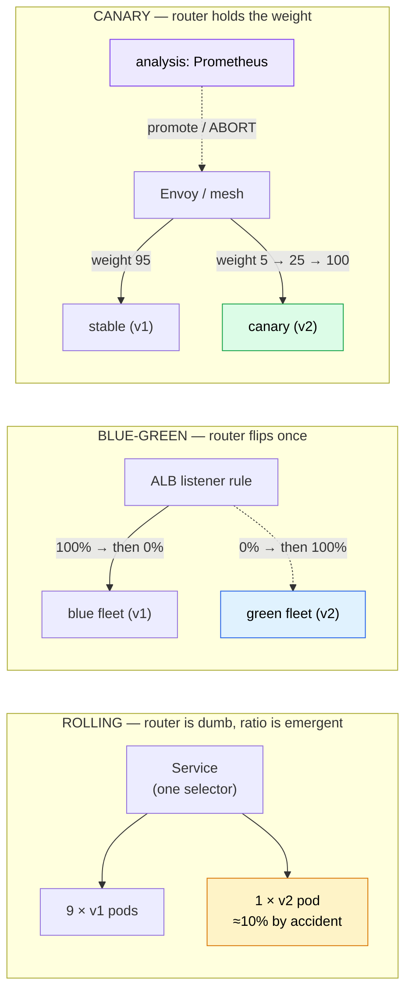

# Deployment Strategies — Blue-Green, Canary, Rolling & Shadow

## 1. Why Should I Care About This?
- **A Partial Deploy Destroyed a Company in 45 Minutes**: On 1 August 2012 Knight Capital deployed new order-routing code to **7 of its 8 SMARS servers**. The 8th still ran old code behind a **repurposed feature flag** — flipping that flag reactivated eight-year-old "Power Peg" dead code. In roughly **45 minutes** Knight executed ~4 million orders in 154 stocks and took a pre-tax loss on the order of **$440–460 million**, more than its entire market capitalization. It was acquired months later. The bug was not in the new code; it was in *how the code was rolled out*.
- **Deployment Strategy *Is* Your Change Failure Rate**: DORA's research consistently finds elite performers deploy on demand, keep **lead time under a day**, keep **change failure rate in the 0–15% band**, and recover from a failed deployment in **under an hour**. Low performers sit at 40–60% change failure with recovery measured in days. The gap is almost entirely tooling and rollout strategy, not developer talent.
- **The Cadence You Are Competing With**: Amazon reported deploying to production **every 11.7 seconds on average — 1,079 deploys in a single hour at peak** (Jon Jenkins, Velocity 2011). You cannot deploy at that rate with a change-advisory-board and a maintenance window; you get there by making a single deploy so small and so instantly reversible that nobody has to think about it.
- **This Is the Question You Will Actually Be Asked**: "How do you ship a change safely?" appears in nearly every infrastructure or senior system-design interview, and the discriminating follow-up is always the same: *"...and what if the change includes a database migration?"* Most candidates can name blue-green and canary. Very few can explain expand–contract, and that is the answer that separates them.

## 2. What Problem Does This Solve?
- **Blast Radius**: Without a strategy, every deploy is a 100%-of-users bet. Canary and ring-based rollout convert "everyone breaks" into "1% of one region breaks for 4 minutes," which is the difference between a Slack message and a status page.
- **Rollback Latency (MTTR)**: The mean time to *detect* is bounded by your monitoring; the mean time to *recover* is bounded by your rollout mechanism. Rebuilding and redeploying an old image is 5–15 minutes. Flipping a load-balancer target group is ~5 seconds. Flipping a feature flag is ~1 second. These are the only three numbers that matter at 3 AM.
- **Version Coexistence**: Any zero-downtime deploy means version N and N+1 run **simultaneously**, against the same database, the same cache, the same message topics. Nobody plans for this, and it is where the outages live.
- **Irreversibility**: Some changes cannot be undone by redeploying — a dropped column, a consumed Kafka offset, an email that has already been sent, a cache filled with a serialization format the old code cannot parse. A deployment strategy has to make you *decide in advance* which changes are reversible.
- **Naive Approach**: "Deploy at 2 AM on Friday, watch the dashboard for ten minutes, and if it's bad, redeploy the previous tag." This fails four ways: the 2 AM traffic is too low to reveal the bug (it appears at 9 AM peak), nobody is awake to watch, "redeploy the previous tag" doesn't undo the migration that ran on the way in, and the ten-minute window is far too short to be statistically meaningful for anything except a total crash.

## 3. Core Idea (Intuition First)
Shipping software is a **dimmer switch, not a light switch** — and the wiring you install determines how fast you can dim it back.

- **A deploy puts code on machines. A release puts users on code.** Those are two separate actions, and every advanced technique here is a way of prying them apart. Once separated, the risky step (release) becomes a routing decision — a weight, a header, a flag — and routing decisions are reversible in seconds.
- **The strategy ladder is a trade between three currencies**: how much extra infrastructure you pay for (recreate 1× → rolling 1.25× → blue-green 2×), how fast you can undo (minutes → seconds), and how many users see the bad version before you undo it (100% → 1%).
- **The mechanism is always the same shape**: two versions exist at once; something in front of them (a load balancer, an Envoy sidecar, an ingress, a feature-flag SDK) decides which requests go where; and something watching the metrics decides whether to advance the weight or slam it to zero.
- **The hard part is never the routing.** It is that both versions share one database, one cache, and one set of queues — so the *schema* has to be compatible with both versions at the same time, which is a design discipline (expand–contract) rather than a tool you can install.

> The mental image: **a deployment strategy is a dimmer switch wired in front of two identical rooms — and the fuse box behind them is shared, so you have to rewire the fuse box before you touch the dimmer.**

![Three-panel diagram of deployment strategies. Panel A places the five strategies side by side over a left-to-right time axis, drawing the traffic share of the new version in green against the old version in blue. Recreate shows a blue block, then a red downtime gap, then a green block, annotated one-times infrastructure cost, thirty seconds to minutes of downtime, rollback by redeploying, and a blast radius of one hundred percent of users. Rolling shows green climbing over blue as a six-step staircase, annotated 1.25 times peak cost from maxSurge, no downtime, rollback by reversing the rollout which takes minutes, and the warning that both versions are live the entire time. Blue-green shows a long blue block, an amber vertical cutover line, then green, annotated two times cost for two full fleets, an atomic flip at the load balancer, rollback in seconds, but a blast radius of one hundred percent all at once. Canary shows blue at full height with a green wedge growing in four steps labelled one, ten, fifty and one hundred percent, annotated 1.05 times cost, rollback by re-weighting to zero in seconds, and the caveat that it needs traffic volume before a judgement is statistically meaningful. Shadow shows blue keeping one hundred percent of real traffic with a dashed green band underneath representing a mirrored copy whose responses are discarded, annotated two times compute for zero percent user risk, nothing to roll back because nothing was released, and the trap of duplicate side effects. Panel B lays out expand-contract as six numbered steps: add a nullable column with a metadata-only lock and no code change, deploy a version that dual-writes both columns while still reading the old one, backfill in five-thousand-row batches with a sleep between them and never one large UPDATE, deploy a version that reads the new column and falls back to the old when it is null while a shadow comparison gates on zero mismatches, deploy a version that reads and writes only the new column and then wait at least one full release cycle, and finally drop the old column only once no running version references it. A green band underneath states the invariant that at every step the schema works for both the version you are leaving and the one you are shipping, and a red band states the shortcut that kills you: renaming or dropping in the same release as the code change, so the still-running old pods query a column that no longer exists. Panel C is an ordered decision list where the first yes wins: downtime acceptable means recreate; the change touches the schema means do expand-contract first because no strategy survives a breaking migration; stateless with no shared-database coupling and budget for two times infrastructure means blue-green while watching the DNS time-to-live; the load balancer or mesh can split by weight and SLIs exist means canary with automated analysis, the default answer at scale; rewriting a read path with zero user risk means shadow first then canary, stubbing every write; and judging conversion over days rather than errors over minutes means an A/B test behind a feature flag, which is a release and not a deployment.](../assets/deployment_strategies_canary.svg)

> Panel A: the five strategies differ only in cost, rollback speed, and blast radius — pick by which of the three you cannot compromise on. Panel B: expand–contract is six releases, and its whole point is the invariant that every intermediate schema works for two app versions at once. Panel C: the first "yes" wins, and the schema question comes before the strategy question.

## 4. How It Actually Works

### 1. Recreate and rolling — what the Kubernetes Deployment controller actually does
- **Recreate** (`strategy.type: Recreate`) scales the old ReplicaSet to 0, waits for termination, then scales the new one up. It is the only strategy where **one and only one version is ever live** — which makes it the *correct* choice for a single-writer batch job, a leader-elected consumer, or anything where two concurrent versions would corrupt data. The price is a downtime window equal to drain time plus startup time plus readiness time: typically 20–90 seconds for a JVM.
- **RollingUpdate** is the default. The Deployment controller creates a **new ReplicaSet** and then plays a two-bounded game: it may exceed the desired replica count by **`maxSurge`** and may drop below it by **`maxUnavailable`** (both default `25%`). It scales the new RS up, waits for pods to become **Ready**, scales the old RS down, and repeats.
- **The arithmetic, with the rounding gotcha**: `replicas: 10`, both defaults at 25% → `maxSurge = ceil(2.5) = 3` (rounded **up**), `maxUnavailable = floor(2.5) = 2` (rounded **down**). So at any instant you have **at least 8 Ready pods and at most 13 total pods**. Set `maxUnavailable: 0, maxSurge: 1` for the safest and slowest rollout: full capacity throughout, one pod at a time, N+1 machines. Set `maxUnavailable: 25%` if you'd rather finish fast and can absorb a quarter of capacity vanishing.
- **`kubectl rollout undo` is not magic** — it works because the old ReplicaSet is still there at scale 0, and the controller just scales it back up. `revisionHistoryLimit` (default 10) is how many of those it keeps. This is why "rollback" on Kubernetes is *another rolling update*: it takes the same minutes the forward rollout took.
- **Kubernetes does not auto-roll-back.** `progressDeadlineSeconds` (default 600) only marks the Deployment as `Progressing=False` with reason `ProgressDeadlineExceeded`. It stops; it does not revert. Anything that claims otherwise is a pipeline step or a controller like Argo Rollouts.
- **The trade-off**: rolling update guarantees N−1 and N run concurrently for the whole rollout, so **every change must be backward-compatible with the version it is replacing** — API shapes, cache formats, message schemas, and above all the database. If you cannot guarantee that, you want Recreate (accept downtime) or blue-green (accept 2× cost).

### 2. Blue-green — an atomic flip, and the shared database that ruins it
- Stand up a complete second fleet (**green**) alongside production (**blue**), smoke-test green out of band, then move **all** traffic at once. Netflix calls this *red/black*; the mechanics are identical.
- **Where the flip happens decides how good it is.** Swapping the target group behind an ALB listener rule, or changing which Kubernetes Service selector matches which pods, is **atomic and reverts in ~5 seconds**. Swapping a **DNS record is neither.** Resolvers and clients cache aggressively: TTLs are honoured inconsistently, connection pools hold open sockets to the old IPs, and the JVM's `networkaddress.cache.ttl` historically defaults to caching a resolution for the process lifetime. A "DNS blue-green" can leave 5–10% of traffic on blue for **tens of minutes**, and your rollback inherits exactly the same lag. **Flip at L7, never at DNS.**
- **The real difficulty is the database.** Blue-green sells you the fantasy of "the old version is untouched, so rollback is free" — but blue and green share one database. The moment green writes a row in the new format, or runs a migration, rolling back to blue means blue is now reading data it does not understand. Full-fidelity blue-green requires *either* a schema compatible with both versions (i.e. you did expand–contract anyway, so the "atomic" flip bought you nothing on the data side) *or* two databases with replication and a cutover, which reintroduces downtime and data-loss risk.
- **Cost**: two full fleets. Mitigate by making green **ephemeral** — create it, cut over, keep it 30 minutes as the rollback target, destroy it. A 40 × `c5.2xlarge` fleet at ~$0.34/hr on-demand is ~$9,900/month; a permanently parked twin doubles that, whereas an ephemeral green live for 30 min × 10 deploys/day is ~150 hours/month ≈ **$2,040** — a 5× saving for the same rollback guarantee.
- **When blue-green wins over canary**: when your traffic is too low for canary statistics to mean anything (see §5), when the change is all-or-nothing (a new database engine, a runtime upgrade), or when your router genuinely cannot do weighted splitting.

### 3. Canary — weights, headers, bake time, and why it is not an A/B test
- Route a small **percentage** of production traffic to the new version, watch, then increase: `1% → 5% → 25% → 50% → 100%`, with a **bake time** (a pause) at each step. Chrome's `Canary → Dev → Beta → Stable` channels are the same idea applied to a client.
- **Weight-based vs identity-based routing** is the key fork. *Weight* (Envoy/Istio `weight: 5`, ALB weighted target groups, NGINX `canary-weight`) is per-request and statistically clean, but a single user's consecutive requests bounce between versions — fatal if the change alters client-visible state or a wire format. *Identity/header-based* (`match: headers: x-canary: "true"`, or a hash of the user ID) gives each user a consistent experience and lets you target internal employees first, but your sample is now **biased** — employees are not users, and one big tenant can dominate the metric.
- **Vanilla Kubernetes has no canary primitive.** The classic fake is to run two Deployments behind one Service and let the replica ratio set the traffic share: 1 canary pod + 9 stable pods ≈ 10%. This **couples traffic share to replica count**, so 1% needs 100 pods, the HPA fights your weight by scaling either Deployment, and per-pod capacity differences skew the split. That coupling is precisely why Argo Rollouts, Flagger, and service meshes exist — they set the weight *in the router*, decoupled from how many pods you run.
- **Sticky sessions silently break the weighting.** If the LB pins by cookie or source-IP hash, "5% of requests" becomes "5% of *sessions*", and each of those users spends their **entire session** on the canary. A session-scoped bug hits them repeatedly, your per-request error rate under-reports it, and the canary population is correlated with whoever happened to arrive during the window. See [Sticky Sessions vs Stateless Design](../07_Load_Balancing_Scalability/Sticky_Sessions_vs_Stateless_Design.md).
- **Canary ≠ A/B test — this conflation is an interview trap.** A **canary** asks *"is this build broken?"*, measures **error rate, latency percentiles, saturation**, resolves in **minutes**, wants a *technically representative* sample, and its success criterion is "indistinguishable from baseline." An **A/B test** asks *"is this idea better?"*, measures **conversion, revenue, retention**, needs **days to weeks** for enough conversions, requires *randomized and sticky* assignment plus statistical design, and its success criterion is "measurably different." You can canary a change and then A/B test the same change; they are different questions with different math and usually different tooling.



### 4. Shadow / mirrored traffic — free realism, expensive side effects
- The router sends the request to production **and** sends a *copy* to the new version, **discarding the copy's response**. Envoy calls it `request_mirror_policies` with a `runtime_fraction`; Istio exposes it as `mirror:` plus `mirrorPercentage: {value: 5.0}` on a `VirtualService`. Envoy appends `-shadow` to the `Host`/`:authority` header so the receiving service can tell it is a mirror, and it is strictly fire-and-forget — the mirrored response cannot affect the user, and mirror failures cannot fail the real request.
- **Why you'd bother**: it is the only way to exercise a rewrite against the true production request *distribution* — the weird encodings, the 400 KB payloads, the one client still sending 2019's API shape — at **zero user-visible risk**. Perfect for validating a rewritten read path, a new query planner, or a language port before you dare give it a single real user.
- **The duplicate-side-effect problem is the whole game.** A mirrored `POST /charge` charges the card twice. A mirrored `sendEmail` sends two emails. A shadow consumer joining the same Kafka consumer group **steals** partitions from production. Mitigations, in order of preference: mirror only idempotent reads; point the shadow deployment at a **read replica** and stubbed/sandboxed downstreams; have the shadow service detect the `-shadow` authority and short-circuit all writes; and always use a distinct consumer group for a shadow consumer.
- **It is not free on capacity either.** 100% mirroring doubles read load on the shared database and cache — a shadow that thrashes the buffer pool degrades *production*. Mirror **5–10%**, and watch the shared tiers, not just the shadow.
- **Trade-off vs canary**: shadow gives you zero blast radius but **no release signal** — nothing was released, so it cannot tell you whether users are happy, only whether the code crashes or is slow. Shadow first, then canary. Never shadow *instead of* canary.

### 5. Automated canary analysis — the statistics, and the "baseline of the same age" rule
- A human staring at Grafana is the weakest link: they eyeball two lines, ignore the confidence interval, and get distracted. **Automated canary analysis (ACA)** replaces that with a scheduled statistical comparison and a hard promote/abort verdict.
- **The load-bearing insight: you do not compare canary against the running production fleet.** Those old pods have warm caches, warm connection pools, and a JIT that has been compiling hot paths for six days. A freshly started canary looks worse on latency *for reasons that have nothing to do with the change*. So Spinnaker/Kayenta deploys **two** new clusters — a **baseline running the OLD code** and a **canary running the NEW code**, both started at the same moment, both taking the same traffic — and compares those. Same age, same warmth, same cache state; the only difference is the code.
- **How the verdict is computed**: Kayenta fetches the same metric queries for both clusters, applies a nonparametric test (its default judge uses a Mann-Whitney-style comparison) per metric, weights the metrics, and emits a score mapped to **PASS / MARGINAL / FAIL**. Argo Rollouts and Flagger take a simpler but very practical route: an `AnalysisTemplate` runs a **PromQL query** on an interval and evaluates a `successCondition` such as `result[0] >= 0.99`, with `failureLimit` consecutive failures triggering an automatic abort and traffic re-weight to 0.
- **Tie the criteria to your SLO, not to a vibe.** "Canary error ratio ≤ 1.0× stable error ratio" and "canary p99 ≤ 1.2× stable p99" are good; "errors < 5%" is not, because 5% may already be burning a month of error budget. Compute against the **error-budget burn rate** — see [SLO, SLI & Error Budgets](../12_Monitoring_Logging_Observability/SLO_SLI_Error_Budgets.md).
- **Do the arithmetic, because it decides your bake time.** Suppose 500 rps total, a 0.1% baseline error rate, and you want to detect a **doubling** to 0.2%. For a two-proportion test at α=0.05 with 80% power, `n ≈ 7.84 × [p₁(1−p₁) + p₂(1−p₂)] / (p₁−p₂)² = 7.84 × 0.002995 / 10⁻⁶ ≈ 23,500 requests per arm`. At **1% weight** that's 5 rps → **~78 minutes** of bake time. At **10%** it's 50 rps → **~8 minutes**. Two consequences: rare-event metrics need either a big weight or a long bake, and **latency percentiles are a far more sensitive canary signal than a rare error rate**, because every single request contributes information. (A 10× regression, 0.1% → 1%, needs only ~1,000 requests — ~3.5 minutes even at 1%. Catastrophes are cheap to detect; subtle regressions are not.)
- **Also gate on the things a query can't see**: `failureLimit` on crash-looping pods, a hard `progressDeadline`, and a wall-clock maximum so a stuck analysis can't hold the rollout open for a day.

```mermaid
sequenceDiagram
    participant CI as CI (new image)
    participant RO as Rollout controller
    participant MESH as Mesh / ingress
    participant P as Prometheus
    CI->>RO: image v2 (spec updated)
    RO->>MESH: setWeight 5  (canary ReplicaSet up, baseline same age)
    RO->>RO: pause 5m — bake time
    RO->>P: PromQL: canary error-ratio &amp; p99 vs baseline
    P-->>RO: 0.9992 / p99 1.04×  → successCondition TRUE
    RO->>MESH: setWeight 25 → 50 → 100
    Note over RO,MESH: any measurement FAILS failureLimit times →<br/>setWeight 0, scale canary down, ~5 s to safety
```

### 6. Deploy vs release — feature flags, rings, kill switches, and flag debt
- **The decoupling**: ship the code to 100% of servers *dark* (behind an `if (flags.isOn("new-checkout"))` that is off everywhere), then release by flipping the flag. The deploy becomes boring and continuous; the release becomes a config change independent of the build pipeline.
- **The reason this matters is one number**: a flag flip is a **~1-second** propagation to already-running processes (SDKs evaluate locally against a streamed ruleset, so there is no per-request network call), versus **minutes** to build, push, and roll out a revert. When you are burning error budget, 1 second vs 8 minutes is the entire incident.
- **Ring-based rollout** generalizes it: `internal users → dogfood/employees → 1% of one region → one full region → global`, with a soak at each ring. Each ring is a different *population*, not just a bigger percentage, which is what catches locale bugs, tenant-specific data bugs, and "works on the corporate network" bugs that a uniform 1% sample never surfaces.
- **A kill switch is a specific kind of flag**: it guards an *expensive or risky dependency* (a recommendation call, an ML model, an image resize) so you can shed it under load rather than fail the whole request. It is a load-shedding tool that happens to use flag machinery — see [Load Shedding & Graceful Degradation](../07_Load_Balancing_Scalability/Load_Shedding_Graceful_Degradation.md).
- **Flag debt is real and it is what killed Knight Capital.** Every flag doubles a code path; N flags mean up to 2ᴺ untested combinations, and a flag left in place for a year has dead code behind it that nobody remembers. Knight's failure mode was exactly this: a flag whose *old* meaning still had live legacy code attached to it. The discipline: every flag gets an **owner and an expiry date** at creation, permanent operational flags are named and reviewed separately from short-lived release flags, and CI fails the build (or opens a ticket) on any release flag older than ~30–60 days. Tools like LaunchDarkly's code-reference scanning will point you at flags no longer referenced in the codebase — delete the flag *and* the losing branch.
- **The trade-off**: flags move risk from the deploy pipeline into the *runtime configuration plane*, so that plane is now a production dependency. A flag service outage must **fail to the last-known-good cached ruleset**, never to "all flags off" (which would disable the features that are actually load-bearing).

### 7. Zero-downtime schema change — expand–contract, step by step
- **The rule, and it is the whole section: a schema change must be compatible with both the version you are leaving (N−1) and the version you are shipping (N+1).** Any rolling deploy, blue-green rollback, or canary means two app versions query one schema at once. This is Martin Fowler's *Parallel Change*, usually called expand–contract.
- **Never rename. Never drop in the same release as the code. Additive only.** `ALTER TABLE users RENAME COLUMN email TO email_address` deployed together with the code that uses the new name is instant breakage: the still-running old pods `SELECT email` and get `column does not exist`, and rolling the app back does not help because the schema already moved.
- **The six steps** (see Panel B and §6's SQL): ① add the new nullable column; ② deploy code that **writes both** and still reads the old; ③ **backfill in batches**; ④ deploy code that **reads new with a fallback to old**, and verify with a shadow comparison; ⑤ deploy code that reads and writes **only** new, then wait at least one full release cycle; ⑥ **drop** the old column. Each step is independently deployable and independently revertible — that is what buys the zero downtime.
- **Backfill in batches or you will take an outage.** A single `UPDATE users SET email_new = email` over 200 M rows holds row locks and bloats the WAL/undo log for the duration; on Postgres it can push replicas hours behind and on MySQL it can block the whole table. Do `WHERE id BETWEEN :lo AND :hi LIMIT 5000`, commit, sleep ~100 ms, repeat, and **throttle on replica lag** rather than on wall-clock time.
- **`ALTER TABLE` locks are where "zero downtime" quietly dies.** In Postgres most `ALTER TABLE` forms take an `ACCESS EXCLUSIVE` lock; the killer is not the lock's duration but the **lock queue** — a DDL statement waiting behind one long-running `SELECT` blocks *every subsequent query* on that table. Always `SET lock_timeout = '3s'` before DDL so it fails fast and retries instead of stalling the application, use `CREATE INDEX CONCURRENTLY` (which cannot run inside a transaction and can leave an `INVALID` index you must drop and rebuild), and add constraints as `NOT VALID` then `VALIDATE CONSTRAINT` separately. `ADD COLUMN ... NULL` is metadata-only; since **Postgres 11** even `ADD COLUMN ... DEFAULT <constant>` avoids a full table rewrite.
- **On MySQL** prefer online DDL (`ALGORITHM=INPLACE, LOCK=NONE`) where the operation supports it, and otherwise use **gh-ost** (GitHub's triggerless tool: it builds a shadow table, tails the binlog to keep it current, is pausable and throttleable on replica lag, and finishes with an atomic `RENAME`) or `pt-online-schema-change` (trigger-based, simpler to run, but it amplifies every write on the primary while it works).
- **And this is why blue-green and a single shared database are a bad marriage**: the "instant rollback" you paid 2× infrastructure for is only real if the schema still serves the blue code — which means you had to do expand–contract regardless. Deeper treatment in [Database Migrations & Schema Evolution](../05_Databases_Storage/Database_Migrations_Schema_Evolution.md).

```mermaid
flowchart TD
    S["Goal: rename users.email → users.email_address<br/>with zero downtime"] --> E1["① EXPAND: ADD COLUMN email_new (NULL)<br/>metadata-only · app unchanged"]
    E1 --> E2["② DUAL-WRITE: v2 writes BOTH, reads OLD<br/>v1 &amp; v2 both correct → rollback free"]
    E2 --> E3["③ BACKFILL: batches of 5k, sleep 100ms,<br/>throttle on replica lag"]
    E3 --> E4["④ READ NEW, fall back to OLD if NULL<br/>+ shadow-compare, gate on 0 mismatches"]
    E4 --> E5["⑤ v3: read + write NEW only<br/>WAIT ≥ 1 full release cycle"]
    E5 --> E6["⑥ CONTRACT: DROP COLUMN email<br/>only when no running version reads it"]
    E4 -.->|"mismatches &gt; 0"| E3
    X["❌ THE SHORTCUT:<br/>RENAME COLUMN + new code, one release"] --> Y["old pods still running:<br/>column does not exist<br/>app rollback does NOT fix it"]
    style S fill:#ede9fe,stroke:#7c3aed,color:#000
    style E2 fill:#e0f2fe,stroke:#2563eb,color:#000
    style E4 fill:#fef3c7,stroke:#d97706,color:#000
    style E6 fill:#dcfce7,stroke:#16a34a,color:#000
    style X fill:#fee2e2,stroke:#dc2626,color:#000
    style Y fill:#fee2e2,stroke:#dc2626,color:#000
```



### 8. Draining, readiness, and when rollback is a lie
- **The pod-termination race**: when a pod is deleted, the kubelet sends `SIGTERM` **and** the endpoints controller removes it from Endpoints — *concurrently and asynchronously*. kube-proxy/Envoy/the ALB need hundreds of milliseconds to seconds to notice. So a pod that exits promptly on `SIGTERM` drops in-flight requests and receives new ones it can no longer serve → 502s during every rollout. **Fix: a `preStop` hook that sleeps 5–15 s** (keep serving while deregistration propagates) and `terminationGracePeriodSeconds` **greater than** `preStop` sleep + your longest request. Default grace is 30 s; a 60 s upload needs more.
- **Readiness probes are the rollout's clock.** Without one, a pod is Ready when the container starts, so a rolling update marches on while pods are still connecting to the database — and you can retire the entire old fleet before any new pod can serve. Add `minReadySeconds` for warm-up (JIT, cache priming) that a probe cannot see.
- **Readiness gates close the last gap.** `spec.readinessGates` lets an external controller vote: the AWS Load Balancer Controller publishes a `target-health.elbv2.k8s.aws/<ingress>` condition so a pod is not Ready until the **ALB target group** reports it healthy. Without it, the rollout outruns target registration and you serve 502s from the load balancer for the first seconds of each batch.
- **PodDisruptionBudget does *not* protect a rolling update** — a very common misconception. A PDB constrains **voluntary disruptions**: `kubectl drain`, node upgrades, cluster-autoscaler scale-down. Rolling-update availability is governed by `maxUnavailable` on the Deployment. You need both, for different threats.
- **Rollback is a lie when the change was not reversible.** The concrete cases: (a) a migration that **dropped or narrowed** something — recovery is a restore, i.e. hours; (b) **consumed messages** — v2 committed Kafka offsets for records written in a new schema that v1 cannot deserialize; (c) **non-idempotent side effects already emitted** — payments captured, emails sent, webhooks fired; (d) a **shared cache poisoned** with a new serialization format, so rolling the app back leaves v1 choking on v2's entries (fix: version your cache keys, `v2:user:123`, so a rollback simply misses instead of exploding); (e) **client-side state** — a mobile app or SPA that already persisted the new local schema.
- **So decide the direction *before* you deploy.** Roll **back** when the change is stateless, self-contained, and the previous artifact is known-good — it is faster and lower-risk. Roll **forward** when the change has already produced irreversible effects, when the bug is in shared state that the old version also can't handle, or when the old version has a *different* known bug. Elite teams roll forward more often than folklore suggests, and the enabler is small changes plus [feature flags](#6-deploy-vs-release--feature-flags-rings-kill-switches-and-flag-debt) — because a flag flip is neither a rollback nor a roll-forward, it is a release-level undo.

## 5. Real-World Example
**Knight Capital, 1 August 2012 — the definitive partial-deploy incident.** Knight deployed new code for the NYSE Retail Liquidity Program to its SMARS order router. The rollout was manual and covered **7 of 8 servers**; nobody verified the 8th. The new code **reused a flag** that, in the old code still present on server 8, enabled a decommissioned routing module called "Power Peg" that lacked the cumulative-fill tracking the modern system had. When the flag was turned on at market open, server 8 began sending unbounded child orders. Warning emails were generated but not treated as alerts, and there was **no kill switch**; it took roughly **45 minutes** to stop, by which point ~4 million executions in 154 symbols had produced a pre-tax loss on the order of **$440–460 million** — larger than Knight's market cap. The lessons map one-to-one onto this file: automate the deploy so "7 of 8" is impossible; treat flag reuse as forbidden and delete dead code with its flag; build a tested kill switch and rehearse it; and make deploy-verification an assertion, not a hope.

**Netflix and Kayenta — automated canary analysis as a product.** Netflix runs blue-green (they call it *red/black*) plus canaries through Spinnaker, and in 2018 open-sourced **Kayenta** with Google to make the judgement automatic. The design detail worth stealing is the one in §5: Kayenta compares a **canary cluster against a freshly deployed baseline cluster running the old code**, not against the long-running production fleet, precisely to eliminate cache-warmth and JIT-warm-up bias. It then applies statistical tests per metric and returns PASS/MARGINAL/FAIL rather than a chart for a human to squint at.

**Amazon's cadence as a forcing function.** At Velocity 2011 Amazon reported a mean of **one deployment every 11.7 seconds** across its fleet, peaking at **1,079 deployments in an hour** and a maximum of **30,000 hosts receiving a single deployment**. That cadence is only survivable because each deployment is tiny, automated, health-checked, and automatically rolled back — the same properties CodeDeploy later productized as deployment configurations plus alarm-triggered rollback. The number is not bragging; it is evidence that *frequency and safety are the same engineering investment*, not a trade-off.

## 6. Code Example
An Argo Rollouts canary with real analysis gates, plus the pod-lifecycle settings that make each step safe:

```yaml
apiVersion: argoproj.io/v1alpha1
kind: Rollout
metadata: { name: checkout }
spec:
  replicas: 20
  strategy:
    canary:
      canaryService: checkout-canary        # Services the controller re-labels each step
      stableService: checkout-stable
      trafficRouting:
        istio:                              # ── THE LOAD-BEARING CHOICE: the WEIGHT lives in the
          virtualService: { name: checkout-vs }   # mesh, NOT in the replica ratio. Decoupled from
      steps:                                #     pod count, so 1% doesn't require 100 pods.
        - setWeight: 5
        - pause: { duration: 10m }          # BAKE TIME. At 5% of 500 rps = 25 rps, 10m ≈ 15k
                                            # requests — enough to see a 2× error regression.
        - analysis: { templates: [{ templateName: slo-gate }] }
        - setWeight: 25
        - pause: { duration: 10m }
        - setWeight: 50
        - analysis: { templates: [{ templateName: slo-gate }] }
  template:
    spec:
      terminationGracePeriodSeconds: 60     # MUST exceed preStop sleep + longest request
      containers:
        - name: app
          readinessProbe: { httpGet: { path: /ready, port: 8080 }, periodSeconds: 2 }
          lifecycle:
            preStop:
              exec: { command: ["sleep", "15"] }   # ── keep serving while the LB deregisters us.
              # Without this you drop in-flight requests on EVERY rollout: SIGTERM and Endpoints
              # removal are concurrent, and kube-proxy/ALB take seconds to notice.
---
apiVersion: argoproj.io/v1alpha1
kind: AnalysisTemplate
metadata: { name: slo-gate }
spec:
  metrics:
    - name: success-rate
      interval: 1m
      count: 10
      failureLimit: 2                       # 2 consecutive bad measurements → ABORT, weight → 0
      successCondition: result[0] >= 0.995  # tied to the 99.5% availability SLO, not a vibe
      provider:
        prometheus:
          address: http://prometheus.monitoring:9090
          # Ratio for the CANARY only. Compare against the stable ratio, never an absolute number.
          query: |
            sum(rate(http_requests_total{app="checkout",ver="canary",code!~"5.."}[2m]))
            / sum(rate(http_requests_total{app="checkout",ver="canary"}[2m]))
    - name: latency-p99-ratio
      interval: 1m
      count: 10
      failureLimit: 2
      successCondition: result[0] <= 1.2    # p99 within 1.2× of stable. Latency is far more
      provider:                             # SENSITIVE than a rare error rate — every request
        prometheus:                         # contributes signal, so it detects regressions in
          address: http://prometheus.monitoring:9090   # minutes instead of ~78.
          query: |
            histogram_quantile(0.99, sum by (le) (rate(http_req_seconds_bucket{ver="canary"}[2m])))
            / histogram_quantile(0.99, sum by (le) (rate(http_req_seconds_bucket{ver="stable"}[2m])))
```

The same change on the data side. Six releases, each independently revertible:

```sql
-- ═══ RELEASE 1 — EXPAND. Schema only; NO application change ships with this. ═══
SET lock_timeout = '3s';                    -- ── THE MOST IMPORTANT LINE: fail fast rather than
                                            -- queue behind a long SELECT and block the table.
ALTER TABLE users ADD COLUMN email_address text NULL;   -- metadata-only, no rewrite, no scan
-- NOT NULL / DEFAULT / UNIQUE here would rewrite or scan 200M rows under ACCESS EXCLUSIVE. Later.

-- ═══ RELEASE 2 — DUAL-WRITE (app v2: writes BOTH columns, still READS the old one) ═══
-- Now v1 and v2 are both correct against this schema → the canary can roll back for free.

-- ═══ RELEASE 3 — BACKFILL, in batches, throttled on replica lag (a job, not a migration) ═══
UPDATE users SET email_address = email
 WHERE id BETWEEN :lo AND :lo + 4999 AND email_address IS NULL;   -- 5k rows, then COMMIT,
-- then sleep ~100ms and advance :lo. One 200M-row UPDATE bloats the WAL and pushes replicas hours
-- behind; the batch loop is boring and finishes. Stop the loop if replica lag > 5s.

-- ═══ RELEASE 4 — READ NEW with a fallback, and prove they agree ═══
--   app: COALESCE(email_address, email); emit a metric on every fallback hit.
SELECT count(*) FROM users WHERE email_address IS DISTINCT FROM email;   -- GATE: must be 0
-- Only once this is 0 AND the fallback metric has been flat at zero for a full release cycle:
ALTER TABLE users ALTER COLUMN email_address SET NOT NULL;   -- cheap now: add as NOT VALID +
                                                            -- VALIDATE if the table is huge

-- ═══ RELEASE 5 — app v3 reads and writes ONLY email_address. WAIT ≥ 1 release cycle. ═══
-- ═══ RELEASE 6 — CONTRACT. Only when no running version references the old column. ═══
ALTER TABLE users DROP COLUMN email;        -- irreversible. This deploy CANNOT be rolled back.
```

Mirroring in Istio — note the two lines that decide whether this is safe:

```yaml
http:
  - route: [{ destination: { host: search, subset: v1 }, weight: 100 }]  # 100% of REAL traffic
    mirror: { host: search, subset: v2 }        # fire-and-forget copy; response is DISCARDED
    mirrorPercentage: { value: 10.0 }           # 10%, not 100% — a shadow that thrashes the
                                                # shared DB buffer pool degrades PRODUCTION.
    # Envoy appends "-shadow" to the :authority header. The v2 build MUST detect that and
    # short-circuit every write, or a mirrored POST /charge bills the customer twice.
```

## 7. Design Variations & Alternatives

| Strategy | Versions live | Traffic control | Extra cost | Rollback | Blast radius | Use when |
|---|---|---|---|---|---|---|
| **Recreate** | 1 (never 2) | none | 1× | redeploy (minutes) | 100% + downtime | Single-writer jobs, leader-elected consumers, anything where two versions corrupt data |
| **Rolling** | 2, throughout | implicit (replica ratio) | ~1.25× peak (`maxSurge`) | reverse rollout (minutes) | grows per batch | The default for stateless HTTP services; N−1/N compatibility is already guaranteed |
| **Blue-green** | 2, one idle | atomic switch at L7 | 2× (or ephemeral) | flip back (~5 s) | 100%, all at once | All-or-nothing changes, low traffic (canary stats meaningless), runtime/engine upgrades |
| **Canary (weighted)** | 2, both serving | router weight | ~1.05× | re-weight to 0 (~5 s) | 1–5% of requests | The default at scale, when you have a weighted router **and** SLIs to judge with |
| **Canary (header/ring)** | 2, both serving | header or user-ID hash | ~1.05× | flip the rule | one cohort | Employee dogfood, per-tenant rollout, changes that must be sticky per user |
| **Shadow / mirror** | 2, one invisible | mirror % | 2× compute | n/a (no release) | **0% of users** | Validating a rewrite of a **read** path against real traffic before releasing it |
| **Feature flag / dark launch** | 1 binary, 2 paths | runtime config | ~0 | flag off (~1 s) | whatever the flag targets | The fastest undo there is; also the only way to do A/B tests and per-tenant releases |
| **A/B test** | 1 binary, 2 paths | sticky randomized assignment | ~0 | flag off | half the cohort | Judging a **business** metric over days — a different question from "is it broken?" |

- **The middle paths are usually the right answer.** *Blue-green with a canary phase*: bring green up, send it 1% by weight for 15 minutes, then flip the rest — you get canary's blast-radius control and blue-green's atomic rollback. *Rolling plus flags*: rolling-deploy the binary dark, then release by flag — cheap, and your rollback is 1 second. *Shadow then canary* for anything you rewrote.
- **When the platform decides for you**: AWS **CodeDeploy** exposes `AllAtOnce`/`HalfAtATime`/`OneAtATime` plus alarm-triggered auto-rollback; **ECS/Lambda** offer `CodeDeployDefault.LambdaCanary10Percent5Minutes` and friends, where Lambda's *alias weighted routing* is a genuinely clean canary primitive. Kubernetes gives you rolling only, which is why **Argo Rollouts** (imperative steps, strong analysis, blue-green and canary in one CRD) and **Flagger** (declarative `Canary` CRD that progressively steps `stepWeight` up to `maxWeight` while checking metrics and running webhook load tests) exist. Argo Rollouts if you want to script the steps; Flagger if you want to declare the shape and let it converge — see [GitOps, Helm & ArgoCD](./GitOps_Helm_ArgoCD.md).

## 8. Pros and Cons

### Blue-green
- **Pros**: rollback is a single routing change measured in **seconds**, not a rebuild; you can run a full smoke-test suite against green with zero production traffic on it; the old fleet is bit-for-bit intact, so there is no "did the rollback deploy actually restore the right image?" doubt; and the cutover is atomic, so you never have two versions serving users simultaneously.
- **Cons**: 2× infrastructure at the moment of cutover (~$9,900/month extra for a 40 × `c5.2xlarge` fleet if you park it permanently); 100% blast radius — a bug that passed smoke tests hits every user at once; the shared database makes the "free rollback" conditional on N−1 schema compatibility you had to build anyway; DNS-based flips are neither atomic nor fast to reverse; and long-lived connections (WebSocket, gRPC streams, database sessions) do not follow an L7 flip — they must be drained.

### Canary with automated analysis
- **Pros**: smallest blast radius of any strategy that actually releases (1% of one region ≈ 5 rps of a 500 rps service); marginal cost (~5% extra pods ≈ $500/month against that same $9,900 fleet, roughly a twentieth of blue-green); it validates against the real production request distribution rather than a synthetic suite; and the abort is automatic and faster than a human — re-weight to 0 in ~5 seconds.
- **Cons**: requires a weighted router (mesh, ALB, ingress with canary annotations) and trustworthy SLIs, so it is gated on real observability maturity; **needs traffic volume** — ~23,500 requests per arm to detect a doubling of a 0.1% error rate, which is 78 minutes at 1% of 500 rps, so low-traffic services cannot canary meaningfully; sticky sessions and consistent-hash routing corrupt the weighting; and it introduces genuine multi-version complexity — N and N+1 must interoperate on the wire, in the cache, and in the queue.

### Feature flags / deploy-release decoupling
- **Pros**: the fastest undo in existence (~1 s, no pipeline); enables per-tenant, per-region, and per-cohort release, which no infrastructure-level strategy can express; makes trunk-based development with continuous deployment practical because unfinished work ships dark; and it is the only mechanism that supports A/B testing.
- **Cons**: **combinatorial testing debt** — N flags mean up to 2ᴺ code-path combinations, and you test maybe three of them; the flag service becomes a production dependency that must fail to last-known-good; conditionals accumulate in the codebase until nobody can read the function; and stale flags with live dead code behind them are exactly the Knight Capital failure mode.

## 9. Failure Scenarios & What Can Go Wrong
- **SYMPTOM**: A burst of 502/503s at the start of every rolling update, always in the first few seconds of each batch. **ROOT CAUSE**: pods are torn down before the load balancer stops sending them traffic — `SIGTERM` and Endpoints removal are concurrent, and kube-proxy/ALB take hundreds of ms to seconds to converge. **FIX**: `preStop: exec: sleep 15`, `terminationGracePeriodSeconds` greater than that plus your longest request, and an ALB **readiness gate** so a pod isn't Ready before the target group says it is healthy.
- **SYMPTOM**: The canary's p99 latency is 2× the stable fleet's, but the code change was a log-line edit. **ROOT CAUSE**: you compared a cold canary against a long-running warm fleet — empty caches, cold connection pools, un-JIT'd hot paths. **FIX**: deploy a **baseline of the same age** running the old code and compare canary against *that* (the Kayenta pattern); add `minReadySeconds` and a warm-up phase; exclude the first 2–3 minutes of each arm from the analysis window.
- **SYMPTOM**: Canary analysis passes every time, including for a build that later causes a real incident. **ROOT CAUSE**: not enough requests through the canary arm for the test to have power — 5 rps for 10 minutes is ~3,000 requests, far below the ~23,500 needed to detect a doubling of a 0.1% error rate. **FIX**: raise the canary weight, lengthen bake time, or switch the gate to a high-signal metric (latency percentiles, saturation) instead of a rare-event one; and add a `failureLimit` on pod restarts as a floor.
- **SYMPTOM**: Deploy succeeds; ten minutes later the old pods start throwing `column "x" does not exist` or deserialization errors. **ROOT CAUSE**: a migration ran that is not compatible with N−1 — a rename, a drop, a narrowed type, or a new `NOT NULL` — while old pods were still serving. **FIX**: expand–contract, additive-only, and enforce it: a CI check that rejects `DROP`/`RENAME`/`SET NOT NULL` in a migration that ships alongside application code.
- **SYMPTOM**: You roll back the application and the errors get *worse*. **ROOT CAUSE**: shared mutable state the old version cannot read — a Redis/Memcached cache full of the new serialization format, or Kafka offsets already committed past records in a new schema. **FIX**: version cache keys and topic schemas (`v2:user:123`) so a rollback misses instead of exploding, register schemas with backward *and* forward compatibility, and treat "is this reversible?" as a checklist item on every PR that touches shared state.
- **SYMPTOM**: A blue-green cutover completes, but 5–10% of traffic keeps hitting blue for 20+ minutes, and the rollback is equally slow. **ROOT CAUSE**: the flip was done at DNS; resolvers, client libraries, and JVM caches hold the old resolution, and existing connection pools never re-resolve at all. **FIX**: flip at L7 (target group / listener rule / Service selector), keep DNS records stable, and force-drain long-lived connections with a `GOAWAY`/connection-max-age rather than assuming they follow.
- **SYMPTOM**: Shadow traffic testing caused duplicate charges, duplicate emails, or production consumer lag. **ROOT CAUSE**: mirrored requests executed real side effects, or the shadow consumer joined the production Kafka consumer group and stole partitions. **FIX**: mirror idempotent reads only; make the shadow build detect the `-shadow` authority header and refuse writes; point it at a read replica and stubbed downstreams; use a distinct consumer group; and cap `mirrorPercentage` at 5–10% to protect shared tiers.
- **SYMPTOM**: A feature is "off" everywhere, yet a small number of users report seeing it. **ROOT CAUSE**: flag evaluation happens in-process against a cached ruleset, and some pods have a stale ruleset (flag service unreachable at startup, or a long-lived SDK that lost its stream); or the kill switch was never actually exercised. **FIX**: alert on flag-SDK staleness age, fail to last-known-good on purpose and monitor it, and **rehearse the kill switch in a game day** — an untested kill switch is a comment, not a control. See [Chaos Engineering](./Chaos_Engineering.md).

## 10. Impact on Scalability, Reliability & Cost
- **Scalability**: rollout *duration* scales with fleet size divided by batch size. 500 pods at `maxSurge: 25%` is 4 waves; at `maxSurge: 1` it is 500 waves — at 40 s per pod (start + readiness + `minReadySeconds`) that is **5.5 hours versus ~3 minutes**. Long rollouts are not merely slow; they extend the window in which N and N+1 coexist, so every compatibility bug gets hours to fire, and an incident mid-rollout leaves you with a fleet in an ambiguous state. Deploy across regions sequentially (a ring per region) so a rollout never runs globally at once, and remember that pods coming and going churns your metrics cardinality — see [Metrics Design & Cardinality](../12_Monitoring_Logging_Observability/Metrics_Design_Cardinality.md).
- **Reliability**: the arithmetic that justifies the whole file. Take 20 deploys/day, a 10% change failure rate, and a 30-minute MTTR with manual rollback: `20 × 0.10 × 30 min = 60 min/day` of degradation ≈ **4.2% of the day**, which annihilates a 99.9% SLO (43 min/month of budget) in a single day. Now canary at 5% with automated abort at 3 minutes: the failure affects 5% of traffic for 3 minutes, so `20 × 0.10 × 3 min × 0.05 = 0.3 min/day` of user-weighted impact ≈ **9 min/month** — comfortably inside budget. **Same code, same bug rate, a 200× reduction in user impact, purely from the rollout mechanism.**
- **Cost**: rank the strategies against a 40 × `c5.2xlarge` baseline at ~$0.34/hr ≈ **$9,900/month**. Rolling at `maxSurge: 25%` costs 10 extra instances for ~5 minutes per deploy — with 20 deploys/day that is ~50 instance-hours/month ≈ **$17**, i.e. free. Canary at 3 extra pods ≈ **$500/month**. Ephemeral blue-green (green alive 30 min × 10 deploys/day) ≈ **$2,040/month**; permanently parked ≈ **$9,900/month**. Shadow at 100% mirroring is a second full fleet *plus* doubled read load on the database, which is often the larger bill. Against those, one hour of a 99.9%-SLO outage on a service doing $1M/day of revenue is ~$42,000 — so the entire canary apparatus pays for itself if it prevents one incident every seven years.

## 11. When NOT to Use This
- **Don't canary a low-traffic service.** At 5 rps total, a 5% canary sees 0.25 rps — you would need days to detect an error-rate doubling. Use blue-green with a thorough smoke-test suite, or ring-based rollout by cohort, and accept that your signal is functional rather than statistical.
- **Don't blue-green a stateful system on one shared database.** The "instant rollback" is fictional the moment green writes data blue cannot read. Either do expand–contract first (at which point the 2× cost bought you only an atomic switch) or accept a maintenance window with a real backup and a tested restore.
- **Don't run two versions concurrently where concurrency is the bug.** A leader-elected consumer, a cron-style singleton, a schema-migration runner, a job that assumes exclusive write access to a partition — these want `Recreate` and a short downtime, not a clever rollout. Rolling-updating a singleton is how you get two of them.
- **Don't use shadow traffic for anything with side effects unless you have explicitly stubbed them.** "It's just a copy, it can't hurt anything" is how mirrored `POST`s reach a payment provider. If you cannot enumerate and neutralize every write path in the shadow build, do not mirror it.
- **Don't add a feature flag you have no plan to delete.** A flag without an owner and an expiry date becomes dead code with a live switch in front of it — the Knight Capital shape. If the change is small, low-risk, and permanent, just ship it and rely on the canary; flags are for risk you actually need to control at runtime.

## 12. Interview Perspective
- **What interviewers expect**: that you name the ladder *and* the currency it trades. Say this: **"Blue-green buys you an atomic, seconds-fast rollback for 2× infrastructure and a 100% blast radius; canary buys you a 1% blast radius for ~5% extra cost but needs a weighted router, real SLIs, and enough traffic to be statistically meaningful. And whichever I pick, the schema has to be compatible with both versions at once — so the migration is expand–contract regardless."** That last clause is the one that marks you as having actually done it.
- **The trap question**: *"You've got blue-green set up, so rollback is instant — right?"* The wrong answer is "yes." The right answer: only for **stateless** changes. Blue and green share a database; the moment green runs a migration or writes a new format, flipping back to blue means blue reads data it does not understand. Blue-green gives you an atomic *traffic* rollback, never a *data* rollback — so it is a complement to expand–contract, not a substitute for it.
- **The math question**: *"How long should the canary bake?"* Walk it out loud. 500 rps total, 0.1% baseline error rate, detect a doubling to 0.2%, α = 0.05, power 80%: `n ≈ 7.84 × [0.001×0.999 + 0.002×0.998] / (0.001)² ≈ 23,500 requests per arm`. At 1% weight → 5 rps → **~78 minutes**; at 10% → 50 rps → **~8 minutes**. Then draw the conclusion: nobody waits 78 minutes, so either raise the weight or gate on **latency percentiles**, where every request carries signal and a regression surfaces in minutes. Finish with the asymmetry: a 10× regression needs only ~1,000 requests, so catastrophes are cheap to catch and subtle regressions are what actually escape.
- **The subtle "why" question**: *"Why compare the canary against a freshly deployed baseline instead of the production fleet?"* Because the production fleet has warm caches, warm pools, and a JIT that has been optimizing for days, so a cold canary looks worse for reasons unrelated to the change — you'd abort good deploys and, worse, learn to ignore the signal. Comparing two clusters **of the same age** isolates the code as the only variable. Same reasoning as a control group in any experiment.
- **Bonus signals**: distinguishing canary (regression signal, minutes, technical metrics) from A/B test (business metric, days, randomized sticky assignment) without being prompted; knowing PodDisruptionBudget governs *voluntary* disruptions and does **not** constrain a rolling update; the `preStop` sleep and why it is needed; that Kubernetes does not auto-roll-back, `progressDeadlineSeconds` only stops; the `maxSurge`-rounds-up / `maxUnavailable`-rounds-down asymmetry; `lock_timeout` before DDL because the lock *queue* is the outage, not the lock; gh-ost tailing the binlog rather than installing triggers; and naming Knight Capital as flag debt plus partial deploy rather than as "a bad deploy."

## 13. Connections to Other Topics
- [CI/CD Pipelines](./CI_CD_Pipelines.md) — the pipeline that builds and promotes the artifact; this file is what the pipeline's *deploy* stage should actually do, and where its auto-rollback criteria come from.
- [Kubernetes Objects (Pods & Services)](./Kubernetes_Objects_Pods_Services.md) — Deployment, ReplicaSet, Service, and readiness probes are the primitives every strategy here manipulates.
- [Service Mesh Deep Dive (Istio)](./Service_Mesh_Deep_Dive_Istio.md) — where canary weights and traffic mirroring actually live; the mesh is what decouples traffic share from replica count.
- [Immutable Infrastructure Pattern](./Immutable_Infrastructure_Pattern.md) — blue-green and canary only work if a version is a fixed, replaceable artifact; a mutated in-place server has no "old version" to flip back to.
- [GitOps, Helm & ArgoCD](./GitOps_Helm_ArgoCD.md) — Argo Rollouts is the sibling controller, and a Git-declared desired state is what makes "roll back" a revert commit.
- [Database Migrations & Schema Evolution](../05_Databases_Storage/Database_Migrations_Schema_Evolution.md) — the deep treatment of expand–contract, online DDL tooling, and migration ordering that §4.7 compresses.
- [SLO, SLI & Error Budgets](../12_Monitoring_Logging_Observability/SLO_SLI_Error_Budgets.md) — canary promote/abort criteria should be error-budget burn rates, not arbitrary thresholds.
- [Golden Signals](../12_Monitoring_Logging_Observability/Golden_Signals_Latency_Traffic_Errors.md) — latency, traffic, errors, saturation are the four metrics an automated canary analysis should query.
- [Health Checks & Failover](../07_Load_Balancing_Scalability/Health_Checks_Failover.md) — readiness vs liveness, target-group registration lag, and connection draining are what make a rollout step safe.
- [API Versioning](../02_API_Interface_Design/API_Versioning.md) — the same N−1/N+1 compatibility rule applied to the wire contract instead of the schema.
- [Chaos Engineering](./Chaos_Engineering.md) — the discipline that proves your rollback and kill switch actually work before you need them at 3 AM.

## 14. Visual Aids
- **The SVG above** ([deployment_strategies_canary.svg](../assets/deployment_strategies_canary.svg)): **Panel A** puts all five strategies on one time axis so the trade is visible at a glance — recreate has a red downtime gap, rolling is a staircase, blue-green is a single amber cutover line, canary is a widening wedge, shadow keeps 100% of real traffic on the old version with a dashed mirrored copy underneath; each column carries its cost multiplier, rollback latency, and blast radius. Takeaway: the strategies differ only in cost, rollback speed, and blast radius. **Panel B** walks expand–contract as six steps with the migration marker advancing through them, and states both the invariant (every intermediate schema serves N−1 and N+1) and the shortcut that breaks it (rename/drop in the same release as the code). Takeaway: zero-downtime deploys are won or lost in the schema. **Panel C** is an ordered decision list where the first "yes" wins, with the schema question placed *above* the strategy question. Takeaway: pick the strategy last.
- **Mermaid (§4.3)**: rolling vs blue-green vs canary drawn as three routers, making concrete that rolling's traffic share is an *accident of replica count* while canary's is a *number in the router* with an analysis loop feeding back into it.
- **Mermaid (§4.5)**: the automated canary analysis sequence — `setWeight → pause → PromQL → promote or abort` — showing that the abort path is a re-weight, which is why it completes in seconds.
- **Mermaid (§4.7)**: expand–contract as a flowchart with the verification loop back to backfill, plus the red branch showing what the one-release rename does to still-running pods.
- **Table (§7)**: the eight-strategy matrix with versions-live, traffic control, cost, rollback latency, blast radius, and a "Use when" column — the single densest thing in the file, and the one to memorize.

## 15. Summary (TL;DR)
**A deployment strategy is nothing but a way to separate *deploying* code onto machines from *releasing* users onto it, because once they are separate the risky step becomes a routing decision that reverses in seconds instead of a rebuild that takes minutes.** The ladder trades three currencies: **recreate** costs 1× and takes downtime, and is the *right* answer for single-writer jobs where two concurrent versions corrupt data; **rolling** (Kubernetes' default) costs ~1.25× peak via `maxSurge` — which rounds up while `maxUnavailable` rounds down, so `replicas: 10` at 25%/25% means 8–13 pods live — but its rollback is just another rolling update and Kubernetes will *never* auto-revert, since `progressDeadlineSeconds` only stops the rollout; **blue-green** costs 2× and gives an atomic flip that reverses in ~5 seconds *if you flip at L7 and never at DNS*, where cached resolutions and pinned connection pools strand traffic for tens of minutes; **canary** costs ~5% and cuts the blast radius to 1% of requests, but only if a weighted router owns the split (native Kubernetes fakes it with replica ratios, which is exactly why Argo Rollouts, Flagger, and service meshes exist) and only if sticky sessions aren't converting "5% of requests" into "5% of sessions"; and **shadow/mirror** costs 2× compute for 0% user risk but will happily charge a card twice unless every write path in the shadow build is stubbed. Automate the judgement: compare the canary against a **freshly deployed baseline of the same age**, never against the warm production fleet, or cache and JIT warm-up bias will make you abort good builds — and do the power arithmetic, because detecting a doubling of a 0.1% error rate needs ~23,500 requests per arm, which is 78 minutes at 1% of 500 rps but 8 minutes at 10%, so gate on latency percentiles where every request carries signal. Decouple release from deploy with feature flags so your fastest undo is a ~1-second config flip rather than an 8-minute pipeline, roll out in **rings** (internal → dogfood → 1% → region → global) because each ring is a different *population* and not merely a bigger percentage, and give every flag an owner and an expiry date — flag debt with live dead code behind it is precisely what turned Knight Capital's partial deploy (7 of 8 servers) into a ~$440M loss in 45 minutes. And remember the one thing that actually decides whether any of this works: **every schema change must be compatible with both the version you are leaving and the version you are shipping, so it is always expand–contract — add nullable, dual-write, backfill in throttled batches, read-new-fall-back-to-old, verify zero mismatches, stop writing old, and only then drop — never rename, never drop in the same release as the code, and set `lock_timeout` before any DDL because the lock queue, not the lock, is what takes the site down.**

## 16. Further Reading & Resources
- [Kubernetes — Deployments (rolling update strategy)](https://kubernetes.io/docs/concepts/workloads/controllers/deployment/) — the exact semantics of `maxSurge`, `maxUnavailable`, `progressDeadlineSeconds`, and `revisionHistoryLimit`, including the rounding rules.
- [Martin Fowler — BlueGreenDeployment](https://martinfowler.com/bliki/BlueGreenDeployment.html) — the original framing, and the paragraph on why the shared database is the hard part.
- [Danilo Sato / Martin Fowler — ParallelChange (expand–contract)](https://martinfowler.com/bliki/ParallelChange.html) — the expand → migrate → contract pattern that makes any interface or schema change reversible.
- [Pete Hodgson — Feature Toggles (aka Feature Flags)](https://martinfowler.com/articles/feature-toggles.html) — the taxonomy (release / experiment / ops / permission toggles), and how to keep flag debt under control.
- [Argo Rollouts — Canary strategy and Analysis](https://argo-rollouts.readthedocs.io/en/stable/features/canary/) — `setWeight`/`pause`/`analysis` steps, `AnalysisTemplate`, `successCondition`, and `failureLimit` in full.
- [Flagger documentation](https://docs.flagger.app/) — the declarative `Canary` CRD: `stepWeight`, `maxWeight`, `threshold`, metric checks, and webhook-driven load testing.
- [Netflix Tech Blog — Automated Canary Analysis at Netflix with Kayenta](https://netflixtechblog.com/automated-canary-analysis-at-netflix-with-kayenta-3260bc7acc69) — why you compare against a same-age baseline, and how the PASS/MARGINAL/FAIL judgement is produced.
- [Istio — Traffic mirroring (shadowing)](https://istio.io/latest/docs/tasks/traffic-management/mirroring/) — `mirror` and `mirrorPercentage`, the `-shadow` authority suffix, and the fire-and-forget semantics.
- [SEC — In the Matter of Knight Capital Americas LLC (Release 34-70694)](https://www.sec.gov/litigation/admin/2013/34-70694.pdf) — the primary-source account of the 7-of-8-server deploy, the repurposed flag, and the missing kill switch.
- [DORA — State of DevOps research](https://dora.dev/) — the four keys (deployment frequency, lead time, change failure rate, failed-deployment recovery time) and the elite/low performance bands.
