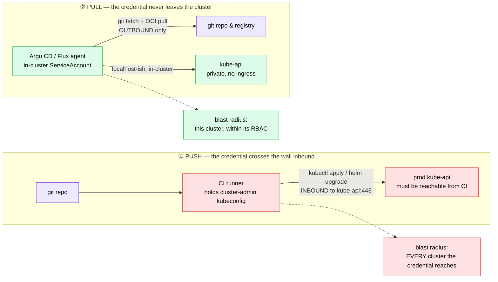
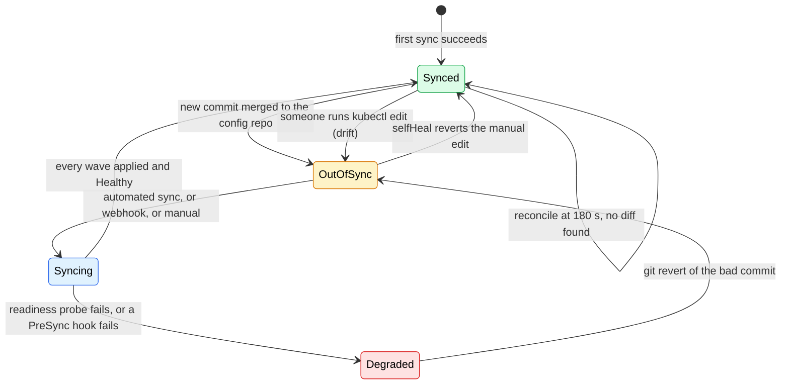

# GitOps, Helm & ArgoCD — Git as the Source of Truth

## 1. Why Should I Care About This?
- **Your CI Runner Is the Most Over-Privileged Thing You Own**: In a classic push pipeline, the GitHub Actions or Jenkins job that runs `kubectl apply` holds a kubeconfig with cluster-admin on production. A compromised runner therefore owns every cluster that credential reaches — which is exactly the attack shape of **SolarWinds (2020)** and the **Codecov bash-uploader compromise (2021)**, where the build system was the target precisely because it was trusted everywhere. GitOps inverts the arrow so that credential never leaves the cluster.
- **"It Works in Staging" Is Usually a Drift Story**: Someone ran `kubectl edit deploy` at 3 AM to unblock an incident and never told anyone. Six weeks later a deploy silently reverts the fix, or staging and prod differ in a way no repository records. Continuous reconciliation makes that class of bug *impossible to persist* — the drift is reverted within ~180 seconds and shows up as an `OutOfSync` signal you can alert on.
- **Helm Is Effectively Mandatory and Genuinely Flawed**: Almost every third-party component you install (ingress-nginx, Prometheus, cert-manager, Kafka) ships as a Helm chart, so you will use it whether you like it or not. You should also know its sharp edges: `helm rollback` does **not** undo what a hook did, and the release history is stored as a Kubernetes Secret, which means a big chart can hit **etcd's 1 MiB Secret limit** and wedge upgrades.
- **This Is the Standard, Not a Trend**: GitOps was named by **Weaveworks in 2017**; Argo CD came out of **Intuit** and was donated to the CNCF, and both **Argo and Flux are graduated CNCF projects** (2022) — the same maturity tier as Kubernetes and Prometheus. Interviewers for any platform, SRE, or senior backend role now assume you can explain pull-based delivery without being prompted.

## 2. What Problem Does This Solve?
- **Credentials Pointing the Wrong Way**: Push CD requires a long-lived, highly privileged cluster credential stored *outside* the cluster and a kube-api endpoint reachable from the CI network. Both are permanent, internet-adjacent liabilities. Pull-based delivery deletes both.
- **Unrecorded, Unreviewable Changes**: A `kubectl scale` or a console click leaves no diff, no reviewer, and no revert path. When the question "who changed this and why?" has no answer, every incident review starts from archaeology.
- **Configuration Drift Between Environments**: Without one rendering pipeline shared by all environments, dev/stage/prod diverge in ways nobody can enumerate. The result is the classic "it passed in staging" failure, which is really "staging was never the same shape."
- **No Defined Rollback**: If the deploy mechanism is a script someone runs, rollback is *a different, less-tested script*. Making the deploy path and the rollback path the same operation (`git revert`, then reconcile) is the single biggest reliability win here.
- **Naive Approach**: "We keep our YAML in a git repo and our pipeline runs `kubectl apply -f k8s/` on merge to main." This is **not** GitOps — it's push CD with a folder. Nothing detects drift, nothing prunes resources you deleted from the repo (the old Deployment lives forever), the apply is a point-in-time event with no convergence guarantee, and the credential problem is untouched. Teams then discover the repo and the cluster diverged months ago and no longer trust either.

## 3. Core Idea (Intuition First)
A push pipeline is **couriering a package into a building**: you need a key to the building, the courier carries it, and once the package is inside nobody checks whether it stayed on the shelf. GitOps is a **thermostat inside the building**: it reads the setpoint from a published document, compares it to the actual temperature, and acts — continuously, forever, with no key ever leaving the room.

- **Desired state is declarative and lives in git.** Not a script that *makes* changes; a description of what should exist. Immutable, versioned, reviewable, revertible.
- **An agent inside the cluster pulls it.** Argo CD's application-controller or Flux's source-controller fetches the repo; nothing outside needs cluster credentials, and nothing needs inbound network access to kube-api.
- **The agent renders it.** `helm template` or `kustomize build` turns the source into plain Kubernetes manifests — the actual bytes that will be applied.
- **It diffs desired against live and applies the difference.** Every ~3 minutes by default, or instantly on a git webhook.
- **The diff itself is a first-class signal.** `OutOfSync` is observable, alertable, and dashboardable — which is why manual drift stops being invisible.

> The mental image: **git is the thermostat setpoint, the cluster is the room temperature, and the agent is the loop that never stops comparing them.** A push pipeline sets the temperature once and walks out.

![Three-panel diagram of GitOps with Helm and Argo CD. Panel A contrasts push and pull delivery with the cluster wall drawn as a dashed vertical boundary. On the left, push CI/CD shows git feeding a CI runner that holds cluster-admin credentials, and an arrow crossing the wall inbound into the production cluster's kube-api, annotated with four consequences: the kubeconfig lives outside the cluster in CI secrets, kube-api must be reachable from the CI network, one compromised runner owns every cluster it can reach, and nothing watches for drift after the apply, with a note that the SolarWinds and Codecov compromises show the pipeline itself is the target. On the right, GitOps pull shows an Argo CD or Flux agent running inside the cluster with only a ServiceAccount, reaching outbound across the wall to fetch from git and an OCI registry, and talking to a private kube-api, annotated with four consequences: cluster credentials never leave the cluster, zero inbound firewall rules are needed, CI needs only permission to write a git commit and push an image, and continuous reconciliation means drift is both reverted and observable. Panel B is the render-and-apply chain drawn left to right: config repo at a git SHA, then values.yaml or an overlay patch, then rendered plain manifests, then kube-api server-side apply, then live state in etcd including admission webhook mutations, then a diff box comparing desired against live, with a dashed reconcile arrow looping from the diff back to the rendered manifests, labelled as the fourth GitOps principle and the only one that actually makes it GitOps. Beneath it the state sequence OutOfSync to Syncing to Synced or Degraded is shown, with the default 180-second poll interval, webhook-driven near-instant sync, and self-heal reverting a manual kubectl edit. Two footer boxes cover sync waves — minus one for CRDs and namespaces, zero for config and secrets, one for Deployments, two for Jobs, waiting for healthy between waves — and the distinction that Synced is not the same as Healthy, with built-in health checks for Deployment, Service and Ingress and custom Lua checks for arbitrary CRDs. Panel C shows environment promotion as a single repository on one main branch with a directory per environment: a base directory holding the chart or kustomize base, and envs/dev, envs/stage and envs/prod each pinning an explicit image digest, where dev and stage carry the same automatically promoted digest and prod carries an older digest promoted only by a reviewed pull request. It notes that promotion is one changed line in one reviewable PR, that the merge SHA becomes a free deploy audit trail, and that revert is git revert so the rollback path is the deploy path, with branch-per-environment marked as an anti-pattern causing merge drift and cherry-pick hell. Alongside it is a four-rung secrets ladder: Sealed Secrets using public-key encryption with in-cluster decryption, SOPS with age or KMS keeping encrypted values in the repo, External Secrets Operator starred as the usual best answer because git holds only a reference while Vault or a cloud secret manager stays the owner, and the Secrets Store CSI driver mounting secrets at pod start so nothing ever lands in etcd.](../assets/gitops_helm_argocd.svg)

> Panel A: the direction of the credential-bearing arrow is the entire security argument — push reaches in, pull reaches out. Panel B: source → values → *rendered manifests* → apply → live → diff → back, and that last arrow is what "GitOps" actually names. Panel C: promotion is a one-line PR across env directories, never a branch merge; and secrets climb a ladder that ends at "git stores only a reference."

## 4. How It Actually Works

### 1. Push vs pull — the credential direction is the whole argument
- **Push CD**: the CI job authenticates *to* the cluster. It needs (a) a kubeconfig or cloud IAM role with write access to production, stored in CI secrets; (b) network reachability from the runner to kube-api. To serve N clusters you either store N credentials in one place or grant one credential access to all N.
- **Pull CD (GitOps)**: an agent runs *in* the cluster with an in-cluster ServiceAccount. It makes **outbound** requests only: `git fetch` over HTTPS/SSH and `docker pull` from a registry. The CI system's total production privilege drops to *"can write a commit to a config repo"* and *"can push an image to a registry."*
- **How the blast radius actually differs**: compromise a push runner and you get cluster-admin on every cluster the credential reaches, immediately, with no cluster-side audit distinguishing you from a legitimate deploy. Compromise the git repo instead and your malicious change is a **commit** — it is diffable, requires passing branch protection and required reviews, is signed or not, and remains permanently attributable. You have converted "steal a key" into "get a PR approved."
- **The trade-off, and when push wins**: pull adds a component to run and debug, and it only reconciles things that are Kubernetes API objects. If you deploy to Lambda, ECS, VMs, or a mobile app store, push is the only model — there is no in-target agent to pull. Push is also better for anything genuinely imperative: a database migration, a one-off backfill, a smoke test that must run *between* two deploy steps.
- **Real number**: with pull, kube-api can live entirely on a private endpoint with **zero** inbound firewall rules — which is why GitOps is the default answer for on-prem, edge, and regulated clusters where exposing the API server is simply not permitted.



### 2. The four OpenGitOps principles — and why only the fourth is load-bearing
The CNCF **OpenGitOps** project (v1.0.0) states four:
1. **Declarative** — the whole system is expressed as *state*, not as steps. This is what makes it diffable at all; you cannot diff a bash script against a cluster.
2. **Versioned and immutable** — state is stored so that versions are complete and immutable, with a full history. Git gives you this, but so would versioned OCI artifacts or an S3 bucket with object versioning. "GitOps" is not literally about git.
3. **Pulled automatically** — agents pull the desired state, rather than being pushed to. This is the credential-direction principle from above.
4. **Continuously reconciled** — agents *continuously* observe actual state and attempt to apply desired state.
- **Why #4 is the distinguishing one**: principles 1–3 describe a well-run push pipeline with a config repo. Principle 4 is what converts a deploy from an *event* into a *control loop*. Concretely: the agent re-renders and re-diffs on a timer (Argo CD's `timeout.reconciliation` defaults to **180 s**), so an out-of-band `kubectl edit`, a stale replica count, a hand-deleted ConfigMap, or a resource an operator mutated is detected and — with `selfHeal: true` — reverted without a human. Every one of those is invisible under "apply on merge."
- **The second-order effect that people miss**: the diff becomes *telemetry*. `argocd_app_info{sync_status="OutOfSync"}` is a Prometheus series; you can alert on "any prod app has been OutOfSync for > 15 minutes" and catch both a broken sync and an unauthorised change with one rule. Drift stops being a story you hear later.
- **Trade-off**: continuous reconciliation actively fights anything else that mutates the same fields — HPAs, VPAs, mutating admission webhooks, service-mesh sidecar injectors. Living with GitOps means learning to declare "this field is not mine" (`ignoreDifferences`), which is real ongoing work.

### 3. Helm mechanically — chart, render, release, three-way merge, hooks
- **Chart layout**: `Chart.yaml` (name, version, `apiVersion: v2`, `dependencies:`), `values.yaml` (defaults), `templates/` (the manifests), `templates/_helpers.tpl` (named templates, by convention the `fullname`/`labels` helpers), `crds/` (installed once, never upgraded by Helm), `charts/` (vendored subcharts).
- **Rendering**: Helm runs each file in `templates/` through **Go `text/template`** plus the **Sprig** function library (`quote`, `default`, `toYaml`, `b64enc`, `sha256sum`, …) with a context of `.Values`, `.Chart`, `.Release`, `.Capabilities` (the target cluster's API versions), and `.Files`. Output is concatenated YAML documents. **`helm template` does exactly this and stops** — no cluster contact (unless you pass `--validate`), which is why it's the right thing to run in CI and in tests.
- **The release object**: `helm install`/`upgrade` renders, then applies, then records a **release** — in Helm 3 a Secret of type `helm.sh/release.v1` named `sh.helm.release.v1.<release>.v<revision>` in the release's namespace, holding a gzipped, base64-encoded snapshot of the rendered manifests and values. (Helm 2 kept this in ConfigMaps in `kube-system` via the Tiller server-side component; killing Tiller was the whole point of Helm 3.) Default history retained is **10 revisions** (`--history-max`).
- **Three-way strategic merge on upgrade**: Helm 3 compares the *old rendered manifest*, the *new rendered manifest*, and the *live object*, and patches only what the chart actually changed. This is why a field set by a controller (an HPA-managed `replicas`, an injected sidecar) survives a `helm upgrade` in Helm 3 but got clobbered in Helm 2.
- **`--wait` and `--atomic`**: `--wait` blocks until resources report ready (Deployments at desired replicas, PVCs bound, Services with an ingress IP) up to `--timeout` (default **5 m**). `--atomic` implies `--wait` and **rolls back to the previous revision on failure** — the flag that makes `helm upgrade` safe in a pipeline. Without it, a failed upgrade leaves you half-applied and marked `pending-upgrade`.
- **Hooks**: annotate a resource with `helm.sh/hook: pre-install | post-install | pre-upgrade | post-upgrade | pre-delete | pre-rollback | test` plus `hook-weight` for ordering and `hook-delete-policy`. Typical use: a Job that runs a database migration before the new pods start.
- **The hook limit that matters**: hooks are **not part of the release manifest**, so Helm does not track or reverse them. `helm rollback` reverts the Kubernetes objects and *does nothing about the migration your pre-upgrade hook already ran.* If the migration was destructive, your "rollback" produced new code and a schema it can't read. Design migrations to be backward-compatible for exactly this reason (see [Deployment Strategies (Blue-Green & Canary)](./Deployment_Strategies_Blue_Green_Canary.md)).
- **Dependencies and `global`**: `dependencies:` in `Chart.yaml` with `condition:`/`tags:` toggles, resolved by `helm dependency update` into `charts/` and pinned by `Chart.lock`. A parent can pass values into a subchart under its name key, and `global:` values are visible to all subcharts — which is also how umbrella charts turn into a mess of who-sets-what.
- **Distribution**: classic chart repos are just an HTTP server with an `index.yaml`; since **Helm 3.8** OCI registries are GA (`helm push chart.tgz oci://registry/charts`), so charts live beside images with the same auth, signing, and replication ([Container Registry & Image Security](./Container_Registry_Image_Security.md)).

### 4. Helm's real problems, and the "rendered manifests" pattern
- **You are templating a whitespace-significant language with a text templater.** Helm has no idea it's producing YAML. Indentation bugs are the dominant failure mode: `{{ toYaml .Values.resources | indent 12 }}` versus `nindent 12` differs by one leading newline and silently produces a *different document shape*. A conditional that leaves a stray blank key yields `null` where a map was expected.
- **`values.yaml` becomes a second configuration language.** Real charts grow hundreds of keys, `if`/`range`/`with` nesting, and dictionary lookups. There is no type system, no IDE support that understands your schema (beyond optional `values.schema.json`), and the only way to know what a change produces is to render it.
- **`helm rollback` is a partial truth.** It restores objects from the stored revision, but does not undo hooks, does not recreate resources deleted outside Helm, and cannot help if the failed upgrade left the release in `pending-upgrade` (a real, common wedge that needs manual Secret surgery or `helm rollback` to the last *deployed* revision).
- **The release Secret is a scaling limit.** Rendered manifests are gzipped into a Secret, and Kubernetes/etcd caps an object at **~1 MiB**. Very large charts (hundreds of CRDs, big generated configs) hit `ConfigMap/Secret is too large` and cannot upgrade at all.
- **The escape hatch — "rendered manifests"**: run `helm template` (or `kustomize build`) **in CI**, commit the plain, fully-resolved YAML to the config repo, and let the GitOps agent apply *that*. What you gain: the PR diff shows the actual manifests a human can review ("this bumps the image and also, surprise, drops a NetworkPolicy"), the agent does no templating so sync is fast and deterministic, chart-version bumps become reviewable diffs instead of leaps of faith, and `helm`'s runtime behaviour disappears from the production path. What you pay: a generated-code commit per environment per change, a CI job that writes back to git (see §8), and a much noisier repo. **This is the pattern most mature platform teams converge on**, and saying so in an interview is a strong signal.

### 5. Kustomize — overlays over a base, and the patch pyramid
- **The model**: no templating at all. A `base/` directory holds real, valid, applyable manifests plus a `kustomization.yaml`. An overlay references the base and declares **patches**: strategic-merge patches (a YAML fragment merged by the same rules kube-api uses) or JSON 6902 patches (`op: replace, path: /spec/replicas`). `kustomize build overlays/prod` prints the result.
- **Built-in transformers do the boring 80%**: `namePrefix`/`nameSuffix`, `namespace`, `commonLabels`/`labels`, `images` (swap tag or digest), `replicas`, `configMapGenerator`/`secretGenerator` — and the generators append a **content hash to the name** so changing a ConfigMap changes the name, which forces a Deployment rollout. That hash-suffix trick solves "I changed the config and nothing restarted" for free, and it is the single most underrated Kustomize feature.
- **`kubectl apply -k` ships in kubectl** (since 1.14) but the vendored Kustomize version lags the standalone binary by a lot; pin the standalone `kustomize` in CI so local and cluster renders match.
- **When overlays are cleaner**: differences between environments are *small and structural* — replica counts, resource limits, an ingress host, one extra sidecar. Two overlays over a base is far more readable than a chart with `{{ if eq .Values.env "prod" }}` scattered through it, because every file is still valid YAML you can read.
- **When it becomes a patch pyramid**: base → common overlay → region overlay → cluster overlay → env overlay, where a value's final result requires mentally executing five merges, and a strategic-merge patch on a list silently *replaces* rather than appends unless a merge key exists. At that point `kustomize build` is the only source of truth and nobody can predict the output — the same failure Helm has, reached by a different road.
- **The honest summary**: Helm is better at *packaging for strangers* (versioned, parameterised, distributable, upgradable). Kustomize is better at *configuring for yourself* (small deltas over manifests you own). Charts you consume from vendors will be Helm; your own app config is often better as Kustomize. Argo CD and Flux both support Helm, Kustomize, plain YAML, and Helm-rendered-through-Kustomize (the `kustomize` + `helmCharts:` inflator).

### 6. Argo CD — architecture, the Application CRD, and the sync engine
- **Components**: **argocd-server** (gRPC/REST API + web UI + RBAC/SSO via Dex or OIDC); **argocd-repo-server** (clones repos and *renders* manifests — this is where `helm template`/`kustomize build` actually execute, and where CPU and memory go); **argocd-application-controller** (the reconcile loop: compare rendered desired state to live state, apply, assess health, emit events); **redis** (a cache of rendered manifests, cluster resource trees, and app state); plus **applicationset-controller** and **notifications-controller**. Argo CD is stateless apart from redis and CRDs — its state of record is git and the cluster.
- **The `Application` CRD** is the unit: `spec.source` (repoURL + targetRevision + path, or `chart`), `spec.destination` (server/name + namespace), `spec.syncPolicy`. `targetRevision` can be a branch, tag, or commit SHA — **pin prod to a tag or SHA**, because tracking `HEAD` of a branch means anyone with merge rights deploys to prod.
- **`automated: {prune: true, selfHeal: true}` and the real danger of each**: `prune` deletes live resources no longer in the rendered output — which is what you want, and also what turns a broken render into a mass deletion. `allowEmpty` defaults to **false** precisely so that a source rendering to *zero* resources refuses to prune instead of deleting the app; do not turn it on. `selfHeal` reverts live divergence, which will fight an HPA if `replicas` is in git, and will loop forever against any mutating webhook whose output you haven't excluded.
- **`ignoreDifferences` is not optional in a real cluster**: sidecar injectors add containers, HPAs own `spec.replicas`, cert-manager writes into Secrets, and the API server defaults dozens of fields. Each of those is a permanent diff that makes an app eternally `OutOfSync` and, with selfHeal, an infinite sync loop. Declare the fields (JSON pointers or `jqPathExpressions`), or use `ServerSideApply=true` so field ownership is negotiated by kube-api rather than guessed.
- **Sync waves and hooks**: YAML has no dependency graph, so Argo adds ordering. `argocd.argoproj.io/sync-wave: "-1"` for CRDs and namespaces, `"0"` for config, `"1"` for workloads, `"2"` for post-deploy Jobs; the controller applies a wave, **waits for its resources to be Healthy**, then proceeds. `argocd.argoproj.io/hook: PreSync|Sync|PostSync|SyncFail` gives you migration Jobs and smoke tests inside the sync itself — and unlike Helm hooks these are visible objects in the app's resource tree.
- **The health model is the reason people pick Argo CD**: `Synced` means "live matches git." `Healthy` means "the thing actually works." They are different, and the gap is where every bad deploy lives — a Deployment can be perfectly Synced and permanently `Progressing` because the new image crash-loops. Argo ships built-in health assessments for core kinds and lets you write **Lua** health checks for arbitrary CRDs (`resource.customizations.health.<group>_<kind>`), so a `Rollout` or a `Cluster` CR reports Healthy/Degraded/Progressing like a native object.
- **Polling vs webhooks**: default reconciliation every **180 s** means p50 deploy latency of ~90 s and 20 polls/hour/app against your git host — at 500 Applications that is 10,000 fetches/hour, which is how teams get rate-limited by GitHub. Wire the git webhook to `/api/webhook` and sync becomes near-instant while the timer stays as a safety net.
- **Scaling and fan-out**: `ApplicationSet` templates Applications from **generators** (list, cluster, git-directory, git-file, matrix, merge, SCM-provider, pull-request) — one manifest producing "this app on all 40 clusters" or "a preview environment per open PR." The **app-of-apps** pattern is the older version: one Application whose source is a directory of Application manifests, giving a bootstrappable root. A single Argo CD instance is routinely run with **thousands of Applications**; the bottlenecks in practice are repo-server CPU/memory during manifest generation and redis, and the fixes are `--parallelismlimit`, sharding the application-controller across clusters, and splitting instances per tenant.



### 7. Flux v2 — the GitOps Toolkit as composable controllers
- **Flux v2 is not one app, it's a set of single-purpose controllers** (the "GitOps Toolkit"), each with its own CRDs: **source-controller** (`GitRepository`, `OCIRepository`, `HelmRepository`, `Bucket` — fetch, verify, and expose an artifact), **kustomize-controller** (`Kustomization` — build and apply, with `prune: true` and `healthChecks`), **helm-controller** (`HelmRelease` — a *declarative* Helm release, so drift on a chart's output is also reconciled), **notification-controller** (inbound webhooks, outbound alerts), and **image-reflector-controller** + **image-automation-controller**.
- **The architectural difference that matters**: Flux's separation means the "fetch and verify" step is a distinct, reusable object. One `GitRepository` can back many `Kustomization`s, and `dependsOn` between Kustomizations gives you cross-app ordering (infra before apps) that Argo expresses only inside one Application via waves.
- **`HelmRelease` vs Argo's Helm support**: Argo CD renders the chart with `helm template` and applies the output itself, so there is *no Helm release object in the cluster* and no `helm list` — a genuine surprise for operators. Flux's helm-controller actually drives the Helm SDK, keeping the release Secret, hooks, and `helm rollback` semantics, plus declarative `remediation.retries`. Pick based on whether you want Helm's runtime behaviour or want it gone.
- **Image automation is Flux's distinctive feature**: image-reflector-controller scans a registry for tags matching a policy (semver range, numeric, regex), and image-automation-controller **writes the new tag back into the git repo** as a commit. That closes the loop entirely inside the cluster with no CI write-back step — powerful, and also the feature most likely to deploy something you didn't intend if the policy is loose.
- **Ergonomics**: Flux has **no UI by default** (Weave GitOps / Capacitor are add-ons) and is CLI/CRD-first, which platform teams like and application developers usually don't. Argo CD's UI, with its live resource tree, per-resource diff, and pod logs, is the reason it wins in orgs where developers self-serve. Both are graduated CNCF projects; both are safe choices. Note the sober footnote: **Weaveworks, which coined "GitOps" in 2017, shut down in 2024** — Flux itself continued under new stewardship, which is a useful reminder that project governance and vendor survival are separate questions.

### 8. Promotion, secrets, and where GitOps stops
- **Two repos, not one**: the **app repo** (source code, Dockerfile, unit tests) and the **config repo** (manifests/charts/overlays, one directory per environment). Separating them means an image build doesn't churn deployment history, the config repo can have different reviewers and branch protection, and a rollback of config doesn't revert code.
- **Directory-per-environment, one branch**: `envs/dev/`, `envs/stage/`, `envs/prod/`, each with an **explicit image digest** (`app@sha256:…`, not `:latest` — a mutable tag means git never changes and the agent has nothing to reconcile). Promotion is then literally a PR that changes one line, reviewed and merged; the merge commit is your deploy record, with author, timestamp, reviewer, and linked ticket, for free.
- **Why branch-per-environment is an anti-pattern**: it looks natural (`dev` → `stage` → `main`) and rots fast. Environment-specific config committed to `stage` must be *kept out of* `main`, so the branches diverge permanently and every promotion is a merge with real conflicts. Hotfixes go straight to prod and must be cherry-picked backwards, so branches silently differ in ways no diff summarises. And "promote" becomes "merge 14 commits" rather than "change one image digest" — you can no longer promote *one* change. Directories make the environment difference **explicit and side-by-side**; branches make it implicit and temporal.
- **The CI write-back loop, and the infinite trigger**: CI builds an image, then commits the new digest into `envs/dev/`. That commit is a push to the config repo, which triggers the config repo's CI, which... The three standard fixes: (a) put the config in a **separate repo with no build workflow**; (b) **path filters** so the workflow ignores changes under `envs/`; (c) a bot-authored commit with `[skip ci]` and a workflow-level check that ignores the bot's identity. Use a dedicated bot identity with write access scoped to one repo, and prefer a GitHub App token over a long-lived PAT.
- **Secrets — you cannot commit plaintext, so pick a rung**: **Sealed Secrets** (encrypt with the controller's public key; only the in-cluster controller can decrypt — simple, but the private key becomes a per-cluster thing you must back up and rotate); **SOPS + age/KMS** (encrypt only the *values* so keys stay diffable; Flux decrypts natively, Argo needs a plugin; rotation touches every file); **External Secrets Operator** (git holds only a *reference* — `ExternalSecret` points at a key in Vault/AWS Secrets Manager/GCP Secret Manager and the operator syncs it into a Kubernetes Secret; the secret store stays the owner, rotation is free, and this is the usual best answer); **Secrets Store CSI driver** (mount the secret into the pod at start, so it never becomes a Kubernetes Secret in etcd — best isolation, but the pod must restart to see a rotation). The details of the stores themselves live in [Secrets Management (Vault & KMS)](../15_Security_Deep_Dive_DevSecOps/Secrets_Management_Vault_KMS.md) and [Configuration Management (Vault)](../10_Microservices_Distributed_Systems/Configuration_Management_Vault.md).
- **Where GitOps stops**: reconciliation works because Kubernetes resources are *declarative with a controller that owns convergence*. An RDS instance, a Route 53 record, an IAM role, or a Kafka topic has no such loop — so you need [Terraform](./Infrastructure_as_Code_Terraform.md) (plan/apply, a state file, run in a pipeline) or **Crossplane / AWS Controllers for Kubernetes (ACK)**, which wrap cloud APIs in CRDs so a `Database` claim reconciles exactly like a Pod and can therefore live in the same GitOps repo. Most organisations run both: **Terraform for cloud primitives and the cluster itself; GitOps for everything inside the cluster.** The boundary is worth writing down as an [ADR](../01_Planning_Foundations/Architecture_Decision_Records.md), because the argument recurs forever.

## 5. Real-World Example
**Intuit and Argo CD's origin.** Argo CD grew out of Applatix, acquired by Intuit in 2018, and was donated to the CNCF; Intuit's platform team publicly described running it across many clusters and thousands of Applications with hundreds of engineers self-serving deploys through the UI. The design consequences are visible in the product: `ApplicationSet` and app-of-apps exist because someone had to manage app counts in the thousands, sharding exists because one application-controller could not; and RBAC/SSO/projects exist because the UI was the *primary interface for developers*, not an ops console. **Argo graduated in the CNCF in December 2022**, alongside Flux — meaning both have production users at scale, a security audit, and open governance.

**CVE-2022-24348 — the multi-tenant repo-server.** In February 2022 researchers at Apiiro disclosed a path-traversal flaw in Argo CD's handling of Helm chart values files: a crafted symlink in a chart could make the repo-server read files outside its own application's directory, letting a tenant who could commit to *their* repo extract secrets belonging to *other* applications on the same Argo CD instance. It was rated critical and patched in 2.1.9/2.2.4/2.3.0-rc4. The lesson to carry into a design discussion: **the GitOps agent is a cluster-admin-equivalent component that renders untrusted input** — it needs the same hardening posture as your CI runners, tenants should be split across Argo CD instances or at minimum Projects, and you must patch it like an ingress controller, not like a dashboard.

**Helm's hook problem, concretely.** A team runs schema migrations from a `pre-upgrade` hook Job. The upgrade's new pods fail their readiness probe, so `--atomic` triggers `helm rollback`. The Deployments revert to the previous image in seconds — and the migration, which already dropped a column, does not. The old code now queries a column that no longer exists, and the "safe automated rollback" has caused a harder outage than the original failure. The fix is not a Helm flag: migrations must be **expand/contract** (add the new column, deploy code that writes both, backfill, deploy code that reads the new one, drop the old column in a *later* release), which is the same discipline zero-downtime deploys require anyway.

## 6. Code Example
An Argo CD `Application` with automated sync, prune, self-heal, sync waves, and the diff exclusions a real cluster needs:

```yaml
apiVersion: argoproj.io/v1alpha1
kind: Application
metadata:
  name: checkout-prod
  namespace: argocd
  finalizers:
    - resources-finalizer.argocd.argoproj.io   # deleting this App also deletes its resources
spec:
  project: payments                            # Project = the tenancy + RBAC + allowed-repo boundary
  source:
    repoURL: https://github.com/acme/config-repo.git
    path: envs/prod/checkout
    targetRevision: v2025.11.3                 # ── THE MOST IMPORTANT LINE: a TAG, not HEAD of main.
    #                                          #    Tracking a branch means every merge deploys to prod.
  destination:
    server: https://prod-cluster.internal      # private endpoint — no inbound path from CI exists
    namespace: checkout
  syncPolicy:
    automated:
      prune: true          # delete resources removed from git — required, or old objects live forever
      selfHeal: true       # revert manual kubectl edits within the reconcile interval
      allowEmpty: false    # ── SAFETY RAIL: if the render yields ZERO resources (broken kustomize
                           #    build, wrong path), refuse to prune instead of deleting the whole app.
    syncOptions:
      - CreateNamespace=true
      - ServerSideApply=true   # let kube-api arbitrate field ownership; also dodges the 256 KB
                               # last-applied-configuration annotation limit on large CRDs
      - PruneLast=true         # delete removed resources AFTER the new ones are healthy
    retry:
      limit: 3
      backoff: {duration: 10s, factor: 2, maxDuration: 3m}
  ignoreDifferences:
    - group: apps
      kind: Deployment
      jsonPointers: ["/spec/replicas"]         # the HPA owns replicas. Without this, selfHeal and the
                                               # HPA fight forever and the app is permanently OutOfSync.
    - group: ""
      kind: Secret
      jqPathExpressions: ['.data."ca.crt"']    # cert-manager writes this field, not us
---
# Ordering, because a list of YAML files has no dependency graph.
apiVersion: batch/v1
kind: Job
metadata:
  name: checkout-migrate
  annotations:
    argocd.argoproj.io/hook: PreSync           # runs BEFORE the wave-1 workloads
    argocd.argoproj.io/hook-delete-policy: BeforeHookCreation
    argocd.argoproj.io/sync-wave: "-1"         # -1 CRDs/ns · 0 config · 1 workloads · 2 smoke tests
spec:
  template:
    spec:
      restartPolicy: Never
      containers:
        - name: migrate
          image: acme/checkout@sha256:9f8e7d1c2b3a4e5f60718293a4b5c6d7e8f90112233445566778899aabbccddee
          command: ["./migrate", "up"]   # must be idempotent AND backward-compatible (expand/contract)
```

The Helm templating trap, and the Kustomize overlay that avoids it:

```yaml
# ── templates/deployment.yaml — three bugs that only appear at render time ──
spec:
  replicas: {{ .Values.replicas }}            # BUG 1: unquoted and unguarded. If replicas is unset the
                                              # line renders as `replicas:` → null → kube-api rejects it.
                                              # Correct: {{ .Values.replicas | default 2 }}
  template:
    spec:
      containers:
        - name: app
          image: "{{ .Values.image.repo }}:{{ .Values.image.tag }}"   # BUG 2: a mutable tag. Git never
          #                                     changes, so the agent has nothing to reconcile. Use a digest.
          resources:
{{ toYaml .Values.resources | indent 12 }}    # BUG 3: `indent` keeps the leading newline that the
                                              # template already emitted → a blank line inside a map,
                                              # or 12-space text pasted at the wrong depth.
                                              # Correct: {{- toYaml .Values.resources | nindent 12 }}
# Helm does not know this is YAML. Always `helm template … | kubeconform -` in CI.
```

```yaml
# ── overlays/prod/kustomization.yaml — no templating, every file is valid YAML ──
apiVersion: kustomize.config.k8s.io/v1beta1
kind: Kustomization
namespace: checkout
resources: [../../base]
images:
  - name: acme/checkout
    digest: sha256:9f8e7d1c2b3a4e5f60718293a4b5c6d7e8f90112233445566778899aabbccddee
    #        ── the promotion line. A PR that changes THIS is the entire deploy.
replicas: [{name: checkout, count: 12}]
patches:
  - path: resources-patch.yaml            # strategic merge: only the fields you name
    target: {kind: Deployment, name: checkout}
configMapGenerator:
  - name: checkout-config
    literals: [LOG_LEVEL=info, FEATURE_X=true]
    # generators append a content hash to the name → changing config CHANGES the name → the
    # Deployment's volume reference changes → pods roll. "I changed config and nothing restarted", solved.
---
# ── the secret: git stores a REFERENCE, never a value ──
apiVersion: external-secrets.io/v1beta1
kind: ExternalSecret
metadata: {name: checkout-db, namespace: checkout}
spec:
  refreshInterval: 1h                     # re-reads the store, so rotation propagates without a commit
  secretStoreRef: {name: vault-backend, kind: ClusterSecretStore}
  target: {name: checkout-db, creationPolicy: Owner}
  data:
    - secretKey: password
      remoteRef: {key: prod/checkout/db, property: password}   # Vault stays the owner of the value
```

## 7. Design Variations & Alternatives

| Approach | How config varies per env | Reviewability of the diff | Main failure mode | Use when |
|---|---|---|---|---|
| **Raw manifests, one dir per env** | Copy-paste | Perfect — it *is* the manifest | Divergence: a fix lands in one dir and not the others | 1–3 services, 2 envs, or a bootstrap/infra repo |
| **Kustomize overlays** | Patches over a shared base | Good — read base + patch | The patch pyramid; list-merge surprises | You own the manifests and env deltas are small deltas |
| **Helm chart + values per env** | `values-<env>.yaml` | Poor — must render to know | Whitespace/`null` template bugs; hook-vs-rollback | Packaging for others, or consuming a vendor chart |
| **Helm rendered in CI → committed** | Same as Helm, plus a generated commit | **Best — the PR shows real manifests** | Generated-code churn; the write-back loop | Regulated/high-blast-radius prod; auditability matters most |
| **jsonnet / cdk8s / Pulumi (real language)** | Functions, types, imports | Depends on tooling; needs a render step | A programming language in the deploy path; new-hire ramp | Hundreds of near-identical services needing real abstraction |

**On the agents:** Argo CD is application-centric with a strong UI, Projects for multi-tenancy, and `ApplicationSet` for fan-out; Flux is a set of composable controllers with `dependsOn` ordering, native SOPS decryption, real Helm releases via helm-controller, and registry-scanning image automation. Both are graduated CNCF projects and both are correct answers; choose Argo CD if developers will look at it, Flux if only platform engineers will. Running **both** is a real pattern (Flux to bootstrap platform components, Argo CD for application teams), and Argo Rollouts / Flagger layer progressive delivery on top of either (see [Deployment Strategies](./Deployment_Strategies_Blue_Green_Canary.md)).

**The middle paths worth naming:** keep push CD for the imperative steps (migrations, cache warms, external API registrations) and pull for state; use Terraform for cloud primitives and GitOps for workloads, with Crossplane/ACK moving the boundary rightward as your team matures; and start with `prune: false, selfHeal: false` and a manual sync button, then turn each on once you trust the diff — this is how you adopt GitOps without a mass-deletion incident in week two.

## 8. Pros and Cons

### GitOps (pull-based reconciliation)
- **Pros**: cluster credentials never leave the cluster and kube-api needs no inbound path, so CI compromise no longer means cluster compromise; drift is detected in ~180 s and optionally auto-reverted; the git log is a complete, attributable deploy audit trail at zero extra cost; rollback is `git revert`, i.e. the same code path as deploy; disaster recovery becomes "point a fresh cluster's agent at the repo"; and onboarding a new environment is a directory plus an `ApplicationSet` entry.
- **Cons**: another control-plane component to run, patch, and debug (and one that is cluster-admin-equivalent and renders untrusted input — see CVE-2022-24348); it only reconciles Kubernetes API objects, so you still need Terraform or Crossplane for cloud primitives; genuinely imperative operations fit badly; the `ignoreDifferences` maintenance tax against webhooks/HPAs is permanent; and "everything is a PR" adds real latency to emergency fixes unless you deliberately design a break-glass path.

### Helm
- **Pros**: the de facto distribution format, so you get versioned, parameterised, upgradable packages for the entire ecosystem; dependencies with a lockfile; three-way merge so controller-owned fields survive upgrades; `--atomic` gives automatic rollback on a failed upgrade; and OCI registries (3.8+) mean charts share your image registry's auth and signing.
- **Cons**: text-templating a whitespace-significant format produces indentation and `null` bugs that only appear at render time; `values.yaml` becomes an untyped second configuration language nobody can review by eye; `helm rollback` cannot undo hooks (so an automated rollback after a destructive migration makes things worse); release history in a ~1 MiB Secret is a hard ceiling for large charts; and a failed upgrade can wedge a release in `pending-upgrade` needing manual repair.

### Kustomize
- **Pros**: no templating language at all — every file is valid YAML you can read, lint, and diff; strategic-merge patches use the same semantics as kube-api; `configMapGenerator`'s content-hash suffix makes config changes actually roll pods; built into kubectl.
- **Cons**: no versioning, packaging, or dependency story, so it is not a distribution format; deep overlay chains become unpredictable and only `kustomize build` knows the truth; patching a list without a merge key replaces it silently; and expressing conditional/loop-shaped config (10 near-identical CronJobs) is either copy-paste or a different tool.

## 9. Failure Scenarios & What Can Go Wrong
- **SYMPTOM**: An Argo CD app sits permanently `OutOfSync` and the sync count climbs forever; the audit log shows the same resource re-applied every few minutes. **ROOT CAUSE**: something else owns a field you declare — an HPA on `spec.replicas`, a sidecar injector adding a container, a defaulting webhook. selfHeal reverts it, the other controller re-applies, forever. **FIX**: add `ignoreDifferences` (jsonPointers or `jqPathExpressions`) for those fields, or enable `ServerSideApply=true` so kube-api arbitrates ownership; remove `replicas` from git entirely when an HPA manages it.
- **SYMPTOM**: A sync deletes an entire namespace of running workloads. **ROOT CAUSE**: `prune: true` combined with a render that produced nothing or almost nothing — a wrong `path`, a renamed directory, a `kustomize build` failure treated as empty output, or a resource whose name/namespace changed so the old one looks removed. **FIX**: keep `allowEmpty: false` (the default); use `PruneLast=true`; require `argocd app diff` in CI on the config-repo PR; adopt GitOps with `prune: false` until you trust renders; and protect the namespace with a deletion-blocking policy.
- **SYMPTOM**: `helm upgrade` fails, `--atomic` rolls back cleanly, and production is now *more* broken than before. **ROOT CAUSE**: a `pre-upgrade` hook already ran a destructive migration; hooks are not part of the release manifest, so rollback cannot reverse them. **FIX**: expand/contract migrations that are backward-compatible for at least one release; run migrations as an explicitly ordered, idempotent step (a `PreSync` Job or a separate pipeline stage), never as something you assume is reversible.
- **SYMPTOM**: `helm upgrade` refuses to run: "another operation is in progress" and the release shows `pending-upgrade`. **ROOT CAUSE**: a previous upgrade was killed mid-flight (pipeline timeout, evicted pod), leaving the release Secret in a non-terminal state. **FIX**: `helm rollback <release> <last-DEPLOYED-revision>` to reset the state machine (or delete the offending `sh.helm.release.v1.*` Secret as a last resort), then always use `--timeout` shorter than your CI job timeout so Helm, not the runner, decides.
- **SYMPTOM**: Manifest apply fails with `metadata.annotations: Too long: must have at most 262144 bytes`. **ROOT CAUSE**: client-side `kubectl apply` stores the full previous manifest in the `last-applied-configuration` annotation, and a large CRD blows the annotation limit. **FIX**: `ServerSideApply=true` in Argo (or `kubectl apply --server-side`), which tracks ownership in `metadata.managedFields` instead of an annotation.
- **SYMPTOM**: CI runs in a loop — every commit triggers another commit which triggers another build. **ROOT CAUSE**: the pipeline writes the new image digest back into a repo whose own workflow triggers on push. **FIX**: put config in a separate repo with no build workflow, add `paths-ignore` filters, or have the bot commit with `[skip ci]` and skip workflows authored by that bot identity.
- **SYMPTOM**: Deploys are slow and your git provider starts returning 429s. **ROOT CAUSE**: N Applications × a poll every 180 s (20/hour each) against the same host — 500 apps is 10,000 requests/hour before any human activity. **FIX**: configure the git webhook to Argo's `/api/webhook` (or Flux's notification-controller receiver) so pushes trigger sync, raise `timeout.reconciliation` to 5–10 minutes as a safety net, and share a single `GitRepository`/repo credential rather than one per app.
- **SYMPTOM**: A commit deploys to prod that nobody approved. **ROOT CAUSE**: `targetRevision: main` (or `HEAD`) — anyone with merge rights on the config repo has production write access, and CODEOWNERS on the app repo doesn't cover it. **FIX**: pin prod to a tag or SHA, enforce branch protection plus required reviews and CODEOWNERS on the config repo, restrict Argo CD Projects to specific repos/paths/destinations, and require signed commits with Argo's `signatureKeys` verification.
- **SYMPTOM**: The Argo CD UI shows an app `Synced` and green while users see 500s. **ROOT CAUSE**: `Synced` only means live matches git; the workload's health is a separate assessment, and a custom CRD with no health check defaults to Healthy. **FIX**: write Lua health checks for your CRDs, alert on `Progressing` and `Degraded` (not just sync status), and never treat GitOps state as a substitute for [SLO-based monitoring](../12_Monitoring_Logging_Observability/SLO_SLI_Error_Budgets.md).

## 10. Impact on Scalability, Reliability & Cost
- **Scalability**: the axis is *(number of Applications) × (render cost) × (reconcile frequency)*. 500 apps at a 180 s interval is 10,000 renders/hour; each Helm render forks a process and can take 1–10 s of repo-server CPU, so 10,000 × 3 s ≈ 8.3 CPU-hours/hour — i.e. you need roughly 8+ cores of repo-server just to keep up, which is exactly why redis manifest caching and webhook-driven sync exist. Fix by caching (identical revision ⇒ no re-render), switching to webhooks (renders become proportional to *commits*, not to time), sharding the application-controller by cluster, and pre-rendering in CI so the agent does zero templating. `ApplicationSet` keeps the *manifest* count at one while app count grows to thousands.
- **Reliability**: the mean-time-to-recover arithmetic is the sellable number. Push CD rollback = find the last good commit, re-run the pipeline (build + test + deploy, typically 10–30 minutes). GitOps rollback = `git revert` + merge + reconcile — a webhook sync applies in seconds, so **MTTR drops from tens of minutes to roughly one to two minutes**, and it uses the identical, continuously-exercised code path rather than a rarely-tested rollback script. That is precisely the mechanism behind DORA's finding that elite performers combine multiple deploys per day with a change-failure rate in the single-digit percent and failed-deployment recovery under an hour: small changes plus a boring, well-worn revert path. Add the drift dimension — a `kubectl edit` that would have survived indefinitely now lives ~180 seconds.
- **Cost**: the agent itself is cheap — an Argo CD control plane of a few replicas each of server/repo-server/controller plus redis fits comfortably in ~4 vCPU / 16 GB, roughly one `m5.xlarge`-equivalent at about **$140/month on-demand** (less on Spot or shared nodes), which is far below the cost of the incident it prevents. The real savings are indirect: no bespoke deploy scripts per service to maintain, no per-cluster CI credential rotation project, and audit evidence for SOC 2 change-management produced as a by-product of git history rather than as a quarterly screenshot exercise. The real *added* cost is a platform engineer's ongoing attention: chart/overlay maintenance, `ignoreDifferences` upkeep, and patching a cluster-admin-equivalent component promptly.

## 11. When NOT to Use This
- **Don't use GitOps for targets that aren't Kubernetes-shaped.** Lambda, ECS, App Runner, VM fleets, and mobile releases have no in-target reconciling agent. Use a push pipeline, or Crossplane/ACK if you specifically want them to reconcile like Pods.
- **Don't put genuinely imperative operations in the reconcile loop.** Data backfills, one-off repairs, and cache invalidations aren't desired *state* and shouldn't be modelled as such. A reconciler that re-runs your backfill every 3 minutes is a distinctly bad afternoon.
- **Don't adopt it for a single small service with one environment.** The Application manifests, config repo, promotion flow, and secrets machinery are real overhead. `kubectl apply` from CI genuinely is fine for a two-person team with one cluster; adopt GitOps when you have multiple environments, multiple clusters, or an auditor.
- **Don't enable `selfHeal` and `prune` on day one.** You will discover your webhook-mutated fields and your name-changing resources the hard way, at production scale. Run manual sync → automated sync → prune → selfHeal as four separate decisions, days or weeks apart.
- **Don't make GitOps the only path to production without a break-glass procedure.** When git or your provider is down, or the reconciler itself is broken, someone must be able to act — so pre-agree an audited `kubectl` escape hatch (break-glass role, alerted use, mandatory retro-commit) rather than inventing one at 3 AM.

## 12. Interview Perspective
- **What interviewers expect**: that you can name the credential direction unprompted. Say: **"In push CD the pipeline holds cluster-admin and reaches into production, so a compromised runner owns every cluster; in GitOps an in-cluster agent pulls, so the cluster credential never leaves the cluster and CI only needs write access to a git repo and a registry."** Then add the second half: **"and because it reconciles continuously, drift is reverted and the diff is an alertable signal."** Those two sentences cover ~80% of what the question is testing.
- **The trap question**: *"So GitOps just means keeping your YAML in git, right?"* The wrong answer agrees. The right answer: no — YAML in git plus `kubectl apply` on merge is still push CD with a folder; it has no drift detection, no pruning of deleted resources, and the same credential exposure. GitOps needs the **fourth** OpenGitOps principle, continuous reconciliation, which is what turns a deploy from an event into a control loop.
- **The math question**: *"You have 500 Applications on one Argo CD. What breaks first, and size it."* Walk it: default reconcile is 180 s ⇒ 20 cycles/hour/app ⇒ 10,000 renders/hour; a Helm render costs ~1–10 s of repo-server CPU, so at 3 s that's ~30,000 CPU-seconds/hour ≈ **8.3 cores continuously** — repo-server (and your git provider's rate limit) is the bottleneck, not the cluster. Fixes, in order of leverage: webhooks so renders scale with commits instead of wall-clock; redis manifest caching; pre-render in CI so the agent applies plain YAML; then shard the application-controller and split instances per tenant.
- **The subtle question**: *"Why is branch-per-environment worse than directory-per-environment?"* Because environment-specific config committed to a branch must never reach the others, so the branches diverge permanently and every promotion becomes a conflicted merge; hotfixes to prod need backward cherry-picks; and you can no longer promote a *single* change without dragging everything else on the branch with it. Directories make the environment delta explicit, side-by-side, and diffable — promotion becomes one changed image digest in one reviewable PR.
- **Bonus signals**: `allowEmpty: false` as the guard against prune-everything; `ignoreDifferences`/`ServerSideApply` for webhook-and-HPA-mutated fields; sync waves for CRD-before-CR ordering; `Synced ≠ Healthy` and Lua health checks; the "rendered manifests in CI" pattern and *why* (a reviewable diff); that Argo CD's Helm support renders with `helm template` so there is no Helm release object in the cluster while Flux's helm-controller keeps one; that `helm rollback` can't undo a hook; the 1 MiB release-Secret ceiling; External Secrets Operator as the default secrets answer; and naming the Terraform/Crossplane boundary for non-Kubernetes resources.

## 13. Connections to Other Topics
- [CI/CD Pipelines](./CI_CD_Pipelines.md) — the push model this file inverts; CI still builds, tests, and publishes the image, it just stops holding cluster credentials. Read that first, then read this as "what happens after the artifact exists."
- [Infrastructure as Code (Terraform)](./Infrastructure_as_Code_Terraform.md) — the same declarative instinct with a state file and an explicit `apply` instead of a continuous loop; it owns the cloud primitives (VPCs, RDS, IAM, the cluster itself) that GitOps cannot reconcile.
- [Kubernetes Objects (Pods & Services)](./Kubernetes_Objects_Pods_Services.md) — the desired-state controllers that make reconciliation possible at all; GitOps is the same control-loop idea moved one level out, from ReplicaSet to repository.
- [Immutable Infrastructure Pattern](./Immutable_Infrastructure_Pattern.md) — why the config repo must pin an image **digest**: a mutable tag reintroduces exactly the mutable-artifact drift immutability was invented to kill.
- [Deployment Strategies (Blue-Green & Canary)](./Deployment_Strategies_Blue_Green_Canary.md) — what happens *inside* a sync; Argo Rollouts and Flagger implement progressive delivery as CRDs the GitOps agent reconciles, and expand/contract migrations are the reason `helm rollback` isn't enough.
- [Kubernetes Operators & CRDs](./Kubernetes_Operators_CRDs.md) — Argo CD *is* an operator (`Application` is a CRD), Crossplane extends the pattern to cloud resources, and custom health checks are the bridge between your CRDs and the sync engine.
- [Container Registry & Image Security](./Container_Registry_Image_Security.md) — the other half of the supply chain: digests, cosign signatures, and OCI-hosted Helm charts, all of which the pull-based agent verifies before it applies anything.
- [Secrets Management (Vault & KMS)](../15_Security_Deep_Dive_DevSecOps/Secrets_Management_Vault_KMS.md) and [Configuration Management (Vault)](../10_Microservices_Distributed_Systems/Configuration_Management_Vault.md) — where the values behind an `ExternalSecret` actually live; this file only covers how git references them without ever holding them.
- [Secure SDLC (SSDLC)](../15_Security_Deep_Dive_DevSecOps/Secure_Software_Development_Lifecycle_SSDLC.md) — GitOps turns change management into branch protection plus signed commits, which is how the audit story ("who deployed what, when, approved by whom") becomes a git log query.
- [Architecture Decision Records](../01_Planning_Foundations/Architecture_Decision_Records.md) — the Terraform-vs-GitOps boundary, Helm-vs-Kustomize, and Argo-vs-Flux are exactly the recurring arguments an ADR exists to settle once.

## 14. Visual Aids
- **The SVG above** ([gitops_helm_argocd.svg](../assets/gitops_helm_argocd.svg)): **Panel A** puts push and pull side by side with the cluster wall drawn as a dashed boundary and the credential-bearing arrow animated across it — the takeaway is that the arrow's direction, not the tooling, is the security argument. **Panel B** is the render-and-apply chain (repo → values/overlay → rendered manifests → server-side apply → live state → diff) with the reconcile arrow looping back, plus sync waves and the `Synced ≠ Healthy` distinction — the takeaway is that the loop, not the YAML, is what makes it GitOps. **Panel C** shows the config repo as directories per environment with explicit digests and branch-per-env struck out, next to the four-rung secrets ladder — the takeaway is that promotion is a one-line PR and that git should hold a *reference* to a secret, never a secret.
- **Mermaid (Section 4.1)**: push vs pull with the credential boundary marked and each path's blast radius stated — "every cluster the credential reaches" versus "this cluster, within its RBAC."
- **Mermaid (Section 4.6)**: the reconcile loop as a state machine — `Synced → OutOfSync` (from a commit *or* from drift) `→ Syncing → Synced | Degraded`, with the 180 s no-diff self-loop and `selfHeal` shown as the edge that reverts a manual edit. The takeaway: a new commit and a `kubectl edit` enter the same state machine, which is why GitOps handles them identically.
- **The table (Section 7)**: five packaging models from raw manifests to jsonnet, scored on env-variation mechanism, diff reviewability, and dominant failure mode. Its job is to make "Helm rendered in CI, applied by the agent" legible as the option with the *most reviewable diff* — the reason mature teams land there.

## 15. Summary (TL;DR)
**GitOps is not "YAML in git" — it is the direction of the credential-bearing arrow plus a control loop.** In push CD the pipeline holds a cluster-admin kubeconfig and reaches *into* production, so kube-api must be reachable from CI and one compromised runner owns every cluster it can touch (the SolarWinds/Codecov attack shape); in GitOps an in-cluster agent makes only *outbound* calls to git and a registry, so the cluster credential never leaves the cluster and CI's entire production privilege collapses to "can write a commit and push an image." The CNCF's four OpenGitOps principles are declarative, versioned-and-immutable, pulled-automatically, and **continuously reconciled** — and only the fourth distinguishes GitOps from a folder of manifests, because it turns a deploy from an event into a loop that re-diffs every 180 seconds by default, reverts a 3 AM `kubectl edit` when `selfHeal` is on, and exposes the diff as an alertable `OutOfSync` signal. Helm is the ecosystem's packaging format and you will use it: `Chart.yaml` + `templates/` + `values.yaml` rendered through Go `text/template` and Sprig, with the release stored as a gzipped Secret (`sh.helm.release.v1.*`, ~1 MiB etcd ceiling, 10 revisions by default), three-way strategic merge on upgrade, and `--atomic` for rollback-on-failure — but it templates a whitespace-significant language as text (`indent` vs `nindent` is a real bug class), `values.yaml` becomes an untyped second config language, and **`helm rollback` cannot undo what a hook already did**, which is why destructive migrations must be expand/contract instead. Kustomize is the no-templating alternative — real manifests in a base, strategic-merge or JSON-6902 patches in overlays, `configMapGenerator`'s content-hash suffix making config changes actually roll pods — clean for small env deltas and unreadable once you stack five overlays. Argo CD is server + repo-server (where rendering and therefore CPU lives) + application-controller + redis, driving the `Application` CRD; **pin prod's `targetRevision` to a tag or SHA, keep `allowEmpty: false` so a broken render can't prune your namespace, declare `ignoreDifferences` (or `ServerSideApply=true`) for HPA- and webhook-owned fields or selfHeal will loop forever, order with sync waves, and remember `Synced ≠ Healthy`** — while Flux v2 solves the same problem as composable controllers with real Helm releases, native SOPS, and registry-scanning image automation, both projects being CNCF-graduated since 2022. Promote with a directory per environment on one branch and an explicit image **digest**, because branch-per-environment guarantees merge drift and cherry-pick hell, whereas directories make promotion one reviewed line whose merge SHA is a free audit trail and whose rollback is `git revert` on the same code path as deploy — dropping MTTR from a 10–30 minute pipeline re-run to a webhook sync in seconds. Never commit a plaintext secret: climb the ladder from Sealed Secrets to SOPS to **External Secrets Operator** (git holds only a reference; Vault/ASM/GSM stays the owner) or the CSI driver. And know the edge of the model: **Kubernetes-shaped resources reconcile beautifully, but databases, DNS, and IAM do not — so run Terraform for the cloud primitives and GitOps for the workloads, and reach for Crossplane/ACK only when you want cloud resources to reconcile like Pods.**

## 16. Further Reading & Resources
- [OpenGitOps — Principles v1.0.0](https://opengitops.dev/) — the CNCF working group's canonical four principles, in about 200 words.
- [Weaveworks — "GitOps: Operations by Pull Request" (2017)](https://www.weave.works/blog/gitops-operations-by-pull-request) — the post that named the pattern, written from the original production experience.
- [Argo CD — Declarative Setup & Application specification](https://argo-cd.readthedocs.io/en/stable/operator-manual/declarative-setup/) — every field of the `Application`/`ApplicationSet` CRDs, sync options, and `ignoreDifferences`.
- [Argo CD — Sync Phases, Waves and Resource Hooks](https://argo-cd.readthedocs.io/en/stable/user-guide/sync-waves/) — exactly how PreSync/Sync/PostSync and wave ordering interact with health assessment.
- [Flux — GitOps Toolkit components](https://fluxcd.io/flux/components/) — the source/kustomize/helm/image controllers and their CRDs, i.e. the composable alternative architecture.
- [Helm — Charts, Hooks, and the Chart Template Developer's Guide](https://helm.sh/docs/topics/charts/) — chart structure, Sprig functions, `indent` vs `nindent`, and the hook lifecycle including its rollback limits.
- [Kustomize — Reference and the kubectl integration](https://kubectl.docs.kubernetes.io/references/kustomize/) — transformers, generators, patch types, and the merge semantics that surprise people.
- [External Secrets Operator documentation](https://external-secrets.io/) — `ExternalSecret`/`ClusterSecretStore`, provider setup, and refresh/rotation behaviour.
- [Apiiro — Argo CD CVE-2022-24348 write-up](https://apiiro.com/blog/malicious-kubernetes-helm-charts-can-be-used-to-steal-sensitive-information-from-argo-cd-deployments/) — the path-traversal disclosure, and why the GitOps agent deserves CI-grade hardening.
- [DORA — Accelerate State of DevOps reports](https://dora.dev/research/) — the deployment-frequency, lead-time, change-failure-rate, and recovery-time findings that pull-based delivery is trying to move.
