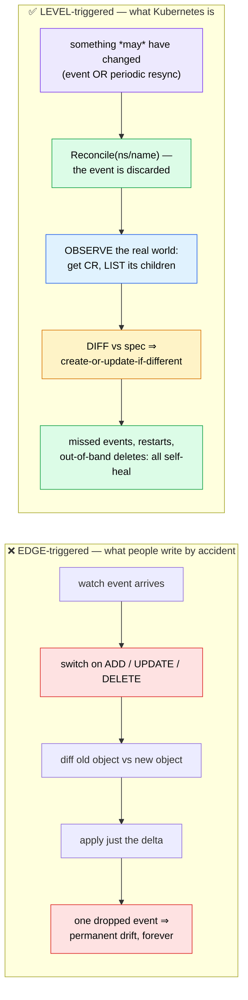
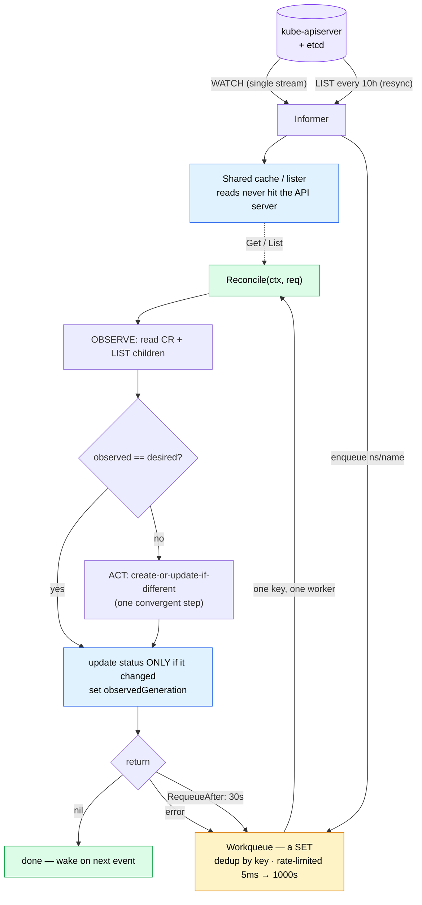

# Kubernetes Operators & CRDs — Encoding Operational Knowledge as Code

## 1. Why Should I Care About This?
- **The Operator Is Your On-Call Engineer Now**: When a Postgres primary dies, CloudNativePG or a Patroni-backed operator detects it, fences the old primary, promotes the most-caught-up replica, and repoints the read-write Service — typically in **well under 30 seconds**. A human paged at 3 AM takes 10–20 minutes just to open the runbook. That delta is the entire business case for the operator pattern, and it is also why the operator becomes a component whose own failure modes you must understand as well as the database's.
- **One `kubectl delete` on the Wrong Object Wipes an Entire Fleet**: Deleting a CustomResourceDefinition deletes **every custom resource of that kind, cluster-wide**, and each of those cascades through `ownerReferences` into its StatefulSets, Secrets, and PVCs. `kubectl delete crd clusters.postgresql.cnpg.io` is a one-line command that can garbage-collect every database in the cluster. This is why a GitOps prune must never be allowed to reach a CRD, and why CRDs get `Prune=false` and a deletion-protection policy.
- **A Webhook That Is Down Is a Cluster-Wide Outage**: An admission webhook with `failurePolicy: Fail` and zero ready endpoints causes the API server to **reject every CREATE and UPDATE to the resources it matches**. Match too broadly — Pods in all namespaces, say — and you cannot schedule the pod that would restore the webhook. The Kubernetes documentation carries an explicit warning about exactly this deadlock; operators that ship a validating webhook are the most common way teams walk into it.
- **Every Missing Finalizer Is a Recurring Invoice**: If your operator creates a cloud load balancer and the custom resource is deleted without a finalizer to clean it up, the LB survives with no owner and no tag anyone remembers. An AWS Network Load Balancer is **$0.0225/hour ≈ $16.40/month** before LCUs; an orphaned 1 TB gp3 volume is **$0.08/GB-month = $82/month**. Two hundred ephemeral dev namespaces churning weekly turns that into a five-figure annual line item that no cost dashboard attributes to anything.

## 2. What Problem Does This Solve?
- **Operational Knowledge Trapped in a Wiki**: "How do we fail over Redis?" lives in a Confluence page that only two people have read, is six months stale, and cannot be executed at 3 AM by a machine. An operator makes that knowledge **executable, versioned, tested, and reviewable in a pull request**.
- **Kubernetes Has No Opinion About Your Stateful System**: A Deployment can restart a crashed pod. It cannot promote a replica, replay WAL to a point in time, rebalance Kafka partitions, or renew a certificate 30 days before expiry. Those need domain knowledge that no built-in controller has, and Kubernetes' answer is not "add it to the core" — it is "extend the API."
- **No API for Your Platform**: Without a CRD, "give me a Postgres" means 400 lines of StatefulSet/Service/Secret/ConfigMap YAML copy-pasted per team, each subtly different. With one, it means `kind: Cluster` with six fields, validated by the API server, visible to `kubectl get`, and subject to the same RBAC as everything else.
- **Human-Speed Reactions to Machine-Speed Events**: Some responses must happen in seconds — certificate rotation, leader promotion, evacuating a node before a spot-instance reclaim (AWS gives **2 minutes** of notice). A control loop that is already watching can act inside that window; a human cannot.
- **Naive Approach**: A bash or Jenkins job wired to an alert, plus a Helm chart plus a runbook. It fails because the script is **imperative and assumes a starting state**: run it twice concurrently (two alerts fire, or the job retries) and you promote two replicas and get **split brain**. It has no idea what the world currently looks like, no way to resume after being killed halfway, and no record of what it observed. Every one of those problems is precisely what a reconciliation loop is designed to eliminate.

## 3. Core Idea (Intuition First)
An operator is **an on-call engineer's runbook compiled into a control loop**. But the mechanism that makes it work is stranger and more important than the metaphor, and it is best seen as the difference between a **thermostat and a doorbell**.

- A **doorbell is edge-triggered**: it reacts to a transition. If the wire is cut for a second while someone presses it, that press is gone forever and the doorbell has no way to discover it missed anything.
- A **thermostat is level-triggered**: it does not remember that someone opened a window. It reads the current temperature, compares it to the setpoint, and turns the heat on or off. Unplug it for an hour and plug it back in — it is immediately correct again, because it never held any history that could be lost.
- Every Kubernetes controller is a thermostat. `Reconcile(ctx, req)` is handed **only a namespace and a name** — deliberately no event, no old object, no "what changed." It re-reads the world, computes the difference from `spec`, and takes one convergent step.
- That single design choice is why a dropped watch event, an operator crash, a node reboot, or an out-of-band `kubectl delete` of a child object all **self-heal with no recovery code at all**. There is no state to lose, because desired state lives in etcd and observed state lives in the world.
- Which forces the other half of the design: because reconcile may run twice for one change, in any order, at any moment, **every action it takes must be idempotent** — create-or-update-if-different, never "do the next step."

> The mental image: **a thermostat, not a doorbell.** The controller never trusts the event that woke it; it only trusts what it can observe right now.

![Three-panel diagram of Kubernetes operators and CustomResourceDefinitions. Panel A is the anatomy in three linked boxes. The first is the CustomResourceDefinition itself, apiextensions.k8s.io slash v1, carrying group, version, kind and plural, a structural OpenAPI version 3 schema which is mandatory in v1 and which buys you server-side validation, field defaulting and kubectl explain for free, the status and scale subresources where scale is what makes kubectl scale and the horizontal pod autoscaler work against your own kind, additionalPrinterColumns for kubectl get output, and multiple versions with exactly one storage version plus a conversion webhook and CEL validation rules. The second box is an instance of the custom resource, split into a spec block that holds desired state and is written by humans and bumps metadata generation, a status block that holds observed state including observedGeneration and is written only by the controller, and a metadata block holding conditions such as Ready and Progressing, finalizers as a pre-delete hook, and ownerReferences that drive cascading garbage collection. The third box is the controller itself, containing an informer that combines a watch with a periodic full resync, a shared cache and lister so reads never hit the API server, a workqueue that deduplicates by namespace and name so a hundred events on one object collapse into a single reconcile and is rate limited from five milliseconds up to a thousand seconds, the Reconcile function which receives only a namespace and name, Owns and Watches mappings that translate a child event back into its parent's key, leader election so only one replica reconciles, MaxConcurrentReconciles for parallelism, and the rule that a resourceVersion conflict must be answered by re-reading and retrying rather than forcing. Panel B explains why the whole thing self-heals. It draws the loop as watch or resync, then workqueue keyed by namespace and name, then observe, diff and act, where the controller lists the real children, compares them to spec, and takes one convergent create-or-update-if-different step, then writes status only if status actually changed, then returns either nil, an error which triggers exponential backoff, or RequeueAfter, with a dashed requeue arrow going back into the same workqueue key so retries collapse. It then lists four situations that would break an edge-triggered system and heal themselves here: a dropped watch event which the periodic resync re-lists and fixes, an operator pod that is killed which simply re-lists everything at boot with no state to recover, someone deleting a child object out of band which the Owns watch surfaces as observed not equal to desired so the child is recreated, and two hundred events in one second which the workqueue collapses into a single reconcile because only the latest level matters. Panel B ends with a direct contrast: the edge-triggered style, on ADD do X, on UPDATE diff old against new, on DELETE undo X, where one dropped event means permanent drift; versus the level-triggered style, whatever woke me, read the world and make it match spec, which is idempotent, restartable at any instant, and eventually correct. Panel C is the judgement call and the maturity ladder. On the left, a Helm chart plus GitOps is enough when the only ongoing lifecycle work is applying new YAML, for stateless apps and config templating, because Argo CD already supplies the reconcile loop, and an unneeded operator is a permanent maintenance liability. On the right, you need an operator when there is genuine operational logic: leader failover and promotion in seconds, backup and restore and point-in-time recovery, certificate rotation, ordered version upgrades with data migration, and resharding or rebalancing — with the test being whether you could write it as a runbook, because a runbook can become a control loop. Below that is the five-level operator maturity model drawn as widening bars: level one basic install which a Helm chart already does, level two seamless upgrades exemplified by Strimzi for Kafka, level three full lifecycle with backup, point-in-time recovery and failover exemplified by CloudNativePG and cert-manager, level four deep insights with metrics, alerts and workload analysis exemplified by the Prometheus Operator, and level five autopilot with auto-scaling, auto-tuning and auto-remediation, noted as rare and as the point where the operator itself becomes a single point of failure for your data-plane failover.](../assets/k8s_operators_crds.svg)

> Panel A: the CRD defines the API, the object holds `spec` vs `status`, the controller supplies informer + cache + workqueue + reconciler. Panel B: level-triggered means the controller re-derives everything, which is why dropped events, restarts, and out-of-band deletes all self-heal. Panel C: a chart *installs*, an operator *operates* — and most published operators live at maturity level II or III.

## 4. How It Actually Works

### 1. The CRD — teaching the API server a new noun
- A **CustomResourceDefinition** (`apiextensions.k8s.io/v1`, GA since Kubernetes 1.16; `v1beta1` removed in 1.22) registers a new `group/version/kind` and its plural. From that moment the API server serves `/apis/postgresql.cnpg.io/v1/namespaces/x/clusters` with full CRUD, watch, RBAC, audit logging, label selectors, and `kubectl` support. **You did not write an API server; you described a type.**
- **`v1` requires a *structural* schema** — an OpenAPI v3 schema where every field is typed and `x-kubernetes-preserve-unknown-fields` is not sprayed everywhere. This is not paperwork: the schema is what gives you **server-side validation** (a typo'd field is rejected at `kubectl apply`, not silently ignored at reconcile time), **defaulting** (`default: 3`), **pruning** of unknown fields, and `kubectl explain clusters.spec.instances` for free.
- **`additionalPrinterColumns`** with a `jsonPath` is what makes `kubectl get clusters` print `INSTANCES / READY / PRIMARY / AGE` instead of just names and ages. It costs three lines and is the single highest-ratio usability feature in a CRD.
- **Multiple versions, one storage version.** You may serve `v1alpha1`, `v1beta1`, and `v1` simultaneously, but exactly one has `storage: true`. If the versions are not field-compatible you must supply a **conversion webhook** — the API server calls it to translate between the stored version and whatever the client asked for. Round-tripping must be lossless, which in practice means you keep an annotation to stash fields the older version cannot express. See [API Versioning](../02_API_Interface_Design/API_Versioning.md) — the constraints are identical, because a CRD *is* a public API.
- **CEL validation rules** (`x-kubernetes-validations`, beta in 1.25, GA in 1.29) let you express cross-field invariants *in the schema*: `rule: "self.maxReplicas >= self.minReplicas"`, or `rule: "self == oldSelf"` for immutable fields. **Trade-off**: CEL runs in-process in the API server, so it cannot be down and cannot add latency to an unrelated resource — which makes it strictly better than a validating webhook whenever it is expressive enough. Reach for a webhook only when you need to consult something outside the object (another resource, an external system).

### 2. `spec` vs `status`, subresources, and conditions
- **`spec` is desired state, written by humans and other controllers. `status` is observed state, written *only* by the controller.** Conflating them is the classic beginner error: if a user can write a field your controller also writes, you get a fight between two writers and a loop that never settles.
- Enabling the **`status` subresource** makes the split structural. Writes to `/status` do not modify `spec`, writes to the main resource do not modify `status`, and — the load-bearing detail — **`metadata.generation` increments only when `spec` changes**. That is what makes the `observedGeneration` guard possible.
- The **`scale` subresource** maps `specReplicasPath`, `statusReplicasPath`, and `labelSelectorPath` onto your fields. Turn it on and `kubectl scale cluster/db --replicas=5` works, and so does an **HPA targeting your custom kind** — see [Kubernetes Scheduling & Autoscaling](./Kubernetes_Scheduling_Autoscaling_HPA_VPA.md). It is roughly six lines of CRD YAML for a genuinely large capability.
- **Conditions are the Kubernetes API convention for "how is it going."** Each is `{type, status: True|False|Unknown, reason, message, lastTransitionTime, observedGeneration}`. `type` is a domain word (`Ready`, `Progressing`, `BackupComplete`), `status` is a tri-state because *unknown* is a real answer, and `reason` is a machine-readable CamelCase token that alerts and `kubectl wait --for=condition=Ready` key off. Emit conditions and your CRD composes with every existing tool; skip them and every consumer has to parse your prose.

### 3. Level-triggered, not edge-triggered — the one idea to take away
- `Reconcile(ctx, req)` receives a `types.NamespacedName` and **nothing else**. Not the event type. Not the previous object. This is a deliberate API design choice, argued at length in Joe Beda's "Level Triggering and Reconciliation in Kubernetes" and codified in the Kubernetes community's *Writing Controllers* guide.
- The body is always the same shape: **observe** (get the custom resource; list its real children), **diff** (what does `spec` say should exist, what actually exists), **act** (take one convergent step), **record** (update `status`), **return**.
- **Why this is not a stylistic preference.** Watch streams are lossy by design — the API server can send a `410 Gone` when a watch falls behind its etcd history window, connections drop, and the informer must re-LIST. An edge-triggered controller that computed "old vs new" would silently and permanently diverge. A level-triggered one loses nothing, because the next pass re-derives everything from the current level.
- **The return value is the control knob.** `return ctrl.Result{}, nil` means "I am done, wake me on the next event." Returning a non-nil `error` requeues the key with the workqueue's **exponential backoff (controller-runtime defaults: 5 ms doubling to a 1000 s cap)** and increments the `controller_runtime_reconcile_errors_total` metric. `return ctrl.Result{RequeueAfter: 30 * time.Second}, nil` means "not done yet, but this is not an error" — the correct answer for polling an external cloud operation, and the reason you should almost never `sleep` inside a reconcile.
- **A concrete consequence to say out loud in an interview**: you can `kubectl delete pod` the operator mid-reconcile, and correctness is unaffected. There is no in-memory progress to lose. That property is *only* available because the loop re-derives instead of resuming.



### 4. The machinery: informer, cache, workqueue, and why you must never poll
- An **informer** does one initial `LIST` and then holds a single long-lived `WATCH`, feeding a local **cache (store)** that you read through a **lister**. Every `client.Get`/`client.List` in controller-runtime hits that in-memory cache by default, not the API server. **This is the difference between an operator and an outage**: see the arithmetic in §10.
- On top of the watch sits a **periodic resync** — a full re-list that re-enqueues every object as belt-and-braces against missed events. `kube-controller-manager`'s `--min-resync-period` defaults to **12 h** (jittered), and controller-runtime's manager `SyncPeriod` defaults to **10 h ±10%**. It is deliberately slow: correctness comes from the watch, and the resync is the safety net. Lowering it to "make things feel responsive" is a smell — it usually means you forgot a `Watches()`.
- The **workqueue** is where the elegance lives. Keys are `namespace/name` strings, and the queue is a **set**: enqueue the same key 200 times while a reconcile is in flight and you get exactly **one** more reconcile. This is what makes a controller survive an event storm without any of its own rate limiting. It also guarantees a key is never processed by two workers at once, so within one operator you get per-object serialization for free.
- **`MaxConcurrentReconciles` defaults to 1.** Raise it to process different objects in parallel (a fleet of 500 databases will crawl at 1). Raising it too far is how you manufacture the conflict storm in §9 — start at 2–5, watch `workqueue_depth` and `controller_runtime_reconcile_time_seconds`, and remember every worker multiplies your write pressure on the API server.
- **`Owns()` and `Watches()` are how a child event finds its parent.** `Owns(&appsv1.StatefulSet{})` installs a handler that reads the child's `ownerReferences` and enqueues the *owner's* key. `Watches(&corev1.Secret{}, handler.EnqueueRequestsFromMapFunc(fn))` covers the non-owned case: your `fn` maps an arbitrary object to a list of parent keys. **Getting this wrong is the most common reason an operator "works but takes 10 hours to notice"** — that is the resync period doing the job the missing watch should have done.
- **Leader election** (Lease-based; controller-runtime defaults: 15 s lease duration, 10 s renew deadline, 2 s retry period) lets you run 3 replicas for availability while only one reconciles. Run without it and two replicas fight over the same objects. This is the same primitive as [Distributed Locking & Leader Election](../10_Microservices_Distributed_Systems/Distributed_Locking_Leader_Election.md), backed by the same Raft-replicated etcd described in [Distributed Consensus](../10_Microservices_Distributed_Systems/Distributed_Consensus_Raft_Paxos.md).



### 5. Optimistic concurrency, conflicts, and the `observedGeneration` guard
- Every object carries a **`resourceVersion`** — an opaque etcd revision. An update sends the version you read; if it changed underneath you, the API server returns **`409 Conflict`**. This is optimistic concurrency control, exactly as in a database.
- **The correct response to a conflict is: re-read the object, recompute, retry.** Return the error and let the workqueue's backoff handle the rescheduling, or use `retry.RetryOnConflict`. **The wrong response is to clear `resourceVersion` and force the write** — that is a blind last-writer-wins overwrite that silently destroys another actor's change. If you ever find yourself wanting to force, the real fix is usually a **server-side apply** with your own field-manager, so you only own the fields you actually manage.
- **`status.observedGeneration` vs `metadata.generation`** is the guard that keeps the loop honest. `generation` bumps only on `spec` changes; so `status.observedGeneration < metadata.generation` means *"my status describes an older spec — do not trust my `Ready` condition yet."* Every consumer (`kubectl wait`, your alerts, a parent controller) should check it, and every reconcile should set it. Skipping it produces the classic bug where a resource reports `Ready: True` for a spec it has not applied yet.

### 6. Idempotency is the design constraint, not a nice-to-have
- Because a reconcile can run twice for one change, in any order, at any time, **every action must be expressed as a convergent assertion**, not a step: `CreateOrUpdate(desired)` rather than `Create()`; "ensure exactly N members exist" rather than "add a member." This is the same discipline as [Idempotency](../02_API_Interface_Design/Idempotency.md) in API design, applied to infrastructure mutation.
- **The rule to internalise: the controller must be safe to `kill -9` at any single instant.** Test it by literally doing that in CI. Any place where correctness depends on "and then the next line runs" is a bug, and the fix is to make the intermediate state observable in the world (a created object, an annotation, a status field) so the next pass can see where it got to.
- **One convergent step per pass, not the whole plan.** If a rolling upgrade needs to replace 5 pods, replace one, record it in `status`, and return `RequeueAfter`. This keeps each reconcile short (long reconciles block the worker and cause conflict storms), and makes every intermediate state a legitimate resting place. It is a [state machine](../04_Low_Level_Design/State_Machines.md) whose current state is read from the world rather than held in memory.

### 7. Finalizers and `ownerReferences` — deletion is the hard part
- **`ownerReferences` drive cascading garbage collection.** Stamp your child objects with `ownerReferences: [{apiVersion, kind, name, uid, controller: true, blockOwnerDeletion: true}]` and the garbage collector deletes them when the parent goes. Propagation is `Background` (default for `kubectl delete`), `Foreground` (children first, parent blocked by a finalizer), or `Orphan`. **Two hard rules**: owner references cannot cross namespaces, and a namespaced object cannot own a cluster-scoped one — violate either and the GC treats the dependent as orphaned and may delete it.
- **Finalizers are the pre-delete hook.** A string in `metadata.finalizers` (e.g. `db.example.com/cleanup`) makes `DELETE` **non-destructive**: the API server sets `metadata.deletionTimestamp` and the object stays. Your reconcile sees the timestamp, does the external cleanup — delete the RDS snapshot, deregister from Consul, release the elastic IP — and only then **removes its own finalizer string**, at which point the object actually disappears. This is the only correct way to clean up something Kubernetes does not own.
- **The finalizer's two failure modes are mirror images.** Forget one and you leak a billing cloud resource forever. Add one whose cleanup can never succeed (the credentials rotated, the external API is gone, the operator was uninstalled) and the object is **permanently undeletable** — and so is its namespace, which will sit in `Terminating` forever. The escape hatch, `kubectl patch pg/db --type=merge -p '{"metadata":{"finalizers":null}}'`, works and should scare you: it deletes the record of the thing without deleting the thing.

### 8. Frameworks, and the distribution story
- **controller-runtime + Kubebuilder** is the mainstream: Go, a `Manager` that owns caches and leader election, a `Builder` DSL (`For().Owns().Complete()`), `controller-gen` generating CRD YAML and RBAC from Go struct tags and `// +kubebuilder:` markers, and envtest for running tests against a real API server binary. Almost every serious operator you have used is built on it.
- **Operator SDK** wraps controller-runtime and adds two non-Go flavours. The **Ansible operator** maps a CR to a playbook run; the **Helm operator** maps a CR to `helm upgrade --install` of a chart. The Helm-based operator is genuinely useful and genuinely limited: it is *"reconcile a chart"* and nothing more. It stops being enough the instant you need to read state back out of the running system — you cannot express "if the primary is unreachable for 30 s, promote the replica with the highest LSN" as chart values.
- **Lightweight paths**: **Metacontroller** runs the informers, cache, and workqueue for you and calls *your* webhook with observed parent + children, expecting the desired children back as JSON — a level-triggered controller in any language, in ~100 lines. **Kopf** (Python) and **shell-operator** (Flant, bash + jq) are excellent for glue automation where a full Go operator is overkill. All three trade fine-grained control (custom rate limiters, multi-watch topologies, subresource handling) for a fraction of the code.
- **Distribution**: the **Operator Lifecycle Manager** models an operator as a `ClusterServiceVersion` with a `Subscription` to a `CatalogSource`, giving versioned installs, dependency resolution, and automatic or manual upgrade approval — plus a `Channel` concept for stable/fast tracks. **OperatorHub.io** is the public catalogue. If you are not on OpenShift, most teams simply ship a Helm chart that installs the CRDs and the operator Deployment, which is fine — but note the sharp edge: **Helm's own CRD handling is deliberately conservative** (`crds/` are installed but never upgraded), so CRD schema migrations end up as a manual `kubectl apply` step you must document.

## 5. Real-World Example
**Prometheus Operator — the best-known CRD design in the ecosystem.** Before it, adding a service to Prometheus meant editing a central `prometheus.yml` and reloading. The operator introduces `ServiceMonitor` and `PodMonitor`: a team ships a `ServiceMonitor` next to its own Deployment declaring "scrape port `metrics`, path `/metrics`, every 30 s," and the operator watches those objects, **generates the entire Prometheus scrape config, writes it into a Secret, and triggers a reload**. `PrometheusRule` does the same for alerting rules. The insight worth stealing is architectural: it turned *central configuration* into a *distributed, self-service, namespace-scoped API* with RBAC as the guardrail — and it is why `kube-prometheus-stack` installs on the order of ten CRDs. See [Metrics Collection (Prometheus & Grafana)](../12_Monitoring_Logging_Observability/Metrics_Collection_Prometheus_Grafana.md).

**cert-manager — a control loop that beats a calendar reminder.** Let's Encrypt certificates are valid for **90 days**, and Let's Encrypt enforces a rate limit of **50 certificates per registered domain per week**. cert-manager models this as `Issuer`/`ClusterIssuer` (the CA and ACME account), `Certificate` (what you want), and the internal `CertificateRequest`/`Order`/`Challenge` chain that drives ACME's HTTP-01 or DNS-01 challenge — provisioning a temporary Ingress or a TXT record, waiting for validation, then writing the key pair into a Secret. It renews at roughly **two-thirds of the lifetime, ~30 days before expiry**, so a certificate outage requires the operator to be broken for a month before anyone notices. Its cautionary tale is equally instructive: cert-manager ships a validating webhook, and a cert-manager whose webhook pods are unschedulable blocks all `Certificate` writes.

**CloudNativePG / Zalando's postgres-operator — level III, where operators earn their keep.** These encode the parts of running Postgres that are genuinely hard: bootstrapping streaming replication, choosing and promoting a new primary while fencing the old one (Zalando's delegates this to **Patroni**, which itself does leader election through the Kubernetes API or etcd), continuously archiving WAL to object storage so you can do **point-in-time recovery to an arbitrary timestamp**, and running a `Backup`/`ScheduledBackup` lifecycle. The reason this must be an operator and not a chart is that **the correct action depends on live observed state** — which replica has the highest LSN right now — and no amount of templating can ask that question.

**Strimzi — ordered upgrades and rebalancing as declarative objects.** Strimzi's `Kafka` CR drives rolling broker restarts in an order that respects partition leadership and ISR so the cluster stays available, coordinates the two-step `inter.broker.protocol.version` dance that a Kafka version upgrade requires, and exposes `KafkaRebalance` as a CR that hands the actual optimisation to **Cruise Control** and writes the proposal back into `status` for a human to approve. That last detail is a pattern worth copying: **a CR whose `status` holds a plan awaiting approval** is how you build an operator that automates the tedious part without automating the scary part.

## 6. Code Example
A compact CRD: structural schema, defaults, CEL, printer columns, and the `status` and `scale` subresources.

```yaml
apiVersion: apiextensions.k8s.io/v1
kind: CustomResourceDefinition
metadata:
  name: caches.data.example.com          # MUST be <plural>.<group>
spec:
  group: data.example.com
  scope: Namespaced
  names: { kind: Cache, plural: caches, singular: cache, shortNames: [ch] }
  versions:
    - name: v1
      served: true
      storage: true                      # ── exactly ONE version may be the storage version
      subresources:
        status: {}                       # ── LOAD-BEARING: splits the writers, and makes
                                         #    metadata.generation bump ONLY on spec changes
        scale:                           # ── this is what makes `kubectl scale` + HPA work
          specReplicasPath: .spec.replicas
          statusReplicasPath: .status.readyReplicas
          labelSelectorPath: .status.selector
      additionalPrinterColumns:          # `kubectl get caches` becomes readable for 4 lines of YAML
        - { name: Replicas, type: integer, jsonPath: .spec.replicas }
        - { name: Ready,    type: integer, jsonPath: .status.readyReplicas }
        - { name: Phase,    type: string,  jsonPath: .status.phase }
        - { name: Age,      type: date,    jsonPath: .metadata.creationTimestamp }
      schema:
        openAPIV3Schema:                 # structural schema is MANDATORY in v1
          type: object
          properties:
            spec:
              type: object
              required: [replicas]
              properties:
                replicas:  { type: integer, minimum: 1, maximum: 9, default: 3 }
                version:   { type: string, pattern: '^7\.[0-9]+\.[0-9]+$' }
                backupBucket: { type: string }
              x-kubernetes-validations:  # CEL (GA in 1.29) — beats a validating webhook,
                                         # because in-process rules cannot be "down"
                - rule: "self.replicas % 2 == 1"
                  message: "replicas must be odd so a quorum always exists"
            status:                      # users never write this; the controller owns it
              type: object
              properties:
                phase:         { type: string }
                readyReplicas: { type: integer }
                selector:      { type: string }
                observedGeneration: { type: integer, format: int64 }
                conditions:            # the standard API convention — compose with kubectl wait
                  type: array
                  items:
                    type: object
                    required: [type, status, lastTransitionTime, reason]
                    properties:
                      type:               { type: string }
                      status:             { type: string, enum: ["True","False","Unknown"] }
                      reason:             { type: string }
                      message:            { type: string }
                      lastTransitionTime: { type: string, format: date-time }
                      observedGeneration: { type: integer, format: int64 }
```

The reconciler. Observe → diff → act → status, with the finalizer and the `observedGeneration` guard as the two load-bearing blocks.

```go
const finalizerName = "data.example.com/cleanup"

func (r *CacheReconciler) Reconcile(ctx context.Context, req ctrl.Request) (ctrl.Result, error) {
	// ── OBSERVE. req carries ONLY namespace/name — no event, no old object.
	//    This is the level-triggered contract: we re-derive everything, every time.
	var cache datav1.Cache
	if err := r.Get(ctx, req.NamespacedName, &cache); err != nil {
		return ctrl.Result{}, client.IgnoreNotFound(err) // already gone ⇒ nothing to converge
	}

	// ── DELETION PATH. A finalizer turns DELETE into "set deletionTimestamp",
	//    which is our only chance to clean up the S3 bucket Kubernetes knows nothing about.
	if !cache.DeletionTimestamp.IsZero() {
		if controllerutil.ContainsFinalizer(&cache, finalizerName) {
			if err := r.deleteExternalBucket(ctx, &cache); err != nil {
				return ctrl.Result{}, err // requeued with backoff; object stays until we succeed
			}
			controllerutil.RemoveFinalizer(&cache, finalizerName) // ⇐ THE object vanishes here
			return ctrl.Result{}, r.Update(ctx, &cache)
		}
		return ctrl.Result{}, nil
	}
	if !controllerutil.ContainsFinalizer(&cache, finalizerName) {
		controllerutil.AddFinalizer(&cache, finalizerName) // add BEFORE creating anything external
		return ctrl.Result{}, r.Update(ctx, &cache)        //   — otherwise a crash in between leaks
	}

	// ── DIFF + ACT. Convergent assertion, not a step. Safe to run twice, in any order.
	sts := desiredStatefulSet(&cache)
	if err := ctrl.SetControllerReference(&cache, sts, r.Scheme); err != nil { // ⇐ cascading GC
		return ctrl.Result{}, err
	}
	op, err := controllerutil.CreateOrUpdate(ctx, r.Client, sts, func() error {
		sts.Spec.Replicas = ptr.To(cache.Spec.Replicas) // mutate only fields WE own
		sts.Spec.Template.Spec.Containers[0].Image = "redis:" + cache.Spec.Version
		return nil
	})
	if err != nil {
		// A 409 Conflict lands here. CORRECT: return it and let the workqueue re-run us
		// (5ms → 1000s exponential backoff) so we re-READ first. NEVER clear resourceVersion.
		return ctrl.Result{}, err
	}
	if op != controllerutil.OperationResultNone {
		r.Recorder.Eventf(&cache, corev1.EventTypeNormal, "Reconciled", "statefulset %s", op)
	}

	// ── RECORD. Compute status from the OBSERVED world, never from what we just asked for.
	live := &appsv1.StatefulSet{}
	if err := r.Get(ctx, client.ObjectKeyFromObject(sts), live); err != nil {
		return ctrl.Result{}, err
	}
	next := cache.Status.DeepCopy()
	next.ReadyReplicas = live.Status.ReadyReplicas
	next.ObservedGeneration = cache.Generation // ⇐ "this status describes THIS spec"
	setCondition(next, metav1.Condition{
		Type:               "Ready",
		Status:             boolToCond(live.Status.ReadyReplicas == cache.Spec.Replicas),
		Reason:             "StatefulSetReady",
		ObservedGeneration: cache.Generation,
	})

	// ── THE MOST IMPORTANT LINE IN THE FILE: only WRITE when status actually differs.
	//    A status write triggers our own watch. Write unconditionally and you have built
	//    an infinite hot loop that will saturate the API server and etcd.
	if !equality.Semantic.DeepEqual(next, &cache.Status) {
		cache.Status = *next
		if err := r.Status().Update(ctx, &cache); err != nil {
			return ctrl.Result{}, err
		}
	}
	if next.ReadyReplicas != cache.Spec.Replicas {
		return ctrl.Result{RequeueAfter: 15 * time.Second}, nil // not an error — just not done
	}
	return ctrl.Result{}, nil
}

func (r *CacheReconciler) SetupWithManager(mgr ctrl.Manager) error {
	return ctrl.NewControllerManagedBy(mgr).
		For(&datav1.Cache{}).
		Owns(&appsv1.StatefulSet{}). // maps a child event back to its OWNER's key via ownerReferences
		WithOptions(controller.Options{MaxConcurrentReconciles: 4}). // default is 1
		Complete(r)
}
```

What the operator's contract looks like from the outside:

```bash
$ kubectl get caches
NAME      REPLICAS   READY   PHASE     AGE      # ← additionalPrinterColumns earning its keep
sessions  3          3       Running   14d

$ kubectl get cache sessions -o jsonpath='{.metadata.generation} {.status.observedGeneration}'
7 7                        # equal ⇒ status describes the CURRENT spec. If 8 vs 7: don't trust Ready.

$ kubectl get cache sessions -o yaml | yq '.status.conditions'
- type: Ready
  status: "True"
  reason: StatefulSetReady
  lastTransitionTime: "2026-07-21T09:14:02Z"
  observedGeneration: 7

$ kubectl wait --for=condition=Ready cache/sessions --timeout=300s   # works BECAUSE we emit conditions
$ kubectl scale cache/sessions --replicas=5                          # works BECAUSE of the scale subresource
$ kubectl explain caches.spec.replicas                               # works BECAUSE the schema is structural
```

## 7. Design Variations & Alternatives

| Approach | What it reconciles | Ongoing operational logic? | Cost to own | Use when |
|---|---|---|---|---|
| **Helm chart, `helm upgrade` by hand** | Nothing — it renders and applies once | ❌ | ~200 lines of templates | One-off installs, dev clusters, things a human already babysits |
| **Chart + GitOps (Argo CD / Flux)** | Git → cluster, continuously | ❌ (but drift *is* corrected) | A repo and a sync policy | **The default.** Argo CD already gives you a level-triggered loop over YAML |
| **Helm-based operator** (Operator SDK) | A CR's values → `helm upgrade` | ⚠️ install/upgrade only | Low — no Go | You want a CRD-shaped self-service API over an existing chart, nothing more |
| **Ansible operator** | A CR → a playbook run | ⚠️ imperative, so idempotency is on you | Low–medium | Your ops knowledge is already playbooks and touches things outside the cluster |
| **Go operator** (Kubebuilder / controller-runtime) | Arbitrary desired ↔ observed state | ✅ full | High: 3–8k LoC + a permanent owner | Failover, backup/PITR, resharding, ordered upgrades with data migration |
| **Metacontroller / Kopf / shell-operator** | Same loop, your language, less control | ✅ moderate | Very low | Glue automation, small internal platform CRDs, prototypes |
| **Crossplane** | *Cloud* resources, as Kubernetes objects | ✅ (for infrastructure) | Medium: providers + XRDs | You want cloud infra continuously reconciled by a controller rather than by a `plan/apply` run |

**The maturity model is the honest way to scope the work.** The Operator Framework's five capability levels: **I Basic Install** (provision and configure — a Helm chart already does this), **II Seamless Upgrades** (version and ordered rolling upgrade — Strimzi), **III Full Lifecycle** (backup, restore, PITR, failover — CloudNativePG, cert-manager), **IV Deep Insights** (metrics, alerts, workload analysis — Prometheus Operator), **V Auto Pilot** (auto-scaling, auto-tuning, auto-remediation with no human). Most published operators stop at II or III, and that is the correct place to stop for most internal platforms: **level I is a chart wearing a costume, and level V is where the operator becomes a single point of failure for your data plane.** Pick a level deliberately and write it in the design doc.

**Crossplane vs Terraform is the interesting architectural argument** and a genuine competitor to [Infrastructure as Code (Terraform)](./Infrastructure_as_Code_Terraform.md). Terraform is a **plan/apply run**: a human or a pipeline invokes it, it reads a **state file**, diffs, shows you a plan, applies, and then stops existing. Between runs, nothing is watching — drift persists until the next `apply`, and the state file is a piece of shared mutable state you must lock and must never lose. Crossplane inverts it: cloud resources become custom resources, and a controller reconciles them **continuously**, with the "state file" being the API server itself (and the live cloud API as the observed level). Delete a bucket by hand and Crossplane recreates it in seconds. The trade-offs are real in both directions: you lose the pre-merge `terraform plan` as a review artifact and the enormous provider ecosystem's maturity, and you gain a permanent reconciler, RBAC, and the ability to compose infra into a self-service `XRD` claim. Most large orgs end up with both — Terraform for the account/network/cluster foundation, Crossplane or an operator for what teams provision themselves.

## 8. Pros and Cons

### The operator pattern
- **Pros**: operational knowledge becomes versioned, tested, reviewable code instead of a wiki page; reactions happen in seconds rather than at pager speed; the loop is idempotent and restart-safe so there is no recovery logic to write; it inherits RBAC, audit logging, admission control, `kubectl`, and events for free; and it gives every team the *same* interface to a complex system.
- **Cons**: a Go operator is a real long-lived service with its own SLO, upgrade path, RBAC surface, and on-call owner — typically thousands of lines to reach level III; a bug in it operates on your most critical stateful data; over-broad cluster-wide RBAC (`get secrets` at cluster scope is common) makes it a **privilege-escalation target**; and it adds an availability dependency between your control plane and your data plane, so a control-plane upgrade can now stall a database failover.

### CRDs as your platform API
- **Pros**: the API server does validation, defaulting, versioning, RBAC, and audit for you; `kubectl get/describe/explain/wait` all work on day one; printer columns and conditions make it feel native; CEL rules and a structural schema catch typos at `apply` time rather than at 3 AM.
- **Cons**: it is a **public API you now have to version forever** — a breaking field change needs a new version, a storage version migration, and a conversion webhook; CRs live in etcd and count against its **~1.5 MiB per-object** limit and its total DB size; a CRD is a cluster-scoped object with a terrifying deletion blast radius; and every extra CRD adds to the API discovery document that every client must fetch.

### Helm chart + GitOps instead
- **Pros**: zero new code to own; the reconcile loop already exists in Argo CD or Flux and is someone else's job to keep running; the diff is reviewable in a PR; upgrades are a version bump; drift is corrected without you writing a controller.
- **Cons**: it cannot read state back out of the running system, so it can never express "promote whichever replica has the highest LSN"; ordering and multi-step migrations degrade into hooks and `sync-wave` annotations that are hard to reason about; there is no place to record observed status; and Helm never upgrades CRDs from `crds/`, so schema migrations become a manual runbook step anyway.

## 9. Failure Scenarios & What Can Go Wrong
- **SYMPTOM**: the operator pod pins a CPU core, `apiserver_request_total` for your kind spikes to thousands/s, and etcd disk-latency alerts fire — with no user activity at all. **ROOT CAUSE**: a **hot reconcile loop**. The controller writes `status` on every pass, the write bumps `resourceVersion`, its own watch fires, and it reconciles again forever. **FIX**: only call `Status().Update()` when the computed status actually differs (`equality.Semantic.DeepEqual`), never write a monotonically-changing field like a timestamp into status on every pass, gate expensive work on `status.observedGeneration == metadata.generation`, and add a `predicate.GenerationChangedPredicate` where you genuinely only care about spec changes.
- **SYMPTOM**: `Operation cannot be fulfilled … the object has been modified` floods the logs and reconcile latency climbs. **ROOT CAUSE**: a **resource-version conflict storm** — `MaxConcurrentReconciles` raised too high, or several controllers (including yours, twice) writing the same object, so optimistic concurrency rejects most writes. **FIX**: lower concurrency, split ownership so exactly one controller writes each field (or adopt **server-side apply** with a distinct field manager), shorten reconciles so the read-modify-write window is small, and treat conflicts as normal by returning the error and letting backoff reschedule.
- **SYMPTOM**: `kubectl delete` succeeded months ago, but a cloud load balancer and a 1 TB volume are still on the bill with no owning object. **ROOT CAUSE**: **no finalizer** — the CR was removed before the operator could delete the external resource, so the cleanup code never ran and nothing remembers the resource exists. **FIX**: add the finalizer *before* creating anything external, make cleanup idempotent, and run a scheduled reconciliation against the cloud provider that reports resources tagged with a cluster ID that has no matching CR.
- **SYMPTOM**: `kubectl delete` hangs forever; the namespace sits in `Terminating` for days. **ROOT CAUSE**: a **stuck finalizer** — the operator is uninstalled, or its cleanup fails permanently (rotated credentials, deleted external system), so nothing will ever remove the string. **FIX**: fix or temporarily reinstall the operator so cleanup completes properly. The escape hatch — `kubectl patch … --type=merge -p '{"metadata":{"finalizers":null}}'` — **deletes the record without deleting the thing**, so use it only after you have confirmed by hand that the external resource is gone, and never as routine practice.
- **SYMPTOM**: every database in the cluster disappears at once, including their PVCs, minutes after a routine GitOps sync. **ROOT CAUSE**: the **CRD was deleted** — by a prune, a `helm uninstall`, or a "clean up unused CRDs" ticket — and deleting a CRD garbage-collects every custom resource of that kind, which cascades through `ownerReferences` into StatefulSets, Secrets, and volumes. **FIX**: never let automation delete CRDs: `argocd.argoproj.io/sync-options: Prune=false` on every CRD, exclude CRDs from prune at the Application level, use a separate repo/`Application` with stricter review for them, and keep `reclaimPolicy: Retain` on the StorageClass so the volumes survive even a full mistake.
- **SYMPTOM**: all writes to a resource fail cluster-wide with `failed calling webhook … no endpoints available`, and new pods cannot be created to fix it. **ROOT CAUSE**: a validating or mutating **webhook is down with `failurePolicy: Fail`**, and its `rules` match more than they needed to. **FIX**: scope `rules` as narrowly as possible (your API group only, never `*/*`), add a `namespaceSelector` that **excludes** `kube-system` and the webhook's own namespace, run the webhook with ≥2 replicas plus a PDB and anti-affinity, set a low `timeoutSeconds` (≤5), and prefer **CEL validation rules** so there is no webhook to be down at all.
- **SYMPTOM**: two StatefulSets (or two cloud resources) exist where one was intended, occasionally, under load. **ROOT CAUSE**: a **stale cache read** — the informer cache had not yet observed the object this same controller created a moment ago, so the next pass concluded it was missing and created it again. **FIX**: use **deterministic names** derived from the parent so the second create fails with `AlreadyExists` instead of duplicating, and for the one critical existence check use a live (non-cached) client read or `APIReader`. Never fix this with a `sleep`.
- **SYMPTOM**: a Postgres primary is down and no failover happens; the operator's pod is `Pending` because the cluster is out of capacity or mid-upgrade. **ROOT CAUSE**: the **operator is a single point of failure for a data-plane action**. **FIX**: give the operator a `system-cluster-critical` PriorityClass, resource requests, a PDB, and multiple replicas with leader election; run it in a namespace that is not subject to the same eviction pressure; and — the senior move — **alert on the operator's own liveness and reconcile-error metrics as a critical SLI**, because a silent operator looks exactly like a healthy one.
- **SYMPTOM**: a compromised sidecar in one namespace reads Secrets from every namespace. **ROOT CAUSE**: **over-broad ClusterRole on the operator**, plus a Role/ClusterRole binding that lets a lower-privileged user create a CR the operator will act on with its own privileges. **FIX**: generate RBAC from markers and then read the diff; prefer namespace-scoped Roles and a watch restricted to specific namespaces; never grant `secrets` `list`/`watch` cluster-wide when `get` on named secrets will do; and remember that **anyone who can write your CR can command your operator** — the operator's permissions are the real blast radius.

## 10. Impact on Scalability, Reliability & Cost
- **Scalability**: the constraint is **API server watch/list load, not your reconcile logic**. A controller managing 5,000 custom resources of ~4 KB each that naively `LIST`s all of them every 10 s pulls 20 MB per list × 6/min ≈ **2 MB/s of serialization per controller**; twenty such controllers is 40 MB/s of pure JSON encoding and easily exhausts the API server's default `--max-requests-inflight` of 400. An informer does **one LIST at boot plus a single watch stream**, and holds the 20 MB in memory where reads are free — which is why *"never poll in a reconcile"* is a hard rule, not advice. On the storage side, each CR must stay under etcd's **~1.5 MiB per-object limit** and the whole DB should stay under the **recommended 8 GB** (default quota is 2 GiB), so 5,000 CRs × 20 KB ≈ 100 MB is fine while stuffing logs or a rendered manifest into `status` is not.
- **Reliability**: the operator's own availability becomes part of your data plane's. With controller-runtime defaults, a killed leader is replaced after the **15 s lease expiry** plus a couple of seconds of retry, and then the new leader must re-LIST its caches — call it a **20–30 second blind window** on a modest cluster. If your failover RTO is 10 s, the operator cannot be the only mechanism (this is exactly why Zalando's operator delegates promotion to Patroni running *inside* the database pods). Conversely, level-triggering buys you enormous reliability for free: the worst case for a missed watch event is not corruption but **latency bounded by the resync period**, which is why that 10–12 h default is defensible.
- **Cost**: the dominant cost is engineering, not compute. The operator itself is one pod — ~100–300 MB RSS and a fraction of a core, call it **$10–20/month**. A level-III Go operator is realistically **3–8k lines plus tests, envtest CI, and a named owner for years**; if the alternative is a 200-line Helm chart that a GitOps controller already reconciles, the operator has to be worth several engineer-months annually. Set against that: one avoided 30-minute database outage, or the ~$16.40/month NLB × 200 leaked resources that a finalizer prevents, and the arithmetic flips fast for anything stateful. The cost that actually bites is the one nobody budgets — **the maintenance tail of an operator that reached level I and stopped.**

## 11. When NOT to Use This
- **Don't write an operator when the only ongoing work is "apply new YAML."** That is a Helm chart plus [GitOps (Helm & Argo CD)](./GitOps_Helm_ArgoCD.md), and Argo CD's sync loop already gives you continuous reconciliation and drift correction. An operator that only installs things is a level-I operator: all of the maintenance, none of the leverage.
- **Don't write an operator for a stateful system a vendor already operates.** CloudNativePG, Strimzi, and cert-manager represent hundreds of engineer-years of edge cases in failover and recovery. Your version will be worse at the exact moment it matters most — see [Managed Services vs Self-Hosted](./Managed_Services_vs_Self_Hosted.md) for the same argument at the platform level.
- **Don't use a CRD as a database or a queue.** Every write is a Raft round-trip fsynced on an etcd quorum and fans out to every watcher in the cluster; objects cap at ~1.5 MiB; there are no transactions across objects and no indexes beyond labels. A controller that writes status every second across 10,000 objects is a self-inflicted etcd incident.
- **Don't put a validating webhook in the path of resources you do not own.** A webhook matching `pods` in all namespaces with `failurePolicy: Fail` is a cluster-wide outage waiting for a bad deploy. Use CEL rules in the CRD schema, and if you truly need a webhook, scope it to your own API group and exclude system namespaces.
- **Don't build an operator whose failover is faster than your ability to debug it.** A level-V autopilot that auto-tunes and auto-remediates will eventually take a confident, wrong, automated action across your whole fleet. Ship the plan into `status` for approval first (as Strimzi's `KafkaRebalance` does), add a kill switch annotation that pauses reconciliation, and only then close the loop.

## 12. Interview Perspective
- **What interviewers expect**: that you can define a CRD and a controller separately, and then say the sentence that separates readers from builders — **"Kubernetes controllers are level-triggered, not edge-triggered: `Reconcile` gets only a namespace and name, re-derives observed state from the world, and takes one convergent step — which is why a missed event, a controller restart, and an out-of-band delete all self-heal."** Follow it immediately with the consequence: therefore every action must be idempotent.
- **The trap question**: *"We need to add a Redis cluster to our platform — would you write an operator?"* The wrong answer starts scaffolding Kubebuilder. The right answer asks **what the ongoing operational work is**: if it is "install it and apply new YAML," a Helm chart plus GitOps is correct and an operator is a maintenance liability; if it includes failover, backup and PITR, ordered upgrades with data migration, or resharding, then it is an operator — and even then, use CloudNativePG/Strimzi rather than writing your own. Then name the maturity level you are targeting and why you are stopping there.
- **The math question**: *"Your operator manages 5,000 CRs. What breaks first?"* Walk it: 5,000 × 4 KB ≈ 20 MB of cached objects — trivial in RAM. But a 10-second poll is 20 MB × 6/min ≈ **2 MB/s per controller** of API server serialization against a default in-flight budget of 400 requests, so **the API server breaks first, not you** — hence informers. Then reconcile throughput: at `MaxConcurrentReconciles: 1` and 200 ms per pass, one full sweep of 5,000 objects takes **~17 minutes**; at 8 workers, ~2 minutes. Then etcd: 5,000 × 20 KB ≈ 100 MB against a recommended 8 GB ceiling — fine, until someone writes logs into `status`.
- **The subtle question**: *"Why does `Reconcile` deliberately not receive the event?"* Because receiving it would tempt you to trust it, and watch streams are lossy — a `410 Gone` after falling behind etcd's history window, a dropped connection, a restart. Discarding the event makes the loss unobservable and therefore harmless: correctness depends only on state you can read *now*. The same reasoning explains the periodic resync, the deduplicating workqueue, and why `observedGeneration` exists.
- **Bonus signals**: naming `observedGeneration` as the guard against reporting `Ready` for a spec you have not applied; the finalizer-vs-orphan trade-off with a dollar figure; knowing that deleting a CRD cascades to every CR; `failurePolicy: Fail` on a down webhook as a cluster-wide outage and CEL as the way to avoid it; server-side apply as the real fix for conflict storms; the `scale` subresource making HPA work on a custom kind; and Crossplane vs Terraform framed as **a continuous reconciler versus a plan/apply run with a state file**.

## 13. Connections to Other Topics
- [Container Orchestration (Kubernetes Objects)](./Kubernetes_Objects_Pods_Services.md) — the prerequisite: Deployments and StatefulSets are themselves built from exactly this controller pattern, so an operator is not an extension bolted on but the same mechanism applied to your own kind.
- [Infrastructure as Code (Terraform)](./Infrastructure_as_Code_Terraform.md) — the direct competitor to Crossplane: a plan/apply run with a state file versus a controller that reconciles cloud resources continuously.
- [GitOps (Helm & Argo CD)](./GitOps_Helm_ArgoCD.md) — the alternative that is usually correct, and the source of the CRD-prune footgun; also where `sync-options: Prune=false` on CRDs belongs.
- [Kubernetes Scheduling & Autoscaling (HPA/VPA)](./Kubernetes_Scheduling_Autoscaling_HPA_VPA.md) — the `scale` subresource is what lets an HPA target your custom resource, and the HPA is itself a textbook level-triggered controller.
- [Distributed Locking & Leader Election](../10_Microservices_Distributed_Systems/Distributed_Locking_Leader_Election.md) — the Lease-based election that keeps exactly one operator replica reconciling, and the same primitive a database operator uses to pick a primary.
- [Retry, Timeout & Backoff Patterns](../10_Microservices_Distributed_Systems/Retry_Timeout_Backoff_Patterns.md) — the workqueue's 5 ms → 1000 s exponential rate limiter is this pattern implemented for you; `RequeueAfter` is its cooperative form.
- [Idempotency](../02_API_Interface_Design/Idempotency.md) — the design constraint that makes reconcile safe to run twice, in any order, and safe to kill at any instant.
- [API Versioning](../02_API_Interface_Design/API_Versioning.md) — a CRD is a public API forever: served versions, one storage version, and a conversion webhook are the Kubernetes-flavoured version of the same problem.
- [State Machines](../04_Low_Level_Design/State_Machines.md) — a reconciler is a state machine whose current state is *read from the world* rather than held in memory, which is precisely why it survives restarts.
- [Metrics Collection (Prometheus & Grafana)](../12_Monitoring_Logging_Observability/Metrics_Collection_Prometheus_Grafana.md) — `ServiceMonitor`/`PodMonitor` are the ecosystem's canonical CRD design, and `controller_runtime_reconcile_*` are the metrics you must alert on.

## 14. Visual Aids
- **The SVG above** ([k8s_operators_crds.svg](../assets/k8s_operators_crds.svg)): **Panel A** — the anatomy in three boxes (CRD schema and subresources → the object's `spec`/`status`/conditions/finalizers → the controller's informer, cache, workqueue, and reconciler), whose takeaway is that the CRD is the *API*, the object is the *state*, and the controller is the *work*. **Panel B** — one reconcile pass drawn as a loop with the requeue/backoff path, followed by four scenarios (dropped event, killed operator, out-of-band child delete, 200-event storm) that all self-heal, and an explicit edge-vs-level contrast; takeaway: level-triggering is what buys you self-healing with zero recovery code. **Panel C** — the Helm-chart-versus-operator decision side by side, plus the five-level maturity ladder with Strimzi, CloudNativePG, cert-manager, and the Prometheus Operator placed on it; takeaway: a chart installs, an operator operates, and level I is a chart in a costume.
- **Mermaid, §4.3**: the edge-triggered pipeline (switch on event type → diff old vs new → apply the delta → permanent drift) set beside the level-triggered one (something may have changed → discard the event → observe → converge). It is the single diagram to redraw on a whiteboard when asked how controllers work.
- **Mermaid, §4.4**: the full machinery — watch plus 10 h resync feeding an informer, a shared cache serving reads, a deduplicating rate-limited workqueue, then observe → diff → act → status, with the three return values (`nil`, error, `RequeueAfter`) routing back into the queue. Takeaway: everything between the API server and your business logic exists to protect the API server.
- **Table, §7**: the approach matrix from a hand-run Helm chart to Crossplane, with a "Use when" column and the ownership cost of each — the fastest way to answer "do I actually need an operator?" in a design review.

## 15. Summary (TL;DR)
**An operator is an on-call engineer's runbook compiled into a control loop, and the single most important thing to understand about it is that Kubernetes controllers are level-triggered, not edge-triggered.** `Reconcile(ctx, req)` is handed only a namespace and a name — deliberately not the event, not the previous object — so it must re-read the current world, diff it against `spec`, and take one convergent step; that is exactly why a dropped watch event, a killed operator pod, and an out-of-band `kubectl delete` of a child all self-heal with no recovery code, and it is why **every action must be idempotent and the controller must be safe to `kill -9` at any instant.** The API half is the CRD: `apiextensions.k8s.io/v1` with a mandatory structural OpenAPI v3 schema that buys you server-side validation, defaulting, and `kubectl explain` for free, `additionalPrinterColumns` so `kubectl get` is readable, CEL `x-kubernetes-validations` instead of a webhook wherever it is expressive enough, the `status` subresource to separate the writers (users own `spec`, the controller alone owns `status`) and the `scale` subresource so `kubectl scale` and the HPA work against your kind, plus served versions with exactly one storage version and a conversion webhook when they diverge. The machinery in between exists entirely to protect the API server: an informer holding one watch plus a slow periodic resync (10–12 h) as the belt-and-braces against missed events, a shared cache so reads never leave the process, a workqueue that deduplicates by object key so 200 events collapse into one reconcile, an exponential rate limiter from 5 ms to 1000 s, `Owns()`/`Watches()` to map a child event back to its parent, optimistic concurrency where a `409 Conflict` means **re-read and retry, never force**, and leader election so only one replica reconciles — so *never poll in a reconcile*, because 5,000 objects listed every 10 s is ~2 MB/s of API server serialization per controller. Deletion is the part people get wrong: `ownerReferences` drive cascading garbage collection, and **a finalizer is your only chance to clean up an external cloud resource** before the object disappears — forget it and you leak a $16/month load balancer forever, make its cleanup impossible and the object becomes undeletable. Guard against the hot loop by writing `status` only when it actually changed and gating on `observedGeneration`, and treat two things as genuinely dangerous: a validating webhook with `failurePolicy: Fail` and no endpoints, which blocks all writes cluster-wide, and **deleting a CRD, which garbage-collects every custom resource of that kind and cascades into their StatefulSets and PVCs** — so never let a GitOps prune reach a CRD. Build with controller-runtime/Kubebuilder for real logic, Helm- or Ansible-flavoured Operator SDK or Metacontroller/Kopf for the light cases, and distribute via OLM or a plain chart. Above all, apply the judgement first: **if the only ongoing lifecycle work is "apply new YAML," a Helm chart plus GitOps is the right answer and an operator is a maintenance liability** — you earn one when there is genuine operational logic (leader failover, backup and PITR, ordered upgrades with data migration, resharding, certificate rotation, or reacting within seconds), and even then you should probably adopt CloudNativePG, Strimzi, cert-manager, or the Prometheus Operator rather than write your own.

## 16. Further Reading & Resources
- [Kubernetes — Custom Resources and CustomResourceDefinitions](https://kubernetes.io/docs/tasks/extend-kubernetes/custom-resources/custom-resource-definitions/) — the canonical reference for structural schemas, subresources, printer columns, versioning, and conversion webhooks.
- [Kubernetes — The Operator pattern](https://kubernetes.io/docs/concepts/extend-kubernetes/operator/) — the short official framing, plus pointers to the framework ecosystem.
- [Kubernetes community — "Writing Controllers" (sig-api-machinery)](https://github.com/kubernetes/community/blob/master/contributors/devel/sig-api-machinery/controllers.md) — the best short document in existence on level-triggering, workqueues, resync, and why controllers must be idempotent.
- [Kubernetes API Conventions — spec, status, and conditions](https://github.com/kubernetes/community/blob/master/contributors/devel/sig-architecture/api-conventions.md) — the convention your CRD must follow to compose with the rest of the ecosystem.
- [The Kubebuilder Book](https://book.kubebuilder.io/) — the practical build guide for controller-runtime: markers, `CreateOrUpdate`, finalizers, envtest, and webhooks.
- [Operator SDK — Operator Capability Levels](https://sdk.operatorframework.io/docs/overview/operator-capabilities/) — the five-level maturity model, with the criteria for each level spelled out.
- [Kubernetes — Finalizers](https://kubernetes.io/docs/concepts/overview/working-with-objects/finalizers/) and [Owners and Dependents](https://kubernetes.io/docs/concepts/overview/working-with-objects/owners-dependents/) — how deletion actually works, including the cascading-GC rules that CRD deletion triggers.
- [Kubernetes — Dynamic Admission Control](https://kubernetes.io/docs/reference/access-authn-authz/extensible-admission-controllers/) — includes the explicit warning about `failurePolicy: Fail` webhooks deadlocking a cluster, and the guidance on scoping rules and excluding system namespaces.
- [Prometheus Operator — Design](https://prometheus-operator.dev/docs/getting-started/design/) and [CloudNativePG documentation](https://cloudnative-pg.io/documentation/current/) — two of the best-designed CRD APIs in the ecosystem, worth reading as API design rather than as user docs.
