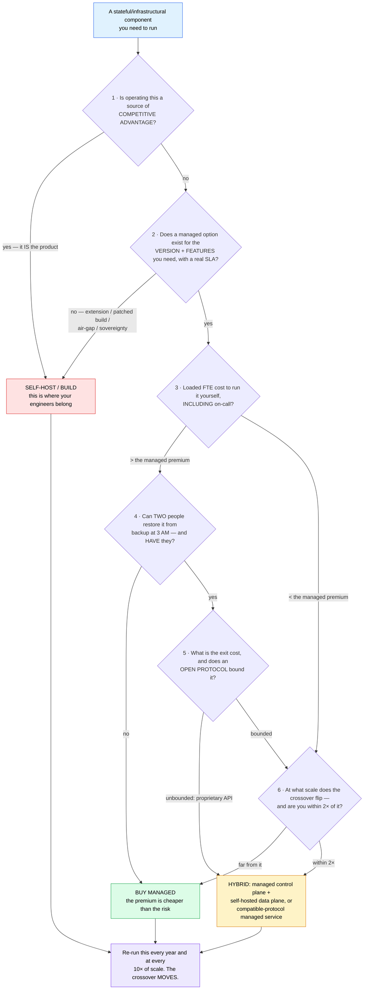

# Managed Services vs Self-Hosted — The Build-vs-Buy Decision

## 1. Why Should I Care About This?
- **The Invoice Is the Smallest Line Item**: A fully loaded senior infrastructure engineer in a high-cost market is roughly **$200–350k/year** once you add benefits, payroll tax, equipment, and overhead onto a $180–250k base. A service that needs **0.5 FTE** of care and feeding therefore costs **$100k+/year before a single instance is billed** — which is more than most managed-service bills any mid-size company will ever see. Teams compare `$1,500/mo RDS` against `$700/mo EC2` and confidently pick the option that costs 4× more.
- **The Cheapest Managed Service in the Industry Is Still Argued About**: The EKS and GKE control plane costs **$0.10/hour ≈ $73/month per cluster**. That is less than *one* loaded engineer-hour. Yet teams still run their own `kubeadm` control plane with a self-managed etcd quorum, certificate rotation, and restore drills — and then discover that a lost etcd quorum at 2 AM is a genuinely hard problem, not a paperwork problem.
- **Leaving Has a Price Tag You Can Compute Today**: Internet egress from AWS is about **$0.09/GB for the first 10 TB/month**, tiering to ~$0.05/GB above 150 TB (with 100 GB/month free since December 2021). Moving a **50 TB dataset out costs roughly $4–5k in bytes alone**, before you have written one line of the migration. Data gravity is not a metaphor; it is a line on a bill.
- **Repatriation Is Real at the Top End**: Dropbox's S-1 disclosed **$74.6M saved over two years (2016–2017)** from the Magic Pocket build-out that moved ~90% of its data off S3, and 37signals has publicly projected savings on the order of **$7–10M over five years** from its cloud exit. Both are *reported* figures from the companies themselves — and both are what the crossover looks like when you are actually past it.

## 2. What Problem Does This Solve?
- **Comparing Invoices Instead of Comparing Costs**: The decision fails when the spreadsheet has one row (`$/month`) instead of six (infrastructure, service premium, loaded engineer time, on-call burden, opportunity cost, expected incident cost). Every real disagreement about build-vs-buy is actually a disagreement about which rows exist.
- **Discovering the On-Call Cost After You Own It**: Nobody signs up for a pager when they choose the technology. They sign up for it three months later when the first disk fills at 3 AM. The on-call burden must be priced *at decision time*, in the same units as everything else.
- **The Restore Nobody Has Tested**: Self-hosting means you own point-in-time recovery. Managed services give you PITR to the second as a checkbox. The question that settles most arguments is not "can we run this?" but **"can two people on the current team restore it from backup at 3 AM — and have they ever?"**
- **Lock-in Discovered at Renewal, Not at Design Time**: Egress pricing, proprietary APIs with no open equivalent, and the fact that nobody left in the building knows how to run the thing are all *exit costs*, and they are cheapest to bound on day one (pick a wire protocol with more than one implementation) and most expensive to discover on the day you want out.
- **Naive Approach**: Two mirror-image mistakes. *"It's open source, so it's free"* — which ignores that the software was never the cost; the engineer was. And *"managed everything, always"* — which ignores that at 10–100× scale a percentage margin on a huge number beats a salary, and that some managed services simply do not expose the feature you need. Both answers are ideology wearing an architecture costume.

## 3. Core Idea (Intuition First)
**A loaf of bread costs about three times what its flour costs, and you buy bread anyway** — because the bakery needs a baker who gets up at 4 AM, an oven that needs servicing, and a supplier relationship. You are not paying a 3× markup on flour; you are paying not to be a baker. And the day you are selling ten thousand loaves, you build the bakery, because now the 3× is a bigger number than the baker.

That is the whole file. The mechanism:

- **True cost = infrastructure + service premium + loaded engineer time + on-call burden + opportunity cost + expected incident cost.** The managed premium is typically **1.5–3×** on the infrastructure line. The engineer term is typically **3–10× the premium** at small and mid scale. So the premium loses the argument and the salary wins it.
- **Managed removes the *undifferentiated* work, not the engineering.** Patching, backups, and failover go away. Schema design, query plans, index bloat, connection limits, IAM, capacity, and cost do not.
- **The exit cost is a mostly independent axis**, and it is bounded by one thing: whether the interface has more than one implementation. Postgres wire protocol, the S3 API, the Kafka protocol, the Redis/Valkey protocol, and OTLP all have competing implementations. DynamoDB's API, Spanner, and Lambda's execution model do not.
- **The crossover exists and it moves in both directions.** It is much further out than engineers instinctively believe, and companies have crossed it in both directions within a decade.

> The mental image: **you are not buying software, you are renting a pager.** The bill is what the pager costs; the salary is what it costs to carry it yourself.

![Three-panel diagram of the managed-versus-self-hosted total cost of ownership decision. Panel A is a worked annual comparison for one production PostgreSQL database of five hundred gigabytes running Multi-AZ at a mid-size company, drawn as two stacked cost bars beside a line-item table. The managed option totals sixty-nine thousand dollars a year, made of forty-one thousand of infrastructure with the service premium included and twenty-eight thousand of loaded engineer time at roughly one tenth of a full-time engineer. The self-hosted option totals two hundred seventy-four thousand dollars a year, made of only nineteen thousand of infrastructure but one hundred forty thousand of loaded engineer time at half a full-time engineer, twenty-five thousand of on-call rotation share, sixty thousand of opportunity cost for features not built, and thirty thousand of amortised expected incident cost. The annotation states that managed costs two point one times more on the invoice and four times less in total, and that the sticker price is fifty-nine percent of the managed true cost but only seven percent of the self-hosted true cost. Panel B is a give-and-take matrix. What managed buys, in green: operating-system and engine patching with CVE response inside a maintenance window, minor-version upgrades you do not orchestrate, automated backups with point-in-time recovery to any second, Multi-AZ failover you did not write or test, a published service-level agreement with credits, and a support contract with a real escalation path. What managed takes away, in red: superuser and root access so no kernel, garbage-collector or fsync tuning, arbitrary extensions and patched builds and custom modules, version freshness because managed offerings trail upstream by months to years and you pay extra to stay on an end-of-life version, operating-system logs and filesystem and strace or perf access while debugging, and anything the provider API simply does not expose. An amber warning strip underneath states that a service-level agreement is a refund policy and not a reliability guarantee: RDS Multi-AZ promises ninety-nine point nine five percent per month, about twenty-two minutes of allowed downtime, and breaching it returns roughly ten percent of that month's bill, twenty-five percent below ninety-nine percent and one hundred percent below ninety-five percent, so your revenue loss is never refunded and you must build your own redundancy anyway. Panel C plots annual total cost of ownership against scale as two curves. The self-hosted curve starts high because of a fixed full-time-engineer floor you pay at every scale and then rises with a shallow slope. The managed curve starts near zero and rises faster because it is a percentage of an ever-larger number. They cross in a marked crossover band, with the region to the left labelled managed wins because the engineer floor dominates, and the region to the right labelled self-hosting wins because at ten to one hundred times scale a percentage margin beats a salary. An annotation marks the EKS and GKE control plane at ten cents an hour, about seventy-three dollars a month per cluster, against running your own kubeadm control plane with an etcd quorum and certificate rotation, as the one curve that never crosses. A footer lists reported repatriation figures: Dropbox's Magic Pocket moved about ninety percent of data off S3 and its S-1 disclosed seventy-four point six million dollars saved over two years; 37signals left the cloud on about six hundred thousand dollars of hardware with publicly projected savings of seven to ten million over five years plus roughly ten petabytes moved off S3; and Zynga built its own zCloud and then migrated back to AWS in 2015 when traffic fell, so the crossover must be re-derived every year.](../assets/managed_vs_self_hosted_tco.svg)

> Panel A: the sticker price is 7% of the self-hosted true cost — managed can be 2× the invoice and 4× cheaper. Panel B: managed buys the undifferentiated work and sells you a refund policy, not reliability. Panel C: the crossover is real, sits far further out than instinct suggests, and moves in both directions.

## 4. How It Actually Works

### 1. The TCO equation, written as arithmetic
The only defensible way to have this argument is to write the equation and fill it in. Per year, per service:

```
TCO = infrastructure                 (instances, storage, IOPS, network)
    + service premium / licence      (what the provider charges above raw compute)
    + loaded_engineer_cost           (FTE_fraction × base_salary × loading_multiplier)
    + on_call_burden                 (rotation share + retention/attrition cost)
    + opportunity_cost               (revenue-generating work that engineer did NOT do)
    + E[incident]                    (P(incident/yr) × (revenue_loss + engineer_hours))
```

- **The loading multiplier is real and people forget it.** Benefits, payroll tax, equipment, recruiting amortisation, and facilities put a **1.25–1.4×** multiplier on base salary. A $220k senior infra engineer costs the company **~$280k**. Half of that engineer is $140k/year.
- **Estimating `FTE_fraction` honestly** is the hard part. Count the recurring work: monitoring and dashboards, capacity reviews, minor upgrades, major-version migrations (a Postgres major upgrade on a large self-hosted cluster is a multi-week project), backup verification, restore drills, security patching, and the long tail of "the disk filled again." For a stateful system with real availability requirements, **0.3–0.7 FTE is the honest range**, and it does not scale down below ~0.2 no matter how small the instance is — the *knowledge* has a fixed cost.
- **On-call is a separate term, not part of the FTE.** A 1-in-6 rotation covering a database has a cost in pay differential, in the daytime work lost to recovery, and — the one nobody prices — in **attrition**. Replacing a senior infra engineer costs somewhere between 6 and 12 months of salary in recruiting, ramp, and lost velocity.
- **Opportunity cost is usually the largest term after salary** and always the one omitted. If your infra engineer spends 40% of their time on Kafka, the question is not "is that cheaper than MSK?" but "what would that 40% have shipped?"
- **The worked comparison** (Panel A): one production Postgres, 500 GB, Multi-AZ. RDS `db.r6i.2xlarge` Multi-AZ plus gp3 storage runs roughly **$41k/year**; the equivalent two EC2 `r6i.2xlarge` instances plus EBS gp3 plus snapshot storage runs roughly **$19k/year** — the managed premium is a genuine **2.1×**. Then add 0.1 FTE of managed oversight ($28k) versus 0.5 FTE plus on-call plus opportunity plus amortised incident cost ($255k). **$69k versus $274k.** Managed is 2.1× the sticker and 4× cheaper. That inversion is the single most useful thing in this file.

### 2. Worked case — RDS/Aurora versus PostgreSQL on EC2
- **The pricing shape.** RDS PostgreSQL on `db.r6i.2xlarge` is roughly **$0.55–0.60/hour** single-AZ against roughly **$0.50/hour** for a bare EC2 `r6i.2xlarge` — so single-AZ the premium looks small. **Multi-AZ doubles the RDS number** (you pay for the standby), which lands you at a ~2× compute premium against a *correct* self-hosted comparison (two instances plus a replication and failover mechanism you wrote). Storage compounds it: **RDS gp3 is ~$0.115/GB-month versus ~$0.08/GB-month for plain EBS gp3.** Aurora prices differently again — storage at ~$0.10/GB-month plus **~$0.20 per million I/O requests**, which makes an I/O-heavy workload unpredictable until you switch to Aurora I/O-Optimized (~30% higher instance cost, zero I/O charges).
- **What the premium buys, mechanically.** Automated snapshots plus continuous WAL archiving give **PITR to any second inside the retention window** (up to 35 days) — the self-hosted equivalent is pgBackRest or WAL-G plus a bucket plus a tested restore runbook. Multi-AZ failover is DNS-based and typically completes in **60–120 seconds** without you writing a fencing mechanism, and it is the single hardest thing to build correctly yourself, because the failure mode you must prevent is not "the primary died" but "the primary is alive and both think they are primary."
- **The trade-off, and when EC2 wins.** RDS blocks superuser, so no `ALTER SYSTEM`, no arbitrary C extensions (only the curated list), no filesystem access, no `perf` on a stall. If you need `pg_partman` at a version RDS lags on, a patched build, a custom background worker, or `shared_preload_libraries` entries that are not allowlisted, managed is simply the wrong tool and the discussion ends. That is a *capability* argument, not a cost argument, and it is the only kind that beats the arithmetic cleanly.
- **The number that catches people**: when your major version hits RDS end-of-standard-support, **RDS Extended Support** bills roughly **$0.10 per vCPU-hour** in years 1–2 (rising in year 3). On an 8-vCPU instance that is `8 × $0.10 × 730 ≈ $584/month` on top of everything else. Managed does not remove the upgrade — it puts a price on deferring it.

### 3. Worked case — Kafka: MSK, Confluent Cloud, or your own brokers
- **The bar has genuinely dropped.** KRaft went GA in Kafka 3.3 and **ZooKeeper was removed entirely in Kafka 4.0 (2025)**, deleting an entire second distributed system from the operational surface. Self-hosting Kafka is meaningfully easier than it was in 2019, and honest people should say so.
- **What is still specialist work.** Partition count and placement (rebalancing a 5,000-partition cluster moves terabytes across the network and is throttle-tuned by hand unless you run Cruise Control), disk sizing against retention and the ISR catch-up burst, broker replacement without under-replicated partitions, rolling upgrades that must respect `min.insync.replicas`, and consumer-group rebalance storms. None of that is *hard* the way distributed consensus is hard; it is hard the way an aircraft checklist is hard — the cost is attention, continuously.
- **The pricing shapes.** **MSK** charges broker instance-hours at a modest premium over the equivalent EC2 plus **~$0.10/GB-month of broker storage**, and gives you provisioning, patching, and tiered storage while leaving topic/partition design entirely yours. **MSK Serverless** prices per cluster-hour plus **per partition-hour**, which punishes over-partitioning directly. **Confluent Cloud** is a multiple of MSK on paper and buys a different category of thing: Schema Registry, ~120 managed connectors, ksqlDB/Flink, tiered storage, and a **99.99% SLA on multi-zone clusters**. If you would otherwise build and operate schema registry and connectors yourself, the comparison is not "Kafka vs Kafka."
- **The judgement call**: MSK is the right default when you already have a platform team and your Kafka usage is "a log with topics." Confluent wins when the *ecosystem* is the product you need. Self-hosting wins at very high sustained throughput, where you can run brokers hot on reserved instances and the percentage premium is a bigger number than the two engineers who own it — see [Kafka Architecture](../09_Message_Queues_Event_Streaming/Kafka_Architecture.md).

### 4. The easiest yes in the industry — the Kubernetes control plane at $73/month
- **EKS and GKE charge $0.10/hour per cluster ≈ $73/month** for a control plane (GKE gives one zonal cluster free; AKS's Free tier charges nothing and its Standard tier is ~$0.10/hour with an SLA). That is the *entire* price.
- **What you are not doing for that $73.** Running an odd-numbered **etcd quorum** on fsync-sensitive storage (etcd's write latency is dominated by disk fsync; put it on a slow EBS volume and the whole control plane goes unstable), periodic **defragmentation and compaction** before the 8 GB default backend limit bites, taking and *testing* raft-consistent snapshots, rotating a small forest of PKI certificates on schedule, and upgrading the API server, scheduler, and controller-manager in the right order. A lost etcd quorum with no tested restore is one of the genuinely scary states in cloud-native operations.
- **The arithmetic is not close.** One engineer-day per month at ~$150/hour loaded is **~$1,200/month** — about **16× the control-plane fee**. There is no plausible scale at which the curve crosses, which is why Panel C annotates it as the one line that never does.
- **The honest exception**: air-gapped, on-premises, or sovereignty-constrained environments where no managed control plane is available, and edge deployments where the cluster must survive with no connectivity to a cloud region. Those are capability constraints, not cost decisions.

### 5. Data-plane cases — DynamoDB, ElastiCache, SQS, and the serverless crossover
- **DynamoDB on-demand vs provisioned.** Post the ~50% on-demand price cut in late 2024, us-east-1 on-demand is roughly **$0.625 per million write request units** and **$0.125 per million read request units**, while provisioned is roughly **$0.00065 per WCU-hour** and **$0.00013 per RCU-hour**. Derive the crossover rather than memorising it: one WCU held for an hour buys 3,600 writes, so at 100% utilisation provisioned costs `$0.00065 / 3600 × 10⁶ ≈ $0.18` per million writes. Against $0.625 on-demand that is a **~3.5× ratio, so provisioned wins above roughly 28–30% sustained utilisation** of the capacity you would have to provision for peak. Before the price cut that number was closer to 15% — **which is exactly why you re-derive it instead of quoting it.**
- **DynamoDB vs self-run Cassandra** is the sharpest lock-in contrast in the file. DynamoDB has **no open-source implementation of its API** (ScyllaDB's Alternator is a partial, third-party approximation). Cassandra runs anywhere but wants 3+ nodes minimum, repair scheduling, compaction strategy tuning, and JVM/GC work — comfortably **1–2 FTE** for a serious cluster. Below very large scale, DynamoDB wins the arithmetic decisively and loses the exit test decisively. Name both halves out loud.
- **ElastiCache vs self-run Redis.** `cache.r6g.large` runs ~**2×** the equivalent EC2 instance. What you buy is failover, backups, and patching for a cache — which is worth *less* than for a database, because a cache that loses its data loses a cache-warming problem, not a business record. So the crossover is nearer than for Postgres. Two wrinkles matter: **ElastiCache Serverless bills per GB-hour of stored data plus per million ECPUs with a 1 GB minimum**, giving it a real monthly floor per cache; and the **March 2024 Redis licence change to RSALv2/SSPL** spawned the Linux Foundation's **Valkey** fork, which AWS now offers at roughly 20% below its Redis pricing. See [Distributed Caching (Redis & Memcached)](../06_Caching_Performance/Distributed_Caching_Redis_Memcached.md).
- **SQS vs RabbitMQ.** SQS is **$0.40 per million requests** (FIFO $0.50), and a request can carry a batch of 10 messages — so batching makes the effective rate 10× lower. A billion messages a month, batched, is **~$40**. A self-run 3-node RabbitMQ cluster is $200–300/month of instances plus quorum-queue configuration plus the notorious network-partition semantics plus 0.2 FTE (~$4,700/month loaded). SQS wins by two orders of magnitude, and you switch only when you need broker semantics SQS does not have: AMQP routing topologies, priorities, or per-message TTL patterns.
- **The relicensing axis, generalised**: Redis, Elasticsearch, MongoDB, and Terraform all changed licences and all spawned forks (Valkey, OpenSearch, FerretDB-adjacent efforts, OpenTofu). **The licence is a lock-in axis you do not control**, and it can move under a self-hosted deployment just as easily as a price list can move under a managed one.

### 6. What managed buys, what it takes away, and why the SLA is not insurance
- **Buys**: OS and engine patching with CVE response inside your maintenance window; minor-version upgrades you do not orchestrate; automated backups with PITR; multi-AZ failover you did not write; a published SLA with credits; a support contract with an escalation path that a human answers.
- **Takes away**: superuser/root, so no kernel, GC, or fsync tuning; arbitrary extensions, patched builds, and custom modules; **version freshness** — managed engines trail upstream, sometimes by a quarter (RDS added PostgreSQL 17 roughly two months after upstream, which is the *good* end) and sometimes by much more, with Aurora typically lagging RDS; OS logs, filesystem, and `strace`/`perf` access exactly when you need them for a stall; and the ability to do the clever thing the API does not expose.
- **The SLA is a refund policy.** RDS Multi-AZ promises **99.95%/month ≈ 22 minutes** of allowed downtime. Breach it and the credit ladder is typically **10%** of that month's bill (below the target), **25%** (below 99.0%), **100%** (below 95.0%). If a 4-hour outage costs you $400k in revenue and your monthly bill is $3,400, your compensation is **$340**. An SLA transfers *some* of the provider's incentive, not any of your risk — so you still need multi-region posture, your own backups, and a graceful-degradation path. See [SLA, SLO & SLI](../01_Planning_Foundations/SLA_SLO_SLI.md) and [Disaster Recovery (RPO/RTO)](./Disaster_Recovery_RPO_RTO.md).
- **Availability composes multiplicatively.** Four dependencies at 99.95% each give `0.9995⁴ ≈ 99.80%` — about 87 minutes/month — even though every individual SLA was met. Managed services do not make your system more available than your architecture allows; they make each component's failure someone else's escalation.

### 7. The "managed still needs ops" fallacy
Managed removes the undifferentiated work. Everything below is still yours, and it is most of the work that actually causes incidents:

- **Schema and query design.** No provider fixes a missing index, an N+1, or a query that table-scans 40M rows. Performance Insights will show you the problem beautifully and will not solve it.
- **Index bloat and vacuum.** RDS runs Postgres; it does not tune `autovacuum_vacuum_cost_limit` for your write pattern, and transaction-ID wraparound protection is still your operational concern.
- **Connection limits and pooling.** RDS derives `max_connections` from instance memory (`LEAST({DBInstanceClassMemory/9531392}, 5000)`), so a small instance gets a few hundred. Point a scaling Lambda fleet at it and you exhaust connections in minutes — you still need PgBouncer or RDS Proxy. See [Serverless Computing (Lambda)](./Serverless_Computing_Lambda.md).
- **Capacity and cost.** Instance sizing, storage autoscaling thresholds, provisioned IOPS, and reserved-capacity commitments are all yours, and they are where the money actually leaks — see [Cost Estimation & FinOps](../01_Planning_Foundations/Cost_Estimation_FinOps.md).
- **IAM, network, and encryption posture.** Least-privilege policies, security groups, subnet placement, KMS key rotation, and audit logging do not arrive configured.
- **Upgrade windows and the forced migration.** When the provider deprecates your major version you will migrate on *their* schedule, or pay Extended Support to defer it. The migration is the same project it would have been self-hosted; you just do not get to choose when.

> The rule: **managed changes who gets paged for the disk, not who is responsible for the system.**

### 8. Lock-in, decomposed into the four axes that actually bite
- **Data gravity and egress.** ~**$0.09/GB** for the first 10 TB/month, tiering down with volume; 50 TB out ≈ **$4–5k** in bytes alone, and that is the *cheap* part next to the migration project, the dual-write period, and the cutover. Note the regulatory shift: EU Data Act provisions on switching charges pushed the major clouds to offer **free egress for customers leaving** (announced 2024), which narrows this axis for whole-provider exits but not for moving one dataset between services.
- **Proprietary API surface.** The decisive question is *how many implementations of this interface exist?* **Bounded** (an escape hatch exists): Postgres/MySQL wire protocol, the S3 API, the Kafka protocol, the Redis/Valkey protocol, OTLP, Kubernetes. **Unbounded** (no open equivalent): DynamoDB's API, Spanner, Lambda's execution and event model, Step Functions, BigQuery's dialect-plus-storage coupling. Choosing a compatible-protocol service is the cheapest lock-in insurance available, and it costs nothing at design time.
- **Operational-muscle atrophy.** Three years on a managed service and nobody left can run it. This is the axis that makes "we could always self-host later" quietly false — the capability decayed, and rebuilding it is a hiring problem with a 6–12 month lead time.
- **Contractual and commit lock-in.** Enterprise agreements, Savings Plans, and reserved capacity are genuine discounts *and* genuine handcuffs; a three-year commit at 40% off is a bet that you will not want to leave for three years.

**The practical test, and the only one that matters:** *what is the concrete exit plan, and have you ever tested a restore into it?* An exit plan that has never had production data restored into it is a document, not a plan.



## 5. Real-World Example
**Dropbox's Magic Pocket — the canonical repatriation.** Dropbox built its own exabyte-scale storage system and moved roughly **90% of its data off S3** over about two and a half years, then disclosed in its 2018 S-1 that it had **saved $74.6M in the two years ended December 31, 2017**. The details that matter for a design review are the preconditions, not the headline: storage *was* Dropbox's product, the volumes were extreme, they hired and retained a purpose-built storage team, and they still kept cloud storage for some regions and workloads. The correct reading is "at this scale a percentage margin on storage exceeded the cost of a specialist org" — not "S3 is expensive."

**37signals / Basecamp — the crossover at SMB scale.** DHH publicly reported roughly **$3.2M/year of cloud spend**, a hardware purchase on the order of **$600k**, and projected savings of about **$7–10M over five years**, later adding a reported ~$1.5M/year saving from moving roughly **10 PB off S3** onto their own storage. These are the company's own reported figures and the workload is unusually favourable — steady, predictable, low-variance, with a small and very senior ops team and no need for elastic burst. It is a genuine data point that the crossover reaches further down-market than people assumed, and a bad template for a company whose traffic is spiky or whose team is not that team.

**Zynga's round trip — the crossover moves.** Zynga built out its own "zCloud" data centres around 2011 when its growth made owned hardware cheaper per unit, then **migrated back to AWS in 2015** when traffic declined and the fixed cost of owned capacity became the expensive option. This is the most useful of the three cases in an interview, because it is the one that proves the decision is not permanent: **the crossover is a function of your scale and your utilisation, both of which change.** Re-derive it annually, and design so that crossing it later is a project rather than a rewrite.

## 6. Code Example
The same Postgres, both ways — with the hidden work named in the comments:

```hcl
# ─────────────────────────────────────────────────────────────────────────────
# OPTION A — MANAGED (RDS). ~20 lines. Every operational property is a DEFAULT.
# ─────────────────────────────────────────────────────────────────────────────
resource "aws_db_instance" "orders" {
  identifier     = "orders-prod"
  engine         = "postgres"
  engine_version = "16.4"                      # you get the version AWS offers, not upstream HEAD
  instance_class = "db.r6i.2xlarge"            # ~$0.58/hr single-AZ · Multi-AZ ≈ 2× (you pay the standby)

  allocated_storage     = 500
  max_allocated_storage = 2000                 # storage autoscaling — a disk-full page you will never get
  storage_type          = "gp3"                # RDS gp3 ≈ $0.115/GB-mo vs EBS gp3 ≈ $0.08 — THAT GAP IS THE PREMIUM

  multi_az = true                              # ◀── THE LOAD-BEARING LINE OF THE WHOLE FILE.
                                               #     Automatic failover in ~60–120s, with fencing you did not
                                               #     write. The hard failure mode is not "the primary died", it's
                                               #     "both think they're primary" — and this is what buys that.

  backup_retention_period      = 14            # snapshots + continuous WAL ⇒ PITR to ANY SECOND in 14 days
  backup_window                = "03:00-04:00"
  auto_minor_version_upgrade   = true          # CVE patching happens in the window, not in a war room
  maintenance_window           = "sun:07:00-sun:08:00"
  performance_insights_enabled = true          # query-level profiling, no agent to deploy
  deletion_protection          = true
  storage_encrypted            = true
  # NOT bought here: schema design, indexes, autovacuum tuning, connection pooling,
  # capacity planning, IAM least-privilege, or the major-version migration in 2028.
}
```

```hcl
# ─────────────────────────────────────────────────────────────────────────────
# OPTION B — SELF-HOSTED. The Terraform is SHORTER. The work is 10× bigger, and
# every "# YOU NOW OWN" comment below is a runbook, an alert, and an on-call page.
# ─────────────────────────────────────────────────────────────────────────────
resource "aws_instance" "pg" {
  count         = 2                            # primary + standby. Cheaper per hour, and only half a system.
  instance_type = "r6i.2xlarge"                # ~$0.504/hr — the 2× premium above is what you just "saved"
  ami           = data.aws_ami.pg16.id         # YOU NOW OWN: building, patching and re-baking this image
                                               #   (see ./Immutable_Infrastructure_Pattern.md)
  tags = { Name = "pg-${count.index == 0 ? "primary" : "standby"}" }
}

resource "aws_ebs_volume" "data" {
  count             = 2
  size              = 500
  type              = "gp3"
  iops              = 12000                    # YOU NOW OWN: sizing IOPS against WAL fsync latency.
  throughput        = 500                      #   Under-provision and commit latency degrades invisibly.
  availability_zone = aws_instance.pg[count.index].availability_zone
}

resource "aws_dlm_lifecycle_policy" "snapshots" {
  # YOU NOW OWN: crash-consistent EBS snapshots are NOT a Postgres backup. You need
  # pgBackRest/WAL-G shipping WAL to S3 for real PITR, plus a RESTORE DRILL on a
  # schedule, or your RPO is a guess. (see ./Disaster_Recovery_RPO_RTO.md)
  description        = "pg daily"
  execution_role_arn = aws_iam_role.dlm.arn
  policy_details { /* … */ }
}

# ── AND NONE OF THIS IS TERRAFORM AT ALL — it is engineer-months, then forever: ──
#  • streaming replication + slot management + replica lag alerting
#  • FAILOVER: Patroni/repmgr + etcd/Consul consensus, VIP or DNS switch, and FENCING.
#    Getting split-brain wrong here corrupts data. This is the genuinely hard part.
#  • connection pooling (PgBouncer), TLS certs and rotation, pg_hba.conf
#  • minor patching + the multi-week major-version upgrade project
#  • autovacuum/bloat monitoring, WAL archive gap alerts, backup VERIFICATION
#  • a 24×7 on-call rotation that can execute all of the above under pressure
```

Model the decision before you argue about it:

```python
LOADING = 1.30                     # benefits + payroll tax + equipment + overhead on base salary

def tco(name, infra_yr, fte, base_salary=220_000, oncall_yr=0,
        opportunity_yr=0, p_incident=0.0, incident_cost=0):
    engineer = fte * base_salary * LOADING
    expected_incident = p_incident * incident_cost
    total = infra_yr + engineer + oncall_yr + opportunity_yr + expected_incident
    print(f"{name:14} infra ${infra_yr:>7,.0f} | eng ${engineer:>8,.0f} | "
          f"on-call ${oncall_yr:>6,.0f} | opp ${opportunity_yr:>6,.0f} | "
          f"E[inc] ${expected_incident:>6,.0f} ||  TCO ${total:>9,.0f}")
    return total

managed = tco("RDS Multi-AZ", 41_000, fte=0.10)
selfhost = tco("EC2 + EBS",   19_000, fte=0.50, oncall_yr=25_000,
               opportunity_yr=60_000, p_incident=0.5, incident_cost=60_000)

print(f"\nsticker ratio (managed/self):  {41_000/19_000:.2f}×   ← the number people argue about")
print(f"TRUE cost ratio (self/managed): {selfhost/managed:.2f}×   ← the number that decides it")
print(f"self-hosting is worth it once the managed bill exceeds "
      f"${selfhost - 19_000 - 0.10*220_000*LOADING:,.0f}/yr")
# RDS Multi-AZ   infra $ 41,000 | eng $  28,600 | ... ||  TCO $   69,600
# EC2 + EBS      infra $ 19,000 | eng $ 143,000 | ... ||  TCO $  277,000
# sticker ratio (managed/self):  2.16×
# TRUE cost ratio (self/managed): 3.98×
```

## 7. Design Variations & Alternatives

| Option | Cost shape | Ops burden | Exit cost | Use when |
|---|---|---|---|---|
| **Fully managed SaaS** (Confluent, MongoDB Atlas, Snowflake) | Highest premium; often per-unit-of-work | ~None for the service | Medium–high; depends on protocol openness | Time-to-market dominates; the ecosystem *is* the product you need |
| **Cloud managed service** (RDS, MSK, ElastiCache, DynamoDB) | ~1.5–3× the raw-compute equivalent | Low: you keep schema, capacity, IAM | Low if wire-compatible; **high if proprietary API** | The default for anything stateful below very large scale |
| **Managed control plane + self-hosted data plane** (EKS/GKE + your own nodes; MSK + your own topics) | Trivial control-plane fee + raw compute for data | Medium | Low — the data plane is portable | **The best default in cloud-native**: buy the hard consensus, keep the cheap capacity |
| **Operator on your own Kubernetes** (CloudNativePG, Strimzi, Zalando Postgres Operator) | Raw compute only | Medium — the operator encodes the runbook, you own the operator | Very low; runs anywhere K8s runs | Multi-cloud or on-prem requirements, many similar instances, an existing platform team ([Kubernetes Operators & CRDs](./Kubernetes_Operators_CRDs.md)) |
| **Self-hosted on VMs** (Patroni, kubeadm, bare Kafka) | Cheapest per hour, most expensive per year | High: 0.3–0.7 FTE + on-call, per system | Lowest | You need an unsupported extension, a patched build, or air-gap/sovereignty |
| **Owned hardware / colocation** | High capex, lowest marginal cost at high utilisation | Highest: plus procurement, DC ops, capacity lead times | N/A (you own it) | Very large, *steady* workloads where utilisation stays high — the repatriation case |

**The middle paths are where mature teams actually land:**

- **Managed control plane, self-hosted data plane.** Buy the part that requires distributed consensus and is hard to get right (EKS control plane, MSK's broker orchestration, a managed etcd), run the part that is just capacity (nodes, topics, consumers) yourself. This is the single highest-leverage pattern in the file, because it buys the difficult 10% and refuses the expensive 90%.
- **Managed for the tail, self-hosted for the head.** Take the one workload that dominates spend (usually storage or logs) and self-host *only that*, keeping thirty small services on managed offerings where the per-service FTE floor would be ruinous. This is exactly what [APM & Observability Tooling Landscape](../12_Monitoring_Logging_Observability/APM_Tools_Landscape.md) works through in detail for observability — self-host the log pillar, buy the correlation.
- **Buy now, build later at the crossover.** Choose a wire-compatible managed service today (Postgres protocol, S3 API, Kafka protocol) precisely so that the later migration is an infrastructure project and not a rewrite. Write it down as an [Architecture Decision Record](../01_Planning_Foundations/Architecture_Decision_Records.md) with the trigger condition — "revisit when the bill exceeds $X/year or throughput exceeds Y" — so the revisit actually happens.

## 8. Pros and Cons

### Buying managed
- **Pros**: days to production instead of engineer-months; PITR, multi-AZ failover, and patching as day-one defaults rather than year-two projects; no pager for the substrate; a support contract with escalation; capacity elasticity you would otherwise have to procure; and the FTE you did not spend is spent on product instead.
- **Cons**: a 1.5–3× premium on the infrastructure line that compounds with scale into a genuinely large number; no superuser, no arbitrary extensions, no kernel or GC tuning; version lag plus a forced migration on the provider's schedule (with Extended Support at ~$0.10/vCPU-hour as the price of deferring); reduced debugging surface exactly when you need it; and an exit cost that is invisible until you want out.

### Self-hosting
- **Pros**: full control — any extension, any patch, any tuning knob; the cheapest possible per-hour infrastructure and the best economics at high sustained utilisation; portable skills and a portable deployment; no per-unit pricing model to be surprised by; and it is the only option when air-gap, sovereignty, or an unsupported feature is a hard requirement.
- **Cons**: 0.3–0.7 FTE per stateful system, which at ~$280k loaded is $85–200k/year *per system*; a 24×7 on-call rotation and the attrition it drives; failover and fencing are the hardest correctness problems in the stack and you will build them under time pressure; the opportunity cost of the roadmap those engineers did not deliver; and the eventual discovery that the person who knew how it worked left.

### The hybrid middle
- **Pros**: buys the genuinely hard component (consensus, failover, control plane) while keeping the cheap and portable one; converts an all-or-nothing decision into a reversible one; and lets you self-host exactly the one workload that dominates spend without paying the FTE floor thirty times over.
- **Cons**: two operating models to understand and document, a boundary that must be explicitly owned or becomes a finger-pointing seam during incidents, and a real risk of "hybrid" being a euphemism for an unfinished migration that nobody wants to own.

## 9. Failure Scenarios & What Can Go Wrong
- **SYMPTOM**: The cloud bill is 3× the plan and nobody can explain it, but the workload did not grow. **ROOT CAUSE**: idle managed resources still bill — NAT gateways at ~$0.045/hour ≈ $33/month *per AZ* before a byte flows, provisioned IOPS billing whether or not you use them (RDS io1 at ~$0.10 per provisioned IOPS-month means a 20,000-IOPS allocation is ~$2,000/month idle), forty dev EKS clusters at $73 each, and every public IPv4 address at $0.005/hour ≈ $3.60/month since February 2024. **FIX**: tag everything, put idle-resource detection in the monthly review, delete non-prod overnight, and audit provisioned-versus-used on every capacity dimension. See [Cost Estimation & FinOps](../01_Planning_Foundations/Cost_Estimation_FinOps.md).
- **SYMPTOM**: A DynamoDB or ElastiCache bill jumps 5× after a launch that "barely changed traffic." **ROOT CAUSE**: per-unit pricing on a dimension nobody modelled — item size crossing a 1 KB WCU boundary so every write costs 2 units, or a scan replacing a query, or Aurora's per-million-I/O charge under a new access pattern. **FIX**: model the *billed unit*, not the request count, and put the unit in the design review; switch to Aurora I/O-Optimized or DynamoDB provisioned-plus-autoscaling once the pattern is known.
- **SYMPTOM**: The self-hosted database fails over and comes back with missing writes, or two nodes both accept writes. **ROOT CAUSE**: split-brain — failover without fencing, or a consensus layer sized without quorum. **FIX**: use a battle-tested manager (Patroni + etcd/Consul, or a CloudNativePG-style operator), never hand-roll leader election, and chaos-test the failover ([Chaos Engineering](./Chaos_Engineering.md)). If you cannot commit to testing this quarterly, this is the argument for buying.
- **SYMPTOM**: A restore is needed and takes 14 hours instead of the 1 hour in the runbook. **ROOT CAUSE**: backups were never restored end to end; the WAL archive had a gap; the restore path was never sized for the current data volume. **FIX**: scheduled, *measured* restore drills that produce a number, and an alert on WAL-archive gaps. **A backup you have never restored is not a backup, managed or not.**
- **SYMPTOM**: An outage burns your entire quarterly error budget and the provider credits you $340. **ROOT CAUSE**: treating the SLA as insurance. **FIX**: internalise that the credit is 10–25% of one month's bill; design multi-AZ or multi-region redundancy and graceful degradation to the RPO/RTO you actually need, and set your internal SLO *below* the composed availability of your dependencies.
- **SYMPTOM**: A migration off a managed service is quoted at 12 months and quietly cancelled. **ROOT CAUSE**: a proprietary API with no open implementation, plus egress cost, plus no one who has ever run the alternative. **FIX**: pick wire-compatible services at design time; keep a written exit plan with a tested restore into the alternative; and if the API is genuinely proprietary, accept the lock-in explicitly in an ADR rather than pretending it is reversible.
- **SYMPTOM**: An "urgent" upgrade lands with a six-week deadline set by the provider. **ROOT CAUSE**: your major version reached end of standard support. **FIX**: track EOL dates in the same calendar as certificate expiry, budget one major upgrade per engine per year, and price Extended Support (~$0.10/vCPU-hour) as the cost of *deliberately* deferring — never as a plan.
- **SYMPTOM**: The team that self-hosted the platform has turned over and nobody can safely change it. **ROOT CAUSE**: operational-muscle atrophy — the knowledge was in people, not in runbooks or an operator. **FIX**: encode operations as code (an operator or fully automated IaC), require two people per system with demonstrated restore capability, and treat a single-owner system as a reliability defect.

## 10. Impact on Scalability, Reliability & Cost
- **Scalability**: managed services scale the axis they price and only that axis. DynamoDB autoscaling reacts to CloudWatch alarms in *minutes*, so a 10-second traffic spike is throttled regardless of the eventual target; RDS storage autoscaling grows but never shrinks; ElastiCache Serverless has a per-cache floor. Self-hosting scales at the speed of your procurement and your rebalancing throttle — moving 5,000 Kafka partitions is a terabyte-scale network operation. Compute the actual reaction time for both options and compare it to your traffic shape, not to the marketing word "elastic."
- **Reliability**: your availability is the *product* of your dependencies, not the max. Four managed dependencies at 99.95% compose to `0.9995⁴ ≈ 99.80%` ≈ 87 minutes/month — every SLA met, your target missed. Managed usually buys you a *better* single-component number than you would achieve (a tested multi-AZ failover beats an untested one every time), but the composition still forces you to own redundancy, timeouts, retries, and degradation.
- **Cost**: the crossover is where `managed_premium × usage` exceeds `FTE_cost + on_call + opportunity`. With a ~$100k/year premium and a 0.5-FTE alternative at ~$205k all-in, you are not close. At a $2M/year premium against three engineers at ~$900k, you are past it — and that is precisely the Dropbox/37signals region. The practical guidance: **budget one FTE-equivalent of premium per stateful system as clearly worth paying, re-derive the crossover annually and at every 10× of scale, and never let a 3-year commit outlive your confidence in the architecture.**

## 11. When NOT to Use This
- **Don't self-host a Kubernetes control plane to save $73/month.** One engineer-day per month of etcd care costs ~16× the fee, and a lost etcd quorum with an untested restore is a genuinely bad day. Buy the control plane; argue about the nodes.
- **Don't buy managed when you need a capability it does not expose.** An unsupported extension, a patched build, `shared_preload_libraries` entries outside the allowlist, kernel or GC tuning, or a hard air-gap/sovereignty requirement all end the cost discussion. Capability constraints beat arithmetic — just say so explicitly instead of arguing price.
- **Don't cite Dropbox or 37signals as precedent for repatriation** unless you also have their scale, their utilisation stability, and a team that wants to do it. Both are statements about their constraints, not templates. And remember Zynga went the other way.
- **Don't sign a 3-year commit for a component you might replace.** The 40% discount is real and so is the handcuff; match commitment length to architectural confidence, and keep the discount on the boring, durable layers (compute, storage) rather than the ones you are still learning.
- **Don't treat "we'll self-host later if it gets expensive" as a plan** unless the interface is wire-compatible, the exit is written down, and someone has restored production data into the alternative. Otherwise operational-muscle atrophy has already made it false.

## 12. Interview Perspective
- **What interviewers expect**: that you refuse the sticker-price framing immediately. The sentence to say is **"the invoice is the smallest term — the real cost is loaded engineer-hours plus on-call plus what that engineer didn't build, and a fully loaded senior infra engineer is $200–350k, so half an FTE is $100k+/year before a single instance is billed."** Then write the six-term equation. Naming the terms *is* the answer.
- **The trap question**: "RDS costs twice as much as running Postgres on EC2 — why would you ever pay that?" The wrong answer defends the premium on features. The right answer inverts the comparison: "the 2× is $22k/year; the honest self-hosted alternative adds 0.5 FTE at $140k, plus on-call, plus opportunity cost, plus the incident I will eventually have — so managed is 2× the sticker and roughly 4× cheaper. I'd flip only at the scale where the premium exceeds the team, or if I needed an extension RDS doesn't support."
- **The math question**: "When does self-hosting Kafka pay off?" Walk it. MSK at ~$120k/year premium over raw EC2 versus 1.5 FTE at $280k loaded plus on-call plus opportunity ≈ $500k+. **Not close** — you would need roughly 4× that premium, so ~$500k/year of MSK spend, before it is even arguable. Then add the reversal: "and if I already have a platform team paid for by other work, the marginal FTE cost is lower and the crossover moves in."
- **The subtle question**: "You have a 99.99% SLA from your provider. What's your availability?" The answer is *lower*, and the SLA is not the mechanism. Availability composes multiplicatively across dependencies, and **an SLA is a refund policy** — a 4-hour outage that costs $400k in revenue returns 10% of a $3,400 monthly bill, i.e. $340. So you still own redundancy, timeouts, and degradation.
- **Bonus signals**: naming EKS/GKE control plane at $0.10/hour as the never-crossing curve; deriving the DynamoDB on-demand/provisioned crossover from unit prices (~30% utilisation post-2024, ~15% before — which is why you derive rather than quote); decomposing lock-in into egress, protocol openness, muscle atrophy, and commit; the "how many implementations of this interface exist?" test; the licence-change axis (Redis→Valkey, Elasticsearch→OpenSearch, Terraform→OpenTofu); managed-control-plane-plus-self-hosted-data-plane as the best cloud-native default; and closing with **"what is the exit plan, and have we ever tested a restore into it?"**

## 13. Connections to Other Topics
- [APM & Observability Tooling Landscape](../12_Monitoring_Logging_Observability/APM_Tools_Landscape.md) — the same argument worked all the way through for one domain: the hybrid where you self-host the volume pillar and buy the correlation. Read it as the concrete instance of this general pattern.
- [Cost Estimation & FinOps](../01_Planning_Foundations/Cost_Estimation_FinOps.md) — where the unit-economics discipline and the idle-resource hunting live; this file supplies the FTE and opportunity-cost terms that FinOps dashboards never show.
- [Trade-off Analysis](../01_Planning_Foundations/Trade_off_Analysis.md) — build-vs-buy is the canonical trade-off, and this is the framework for making it out loud.
- [Architecture Decision Records](../01_Planning_Foundations/Architecture_Decision_Records.md) — where "buy now, build later at the crossover" must be written down *with its trigger condition*, or the revisit never happens.
- [Hybrid & Multi-Cloud Strategies](./Hybrid_Multi_Cloud_Strategies.md) — the next axis out: once you have decided who runs it, decide how many providers run it, and why portability costs more than most teams admit.
- [Kubernetes Objects (Pods & Services)](./Kubernetes_Objects_Pods_Services.md) — the data plane you keep when you buy the control plane; the managed/self-hosted seam runs exactly between them.
- [Kubernetes Operators & CRDs](./Kubernetes_Operators_CRDs.md) — the middle path where self-hosting becomes tractable, because the runbook is encoded as a controller instead of living in one person's head.
- [Disaster Recovery (RPO/RTO)](./Disaster_Recovery_RPO_RTO.md) — the "can two people restore it at 3 AM?" question, made quantitative; managed services hand you a PITR story you would otherwise have to build and test.
- [Serverless Computing (Lambda)](./Serverless_Computing_Lambda.md) — the far end of the managed spectrum, where the provisioned-versus-per-invocation crossover and the connection-limit trap both show up.
- [Infrastructure as Code (Terraform)](./Infrastructure_as_Code_Terraform.md) — the language the comparison in section 6 is written in, and the tool that makes "later" a project rather than a rewrite.
- [Kafka Architecture](../09_Message_Queues_Event_Streaming/Kafka_Architecture.md) — the mechanics behind the MSK-versus-self-run judgement, including why partition rebalancing is still specialist work after KRaft.
- [Object Storage & Blob Stores](../05_Databases_Storage/Object_Storage_Blob_Stores.md) — the S3 API as the best example of an open-enough interface, and the workload where repatriation actually pays.

## 14. Visual Aids
- **The SVG above** ([managed_vs_self_hosted_tco.svg](../assets/managed_vs_self_hosted_tco.svg)): panel A — two stacked cost bars plus the line-item table, where the self-hosted sticker is 7% of its own true cost and managed comes out 2.1× the invoice and 4× cheaper overall; panel B — the give/take matrix, with the SLA-is-a-refund-policy strip and the $340-for-a-$400k-outage arithmetic; panel C — the cost-versus-scale crossover curves, the crossover band, the never-crossing $73/month control-plane annotation, and the repatriation cases labelled as *reported* figures.
- **Mermaid (Section 4)**: the six-question decision tree — competitive advantage → does a managed option exist for the version you need → loaded FTE cost → can two people restore it at 3 AM → is the exit bounded by an open protocol → where is the crossover, with hybrid as a first-class outcome and an explicit "re-run this annually" terminal node.
- **The tables (Section 7)**: the six-option ladder from fully managed SaaS down to owned hardware with a "Use when" column, and the middle-path prose that names managed-control-plane-plus-self-hosted-data-plane as the best cloud-native default.

## 15. Summary (TL;DR)
**The sticker price is never the decision.** True cost is `infrastructure + service premium + loaded engineer time + on-call burden + opportunity cost + expected incident cost`, and the terms after the second one dominate almost every real comparison: a fully loaded senior infrastructure engineer is roughly **$200–350k/year**, so a service needing **0.5 FTE** of care costs **$140k/year before a single instance is billed** — which is why one production Postgres runs about **$41k/year on RDS Multi-AZ versus $19k on EC2 (a genuine 2.1× premium) and still comes out roughly 4× cheaper in total, at $69k against $274k.** The clearest case in the industry is the **EKS/GKE control plane at $0.10/hour ≈ $73/month**, against which one engineer-day a month of etcd quorum, defrag, certificate rotation, and restore drills costs about 16× more — that curve never crosses. What managed genuinely buys is the *undifferentiated* work: patching, minor upgrades, automated backups with PITR to the second, a multi-AZ failover you did not write (and split-brain fencing you would get wrong under pressure), an SLA, and a support contract. What it takes away is superuser, arbitrary extensions, kernel/GC tuning, version freshness, filesystem and `perf` access while debugging, and the clever thing the API does not expose — and crucially **an SLA is a refund policy, not a reliability guarantee**: breaching RDS Multi-AZ's 99.95% returns ~10% of one month's bill, so a $400k outage on a $3,400 bill pays you $340, and availability still composes multiplicatively (four dependencies at 99.95% ≈ 99.80%, about 87 minutes a month). Managed also does **not** remove engineering: schema and index design, autovacuum and bloat, connection limits and pooling, IAM, capacity and cost, and the forced migration when your major version EOLs (Extended Support at ~$0.10/vCPU-hour is the price of deferring, not a plan) all remain yours. Decompose lock-in into the four axes that actually bite — **egress and data gravity** (~$0.09/GB first tier, so 50 TB out is $4–5k in bytes alone), **proprietary API surface** (ask "how many implementations of this interface exist?" — Postgres wire, S3, Kafka, Redis/Valkey and OTLP are bounded; DynamoDB, Spanner and Lambda are not), **operational-muscle atrophy**, and **contractual commit** — then apply the only test that settles it: *what is the concrete exit plan, and have you ever tested a restore into it?* Self-hosting genuinely wins at large scale where a percentage margin beats an FTE (Dropbox's Magic Pocket, **$74.6M reported saved over two years**; 37signals' cloud exit, **~$7–10M reported over five years**), under air-gap, sovereignty, or regulatory constraint, when you need an unsupported extension or patched build, when utilisation is steady enough that owned hardware wins, or when the thing *is* your differentiator — but Zynga built its own data centres and migrated back to AWS in 2015, so **re-derive the crossover every year and at every 10× of scale, prefer the hybrid middle (buy the control plane, keep the data plane; self-host only the one workload that dominates spend), and pick a wire-compatible interface today so that crossing the line later is a project and not a rewrite.**

## 16. Further Reading & Resources
- [AWS — Amazon RDS pricing](https://aws.amazon.com/rds/pricing/) · [Amazon EKS pricing](https://aws.amazon.com/eks/pricing/) · [DynamoDB pricing](https://aws.amazon.com/dynamodb/pricing/) — read the *units* before the numbers; the billed dimension is the real product, and list prices move.
- [AWS — EC2 Data Transfer pricing](https://aws.amazon.com/ec2/pricing/on-demand/#Data_Transfer) and [Free data transfer out when moving off AWS](https://aws.amazon.com/blogs/aws/free-data-transfer-out-to-internet-when-moving-out-of-aws/) — the egress arithmetic behind data gravity, and the EU-Data-Act-driven change that narrows it for whole-provider exits.
- [AWS — Amazon RDS Service Level Agreement](https://aws.amazon.com/rds/sla/) — the actual credit ladder (10% / 25% / 100%), which is the primary source for "an SLA is a refund policy."
- [Amazon RDS — Extended Support](https://docs.aws.amazon.com/AmazonRDS/latest/UserGuide/extended-support.html) — the per-vCPU-hour price of deferring a major-version migration, and the EOL calendar you must track.
- [Dropbox — "Magic Pocket" engineering series](https://dropbox.tech/infrastructure/magic-pocket-infrastructure) — the canonical repatriation, told by the team that did it; read it for the preconditions, not the headline number.
- [37signals / David Heinemeier Hansson — "Why we're leaving the cloud"](https://world.hey.com/dhh/why-we-re-leaving-the-cloud-654b47e0) — the SMB-scale cloud exit with the company's own reported figures, and the follow-up posts on the hardware purchase and the S3 exit.
- [Andreessen Horowitz — "The Cost of Cloud, a Trillion Dollar Paradox"](https://a16z.com/the-cost-of-cloud-a-trillion-dollar-paradox/) — the widely-cited argument that the crossover exists and where public-company gross margins put it.
- [Apache Kafka — KRaft and the removal of ZooKeeper (KIP-500)](https://cwiki.apache.org/confluence/display/KAFKA/KIP-500%3A+Replace+ZooKeeper+with+a+Self-Managed+Metadata+Quorum) — why the self-hosting bar for Kafka genuinely dropped, and what remains.
- [CloudNativePG documentation](https://cloudnative-pg.io/documentation/current/) — the operator middle path: what "self-hosting with the runbook encoded as a controller" actually looks like.
