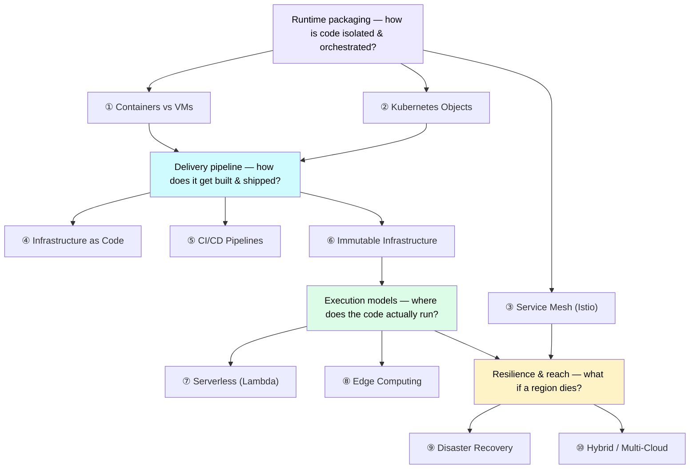
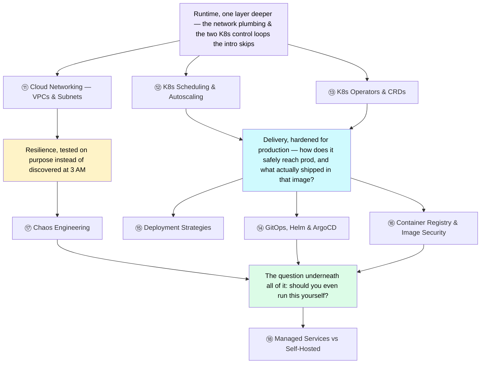
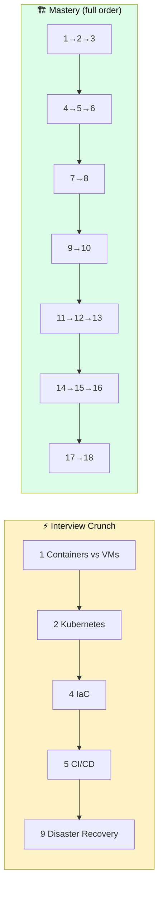

# 13 · Cloud-Native Infrastructure ☁️

> **The platform underneath the architecture.** Once the boxes-and-arrows are drawn, someone has to actually run them: package the code (containers, orchestrated by Kubernetes, wired together by a service mesh), define the infrastructure as versioned code, and ship it through a pipeline. Then decide where it actually executes — a fleet of servers, a function that scales to zero, or a point-of-presence a few milliseconds from the user — and what happens when a region, a provider, or an entire data center disappears. Get this layer right and deploys are boring; get it wrong and the best architecture on paper never survives contact with 3 AM.

---

## 🎯 What You'll Be Able To Do

- **Choose container vs VM per workload** and reason about Kubernetes' Pod/Deployment/Service model as the "operating system of the cloud."
- **Push cross-cutting network concerns** — mTLS, retries, canary routing — out of application code and into a service mesh sidecar, and know when a sidecar-less **ambient mesh** trades per-pod isolation for per-node cost.
- **Codify infrastructure as versioned, idempotent code** (Terraform) instead of clicking consoles, and ship it through a CI/CD pipeline with automated rollback.
- **Replace mutable, drifting servers with immutable golden images**, so what you tested in staging is byte-for-byte what runs in production.
- **Pick the right execution model** — always-on servers, serverless functions that scale to zero, or edge functions that beat the speed of light.
- **Set RPO/RTO targets deliberately** and design the disaster-recovery and multi-cloud posture that hits them without overpaying for nines you don't need.
- **Draw the VPC before the Terraform** — CIDR planning, public-vs-private-by-route-table, and security groups vs NACLs, so peering and Transit Gateway don't hit an overlapping-CIDR wall later.
- **Right-size a pod on purpose** — requests as a scheduler promise, limits as a kernel threat, QoS class derived from both, and exactly one autoscaler owning each axis (HPA/VPA/Cluster Autoscaler-Karpenter/KEDA).
- **Encode operational knowledge as a control loop** (CRDs + operators) instead of a runbook a human executes at 3 AM — and know when a Helm chart is the right answer instead.
- **Separate deploying code from releasing it** — blue-green, canary, and shadow traffic, gated by real statistics against a freshly-deployed baseline, with database migrations kept expand-contract.
- **Make git the single source of truth for what's running** (GitOps/Helm/ArgoCD) so the cluster credential never leaves the cluster and `git revert` is the rollback plan.
- **Ship a signed, scanned, SBOM'd image by digest** — not a mutable tag — and reject anything else at the admission-controller boundary.
- **Break production on purpose, safely** — a falsifiable hypothesis, the smallest blast radius that can prove it, and a pre-tested abort switch, before an unplanned outage does it for you.
- **Run the build-vs-buy arithmetic honestly** — loaded engineer time and on-call burden usually dominate the "managed premium," until scale flips the sign.

---

## 🗺️ How the 18 Topics Interlock

This section is now two layers. **Layer 1 (①–⑩)** is the *foundation* — package the code, codify and ship it, pick where it runs, and plan for the region that disappears. **Layer 2 (⑪–⑱)** is what a platform team actually spends its time on once the foundation is in place: the networking and scheduling detail underneath Kubernetes, the delivery machinery hardened for production, and the two judgment calls (chaos, build-vs-buy) that decide whether the whole platform is trustworthy and worth running yourself.

### Layer 1 — the foundation (①–⑩)



> **The spine:** *package the code and orchestrate it (containers → Kubernetes → service mesh) → automate its delivery as a versioned, immutable artifact (IaC → CI/CD → immutable infrastructure) → decide where it actually executes (servers, functions, or the edge) → assume the region or provider disappears and design the escape route.* Service mesh (③) is the networking layer every cluster eventually needs; immutable infrastructure (⑥) is what makes serverless deploys (⑦) and DR failover (⑨) trustworthy in the first place.

### Layer 2 — the platform team's actual day job (⑪–⑱)



> **The through-line:** *Layer 1 tells you Kubernetes is "the operating system of the cloud"; Layer 2 is what running that OS in anger actually involves.* ⑪ is the CIDR plan every VPC peering/Transit Gateway decision inherits and never changes later; ⑫ is why a cluster reporting 95% allocated can be 15% utilised, because requests are a scheduler promise and limits are a kernel threat, enforced by two different authorities; ⑬ generalizes ② — a controller is level-triggered (`Reconcile` re-reads the world every time), which is what makes an operator self-healing instead of just automated. On the delivery side, ⑭ inverts the CI/CD (⑤) credential arrow so the cluster pulls instead of being pushed into, ⑮ is the release-vs-deploy split CI/CD glossed over, and ⑯ is what immutable infrastructure (⑥) actually means for a container image — a digest, not a tag, with a signature and an SBOM attached. ⑰ is DR (⑨) proven on purpose instead of assumed, and ⑱ is the capstone judgment call every other topic here eventually forces: build it, or rent it, and re-derive the answer at every 10× of scale.

---

## 📚 The Complete File Index

### Foundation (①–⑩)

| # | Topic | One-line | Key takeaway |
|---|-------|----------|--------------|
| 1 | [Containers vs VMs (Docker)](./Containers_vs_VMs_Docker.md) | Apartment building vs house | Namespaces + cgroups share the kernel (fast, light); hypervisors virtualize hardware (slow, isolated) |
| 2 | [Kubernetes Objects](./Kubernetes_Objects_Pods_Services.md) | The automated factory floor | Pod (unit) + Deployment (desired-state manager) + Service (stable DNS/LB); self-healing, declarative |
| 3 | [Service Mesh Deep Dive (Istio)](./Service_Mesh_Deep_Dive_Istio.md) | An airport, not a switchboard | `VirtualService` decides *where* (weights), `DestinationRule` decides *how* (subsets) — mismatch a subset reference and it's a silent 503 `NR`; ambient mode trades per-pod cost for per-node blast radius |
| 4 | [Infrastructure as Code (Terraform)](./Infrastructure_as_Code_Terraform.md) | The recipe, not the cooking | Declarative + idempotent + a state file you must never lose; infra becomes a `git commit`-able text file |
| 5 | [CI/CD Pipelines](./CI_CD_Pipelines.md) | The automated car wash | Build/test/lint on every push keeps `main` shippable; canary rollout + auto-rollback limit blast radius |
| 6 | [Immutable Infrastructure Pattern](./Immutable_Infrastructure_Pattern.md) | Replace the phone, don't repair it | Golden images (Packer/Docker) swap servers wholesale — kills config drift and "snowflake" servers |
| 7 | [Serverless Computing (Lambda)](./Serverless_Computing_Lambda.md) | Taxi rides, not owned cars | FaaS pays per invocation and scales to zero; the cold start is the tax you pay for not managing a server |
| 8 | [Edge Computing (CloudFront Functions)](./Edge_Computing_Cloudfront_Functions.md) | The corner store, not the supermarket | Code runs in the PoP nearest the user (V8 isolates, <1ms start) — beats the speed-of-light latency floor |
| 9 | [Disaster Recovery (RPO/RTO)](./Disaster_Recovery_RPO_RTO.md) | Spare key and a backup car | RPO = data you can lose, RTO = downtime you can tolerate; climb backup → pilot light → warm standby → active/active |
| 10 | [Hybrid & Multi-Cloud Strategies](./Hybrid_Multi_Cloud_Strategies.md) | Don't shop at only one store | Avoid lock-in and regional outages; Terraform/Kubernetes/Docker are the cloud-agnostic glue that makes it possible |

### The Deepening (⑪–⑱)

| # | Topic | One-line | Key takeaway |
|---|-------|----------|--------------|
| 11 | [Cloud Networking — VPCs, Subnets & Private Connectivity](./Cloud_Networking_VPC_Subnets.md) | A building you lease, and you own the floor plan | CIDR is permanent — pick it from a registry; "public" is just a route table entry; security groups (stateful, per-ENI) beat NACLs (stateless, per-subnet) for east-west |
| 12 | [Kubernetes Scheduling & Autoscaling (HPA/VPA/Karpenter)](./Kubernetes_Scheduling_Autoscaling_HPA_VPA.md) | An airline seat map | Requests are a reservation the scheduler checks, limits are a seatbelt sign the kernel enforces; never let HPA and VPA both fight over CPU |
| 13 | [Kubernetes Operators & CRDs](./Kubernetes_Operators_CRDs.md) | A thermostat, not a doorbell | Controllers are level-triggered — `Reconcile()` re-reads the whole world every time, so a dropped event or a crashed pod self-heals with zero recovery code |
| 14 | [GitOps, Helm & ArgoCD](./GitOps_Helm_ArgoCD.md) | A thermostat inside the building, not a courier with a key | An in-cluster agent *pulls* desired state from git and reconciles continuously — the cluster credential never leaves the cluster |
| 15 | [Deployment Strategies — Blue-Green, Canary, Rolling & Shadow](./Deployment_Strategies_Blue_Green_Canary.md) | A dimmer switch, not a light switch | Deploying code and releasing users onto it are separable; canary needs a real weighted router and a freshly-deployed baseline, never the warm fleet |
| 16 | [Container Registries & Image Supply-Chain Security](./Container_Registry_Image_Security.md) | A Merkle tree of tarballs | A tag is a mutable database row, a digest is identity; deploy by digest and attach a signature + SBOM + provenance to it |
| 17 | [Chaos Engineering](./Chaos_Engineering.md) | A fire drill, not arson | Falsifiable hypothesis + user-visible steady state + smallest blast radius + a pre-tested abort switch — latency injection finds more than `kill -9` ever will |
| 18 | [Managed Services vs Self-Hosted](./Managed_Services_vs_Self_Hosted.md) | Buying bread instead of running a bakery | True cost = infra + premium + loaded engineer time + on-call; the engineer term dominates until scale flips the sign |

---

## 🧭 Suggested Study Paths



| Goal | Path | Why |
|------|------|-----|
| **⚡ Interview in 48h** | 1 → 2 → 4 → 5 → 9 (+ skim 12, 15) | Packaging + orchestration + codified infra + pipeline + DR = the most-asked 80%; 12 and 15 arm you for the guaranteed "how do you ship safely?" follow-up |
| **🏗️ Deep mastery** | 1→2→3 → 4→5→6 → 7→8 → 9→10 → 11→12→13 → 14→15→16 → 17→18 | Runtime → delivery → execution model → resilience → then the networking/scheduling/operator depth, the hardened delivery path, and the two judgment calls, in dependency order |
| **🌐 "Design the platform"** | 2 → 4 → 5 → 6 (+ 11, 12) | Orchestrate the workload, codify it, automate its delivery, freeze the deployable unit — then draw the VPC and size the pods before any of it runs |
| **🛡️ Resilience focus** | 3 → 9 → 10 → 17 (+ [03 · High Availability Design](../03_High_Level_Design/High_Availability_Design.md)) | Mesh-level retries → region-level DR → provider-level redundancy → then *prove* the resilience claims true with chaos experiments instead of assuming them |
| **☸️ "Kubernetes in production"** | 2 → 12 → 13 → 11 | Objects, then the two control loops every real cluster needs (scheduling/autoscaling, operators), then the networking underneath the pods |
| **🚀 "Ship this safely"** | 5 → 15 → 14 → 16 | Pipeline → release strategy (blue-green/canary) → GitOps as the deploy mechanism → a signed, scanned image as the artifact all of it ships |
| **💰 "Build vs buy" review** | 4 → 6 → 18 | See what IaC and immutable infra cost to run yourself before deciding whether to run them yourself at all |

> **Study each file by** doing the 🏋️ **Practice Drills before the solutions**, rehearsing the 🎤 **Interview Q&A out loud**, and reading 🎯 **Staff+ Nuances** for senior-level depth.

---

## 🔑 The Decision Card (whole-section cheat sheet)

```
RUNTIME    container = share kernel (namespaces+cgroups), boot in ms · VM = hypervisor, hardware isolation, boot in mins
           K8s = Pod (unit) + Deployment (desired-state manager) + Service (stable DNS/LB) · self-healing, bin-packing
           MESH = sidecar (Envoy) per pod + control plane (Istio) → mTLS, retries, canary weights, for free
DELIVERY   IaC = declarative + idempotent + a STATE FILE you never lose · infra is a text file, not a console click
           CI = build/test/lint on every push (broken main = blocked) · CD = ship it, canary %, auto-rollback
           IMMUTABLE = golden image (Packer/Docker), never patch a live server — kill it, spin up new
EXECUTION  serverless (FaaS) = pay per invocation, scale to zero, COLD START is the tax, event-triggered not always-on
           edge = push code to the PoP nearest the user (V8 isolates, <1ms start) — beats speed-of-light latency
RESILIENCE RPO (data you can lose) vs RTO (downtime you can tolerate) · ladder: backup → pilot light → warm standby → active/active
           hybrid = private + public glued by Direct Connect/ExpressRoute · multi-cloud = avoid lock-in via Terraform/K8s/Docker as the agnostic glue
── THE DEEPENING (⑪–⑱) ───────────────────────────────────────────────────────
NETWORKING CIDR is PERMANENT (no resize) — plan from a company-wide registry, leave room for accounts that don't exist yet
           subnet = one AZ · "public" = route table has 0.0.0.0/0 → IGW, nothing else — there is no flag
           security group = stateful, per-ENI, allow-only, can reference another SG as source (sg-app → sg-db)
           NACL = stateless, per-subnet, ordered, allow+deny — open the ephemeral range 1024-65535 or replies vanish
           NAT gateway: one per AZ ($0.045/hr + $0.045/GB) · free S3/DynamoDB gateway endpoint = highest-ROI change you can make
           peering (free, non-transitive) → Transit Gateway (transitive hub) → PrivateLink (only option that tolerates overlap) → VPN → Direct Connect
           debug in cost order: route table → SG → NACL → OS firewall → is anything listening → DNS → MTU (9001 vs 1500 = silent black hole)
K8S SCHED  request = promise to the SCHEDULER (sums vs allocatable, never looks at real usage) · limit = threat from the KERNEL (cgroups, continuous)
           CPU limit = compressible → CFS-throttled, p99 dies while avg looks fine · memory limit = incompressible → instant SIGKILL, exit 137
           requests.memory == limits.memory, always · CPU: consider requests with NO limit
           QoS is DERIVED: Guaranteed (req==limit everywhere) > Burstable > BestEffort — decides eviction order, not declared
           scheduler = filter (fits?) → score (LeastAllocated/MostAllocated/spread) → bind, ~100 pods/s, then kubelet can still reject
           topologySpreadConstraints > required pod anti-affinity (that's O(pods×nodes)) · PodDisruptionBudget must leave real slack
           4 autoscalers, 4 axes, don't let two fight: HPA (replicas, 15s loop) · VPA (pod size, evicts to apply) · CA/Karpenter (nodes) · KEDA (events, scale to zero)
           never HPA+VPA both on CPU · scale-up floor is 1-5 min (Pending→cloud API→boot→ready) — buy the minutes with pause-pod overprovisioning
OPERATORS  controllers are LEVEL-TRIGGERED not edge-triggered: Reconcile(ns,name) re-reads the world every time — no event, no diff, no history to lose
           ⇒ every action must be idempotent, safe to kill -9 anytime; dropped watches/crashes/out-of-band deletes all self-heal for free
           CRD = structural OpenAPI schema (validation+defaulting free), status subresource (controller-owned, user can't write it), one storage version
           machinery exists to protect the API server: informer cache, workqueue (dedupes by key), rate limiter, leader election — NEVER poll in Reconcile
           finalizer = your only chance to clean up an external resource before the object vanishes — forget it, leak the load balancer forever
           deleting a CRD cascades and garbage-collects every custom resource of that kind — never let a GitOps prune reach a CRD
           build one only when there's real ongoing lifecycle logic (failover, backup/PITR, resharding) — otherwise a Helm chart + GitOps is the right answer
GITOPS     GitOps = the CREDENTIAL ARROW flips: push CD reaches INTO the cluster (kube-admin in CI); GitOps agent pulls OUT (git+registry only)
           4 OpenGitOps principles: declarative, versioned, pulled automatically, CONTINUOUSLY RECONCILED — only #4 makes it GitOps, not just YAML in git
           Helm = Chart.yaml + templates/ + values.yaml → Go text/template+Sprig; release stored as a gzipped Secret; --atomic for rollback-on-failure
           helm rollback CANNOT undo what a hook already ran — destructive migrations must be expand/contract regardless of the tool
           Kustomize = no templating, strategic-merge/JSON-6902 patches, configMapGenerator hash-suffix actually rolls pods on config change
           Argo CD Application: pin targetRevision to a SHA, allowEmpty:false, ignoreDifferences for HPA-owned fields or selfHeal loops forever
           promote via a DIRECTORY per environment on one branch + an explicit image DIGEST — branch-per-env guarantees merge drift
           secrets ladder: Sealed Secrets → SOPS → External Secrets Operator (git holds only a reference, Vault/ASM stays the owner)
           K8s-shaped resources reconcile beautifully; databases/DNS/IAM don't — Terraform for cloud primitives, GitOps for workloads
DEPLOY     a DEPLOY puts code on machines; a RELEASE puts users on code — every strategy here is prying those two apart
           recreate (1×, downtime, right for single-writer jobs) → rolling (~1.25× via maxSurge, K8s default, never auto-rollback)
           → blue-green (2×, atomic flip in ~seconds — but ONLY if you flip at L7, never at DNS) → canary (~5%, needs a real weighted router)
           → shadow/mirror (2× compute, 0% user risk, stub every write path or you double-charge cards)
           compare canary against a FRESHLY DEPLOYED baseline, never the warm fleet — cache/JIT warmup bias aborts good builds
           detecting a doubled 0.1% error rate needs ~23,500 requests/arm — do the power math before you trust a canary's verdict
           decouple release from deploy with FEATURE FLAGS (~1s undo) · roll out in RINGS (internal→dogfood→1%→region→global) — each ring is a different population
           schema changes: ALWAYS expand-contract (add nullable → dual-write → backfill → read-new → stop-old → drop) — never rename/drop in the same release
REGISTRY   image = Merkle tree: layer (hash of bytes) → config (lists layers+entrypoint) → manifest (lists config+layers) → digest = SHA-256 of the manifest
           a TAG is a mutable DB row; only image@sha256:… is an identity — deploy by digest, let tooling rewrite it
           RUN rm secret writes a whiteout, bytes still recoverable in the earlier layer — secrets via BuildKit --mount=type=secret, never ARG; rotate if leaked
           base image ladder: debian/ubuntu (CVE backlog) → alpine (musl bites DNS/wheels) → distroless/Wolfi (no shell, for them or you)
           never let prod pull Docker Hub directly (anonymous rate limit) — mirror through a pull-through cache, immutable tags, lifecycle/GC policies
           a scanner only matches known feeds — RESCAN images already in the registry, because yesterday's clean image is vulnerable today with zero changes
           attach 3 signed things per digest: SBOM (SPDX/CycloneDX) · signature (cosign keyless via Fulcio+Rekor, no long-lived key) · provenance (builder+repo+commit)
           SLSA ladder: L1 provenance exists → L2 hosted builder signs it → L3 provenance is non-falsifiable (platform produces it, not your script)
           enforce at admission (Kyverno/Gatekeeper): reject unsigned/foreign-registry/:latest/root — and PIN both oidc-issuer AND identity or verification proves nothing
CHAOS      hypothesis around a STEADY STATE that is user-visible business output (orders/sec) — NEVER a resource metric like CPU
           5 principles: steady state, real-world events, run in PRODUCTION (staging lies), AUTOMATE it, minimise BLAST RADIUS
           latency injection > kill -9: Little's Law — 20ms→1s downstream call at 300rps needs ~306 workers vs a 200-thread pool ⇒ total outage
           a BROWNOUT is harder than a blackout: 10% errors never trips a 50%-threshold breaker, retries amplify (3 hops × 3 attempts = 27 calls) → metastable state
           write the ABORT CRITERIA and test the kill switch BEFORE injecting anything — express as an SLO burn rate, must not depend on the thing you're breaking
           climb blast radius one rung: dev → staging → 1 canary pod → 1% traffic → 1 AZ → 1 cell → 1 region — use a CONTROL group from 1% up
           gate on maturity first (observability + SLOs + working on-call) · run as a GameDay: one conductor, observers, a scribe, daylight, a timebox
           rolling back the injection ≠ recovering the system — measure time-to-recover, not just time-to-detect
BUY vs RUN true cost = infra + SERVICE PREMIUM (1.5-3×) + LOADED ENGINEER TIME (3-10× the premium) + on-call + opportunity + expected incident cost
           the engineer term dominates at small/mid scale — a service needing 0.5 FTE costs ~$140k/yr before a single instance is billed
           EKS/GKE control plane at ~$73/mo vs 1 engineer-day/mo of etcd quorum+cert rotation — that curve never crosses
           managed buys the UNDIFFERENTIATED work (patching, PITR backups, failover, SLA) — NOT superuser, kernel tuning, or engineering judgment
           an SLA is a REFUND POLICY, not a reliability guarantee — 99.95% breach on a $3,400 bill refunds ~$340 against a $400k outage
           4 lock-in axes: egress/data gravity ($0.09/GB) · proprietary API surface (how many implementations exist?) · atrophied ops muscle · contractual commit
           the only test that settles it: what's the exit plan, and have you ever TESTED a restore into it?
           self-host wins at genuine scale (Dropbox Magic Pocket, $74.6M saved/2yr) or under sovereignty/air-gap constraints — re-derive the crossover every 10× of scale
```

---

## 🎨 Conventions & Authoring

- Every file follows the root [TEMPLATE.md](../TEMPLATE.md). Animated SVGs live in [/assets](../assets/).
- Each file ends with the three mastery sections: 🏋️ Practice Drills, 🎤 Interview Q&A Bank, 🎯 Staff+ Nuances.

---

## ➡️ Where This Connects

- ⬅️ [07 · Load Balancing & Scalability](../07_Load_Balancing_Scalability/) — the traffic-routing layer that sits in front of every Kubernetes Service and multi-region failover here, and the [load-balancing algorithms](../07_Load_Balancing_Scalability/Load_Balancing_Algorithms.md) that Istio's `DestinationRule` implements at the sidecar.
- ⬅️ [10 · Microservices & Distributed Systems](../10_Microservices_Distributed_Systems/) — the services this platform packages, orchestrates, and ships, plus the [circuit breaker/bulkhead](../10_Microservices_Distributed_Systems/Circuit_Breaker_Bulkhead.md) pattern a `DestinationRule`'s connection pool and outlier detection implement for you.
- ⬅️ [12 · Monitoring, Logging & Observability](../12_Monitoring_Logging_Observability/) — the golden signals and SLO burn rate that chaos experiments (⑰) validate against, and the `proxy-status`/xDS ACKs (③) that are the mesh's own telemetry.
- ➡️ [14 · Performance Optimization & Scalability](../14_Performance_Optimization_Scalability/) — tuning the workloads once the platform underneath them is solid.
- ➡️ [15 · Security Deep Dive & DevSecOps](../15_Security_Deep_Dive_DevSecOps/) — securing the containers, pipelines, and cloud accounts built here, and where the image-signing policy (⑯) and SPIFFE workload identity (③) plug into a broader zero-trust posture.

---
*Part of the [System Design & Architecture Master Repository](../README.md). This is the ground everything else runs on — invisible when it works, catastrophic when it doesn't.*
