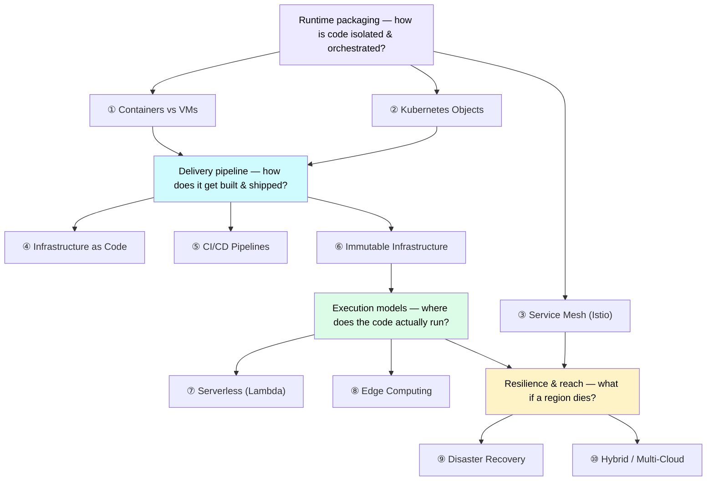
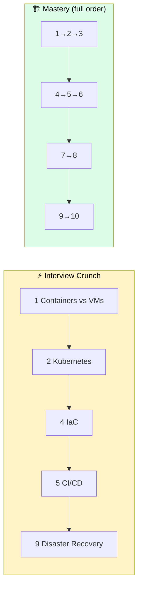

# 13 · Cloud-Native Infrastructure ☁️

> **The platform underneath the architecture.** Once the boxes-and-arrows are drawn, someone has to actually run them: package the code (containers, orchestrated by Kubernetes, wired together by a service mesh), define the infrastructure as versioned code, and ship it through a pipeline. Then decide where it actually executes — a fleet of servers, a function that scales to zero, or a point-of-presence a few milliseconds from the user — and what happens when a region, a provider, or an entire data center disappears. Get this layer right and deploys are boring; get it wrong and the best architecture on paper never survives contact with 3 AM.

---

## 🎯 What You'll Be Able To Do

- **Choose container vs VM per workload** and reason about Kubernetes' Pod/Deployment/Service model as the "operating system of the cloud."
- **Push cross-cutting network concerns** — mTLS, retries, canary routing — out of application code and into a service mesh sidecar.
- **Codify infrastructure as versioned, idempotent code** (Terraform) instead of clicking consoles, and ship it through a CI/CD pipeline with automated rollback.
- **Replace mutable, drifting servers with immutable golden images**, so what you tested in staging is byte-for-byte what runs in production.
- **Pick the right execution model** — always-on servers, serverless functions that scale to zero, or edge functions that beat the speed of light.
- **Set RPO/RTO targets deliberately** and design the disaster-recovery and multi-cloud posture that hits them without overpaying for nines you don't need.

---

## 🗺️ How the 10 Topics Interlock



> **The spine:** *package the code and orchestrate it (containers → Kubernetes → service mesh) → automate its delivery as a versioned, immutable artifact (IaC → CI/CD → immutable infrastructure) → decide where it actually executes (servers, functions, or the edge) → assume the region or provider disappears and design the escape route.* Service mesh (③) is the networking layer every cluster eventually needs; immutable infrastructure (⑥) is what makes serverless deploys (⑦) and DR failover (⑨) trustworthy in the first place.

---

## 📚 The Complete File Index

| # | Topic | One-line | Key takeaway |
|---|-------|----------|--------------|
| 1 | [Containers vs VMs (Docker)](./Containers_vs_VMs_Docker.md) | Apartment building vs house | Namespaces + cgroups share the kernel (fast, light); hypervisors virtualize hardware (slow, isolated) |
| 2 | [Kubernetes Objects](./Kubernetes_Objects_Pods_Services.md) | The automated factory floor | Pod (unit) + Deployment (desired-state manager) + Service (stable DNS/LB); self-healing, declarative |
| 3 | [Service Mesh (Istio)](./Service_Mesh_Deep_Dive_Istio.md) | A secretary for every microservice | Sidecar (Envoy) + control plane (Istio) give mTLS, retries, and canary weights without touching app code |
| 4 | [Infrastructure as Code (Terraform)](./Infrastructure_as_Code_Terraform.md) | The recipe, not the cooking | Declarative + idempotent + a state file you must never lose; infra becomes a `git commit`-able text file |
| 5 | [CI/CD Pipelines](./CI_CD_Pipelines.md) | The automated car wash | Build/test/lint on every push keeps `main` shippable; canary rollout + auto-rollback limit blast radius |
| 6 | [Immutable Infrastructure Pattern](./Immutable_Infrastructure_Pattern.md) | Replace the phone, don't repair it | Golden images (Packer/Docker) swap servers wholesale — kills config drift and "snowflake" servers |
| 7 | [Serverless Computing (Lambda)](./Serverless_Computing_Lambda.md) | Taxi rides, not owned cars | FaaS pays per invocation and scales to zero; the cold start is the tax you pay for not managing a server |
| 8 | [Edge Computing (CloudFront Functions)](./Edge_Computing_Cloudfront_Functions.md) | The corner store, not the supermarket | Code runs in the PoP nearest the user (V8 isolates, <1ms start) — beats the speed-of-light latency floor |
| 9 | [Disaster Recovery (RPO/RTO)](./Disaster_Recovery_RPO_RTO.md) | Spare key and a backup car | RPO = data you can lose, RTO = downtime you can tolerate; climb backup → pilot light → warm standby → active/active |
| 10 | [Hybrid & Multi-Cloud Strategies](./Hybrid_Multi_Cloud_Strategies.md) | Don't shop at only one store | Avoid lock-in and regional outages; Terraform/Kubernetes/Docker are the cloud-agnostic glue that makes it possible |

---

## 🧭 Suggested Study Paths



| Goal | Path | Why |
|------|------|-----|
| **⚡ Interview in 48h** | 1 → 2 → 4 → 5 → 9 | Packaging + orchestration + codified infra + pipeline + DR = the most-asked 80% |
| **🏗️ Deep mastery** | 1→2→3 → 4→5→6 → 7→8 → 9→10 | Runtime → delivery → execution model → resilience, in dependency order |
| **🌐 "Design the platform"** | 2 → 4 → 5 → 6 | Orchestrate the workload, codify it, automate its delivery, and freeze the deployable unit |
| **🛡️ Resilience focus** | 3 → 9 → 10 (+ [03 · High Availability Design](../03_High_Level_Design/High_Availability_Design.md)) | Mesh-level retries → region-level DR → provider-level redundancy |

> **Study each file by** doing the 🏋️ **Practice Drills before the solutions**, rehearsing the 🎤 **Interview Q&A out loud**, and reading 🎯 **Staff+ Nuances** for senior-level depth.

---

## 🔑 The Decision Card (whole-section cheat sheet)

```
RUNTIME    container = share kernel (namespaces+cgroups), boot in ms · VM = hypervisor, hardware isolation, boot in mins
           K8s = Pod (unit) + Deployment (desired-state manager) + Service (stable DNS/LB) · self-healing, bin-packing
           MESH = sidecar (Envoy) per pod + control plane (Istio) → mTLS, retries, canary weights, for free
DELIVERY   IaC = declarative + idempotent + a STATE FILE you never lose · infra is a text file, not a console click
           CI = build/test/lint on every push (broken main = blocked) · CD = ship it, canary %, auto-rollback
           IMMUTABLE = golden image (Packer/Docker), never patch a live server — kill it, spin up new
EXECUTION  serverless (FaaS) = pay per invocation, scale to zero, COLD START is the tax, event-triggered not always-on
           edge = push code to the PoP nearest the user (V8 isolates, <1ms start) — beats speed-of-light latency
RESILIENCE RPO (data you can lose) vs RTO (downtime you can tolerate) · ladder: backup → pilot light → warm standby → active/active
           hybrid = private + public glued by Direct Connect/ExpressRoute · multi-cloud = avoid lock-in via Terraform/K8s/Docker as the agnostic glue
```

---

## 🎨 Conventions & Authoring

- Every file follows the root [TEMPLATE.md](../TEMPLATE.md). Animated SVGs live in [/assets](../assets/).
- Each file ends with the three mastery sections: 🏋️ Practice Drills, 🎤 Interview Q&A Bank, 🎯 Staff+ Nuances.

---

## ➡️ Where This Connects

- ⬅️ [07 · Load Balancing & Scalability](../07_Load_Balancing_Scalability/) — the traffic-routing layer that sits in front of every Kubernetes Service and multi-region failover here.
- ⬅️ [10 · Microservices & Distributed Systems](../10_Microservices_Distributed_Systems/) — the services this platform packages, orchestrates, and ships.
- ➡️ [14 · Performance Optimization & Scalability](../14_Performance_Optimization_Scalability/) — tuning the workloads once the platform underneath them is solid.
- ➡️ [15 · Security Deep Dive & DevSecOps](../15_Security_Deep_Dive_DevSecOps/) — securing the containers, pipelines, and cloud accounts built here.

---
*Part of the [System Design & Architecture Master Repository](../README.md). This is the ground everything else runs on — invisible when it works, catastrophic when it doesn't.*
