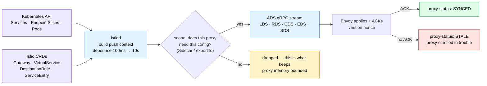
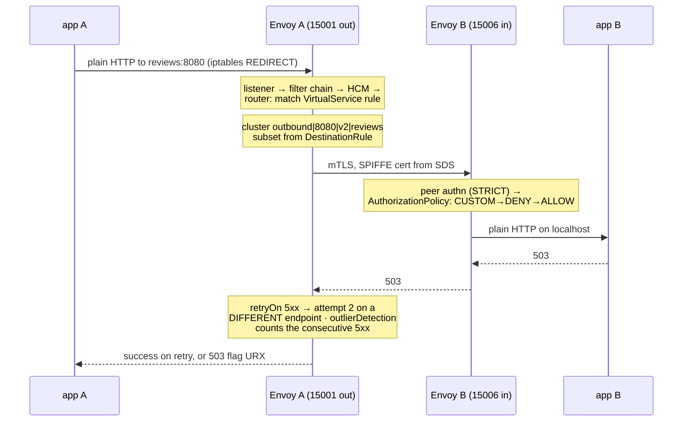

# Service Mesh Deep Dive — Istio's Traffic Model, xDS, mTLS Identity & Ambient Mode

## 1. Why Should I Care About This?
This file assumes you have already read [Service Mesh (Istio, Linkerd)](../10_Microservices_Distributed_Systems/Service_Mesh_Istio_Linkerd.md) — sidecar, control plane, "mTLS and canaries for free" — and picks up exactly where it stops. Nothing below re-explains what a sidecar is.

- **The Canary That Silently 503s**: The single most common Istio failure in the wild is a `VirtualService` with `weight: 90 / weight: 10` pointing at subsets `v1`/`v2` that no `DestinationRule` defines. Both YAMLs apply cleanly, `kubectl get` looks perfect, and 100% of traffic returns **503 with Envoy response flag `NR` (no route)**. Knowing which object owns weights and which owns subsets is the difference between a five-minute canary and a two-hour outage.
- **Every Proxy Holds Every Service, By Default**: istiod's default behaviour is to push the *entire* mesh's listener/cluster/endpoint set to *every* sidecar. In a cluster with a few thousand Services, each Envoy's config dump runs to tens of MB and its RSS climbs into the hundreds of MB — multiplied by every pod. A `Sidecar` resource or `exportTo` isn't an optimisation, it's the thing that keeps a large mesh from eating its own cluster.
- **The Per-Pod Tax Is a Real Line Item**: Istio's own published performance data puts an Envoy sidecar at roughly **0.35 vCPU and 40 MB of memory per 1,000 rps** flowing through it, with about **2–3 ms added to p90 latency** for the two-proxy round trip. At 1,000 pods that's on the order of 100 vCPU and 100 GB of RAM you are renting to run proxies — roughly a dozen `m5.2xlarge` instances, about **$3.5k/month** at us-east-1 on-demand, before you serve a single user request.
- **Sidecar-Less Is Now the Default Direction of Travel**: Istio's **ambient mode** (announced 2022, GA in Istio 1.24) replaces the per-pod proxy with a shared per-node L4 proxy (`ztunnel`) plus an *optional* per-namespace L7 `waypoint`. It removes the injection step, the pod restart on mesh upgrade, and most of the baseline overhead — and in exchange it moves your security and failure boundary from **per-pod to per-node**. That trade is now a standard interview question.

## 2. What Problem Does This Solve?
- **"I applied the YAML and nothing changed"**: Istio's networking API is four objects with sharply different jobs, and a rule that lands in the wrong one is silently inert. Knowing the layering (`Gateway` → `VirtualService` → `DestinationRule` → endpoints) turns debugging from guesswork into a two-command lookup.
- **Config That Never Reaches the Proxy**: A mesh is a distributed system for *distributing configuration*. If you can't answer "did istiod compute this, did it push it, did Envoy accept it?", you cannot debug a mesh at all — you can only restart things and hope.
- **Encryption Without Identity Is Theatre**: Turning on mTLS encrypts the wire, but the value is the **cryptographic workload identity** underneath it — and the moment you rely on it you must also know that it authenticates the *service account*, never the *end user*.
- **The Overhead Nobody Budgeted**: Teams adopt a mesh for mTLS, then discover the p99 tail, the memory footprint, and the fleet-wide restart on every upgrade. Understanding where each cost comes from is what lets you choose sidecar vs ambient vs eBPF deliberately instead of by default.
- **Naive Approach**: `istioctl install --set profile=demo`, label every namespace `istio-injection=enabled`, and treat the mesh as a checkbox. What actually happens: the demo profile ships 100% trace sampling and permissive mTLS, every proxy holds the whole cluster's config, the first upgrade restarts every pod in production during business hours, and the first real incident is debugged by people who have never run `istioctl proxy-config`.

## 3. Core Idea (Intuition First)
Istio's traffic API is **an airport, not a switchboard**. The `Gateway` is the terminal door — it decides which flights (ports, hostnames, TLS certs) are even allowed into the building. The `VirtualService` is the departures board — given a passenger, it decides **which gate they go to**. The `DestinationRule` is the ground crew at that gate — it decides **how** they board: which aircraft variants exist (subsets), how many jetways run at once (connection pool), when a plane is pulled from service (outlier detection), and whether the walk to it is encrypted.

- **`Gateway`** = admission at the edge. Ports, hosts, TLS. Zero routing logic.
- **`VirtualService`** = *where*. Ordered match rules on host/path/header, then `route` destinations **with weights**, plus `retries`, `timeout`, `fault`, and `mirror`.
- **`DestinationRule`** = *how*, after a destination is chosen. **Subsets defined by pod labels**, load-balancer policy, connection pool caps, outlier detection, TLS mode.
- **`ServiceEntry`** = a registry entry for something outside the cluster, so mesh policy applies to `api.stripe.com` too.
- **`Sidecar`** = a scoping fence: which slice of the mesh's config this proxy is even told about.

> The mental image: **the VirtualService decides *where* the request goes, the DestinationRule decides *how* it is sent — and a canary needs both, because the weights live in one object and the subsets live in the other.**

![Three-panel technical diagram of an Istio deep dive. Panel A lays out the layered traffic model as four boxes connected left to right. The first box is Gateway, described as what the edge accepts: a port such as 443, a list of hostnames, a TLS credentialName, and a selector pointing at the ingress gateway deployment, with the note that no routing rules live here. The second box is VirtualService, highlighted green and labelled "where does it go?", listing ordered match rules on URI and header, a route block splitting traffic ninety to version one and ten to version two, an explicit annotation that the weights live here, and the retries, timeout, fault and mirror fields. The third box is DestinationRule, highlighted amber and labelled "how is it sent?", listing subsets defined by pod label with an explicit annotation that the subsets live here, plus loadBalancer, connectionPool, outlierDetection and the TLS mode. The fourth box is Endpoints from EDS, showing eight pods on version one and one pod on version two, locality priorities zero, one and two, and Envoy's fifty percent healthy panic threshold. Below the row, a red warning box explains the classic mistake: weights in a VirtualService referencing a subset that no DestinationRule defines leaves Envoy with no matching cluster, producing a 503 with response flag NR even though the YAML applied cleanly. A purple box beside it names the two objects nobody configures until it hurts: ServiceEntry, which pulls an external host into the mesh, and Sidecar or exportTo, which scopes which config a proxy receives, noting that the default is every service's config in every proxy. Panel B is a five-step numbered flow showing where a workload certificate comes from: a pod runs as a Kubernetes ServiceAccount and gets a projected service account token with audience istio-ca; the istio-agent generates a keypair in memory and sends a certificate signing request plus that token to istiod; istiod in its Citadel role validates the token through the Kubernetes TokenReview API and signs a certificate valid for roughly twenty-four hours; the secret discovery service hands the certificate to Envoy over a local unix socket so the private key never touches disk; and strict mutual TLS then runs proxy to proxy with the agent re-rotating at roughly half the certificate lifetime. A red side box gives the resulting SPIFFE identity in the form spiffe colon slash slash cluster dot local slash ns slash namespace slash sa slash service account, notes that this string is the AuthorizationPolicy principal, and states the limit that trips people up: mTLS proves which workload is calling and says nothing about which user, so RequestAuthentication with a JWT is what supplies end-user identity. A footer line states that zero trust needs the pair. Panel C compares three data-plane architectures side by side. The sidecar column, one Envoy per pod, offers full Envoy L7 with every filter, costs roughly forty megabytes and 0.35 vCPU per thousand requests per second per pod, has a blast radius of one pod, requires restarting every pod to upgrade, adds two proxy hops per call, intercepts traffic via iptables or a CNI plugin, and means a thousand pods equals a thousand proxies. The ambient column, ztunnel plus waypoint, gives L7 only where a waypoint exists, costs one ztunnel per node plus a waypoint per namespace, has a blast radius of the whole node, needs no application restart to upgrade, adds an L4 ztunnel hop plus an optional waypoint L7 hop, uses HBONE HTTP/2 CONNECT as transport, and lets you pay for L7 only where you use it. The eBPF Cilium column notes the kernel handles L4 routing natively while HTTP still needs a userspace proxy anyway, has a node or kernel blast radius, upgrades by rolling the node agent, adds zero hops for pure L4 policy, requires a recent kernel with CO-RE, and gives identity per node rather than per pod. A footer bar summarises the choice: per-pod L7 everywhere points to sidecar, baseline cost plus restart-free upgrades points to ambient, mostly L4 identity and policy points to eBPF.](../assets/istio_traffic_model_ambient.svg)

> Panel A: four objects, sharply divided jobs — weights in the `VirtualService`, subsets in the `DestinationRule`, and a mismatch is a silent 503 `NR`. Panel B: identity is derived from the Kubernetes ServiceAccount and delivered as a short-lived SPIFFE certificate over SDS — and it authenticates the workload, never the user. Panel C: sidecar, ambient, and eBPF differ mainly in per-pod cost, blast-radius boundary, and how much L7 you actually get.

## 4. How It Actually Works

### 1. The traffic API is layered, and a canary needs two objects
- **`Gateway`** binds a set of `hosts` and `port`/`protocol`/`tls` blocks to a gateway deployment via a label `selector`. It is *admission only* — it does not route. A `Gateway` with no `VirtualService` bound to it (`spec.gateways: [my-gw]`) accepts the connection and then returns **404**, which is the single most confusing first-day Istio symptom.
- **`VirtualService`** is where routing happens. `spec.hosts` are the *client-facing* names; `spec.http` is an **ordered list** — Envoy evaluates rules top to bottom and takes the **first match**, so a catch-all rule placed above your header match makes the header match dead code. Each rule carries `match` (uri prefix/exact/regex, headers, method, query params, source labels), `route` (one or more `destination` + `weight`, summing to 100), plus the resilience knobs: `retries` (`attempts`, `perTryTimeout`, `retryOn` flags), `timeout` (an overall deadline — note `attempts × perTryTimeout` can exceed it, and the overall `timeout` wins), `fault` (`delay`/`abort` for [chaos experiments](./Chaos_Engineering.md)), and `mirror` (fire-and-forget shadow copy to a second destination, response discarded — the safest way to test v2 with production traffic).
- **`DestinationRule`** applies *after* a destination host is chosen. Its `subsets` are the named label selectors (`labels: {version: v2}`) that `VirtualService` weights refer to. `trafficPolicy` carries `loadBalancer` (ROUND_ROBIN, LEAST_REQUEST — Envoy's power-of-two-choices, RANDOM, or `consistentHash` for sticky routing), `connectionPool` (`tcp.maxConnections`, `http.http1MaxPendingRequests`, `http2MaxRequests`, `maxRequestsPerConnection`) which is your [bulkhead](../10_Microservices_Distributed_Systems/Circuit_Breaker_Bulkhead.md), `outlierDetection` (the circuit breaker: eject a host after N consecutive 5xx), and `tls.mode` for the upstream leg.
- **The trade-off that matters**: `VirtualService` and `DestinationRule` are separate objects because *routing* and *transport policy* have different owners and different change cadences. A release engineer flips weights every deploy; a platform engineer sets connection pools once. The cost of that separation is exactly the failure in Panel A — **`weight` in one file, `subset` definition in another, and nothing validates the reference at admission time.**
- **Real number**: Envoy's `LEAST_REQUEST` is not a full scan; it samples 2 hosts (`choiceCount: 2` by default) and picks the less loaded. Power-of-two-choices gets you most of the benefit of least-connections at O(1) cost — the same result described in [Load Balancing Algorithms](../07_Load_Balancing_Scalability/Load_Balancing_Algorithms.md).

### 2. `ServiceEntry`, `Sidecar` scoping, and the Gateway API convergence
- **`ServiceEntry`** adds a host to Istio's internal registry so the mesh can apply policy to something it doesn't own: `api.stripe.com` becomes a real cluster you can attach timeouts, retries, and per-host TLS origination to. Combined with `outboundTrafficPolicy: REGISTRY_ONLY`, unlisted egress is *blocked* — which converts "who is our service calling on the internet?" from an unanswerable question into an allowlist.
- **`Sidecar`** solves the scaling problem: by default istiod pushes every service's listeners, clusters, and endpoints to every proxy, so **per-proxy memory grows with cluster size, not with the pod's own dependencies**. A `Sidecar` with `egress.hosts: ["./*", "istio-system/*"]` restricts a namespace's proxies to their own namespace, collapsing a multi-MB config dump to a few hundred KB. `exportTo` on a `Service`/`VirtualService`/`DestinationRule` does the same thing from the producer side. In any cluster past a few hundred Services this is mandatory, not optional.
- **Kubernetes Gateway API and GAMMA are where this is all going.** Gateway API reached v1.0 in October 2023 with `GatewayClass`/`Gateway`/`HTTPRoute` as stable, and the **GAMMA** initiative (Gateway API for Mesh Management and Administration) extends the same `HTTPRoute` object to *east-west* mesh traffic by letting a route attach to a `Service` as its parent instead of a `Gateway`. Istio implements it, treats it as the recommended path for new ingress, and ambient's `waypoint` proxies are themselves declared as Gateway API `Gateway` objects with `gatewayClassName: istio-waypoint`. The practical consequence: **learn the mechanism, expect the CRD names to migrate.** `HTTPRoute` gives you the same ordered-match-plus-weight model with cross-implementation portability; the Istio CRDs still expose things Gateway API doesn't (mirroring percentages, fine-grained fault injection, everything in `DestinationRule`), so real clusters run both for now.

### 3. xDS — how a YAML edit becomes an Envoy route
istiod is a compiler with a push loop. It watches the Kubernetes API for both **config** (your CRDs) and **state** (Services, EndpointSlices, Pods, ServiceAccounts), builds an internal push context, and translates it into Envoy's discovery-service resources delivered over a single bidirectional gRPC stream (**ADS**, aggregated discovery):

| xDS type | What it carries | Debug with |
|---|---|---|
| **LDS** — Listeners | Sockets Envoy binds: `15001` (outbound), `15006` (inbound), per-port virtual listeners | `istioctl pc listener` |
| **RDS** — Routes | The `VirtualService` match rules, compiled to ordered route configs | `istioctl pc route` |
| **CDS** — Clusters | One cluster per host+subset+port (`outbound|8080|v2|reviews.shop.svc.cluster.local`) | `istioctl pc cluster` |
| **EDS** — Endpoints | The actual pod IPs and their locality/priority, updated on every pod churn | `istioctl pc endpoint` |
| **SDS** — Secrets | Workload certs and CA roots, over a local UDS so keys never hit disk | `istioctl pc secret` |

- **Debouncing and throttling are load-bearing.** A rolling deploy of 200 pods generates hundreds of endpoint events per second. istiod coalesces them (`PILOT_DEBOUNCE_AFTER`, default 100 ms, up to `PILOT_DEBOUNCE_MAX`, default 10 s) and caps concurrent pushes (`PILOT_PUSH_THROTTLE`, default 100). Without this, a large deploy becomes a config storm that pins istiod's CPU and delays *every* proxy's update.
- **`istioctl proxy-status` is the first command in any mesh incident.** It prints, per proxy, whether each xDS type is `SYNCED` (proxy ack'd istiod's version), `STALE` (istiod sent it, no ACK — the proxy is unhealthy or istiod is overloaded), or `NOT SENT` (istiod never computed it — usually means no config applies).
- **Trade-off**: the mesh is eventually consistent by design. A weight change takes hundreds of milliseconds to seconds to land across a fleet, and during a push different proxies hold different versions. Never build a system that assumes an Istio config change is atomic.



### 4. Inside the proxy: interception, the filter chain, and the two-hop latency bill
- **Interception.** The classic mechanism is an `istio-init` container that runs `iptables` in the pod's network namespace, `REDIRECT`-ing outbound traffic to port **15001** and inbound to **15006**. That init container needs **`NET_ADMIN` and `NET_RAW`** capabilities — a real problem in clusters with restrictive Pod Security Standards. **CNI-plugin mode** (`istio-cni`) moves the same iptables programming into a privileged DaemonSet that acts at pod-network-setup time, so application pods need no elevated capabilities at all and there's no init container to race. If your security team objects to Istio, CNI mode is usually the answer.
- **The path through Envoy**, outbound side: packet hits **listener** `15001` → Envoy matches a **filter chain** (by SNI, destination IP/port, ALPN) → the **HTTP Connection Manager** parses the request → the **router filter** evaluates the RDS route table (your `VirtualService`, in order) → selects a **cluster** (host + subset + port) → the cluster's load balancer picks an **endpoint** from EDS, filtered by outlier-detection ejections and locality priority → connection pool sends it. Inbound at `15006` runs the mirror image with authn/authz filters before the app.
- **The double hop is where the latency comes from.** One logical call `A → B` traverses **two** proxies: A's outbound and B's inbound. Istio's published benchmarks put this at roughly **2–3 ms added at p90** for a simple HTTP call with default telemetry, and around **0.35 vCPU + 40 MB per 1,000 rps** per proxy. Treat those as an order of magnitude, not a promise: they move materially with Istio version, telemetry configuration, whether access logging is on, protocol (HTTP/1.1 vs HTTP/2 vs gRPC), and payload size. **The p50 is rarely the problem; the tail is.** Two extra queues, two extra connection pools, and two extra GC-free-but-not-free event loops widen p99 more than they move the median.
- **Other ports worth memorising** for debugging: `15000` Envoy admin (`/config_dump`, `/stats`, `/clusters`), `15021` health probe endpoint, `15090` Prometheus telemetry, `15008` HBONE in ambient mode.



### 5. The two lifecycle races nobody warns you about
- **App starts before the sidecar is ready.** Containers in a pod start concurrently. A service that opens a database connection or calls a dependency in its first 200 ms will hit iptables rules pointing at an Envoy that hasn't loaded its config, and get connection-refused or 503. Classic symptom: **crash-looping pods that work fine on the second attempt.** Fixes, in order of preference: **Kubernetes native sidecar containers** (an `initContainer` with `restartPolicy: Always`, beta in Kubernetes 1.29, graduating in 1.33 — the container starts and becomes ready *before* the main containers begin), or Istio's older `holdApplicationUntilProxyStarts: true`, which injects the proxy first and blocks the app on its readiness.
- **The sidecar dies before the app finishes draining.** The mirror image: on `SIGTERM` Kubernetes signals all containers, Envoy stops accepting and starts draining, but the app is still trying to flush in-flight work through a proxy that is going away — so the last few seconds of a rolling update produce 503s that look like a code bug. Controls: `terminationDrainDuration` (Istio's proxy drain window, default 5 s — raise it above your longest request), a `preStop` sleep on the app, and native sidecars, which Kubernetes shuts down *after* the main containers exit. Both races exist because a Pod's containers were never designed to have a start/stop ordering; the mesh needs one.

### 6. Identity: SPIFFE, the CSR flow, and short-lived certs over SDS
- **The identity is the Kubernetes ServiceAccount.** Istio derives a **SPIFFE ID** of the form `spiffe://<trust-domain>/ns/<namespace>/sa/<service-account>` — e.g. `spiffe://cluster.local/ns/shop/sa/checkout` — and encodes it as a URI SAN in the workload certificate. This is why "give every workload its own ServiceAccount" stops being hygiene advice and becomes a hard prerequisite: if ten Deployments share `default`, they are the *same* identity and no policy can tell them apart.
- **The CSR flow**, step by step: (1) the pod mounts a **projected ServiceAccount token** with audience `istio-ca` and a short TTL; (2) `istio-agent` (the pilot-agent sidecar in the same container as Envoy) generates a private key **in memory**; (3) it sends a CSR plus that token to istiod's CA endpoint; (4) istiod validates the token via the Kubernetes **TokenReview** API — this is the root of trust: Kubernetes vouches that this pod really runs as that ServiceAccount; (5) istiod signs a certificate, default lifetime **24 hours**; (6) the agent serves it to Envoy over **SDS** on a local Unix domain socket, so the private key **never touches disk or the API server**; (7) the agent re-runs the flow at roughly half the certificate lifetime, so a rotation failure has ~12 hours of runway before anything breaks. Compare with the long-lived, manually-rotated certs in [PKI & TLS Certificates](../11_Security_Identity/PKI_TLS_Certificates.md) — short-lived automated certs are the whole reason mesh mTLS is operable at all.
- **`PeerAuthentication` modes.** `STRICT` rejects any plaintext inbound. `PERMISSIVE` — the default — accepts *both* mTLS and plaintext on the same port, because Envoy sniffs the connection. PERMISSIVE exists purely as a **migration path**: you cannot flip a running mesh to STRICT atomically, so you onboard workloads, verify from telemetry that 100% of traffic is already mTLS, then tighten namespace by namespace. Leaving a production mesh PERMISSIVE forever is the most common way to have "mTLS" and no actual guarantee.
- **What it does not do**: mTLS proves *which workload* opened the connection. It cannot tell you which human is behind the request. See below.

### 7. Authorization: evaluation order, and the workload-vs-user boundary
- **`AuthorizationPolicy` evaluates in a fixed order: CUSTOM → DENY → ALLOW.** For a given workload, all matching CUSTOM policies (external authz) run first; then if any DENY matches, the request is rejected; then, **only if at least one ALLOW policy exists for that workload**, the request must match one of them or it is rejected. That last clause is the subtle one: **a workload with no ALLOW policy is wide open, and a workload with one ALLOW policy is default-deny.** And an ALLOW policy with an empty `rules` list (or `spec: {}`) matches nothing, so it **denies everything** for the workloads its selector covers — which is either the cleanest possible namespace default-deny or an accidental full outage, depending on whether you meant it.
- **Principals come from mTLS.** `from.source.principals: ["cluster.local/ns/shop/sa/frontend"]` is the SPIFFE ID minus the scheme. `namespaces` and `serviceAccounts` are conveniences over the same identity. **These fields only work if mTLS is actually in force** — under PERMISSIVE, a plaintext request has no principal, so a policy keyed on principals will deny it, which is usually right but surprises people mid-migration.
- **`RequestAuthentication` is the other half.** It validates a **JWT** against a JWKS URI and populates `request.auth.principal` / `request.auth.claims[...]`, which `AuthorizationPolicy` can then match on (`when: key: request.auth.claims[groups], values: ["admin"]`). Critically, `RequestAuthentication` **only rejects a bad token; it does not require a token** — a request with no JWT at all passes it. Requiring authentication takes an `AuthorizationPolicy` with `requestPrincipals: ["*"]`.
- **The pairing is the whole point.** Workload identity (mTLS) answers *what service is calling*; request identity (JWT) answers *on whose behalf*. Either one alone is a half-measure: mTLS-only lets a compromised legitimate service act as any user; JWT-only lets anything on the network present a stolen token. Real [zero trust](../15_Security_Deep_Dive_DevSecOps/Zero_Trust_Architecture.md) needs both, evaluated together, which is exactly what [API Security (Scopes & mTLS)](../15_Security_Deep_Dive_DevSecOps/API_Security_Scopes_mTLS.md) describes at the API layer.

### 8. Ambient mode, HBONE, and eBPF — three data planes, three cost curves
- **Why ambient exists.** The sidecar model's costs are structural, not implementation bugs: a proxy per pod, injection as a mutating-webhook dependency on every pod creation, a fleet-wide pod restart to upgrade the mesh, and full L7 machinery paid for even by workloads that only need encryption and L4 policy.
- **`ztunnel`** is a per-node DaemonSet (Rust) that handles **L4 only**: mTLS, workload identity, L4 authorization, TCP telemetry. Traffic is tunnelled between nodes using **HBONE** — HTTP/2 `CONNECT` over mTLS on port **15008** — which preserves the original destination inside the tunnel and lets one long-lived connection carry many logical streams.
- **`waypoint`** is an *optional* per-namespace (or per-service-account) Envoy deployment that provides the L7 features: header-based routing, weighted canaries, retries, L7 authorization, request-level telemetry. You deploy one only where you need L7, so **you pay for L7 exactly where you use it.** Waypoints are declared as Gateway API `Gateway` objects with `gatewayClassName: istio-waypoint`.
- **The consequences, honestly.** Gains: no injection step, no per-pod proxy, no application restart to upgrade the mesh, dramatically lower baseline overhead, and a mesh you can enable per-namespace with a label rather than a redeploy. Losses: `ztunnel` is a **shared, node-level component**, so it is a shared failure domain — a crash or a bad upgrade affects every pod on that node, not one — and the security boundary moves from **per-pod to per-node**, meaning a compromised ztunnel holds the keys for every workload scheduled there. That is a genuinely different threat model, and it is the correct answer to "what's the catch with ambient?"
- **eBPF (Cilium service mesh) is the third architecture.** It puts L4 routing, identity, and network policy in the kernel via eBPF programs attached to sockets and TC hooks — no userspace hop at all for L4, which is genuinely faster and is a natural fit for policy enforcement. **But eBPF cannot practically do full L7 HTTP processing**: HTTP/2 and gRPC parsing, header manipulation, retries with buffering, and JWT validation all end up in a userspace proxy — Cilium's answer is a **per-node Envoy**, which converges on the same shape as ambient's ztunnel-plus-waypoint. The honest framing for an interview: **eBPF removes the per-pod proxy for L4, it does not remove the proxy for L7.** Cilium graduated in the CNCF in 2023 and is a serious option when your requirements are mostly L4 identity and policy.

## 5. Real-World Example
**Envoy was built at Lyft, and that explains its weight.** Matt Klein's 2017 announcement described Envoy already running across Lyft's entire infrastructure — on the order of 100 services and 10,000 hosts, handling roughly 2 million requests per second — as both edge proxy and per-service sidecar. It was designed as a *universal data plane* with a pluggable filter chain, a full HTTP/2 stack, and the xDS management API as a first-class contract. Every Istio strength (arbitrary L7 filters, WASM extensions, protocol breadth) and every Istio complaint (memory footprint, config-dump size, a learning curve) descends directly from that origin. **Linkerd made the opposite bet**: `linkerd2-proxy` is a purpose-built Rust micro-proxy that deliberately drops Envoy's extensibility for a much smaller footprint and tighter tail latency, and Buoyant has published benchmarks arguing exactly that trade. Neither is wrong — they answer different questions.

**Istio's own performance page is the most useful and most misread document in the ecosystem.** It publishes concrete figures — roughly 0.35 vCPU and 40 MB per 1,000 rps per proxy, and single-digit-millisecond p90 addition for the two-proxy path — from a specific, documented benchmark: a synthetic `fortio` workload, a stated Istio version, a stated telemetry config. Engineers quote the number and skip the configuration, then are surprised when their own gRPC service with 1 MB payloads, access logging on, and 100% trace sampling behaves nothing like it. **The reusable lesson is procedural: run `fortio` through your own mesh with the mesh enabled and disabled, on your own payloads, and compare p50/p95/p99 — the ratio for your workload is the only number that matters.**

**Ambient mode's stated motivation was cost and upgrade friction, not features.** When Google and Solo.io introduced ambient mesh in 2022, the argument was explicitly operational: sidecar injection couples the mesh to the application lifecycle, so every mesh upgrade becomes a fleet-wide pod restart, and every pod pays for L7 whether it uses it or not. Ambient reached GA in Istio 1.24, and the design — shared node-level L4 proxy plus optional L7 proxy — is now converging with what Cilium built from the eBPF side. That convergence is itself the signal: **the industry decided the per-pod proxy was the part worth removing.**

## 6. Code Example
A complete weighted canary. Note that **three objects are required** and each owns a different piece:

```yaml
# ── 1. Gateway: what the edge ACCEPTS. No routing logic lives here. ──────────
apiVersion: networking.istio.io/v1
kind: Gateway
metadata: {name: shop-gw, namespace: istio-system}
spec:
  selector: {istio: ingressgateway}     # binds to the ingress Deployment's labels
  servers:
    - port: {number: 443, name: https, protocol: HTTPS}
      hosts: ["shop.example.com"]
      tls:
        mode: SIMPLE
        credentialName: shop-tls        # a k8s Secret in the GATEWAY's namespace, not yours
---
# ── 2. VirtualService: WHERE the request goes. THE WEIGHTS LIVE HERE. ───────
apiVersion: networking.istio.io/v1
kind: VirtualService
metadata: {name: reviews, namespace: shop}
spec:
  hosts: ["shop.example.com"]
  gateways: ["istio-system/shop-gw"]    # omit this and the Gateway 404s
  http:
    - name: internal-testers            # ORDER MATTERS — first match wins.
      match:                            # Put the specific rule ABOVE the catch-all
        - headers: {x-canary: {exact: "true"}}
      route:
        - destination: {host: reviews.shop.svc.cluster.local, subset: v2}
    - name: weighted-canary
      route:
        - destination: {host: reviews.shop.svc.cluster.local, subset: v1}
          weight: 90
        - destination: {host: reviews.shop.svc.cluster.local, subset: v2}
          weight: 10                    # ◀── LOAD-BEARING: weights must sum to 100
      mirror: {host: reviews.shop.svc.cluster.local, subset: v3}
      mirrorPercentage: {value: 5.0}    # shadow traffic; response discarded
      timeout: 3s                       # OVERALL deadline — this beats retries below
      retries:
        attempts: 3
        perTryTimeout: 800ms            # 3 × 800ms = 2.4s, fits inside the 3s timeout
        retryOn: 5xx,reset,connect-failure,retriable-status-codes
        retryRemoteLocalities: true     # let a retry cross AZ if the local one is sick
---
# ── 3. DestinationRule: HOW it is sent. THE SUBSETS LIVE HERE. ──────────────
#    Without this file, the weights above resolve to nothing → 503 flag NR.
apiVersion: networking.istio.io/v1
kind: DestinationRule
metadata: {name: reviews, namespace: shop}
spec:
  host: reviews.shop.svc.cluster.local
  trafficPolicy:
    tls: {mode: ISTIO_MUTUAL}           # use the mesh's SPIFFE certs on this leg
    loadBalancer: {simple: LEAST_REQUEST}
    connectionPool:                     # ◀── this is the BULKHEAD
      tcp: {maxConnections: 100}
      http: {http2MaxRequests: 200, http1MaxPendingRequests: 50, maxRequestsPerConnection: 0}
    outlierDetection:                   # ◀── this is the CIRCUIT BREAKER
      consecutive5xxErrors: 5
      interval: 10s
      baseEjectionTime: 30s
      maxEjectionPercent: 20            # NEVER 100 — see failure modes. Default is 10.
  subsets:                              # ◀── THE NAMES THE VirtualService REFERS TO
    - name: v1
      labels: {version: v1}             # must match POD labels, not Service labels
    - name: v2
      labels: {version: v2}
    - name: v3
      labels: {version: v3}
```

Locking the namespace down — workload identity *and* user identity, which is the pairing that makes it real:

```yaml
# STRICT mTLS for the whole namespace: reject any plaintext inbound.
apiVersion: security.istio.io/v1
kind: PeerAuthentication
metadata: {name: default, namespace: shop}
spec: {mtls: {mode: STRICT}}            # flip from PERMISSIVE only after telemetry
---                                     # confirms 100% of inbound is already mTLS
# Validate end-user JWTs. NOTE: this does NOT require a token — it only rejects bad ones.
apiVersion: security.istio.io/v1
kind: RequestAuthentication
metadata: {name: jwt, namespace: shop}
spec:
  selector: {matchLabels: {app: reviews}}
  jwtRules:
    - issuer: "https://auth.example.com"
      jwksUri: "https://auth.example.com/.well-known/jwks.json"
---
apiVersion: security.istio.io/v1
kind: AuthorizationPolicy
metadata: {name: reviews-allow, namespace: shop}
spec:
  selector: {matchLabels: {app: reviews}}
  action: ALLOW                         # ◀── LOAD-BEARING: the mere EXISTENCE of one
  rules:                                #      ALLOW policy makes this workload default-DENY
    - from:
        - source:
            principals: ["cluster.local/ns/shop/sa/frontend"]   # ← the WORKLOAD (mTLS)
            requestPrincipals: ["https://auth.example.com/*"]   # ← the USER (JWT). Both.
      to:
        - operation: {methods: ["GET"], paths: ["/api/reviews/*"]}
      when:
        - key: request.auth.claims[groups]
          values: ["reviewer", "admin"]
# An ALLOW policy with `rules: []` (or spec:{}) matches NOTHING and therefore DENIES
# everything its selector covers. That is either your namespace default-deny, or an outage.
```

The debugging sequence, in the order you should actually run it:

```bash
# 1. Is the config even reaching the proxies? SYNCED / STALE / NOT SENT.
istioctl proxy-status                       # STALE ⇒ istiod overloaded or proxy sick
                                            # NOT SENT ⇒ istiod computed nothing for it

# 2. Does the route exist, and does it point at a cluster that exists?
POD=$(kubectl -n shop get pod -l app=frontend -o name | head -1 | cut -d/ -f2)
istioctl -n shop pc route  "$POD" --name 8080 -o json | jq '.[].virtualHosts[].routes[].route'
istioctl -n shop pc cluster "$POD" --fqdn reviews.shop.svc.cluster.local
#   ▲ THE MONEY COMMAND for a broken canary: if `subset: v2` has no matching
#     cluster here, your DestinationRule subset is missing/mislabelled → 503 NR.

# 3. Are there healthy endpoints, and has outlier detection ejected them?
istioctl -n shop pc endpoint "$POD" --cluster "outbound|8080|v2|reviews.shop.svc.cluster.local"

# 4. Is mTLS actually in force on this leg, and what identity is presented?
istioctl -n shop pc secret "$POD" -o json | jq -r '.dynamicActiveSecrets[0].name'
kubectl -n shop exec "$POD" -c istio-proxy -- \
  openssl s_client -connect reviews:8080 2>/dev/null | grep -i 'URI:spiffe'

# 5. Read the response flags — they name the failure class directly.
kubectl -n shop logs "$POD" -c istio-proxy --tail=50 | grep -E ' (503|UC|UF|NR|URX|UO) '
#   NR = no route configured        UC = upstream connection terminated
#   UF = upstream connection failure  URX = retry limit exceeded
#   UO = upstream overflow (your connectionPool circuit-broke it)

# 6. Would this AuthorizationPolicy actually allow the call? Analyze before applying.
istioctl analyze -n shop                    # catches most missing-subset / dangling-ref bugs
```

## 7. Design Variations & Alternatives

| Approach | L7 features | Per-pod cost | Blast radius | Upgrade cost | Use when |
|---|---|---|---|---|---|
| **Istio sidecar (Envoy)** | Everything: WASM filters, any protocol | ~40 MB + 0.35 vCPU per 1k rps, **per pod** | One pod | Restart every pod in the fleet | You need per-pod L7 everywhere and can pay the tax |
| **Istio ambient (ztunnel + waypoint)** | L4 everywhere, L7 only where a waypoint exists | One ztunnel **per node**; waypoint per namespace | **The whole node** | No app restart | Baseline overhead or restart-free upgrades dominate |
| **Linkerd (Rust micro-proxy)** | Solid core L7, deliberately not extensible | Materially smaller than Envoy | One pod | Restart pods | You want a mesh you can operate with a small team |
| **Cilium / eBPF** | Kernel L4 is excellent; L7 still needs a per-node Envoy | No per-pod proxy | Node / kernel | Roll the node agent | Requirements are mostly L4 identity + network policy |
| **Proxyless gRPC (xDS in the client)** | Whatever the gRPC xDS implementation supports | Zero — it's a library | One process | Redeploy the app | Uniformly gRPC, one or two languages, latency-critical |
| **Resilience library (Resilience4j, Polly)** | Retries, timeouts, circuit breakers only | Zero | One process | Redeploy the app | Few services, one language, no mTLS requirement |
| **Ingress gateway only (no mesh)** | Full L7 north-south, nothing east-west | Zero | The gateway | Roll the gateway | You only ever needed edge routing and TLS termination |

**Multi-cluster and mesh expansion.** Two topologies. **Multi-primary** runs istiod in every cluster: each control plane is independent, failure is contained, and clusters discover each other's endpoints through a remote-secret-based API-server credential. **Primary-remote** runs one istiod that serves proxies in remote clusters — cheaper to run, but the remote clusters lose their control plane when the primary's region does. Both need three things:
- **A shared trust domain and a common root of trust.** Either both clusters' istiods are intermediate CAs signed by one root (the recommended production setup, ideally with the root key in a [KMS/HSM](../15_Security_Deep_Dive_DevSecOps/KMS_HSM_Key_Management.md)), or SPIFFE IDs from cluster B mean nothing to a proxy in cluster A and cross-cluster mTLS simply fails.
- **East-west gateways.** Cross-cluster traffic doesn't go pod-to-pod; it goes through a dedicated gateway (conventionally port **15443**) that does SNI-based passthrough routing, preserving end-to-end mTLS while giving you one routable address per cluster. This is what makes multi-cluster work across VPCs that don't have flat pod networking — see [Cloud Networking (VPC & Subnets)](./Cloud_Networking_VPC_Subnets.md).
- **Locality-aware load balancing with explicit failover.** Envoy's locality priority sends traffic to same-zone endpoints (priority 0) and only spills to other zones (priority 1, 2) as local capacity is exhausted or ejected. `localityLbSetting.failover` lets you declare `us-east-1 → us-west-2`. **This is a cost decision as much as a latency one**: AWS bills roughly **$0.01/GB in each direction** for cross-AZ traffic, so an accidental cross-zone routing policy on a 10 TB/day internal service is about **$200/day** of pure waste. Watch Envoy's **healthy panic threshold** here: if fewer than 50% of endpoints in the priority set are healthy, Envoy *disregards locality and health* and spreads load across everything — a deliberate design choice that prevents cascading overload but will absolutely surprise you by sending "local-only" traffic across a region.

## 8. Pros and Cons

### Sidecar mode (Envoy per pod)
- **Pros**: full L7 everywhere with no exceptions — WASM/Lua filters, arbitrary protocol handling, per-pod telemetry with real request attribution; the security boundary is the pod, so a compromised proxy holds exactly one workload's key; per-workload config scoping is possible; the most mature, best-documented path with the deepest ecosystem.
- **Cons**: the cost is multiplicative in pod count — 1,000 pods is 1,000 proxies and, at Istio's published figures, roughly 100 vCPU and 100 GB of RAM (~$3.5k/month on `m5` on-demand) before serving a request; a mesh upgrade is a fleet-wide pod restart; injection depends on a mutating webhook that is now on the critical path of every pod creation; two extra hops widen p99 more than p50; and by default every proxy carries the whole mesh's config.

### Ambient mode (ztunnel + optional waypoint)
- **Pros**: baseline overhead drops to one shared proxy per node instead of one per pod; mesh upgrades touch DaemonSets and waypoints, not application pods, so there is no coordinated restart; enabling the mesh is a namespace label rather than a redeploy; L7 cost is opt-in per namespace; no `NET_ADMIN` init container and no injection race.
- **Cons**: `ztunnel` is a shared failure domain — one crash or bad rollout affects every pod on the node; the security boundary moves from per-pod to per-node, so key compromise scope grows with node density; L7 features require deploying and reasoning about a *second* hop (the waypoint), which makes the request path harder to trace, not easier; and it is the newer code path, so operational knowledge, third-party tooling, and battle-tested runbooks are thinner than for sidecars.

### No mesh (library + ingress gateway)
- **Pros**: zero proxy overhead and zero added hops; one fewer distributed system with its own control plane, upgrade cadence, and failure modes; debugging stays inside a single process and a single stack trace; the resilience patterns in [Retry, Timeout & Backoff](../10_Microservices_Distributed_Systems/Retry_Timeout_Backoff_Patterns.md) and [Circuit Breaker & Bulkhead](../10_Microservices_Distributed_Systems/Circuit_Breaker_Bulkhead.md) are perfectly implementable in-process.
- **Cons**: policy is only as consistent as your slowest-upgrading service — a library fix requires redeploying every service that uses it; a second language means reimplementing everything; mTLS with automated short-lived certificate rotation is genuinely hard to build yourself; and you get no uniform telemetry, so [distributed tracing](../12_Monitoring_Logging_Observability/Distributed_Tracing_OpenTelemetry.md) coverage depends on every team instrumenting correctly.

## 9. Failure Scenarios & What Can Go Wrong
- **SYMPTOM**: 100% of canary traffic returns 503, Envoy access log shows response flag **`NR`**. **ROOT CAUSE**: the `VirtualService` weights reference `subset: v2` but no `DestinationRule` defines that subset — or it defines it with labels that match the *Service*, not the *pods*. Envoy has no cluster to route to. **FIX**: `istioctl pc cluster $POD --fqdn <host>` and confirm a cluster named `outbound|<port>|v2|<host>` exists; run `istioctl analyze`, which catches dangling subset references before you ship them.
- **SYMPTOM**: intermittent 503s with flag **`UC`** or **`UF`**, worst right after enabling STRICT mode. **ROOT CAUSE**: a TLS mismatch between layers — commonly a `DestinationRule` with `tls.mode: DISABLE` or `SIMPLE` on a host whose `PeerAuthentication` is `STRICT`, so the client sends plaintext into a port that demands mTLS. **FIX**: use `ISTIO_MUTUAL` in the `DestinationRule` (or omit `tls` and let the mesh default apply) and roll STRICT out namespace by namespace, verifying with telemetry that inbound is already 100% mTLS first.
- **SYMPTOM**: config changes stop taking effect; `istioctl proxy-status` shows many proxies **`STALE`**. **ROOT CAUSE**: a push storm — a large rolling deploy or a churny `ServiceEntry` generated more endpoint events than istiod could compute and push, so it is CPU-saturated and pushes are queued. **FIX**: scale istiod horizontally, raise `PILOT_DEBOUNCE_AFTER`, and — the real fix — add `Sidecar` resources so istiod computes and pushes far less per proxy. Alert on istiod's `pilot_xds_push_time` and `pilot_proxy_convergence_time`.
- **SYMPTOM**: a brief 5xx spike takes out the *entire* upstream pool rather than the one bad pod. **ROOT CAUSE**: `outlierDetection` with `maxEjectionPercent: 100` — a shared dependency blip makes every host return 5xx at once, so every host is ejected simultaneously and there is nothing left to route to. **FIX**: keep `maxEjectionPercent` at 10–20%, set `minHealthPercent` on the cluster, and understand Envoy's 50% healthy panic threshold as the intended backstop.
- **SYMPTOM**: pods crash-loop on first start but succeed on retry; logs show connection-refused to a dependency in the first second. **ROOT CAUSE**: containers start concurrently, so the app hit iptables rules pointing at an Envoy that had not yet loaded config. **FIX**: Kubernetes **native sidecar containers** (`initContainer` with `restartPolicy: Always`), or `holdApplicationUntilProxyStarts: true`. For the mirror-image problem — 503s in the last seconds of a rolling update — raise `terminationDrainDuration` above your longest request and add a `preStop` sleep.
- **SYMPTOM**: every request to a namespace returns `RBAC: access denied` immediately after applying a policy. **ROOT CAUSE**: either an `AuthorizationPolicy` with `action: ALLOW` and empty `rules` (matches nothing ⇒ denies everything its selector covers), or a `selector` typo that matched a *different* workload and left the intended one default-deny. **FIX**: remember the ordering — CUSTOM → DENY → ALLOW, deny wins, and the existence of one ALLOW policy flips a workload to default-deny. Test with `istioctl analyze` and a shadow `action: AUDIT` policy before enforcing.
- **SYMPTOM**: a Redis, MySQL, MongoDB, or Kafka client breaks the moment the namespace joins the mesh; or Kubernetes liveness probes start failing. **ROOT CAUSE**: mTLS and L7 handling applied to a protocol Envoy can't sniff correctly, a server-first protocol where the server speaks first, or an HTTP health check now demanding client certs. **FIX**: name ports explicitly by protocol (`tcp-redis`, `mysql`) so Envoy treats them as opaque TCP; use `PeerAuthentication` `portLevelMtls` to exempt a specific port; and rely on Istio's rewritten probe path on port `15021` rather than probing the app port directly.
- **SYMPTOM**: an Istio minor-version upgrade rolls every pod in the fleet, and something unrelated breaks under the load of a thousand simultaneous restarts. **ROOT CAUSE**: in sidecar mode the proxy version is baked into the pod, so a data-plane upgrade *is* a fleet-wide redeploy — and skew between a new control plane and old proxies is only supported across a narrow version window. **FIX**: use **revision-based canary upgrades** (`istioctl install --revision=1-24-0`, move namespaces' `istio.io/rev` label a few at a time, keep both control planes running), and treat the data-plane roll as a scheduled change with its own runbook. This friction is precisely what ambient mode was built to remove.

## 10. Impact on Scalability, Reliability & Cost
- **Scalability**: the mesh has two independent scaling axes and people only watch one. **Data plane** scales with pod count: 1,000 pods = 1,000 proxies, and at Istio's published ~40 MB + 0.35 vCPU per 1,000 rps that's roughly 100 GB RAM and 100 vCPU of pure overhead. **Control plane** scales with the *product* of proxies and config size: unscoped, each proxy holds every Service's LDS/RDS/CDS/EDS, so 5,000 Services × 1,000 proxies is 5 M cluster entries istiod must compute, push, and hold in memory. A `Sidecar` resource cutting each proxy's visible scope from 5,000 services to 50 reduces both istiod CPU and per-proxy RSS by roughly two orders of magnitude — the single highest-leverage change in a large mesh. Ambient inverts the first axis: one ztunnel per *node* means a 100-node/1,000-pod cluster runs 100 proxies instead of 1,000.
- **Reliability**: the mesh genuinely improves reliability by making retries, timeouts, outlier detection, and locality failover uniform across every language — but it does so by inserting a new distributed system into the request path. Note the failure asymmetry: **istiod going down is survivable** (proxies keep serving their last-known-good config indefinitely; you just can't push changes or issue new certificates), whereas **certificate rotation failing is not** — with a 24 h TTL rotated at half-life you have roughly 12 hours of runway before mesh-wide auth failure, which is why the CA path deserves its own alert. And every new mechanism is a new failure mode: aggressive retries amplify load into an already-struggling upstream (retry budgets exist for exactly this — see [Retry, Timeout & Backoff](../10_Microservices_Distributed_Systems/Retry_Timeout_Backoff_Patterns.md)), and outlier detection with the wrong `maxEjectionPercent` converts a partial failure into a total one.
- **Cost**: do the arithmetic before you adopt. 1,000 pods × 100 MB sidecar RSS = 100 GB of RAM; 1,000 × ~0.1 vCPU at moderate traffic = 100 vCPU. On `m5.2xlarge` (8 vCPU / 32 GB, about $0.384/hour on-demand in us-east-1 ≈ $280/month), covering 100 vCPU takes ~13 instances ≈ **$3.6k/month** — a real line item that buys you zero user-facing features. Add the telemetry bill: per-proxy Envoy stats are high-cardinality by default (source workload × destination workload × response code × …), and an unscoped mesh can double your metrics spend on its own, so trim `metrics` via Telemetry API and be deliberate about labels ([Metrics Design & Cardinality](../12_Monitoring_Logging_Observability/Metrics_Design_Cardinality.md)). Then add cross-AZ data transfer at ~$0.01/GB each direction, which locality-aware routing exists to minimise. Ambient's pitch is a direct attack on the first number.

## 11. When NOT to Use This
- **Don't run a mesh under ~10 services.** The mesh's own operational surface — a control plane, a CA, CRDs, an upgrade treadmill, a new class of 503 to learn — is a fixed cost that exceeds the benefit until you have enough services for cross-cutting uniformity to be a real problem. An ingress gateway plus a resilience library gets you most of the value.
- **Don't reach for a mesh when you have one language.** A single-language shop gets ~80% of the mesh's value from a library: Resilience4j/Polly for retries and circuit breaking, or **proxyless gRPC** where the gRPC client speaks xDS directly to istiod and does its own load balancing and traffic splitting with zero proxy hops. You keep the traffic-management API and pay none of the sidecar tax.
- **Don't install a mesh when what you actually needed was an ingress gateway.** If the requirement is TLS termination, host/path routing, and WAF at the edge, that is north-south only. Use Gateway API with an ingress controller and skip the east-west data plane entirely — see [LB vs Reverse Proxy vs API Gateway](../07_Load_Balancing_Scalability/LB_vs_Reverse_Proxy_vs_API_Gateway.md).
- **Don't put a mesh in a genuinely latency-critical path.** Two proxy hops adding single-digit milliseconds at p90 is irrelevant to a web API and disqualifying for a market-data or ad-bidding path with a sub-millisecond budget. If you need the identity but not the L7, ambient's L4-only path or eBPF policy is the compromise.
- **Don't adopt a mesh without an owner.** A service mesh is a distributed system on your critical path with its own control plane, certificate authority, config language, and quarterly upgrade cadence. If no team owns it, it will be running an unsupported version with `PERMISSIVE` mTLS and a demo-profile 100% trace sampling within a year — all of the cost, none of the guarantees.

## 12. Interview Perspective
- **What interviewers expect**: that you can name the objects *and* their division of labour, unprompted. The sentence to say is **"the VirtualService decides where the request goes and the DestinationRule decides how it's sent — so a canary needs both, because the weights live in the VirtualService and the subsets live in the DestinationRule."** Follow it with the config path: "istiod watches the K8s API, compiles CRDs plus endpoints into xDS — LDS, RDS, CDS, EDS, SDS — and pushes it over a gRPC ADS stream; `istioctl proxy-status` tells you whether it landed."
- **The trap question**: *"You've enabled mTLS. Is your service-to-service traffic now secure?"* The wrong answer is "yes, everything is encrypted." The right answer: mTLS gives you encryption plus a **cryptographic workload identity** — a SPIFFE ID derived from the Kubernetes ServiceAccount — but it authenticates *the workload, not the user*, so a compromised legitimate service can still act as anyone. You need `RequestAuthentication` validating end-user JWTs and an `AuthorizationPolicy` matching on **both** `principals` and `requestPrincipals`. Then add the operational catch: if `PeerAuthentication` is still `PERMISSIVE` (the default), Envoy also accepts plaintext on the same port, so you have the appearance of mTLS and no actual guarantee.
- **The math question**: *"What does the mesh cost you at 1,000 pods?"* Walk it out loud: Istio publishes roughly 0.35 vCPU and 40 MB per 1,000 rps per proxy, so at moderate traffic call it ~0.1 vCPU and ~100 MB per pod → **100 vCPU and 100 GB of RAM** across the fleet. On `m5.2xlarge` (8 vCPU/32 GB, ~$280/month) that's ~13 instances ≈ **$3.6k/month** of pure overhead, plus a high-cardinality telemetry bill, plus 2 proxy hops at ~2–3 ms p90 each way. Then give the fix: ambient mode makes it **one ztunnel per node**, so a 100-node cluster runs 100 proxies instead of 1,000. Ending with the before-and-after number is what lands.
- **The subtle question**: *"Why does adding a `Sidecar` resource reduce istiod's CPU?"* Because config scope, not proxy count, is the control plane's real cost driver: unscoped, istiod computes and pushes every Service's listeners, routes, clusters, and endpoints to every proxy, so its work is O(services × proxies) and every pod churn anywhere invalidates every proxy's config. Scoping a namespace to its actual dependencies makes most endpoint events irrelevant to most proxies, which shrinks both the computation and the push fan-out.
- **Bonus signals**: naming Envoy response flags (`NR`, `UC`, `UF`, `URX`, `UO`) and mapping each to a cause; the ordered-rules gotcha in `VirtualService`; `AuthorizationPolicy` order (CUSTOM → DENY → ALLOW) and that an empty ALLOW denies everything; the startup/shutdown races and native sidecar containers as the fix; iptables `NET_ADMIN` vs CNI mode; HBONE as HTTP/2 CONNECT; that eBPF removes the per-pod proxy for L4 but *not* for L7; revision-based canary upgrades of the control plane; and locality-aware load balancing framed as a cross-AZ **data transfer bill**, not just a latency knob.

## 13. Connections to Other Topics
- [Service Mesh (Istio, Linkerd)](../10_Microservices_Distributed_Systems/Service_Mesh_Istio_Linkerd.md) — **the prerequisite.** Sidecar, control plane, and the case for a mesh at all; this file is the mechanism layer underneath it.
- [API Gateway & Sidecar Pattern](../10_Microservices_Distributed_Systems/API_Gateway_Sidecar_Pattern.md) — the north-south edge that Istio's `Gateway` object configures, and the pattern the data plane is an instance of.
- [Circuit Breaker & Bulkhead](../10_Microservices_Distributed_Systems/Circuit_Breaker_Bulkhead.md) — `outlierDetection` and `connectionPool` in a `DestinationRule` are exactly these two patterns, moved out of the application.
- [Retry, Timeout & Backoff Patterns](../10_Microservices_Distributed_Systems/Retry_Timeout_Backoff_Patterns.md) — the `retries`/`timeout` block, plus why mesh-level retries amplify load without a budget.
- [Service Discovery (Consul, Eureka)](../10_Microservices_Distributed_Systems/Service_Discovery_Consul_Eureka.md) — EDS is discovery delivered to a proxy instead of a client library; `ServiceEntry` is manual registry insertion.
- [Kubernetes Objects (Pods & Services)](./Kubernetes_Objects_Pods_Services.md) — ServiceAccounts become SPIFFE identities, EndpointSlices become EDS, and native sidecar containers fix the startup race.
- [Deployment Strategies (Blue-Green & Canary)](./Deployment_Strategies_Blue_Green_Canary.md) — the weighted-subset mechanism here is what a progressive-delivery controller (Argo Rollouts, Flagger) drives automatically.
- [PKI & TLS Certificates](../11_Security_Identity/PKI_TLS_Certificates.md) and [TLS/SSL Handshake](../08_Communication_Protocols/TLS_SSL_Handshake.md) — the CSR, chain of trust, and handshake that the SDS flow automates every 12 hours.
- [Zero Trust Architecture](../15_Security_Deep_Dive_DevSecOps/Zero_Trust_Architecture.md) and [JWT Basics & Best Practices](../11_Security_Identity/JWT_Basics_Best_Practices.md) — workload identity plus user identity is the pairing; neither alone is zero trust.
- [Layer 4 vs Layer 7 Load Balancing](../07_Load_Balancing_Scalability/Layer_4_vs_Layer_7_Load_Balancing.md) — ambient's ztunnel/waypoint split *is* the L4/L7 boundary, made into a deployment decision.
- [Distributed Tracing (OpenTelemetry)](../12_Monitoring_Logging_Observability/Distributed_Tracing_OpenTelemetry.md) — the mesh generates spans for free but cannot propagate context; apps must still forward `traceparent`/B3 headers or every trace breaks at the first hop.
- [Chaos Engineering](./Chaos_Engineering.md) — `fault.delay` and `fault.abort` in a `VirtualService` are the cleanest fault-injection primitive you will ever get.

## 14. Visual Aids
- **The SVG above** ([istio_traffic_model_ambient.svg](../assets/istio_traffic_model_ambient.svg)): **Panel A** — the four-object traffic model with the weights and the subsets explicitly located in different objects, and the resulting 503 `NR` when they disagree; takeaway: a canary is a two-file change. **Panel B** — the five-step certificate flow from ServiceAccount token through TokenReview to a 24-hour SPIFFE cert delivered over SDS, with the SPIFFE ID format and the workload-not-user caveat called out; takeaway: identity comes from Kubernetes and stops at the workload. **Panel C** — sidecar vs ambient vs eBPF compared on L7 capability, per-pod cost, blast-radius boundary, and upgrade cost; takeaway: they are three points on a cost/isolation curve, not three brands.
- **Mermaid (Section 4.3)**: the config path — Kubernetes API and CRDs into istiod, debounced, scoped by `Sidecar`/`exportTo`, pushed over ADS, ending in `SYNCED` vs `STALE`. Takeaway: the scoping decision is the branch that determines control-plane and proxy cost.
- **Mermaid (Section 4.4)**: the request path through both proxies with every decision point labelled — route match, subset selection, mTLS, authz ordering, retry-on-5xx. Takeaway: one logical call is two proxy traversals, and that is where the latency and the failure modes live.
- **Table (Section 4.3)**: the five xDS types mapped to the exact `istioctl proxy-config` subcommand that inspects each. Takeaway: mesh debugging is five commands, in order.
- **Table (Section 7)**: the seven-way architecture comparison with per-pod cost, blast radius, and upgrade cost as explicit columns. Takeaway: "do we need a mesh?" and "which data plane?" are two separate decisions.

## 15. Summary (TL;DR)
**Istio's traffic API is four objects with strictly separated jobs, and knowing the split is the difference between a five-minute canary and a two-hour outage: `Gateway` decides what the edge accepts (ports, hosts, TLS), `VirtualService` decides *where* a request goes (ordered match rules — first match wins — plus `route` weights, `retries`, `timeout`, `fault`, `mirror`), `DestinationRule` decides *how* it is sent once a destination is chosen (label-selected `subsets`, load-balancer policy, `connectionPool` as a bulkhead, `outlierDetection` as a circuit breaker, TLS mode), and `ServiceEntry`/`Sidecar` bring external hosts in and scope what config a proxy is even told about.** So **a weighted canary requires two objects — the weights live in the `VirtualService` and the subsets live in the `DestinationRule` — and a dangling subset reference applies cleanly and returns 503 with Envoy flag `NR`**, which is the single most common Istio bug and the reason `istioctl pc cluster` is the command you should reach for first. Underneath, istiod is a compiler and a push loop: it watches the Kubernetes API for CRDs *and* Services/EndpointSlices, compiles them into Envoy's xDS resources (LDS listeners, RDS routes, CDS clusters, EDS endpoints, SDS secrets), debounces and throttles the pushes, and streams them over gRPC ADS — with `istioctl proxy-status` reporting `SYNCED`/`STALE`/`NOT SENT`, and the crucial scaling caveat that **by default every proxy receives every service's config, so per-proxy memory grows with cluster size and a `Sidecar` resource or `exportTo` is a real requirement, not a tuning knob.** Inside the pod, an `istio-init` container programs iptables `REDIRECT` (needing `NET_ADMIN`, which CNI mode removes) so traffic enters Envoy at 15001 outbound / 15006 inbound and walks listener → filter chain → HTTP connection manager → router → cluster → endpoint; because one logical call crosses **two** proxies, Istio's own published figures of roughly 0.35 vCPU + 40 MB per 1,000 rps and ~2–3 ms added p90 apply *per hop*, the tail hurts more than the median, and 1,000 pods means 1,000 proxies and roughly $3.5k/month of pure overhead — **measure these on your own workload rather than quoting them, because they move with version, protocol, and telemetry config.** Watch the two lifecycle races (app starting before the proxy is ready, proxy dying before the app drains), fixed by Kubernetes native sidecar containers or `holdApplicationUntilProxyStarts` plus a longer `terminationDrainDuration`. Identity is derived from the Kubernetes ServiceAccount as a SPIFFE ID `spiffe://cluster.local/ns/<ns>/sa/<sa>`, issued through a CSR the agent authenticates with a projected SA token that istiod validates via TokenReview, signed for ~24 hours, rotated at half-life, and handed to Envoy over SDS so **the private key never touches disk**; `PeerAuthentication` `PERMISSIVE` exists only as a migration path to `STRICT`, and `AuthorizationPolicy` evaluates CUSTOM → DENY → ALLOW where deny wins and an empty ALLOW denies everything its selector covers. **But mTLS authenticates the workload, never the user** — pair it with `RequestAuthentication` validating JWTs and match on both `principals` and `requestPrincipals`, because that pairing is what makes zero trust real rather than decorative. Finally, know the three data planes: sidecar (full L7, per-pod cost, per-pod blast radius, fleet-wide restart to upgrade), **ambient** (per-node `ztunnel` for L4 identity and mTLS over HBONE, optional per-namespace `waypoint` for L7, so you pay for L7 only where you use it and never restart an app to upgrade the mesh — at the price of a shared node-level failure domain and a security boundary that moves from pod to node), and eBPF/Cilium (kernel-native L4 is excellent, but **full L7 HTTP still lands in a userspace proxy**). Layer multi-cluster on top only with a shared root of trust, east-west gateways, and locality-aware failover you have priced against ~$0.01/GB cross-AZ transfer — and remember that **under ten services, or one language, a library plus an ingress gateway gets you most of the value with none of a second distributed system on your critical path.**

## 16. Further Reading & Resources
- [Istio — Traffic Management concepts](https://istio.io/latest/docs/concepts/traffic-management/) — the canonical description of `Gateway`/`VirtualService`/`DestinationRule`/`ServiceEntry`/`Sidecar` and how they compose.
- [Istio — Performance and Scalability](https://istio.io/latest/docs/ops/deployment/performance-and-scalability/) — the published vCPU/memory-per-1k-rps and added-latency figures, plus the benchmark methodology you should copy rather than the numbers.
- [Istio — Ambient mode architecture](https://istio.io/latest/docs/ambient/architecture/) — `ztunnel`, waypoint proxies, HBONE, and the per-node vs per-pod boundary change.
- [Istio blog — "Introducing Ambient Mesh"](https://istio.io/latest/blog/2022/introducing-ambient-mesh/) — the original motivation: sidecar cost, upgrade friction, and paying for L7 you don't use.
- [Envoy — xDS protocol](https://www.envoyproxy.io/docs/envoy/latest/api-docs/xds_protocol) — how ADS streams, versions, nonces, and ACK/NACK actually work, which is what `SYNCED`/`STALE` reflects.
- [Envoy — Response flags in access logs](https://www.envoyproxy.io/docs/envoy/latest/configuration/observability/access_log/usage) — the authoritative list behind `NR`, `UC`, `UF`, `URX`, `UO` triage.
- [SPIFFE — ID and X.509-SVID specification](https://github.com/spiffe/spiffe/blob/main/standards/SPIFFE-ID.md) — the trust-domain/workload identity format Istio implements.
- [Matt Klein — "Announcing Envoy: C++ L7 proxy and communication bus"](https://eng.lyft.com/announcing-envoy-c-l7-proxy-and-communication-bus-e7ede0a37158) — Envoy's origin at Lyft and the design goals that explain both its power and its weight.
- [Kubernetes — Gateway API and the GAMMA initiative](https://gateway-api.sigs.k8s.io/mesh/gamma/) — how `HTTPRoute` extends to east-west mesh traffic, and where Istio's CRDs are heading.
- [Kubernetes — Sidecar containers](https://kubernetes.io/docs/concepts/workloads/pods/sidecar-containers/) — native sidecars and the start/stop ordering guarantees that fix both lifecycle races.
