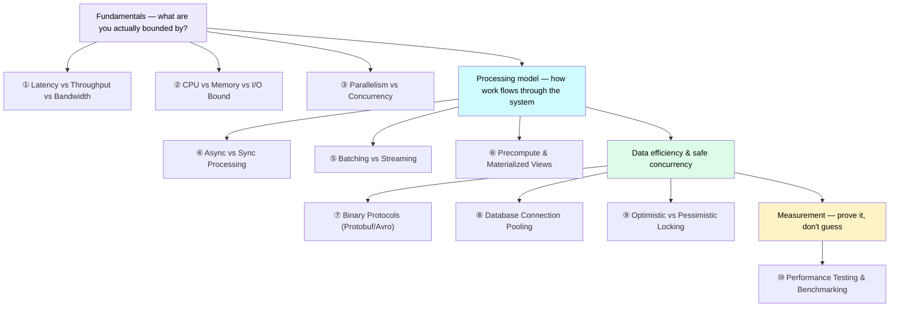
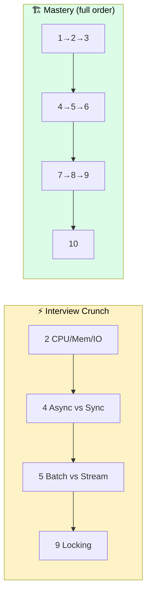

# 14 · Performance Optimization & Scalability ⚙️

> **Squeezing the millisecond out of a system that already works.** Once a design is correct, this section is where you make it *fast*: know which resource is actually bounded (CPU, memory, or I/O) before you buy hardware, pick sync vs async and batching vs streaming to fit the workload, and choose the wire formats, pooling, and locking strategies that hold up once real traffic hits. The final discipline is proof, not guessing — benchmark it and show the numbers.

---

## 🎯 What You'll Be Able To Do

- **Diagnose the real bottleneck** — tell latency, throughput, and bandwidth apart, and know whether a system is CPU-, memory-, or I/O-bound before reaching for more hardware.
- **Pick the right execution model** — concurrency vs true parallelism, and sync vs async processing, matched to the workload's shape.
- **Choose batch vs stream vs precompute** — trade freshness for efficiency deliberately, and move expensive reads to background work.
- **Shrink what crosses the wire** — replace chatty JSON with schema-typed binary protocols (Protobuf/Avro) where payload size matters.
- **Manage shared, expensive resources safely** — pool database connections correctly, and pick optimistic vs pessimistic locking by conflict rate.
- **Prove a change actually helped** — design load, stress, soak, and spike tests instead of shipping on a hunch.

---

## 🗺️ How the 10 Topics Interlock



> **The spine:** *find what's actually bounded → pick the processing model that fits it → make each unit of work smaller and contention-safe → measure to prove it worked.* Knowing the bound (②) decides whether async (④) or real parallelism (③) even helps; batching/streaming (⑤) and precompute (⑥) are two ways to stop redoing the same work; binary protocols (⑦) shrink exactly what latency/bandwidth (①) measure; pooling (⑧) and locking (⑨) both guard a scarce shared resource from the same kind of contention; testing (⑩) closes the loop back to ①.

---

## 📚 The Complete File Index

| # | Topic | One-line | Key takeaway |
|---|-------|----------|--------------|
| 1 | [Latency vs Throughput vs Bandwidth](./Latency_Throughput_Bandwidth.md) | Pipe width vs one drop's travel time | Latency ≠ throughput ≠ bandwidth; know which one your users vs your budget care about |
| 2 | [CPU vs Memory vs I/O Bound](./CPU_vs_Memory_vs_IO_Bound.md) | Find the tank that's empty | Diagnose the real bottleneck before buying hardware or scaling out |
| 3 | [Parallelism vs Concurrency](./Parallelism_vs_Concurrency.md) | Managing many things vs doing many at once | Concurrency structures I/O waits; parallelism needs real cores for CPU work |
| 4 | [Async vs Sync Processing](./Async_vs_Sync_Processing.md) | The waiter who doesn't stand and stare | Non-blocking I/O turns "one thread per request" into thousands served by one |
| 5 | [Batching vs Streaming](./Batching_vs_Streaming.md) | The laundry basket vs the open tap | Batch is cheap but stale, stream is fresh but overhead-heavy; micro-batch splits the gap |
| 6 | [Precompute & Materialized Views](./Precompute_Materialized_Views.md) | Pre-chopped vegetables in the fridge | Pay the expensive calculation once in the background, serve reads instantly |
| 7 | [Binary Protocols (Protobuf/Avro)](./Binary_Protocols_Protobuf_Avro.md) | Flat-packed furniture, not fully assembled | Schema-typed binary drops repeated field names; far smaller and faster than JSON |
| 8 | [Database Connection Pooling](./Database_Connection_Pooling.md) | A fleet of shared taxis, engines warm | Reuse the expensive TCP/TLS/auth handshake; size pool × instances ≤ DB max connections |
| 9 | [Optimistic vs Pessimistic Locking](./Optimistic_vs_Pessimistic_Locking.md) | Library checkout vs editing a wiki page | Lock rows for high-conflict writes; version-check and retry for low-conflict ones |
| 10 | [Performance Testing & Benchmarking](./Performance_Testing_Benchmarking.md) | Stress-testing a bridge before it opens | Load/stress/soak/spike tests turn "I think it's fast" into real, repeatable numbers |

---

## 🧭 Suggested Study Paths



| Goal | Path | Why |
|------|------|-----|
| **⚡ Interview in 48h** | 2 → 4 → 5 → 9 → 10 | Bottleneck ID + async model + batch/stream trade-off + locking + proof — the most-asked 80% |
| **🏗️ Deep mastery** | 1→2→3 → 4→5→6 → 7→8→9 → 10 | Fundamentals → processing model → data efficiency → measurement, in dependency order |
| **🧵 Concurrency focus** | 3 → 4 → 9 | Parallelism/concurrency theory → the async I/O model built on it → correctness under contention |
| **📉 Latency-shaving focus** | 1 → 6 → 7 → 8 | Know the metric → precompute the answer → shrink the payload → reuse the connection |

> **Study each file by** attempting the 🏋️ **Practice Drills before the solutions**, rehearsing the 🎤 **Interview Q&A out loud**, and reading 🎯 **Staff+ Nuances** for senior-level depth.

---

## 🔑 The Decision Card (whole-section cheat sheet)

```
FUNDAMENTALS  latency=delay per item · throughput=rate of success · bandwidth=max capacity — never conflate them
              find the BOUND first: CPU (100% util → more cores/GPU) · memory (swapping → bigger RAM/LRU) · I/O (CPU idle → async/cache/pool)
              concurrency = STRUCTURE (interleave I/O waits) · parallelism = HARDWARE (simultaneous cores) — high-scale systems need both
PROCESSING    sync blocks a thread per request · async frees it via callback/event-loop/queue — pick async for I/O-bound fan-out
              batch = cheap+stale (throughput) · stream = fresh+overhead (latency) · micro-batch splits the difference
              precompute/materialized views: pay the cost once in the background, serve reads in O(1) — the refresh policy is the hard part
DATA & CONCURRENCY  binary protocols (Protobuf/Avro) drop repeated field names + type ambiguity — needs a schema, far smaller than JSON
              connection pooling reuses the expensive TCP/TLS/auth handshake — size (pool × instances) ≤ DB max_connections
              pessimistic locking (SELECT ... FOR UPDATE) for high-conflict writes · optimistic (version column) for low-conflict — retry on mismatch
MEASUREMENT   load (expected peak) · stress (find the snap) · soak (leaks over hours) · spike (10x in seconds) — numbers, not guesses
RECURRING     the same trade everywhere: pay the cost now (sync/pessimistic/no cache) or push it later with more moving parts (async/optimistic/batch)
```

---

## 🎨 Conventions & Authoring

- Every file follows the root [TEMPLATE.md](../TEMPLATE.md).
- Each file ends with the three mastery sections: 🏋️ Practice Drills, 🎤 Interview Q&A Bank, 🎯 Staff+ Nuances.

---

## ➡️ Where This Connects

- ⬅️ [06 · Caching & Performance](../06_Caching_Performance/) — caching is the first lever; this section is everything else once caching alone isn't enough.
- ⬅️ [07 · Load Balancing & Scalability](../07_Load_Balancing_Scalability/) — scaling out only pays off once the per-node bottleneck here is understood.
- ⬅️ [12 · Monitoring, Logging & Observability](../12_Monitoring_Logging_Observability/) — the metrics that tell you which of these decisions to make, and prove they worked.
- ➡️ [16 · Emerging Trends & Miscellaneous](../16_Emerging_Trends_Miscellaneous/) — where these techniques meet newer platforms and tooling.

---
*Part of the [System Design & Architecture Master Repository](../README.md). Correctness gets the system working; this section is what makes it fast enough to matter under real load.*
