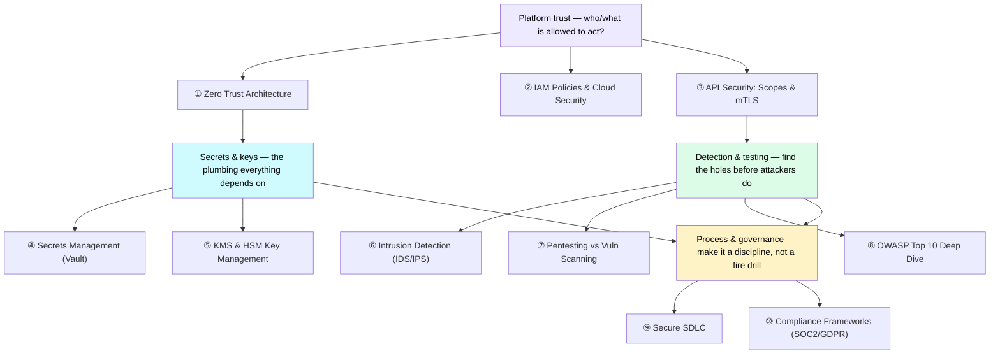
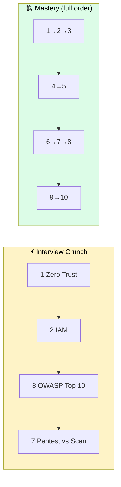

# 15 · Security Deep Dive & DevSecOps 🛡️

> **Hardening past the basics.** Section 11 covered the fundamentals of identity and encryption; this section is where security becomes a *platform discipline* — zero trust and IAM decide who can touch what, secrets and key management are the plumbing every production system quietly depends on, and detection, testing, and process turn "we think we're secure" into "we can prove it." This is the depth a Staff+ engineer or a security-minded architect is expected to bring.

---

## 🎯 What You'll Be Able To Do

- **Design a zero-trust perimeter** — treat identity, not the network, as the boundary, and enforce least-privilege, continuously verified access.
- **Write IAM policies that fail safe** — least privilege by default, explicit deny wins, and a blast radius you can actually reason about.
- **Lock down service-to-service traffic** — OAuth2 scopes and mTLS so a compromised token or certificate can't roam beyond its job.
- **Stop hardcoding secrets** — centralize, rotate, and dynamically issue credentials instead of scattering them in `.env` files and source code.
- **Detect and validate, not just hope** — run IDS/IPS for live attacks, and know when a vulnerability scan is enough versus when you need a real pentest.
- **Build security into the pipeline, not bolted on after** — SSDLC, the OWASP Top 10, and compliance frameworks (SOC2/GDPR/HIPAA) as everyday engineering process, not a pre-launch fire drill.

---

## 🗺️ How the 10 Topics Interlock



> **The spine:** *establish platform trust (never trust, always verify; least-privilege IAM; scoped, mutually-authenticated APIs) → protect the secrets and keys that trust depends on → detect and test for the gaps that slip through → wrap it all in a repeatable process that proves compliance instead of assuming it.* Zero trust (①) is the philosophy IAM (②) and mTLS (③) implement; secrets (④) and keys (⑤) are what an attacker who breaches trust is really after; the OWASP Top 10 (⑧) is the checklist SSDLC (⑨) exists to enforce before code ships.

---

## 📚 The Complete File Index

| # | Topic | One-line | Key takeaway |
|---|-------|----------|--------------|
| 1 | [Zero Trust Architecture](./Zero_Trust_Architecture.md) | The perimeter is dead | Never trust, always verify; identity is the new perimeter; micro-segment to stop lateral movement |
| 2 | [IAM Policies & Cloud Security](./IAM_Policies_Cloud_Security.md) | The keys to the kingdom | Least privilege, explicit deny wins; Effect/Action/Resource/Condition define the blast radius |
| 3 | [API Security: Scopes & mTLS](./API_Security_Scopes_mTLS.md) | Valet key, not a master key | OAuth2 scopes limit *what* a token can do; mTLS proves *who* is calling with a certificate |
| 4 | [Secrets Management (Vault, KMS)](./Secrets_Management_Vault_KMS.md) | A hotel keycard, not a metal key | Centralize + rotate + issue dynamic, short-lived credentials instead of hardcoding secrets |
| 5 | [KMS & HSM Key Management](./KMS_HSM_Key_Management.md) | The key that never leaves the safe | Envelope encryption: HSM guards the root key, KMS wraps data keys, you never see the master key |
| 6 | [Intrusion Detection (IDS/IPS)](./Intrusion_Detection_IDS_IPS.md) | The security camera vs the guard | IDS detects and alerts, IPS blocks automatically; signature-based catches known, anomaly-based catches new |
| 7 | [Pentesting vs Vuln Scanning](./Pentesting_vs_Vuln_Scanning.md) | Robot doorknob-checker vs ninja burglar | Scanners are cheap, continuous, and shallow; pentesters are expensive, rare, and chain vulnerabilities into real breaches |
| 8 | [OWASP Top 10 Deep Dive](./OWASP_Top_10_Deep_Dive.md) | The hacker's most-wanted list | Broken access control, crypto failures, and injection dominate; know the top 3 cold for interviews |
| 9 | [Secure SDLC (S-SDLC)](./Secure_Software_Development_Lifecycle_SSDLC.md) | Built-in security, not bolted-on | Threat model at design, SAST while coding, DAST + dependency scanning at test — a $10 fix beats a $10,000 one |
| 10 | [Compliance Frameworks (SOC2, GDPR)](./Compliance_Frameworks_SOC2_GDPR.md) | The building inspector for your org | SOC2 sells trust, GDPR protects EU privacy, HIPAA protects health data — compliance is proving you're secure, not just being secure |

---

## 🧭 Suggested Study Paths



| Goal | Path | Why |
|------|------|-----|
| **⚡ Interview in 48h** | 1 → 2 → 8 → 7 | Zero trust + IAM fundamentals + OWASP Top 10 + knowing scan vs pentest cover the most-asked security questions |
| **🏗️ Deep mastery** | 1 → 2 → 3 → 4 → 5 → 6 → 7 → 8 → 9 → 10 | Trust → secrets/keys → detection/testing → process, in dependency order |
| **🔐 Secrets & keys focus** | 4 → 5 | Vault-style dynamic secrets, then envelope encryption via KMS/HSM |
| **📋 Governance focus** | 8 → 9 → 10 | Know the vulnerabilities → bake defenses into the pipeline → prove it to an auditor |

> **Study each file by** working through the 🏋️ **Practice Drills before the solutions**, rehearsing the 🎤 **Interview Q&A out loud**, and reading 🎯 **Staff+ Nuances** for senior-level depth.

---

## 🔑 The Decision Card (whole-section cheat sheet)

```
TRUST     never trust, always verify · identity IS the perimeter · least privilege + JIT access ·
          IAM: explicit DENY always wins · Effect/Action/Resource/Condition · mTLS = client also proves identity
KEYS      secrets manager > hardcoded creds · DYNAMIC short-lived secrets beat static passwords ·
          envelope encryption: root key stays in the HSM, KMS only wraps/unwraps data keys, key never leaves
DETECT    IDS = camera (alerts), IPS = guard (blocks) · signature (known) + anomaly (unknown) detection ·
          vuln SCAN = cheap/continuous/shallow · PENTEST = expensive/rare/chains bugs into real breaches
OWASP     A01 Broken Access Control · A02 Crypto Failures · A03 Injection — the top 3 to know cold ·
          parameterized queries, BCrypt/Argon2, TLS 1.3, per-request authorization checks
PROCESS   SSDLC: threat model (design) → SAST (code) → DAST + dep scan (test) → WAF/IDS + IR plan (deploy)
          $10 fix in design vs $10,000 fix in production — shift security LEFT
COMPLIANCE SOC2 (trust, sells to enterprise) · GDPR (EU privacy, right to be forgotten, 4% global revenue fines) ·
          HIPAA (US healthcare, encryption + audit mandatory) · being secure ≠ proving you're secure
```

---

## 🎨 Conventions & Authoring

- Every file follows the root [TEMPLATE.md](../TEMPLATE.md). Animated SVGs live in [/assets](../assets/).
- Each file ends with the three mastery sections: 🏋️ Practice Drills, 🎤 Interview Q&A Bank, 🎯 Staff+ Nuances.

---

## ➡️ Where This Connects

- ⬅️ Built on [11 · Security & Identity](../11_Security_Identity/) — authentication, authorization, and encryption fundamentals this section hardens into a platform-wide discipline.
- ⬅️ [13 · Cloud-Native Infrastructure](../13_Cloud_Native_Infrastructure/) — the IaC, containers, and CI/CD pipelines that zero trust, IAM, and SSDLC lock down.
- ➡️ [16 · Emerging Trends & Miscellaneous](../16_Emerging_Trends_Miscellaneous/) — where security practice meets the newer patterns reshaping the rest of the stack.

---
*Part of the [System Design & Architecture Master Repository](../README.md). Security here stops being a checkbox and becomes the discipline that keeps everything upstream trustworthy.*
