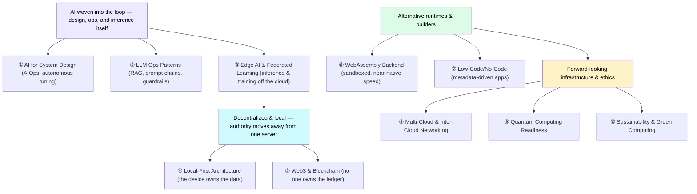
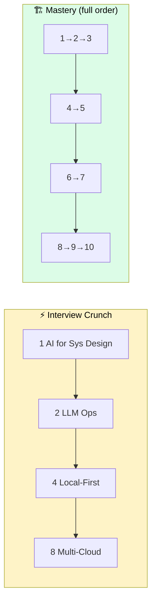

# 16 · Emerging Trends & Miscellaneous 🔮

> **The frontier — no settled playbook yet.** This closing section covers what's changing fastest: AI getting woven into the design-and-ops loop itself, architectures that push logic off to the edge, onto the device, or off the network entirely, and the technologies — Web3, quantum, Wasm, low-code — worth understanding even if you never ship them this year. Treat this section less as "memorize the answer" and more as "know enough to reason about it in a room."

---

## 🎯 What You'll Be Able To Do

- **Use AI as part of the system itself** — AIOps for predictive scaling/tuning, and LLM-specific patterns (RAG, prompt chaining, guardrails) instead of a naive single API call.
- **Push intelligence and state off the central server** — edge inference, federated learning, and local-first apps that work offline and sync later.
- **Evaluate decentralized trust models** — explain what a blockchain actually buys you (and costs you) versus a normal database with an admin.
- **Pick the right runtime for the job** — WebAssembly for sandboxed, millisecond-boot compute; low-code/no-code for velocity without a full engineering team.
- **Design infrastructure that survives more than one cloud and one era of cryptography** — multi-cloud/inter-cloud networking today, post-quantum crypto before "harvest now, decrypt later" catches up to you.
- **Factor sustainability into architecture decisions** — carbon-aware scheduling, efficient languages, and killing zombie compute as a cost *and* ESG lever.

---

## 🗺️ How the 10 Topics Interlock



> **The spine:** *AI takes over more of the design/ops loop (①②) → the same push toward autonomy pushes intelligence to the edge and off any one server (③→④⑤) → new runtimes change who can build and how fast code starts (⑥⑦) → and the infrastructure carrying all of it has to span clouds, survive a future with quantum computers, and answer for its power bill (⑧⑨⑩).* None of these have one "correct" answer yet — that's what makes them emerging.

---

## 📚 The Complete File Index

| # | Topic | One-line | Key takeaway |
|---|-------|----------|--------------|
| 1 | [AI for System Design](./AI_for_System_Design.md) | A self-driving car for your datacenter | AIOps + autonomous tuning move ops from reactive ("CPU>80%, scale") to predictive; AI finds the one root cause in 1,000 alerts |
| 2 | [LLM Ops Patterns](./LLM_Ops_Patterns.md) | Managing a brilliant, forgetful intern | RAG (retrieval) + prompt chaining + guardrails turn "prompting" (art) into engineering (repeatable pipeline), with caching to control cost |
| 3 | [Edge AI & Federated Learning](./Edge_AI_Federated_Learning.md) | Students studying at home, not a classroom | Inference runs on-device for privacy/latency/bandwidth; federated learning shares math updates, never raw data, back to a central model |
| 4 | [Local-First Architecture](./Local_First_Architecture.md) | A paper notebook, not a shared doc | The device is the source of truth (SQLite/IndexedDB) with CRDTs merging offline edits; the cloud becomes a sync relay, not the primary keeper |
| 5 | [Web3 & Blockchain Architecture](./Web3_Blockchain_Architecture.md) | A global spreadsheet nobody owns | Distributed ledger + consensus replace a trusted central party with math; smart contracts self-execute, PoS trades PoW's energy bill for stake-based security |
| 6 | [WebAssembly (Wasm) Backend](./WebAssembly_Wasm_Backend.md) | A cartridge that plugs into any server | Near-native speed with millisecond cold starts (vs. Docker's hundreds of MBs and slow boot); WASI punches controlled holes for safe multi-tenant plugins |
| 7 | [Low-Code/No-Code Architecture](./LowCode_NoCode_Architecture.md) | Building with LEGO, not pouring concrete | A metadata engine renders prebuilt "bricks" (JSON/DSL definitions) so citizen developers ship fast — but it still needs governance or it becomes shadow IT |
| 8 | [Multi-Cloud & Inter-Cloud Networking](./Multi_Cloud_Inter_Cloud_Networking.md) | Two islands, or a bridge between them | Multi-cloud avoids lock-in and single-provider outages; interconnects + SD-WAN turn separate clouds into one fast, lower-fee virtual network |
| 9 | [Quantum Computing Readiness](./Quantum_Computing_Readiness.md) | A gas cloud that fills every maze path | Shor's algorithm breaks RSA, Grover's halves AES's effective strength; migrate to post-quantum crypto now — "harvest now, decrypt later" is already happening |
| 10 | [Sustainability & Green Computing](./Sustainability_Green_Computing.md) | Fuel-efficient driving for your datacenter | Carbon-aware scheduling, efficient languages/algorithms, and killing zombie servers cut cost and emissions with the same lever |

---

## 🧭 Suggested Study Paths



| Goal | Path | Why |
|------|------|-----|
| **⚡ Interview in 48h** | 1 → 2 → 4 → 8 (+ skim 5, 9) | AI-in-ops + LLM patterns + local-first + multi-cloud are the ones most likely to come up as "how would you design X today" |
| **🏗️ Deep mastery** | 1 → 2 → 3 → 4 → 5 → 6 → 7 → 8 → 9 → 10 | AI-in-the-loop → decentralized/local → alternative runtimes → forward-looking infra, in dependency order |
| **🤖 AI-systems focus** | 1 → 2 → 3 | AIOps → LLM app patterns → pushing inference/training to the edge, as one connected arc |
| **🌍 "Beyond one cloud" focus** | 5 → 8 → 9 | Trust without a central party → networking across providers → surviving the next era of cryptography |

> **Study each file by** working through the 🏋️ **Practice Drills before the solutions**, rehearsing the 🎤 **Interview Q&A out loud**, and reading 🎯 **Staff+ Nuances** for senior-level depth.

---

## 🔑 The Decision Card (whole-section cheat sheet)

```
AI-IN-THE-LOOP   AIOps predicts & auto-tunes before a human would notice · LLM apps = RAG (retrieval) +
                 prompt chaining + guardrails, NEVER a single raw API call · edge AI = inference on-device ·
                 federated learning shares gradients/updates, NEVER raw user data
DECENTRALIZED & LOCAL   local-first: the device is the source of truth, CRDTs merge offline edits,
                 the cloud is a sync relay not the owner · Web3: consensus + cryptography replace a
                 trusted central party — you trust the math, not the company · PoS >> PoW on energy
ALT RUNTIMES     Wasm = near-native speed + millisecond cold start + sandbox (WASI = controlled holes) —
                 beats containers for short-lived/plugin/multi-tenant code · low-code = metadata-driven
                 "LEGO bricks," huge velocity win, but govern it or it becomes shadow IT
FORWARD-LOOKING  multi-cloud avoids lock-in; inter-cloud interconnects/SD-WAN make it cheap & fast, not 2x work ·
                 "harvest now, decrypt later" is happening TODAY — start post-quantum crypto migration now,
                 not when the quantum computer exists · every CPU cycle has a carbon cost — schedule batch
                 jobs when the grid is green, kill zombie servers, prefer compiled languages on hot paths
```

---

## 🎨 Conventions & Authoring

- Every file follows the root [TEMPLATE.md](../TEMPLATE.md). Animated SVGs live in [/assets](../assets/).
- Each file ends with the three mastery sections: 🏋️ Practice Drills, 🎤 Interview Q&A Bank, 🎯 Staff+ Nuances.

---

## ➡️ Where This Connects

- ⬅️ Built on [13 · Cloud-Native Infrastructure](../13_Cloud_Native_Infrastructure/) — containers, orchestration, and IaC are the substrate that Wasm, edge AI, and multi-cloud all run on top of.
- ⬅️ [14 · Performance Optimization & Scalability](../14_Performance_Optimization_Scalability/) — the scaling instincts here get automated by AIOps and pressure-tested by edge/local-first designs.
- ⬅️ [15 · Security Deep Dive & DevSecOps](../15_Security_Deep_Dive_DevSecOps/) — the threat model this section extends: quantum readiness is a crypto-migration problem, Web3 trust is a cryptography problem, and Wasm sandboxing is an isolation problem.
- This section rounds out the repository — for the full index of all 16 sections, return to [the root README](../README.md).

---
*Part of the [System Design & Architecture Master Repository](../README.md). Everything before this section teaches you to build systems that work today; this one teaches you to keep asking whether tomorrow's system should be built differently at all.*
