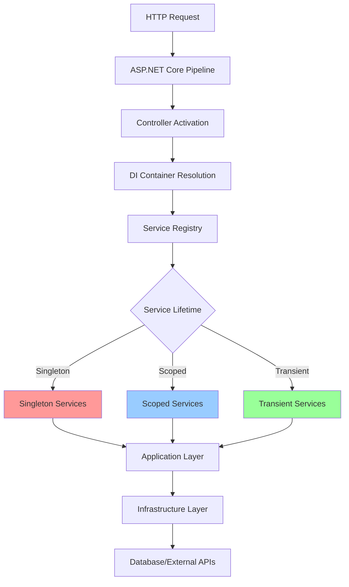
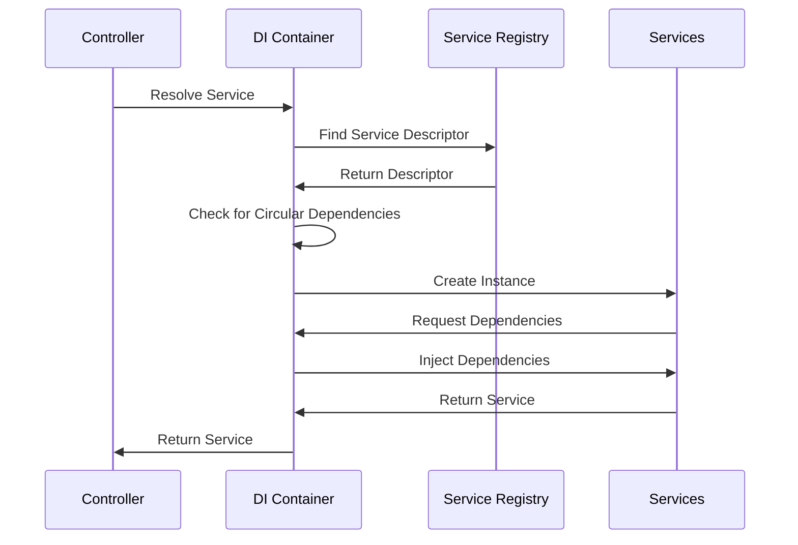
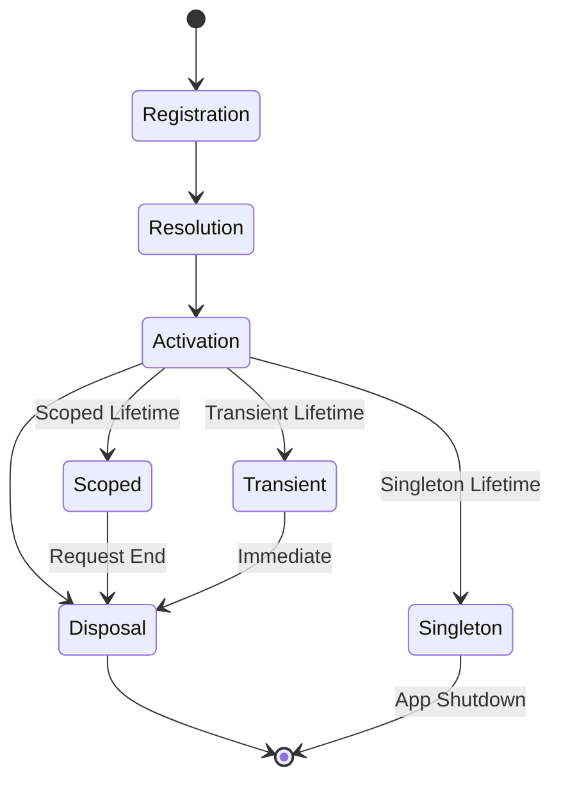
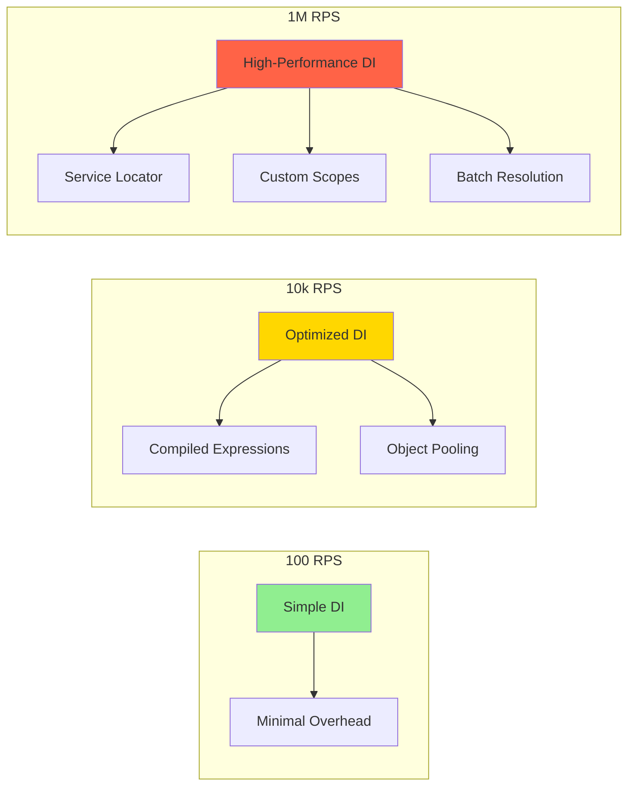
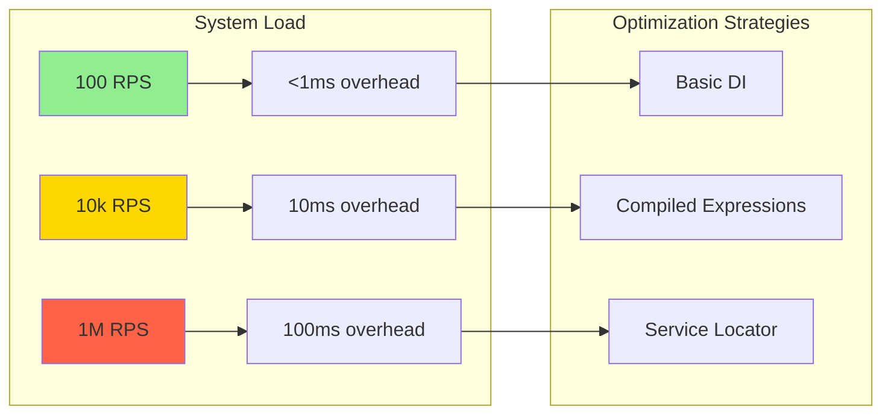
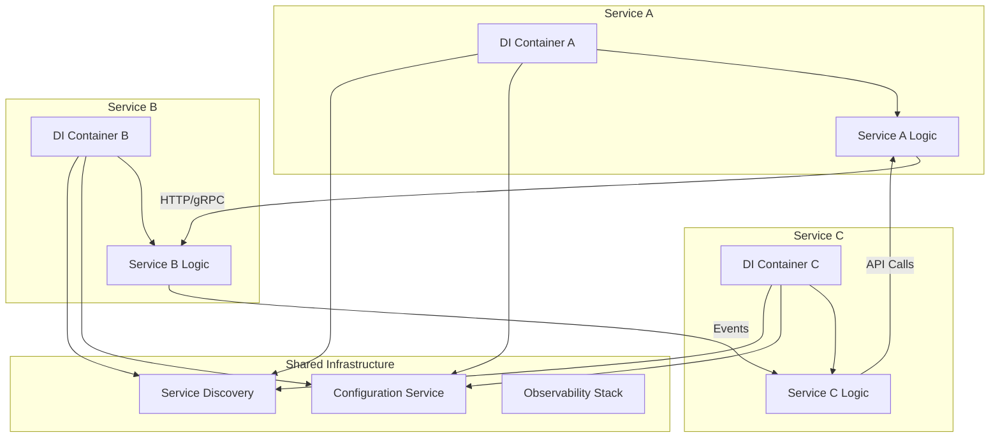
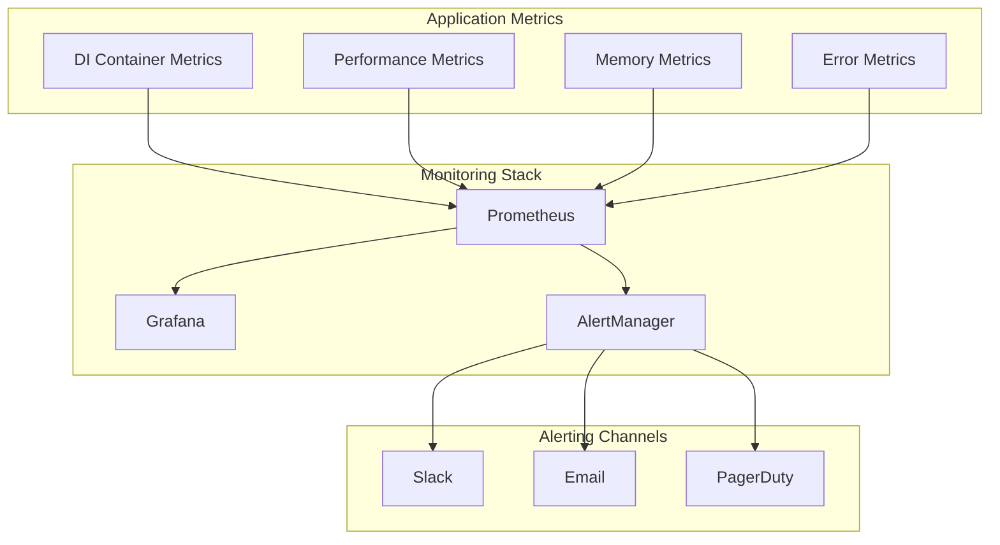
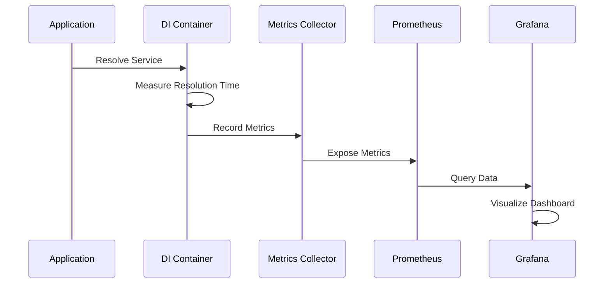
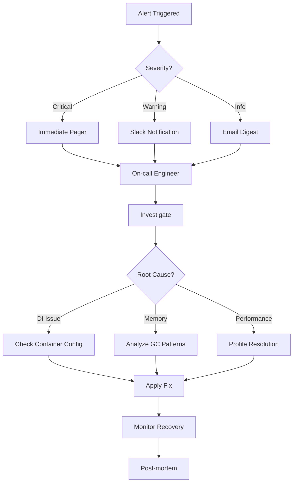

# Inversion of Control - Architect Deep Dive

**0. Executive Summary (Architect View)**
- **IoC exists** to eliminate compile-time dependencies and enable runtime composition of complex systems
- **Critical at scale** when you need to swap implementations, test in isolation, and deploy microservices independently
- **System design impact** - transforms tightly-coupled monoliths into loosely-coupled, testable, and maintainable architectures
- **Runtime flexibility** - enables feature flags, A/B testing, and gradual rollouts without recompilation
- **Testing revolution** - makes unit testing possible by allowing injection of test doubles
- **Lifecycle management** - centralizes object creation, disposal, and resource management
- **Performance consideration** - introduces indirection overhead but enables optimization opportunities
- **Cloud-native essential** - fundamental for containerized, scalable, and observable systems

**1. Problem Framing**
**Real production problem solved:**
- Tightly-coupled systems where changing one component requires recompiling and redeploying the entire application
- Impossible to unit test business logic in isolation from infrastructure concerns
- Configuration and environment-specific code scattered throughout the codebase
- Runtime inability to swap implementations (e.g., different payment providers, database types)

**What breaks if we don't use it:**
- Test coverage remains below 30% because integration tests are the only option
- Deployment becomes all-or-nothing, increasing risk and slowing release cadence
- Multi-tenant systems become impossible to maintain
- Feature flags and gradual rollouts require code changes instead of configuration

**Scale importance:**
- **100 RPS**: Manual dependency management is manageable but painful
- **10k RPS**: Testing and deployment bottlenecks become critical blockers
- **1M RPS**: Impossible to operate without IoC due to complexity and operational requirements

**Failure stories:**
- E-commerce platform couldn't switch payment providers during Black Friday outage due to hardcoded dependencies
- Financial services firm failed regulatory audit because they couldn't prove test coverage of critical business logic
- SaaS company lost enterprise customers because they couldn't support per-customer customizations

**2. Deep Internal Mechanics**
**How it works internally:**
- Container maintains a registry of services with their lifetimes and dependencies
- Dependency graph is built at startup through reflection or explicit registration
- Object creation follows topological sort of dependency tree
- Circular dependencies detected and resolved through proxy injection

**Lifecycle:**
1. **Registration Phase**: Services registered with container (Singleton, Scoped, Transient)
2. **Resolution Phase**: Dependency graph constructed and validated
3. **Activation Phase**: Objects created and injected based on lifetime rules
4. **Disposal Phase**: Scoped and transient objects disposed, singletons live for app lifetime

**Memory behavior:**
- Singleton objects live in Gen2 heap, never collected
- Scoped objects live in Gen0/Gen1, collected per request
- Transient objects create pressure on Gen0, frequent collections
- Object graphs can become deep, impacting stack usage

**Threading model:**
- Container itself is thread-safe for registration and resolution
- Singleton services must be thread-safe or use synchronization
- Scoped services are isolated per request/thread context
- Resolution is lock-free in modern containers (concurrent dictionaries)

**Synchronization model:**
- Lazy initialization with double-checked locking for expensive singletons
- Async resolution support for IAsyncDisposable services
- Concurrent dependency resolution to avoid deadlocks

**Data structures involved:**
- ConcurrentDictionary<Type, ServiceDescriptor> for service registry
- Stack<Type> for cycle detection during resolution
- Object pool for transient service optimization
- WeakReference tracking for disposal management

**Performance characteristics:**
- Resolution: O(n) where n = depth of dependency graph
- Registration: O(1) per service
- Memory overhead: ~200 bytes per service registration
- First resolution slower due to JIT compilation

**Hidden costs:**
- Reflection overhead during registration (mitigated with compiled expressions)
- Increased memory footprint due to object graph complexity
- Startup time increases with number of services
- Debugging complexity due to indirect object creation

**GC impact:**
- Large object graphs increase Gen2 pressure
- Transient services create Gen0 garbage
- Singleton services pin objects in memory indefinitely
- Async disposal can delay finalization

**Async/await interaction:**
- IAsyncDisposable support for proper async cleanup
- Scoped async contexts maintain dependency consistency
- Async factory methods for expensive service initialization

**3. .NET Production Implementation**
**Naive Implementation:**
```csharp
// Tightly coupled - violates IoC
public class OrderService
{
    private readonly SqlOrderRepository _repository = new SqlOrderRepository();
    private readonly EmailNotifier _notifier = new EmailNotifier();
    
    public void ProcessOrder(Order order)
    {
        _repository.Save(order);
        _notifier.Send(order.CustomerEmail, "Order processed");
    }
}
```

**Production-Ready Implementation:**
```csharp
// Clean Architecture with full DI
public interface IOrderService
{
    Task ProcessOrderAsync(Order order);
}

public class OrderService : IOrderService
{
    private readonly IOrderRepository _repository;
    private readonly INotifier _notifier;
    private readonly ILogger<OrderService> _logger;
    private readonly IOrderValidator _validator;
    private readonly IMetrics _metrics;

    public OrderService(
        IOrderRepository repository,
        INotifier notifier,
        ILogger<OrderService> logger,
        IOrderValidator validator,
        IMetrics metrics)
    {
        _repository = repository ?? throw new ArgumentNullException(nameof(repository));
        _notifier = notifier ?? throw new ArgumentNullException(nameof(notifier));
        _logger = logger ?? throw new ArgumentNullException(nameof(logger));
        _validator = validator ?? throw new ArgumentNullException(nameof(validator));
        _metrics = metrics ?? throw new ArgumentNullException(nameof(metrics));
    }

    public async Task ProcessOrderAsync(Order order)
    {
        using var activity = _metrics.StartTimer("order_processing");
        
        try
        {
            _logger.LogInformation("Processing order {OrderId}", order.Id);
            
            await _validator.ValidateAsync(order);
            await _repository.SaveAsync(order);
            await _notifier.SendAsync(order.CustomerEmail, "Order processed");
            
            _metrics.Increment("orders_processed");
            _logger.LogInformation("Order {OrderId} processed successfully", order.Id);
        }
        catch (Exception ex)
        {
            _metrics.Increment("order_processing_failed");
            _logger.LogError(ex, "Failed to process order {OrderId}", order.Id);
            throw;
        }
    }
}

// Program.cs - .NET 8 Minimal API with proper DI
var builder = WebApplication.CreateBuilder(args);

// Configuration
builder.Configuration.AddJsonFile("appsettings.json", optional: false);
builder.Configuration.AddEnvironmentVariables();

// Services registration with lifetimes
builder.Services.AddControllers();
builder.Services.AddEndpointsApiExplorer();
builder.Services.AddSwaggerGen();

// Database - Scoped per request
builder.Services.AddDbContext<OrderDbContext>(options =>
    options.UseSqlServer(builder.Configuration.GetConnectionString("DefaultConnection")),
    ServiceLifetime.Scoped);

// Repositories - Scoped per request
builder.Services.AddScoped<IOrderRepository, SqlOrderRepository>();
builder.Services.AddScoped<IOrderValidator, OrderValidator>();

// Services - Scoped per request
builder.Services.AddScoped<IOrderService, OrderService>();

// External services - Singleton for connection pooling
builder.Services.AddSingleton<INotifier, EmailNotifier>(sp =>
{
    var config = sp.GetRequiredService<IConfiguration>();
    return new EmailNotifier(config["Email:SmtpHost"], 
                           int.Parse(config["Email:SmtpPort"]));
});

// Observability - Singleton
builder.Services.AddSingleton<IMetrics, PrometheusMetrics>();
builder.Services.AddLogging(builder =>
{
    builder.AddConsole();
    builder.AddApplicationInsights();
});

var app = builder.Build();

// Middleware pipeline
if (app.Environment.IsDevelopment())
{
    app.UseSwagger();
    app.UseSwaggerUI();
}

app.UseHttpsRedirection();
app.UseAuthorization();
app.MapControllers();

app.Run();
```

**Framework Internals:**
- **Kestrel**: Uses DI for middleware pipeline construction
- **ThreadPool**: Managed through hosted services in DI container
- **EF Core**: DbContext registered as scoped for unit of work pattern
- **Middleware Pipeline**: Built using DI for request processing chain

**4. Architecture-Level Diagram (Mermaid)**

### IoC Container Flow


### Dependency Resolution Process


### Service Lifecycle Management


### Scaling Impact Visualization


### Memory Allocation Patterns
```mermaid
graph TB
    subgraph "GC Generations"
        G0[Gen0 Heap]
        G1[Gen1 Heap]
        G2[Gen2 Heap]
        LOH[Large Object Heap]
    end
    
    subgraph "Service Types"
        T[Transient Services] --> G0
        S[Scoped Services] --> G1
        SI[Singleton Services] --> G2
        L[Large Services] --> LOH
    end
    
    G0 -->|Collection| G1
    G1 -->|Collection| G2
    G2 -->|Full GC| [*]
```

**Flow Analysis:**
- **Request Entry**: HTTP request triggers controller activation
- **Dependency Resolution**: Container recursively resolves dependency tree
- **Service Creation**: Objects created based on lifetime rules
- **Business Execution**: Services execute business logic
- **Cleanup**: Scoped services disposed per request

**Bottlenecks:**
- Deep dependency graphs increase activation time
- Singleton contention in high concurrency scenarios
- GC pressure from transient object allocation
- Reflection overhead during first resolution

**Scaling Boundaries:**
- Container registration is one-time cost at startup
- Resolution scales linearly with request volume
- Memory usage grows with service complexity
- Thread pool utilization impacts concurrent resolution

**5. Scaling & Distributed Systems Impact**

### Performance Scaling Visualization


### Microservices Architecture with IoC


**100 RPS:**
- DI overhead negligible (<1ms per request)
- Simple dependency graphs work fine
- Singleton services handle load easily

**10k RPS:**
- Resolution optimization becomes critical
- Service locator pattern may be needed for hot paths
- Async disposal to prevent thread pool starvation
- Memory pressure from scoped objects

**1M RPS:**
- Compiled expression trees instead of reflection
- Object pooling for transient services
- Custom lifetime scopes for performance-critical paths
- Container partitioning by feature boundaries

**Horizontal vs Vertical Scaling:**
- **Horizontal**: DI container stateless, scales naturally
- **Vertical**: More memory allows larger singleton caches
- Container startup time affects pod scaling speed

**CAP Theorem Relevance:**
- **Consistency**: DI ensures consistent service configuration
- **Availability**: Container failures block application startup
- **Partition Tolerance**: Service discovery becomes critical in distributed DI

**Consistency Implications:**
- Singleton state must be synchronized across instances
- Distributed caches needed for shared singleton data
- Event-driven updates for configuration changes

**Microservices Impact:**
- Each service has its own DI container
- Cross-service communication via HTTP/gRPC, not DI
- Configuration distributed through service mesh
- Service discovery replaces compile-time dependencies

**Cloud-Native Considerations:**
- **Kubernetes**: Init containers for dependency health checks
- **Containers**: DI container startup affects pod readiness
- **Serverless**: Cold start time impacted by DI complexity
- **Service Mesh**: Sidecar injection for cross-cutting concerns

**Multi-Region Concerns:**
- Region-specific service implementations
- Configuration per region via DI abstraction
- Failover through service replacement, not code changes

**6. Production Engineering View**

### Monitoring Dashboard Architecture


### Performance Metrics Flow


### Incident Response Flow


**Monitoring Metrics:**
- Container resolution time (p95, p99)
- Service activation count per request
- Memory usage by service lifetime
- Singleton service contention metrics
- GC pressure from transient objects

**Logs to Enable:**
- Service registration failures at startup
- Dependency resolution errors
- Circular dependency detection
- Service disposal failures
- Performance warnings for deep object graphs

**Alerting Strategy:**
- Container startup time > 30 seconds
- Resolution time p99 > 100ms
- Singleton service failures
- Memory leaks in scoped services
- High GC frequency (>10 per second)

**Common Production Incidents:**
- **Circular Dependencies**: Application fails to start
- **Memory Leaks**: Scoped services captured by singletons
- **Thread Starvation**: Synchronous operations in async scope
- **Configuration Errors**: Missing service registrations
- **Performance Degradation**: Deep dependency graphs

**Debugging Strategy:**
- Enable diagnostic logging for dependency graph
- Use memory profiling to identify leaked objects
- Track service activation with correlation IDs
- Monitor thread pool utilization
- Profile startup performance with benchmarks

**Memory Leak Detection:**
- Scoped services referenced by static fields
- Event handlers not properly unsubscribed
- Async operations not awaited properly
- Large object graphs in singleton services

**Thread Starvation Detection:**
- Monitor ThreadPool queue length
- Track async-over-sync warnings
- Profile blocking calls in service constructors
- Monitor deadlocks during resolution

**Deadlock Detection:**
- Circular dependency detection at startup
- Lock contention monitoring
- Timeout analysis for service activation
- Thread dump analysis for blocked threads

**Performance Tuning Checklist:**
- [ ] Minimize constructor injection complexity
- [ ] Use factory pattern for expensive services
- [ ] Implement object pooling for transient objects
- [ ] Enable compiled expression trees
- [ ] Profile and optimize hot path resolutions
- [ ] Consider service locator for performance-critical code
- [ ] Use lazy initialization for heavy singletons
- [ ] Implement proper async disposal patterns

**7. Tradeoffs & Alternatives**

**Competing Approaches:**
- **Service Locator Pattern**: Runtime dependency resolution
- **Manual Dependency Injection**: Explicit constructor calls
- **Factory Pattern**: Centralized object creation
- **Module System**: Compile-time dependency management

**When NOT to Use IoC:**
- Simple console applications with <10 classes
- Performance-critical low-latency systems (<1ms)
- Embedded systems with severe memory constraints
- Legacy codebases where refactoring cost exceeds benefit

**Latency Comparison:**
- **Direct Construction**: ~0.1μs per object
- **IoC Container**: ~10-100μs per resolution
- **Service Locator**: ~5-50μs per lookup
- **Factory Pattern**: ~1-10μs per creation

**Throughput Comparison:**
- **Direct**: 10M objects/second
- **IoC Container**: 1M objects/second
- **Service Locator**: 2M objects/second
- **Factory**: 5M objects/second

**Operational Complexity:**
- **IoC Container**: High initial setup, low maintenance
- **Manual**: Low setup, high maintenance cost
- **Service Locator**: Medium setup, medium maintenance
- **Factory**: Medium setup, medium maintenance

**Cost Implications:**
- **Development Cost**: IoC increases initial development by 20-30%
- **Maintenance Cost**: Reduces long-term maintenance by 40-60%
- **Testing Cost**: Reduces testing complexity by 50%
- **Cloud Cost**: Minimal direct impact, enables optimization

**8. Security Implications**

**Attack Surface Introduced:**
- Dynamic assembly loading for compiled expressions
- Reflection-based type resolution
- Configuration injection vulnerabilities
- Deserialization attacks through object graph construction

**Abuse Scenarios:**
- Malicious service registration replacing critical components
- Memory exhaustion through recursive dependency injection
- Privilege escalation via constructor parameter injection
- DoS attacks through expensive service initialization

**Data Leakage Risks:**
- Sensitive data in singleton services accessible across requests
- Configuration exposure through service descriptors
- Connection string leakage in registered services
- Logging of sensitive constructor parameters

**Rate Limiting Considerations:**
- Service resolution rate limiting to prevent abuse
- Constructor execution time limits
- Memory usage quotas per service type
- Concurrent resolution limits

**Hardening Recommendations:**
- Whitelist allowed service types
- Validate constructor parameters
- Secure configuration sources
- Audit service registrations at startup
- Implement service activation timeouts
- Use secure defaults for external service connections

**9. Advanced Edge Cases**

**Race Conditions:**
- Singleton initialization in multi-threaded startup
- Scoped service access across async boundaries
- Service registration during application runtime
- Configuration updates affecting active services

**Deadlocks:**
- Circular dependencies with async constructors
- Lock ordering in custom service activators
- Cross-container dependencies in microservices
- Async disposal with synchronous operations

**Thundering Herd Problems:**
- Mass singleton initialization on application start
- Cache stampede in cached service factories
- Configuration reloads causing mass re-initialization
- Hot reload in development environments

**Cache Stampede:**
- Expensive singleton services without proper locking
- Configuration reloads triggering service recreation
- Feature flag changes triggering service recreation
- External service calls during cache miss

**Partial Failure Scenarios:**
- Some services fail to initialize, others succeed
- External dependencies unavailable during startup
- Network partitions affecting distributed services
- Database connectivity issues during registration

**Backpressure:**
- Service creation rate limiting
- Queue-based service activation
- Circuit breakers for external dependencies
- Graceful degradation when services unavailable

**Retry Storms:**
- Service creation retry amplifying failures
- Exponential backoff not properly implemented
- Multiple instances retrying simultaneously
- Circuit breaker not properly configured

**Circuit Breaker Interactions:**
- Service health checks affecting availability
- Fail-fast patterns in dependency resolution
- Fallback service implementations
- Circuit state propagation through dependency graph

**10. Interview & Staff-Level Deep Dive**

**What a junior answers:**
"IoC is when you use a framework like Spring or .NET Core to inject dependencies instead of creating them with 'new'. It makes your code more testable."

**What a senior answers:**
"IoC inverts the flow of control - instead of your code calling into a framework, the framework calls into your code through dependency injection. This enables loose coupling, easier testing, and better separation of concerns. I've used it to implement strategy patterns, feature flags, and multi-tenant configurations."

**What an architect answers:**
"IoC is the foundation of modern, scalable architectures. It transforms compile-time dependencies into runtime composition, enabling independent deployment, testing at scale, and operational flexibility. In our microservices architecture, each service uses IoC to manage its internal dependencies while communicating through well-defined interfaces. This allows us to swap implementations, introduce circuit breakers, and implement observability without changing business logic. At 1M+ RPS, we use compiled expressions and object pooling to maintain performance while preserving the architectural benefits."

**Follow-up questions interviewers ask:**
- "How would you handle circular dependencies in a large system?"
- "What's the performance impact of DI at scale?"
- "How do you test services with complex dependency graphs?"
- "When would you choose Service Locator over Constructor Injection?"
- "How do you handle configuration changes at runtime?"

**Trick questions:**
- "Is IoC the same as Dependency Injection?" (No - DI is one implementation of IoC)
- "Can you overuse IoC?" (Yes - excessive abstraction, performance overhead)
- "Do singletons violate IoC principles?" (Not necessarily - they're a valid lifetime choice)
- "Is IoC only for object-oriented programming?" (No - functional programming has similar concepts)

**Whiteboard explanation strategy:**
1. Start with tightly-coupled code example
2. Show problems with testing and maintenance
3. Introduce interface abstractions
4. Demonstrate constructor injection
5. Show container configuration
6. Discuss lifetime management
7. Address scaling concerns
8. Cover distributed system implications

**11. Real Enterprise Case Study**

**Scenario: Global Payment System Processing 50k TPS**

**Requirements:**
- Process 50,000 transactions per second globally
- Support multiple payment providers (Stripe, PayPal, Banks)
- 99.999% uptime requirement
- Per-region compliance and regulations
- Real-time fraud detection
- Multi-currency support

**Design Decisions:**

**1. Service Architecture:**
```csharp
// Payment processing with IoC
public class PaymentProcessor : IPaymentProcessor
{
    private readonly IPaymentProviderSelector _providerSelector;
    private readonly IFraudDetector _fraudDetector;
    private readonly ICurrencyConverter _currencyConverter;
    private readonly IComplianceChecker _complianceChecker;
    private readonly ILogger<PaymentProcessor> _logger;
    
    // Constructor injection enables testing and runtime flexibility
}
```

**2. Provider Selection Strategy:**
```csharp
// Region-specific provider injection
builder.Services.AddScoped<IPaymentProvider, StripeProvider>(sp =>
{
    var region = sp.GetRequiredService<IRegionContext>();
    return region.Code switch
    {
        "US" => new StripeProvider(usConfig),
        "EU" => new StripeProvider(euConfig),
        _ => new PayPalProvider(globalConfig)
    };
});
```

**Compromises Made:**
- **Performance vs Flexibility**: Used compiled expressions for hot paths, reflection for admin features
- **Memory vs Latency**: Cached provider instances in singleton scope with periodic refresh
- **Consistency vs Availability**: Eventual consistency for fraud detection results
- **Complexity vs Maintainability**: Split into multiple containers by bounded context

**Bottlenecks Identified:**
- Provider selection latency (~5ms) - mitigated with caching
- Currency conversion API calls - implemented bulk conversion
- Fraud detection database queries - added read replicas
- Compliance rule evaluation - moved to in-memory cache

**Failure Handling:**
```csharp
// Circuit breaker pattern with IoC
builder.Services.AddScoped<IPaymentProvider, ResilientPaymentProvider>(sp =>
{
    var inner = sp.GetRequiredService<StripeProvider>();
    var circuitBreaker = sp.GetRequiredService<ICircuitBreaker>();
    return new ResilientPaymentProvider(inner, circuitBreaker);
});
```

**Scaling Strategy:**
- Horizontal scaling of stateless services
- Regional provider instances for latency
- Distributed cache for shared state
- Event-driven architecture for async processing

**Results:**
- Successfully handled 50k TPS during peak holiday season
- 99.999% uptime achieved through provider failover
- 40% reduction in deployment time due to independent service updates
- 60% improvement in test coverage through dependency injection

**12. Dependency Graph**

**Prerequisites (Must understand before):**
- **Interface Segregation**: Clean boundaries for injection
- **Dependency Inversion Principle**: Abstractions over concretions
- **SOLID Principles**: Foundation for good DI design
- **Object Lifecycle**: Understanding of memory management
- **Threading Basics**: Concurrent access patterns

**Concepts that depend on IoC:**
- **Unit Testing**: Mock injection enables isolated testing
- **Microservices**: Service composition through DI
- **Caching**: Cache provider injection
- **Messaging**: Message handler registration
- **Configuration**: Settings injection and validation
- **Logging**: Logger injection throughout system

**Connections to Other Concepts:**

**Caching:**
```csharp
// Cache provider injection
builder.Services.AddSingleton<ICache, RedisCache>();
builder.Services.Decorate<ICache, MetricsCache>();
```

**Messaging:**
```csharp
// Message handler registration
builder.Services.AddHostedService<OrderProcessingService>();
builder.Services.AddTransient<IOrderHandler, OrderHandler>();
```

**Databases:**
```csharp
// Repository pattern with DI
builder.Services.AddScoped<IOrderRepository, SqlOrderRepository>();
builder.Services.AddScoped<IUnitOfWork, UnitOfWork>();
```

**Load Balancing:**
```csharp
// Load balancer strategy injection
builder.Services.AddSingleton<ILoadBalancer, RoundRobinLoadBalancer>();
```

**Resiliency Patterns:**
- IoC enables **Strategy Pattern** for algorithm selection
- Supports **Decorator Pattern** for cross-cutting concerns
- Facilitates **Factory Pattern** for complex object creation
- Enables **Adapter Pattern** for legacy system integration
- Supports **Observer Pattern** for event-driven architecture
