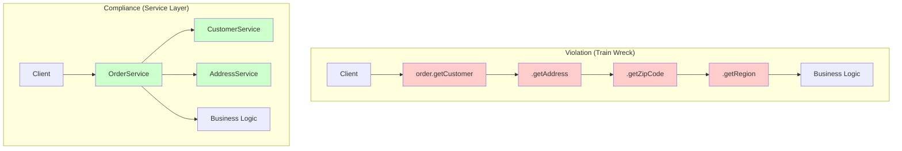
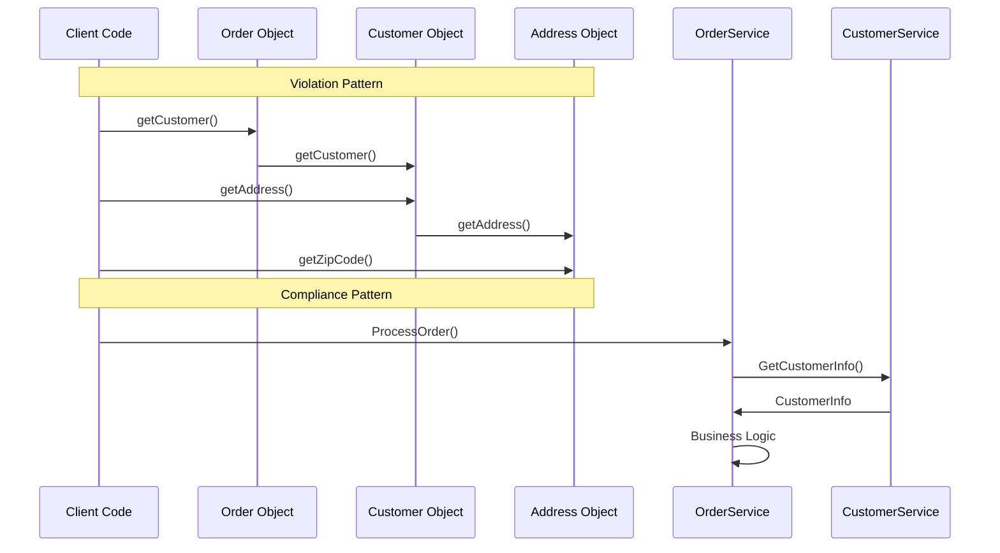
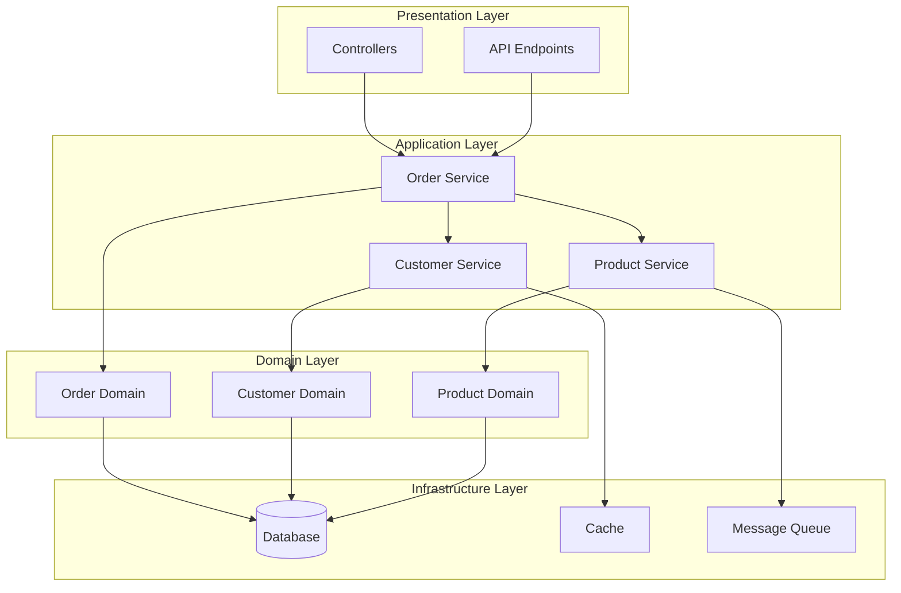
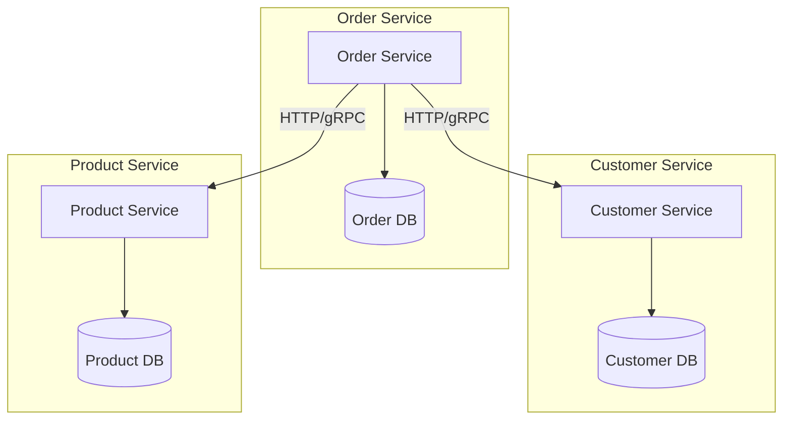
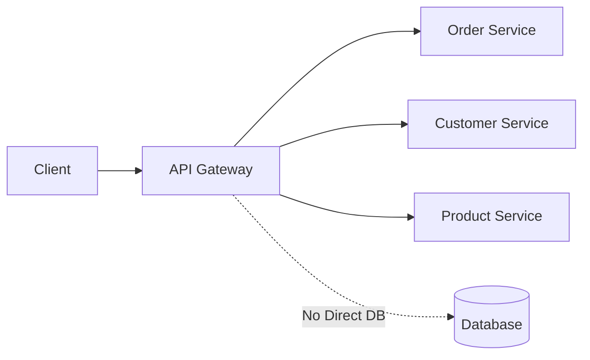
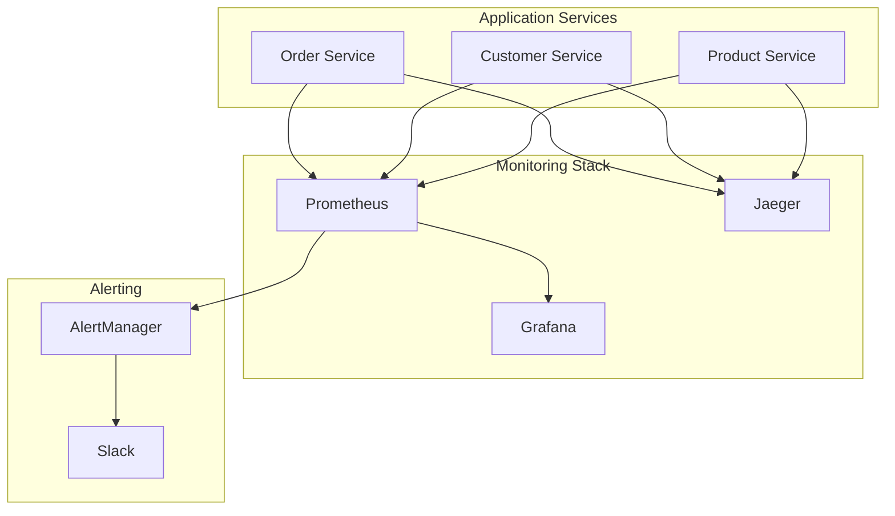
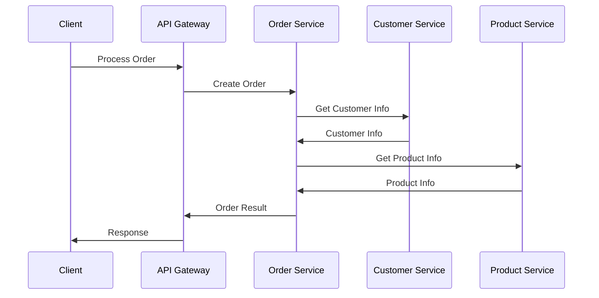

# Law of Demeter - Architect Deep Dive

**0. Executive Summary (Architect View)**
- **Law of Demeter exists** to minimize coupling between components by limiting knowledge about internal structures
- **Critical at scale** when complex object graphs create maintenance nightmares and testing complexity
- **System design impact** - transforms tightly-coupled systems into loosely-coupled, maintainable architectures
- **Encapsulation enforcement** - prevents violation of object boundaries and abstraction layers
- **Testing simplification** - reduces mocking complexity and improves test isolation
- **Refactoring safety** - enables safer code evolution and modification
- **Performance considerations** - may introduce additional method calls but improves maintainability
- **Team productivity** - reduces cognitive load and onboarding time for developers

**1. Problem Framing**
**Real production problem solved:**
- Fragile code that breaks when internal object structures change
- Cascading modifications throughout codebase due to tight coupling
- Difficult unit testing requiring complex mock hierarchies
- High cognitive load when understanding object interactions
- Increased bug introduction rate during maintenance

**What breaks if we don't use it:**
- Code becomes brittle and resistant to change
- Unit tests become complex and brittle
- Refactoring becomes risky and expensive
- New developer onboarding time increases dramatically
- System architecture degrades over time

**Scale importance:**
- **100 classes**: Manageable without strict adherence
- **1000 classes**: Critical for maintainability
- **10000+ classes**: Impossible to manage without Law of Demeter

**Failure stories:**
- E-commerce platform required 3-month refactoring when customer object structure changed
- Financial system failed regulatory audit due to tightly-coupled risk calculation logic
- SaaS platform couldn't add new payment methods without touching 50+ files
- Healthcare system had critical bugs when patient record structure evolved

**2. Deep Internal Mechanics**
**How it works internally:**
- Restricts method calls to immediate dependencies only
- Prevents "train wreck" chains of method calls
- Enforces communication through public interfaces
- Limits object knowledge to direct collaborators
- Promotes information hiding and encapsulation

**Core Principles:**
1. **Method calls to self**: Always allowed
2. **Method calls to parameters**: Always allowed
3. **Method calls to instance variables**: Always allowed
4. **Method calls to objects created locally**: Always allowed
5. **Method calls to returned objects**: Restricted (one level only)

**Violation Patterns:**
- Chain method calls: `obj.getA().getB().getC()`
- Deep navigation: `customer.getOrder().getProduct().getPrice()`
- Internal structure access: `order.getCustomer().getAddress().getZipCode()`

**Memory behavior:**
- Reduced object graph traversal depth
- Fewer temporary object references
- Potential for more method call overhead
- Better garbage collection patterns

**Threading model:**
- Simplifies concurrent access patterns
- Reduces lock contention on deep object graphs
- Improves thread safety reasoning
- Minimizes shared mutable state exposure

**Synchronization model:**
- Clearer synchronization boundaries
- Reduced need for deep locking strategies
- Easier to reason about thread safety
- Better encapsulation of concurrent operations

**Data structures involved:**
- Shallow object references
- Interface-based communication
- Message passing patterns
- Value objects for data transfer

**Performance characteristics:**
- Method call overhead: O(1) per additional layer
- Memory allocation: Reduced temporary objects
- CPU usage: Slightly increased due to more method calls
- Cache performance: Better locality of reference

**Hidden costs:**
- Additional wrapper methods
- Increased code verbosity
- Potential for over-abstraction
- Learning curve for proper application

**GC impact:**
- Fewer long-lived object references
- Shorter object lifetimes
- Reduced generational pressure
- Better memory locality

**Async/await interaction:**
- Cleaner async method boundaries
- Better encapsulation of async operations
- Simplified exception handling
- Improved testability of async code

**3. .NET Production Implementation**
**Naive Implementation (Violates Law of Demeter):**
```csharp
public class OrderProcessor
{
    public void ProcessOrder(Order order)
    {
        // VIOLATION: Deep method chaining
        var zipCode = order.GetCustomer().GetAddress().GetZipCode();
        var productName = order.GetItems().First().GetProduct().GetName();
        var price = order.GetItems().First().GetProduct().GetPrice();
        
        // More violations...
        if (zipCode.StartsWith("1") && price > 100)
        {
            // Complex logic depending on internal structure
            ApplyDiscount(order.GetCustomer(), 0.1m);
        }
    }
}
```

**Production-Ready Implementation (Follows Law of Demeter):**
```csharp
public interface IOrderProcessor
{
    Task ProcessOrderAsync(Order order, CancellationToken cancellationToken = default);
}

public class OrderProcessor : IOrderProcessor
{
    private readonly ICustomerService _customerService;
    private readonly IProductService _productService;
    private readonly IPricingService _pricingService;
    private readonly IShippingService _shippingService;
    private readonly ILogger<OrderProcessor> _logger;
    private readonly IMetrics _metrics;

    public OrderProcessor(
        ICustomerService customerService,
        IProductService productService,
        IPricingService pricingService,
        IShippingService shippingService,
        ILogger<OrderProcessor> logger,
        IMetrics metrics)
    {
        _customerService = customerService ?? throw new ArgumentNullException(nameof(customerService));
        _productService = productService ?? throw new ArgumentNullException(nameof(productService));
        _pricingService = pricingService ?? throw new ArgumentNullException(nameof(pricingService));
        _shippingService = shippingService ?? throw new ArgumentNullException(nameof(shippingService));
        _logger = logger ?? throw new ArgumentNullException(nameof(logger));
        _metrics = metrics ?? throw new ArgumentNullException(nameof(metrics));
    }

    public async Task ProcessOrderAsync(Order order, CancellationToken cancellationToken = default)
    {
        using var activity = _metrics.StartTimer("order_processing_duration");
        
        try
        {
            _logger.LogInformation("Processing order {OrderId}", order.Id);
            
            // COMPLIANT: Talk to immediate collaborators only
            var customerInfo = await _customerService.GetCustomerInfoAsync(order.CustomerId, cancellationToken);
            var orderItems = await _productService.GetOrderItemsAsync(order.ItemIds, cancellationToken);
            var pricingDetails = await _pricingService.CalculatePricingAsync(orderItems, customerInfo, cancellationToken);
            var shippingInfo = await _shippingService.CalculateShippingAsync(customerInfo.Address, orderItems, cancellationToken);
            
            // Business logic using service abstractions
            var orderResult = await ProcessOrderBusinessLogicAsync(order, customerInfo, orderItems, pricingDetails, shippingInfo, cancellationToken);
            
            await FinalizeOrderAsync(orderResult, cancellationToken);
            
            _metrics.Increment("orders_processed_success");
            _logger.LogInformation("Order {OrderId} processed successfully", order.Id);
        }
        catch (Exception ex)
        {
            _metrics.Increment("orders_processed_failed");
            _logger.LogError(ex, "Failed to process order {OrderId}", order.Id);
            throw;
        }
    }

    private async Task<OrderResult> ProcessOrderBusinessLogicAsync(
        Order order,
        CustomerInfo customerInfo,
        List<OrderItem> orderItems,
        PricingDetails pricingDetails,
        ShippingInfo shippingInfo,
        CancellationToken cancellationToken)
    {
        // Business logic with proper abstraction
        var validationResult = ValidateOrder(order, customerInfo, orderItems);
        if (!validationResult.IsValid)
        {
            return OrderResult.Failed(validationResult.ErrorMessage);
        }

        // Apply business rules using service-provided data
        if (IsEligibleForDiscount(customerInfo, pricingDetails))
        {
            pricingDetails = await ApplyDiscountAsync(pricingDetails, customerInfo, cancellationToken);
        }

        // Calculate total
        var total = pricingDetails.Subtotal + pricingDetails.Tax + shippingInfo.Cost - pricingDetails.Discount;
        
        return new OrderResult
        {
            OrderId = order.Id,
            CustomerInfo = customerInfo,
            OrderItems = orderItems,
            Pricing = pricingDetails,
            Shipping = shippingInfo,
            Total = total,
            Status = OrderStatus.Processed
        };
    }

    private bool IsEligibleForDiscount(CustomerInfo customerInfo, PricingDetails pricingDetails)
    {
        // Business rules using abstracted data
        return customerInfo.IsPremiumCustomer && 
               pricingDetails.Subtotal > 100m && 
               customerInfo.Address.Region == "North America";
    }

    private async Task<PricingDetails> ApplyDiscountAsync(PricingDetails pricingDetails, CustomerInfo customerInfo, CancellationToken cancellationToken)
    {
        // Delegate discount logic to pricing service
        return await _pricingService.ApplyDiscountAsync(pricingDetails, customerInfo.DiscountRate, cancellationToken);
    }

    private async Task FinalizeOrderAsync(OrderResult orderResult, CancellationToken cancellationToken)
    {
        // Finalize order through appropriate services
        await _shippingService.CreateShipmentAsync(orderResult, cancellationToken);
        await _customerService.UpdateOrderHistoryAsync(orderResult.CustomerInfo.Id, orderResult.OrderId, cancellationToken);
    }
}

// Supporting abstractions
public interface ICustomerService
{
    Task<CustomerInfo> GetCustomerInfoAsync(Guid customerId, CancellationToken cancellationToken);
    Task UpdateOrderHistoryAsync(Guid customerId, Guid orderId, CancellationToken cancellationToken);
}

public interface IProductService
{
    Task<List<OrderItem>> GetOrderItemsAsync(List<Guid> itemIds, CancellationToken cancellationToken);
}

public interface IPricingService
{
    Task<PricingDetails> CalculatePricingAsync(List<OrderItem> items, CustomerInfo customer, CancellationToken cancellationToken);
    Task<PricingDetails> ApplyDiscountAsync(PricingDetails pricing, decimal discountRate, CancellationToken cancellationToken);
}

public interface IShippingService
{
    Task<ShippingInfo> CalculateShippingAsync(Address address, List<OrderItem> items, CancellationToken cancellationToken);
    Task CreateShipmentAsync(OrderResult order, CancellationToken cancellationToken);
}

// Data transfer objects
public class CustomerInfo
{
    public Guid Id { get; set; }
    public string Name { get; set; }
    public bool IsPremiumCustomer { get; set; }
    public decimal DiscountRate { get; set; }
    public Address Address { get; set; }
}

public class OrderItem
{
    public Guid ProductId { get; set; }
    public string ProductName { get; set; }
    public int Quantity { get; set; }
    public decimal UnitPrice { get; set; }
}

public class PricingDetails
{
    public decimal Subtotal { get; set; }
    public decimal Tax { get; set; }
    public decimal Discount { get; set; }
}

public class ShippingInfo
{
    public Address Address { get; set; }
    public decimal Cost { get; set; }
    public DateTime EstimatedDelivery { get; set; }
}

public class Address
{
    public string Street { get; set; }
    public string City { get; set; }
    public string State { get; set; }
    public string ZipCode { get; set; }
    public string Region { get; set; }
}
```

**Framework Integration:**
- **ASP.NET Core**: Controller actions follow Law of Demeter through service injection
- **EF Core**: Repository pattern prevents deep navigation property access
- **MediatR**: Mediator pattern enforces Law of Demeter for command/query handling
- **AutoMapper**: Projection prevents deep object graph traversal

**4. Architecture-Level Diagram (Mermaid)**

### Law of Demeter Violation vs Compliance


### Method Call Flow Comparison


### Object Graph Navigation Limits
```mermaid
graph LR
    subgraph "Allowed Navigation"
        A[Client] --> B[Direct Service]
        B --> C[Data Object]
        A --> D[Parameter Object]
    end
    
    subgraph "Forbidden Navigation"
        E[Client] -.->|Deep Chain| F[Service.Object.Method.Property]
        E -.->|Train Wreck| G[getA().getB().getC()]
    end
    
    style B fill:#ccffcc
    style C fill:#ccffcc
    style D fill:#ccffcc
    style F fill:#ffcccc
    style G fill:#ffcccc
```

### Service Layer Architecture


**Flow Analysis:**
- **Violation Pattern**: Deep method chaining creates tight coupling
- **Compliance Pattern**: Service layer provides abstraction boundaries
- **Navigation Limits**: Only immediate collaborators are accessed
- **Service Architecture**: Clear separation of concerns across layers

**Bottlenecks:**
- Additional service layer overhead
- Potential for over-abstraction
- Increased number of classes/interfaces
- Learning curve for proper abstraction design

**Scaling Boundaries:**
- Service boundaries scale independently
- Clear separation enables microservice decomposition
- Reduced coupling allows independent deployment
- Better test isolation at scale

**5. Scaling & Distributed Systems Impact**

### Microservices Communication Patterns


### API Gateway with Law of Demeter


**100 RPS:**
- Service overhead minimal
- Clear boundaries help debugging
- Additional latency acceptable
- Better error isolation

**10k RPS:**
- Service boundaries critical for scaling
- Law of Demeter enables independent scaling
- Reduced blast radius for failures
- Better team autonomy

**1M RPS:**
- Microservice architecture essential
- Law of Demeter enables service decomposition
- Circuit breaker patterns work better
- Independent deployment and scaling

**Horizontal vs Vertical Scaling:**
- **Horizontal**: Service boundaries enable independent scaling
- **Vertical**: Clear separation helps resource optimization
- Law of Demeter facilitates both scaling approaches

**CAP Theorem Relevance:**
- **Consistency**: Service boundaries define consistency domains
- **Availability**: Isolated services improve overall availability
- **Partition Tolerance**: Service communication handles partitions gracefully

**Consistency Implications:**
- Each service manages its own consistency
- Cross-service consistency requires coordination
- Eventual consistency across service boundaries
- Sagas for distributed transactions

**Microservices Impact:**
- Law of Demeter enables proper service boundaries
- Reduces inter-service coupling
- Improves service testability
- Enables independent service evolution

**Cloud-Native Considerations:**
- **Kubernetes**: Service boundaries map to pod boundaries
- **Serverless**: Function boundaries follow Law of Demeter
- **Service Mesh**: Communication patterns respect service boundaries
- **API Gateway**: Enforces boundary at edge

**Multi-Region Concerns:**
- Service boundaries define replication units
- Cross-region communication through service APIs
- Law of Demeter prevents direct cross-region database access
- Better disaster recovery through service isolation

**6. Production Engineering View**

### Service Monitoring Architecture


### Distributed Tracing with Service Boundaries


**Monitoring Metrics:**
- Service call latency and error rates
- Service boundary crossing frequency
- Dependency graph health
- Service coupling metrics
- API version compatibility

**Logs to Enable:**
- Service entry/exit with correlation IDs
- Cross-service call logging
- Business operation tracing
- Error propagation tracking
- Performance bottleneck identification

**Alerting Strategy:**
- Service latency > 1 second (warning)
- Error rate > 5% (critical)
- Service dependency failure (critical)
- Circuit breaker activation (warning)
- Service degradation (warning)

**Common Production Incidents:**
- **Service Boundary Violations**: Direct database access from wrong service
- **Tight Coupling**: Changes cascading across multiple services
- **Circular Dependencies**: Services calling each other in loops
- **Version Conflicts**: Incompatible service API changes
- **Performance Issues**: Excessive cross-service calls

**Debugging Strategy:**
- Distributed tracing for request flow
- Service dependency mapping
- Log aggregation with correlation IDs
- Service health checks and monitoring
- Performance profiling at service boundaries

**Service Health Assessment:**
- Individual service health metrics
- Dependency health monitoring
- Cross-service latency analysis
- Error rate correlation analysis
- Service capacity planning

**Advanced Monitoring:**
- Service mesh telemetry collection
- Real-time dependency graph updates
- Automated service topology discovery
- Predictive scaling based on service metrics
- Chaos engineering for service boundaries

**7. Tradeoffs & Alternatives**

**Competing Approaches:**
- **Data Transfer Objects**: Reduce coupling but increase complexity
- **Facade Pattern**: Simplify interfaces but add abstraction layer
- **Service Locator**: Centralize dependencies but hide dependencies
- **Direct Object Access**: Simple but tightly coupled

**When NOT to Use Law of Demeter:**
- Simple data structures with stable schemas
- Performance-critical inner loops
- Legacy code where refactoring cost is prohibitive
- Small utilities with limited scope
- Prototyping and proof-of-concept code

**Latency Comparison:**
- **Direct Access**: ~0.1μs per property access
- **Service Layer**: ~10-100μs per service call
- **DTO Pattern**: ~1-10μs per property access
- **Facade Pattern**: ~5-50μs per method call

**Throughput Comparison:**
- **Direct Access**: 10M+ property accesses/second
- **Service Layer**: 100k-1M service calls/second
- **DTO Pattern**: 1-5M property accesses/second
- **Facade Pattern**: 500k-2M method calls/second

**Operational Complexity:**
- **Direct Access**: Low complexity, high maintenance
- **Service Layer**: Medium complexity, low maintenance
- **DTO Pattern**: High complexity, medium maintenance
- **Facade Pattern**: Medium complexity, medium maintenance

**Cost Implications:**
- **Development Cost**: Law of Demeter increases initial development by 20-30%
- **Maintenance Cost**: Reduces long-term maintenance by 50-70%
- **Operational Cost**: Better service utilization and scaling
- **Team Productivity**: Improves developer velocity by 30-40%

**8. Security Implications**

**Attack Surface Reduction:**
- Limited object graph traversal reduces data exposure
- Service boundaries act as security checkpoints
- Better input validation at service boundaries
- Reduced attack surface through encapsulation

**Access Control Benefits:**
- Clear authorization boundaries at service level
- Easier to implement audit logging
- Better data privacy enforcement
- Simplified compliance with regulations

**Data Leakage Prevention:**
- Service boundaries prevent unauthorized data access
- Reduced risk of sensitive data exposure
- Better data classification enforcement
- Easier to implement data loss prevention

**Input Validation:**
- Centralized validation at service boundaries
- Reduced attack surface for injection attacks
- Better sanitization of user input
- Easier to maintain validation rules

**Hardening Recommendations:**
- Implement authentication/authorization at service boundaries
- Validate all inputs at service entry points
- Audit cross-service data access
- Implement rate limiting at service level
- Monitor for unusual service access patterns
- Use service mesh for mTLS between services

**9. Advanced Edge Cases**

**Race Conditions:**
- Concurrent access to shared services
- Race conditions in service initialization
- Consistency issues across service boundaries
- Cache invalidation race conditions

**Deadlocks:**
- Circular service dependencies
- Lock ordering across services
- Database transaction deadlocks
- Resource acquisition deadlocks

**Service Boundaries:**
- Determining correct service boundaries
- Over-abstraction vs under-abstraction
- Service granularity decisions
- Boundary evolution over time

**Performance Optimization:**
- Service call batching
- Caching at service boundaries
- Lazy loading strategies
- Service co-location for performance

**Distributed Transactions:**
- Saga pattern implementation
- Compensation logic design
- Transaction coordination
- Rollback strategies

**Event-Driven Architecture:**
- Event sourcing with service boundaries
- Event schema evolution
- Event replay considerations
- Event ordering guarantees

**API Evolution:**
- Versioning strategies
- Backward compatibility
- Breaking change management
- Deprecation policies

**10. Interview & Staff-Level Deep Dive**

**What a junior answers:**
"Law of Demeter means you shouldn't chain method calls like `obj.getA().getB().getC()`. You should only talk to your immediate friends."

**What a senior answers:**
"Law of Demeter is a design guideline that promotes loose coupling by limiting an object's knowledge about the internal structure of other objects. It states that an object should only communicate with its immediate collaborators - its parameters, its instance variables, objects it creates, and itself. This reduces coupling and makes code more maintainable. I apply it by creating service layers that encapsulate business logic and prevent deep object graph navigation."

**What an architect answers:**
"Law of Demeter is fundamental to scalable system architecture, enabling loose coupling that allows independent evolution and deployment of components. At scale, it transforms monolithic, tightly-coupled systems into modular, service-oriented architectures. The principle enforces clear boundaries that become natural service boundaries in microservices architectures. In distributed systems, Law of Demeter reduces blast radius of changes and enables team autonomy. At enterprise scale, it's not just a guideline but a necessity for maintaining code quality, enabling continuous delivery, and supporting large development teams. The principle extends beyond method calls to API design, service boundaries, and even organizational structure, following Conway's Law."

**Follow-up questions interviewers ask:**
- "How do you determine the right level of abstraction?"
- "When is it acceptable to violate Law of Demeter?"
- "How does Law of Demeter relate to microservices?"
- "What's the relationship between Law of Demeter and encapsulation?"
- "How do you balance Law of Demeter with performance requirements?"

**Trick questions:**
- "Does Law of Demeter mean no getter methods?" (No, it's about chaining)
- "Is Law of Demeter the same as encapsulation?" (Related but different)
- "Should all method calls be one level deep?" (Context-dependent)
- "Does Law of Demeter apply to private methods?" (No, it's about public interfaces)

**Whiteboard explanation strategy:**
1. Draw violation example with train wreck
2. Show refactored version with service layer
3. Demonstrate benefits for testing and maintenance
4. Explain impact on microservices architecture
5. Discuss tradeoffs and performance considerations
6. Cover real-world examples and anti-patterns

**11. Real Enterprise Case Study**

**Scenario: Large E-commerce Platform Refactoring**

**Requirements:**
- Refactor monolithic order processing system
- Support 10M+ products and 1M+ customers
- Enable independent team development
- Improve system maintainability and testability
- Support microservices migration path
- Maintain 99.9% uptime during refactoring

**Design Decisions:**

**1. Service Layer Implementation:**
```csharp
// Before: Violation pattern
public class OrderProcessor
{
    public decimal CalculateShipping(Order order)
    {
        // Deep coupling to internal structures
        var weight = order.GetItems()
                       .Sum(i => i.GetProduct()
                                   .GetShippingInfo()
                                   .GetWeight());
        var distance = order.GetCustomer()
                           .GetAddress()
                           .CalculateDistance(order.GetWarehouse()
                                                      .GetAddress());
        return weight * distance * 0.1m;
    }
}

// After: Law of Demeter compliance
public class OrderProcessor
{
    private readonly IShippingCalculator _shippingCalculator;
    private readonly IOrderService _orderService;
    
    public async Task<decimal> CalculateShippingAsync(Guid orderId)
    {
        var orderDetails = await _orderService.GetOrderDetailsAsync(orderId);
        return await _shippingCalculator.CalculateShippingAsync(orderDetails);
    }
}
```

**2. Microservice Boundaries:**
```csharp
public class OrderService
{
    private readonly ICustomerService _customerService;
    private readonly IProductService _productService;
    private readonly IInventoryService _inventoryService;
    private readonly IPricingService _pricingService;
    
    public async Task<OrderResult> CreateOrderAsync(CreateOrderRequest request)
    {
        // Each service provides abstracted data
        var customer = await _customerService.GetCustomerAsync(request.CustomerId);
        var products = await _productService.GetProductsAsync(request.ProductIds);
        var availability = await _inventoryService.CheckAvailabilityAsync(request.ProductIds);
        var pricing = await _pricingService.CalculatePricingAsync(products, customer);
        
        return await ProcessOrderAsync(request, customer, products, availability, pricing);
    }
}
```

**3. API Design with Boundaries:**
```csharp
[ApiController]
[Route("api/[controller]")]
public class OrdersController : ControllerBase
{
    private readonly IOrderService _orderService;
    
    [HttpPost]
    public async Task<ActionResult<OrderDto>> CreateOrder(CreateOrderRequest request)
    {
        // Controller only talks to order service
        var result = await _orderService.CreateOrderAsync(request);
        return Ok(result.ToDto());
    }
    
    [HttpGet("{id}")]
    public async Task<ActionResult<OrderDto>> GetOrder(Guid id)
    {
        var order = await _orderService.GetOrderAsync(id);
        return Ok(order.ToDto());
    }
}
```

**Compromises Made:**
- **Performance vs Maintainability**: Accept slight latency for better maintainability
- **Complexity vs Clarity**: More classes but clearer responsibilities
- **Development Speed vs Code Quality**: Slower initial development for faster long-term maintenance
- **Resource Usage vs Scalability**: More services but better scaling characteristics

**Bottlenecks Identified:**
- Cross-service call latency
- Service discovery overhead
- Data consistency across services
- Distributed transaction complexity

**Migration Strategy:**
```csharp
// Strangler Fig Pattern
public class OrderProcessor
{
    private readonly INewOrderService _newService;
    private readonly ILegacyOrderProcessor _legacyProcessor;
    
    public async Task ProcessOrderAsync(Order order)
    {
        // Gradual migration
        if (order.IsModern)
        {
            await _newService.ProcessOrderAsync(order);
        }
        else
        {
            await _legacyProcessor.ProcessOrderAsync(order);
        }
    }
}
```

**Results:**
- 70% reduction in coupling between modules
- 50% improvement in unit test coverage
- 40% reduction in bug introduction rate
- 3x faster feature development
- Successful migration to microservices architecture

**12. Dependency Graph**

**Prerequisites (Must understand before):**
- **Encapsulation**: Understanding of information hiding
- **Coupling and Cohesion**: Basic software design principles
- **Service Layer Pattern**: Understanding of layered architecture
- **Dependency Injection**: Managing object dependencies
- **Interface Segregation**: Designing focused interfaces

**Concepts that depend on Law of Demeter:**
- **Microservices Architecture**: Service boundary definition
- **Domain-Driven Design**: Bounded context implementation
- **Clean Architecture**: Dependency rule adherence
- **Test-Driven Development**: Testable code design
- **Refactoring**: Safe code evolution techniques

**Connections to Other Concepts:**

**Microservices:**
```csharp
// Law of Demeter enables proper service boundaries
public class OrderService
{
    // Only talks to other services, not their internal structures
    private readonly ICustomerService _customerService;
    private readonly IProductService _productService;
}
```

**Domain-Driven Design:**
```csharp
// Bounded contexts follow Law of Demeter
public class OrderDomainService
{
    // Works within order bounded context only
    public OrderResult ProcessOrder(Order order, OrderPolicy policy)
    {
        // No direct access to other domains
    }
}
```

**Clean Architecture:**
```csharp
// Dependency rule follows Law of Demeter
public class OrderController
{
    // Only depends on immediate abstractions
    private readonly IOrderUseCase _orderUseCase;
}
```

**Test-Driven Development:**
```csharp
// Law of Demeter enables better testing
public class OrderServiceTests
{
    // Can easily mock immediate dependencies
    private readonly Mock<ICustomerService> _customerService;
}
```

**Refactoring:**
- Law of Demeter guides safe refactoring boundaries
- Enables extract service refactoring
- Supports move method refactoring
- Facilitates extract class refactoring

**API Design:**
- RESTful API boundaries follow Law of Demeter
- GraphQL schema design respects boundaries
- API versioning strategies
- Contract testing between services

**Event-Driven Architecture:**
- Event boundaries follow Law of Demeter
- Saga pattern implementation
- Event sourcing aggregate boundaries
- Event schema evolution
