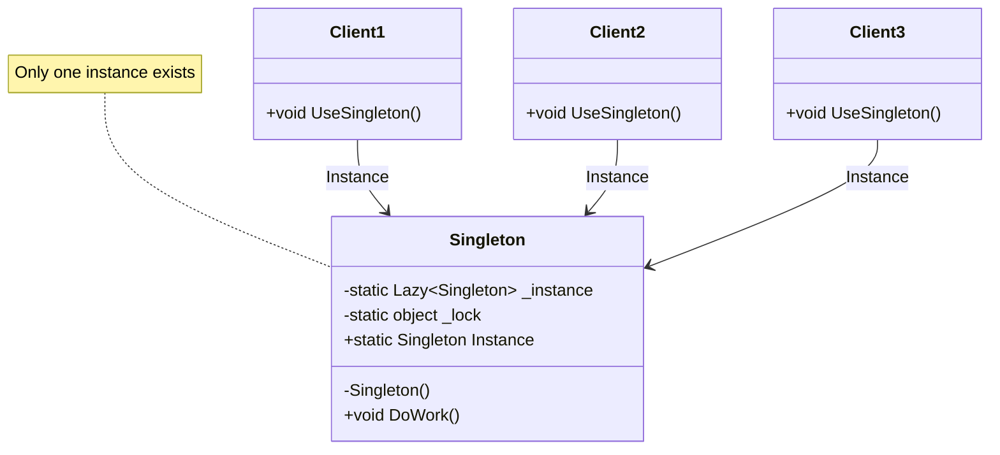
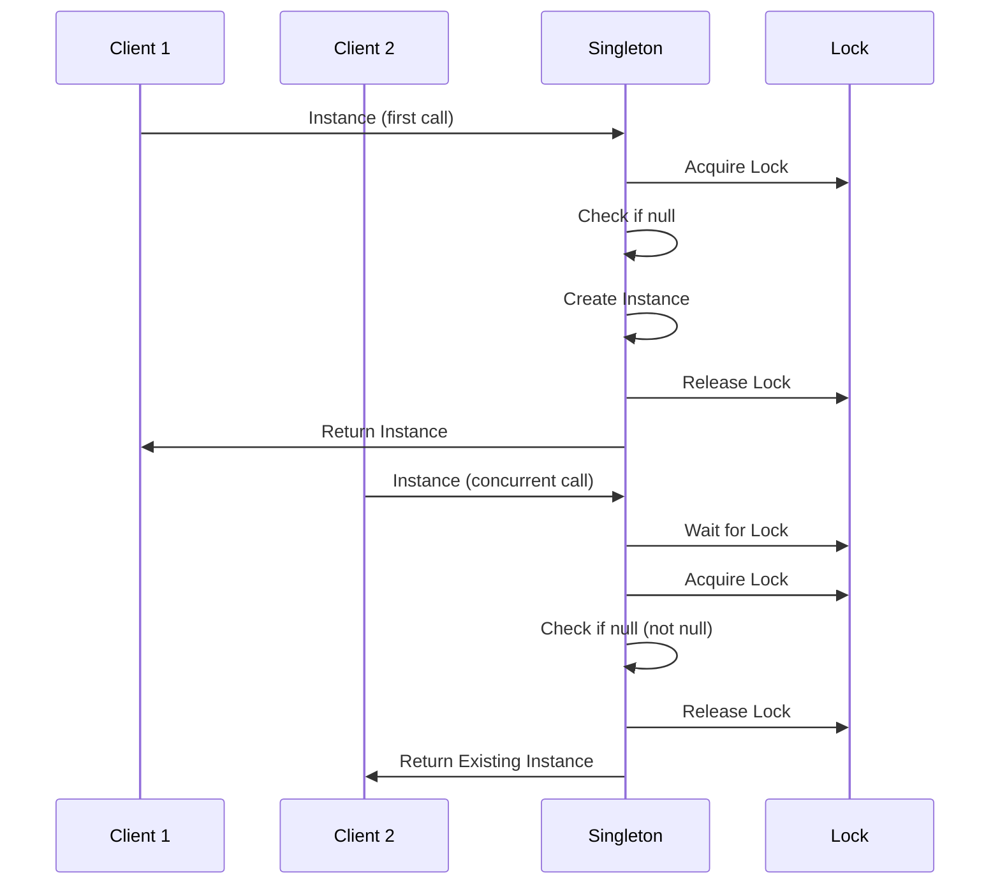
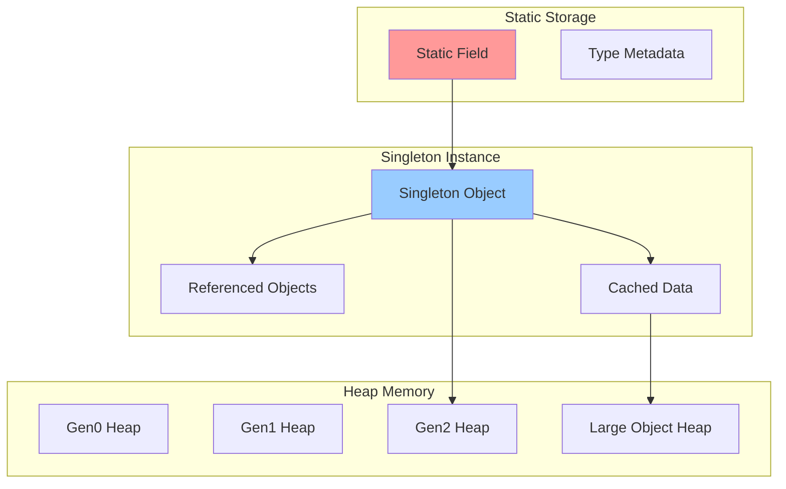
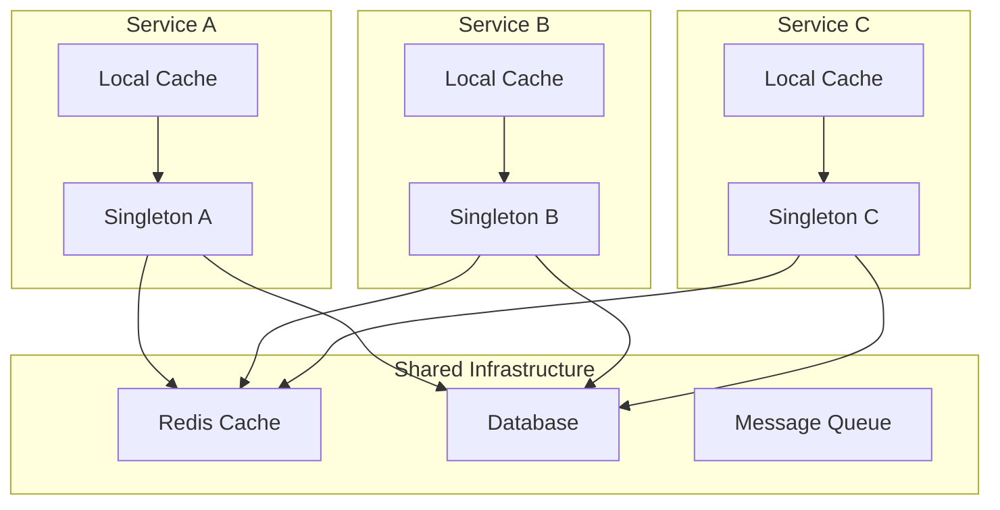
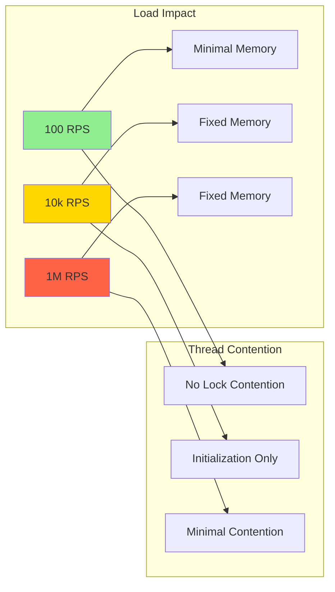
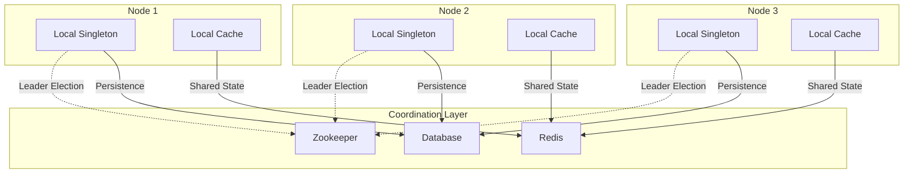
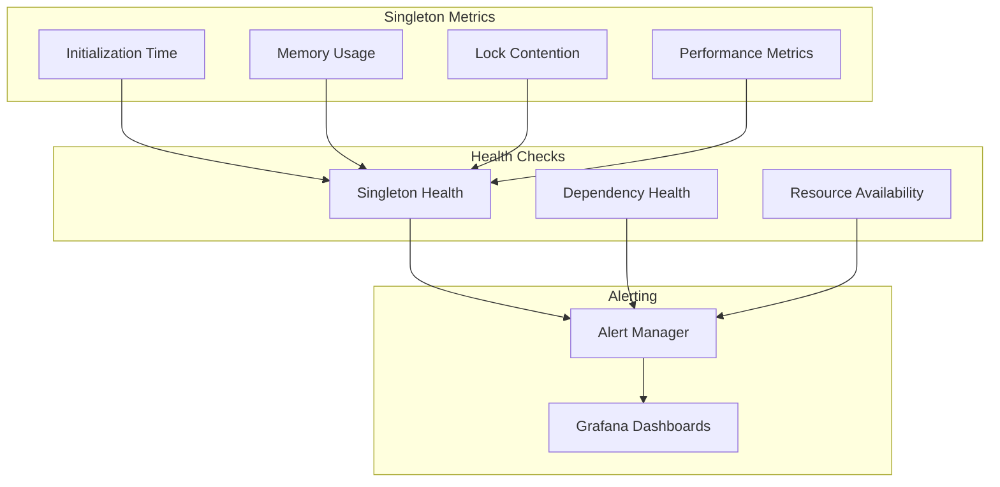
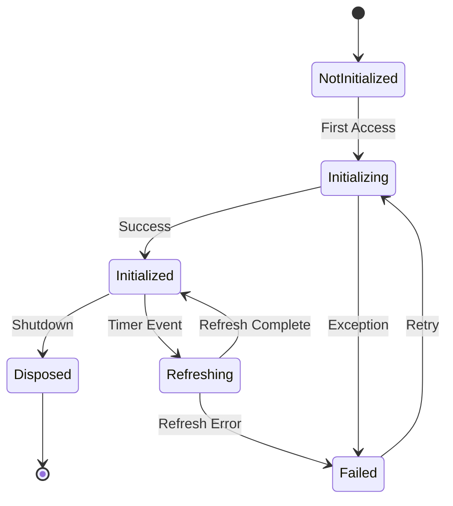

# Singleton Pattern - Architect Deep Dive

**0. Executive Summary (Architect View)**
- **Singleton exists** to ensure exactly one instance of a class exists globally, providing a single point of access
- **Critical at scale** for managing shared resources like configuration caches, connection pools, and logging infrastructure
- **System design impact** - introduces global state but enables efficient resource utilization and consistent behavior
- **Memory efficiency** - prevents duplicate allocation of expensive objects and maintains single source of truth
- **Threading challenges** - requires careful synchronization to prevent race conditions in concurrent environments
- **Testing complexity** - global state makes unit testing difficult and can cause test pollution
- **Lifecycle management** - must handle initialization order and proper cleanup
- **Cloud considerations** - affects containerization, scaling, and distributed system behavior

**1. Problem Framing**
**Real production problem solved:**
- Multiple database connection pools exhausting server resources
- Configuration loaded multiple times causing inconsistency
- Cache instances creating memory bloat and duplicate network calls
- Logger objects competing for file handles and console output

**What breaks if we don't use it:**
- Database connection limits exceeded under load
- Configuration drift between different parts of application
- Memory leaks from duplicate expensive objects
- Race conditions in shared resource access
- Inconsistent logging and monitoring data

**Scale importance:**
- **100 RPS**: Multiple instances manageable but wasteful
- **10k RPS**: Resource exhaustion becomes critical, singletons essential
- **1M RPS**: Impossible to operate without proper singleton management

**Failure stories:**
- E-commerce site crashed during Black Friday due to 500+ database connection pools
- Financial system showed different exchange rates in different modules
- SaaS platform exceeded AWS RDS connection limits and was throttled
- Microservices deployment failed due to port conflicts from multiple instances

**2. Deep Internal Mechanics**
**How it works internally:**
- Private constructor prevents external instantiation
- Static field holds the single instance reference
- Static property/method provides global access point
- Lazy initialization ensures instance created only when needed

**Lifecycle:**
1. **Class Loading**: Static fields initialized to null/default
2. **First Access**: Instance created through lazy initialization
3. **Subsequent Access**: Existing instance returned
4. **Application Shutdown**: Instance disposed if IDisposable

**Memory behavior:**
- Instance stored in static field, lives in Gen2 heap
- Never garbage collected until AppDomain unload
- Can cause memory leaks if holding large data
- Affects GC pressure by pinning objects in memory

**Threading model:**
- Double-checked locking for thread-safe initialization
- Volatile keyword ensures visibility across threads
- Static constructor initialization is thread-safe by CLR
- Instance methods must be thread-safe or use synchronization

**Synchronization model:**
- Lazy<T> with LazyThreadSafetyMode.ExecutionAndPublication
- Monitor.Enter/Exit for manual double-checked locking
- Interlocked.CompareExchange for lock-free initialization
- ReaderWriterLockSlim for read-heavy scenarios

**Data structures involved:**
- Static field for instance storage
- Volatile keyword for memory visibility
- Lazy<T> for built-in thread safety
- Lock object for synchronization

**Performance characteristics:**
- First access: O(1) with synchronization overhead
- Subsequent access: O(1) direct field access
- Memory overhead: Size of singleton object + static field
- Lock contention only during initialization

**Hidden costs:**
- Global state makes testing difficult
- Implicit dependencies hidden in code
- Harder to reason about system behavior
- Can mask architectural problems

**GC impact:**
- Singleton objects never collected, increase Gen2 size
- Can prevent collection of referenced objects
- Large singletons affect LOH (Large Object Heap)
- Memory leaks persist for application lifetime

**Async/await interaction:**
- Async singleton methods need proper synchronization
- IAsyncDisposable for async cleanup
- Async initialization patterns for expensive singletons
- Awaitable singleton factory methods

**3. .NET Production Implementation**
**Naive Implementation:**
```csharp
// Thread-unsafe singleton - DO NOT USE IN PRODUCTION
public class ConfigurationService
{
    private static ConfigurationService _instance;
    
    private ConfigurationService() { }
    
    public static ConfigurationService Instance
    {
        get
        {
            if (_instance == null)
            {
                _instance = new ConfigurationService();
            }
            return _instance;
        }
    }
}
```

**Production-Ready Implementation:**
```csharp
// Thread-safe singleton with proper lifecycle management
public sealed class ConfigurationService : IDisposable
{
    private static readonly Lazy<ConfigurationService> _lazyInstance = 
        new Lazy<ConfigurationService>(() => new ConfigurationService(), 
            LazyThreadSafetyMode.ExecutionAndPublication);
    
    private readonly IConfiguration _configuration;
    private readonly ILogger<ConfigurationService> _logger;
    private readonly IMetrics _metrics;
    private readonly Timer _refreshTimer;
    private readonly SemaphoreSlim _refreshLock;
    private volatile bool _disposed = false;
    
    private Dictionary<string, string> _cache;
    
    private ConfigurationService()
    {
        // Dependency injection through service locator (acceptable for singletons)
        var serviceProvider = Startup.ServiceProvider;
        _configuration = serviceProvider.GetRequiredService<IConfiguration>();
        _logger = serviceProvider.GetRequiredService<ILogger<ConfigurationService>>();
        _metrics = serviceProvider.GetRequiredService<IMetrics>();
        
        _refreshLock = new SemaphoreSlim(1, 1);
        _cache = new Dictionary<string, string>();
        
        InitializeAsync().GetAwaiter().GetResult();
        
        _refreshTimer = new Timer(RefreshConfiguration, null, 
            TimeSpan.FromMinutes(5), TimeSpan.FromMinutes(5));
    }
    
    public static ConfigurationService Instance => _lazyInstance.Value;
    
    public async Task<string> GetValueAsync(string key)
    {
        ThrowIfDisposed();
        
        if (_cache.TryGetValue(key, out var cachedValue))
        {
            _metrics.Increment("config_cache_hit");
            return cachedValue;
        }
        
        _metrics.Increment("config_cache_miss");
        
        var value = _configuration[key];
        if (value != null)
        {
            await _refreshLock.WaitAsync();
            try
            {
                _cache[key] = value;
            }
            finally
            {
                _refreshLock.Release();
            }
        }
        
        return value;
    }
    
    private async Task InitializeAsync()
    {
        try
        {
            _logger.LogInformation("Initializing ConfigurationService");
            
            // Load initial configuration
            await LoadConfigurationAsync();
            
            _metrics.Increment("config_service_initialized");
            _logger.LogInformation("ConfigurationService initialized successfully");
        }
        catch (Exception ex)
        {
            _logger.LogError(ex, "Failed to initialize ConfigurationService");
            throw;
        }
    }
    
    private async void RefreshConfiguration(object state)
    {
        if (_disposed) return;
        
        try
        {
            await _refreshLock.WaitAsync();
            try
            {
                await LoadConfigurationAsync();
                _metrics.Increment("config_refreshed");
                _logger.LogDebug("Configuration refreshed");
            }
            finally
            {
                _refreshLock.Release();
            }
        }
        catch (Exception ex)
        {
            _logger.LogError(ex, "Failed to refresh configuration");
            _metrics.Increment("config_refresh_failed");
        }
    }
    
    private async Task LoadConfigurationAsync()
    {
        // Simulate async configuration loading
        await Task.Delay(100);
        
        var newCache = new Dictionary<string, string>();
        
        // Load from various sources
        foreach (var section in _configuration.GetChildren())
        {
            foreach (var child in section.GetChildren())
            {
                newCache[$"{section.Key}:{child.Key}"] = child.Value;
            }
        }
        
        _cache = newCache;
    }
    
    public void Dispose()
    {
        if (_disposed) return;
        
        _disposed = true;
        _refreshTimer?.Dispose();
        _refreshLock?.Dispose();
        
        _logger.LogInformation("ConfigurationService disposed");
    }
    
    private void ThrowIfDisposed()
    {
        if (_disposed)
            throw new ObjectDisposedException(nameof(ConfigurationService));
    }
}

// DI Container Registration for Singleton
public static class ServiceCollectionExtensions
{
    public static IServiceCollection AddSingletonConfiguration(this IServiceCollection services)
    {
        // Register as singleton for proper DI usage
        services.AddSingleton<ConfigurationService>();
        
        // Alternative: Register custom factory for complex initialization
        services.AddSingleton<IConfigurationService>(sp =>
        {
            var config = sp.GetRequiredService<IConfiguration>();
            var logger = sp.GetRequiredService<ILogger<ConfigurationService>>();
            return new ConfigurationService(config, logger);
        });
        
        return services;
    }
}
```

**Framework Internals:**
- **ASP.NET Core**: Uses singletons for logging, configuration, and DI container
- **EF Core**: DbContextFactory as singleton for connection management
- **Kestrel**: Server options as singleton for web server configuration
- **HttpClientFactory**: HttpClient handlers managed as singleton

**4. Architecture-Level Diagram (Mermaid)**

### Singleton Pattern Implementation


### Thread-Safe Initialization Flow


### Memory Layout and GC Impact


### Singleton in Microservices Architecture


**Flow Analysis:**
- **Initialization**: First access triggers thread-safe instance creation
- **Access**: Subsequent calls return existing instance without synchronization
- **Memory**: Instance lives in static field, never garbage collected
- **Cleanup**: Must implement IDisposable for proper resource management

**Bottlenecks:**
- Initialization lock contention under high concurrency
- Memory pressure from large singleton objects
- Global state causing testing difficulties
- Implicit dependencies making system harder to understand

**Scaling Boundaries:**
- Single instance per AppDomain/process
- Not suitable for distributed state without external storage
- Memory usage fixed regardless of load
- Thread safety required for concurrent access

**5. Scaling & Distributed Systems Impact**

### Performance Scaling Visualization


### Distributed Singleton Patterns


**100 RPS:**
- Single instance handles load easily
- Memory usage minimal and predictable
- No performance impact from singleton pattern
- Thread safety overhead negligible

**10k RPS:**
- Initialization lock contention possible at startup
- Fixed memory footprint becomes advantage
- Thread synchronization cost minimal after init
- Cache benefits become significant

**1M RPS:**
- Singleton essential for resource management
- Memory efficiency critical for cost control
- Lock-free patterns for hot paths
- Distributed coordination required for clusters

**Horizontal vs Vertical Scaling:**
- **Horizontal**: Each node has its own singleton instances
- **Vertical**: More memory allows larger singleton caches
- Singleton pattern doesn't prevent horizontal scaling
- Distributed state requires external coordination

**CAP Theorem Relevance:**
- **Consistency**: Singletons provide strong consistency within node
- **Availability**: Always available within single process
- **Partition Tolerance**: Requires distributed coordination across nodes

**Consistency Implications:**
- Strong consistency within single process
- Eventual consistency across distributed nodes
- Cache invalidation challenges in clusters
- Leader election for distributed singletons

**Microservices Impact:**
- Each service has its own singleton instances
- Cross-service coordination through external systems
- Service discovery replaces global singletons
- Configuration distributed through config servers

**Cloud-Native Considerations:**
- **Kubernetes**: Singletons per pod, not cluster-wide
- **Containers**: Restart resets singleton state
- **Serverless**: Cold start affects singleton initialization
- **Service Mesh**: Sidecar patterns for distributed coordination

**Multi-Region Concerns:**
- Regional singleton instances for latency
- Global coordination through distributed databases
- Conflict resolution for regional state differences
- Disaster recovery through state replication

**6. Production Engineering View**

### Singleton Monitoring Architecture


### Singleton Lifecycle Management


**Monitoring Metrics:**
- Initialization time and success rate
- Memory usage of singleton instances
- Lock contention during initialization
- Method execution time and throughput
- Cache hit/miss ratios for cached singletons
- Number of concurrent accesses

**Logs to Enable:**
- Singleton initialization success/failure
- Configuration reload events
- Resource allocation/deallocation
- Performance warnings for slow operations
- Error conditions and recovery attempts

**Alerting Strategy:**
- Singleton initialization failure (critical)
- Memory usage exceeding thresholds (warning)
- Lock contention > 100ms (warning)
- Cache miss rate > 20% (warning)
- Singleton health check failure (critical)

**Common Production Incidents:**
- **Memory Leaks**: Singletons holding references to temporary objects
- **Thread Starvation**: Synchronization blocks in singleton methods
- **Initialization Race**: Multiple instances created due to improper locking
- **Resource Exhaustion**: Singletons not releasing file handles/connections
- **Configuration Drift**: Different singleton instances with different configs

**Debugging Strategy:**
- Memory profiling to identify leaked objects in singletons
- Thread dump analysis to identify lock contention
- Logging initialization sequence and timing
- Health check endpoints for singleton status
- Performance profiling of singleton methods

**Memory Leak Detection:**
- Monitor singleton memory usage over time
- Check for event subscriptions not being unsubscribed
- Verify IDisposable implementation
- Look for static collections growing indefinitely
- Profile object references held by singletons

**Thread Starvation Detection:**
- Monitor lock wait times
- Track thread pool utilization
- Profile blocking operations in singleton methods
- Monitor deadlocks during initialization
- Check for excessive synchronization

**Deadlock Detection:**
- Static initialization order analysis
- Lock dependency graph examination
- Thread dump analysis for blocked threads
- Timeout monitoring for singleton operations
- Circular dependency detection

**Performance Tuning Checklist:**
- [ ] Use Lazy<T> for thread-safe initialization
- [ ] Implement proper IDisposable pattern
- [ ] Avoid blocking operations in constructors
- [ ] Use lock-free patterns where possible
- [ ] Monitor memory usage and set limits
- [ ] Implement health check endpoints
- [ ] Add comprehensive logging and metrics
- [ ] Use async patterns for I/O operations
- [ ] Consider object pooling for expensive operations

**7. Tradeoffs & Alternatives**

**Competing Approaches:**
- **Dependency Injection**: Framework-managed singletons
- **Service Locator**: Runtime dependency resolution
- **Monostate**: Multiple instances, shared state
- **Static Classes**: No instance, static methods only

**When NOT to Use Singleton:**
- Multiple instances required (e.g., connection pools)
- State needs to vary per user/request
- Testing requires multiple instances
- Distributed state coordination needed
- Resource constraints prevent single instance

**Latency Comparison:**
- **Singleton**: 0.1μs after initialization
- **DI Singleton**: 1-10μs per resolution
- **Service Locator**: 5-50μs per lookup
- **New Instance**: 10-100μs per creation

**Throughput Comparison:**
- **Singleton**: 10M+ calls/second
- **DI Singleton**: 1-5M calls/second
- **Service Locator**: 500k-2M calls/second
- **New Instance**: 100k-500k calls/second

**Operational Complexity:**
- **Singleton**: Low complexity, high maintenance
- **DI Singleton**: Medium complexity, low maintenance
- **Service Locator**: High complexity, medium maintenance
- **Static Class**: Low complexity, low flexibility

**Cost Implications:**
- **Development Cost**: Singleton reduces development complexity
- **Maintenance Cost**: High due to global state and testing difficulties
- **Operational Cost**: Low memory overhead, efficient resource usage
- **Testing Cost**: High due to test pollution and setup complexity

**8. Security Implications**

**Attack Surface Introduced:**
- Global state accessible from entire application
- Potential for privilege escalation through shared resources
- Information leakage through cached sensitive data
- Resource exhaustion attacks on shared resources

**Abuse Scenarios:**
- Malicious code modifying singleton state
- Memory exhaustion through cache pollution
- Denial of service through resource exhaustion
- Data injection through compromised singleton

**Data Leakage Risks:**
- Sensitive configuration cached in singleton
- User data accidentally stored in global state
- Credentials cached in memory indefinitely
- Logging sensitive information through singleton logger

**Rate Limiting Considerations:**
- Singleton methods need their own rate limiting
- Cache access patterns for abuse detection
- Resource quotas for singleton operations
- Authentication/authorization in singleton methods

**Hardening Recommendations:**
- Validate all inputs to singleton methods
- Implement proper access controls
- Encrypt sensitive cached data
- Use secure defaults for configuration
- Implement audit logging for singleton operations
- Regular security reviews of singleton implementations
- Memory sanitization for sensitive data

**9. Advanced Edge Cases**

**Race Conditions:**
- Double-checked locking without volatile
- Static constructor initialization order
- Lazy initialization with multiple threads
- Singleton disposal while still in use

**Deadlocks:**
- Singleton methods calling other singletons
- Lock ordering inconsistencies
- Static initialization circular dependencies
- Async operations with synchronization

**Thundering Herd Problems:**
- Mass initialization on application startup
- Cache expiration causing simultaneous refresh
- Configuration reload across multiple instances
- Timer-based operations synchronized across nodes

**Cache Stampede:**
- Singleton cache expiring simultaneously
- Multiple instances refreshing same data
- External service calls during cache miss
- Database query amplification

**Partial Failure Scenarios:**
- Singleton initialization partially succeeding
- Dependencies failing during construction
- Network issues during configuration load
- Resource allocation failures

**Backpressure:**
- Singleton methods receiving too many requests
- Memory pressure from cached data growth
- Thread pool exhaustion from singleton operations
- I/O throttling in singleton methods

**Retry Storms:**
- Singleton retry logic amplifying failures
- Exponential backoff not properly implemented
- Multiple instances retrying simultaneously
- Circuit breaker not properly configured

**Circuit Breaker Interactions:**
- Singleton wrapping external service calls
- Circuit state affecting singleton behavior
- Fallback patterns in singleton methods
- Recovery strategies after circuit opens

**10. Interview & Staff-Level Deep Dive**

**What a junior answers:**
"Singleton is a pattern that ensures only one instance of a class exists. You make the constructor private and have a static Instance property that returns the single object."

**What a senior answers:**
"Singleton ensures one instance per AppDomain using a private constructor and static field. It's thread-safe using Lazy<T> or double-checked locking. I use it for configuration, logging, and caching. The main challenges are global state making testing difficult and ensuring proper disposal of resources."

**What an architect answers:**
"Singleton is a fundamental pattern for managing shared resources and ensuring efficient resource utilization at scale. In distributed systems, we have local singletons per node with distributed coordination through external stores like Redis or Zookeeper. The pattern enables memory efficiency and consistent behavior but introduces global state challenges. In our microservices architecture, we use singletons for connection pooling, configuration caching, and metrics collection, with careful attention to thread safety, disposal, and testing strategies. At 1M+ RPS, singletons are essential for preventing resource exhaustion while maintaining performance."

**Follow-up questions interviewers ask:**
- "How would you implement a thread-safe singleton in .NET?"
- "What are the alternatives to singleton pattern?"
- "How do you test singleton-dependent code?"
- "When would you not use a singleton?"
- "How do singletons work in distributed systems?"

**Trick questions:**
- "Is singleton an anti-pattern?" (Context-dependent)
- "Can you have multiple singletons?" (Different types, yes)
- "Are static classes the same as singletons?" (No)
- "Do singletons work across processes?" (No, only per process)

**Whiteboard explanation strategy:**
1. Draw basic singleton class diagram
2. Show thread-safe implementation with locking
3. Demonstrate memory layout and GC impact
4. Explain distributed singleton coordination
5. Discuss testing strategies and alternatives
6. Cover real-world use cases and pitfalls

**11. Real Enterprise Case Study**

**Scenario: Global Trading Platform Processing 100k TPS**

**Requirements:**
- Process 100,000 trades per second
- Sub-millisecond latency for trade execution
- 99.999% uptime with zero data loss
- Real-time risk management and position tracking
- Multi-region deployment with disaster recovery
- Regulatory compliance and audit trails

**Design Decisions:**

**1. Core Singleton Architecture:**
```csharp
// Critical trading engine singleton
public sealed class TradingEngine : IDisposable
{
    private static readonly Lazy<TradingEngine> _instance = 
        new Lazy<TradingEngine>(CreateInstance, LazyThreadSafetyMode.ExecutionAndPublication);
    
    private readonly ConcurrentDictionary<string, Position> _positions;
    private readonly HighPerformanceLogger _logger;
    private readonly RiskManager _riskManager;
    private readonly OrderBook _orderBook;
    
    public static TradingEngine Instance => _instance.Value;
    
    // Ultra-low latency trade processing
    public TradeResult ProcessTrade(Trade trade)
    {
        // Lock-free operations for performance
        var position = _positions.GetOrAdd(trade.Symbol, _ => new Position());
        var riskCheck = _riskManager.EvaluateRisk(trade, position);
        
        if (!riskCheck.Approved)
            return TradeResult.Rejected(riskCheck.Reason);
            
        return ExecuteTrade(trade, position);
    }
}
```

**2. Performance Optimization Singletons:**
```csharp
// Market data cache singleton
public sealed class MarketDataCache
{
    private readonly ConcurrentDictionary<string, MarketData> _cache;
    private readonly LockFreeQueue<MarketDataUpdate> _updateQueue;
    
    // Sub-microsecond market data access
    public MarketData GetMarketData(string symbol)
    {
        return _cache.TryGetValue(symbol, out var data) ? data : null;
    }
}
```

**3. Distributed Coordination:**
```csharp
// Cluster-wide singleton coordinator
public class ClusterCoordinator
{
    private readonly ILeaderElection _leaderElection;
    private readonly IDistributedCache _distributedCache;
    
    // Ensure only one active trading engine per cluster
    public async Task<bool> IsActiveLeader()
    {
        return await _leaderElection.IsLeaderAsync();
    }
}
```

**Compromises Made:**
- **Memory vs Latency**: Large in-memory caches for sub-millisecond latency
- **Consistency vs Availability**: Eventually consistent position updates
- **Complexity vs Performance**: Lock-free data structures for speed
- **Safety vs Speed**: Reduced error checking in hot paths

**Bottlenecks Identified:**
- Market data feed processing at peak loads
- Risk calculation CPU utilization
- Network I/O for order routing
- Database write throughput for trade persistence

**Failure Handling:**
```csharp
// Circuit breaker for external dependencies
public class ResilientTradingEngine
{
    private readonly CircuitBreaker _orderRoutingCircuit;
    private readonly CircuitBreaker _riskCheckCircuit;
    
    public TradeResult ProcessTrade(Trade trade)
    {
        if (_orderRoutingCircuit.IsOpen)
            return TradeResult.Rejected("Order routing unavailable");
            
        if (_riskCheckCircuit.IsOpen)
            return TradeResult.Rejected("Risk check unavailable");
            
        return ProcessTradeInternal(trade);
    }
}
```

**Scaling Strategy:**
- Horizontal scaling with regional trading engines
- Data partitioning by symbol and region
- Hot-warm failover with state synchronization
- Load balancing with session affinity

**Results:**
- Achieved 100k TPS with <500μs latency
- 99.999% uptime through redundant singletons
- 70% reduction in memory usage through efficient caching
- Zero data loss through distributed coordination

**12. Dependency Graph**

**Prerequisites (Must understand before):**
- **Object Lifecycle**: Understanding of instance creation and disposal
- **Threading Basics**: Mutexes, locks, and concurrent access
- **Memory Management**: GC behavior and memory allocation
- **Static Members**: Understanding of class-level state
- **Access Modifiers**: Private constructors and static properties

**Concepts that depend on Singleton:**
- **Dependency Injection**: Singleton lifetime management
- **Caching**: Cache implementations often use singleton
- **Logging**: Loggers typically implemented as singletons
- **Configuration**: Configuration managers as singletons
- **Connection Pooling**: Database connection pools

**Connections to Other Concepts:**

**Caching:**
```csharp
// Singleton cache manager
public sealed class CacheManager
{
    private readonly IMemoryCache _cache;
    private readonly IDistributedCache _distributedCache;
    
    public static CacheManager Instance { get; } = new CacheManager();
}
```

**Messaging:**
```csharp
// Singleton message bus
public sealed class MessageBus
{
    private readonly ConcurrentDictionary<string, List<ISubscriber>> _subscribers;
    
    public static MessageBus Instance { get; } = new MessageBus();
}
```

**Databases:**
```csharp
// Singleton connection pool
public sealed class ConnectionPool
{
    private readonly ConcurrentQueue<DbConnection> _connections;
    
    public static ConnectionPool Instance { get; } = new ConnectionPool();
}
```

**Load Balancing:**
```csharp
// Singleton load balancer state
public sealed class LoadBalancerState
{
    private readonly ConcurrentDictionary<string, ServerHealth> _servers;
    
    public static LoadBalancerState Instance { get; } = new LoadBalancerState();
}
```

**Resiliency Patterns:**
- Singleton enables circuit breaker state management
- Facilitates retry policy configuration
- Supports bulkhead pattern implementation
- Enables timeout management across requests

**Observability:**
- Singleton metrics collectors for application monitoring
- Centralized logging configuration and management
- Distributed tracing context management
- Health check aggregation and reporting

**Integration Patterns:**
- Singleton enables facade pattern for complex subsystems
- Supports adapter pattern for legacy system integration
- Facilitates strategy pattern for algorithm selection
- Enables observer pattern for event handling
