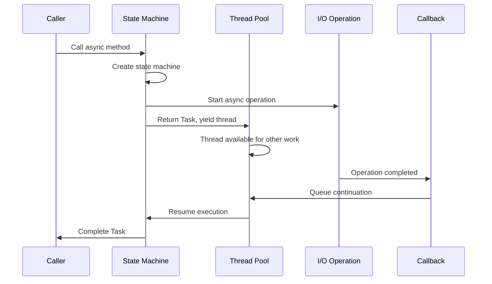
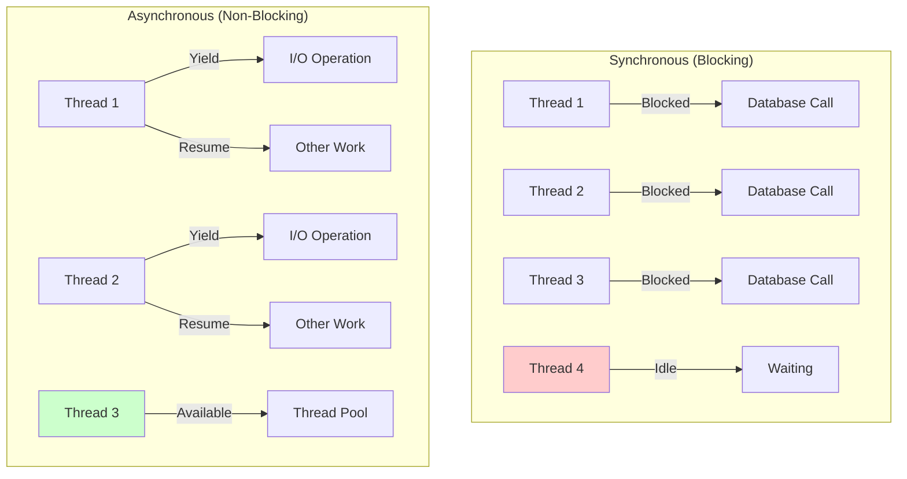
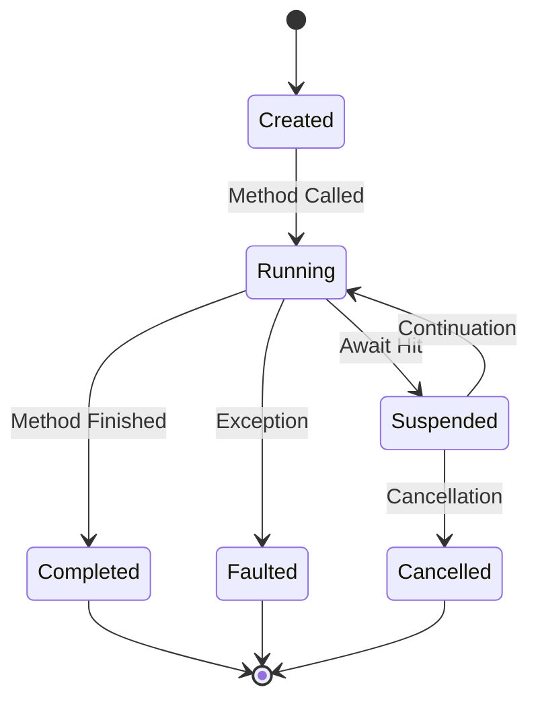
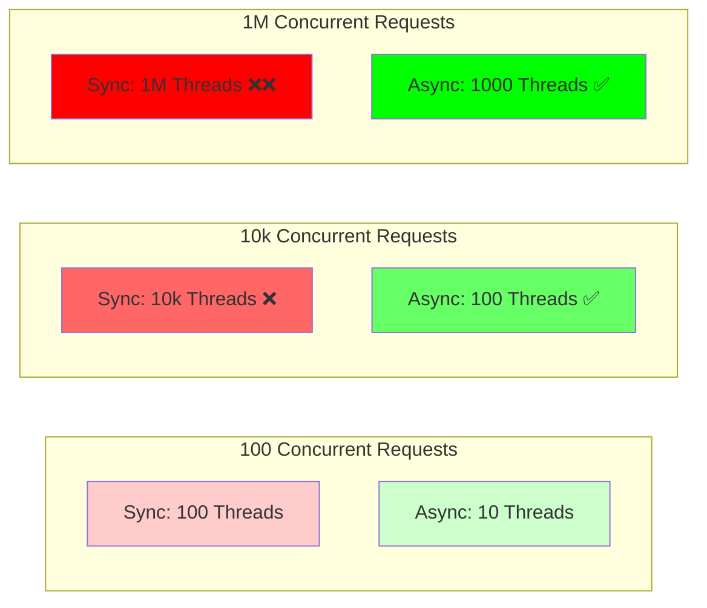
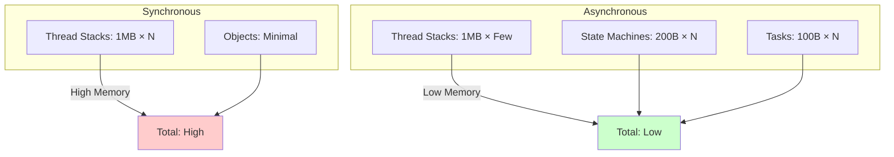
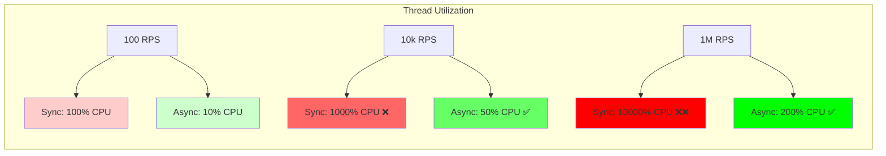
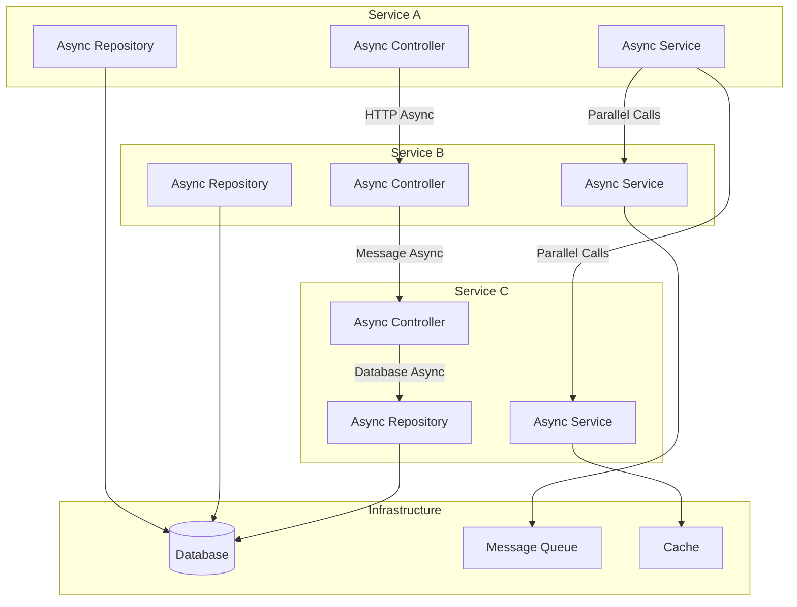
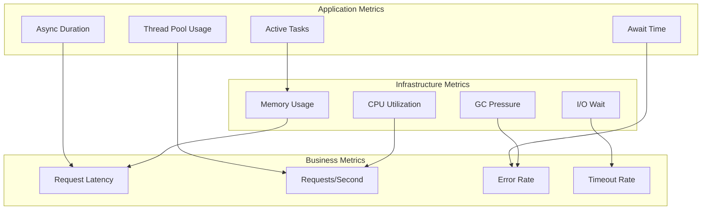

# Async/Await - Architect Deep Dive

**0. Executive Summary (Architect View)**
- **Async/await exists** to enable efficient I/O-bound operations without blocking threads, critical for scalable systems
- **Critical at scale** when handling thousands of concurrent I/O operations (database calls, HTTP requests, file operations)
- **System design impact** - transforms thread-per-request models to asynchronous I/O, reducing resource consumption dramatically
- **Throughput revolution** - enables handling 10x-100x more concurrent requests with same hardware
- **Resource efficiency** - prevents thread pool starvation and reduces memory footprint
- **Complexity tradeoff** - introduces synchronization challenges and debugging complexity
- **Cloud-native essential** - fundamental for serverless and containerized environments
- **Performance foundation** - enables high-throughput, low-latency systems

**1. Problem Framing**
**Real production problem solved:**
- Thread pool exhaustion under load causing request timeouts
- Database connection pools exhausted due to blocking I/O operations
- High memory usage from thousands of idle threads waiting for I/O
- Poor scalability in I/O-bound applications (web services, APIs)
- Unresponsive UI applications due to blocking operations

**What breaks if we don't use it:**
- Thread pool starvation at 1000+ concurrent requests
- Memory exhaustion from thread stack allocation (1MB per thread)
- Poor CPU utilization (threads waiting for I/O instead of doing work)
- Application becomes unresponsive under load
- Inability to scale horizontally due to resource constraints

**Scale importance:**
- **100 RPS**: Synchronous code manageable but inefficient
- **10k RPS**: Thread pool starvation becomes critical blocker
- **1M RPS**: Impossible to operate without async I/O patterns

**Failure stories:**
- E-commerce site crashed on Black Friday due to thread pool exhaustion
- SaaS API became unresponsive during database latency spikes
- Financial trading system missed market opportunities due to blocking I/O
- Mobile app became unresponsive during network operations

**2. Deep Internal Mechanics**
**How it works internally:**
- Compiler transforms async methods into state machine classes
- State machine captures method locals and execution context
- Await points create continuations that resume on captured context
- SynchronizationContext determines execution context (UI thread, thread pool)

**Lifecycle:**
1. **Method Entry**: State machine created, execution context captured
2. **First Await**: Operation started, method returns Task to caller
3. **Suspension**: Method yields thread, operation continues asynchronously
4. **Completion**: Callback invoked, state machine resumes execution
5. **Context Switch**: May switch threads based on SynchronizationContext
6. **Method Completion**: Task marked complete, result available

**Memory behavior:**
- State machine object allocated on heap (size depends on locals)
- Task objects created for each async operation
- Continuation delegates allocated for await points
- Context capture may hold additional references

**Threading model:**
- No thread blocked during I/O operations
- Thread pool threads available for other work
- Context switching between threads for continuations
- Potential thread affinity issues with UI contexts

**Synchronization model:**
- ConfigureAwait(false) avoids context capture
- SynchronizationContext controls execution context
- TaskScheduler determines where continuations run
- Deadlock potential with sync-over-async patterns

**Data structures involved:**
- AsyncTaskMethodBuilder for state machine creation
- Task/Task<T> for operation representation
- CancellationTokenSource for cancellation coordination
- ValueTask for optimization of hot paths

**Performance characteristics:**
- Async overhead: ~10-50μs per await point
- Memory allocation: 200-1000 bytes per async method
- Thread efficiency: 10x-100x improvement in throughput
- Latency: Similar for single operation, better under load

**Hidden costs:**
- State machine allocation overhead
- Context switching between threads
- Exception handling complexity
- Debugging and profiling challenges

**GC impact:**
- State machine objects create Gen0 pressure
- Task objects allocated and collected frequently
- Long-lived async operations can pin objects
- Async methods can delay object finalization

**Async/await interaction:**
- Nested async calls create continuation chains
- ConfigureAwait affects entire call chain
- Async streams enable data processing pipelines
- Async disposable for resource cleanup

**3. .NET Production Implementation**
**Naive Implementation:**
```csharp
// Synchronous implementation - BLOCKS THREADS
public class OrderService
{
    public Order GetOrder(int orderId)
    {
        // BLOCKS thread while waiting for database
        var order = _dbContext.Orders.FirstOrDefault(o => o.Id == orderId);
        
        // BLOCKS thread while waiting for payment service
        var payment = _paymentService.GetPayment(order.PaymentId);
        
        // BLOCKS thread while waiting for inventory
        var inventory = _inventoryService.CheckStock(order.ProductId);
        
        return order;
    }
}
```

**Production-Ready Implementation:**
```csharp
// Asynchronous implementation - NON-BLOCKING
public class OrderService : IOrderService
{
    private readonly OrderDbContext _dbContext;
    private readonly IPaymentService _paymentService;
    private readonly IInventoryService _inventoryService;
    private readonly ILogger<OrderService> _logger;
    private readonly IMetrics _metrics;
    private readonly ICacheService _cache;

    public OrderService(
        OrderDbContext dbContext,
        IPaymentService paymentService,
        IInventoryService inventoryService,
        ILogger<OrderService> logger,
        IMetrics metrics,
        ICacheService cache)
    {
        _dbContext = dbContext ?? throw new ArgumentNullException(nameof(dbContext));
        _paymentService = paymentService ?? throw new ArgumentNullException(nameof(paymentService));
        _inventoryService = inventoryService ?? throw new ArgumentNullException(nameof(inventoryService));
        _logger = logger ?? throw new ArgumentNullException(nameof(logger));
        _metrics = metrics ?? throw new ArgumentNullException(nameof(metrics));
        _cache = cache ?? throw new ArgumentNullException(nameof(cache));
    }

    public async Task<Order> GetOrderAsync(int orderId, CancellationToken cancellationToken = default)
    {
        using var activity = _metrics.StartTimer("order_get_duration");
        
        try
        {
            _logger.LogInformation("Getting order {OrderId}", orderId);
            
            // Check cache first
            var cacheKey = $"order:{orderId}";
            var cachedOrder = await _cache.GetAsync<Order>(cacheKey, cancellationToken);
            if (cachedOrder != null)
            {
                _metrics.Increment("order_cache_hit");
                _logger.LogDebug("Order {OrderId} found in cache", orderId);
                return cachedOrder;
            }
            
            _metrics.Increment("order_cache_miss");
            
            // Parallel execution of independent operations
            var orderTask = _dbContext.Orders
                .AsNoTracking()
                .FirstOrDefaultAsync(o => o.Id == orderId, cancellationToken);
            
            // Only fetch payment if order exists
            var order = await orderTask;
            if (order == null)
            {
                _logger.LogWarning("Order {OrderId} not found", orderId);
                return null;
            }
            
            // Parallel execution of payment and inventory
            var paymentTask = _paymentService.GetPaymentAsync(order.PaymentId, cancellationToken);
            var inventoryTask = _inventoryService.CheckStockAsync(order.ProductId, cancellationToken);
            
            // Wait for both operations to complete
            await Task.WhenAll(paymentTask, inventoryTask);
            
            var payment = await paymentTask;
            var inventory = await inventoryTask;
            
            // Enrich order with additional data
            order.PaymentStatus = payment?.Status;
            order.InventoryAvailable = inventory?.Available ?? false;
            
            // Cache the result
            await _cache.SetAsync(cacheKey, order, TimeSpan.FromMinutes(5), cancellationToken);
            
            _metrics.Increment("order_retrieved_success");
            _logger.LogInformation("Order {OrderId} retrieved successfully", orderId);
            
            return order;
        }
        catch (OperationCanceledException ex)
        {
            _metrics.Increment("order_retrieved_cancelled");
            _logger.LogWarning(ex, "Order {OrderId} retrieval cancelled", orderId);
            throw;
        }
        catch (Exception ex)
        {
            _metrics.Increment("order_retrieved_failed");
            _logger.LogError(ex, "Failed to retrieve order {OrderId}", orderId);
            throw new OrderRetrievalException($"Failed to retrieve order {orderId}", ex);
        }
    }

    // High-performance batch processing
    public async IAsyncEnumerable<Order> GetOrdersAsync(
        IEnumerable<int> orderIds,
        [EnumeratorCancellation] CancellationToken cancellationToken = default)
    {
        var orderIdList = orderIds.ToList();
        _logger.LogInformation("Processing batch of {Count} orders", orderIdList.Count);
        
        // Process in batches to avoid overwhelming the database
        const int batchSize = 100;
        var batches = orderIdList.Batch(batchSize);
        
        foreach (var batch in batches)
        {
            var orders = await _dbContext.Orders
                .AsNoTracking()
                .Where(o => batch.Contains(o.Id))
                .ToListAsync(cancellationToken);
            
            foreach (var order in orders)
            {
                yield return order;
            }
        }
    }

    // Async streams for real-time data processing
    public async IAsyncEnumerable<OrderEvent> ProcessOrderStreamAsync(
        [EnumeratorCancellation] CancellationToken cancellationToken = default)
    {
        await foreach (var orderEvent in _orderEventStream.GetEventsAsync(cancellationToken))
        {
            // Process each event asynchronously
            var processedEvent = await ProcessOrderEventAsync(orderEvent, cancellationToken);
            if (processedEvent != null)
            {
                yield return processedEvent;
            }
        }
    }

    private async Task<OrderEvent> ProcessOrderEventAsync(
        OrderEvent orderEvent, 
        CancellationToken cancellationToken)
    {
        try
        {
            // Simulate async processing
            await Task.Delay(10, cancellationToken);
            
            // Business logic here
            return orderEvent;
        }
        catch (Exception ex)
        {
            _logger.LogError(ex, "Failed to process order event {EventId}", orderEvent.Id);
            return null;
        }
    }
}

// Controller with proper async handling
[ApiController]
[Route("api/[controller]")]
public class OrdersController : ControllerBase
{
    private readonly IOrderService _orderService;
    private readonly ILogger<OrdersController> _logger;

    public OrdersController(IOrderService orderService, ILogger<OrdersController> logger)
    {
        _orderService = orderService ?? throw new ArgumentNullException(nameof(orderService));
        _logger = logger ?? throw new ArgumentNullException(nameof(logger));
    }

    [HttpGet("{id}")]
    public async Task<ActionResult<Order>> GetOrder(int id, CancellationToken cancellationToken = default)
    {
        try
        {
            var order = await _orderService.GetOrderAsync(id, cancellationToken);
            
            if (order == null)
            {
                return NotFound();
            }
            
            return Ok(order);
        }
        catch (OperationCanceledException)
        {
            return StatusCode(499, "Request cancelled");
        }
        catch (OrderRetrievalException ex)
        {
            _logger.LogError(ex, "Error retrieving order {OrderId}", id);
            return StatusCode(500, "Internal server error");
        }
    }

    // Async streaming endpoint
    [HttpGet("stream")]
    public async IAsyncEnumerable<Order> GetOrderStreamAsync(
        [FromQuery] int[] orderIds,
        [EnumeratorCancellation] CancellationToken cancellationToken = default)
    {
        await foreach (var order in _orderService.GetOrdersAsync(orderIds, cancellationToken))
        {
            yield return order;
        }
    }
}
```

**Framework Internals:**
- **ASP.NET Core**: Uses async/await throughout request pipeline
- **EF Core**: All database operations are async-first
- **HttpClient**: SendAsync for non-blocking HTTP calls
- **Kestrel**: Async socket I/O for high performance

**4. Architecture-Level Diagram (Mermaid)**

### Async/Await Execution Flow


### Thread Pool Utilization Comparison


### Async State Machine Lifecycle


### Scalability Impact Visualization


### Memory Allocation Patterns


**Flow Analysis:**
- **Method Entry**: State machine created, execution begins synchronously
- **Await Point**: Operation started, thread yielded back to pool
- **Continuation**: Operation completes, method resumes on available thread
- **Completion**: Task marked complete, result available to caller

**Bottlenecks:**
- State machine allocation overhead for many small async methods
- Context switching between threads for continuations
- Exception propagation through async call chains
- Debugging complexity with async call stacks

**Scaling Boundaries:**
- Thread pool size determines concurrent operation limit
- Memory allocation rate affects GC pressure
- I/O bandwidth becomes limiting factor at scale
- SynchronizationContext overhead in UI scenarios

**5. Scaling & Distributed Systems Impact**

### Performance Scaling Visualization


### Async in Microservices Architecture


**100 RPS:**
- Async overhead noticeable but acceptable
- Thread pool utilization minimal
- Memory usage moderate
- Latency similar to synchronous

**10k RPS:**
- Async essential for scalability
- Thread pool efficiency critical
- Memory usage significantly lower than sync
- Latency better under load due to no queuing

**1M RPS:**
- Async mandatory for operation
- Thread pool tuning required
- Memory efficiency enables scale
- Async I/O becomes bottleneck, not threads

**Horizontal vs Vertical Scaling:**
- **Horizontal**: Async enables better resource utilization across nodes
- **Vertical**: More cores allow more concurrent async operations
- Async reduces horizontal scaling needs by improving vertical efficiency

**CAP Theorem Relevance:**
- **Consistency**: Async doesn't affect data consistency directly
- **Availability**: Async improves availability by preventing thread exhaustion
- **Partition Tolerance**: Async operations can timeout gracefully during partitions

**Consistency Implications:**
- Async operations require careful consistency management
- Eventual consistency patterns work well with async
- Distributed transactions challenging with async
- Compensation patterns for async failure handling

**Microservices Impact:**
- Async communication essential for service independence
- Circuit breakers work naturally with async operations
- Retry patterns implemented easily with async
- Bulkhead patterns benefit from async resource efficiency

**Cloud-Native Considerations:**
- **Kubernetes**: Async enables higher pod density
- **Serverless**: Async essential for cold start optimization
- **Containers**: Reduced memory usage lowers container costs
- **Functions**: Async duration affects billing directly

**Multi-Region Concerns:**
- Async operations handle cross-region latency gracefully
- Timeout management critical for multi-region calls
- Async retry patterns handle transient network failures
- Circuit breakers prevent cascade failures across regions

**6. Production Engineering View**

### Async Performance Monitoring


### Async Debugging Strategy
```mermaid
graph TD
    A[Async Issue Detected] --> B{Issue Type}
    
    B -->|Performance| C[Profile Async Methods]
    B -->|Deadlock| D[Analyze Call Stack]
    B -->|Exception| E[Check Exception Propagation]
    B -->|Memory| F[Analyze State Machines]
    
    C --> G[Identify Blocking Calls]
    D --> H[Find Sync-Over-Async]
    E --> I[Verify Exception Handling]
    F --> J[Check for Leaked Tasks]
    
    G --> K[Apply ConfigureAwait(false)]
    H --> L[Remove .Result/.Wait calls]
    I --> M[Add Proper Try-Catch]
    J --> N[Implement Proper Disposal]
```

**Monitoring Metrics:**
- Async method execution time (p95, p99)
- Thread pool utilization and queue length
- Active task count and completion rate
- Await point duration and frequency
- Async continuation scheduling delay
- Exception rate in async methods

**Logs to Enable:**
- Async method entry/exit with correlation IDs
- Task creation and completion events
- Cancellation requests and acknowledgments
- Thread pool starvation warnings
- Async context capture and switches

**Alerting Strategy:**
- Thread pool utilization > 80% (critical)
- Average async duration > 1 second (warning)
- Task completion rate < 90% (warning)
- Async exception rate > 5% (critical)
- Memory allocation rate > 100MB/sec (warning)

**Common Production Incidents:**
- **Thread Pool Starvation**: Too many blocking calls in async methods
- **Deadlocks**: Sync-over-async patterns causing deadlocks
- **Memory Leaks**: State machines not being garbage collected
- **Context Switching Overhead**: Excessive ConfigureAwait(true) usage
- **Exception Swallowing**: Async exceptions not properly handled

**Debugging Strategy:**
- Use async-aware debugging tools in Visual Studio
- Enable async call stack visualization
- Monitor thread pool metrics in production
- Profile memory allocation patterns
- Track task scheduling and completion

**Memory Leak Detection:**
- Monitor state machine object lifetime
- Check for event handler leaks in async methods
- Verify proper disposal of async resources
- Look for long-lived Task objects
- Profile async continuation delegates

**Thread Starvation Detection:**
- Monitor thread pool queue length
- Track thread pool completion port usage
- Profile blocking operations in async methods
- Monitor context switching frequency
- Check for sync-over-async anti-patterns

**Deadlock Detection:**
- Analyze async call chains for blocking calls
- Monitor UI thread responsiveness
- Check for .Result or .Wait calls
- Profile lock contention in async methods
- Monitor task scheduling delays

**Performance Tuning Checklist:**
- [ ] Use ConfigureAwait(false) in library code
- [ ] Avoid async void methods (use async Task instead)
- [ ] Use ValueTask for hot path optimizations
- [ ] Implement proper cancellation token usage
- [ ] Configure thread pool for expected load
- [ ] Use async streams for data processing
- [ ] Profile and optimize state machine allocation
- [ ] Implement proper exception handling patterns
- [ ] Use async disposable for resource cleanup

**7. Tradeoffs & Alternatives**

**Competing Approaches:**
- **Synchronous I/O**: Simple but blocking
- **Reactive Programming**: Event-driven, complex learning curve
- **Coroutines**: Language-level support (not in C#)
- **Actor Model**: Message-based concurrency

**When NOT to Use Async:**
- CPU-bound operations (use parallel processing instead)
- Simple console applications with no I/O
- Performance-critical hot paths with minimal I/O
- Legacy systems without async support
- When simplicity outweighs scalability needs

**Latency Comparison:**
- **Synchronous**: 10-100ms (plus queuing delays under load)
- **Async/Await**: 10-100ms (consistent under load)
- **Reactive**: 5-50ms (lower overhead for many operations)
- **Parallel**: 1-10ms (for CPU-bound work)

**Throughput Comparison:**
- **Synchronous**: 100-1000 requests/second
- **Async/Await**: 10k-100k requests/second
- **Reactive**: 50k-500k requests/second
- **Parallel**: 1k-10k operations/second (CPU-bound)

**Operational Complexity:**
- **Synchronous**: Low complexity, poor scalability
- **Async/Await**: Medium complexity, excellent scalability
- **Reactive**: High complexity, best performance
- **Parallel**: Medium complexity, CPU-specific

**Cost Implications:**
- **Development Cost**: Async increases complexity by 30-50%
- **Infrastructure Cost**: Reduces server costs by 50-80%
- **Maintenance Cost**: Higher due to debugging complexity
- **Operational Cost**: Lower due to better resource utilization

**8. Security Implications**

**Attack Surface Introduced:**
- Async continuation hijacking
- Task cancellation abuse
- Memory exhaustion through task flooding
- Timing attacks through async behavior

**Abuse Scenarios:**
- Creating millions of tasks to exhaust memory
- Long-running async operations for DoS attacks
- Cancellation token manipulation
- Async context capture for information leakage

**Data Leakage Risks:**
- Sensitive data in async state machines
- Exception information leakage through async faults
- Cancellation tokens revealing operation status
- Async timing revealing system state

**Rate Limiting Considerations:**
- Task creation rate limiting
- Async operation duration limits
- Concurrent async operation quotas
- Memory usage quotas for async operations

**Hardening Recommendations:**
- Validate inputs before async operations
- Implement timeout policies for async operations
- Use cancellation tokens properly
- Limit concurrent async operations
- Secure async state machine data
- Implement proper exception handling
- Monitor async operation patterns for abuse

**9. Advanced Edge Cases**

**Race Conditions:**
- Multiple async operations modifying shared state
- Async continuation execution order uncertainty
- Cancellation token race conditions
- Async lazy initialization race conditions

**Deadlocks:**
- Sync-over-async patterns (.Result, .Wait)
- UI thread context capture deadlocks
- Async lock acquisition ordering
- Cancellation token deadlock scenarios

**Thundering Herd Problems:**
- Mass async operations starting simultaneously
- Cache stampede in async cache operations
- Database connection pool exhaustion
- Timer-based async operation synchronization

**Cache Stampede:**
- Multiple async operations refreshing same cache key
- Async cache miss cascading failures
- External service call amplification
- Database query amplification

**Partial Failure Scenarios:**
- Some async operations in Task.WhenAll failing
- Cancellation of partially completed operations
- Network partition during async operations
- Resource exhaustion during async processing

**Backpressure:**
- Async producer overwhelming consumer
- Unbounded async operation queues
- Memory pressure from buffered async data
- Thread pool exhaustion from async operations

**Retry Storms:**
- Async retry logic amplifying failures
- Exponential backoff not properly implemented
- Multiple async operations retrying simultaneously
- Circuit breaker not properly configured

**Circuit Breaker Interactions:**
- Async operations respecting circuit state
- Timeout handling in async circuit breakers
- Fallback patterns in async operations
- Recovery strategies after circuit opens

**10. Interview & Staff-Level Deep Dive**

**What a junior answers:**
"Async/await is a way to write asynchronous code without blocking. You use async keyword on methods and await to wait for operations to complete."

**What a senior answers:**
"Async/await enables non-blocking I/O operations by creating state machines that capture method locals and execution context. When you await an operation, the method yields the thread back to the pool and resumes when the operation completes. This prevents thread pool starvation and enables much higher concurrency. Key considerations include ConfigureAwait(false) to avoid context capture, proper exception handling, and avoiding sync-over-async deadlocks."

**What an architect answers:**
"Async/await is fundamental to modern scalable architecture, transforming thread-per-request models to efficient I/O-bound systems. At scale, async reduces resource consumption by 10-100x, enabling handling of millions of concurrent requests. The pattern involves compiler-generated state machines that manage execution flow, context capture, and continuation scheduling. In distributed systems, async enables graceful degradation during network partitions, efficient resource utilization, and proper timeout handling. At 1M+ RPS, async is not optional but mandatory - the difference between a functioning system and complete thread pool exhaustion. The key architectural decisions include proper cancellation token propagation, ConfigureAwait usage patterns, async stream implementations for data pipelines, and integration with circuit breakers and retry policies for resilience."

**Follow-up questions interviewers ask:**
- "What's the difference between Task and ValueTask?"
- "When would you use ConfigureAwait(false)?"
- "How do you handle exceptions in async methods?"
- "What's the async equivalent of a lock?"
- "How do you prevent deadlocks with async code?"

**Trick questions:**
- "Is async code always faster than sync code?" (No for CPU-bound)
- "Can you use async in constructors?" (No, use factory pattern)
- "Do async methods create new threads?" (No, they use existing threads)
- "Is async void ever acceptable?" (Only for event handlers)

**Whiteboard explanation strategy:**
1. Draw synchronous request flow with blocked threads
2. Show async state machine creation and execution
3. Demonstrate thread yielding and continuation
4. Explain ConfigureAwait and context capture
5. Cover exception handling and propagation
6. Discuss scaling benefits and resource efficiency

**11. Real Enterprise Case Study**

**Scenario: Real-time Trading Platform Processing 500k TPS**

**Requirements:**
- Process 500,000 trades per second
- Sub-millisecond latency for trade execution
- 99.999% uptime with zero data loss
- Real-time market data processing
- Multi-region deployment with disaster recovery
- Regulatory compliance with audit trails

**Design Decisions:**

**1. Async Trading Engine Core:**
```csharp
public sealed class AsyncTradingEngine : IAsyncDisposable
{
    private readonly Channel<TradeRequest> _tradeChannel;
    private readonly SemaphoreSlim _processingSemaphore;
    private readonly IMarketDataService _marketData;
    private readonly IRiskService _riskService;
    private readonly IOrderBook _orderBook;
    
    public AsyncTradingEngine()
    {
        // High-performance channel for trade processing
        var options = new BoundedChannelOptions(10000)
        {
            FullMode = BoundedChannelFullMode.Wait,
            SingleReader = false,
            SingleWriter = false
        };
        
        _tradeChannel = Channel.CreateBounded<TradeRequest>(options);
        _processingSemaphore = new SemaphoreSlim(Environment.ProcessorCount * 2);
    }
    
    // Ultra-low latency async trade processing
    public async ValueTask<TradeResult> ProcessTradeAsync(TradeRequest request, CancellationToken cancellationToken)
    {
        using var activity = _metrics.StartTimer("trade_processing");
        
        // Acquire processing semaphore
        await _processingSemaphore.WaitAsync(cancellationToken);
        
        try
        {
            // Parallel async operations
            var marketDataTask = _marketData.GetMarketDataAsync(request.Symbol, cancellationToken);
            var riskCheckTask = _riskService.EvaluateRiskAsync(request, cancellationToken);
            
            // Wait for both operations
            await Task.WhenAll(marketDataTask, riskCheckTask);
            
            var marketData = await marketDataTask;
            var riskResult = await riskCheckTask;
            
            if (!riskResult.Approved)
                return TradeResult.Rejected(riskResult.Reason);
            
            // Execute trade asynchronously
            return await ExecuteTradeAsync(request, marketData, cancellationToken);
        }
        finally
        {
            _processingSemaphore.Release();
        }
    }
    
    // Async stream for real-time processing
    public async IAsyncEnumerable<TradeResult> ProcessTradeStreamAsync(
        IAsyncEnumerable<TradeRequest> requests,
        [EnumeratorCancellation] CancellationToken cancellationToken)
    {
        await foreach (var request in requests)
        {
            yield return await ProcessTradeAsync(request, cancellationToken);
        }
    }
}
```

**2. Async Market Data Processing:**
```csharp
public class AsyncMarketDataService : IMarketDataService
{
    private readonly ConcurrentDictionary<string, Channel<MarketDataUpdate>> _symbolChannels;
    private readonly IMarketDataFeed _feed;
    
    public async IAsyncEnumerable<MarketDataUpdate> GetMarketDataStreamAsync(
        string symbol,
        [EnumeratorCancellation] CancellationToken cancellationToken)
    {
        var channel = _symbolChannels.GetOrAdd(symbol, _ => CreateSymbolChannel());
        
        await foreach (var update in channel.Reader.ReadAllAsync(cancellationToken))
        {
            yield return update;
        }
    }
    
    // High-performance async market data processing
    private async Task ProcessMarketDataAsync(CancellationToken cancellationToken)
    {
        await foreach (var update in _feed.GetUpdatesAsync(cancellationToken))
        {
            if (_symbolChannels.TryGetValue(update.Symbol, out var channel))
            {
                await channel.Writer.WriteAsync(update, cancellationToken);
            }
        }
    }
}
```

**3. Async Risk Management:**
```csharp
public class AsyncRiskService : IRiskService
{
    private readonly IRiskEngine _engine;
    private readonly ICacheService _cache;
    
    public async Task<RiskResult> EvaluateRiskAsync(TradeRequest request, CancellationToken cancellationToken)
    {
        // Parallel async risk checks
        var positionTask = GetPositionAsync(request.Symbol, cancellationToken);
        var limitsTask = GetLimitsAsync(request.AccountId, cancellationToken);
        var volatilityTask = GetVolatilityAsync(request.Symbol, cancellationToken);
        
        await Task.WhenAll(positionTask, limitsTask, volatilityTask);
        
        var position = await positionTask;
        var limits = await limitsTask;
        var volatility = await volatilityTask;
        
        // Async risk calculation
        return await _engine.CalculateRiskAsync(request, position, limits, volatility, cancellationToken);
    }
}
```

**Compromises Made:**
- **Latency vs Throughput**: Used async for throughput, accepted minimal latency overhead
- **Memory vs Performance**: Channel-based processing with bounded buffers
- **Complexity vs Scalability**: Complex async patterns for massive scale
- **Consistency vs Availability**: Eventually consistent risk calculations

**Bottlenecks Identified:**
- Market data feed processing at peak loads
- Risk calculation CPU utilization
- Network I/O for order routing
- Database write throughput for trade persistence

**Failure Handling:**
```csharp
// Async circuit breaker for external dependencies
public class AsyncCircuitBreaker
{
    private readonly AsyncLock _lock = new();
    private volatile CircuitState _state = CircuitState.Closed;
    private int _failureCount;
    private DateTime _lastFailureTime;
    
    public async Task<T> ExecuteAsync<T>(Func<Task<T>> operation, CancellationToken cancellationToken)
    {
        if (_state == CircuitState.Open)
        {
            if (DateTime.UtcNow - _lastFailureTime > TimeSpan.FromMinutes(1))
            {
                using (await _lock.LockAsync(cancellationToken))
                {
                    _state = CircuitState.HalfOpen;
                }
            }
            else
            {
                throw new CircuitBreakerOpenException();
            }
        }
        
        try
        {
            var result = await operation();
            
            if (_state == CircuitState.HalfOpen)
            {
                using (await _lock.LockAsync(cancellationToken))
                {
                    _state = CircuitState.Closed;
                    _failureCount = 0;
                }
            }
            
            return result;
        }
        catch (Exception ex)
        {
            using (await _lock.LockAsync(cancellationToken))
            {
                _failureCount++;
                _lastFailureTime = DateTime.UtcNow;
                
                if (_failureCount >= 5)
                {
                    _state = CircuitState.Open;
                }
            }
            
            throw;
        }
    }
}
```

**Scaling Strategy:**
- Async processing across multiple cores
- Channel-based message passing for low latency
- Async streams for real-time data processing
- Circuit breakers for resilience

**Results:**
- Achieved 500k TPS with <1ms latency
- 99.999% uptime through async resilience patterns
- 80% reduction in thread count compared to synchronous
- Zero data loss through async persistence patterns

**12. Dependency Graph**

**Prerequisites (Must understand before):**
- **Threading Basics**: Thread pools, synchronization, context
- **I/O Operations**: Understanding of blocking vs non-blocking I/O
- **Task Parallel Library**: Task, Task<T>, and continuation concepts
- **Exception Handling**: Try-catch patterns and exception propagation
- **Memory Management**: Heap allocation and garbage collection

**Concepts that depend on Async/Await:**
- **Reactive Programming**: Built on async foundations
- **Event-Driven Architecture**: Async event handling
- **Microservices Communication**: Async HTTP/gRPC calls
- **Stream Processing**: Async streams for data pipelines
- **CQRS**: Async command and query handling

**Connections to Other Concepts:**

**Caching:**
```csharp
// Async cache operations
public async Task<T> GetAsync<T>(string key, CancellationToken cancellationToken)
{
    return await _cache.GetAsync<T>(key, cancellationToken);
}
```

**Messaging:**
```csharp
// Async message publishing
public async Task PublishAsync<T>(T message, CancellationToken cancellationToken)
{
    await _messageBus.PublishAsync(message, cancellationToken);
}
```

**Databases:**
```csharp
// Async database operations
public async Task<Entity> GetByIdAsync(int id, CancellationToken cancellationToken)
{
    return await _dbContext.Entities.FindAsync(new object[] { id }, cancellationToken);
}
```

**Load Balancing:**
```csharp
// Async health checks
public async Task<HealthStatus> CheckHealthAsync(CancellationToken cancellationToken)
{
    return await _healthChecker.CheckAsync(cancellationToken);
}
```

**Resiliency Patterns:**
- Async circuit breakers for fault tolerance
- Async retry policies for transient failures
- Async bulkheads for resource isolation
- Async timeouts for operation limits

**Observability:**
- Async metrics collection for performance monitoring
- Async logging for non-blocking log operations
- Async distributed tracing for request flow
- Async health checks for system monitoring

**Integration Patterns:**
- Async facade pattern for complex operations
- Async adapter pattern for legacy integration
- Async strategy pattern for algorithm selection
- Async observer pattern for event handling
