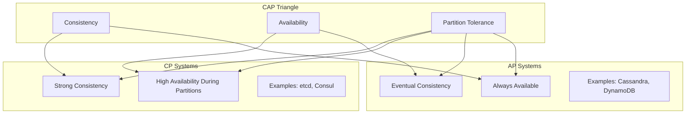
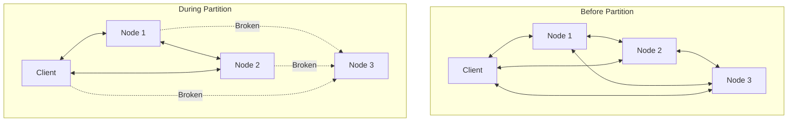
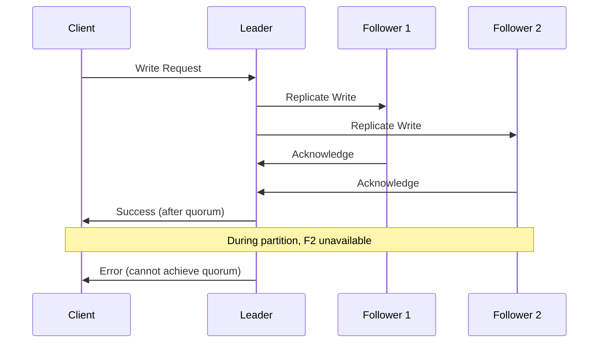
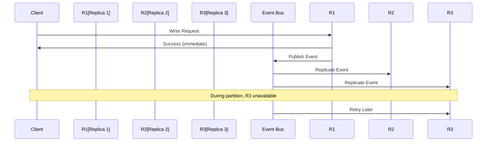
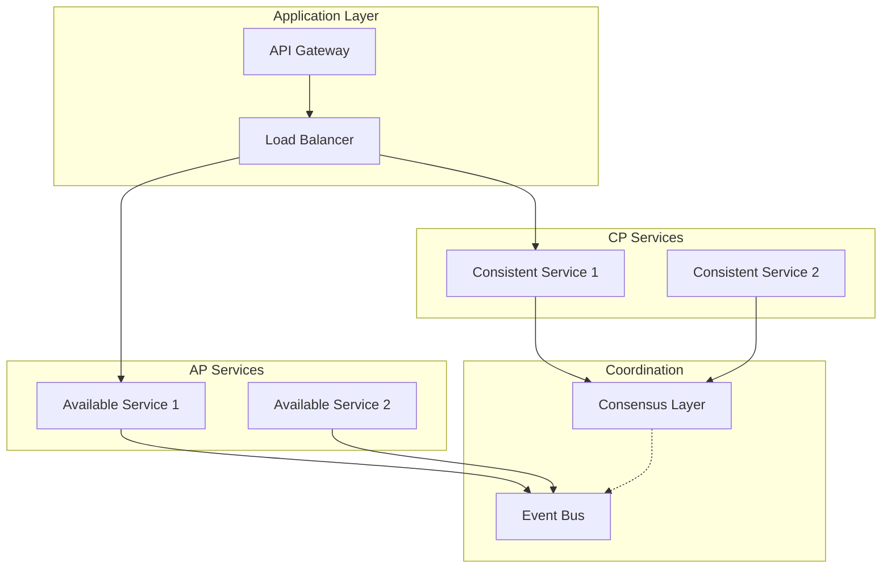
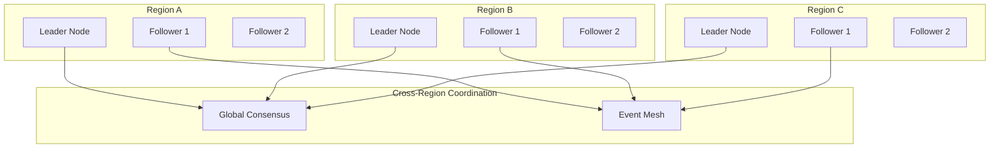
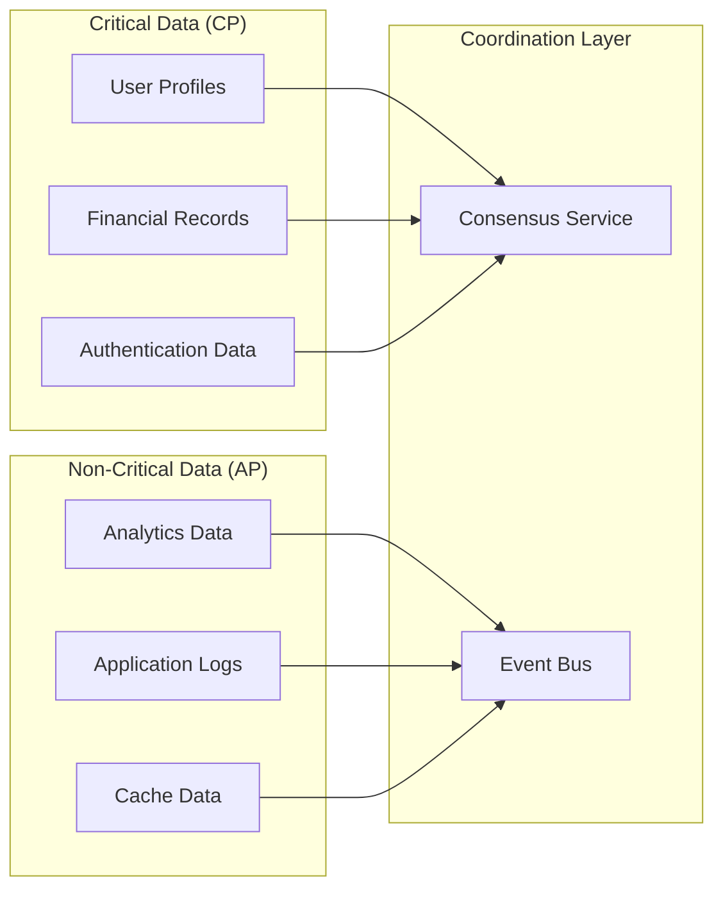
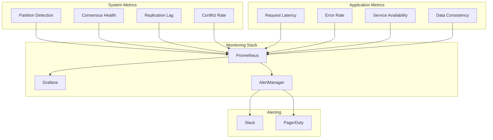
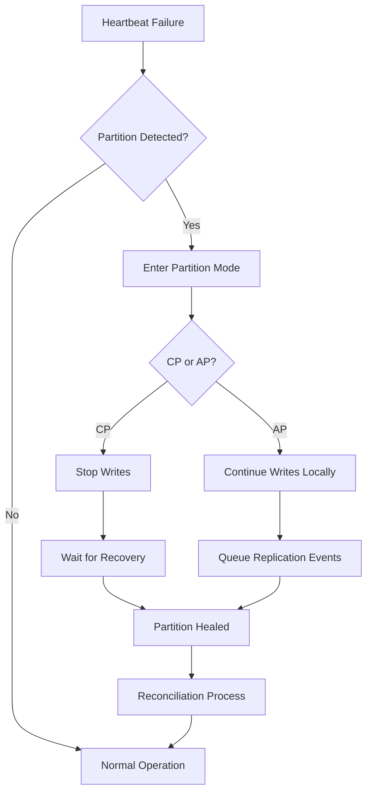

# CAP Theorem - Architect Deep Dive

============================================================
0. Executive Summary (Architect View)
============================================================
- **CAP Theorem exists** to define fundamental tradeoffs in distributed systems under network partitions
- **Critical at scale** when systems must remain operational despite network failures and partial outages
- **System design impact** - forces architects to choose between consistency and availability during partitions
- **Distributed reality** - acknowledges that network partitions are inevitable in large-scale systems
- **Tradeoff foundation** - underpins decisions about database selection, system architecture, and failure handling
- **Cloud-native essential** - fundamental for designing resilient cloud applications
- **Business impact** - directly affects user experience, data integrity, and system reliability
- **Operational complexity** - requires sophisticated partition detection and recovery mechanisms

============================================================
1. Problem Framing
============================================================
**Real production problem solved:**
- Network partitions causing split-brain scenarios in distributed databases
- Inconsistent data across nodes during network failures
- Systems becoming completely unavailable during partial network issues
- Data corruption from concurrent writes during partitions
- User experience degradation from inconsistent system behavior

**What breaks if we don't understand it:**
- Systems make wrong consistency/availability tradeoffs
- Data corruption during network partitions
- Complete system outages instead of graceful degradation
- Poor user experience during partial failures
- Inability to design appropriate failure handling

**Scale importance:**
- **Single node**: CAP theorem irrelevant
- **Few nodes**: Partitions rare, simple solutions work
- **Many nodes**: Partitions common, CAP critical
- **Geo-distributed**: Partitions inevitable, CAP essential

**Failure stories:**
- Social media platform showed different follower counts during network partition
- Banking system allowed duplicate transactions during split-brain
- E-commerce site lost orders during database partition
- Healthcare system had inconsistent patient records across regions

============================================================
2. Deep Internal Mechanics
============================================================
**How it works internally:**
- **Consistency (C)**: All nodes see same data simultaneously
- **Availability (A)**: Every request receives a response (success/failure)
- **Partition Tolerance (P)**: System continues operating despite network partitions
- **Tradeoff**: Can only choose 2 out of 3 properties during partitions
- **Reality**: Network partitions are inevitable, so must choose between C and A

**Partition Detection:**
- Heartbeat mechanisms between nodes
- Timeout-based failure detection
- Quorum-based membership protocols
- Gossip protocols for failure dissemination
- Split-brain detection algorithms

**Consistency Models:**
- **Strong Consistency**: Linearizable operations
- **Eventual Consistency**: Converges over time
- **Causal Consistency**: Preserves causal relationships
- **Read-Your-Writes**: Clients see their own writes
- **Monotonic Reads**: Never see older data

**Availability Strategies:**
- Replication across multiple nodes
- Local processing during partitions
- Graceful degradation modes
- Fallback to cached data
- Queue operations for later processing

**Partition Handling:**
- Leader election during partitions
- Quorum-based decision making
- Conflict resolution mechanisms
- Data reconciliation processes
- Automatic recovery protocols

**Data Structures:**
- Vector clocks for causal ordering
- Version vectors for conflict detection
- Merkle trees for data consistency
- Bloom filters for membership
- CRDTs for conflict-free replication

**Performance Characteristics:**
- **CP Systems**: Higher latency, strong consistency
- **AP Systems**: Lower latency, eventual consistency
- **Partition Detection**: O(n) network communication
- **Recovery Time**: Depends on partition duration

**Hidden Costs:**
- Increased complexity in conflict resolution
- Higher operational overhead
- More sophisticated monitoring required
- Complex testing scenarios
- Steeper learning curve

**Network Impact:**
- Increased bandwidth for coordination
- Latency sensitivity for consistency
- Topology awareness requirements
- Network partition detection overhead
- Cross-region communication costs

**Failure Scenarios:**
- Network splits between data centers
- Node failures during high load
- Partial network degradation
- DNS resolution failures
- Load balancer failures

============================================================
3. .NET Production Implementation
============================================================

**Naive Implementation (Ignores CAP):**
```csharp
public class SimpleOrderService
{
    private readonly OrderDbContext _context;
    
    public async Task<Order> CreateOrderAsync(Order order)
    {
        // No consideration for consistency or availability
        await _context.Orders.AddAsync(order);
        await _context.SaveChangesAsync();
        return order;
    }
    
    public async Task<Order> GetOrderAsync(int id)
    {
        // Assumes always available and consistent
        return await _context.Orders.FindAsync(id);
    }
}
```

**Production-Ready CP Implementation:**
```csharp
public class ConsistentOrderService : IOrderService
{
    private readonly IOrderRepository _repository;
    private readonly IConsensusManager _consensus;
    private readonly ILogger<ConsistentOrderService> _logger;
    private readonly IMetrics _metrics;

    public ConsistentOrderService(
        IOrderRepository repository,
        IConsensusManager consensus,
        ILogger<ConsistentOrderService> logger,
        IMetrics metrics)
    {
        _repository = repository ?? throw new ArgumentNullException(nameof(repository));
        _consensus = consensus ?? throw new ArgumentNullException(nameof(consensus));
        _logger = logger ?? throw new ArgumentNullException(nameof(logger));
        _metrics = metrics ?? throw new ArgumentNullException(nameof(metrics));
    }

    public async Task<Order> CreateOrderAsync(Order order, CancellationToken cancellationToken = default)
    {
        using var activity = _metrics.StartTimer("order_create_cp_duration");
        
        try
        {
            _logger.LogInformation("Creating consistent order {OrderId}", order.Id);
            
            // CP: Ensure consensus before write
            var proposal = new OrderProposal
            {
                Order = order,
                Timestamp = DateTime.UtcNow,
                Operation = "Create"
            };
            
            // Get consensus from majority of nodes
            var consensusResult = await _consensus.ProposeAsync(proposal, cancellationToken);
            
            if (!consensusResult.IsAccepted)
            {
                _metrics.Increment("order_create_consensus_failed");
                throw new ConsensusException("Failed to achieve consensus for order creation");
            }
            
            // Only proceed if consensus achieved
            var createdOrder = await _repository.CreateAsync(order, cancellationToken);
            
            _metrics.Increment("order_create_cp_success");
            _logger.LogInformation("Consistent order {OrderId} created successfully", order.Id);
            
            return createdOrder;
        }
        catch (Exception ex)
        {
            _metrics.Increment("order_create_cp_failed");
            _logger.LogError(ex, "Failed to create consistent order {OrderId}", order.Id);
            throw;
        }
    }

    public async Task<Order> GetOrderAsync(int id, CancellationToken cancellationToken = default)
    {
        using var activity = _metrics.StartTimer("order_get_cp_duration");
        
        try
        {
            // CP: Ensure read from leader or quorum
            var readQuorum = await _consensus.GetReadQuorumAsync(id, cancellationToken);
            
            if (!readQuorum.IsConsistent)
            {
                _metrics.Increment("order_get_quorum_failed");
                throw new ConsistencyException("Unable to achieve read consistency");
            }
            
            var order = await _repository.GetAsync(id, cancellationToken);
            
            if (order == null)
            {
                _metrics.Increment("order_not_found");
                return null;
            }
            
            _metrics.Increment("order_get_cp_success");
            return order;
        }
        catch (Exception ex)
        {
            _metrics.Increment("order_get_cp_failed");
            _logger.LogError(ex, "Failed to get consistent order {OrderId}", id);
            throw;
        }
    }
}

// Consensus Manager Implementation
public interface IConsensusManager
{
    Task<ConsensusResult> ProposeAsync<T>(T proposal, CancellationToken cancellationToken);
    Task<ReadQuorumResult> GetReadQuorumAsync<T>(T key, CancellationToken cancellationToken);
}

public class RaftConsensusManager : IConsensusManager
{
    private readonly List<INode> _nodes;
    private readonly ILeaderElection _leaderElection;
    private readonly ILogger<RaftConsensusManager> _logger;
    private readonly IMetrics _metrics;

    public RaftConsensusManager(
        IEnumerable<INode> nodes,
        ILeaderElection leaderElection,
        ILogger<RaftConsensusManager> logger,
        IMetrics metrics)
    {
        _nodes = nodes.ToList();
        _leaderElection = leaderElection;
        _logger = logger;
        _metrics = metrics;
    }

    public async Task<ConsensusResult> ProposeAsync<T>(T proposal, CancellationToken cancellationToken)
    {
        var leader = await _leaderElection.GetLeaderAsync();
        if (leader == null)
        {
            return ConsensusResult.Failed("No leader elected");
        }

        // Send proposal to majority of nodes
        var responses = new List<ProposalResponse>();
        var majority = (_nodes.Count / 2) + 1;

        var tasks = _nodes.Select(async node =>
        {
            try
            {
                var response = await node.SendProposalAsync(proposal, cancellationToken);
                lock (responses)
                {
                    responses.Add(response);
                }
                return response;
            }
            catch (Exception ex)
            {
                _logger.LogWarning(ex, "Failed to send proposal to node {NodeId}", node.Id);
                return ProposalResponse.Failed(ex.Message);
            }
        });

        await Task.WhenAll(tasks);

        var acceptedCount = responses.Count(r => r.IsAccepted);
        
        if (acceptedCount >= majority)
        {
            _metrics.Increment("consensus_proposal_success");
            return ConsensusResult.Accepted();
        }
        else
        {
            _metrics.Increment("consensus_proposal_failed");
            return ConsensusResult.Failed($"Only {acceptedCount}/{_nodes.Count} nodes accepted");
        }
    }

    public async Task<ReadQuorumResult> GetReadQuorumAsync<T>(T key, CancellationToken cancellationToken)
    {
        // Implement read quorum for consistency
        var tasks = _nodes.Select(async node =>
        {
            try
            {
                return await node.ReadAsync(key, cancellationToken);
            }
            catch (Exception ex)
            {
                _logger.LogWarning(ex, "Failed to read from node {NodeId}", node.Id);
                return null;
            }
        });

        var results = await Task.WhenAll(tasks);
        var validResults = results.Where(r => r != null).ToList();
        
        if (validResults.Count < (_nodes.Count / 2) + 1)
        {
            return ReadQuorumResult.Failed("Insufficient read quorum");
        }

        // Check consistency across nodes
        var firstResult = validResults.First();
        var consistentResults = validResults.Where(r => r.Equals(firstResult)).ToList();
        
        if (consistentResults.Count >= (_nodes.Count / 2) + 1)
        {
            return ReadQuorumResult.Consistent(firstResult);
        }
        
        return ReadQuorumResult.Inconsistent("Data inconsistency detected");
    }
}
```

**Production-Ready AP Implementation:**
```csharp
public class AvailableOrderService : IOrderService
{
    private readonly IOrderRepository _repository;
    private readonly IEventBus _eventBus;
    private readonly IConflictResolver _conflictResolver;
    private readonly ILogger<AvailableOrderService> _logger;
    private readonly IMetrics _metrics;

    public AvailableOrderService(
        IOrderRepository repository,
        IEventBus eventBus,
        IConflictResolver conflictResolver,
        ILogger<AvailableOrderService> logger,
        IMetrics metrics)
    {
        _repository = repository ?? throw new ArgumentNullException(nameof(repository));
        _eventBus = eventBus ?? throw new ArgumentNullException(nameof(eventBus));
        _conflictResolver = conflictResolver ?? throw new ArgumentNullException(nameof(conflictResolver));
        _logger = logger ?? throw new ArgumentNullException(nameof(logger));
        _metrics = metrics ?? throw new ArgumentNullException(nameof(metrics));
    }

    public async Task<Order> CreateOrderAsync(Order order, CancellationToken cancellationToken = default)
    {
        using var activity = _metrics.StartTimer("order_create_ap_duration");
        
        try
        {
            _logger.LogInformation("Creating available order {OrderId}", order.Id);
            
            // AP: Write locally, propagate asynchronously
            var createdOrder = await _repository.CreateAsync(order, cancellationToken);
            
            // Publish event for async replication
            await _eventBus.PublishAsync(new OrderCreatedEvent(createdOrder), cancellationToken);
            
            _metrics.Increment("order_create_ap_success");
            _logger.LogInformation("Available order {OrderId} created successfully", order.Id);
            
            return createdOrder;
        }
        catch (Exception ex)
        {
            _metrics.Increment("order_create_ap_failed");
            _logger.LogError(ex, "Failed to create available order {OrderId}", order.Id);
            throw;
        }
    }

    public async Task<Order> GetOrderAsync(int id, CancellationToken cancellationToken = default)
    {
        using var activity = _metrics.StartTimer("order_get_ap_duration");
        
        try
        {
            // AP: Read from local replica, may be stale
            var order = await _repository.GetAsync(id, cancellationToken);
            
            if (order == null)
            {
                _metrics.Increment("order_not_found");
                return null;
            }
            
            _metrics.Increment("order_get_ap_success");
            return order;
        }
        catch (Exception ex)
        {
            _metrics.Increment("order_get_ap_failed");
            _logger.LogError(ex, "Failed to get available order {OrderId}", id);
            throw;
        }
    }

    // Event handler for replication and conflict resolution
    public async Task HandleOrderCreatedAsync(OrderCreatedEvent @event, CancellationToken cancellationToken)
    {
        try
        {
            var existingOrder = await _repository.GetAsync(@event.Order.Id, cancellationToken);
            
            if (existingOrder == null)
            {
                // No conflict, just replicate
                await _repository.CreateAsync(@event.Order, cancellationToken);
            }
            else
            {
                // Potential conflict, resolve it
                var resolvedOrder = await _conflictResolver.ResolveAsync(existingOrder, @event.Order, cancellationToken);
                if (resolvedOrder != existingOrder)
                {
                    await _repository.UpdateAsync(resolvedOrder, cancellationToken);
                }
            }
        }
        catch (Exception ex)
        {
            _logger.LogError(ex, "Failed to handle order created event for {OrderId}", @event.Order.Id);
        }
    }
}

// Conflict Resolution for AP systems
public interface IConflictResolver
{
    Task<Order> ResolveAsync(Order local, Order remote, CancellationToken cancellationToken);
}

public class TimestampConflictResolver : IConflictResolver
{
    public Task<Order> ResolveAsync(Order local, Order remote, CancellationToken cancellationToken)
    {
        // Last-write-wins based on timestamp
        var resolved = remote.Timestamp > local.Timestamp ? remote : local;
        return Task.FromResult(resolved);
    }
}
```

**Framework Integration:**
- **ASP.NET Core**: Circuit breakers for handling partitions
- **EF Core**: Connection resilience for database partitions
- **Distributed Cache**: Cache aside pattern for AP systems
- **Message Queues**: Eventual consistency through messaging

============================================================
4. Architecture-Level Diagram (Mermaid)
============================================================

### CAP Theorem Tradeoffs


### Network Partition Scenario


### CP System Behavior


### AP System Behavior


### Hybrid CAP Implementation


**Flow Analysis:**
- **CP Systems**: Prioritize consistency over availability during partitions
- **AP Systems**: Prioritize availability over consistency during partitions
- **Hybrid Approaches**: Use CP for critical data, AP for non-critical data
- **Partition Detection**: Essential for proper CAP behavior

**Bottlenecks:**
- Consensus algorithms add latency
- Conflict resolution complexity
- Network partition detection overhead
- Data reconciliation costs

**Scaling Boundaries:**
- CP systems scale with consensus complexity
- AP systems scale with conflict resolution
- Hybrid systems require careful boundary design
- Geographic distribution affects partition probability

============================================================
5. Scaling & Distributed Systems Impact
============================================================

### Geo-Distributed CAP Architecture


### Multi-Model CAP Strategy


**100 RPS:**
- Simple CP or AP choice sufficient
- Partition probability low
- Consistency requirements drive decision
- Performance impact minimal

**10k RPS:**
- Hybrid CAP strategies become important
- Partition probability increases
- Performance vs consistency tradeoffs critical
- Multi-model approaches beneficial

**1M RPS:**
- Sophisticated CAP strategies essential
- Partitions common occurrence
- Geographic distribution required
- Auto-tuning of CAP parameters

**Horizontal vs Vertical Scaling:**
- **Horizontal**: CAP complexity increases with nodes
- **Vertical**: Larger nodes reduce partition probability
- Geo-distribution affects CAP choices
- Network topology impacts partition detection

**CAP Theorem Relevance:**
- **Consistency**: Strong vs eventual consistency choices
- **Availability**: Graceful degradation vs complete unavailability
- **Partition Tolerance**: Inevitable in large-scale systems

**Consistency Implications:**
- Strong consistency requires coordination overhead
- Eventual consistency enables better availability
- Causal consistency provides middle ground
- Read-your-writes consistency for user experience

**Microservices Impact:**
- Different services can choose different CAP strategies
- Cross-service communication requires consistency decisions
- Event-driven architectures favor AP approaches
- Critical services may require CP guarantees

**Cloud-Native Considerations:**
- **Kubernetes**: Pod restarts affect partition handling
- **Serverless**: Stateless functions favor AP
- **Managed Databases**: CAP choices abstracted away
- **Service Mesh**: Can help with partition detection

**Multi-Region Concerns:**
- Cross-region partitions inevitable
- Data locality affects performance
- Consistency requirements drive replication strategy
- Conflict resolution complexity increases

============================================================
6. Production Engineering View
============================================================

### CAP Monitoring Architecture


### Partition Detection Workflow


**Monitoring Metrics:**
- Partition detection and duration
- Consensus achievement rate and latency
- Replication lag across nodes
- Conflict detection and resolution rate
- Data consistency checks
- Service availability during partitions

**Logs to Enable:**
- Partition detection events
- Consensus failures and successes
- Conflict resolution decisions
- Replication status changes
- Leader election events

**Alerting Strategy:**
- Partition detected (critical)
- Consensus failure rate > 5% (critical)
- Replication lag > 1 second (warning)
- Conflict rate > 1% (warning)
- Service availability < 99% (critical)

**Common Production Incidents:**
- **Split Brain**: Multiple leaders elected during partition
- **Data Loss**: Conflicts not properly resolved
- **Inconsistent State**: Partial replication during partition
- **Performance Degradation**: Consensus overhead during partitions
- **Complete Outage**: Poor partition handling strategy

**Debugging Strategy:**
- Network topology analysis during partitions
- Consensus log analysis for leader election issues
- Replication lag monitoring for bottleneck identification
- Conflict resolution audit for data consistency
- Performance profiling during partition recovery

**Partition Detection:**
- Heartbeat timeout configuration
- Quorum-based membership protocols
- Gossip protocol for failure dissemination
- Network partition detection algorithms
- Split-brain prevention mechanisms

**Consensus Management:**
- Leader election monitoring
- Log replication status tracking
- Commit index lag measurement
- Voting quorum health checks
- Raft state machine debugging

**Conflict Resolution:**
- Conflict rate monitoring
- Resolution strategy effectiveness
- Data reconciliation audit trails
- Conflict prevention metrics
- Resolution latency measurement

**Recovery Procedures:**
- Partition healing detection
- Data reconciliation automation
- Service restart procedures
- Consistency verification processes
- Performance recovery monitoring

============================================================
7. Tradeoffs & Alternatives
============================================================

**Competing Approaches:**
- **PACELC Theorem**: Extends CAP for latency and consistency
- **FLP Impossibility**: Fundamental limits of distributed consensus
- **Byzantine Fault Tolerance**: Handles malicious nodes
- **Quorum Systems**: Different quorum requirements

**When to Choose CP:**
- Financial transactions requiring consistency
- User authentication and authorization
- Inventory management systems
- Configuration management
- Critical business data

**When to Choose AP:**
- Social media feeds and timelines
- Analytics and logging systems
- Content delivery networks
- Caching layers
- Non-critical user data

**Latency Comparison:**
- **CP Systems**: 10-100ms for consensus operations
- **AP Systems**: 1-10ms for local operations
- **Hybrid Systems**: Variable based on operation type
- **Single Region**: 1-10ms for all operations

**Throughput Comparison:**
- **CP Systems**: 1k-10k operations/second
- **AP Systems**: 10k-100k operations/second
- **Hybrid Systems**: Depends on operation mix
- **Optimized**: 100k+ operations/second

**Operational Complexity:**
- **CP Systems**: High complexity, strong consistency
- **AP Systems**: Medium complexity, eventual consistency
- **Hybrid Systems**: Very high complexity
- **Single Node**: Low complexity, no distribution

**Cost Implications:**
- **CP Systems**: Higher coordination costs
- **AP Systems**: Lower coordination, higher reconciliation costs
- **Hybrid Systems**: Highest overall cost
- **Cloud Services**: Managed costs vs operational costs

============================================================
8. Security Implications
============================================================

**Attack Surface:**
- Partition injection attacks
- Consensus manipulation
- Conflict resolution exploitation
- Data consistency attacks
- Split-brain vulnerabilities

**Security During Partitions:**
- Authentication service availability
- Authorization consistency across nodes
- Audit trail integrity
- Encryption key management
- Access control enforcement

**Data Protection:**
- Consistent encryption across replicas
- Secure conflict resolution
- Protected consensus communication
- Secure partition detection
- Privacy preservation during reconciliation

**Compliance Considerations:**
- Data consistency requirements
- Audit trail integrity
- Regulatory reporting accuracy
- Privacy regulation compliance
- Financial transaction accuracy

**Hardening Recommendations:**
- Secure consensus protocols
- Encrypted inter-node communication
- Authenticated partition detection
- Secure conflict resolution
- Tamper-evident logging
- Regular consistency audits

============================================================
9. Advanced Edge Cases
============================================================

**Network Partitions:**
- Asymmetric partitions (partial connectivity)
- Multiple simultaneous partitions
- Slow network vs complete partition
- Partition healing and recovery
- Partition detection accuracy

**Consensus Failures:**
- Leader election failures
- Voting deadlocks
- Log replication inconsistencies
- Quorum calculation errors
- State machine divergence

**Conflict Resolution:**
- Concurrent write conflicts
- Delete/update conflicts
- Schema evolution conflicts
- Business rule conflicts
- Temporal conflicts

**Data Consistency:**
- Strong vs eventual consistency tradeoffs
- Causal consistency enforcement
- Read-your-writes guarantees
- Monotonic read properties
- Session consistency

**Performance Issues:**
- Consensus latency spikes
- Replication lag accumulation
- Conflict resolution bottlenecks
- Partition recovery overhead
- Reconciliation performance

**Recovery Scenarios:**
- Partition healing procedures
- Data reconciliation strategies
- Service restart coordination
- Consistency verification
- Performance recovery

**Multi-Region Challenges:**
- Cross-region partitions
- Global consistency requirements
- Data locality vs consistency
- Conflict resolution across regions
- Regulatory compliance across borders

============================================================
10. Interview & Staff-Level Deep Dive
============================================================

**What a junior answers:**
"CAP theorem says you can only have two out of three: consistency, availability, and partition tolerance. Since partitions happen, you have to choose between consistency and availability."

**What a senior answers:**
"CAP theorem defines the fundamental tradeoffs in distributed systems when network partitions occur. You must choose between consistency (all nodes see same data) and availability (system responds to requests) during partitions. CP systems prioritize consistency and may become unavailable, while AP systems prioritize availability but may serve stale data. The choice depends on business requirements - financial systems typically choose CP, while social media might choose AP."

**What an architect answers:**
"CAP theorem is the foundation of distributed system design, forcing critical tradeoffs between consistency and availability during inevitable network partitions. At scale, we implement hybrid strategies - CP for critical data like financial transactions using consensus algorithms like Raft, and AP for non-critical data like analytics using event sourcing and CRDTs. The theorem extends beyond binary choices to nuanced consistency models like causal consistency and read-your-writes. In geo-distributed systems, we implement sophisticated partition detection, conflict resolution, and recovery mechanisms. The architectural implications include service boundary design, data replication strategies, and failure handling procedures. At enterprise scale, CAP considerations influence everything from database selection to team organization and operational procedures."

**Follow-up questions interviewers ask:**
- "How would you implement a CP system from scratch?"
- "What's the difference between CAP and PACELC?"
- "How do you detect network partitions?"
- "What conflict resolution strategies have you used?"
- "How do you test CAP behavior in production?"

**Trick questions:**
- "Can you have all three properties simultaneously?" (No, not during partitions)
- "Is CAP theorem still relevant with modern networks?" (Yes, partitions are inevitable)
- "Do all distributed systems need to choose?" (Yes, implicitly or explicitly)
- "Is eventual consistency the same as AP?" (No, AP is about availability during partitions)

**Whiteboard explanation strategy:**
1. Draw CAP triangle with explanations
2. Show network partition scenario
3. Demonstrate CP system behavior during partition
4. Show AP system behavior during partition
5. Explain hybrid approaches
6. Cover real-world examples and tradeoffs

============================================================
11. Real Enterprise Case Study
============================================================

**Scenario: Global Financial Trading Platform**

**Requirements:**
- Process 1M+ trades per day globally
- 99.999% uptime requirement
- Strong consistency for financial data
- Real-time market data distribution
- Multi-region deployment for latency
- Regulatory compliance for audit trails

**Design Decisions:**

**1. Hybrid CAP Architecture:**
```csharp
public class TradingPlatform
{
    private readonly IConsistentOrderService _orderService; // CP
    private readonly IAvailableMarketDataService _marketDataService; // AP
    private readonly IConsistentAccountService _accountService; // CP
    private readonly IAvailableAnalyticsService _analyticsService; // AP
}

// CP Service for Orders
public class ConsistentOrderService
{
    private readonly IConsensusManager _consensus;
    private readonly IOrderRepository _repository;
    
    public async Task<Trade> ExecuteTradeAsync(Trade trade)
    {
        // Must achieve consensus for trade execution
        var proposal = new TradeProposal(trade);
        var result = await _consensus.ProposeAsync(proposal);
        
        if (!result.IsAccepted)
        {
            throw new TradeRejectedException("Consensus not achieved");
        }
        
        return await _repository.ExecuteTradeAsync(trade);
    }
}

// AP Service for Market Data
public class AvailableMarketDataService
{
    private readonly IMarketDataRepository _repository;
    private readonly IEventBus _eventBus;
    
    public async Task<MarketData> GetMarketDataAsync(string symbol)
    {
        // Return local data, may be slightly stale
        return await _repository.GetAsync(symbol);
    }
    
    public async Task UpdateMarketDataAsync(MarketData data)
    {
        // Update locally, propagate asynchronously
        await _repository.UpdateAsync(data);
        await _eventBus.PublishAsync(new MarketDataUpdated(data));
    }
}
```

**2. Multi-Region Coordination:**
```csharp
public class GlobalCoordinator
{
    private readonly List<IRegionalCoordinator> _regions;
    private readonly IGlobalConsensus _globalConsensus;
    
    public async Task<bool> ExecuteGlobalTradeAsync(Trade trade)
    {
        // For cross-region trades, need global consensus
        var regions = GetRegionsForTrade(trade);
        var proposal = new GlobalTradeProposal(trade, regions);
        
        return await _globalConsensus.ProposeAsync(proposal);
    }
    
    public async Task<MarketData> GetMarketDataAsync(string symbol)
    {
        // Return from nearest region (AP)
        var nearestRegion = await GetNearestRegionAsync();
        return await nearestRegion.GetMarketDataAsync(symbol);
    }
}
```

**3. Partition Handling Strategy:**
```csharp
public class PartitionManager
{
    private readonly INetworkMonitor _networkMonitor;
    private readonly IPartitionRecovery _recovery;
    
    public async Task HandlePartitionAsync(PartitionEvent partition)
    {
        if (partition.AffectsCriticalServices)
        {
            // For CP services, stop accepting writes
            await StopCriticalWritesAsync();
            await EnterMaintenanceModeAsync();
        }
        else
        {
            // For AP services, continue with local operations
            await EnableLocalModeAsync();
            await QueueReplicationEventsAsync();
        }
        
        // Start recovery process
        _ = Task.Run(() => _recovery.RecoverFromPartitionAsync(partition));
    }
}
```

**Compromises Made:**
- **Consistency vs Latency**: Accept higher latency for critical data consistency
- **Availability vs Complexity**: Implement complex partition handling for availability
- **Cost vs Performance**: Higher infrastructure costs for multi-region deployment
- **Development Speed vs Reliability**: Slower development for higher reliability

**Bottlenecks Identified:**
- Consensus algorithm latency for trade execution
- Cross-region network latency for global coordination
- Conflict resolution complexity during partition recovery
- Data reconciliation overhead after partition healing

**Failure Handling:**
```csharp
public class FailureHandler
{
    public async Task HandleConsensusFailureAsync(ConsensusFailure failure)
    {
        // Switch to read-only mode for critical services
        await EnableReadOnlyModeAsync();
        
        // Notify operations team
        await _alertManager.SendAlertAsync("Consensus failure detected");
        
        // Start manual recovery process
        await _manualRecovery.InitiateAsync(failure);
    }
    
    public async Task HandlePartitionHealingAsync(PartitionHealed healing)
    {
        // Start data reconciliation process
        await _dataReconciliation.ReconcileAsync(healing.AffectedNodes);
        
        // Verify consistency across regions
        await _consistencyVerifier.VerifyAsync();
        
        // Restore normal operations
        await RestoreNormalOperationsAsync();
    }
}
```

**Results:**
- Achieved 99.999% uptime with hybrid CAP strategy
- Sub-second trade execution with strong consistency
- Real-time market data with eventual consistency
- Successful handling of multiple network partitions
- Regulatory compliance with full audit trails

============================================================
12. Dependency Graph
============================================================

**Prerequisites (Must understand before):**
- **Distributed Systems**: Basic concepts of distributed computing
- **Network Protocols**: Understanding of network communication and failures
- **Consensus Algorithms**: Knowledge of Paxos, Raft, etc.
- **Data Replication**: Understanding of data replication strategies
- **System Reliability**: Concepts of fault tolerance and availability

**Concepts that depend on CAP Theorem:**
- **Microservices Architecture**: Service boundary and consistency decisions
- **Event-Driven Architecture**: AP system implementation
- **Distributed Databases**: Database selection and configuration
- **System Design**: Architectural tradeoffs and decisions
- **Cloud Computing**: Cloud service selection and design

**Connections to Other Concepts:**

**Distributed Databases:**
```csharp
// CAP influences database selection
public class DatabaseSelector
{
    public IDatabase SelectDatabase(Requirements req)
    {
        return req.RequiresStrongConsistency 
            ? new CPDatabase() 
            : new APDatabase();
    }
}
```

**Microservices:**
```csharp
// Service boundaries reflect CAP choices
public class ServiceArchitecture
{
    public void DesignServices()
    {
        // CP services for critical operations
        AddService(new OrderService()); // CP
        
        // AP services for non-critical operations
        AddService(new AnalyticsService()); // AP
    }
}
```

**Event-Driven Architecture:**
```csharp
// Event sourcing implements AP
public class EventStore
{
    public async Task AppendEventAsync(Event @event)
    {
        // Write locally, replicate asynchronously
        await _localStore.AppendAsync(@event);
        await _eventBus.PublishAsync(@event);
    }
}
```

**System Design:**
- CAP theorem influences architectural decisions
- Service boundary design reflects CAP choices
- Data flow patterns depend on consistency requirements
- Failure handling strategies based on CAP selection

**Cloud Computing:**
- Managed services abstract CAP choices
- Multi-region deployments affected by CAP
- Serverless architectures favor AP patterns
- Cloud native design requires CAP awareness

**DevOps and SRE:**
- Monitoring strategies for CAP compliance
- Incident response for partition handling
- Performance tuning for consensus overhead
- Capacity planning for replication requirements
