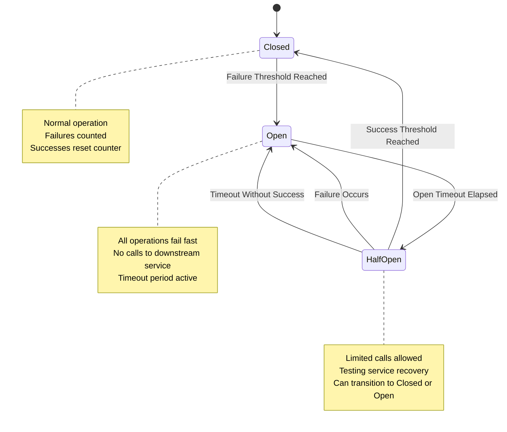
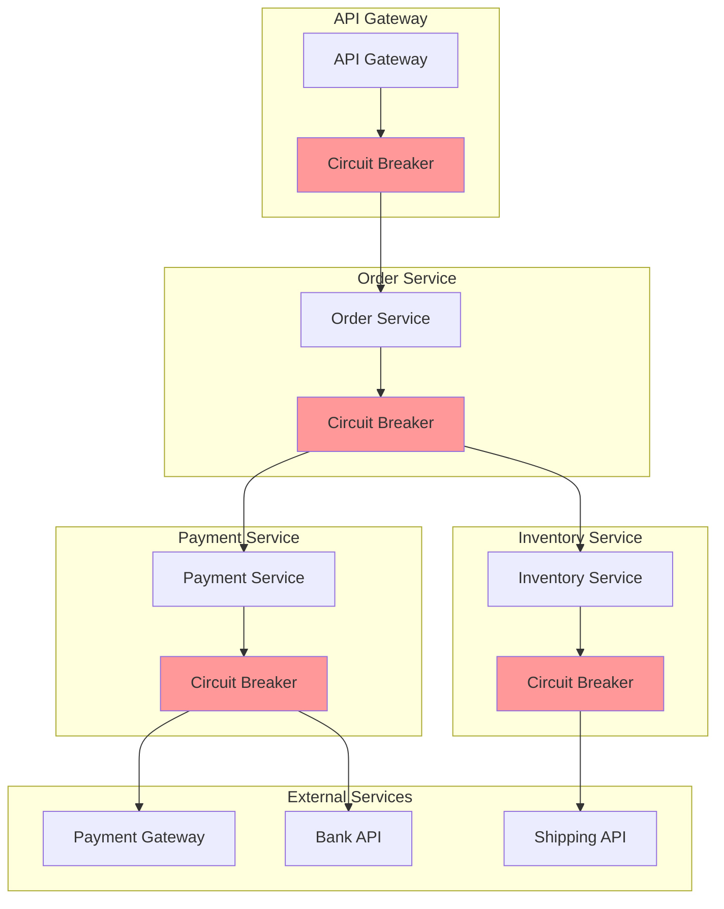
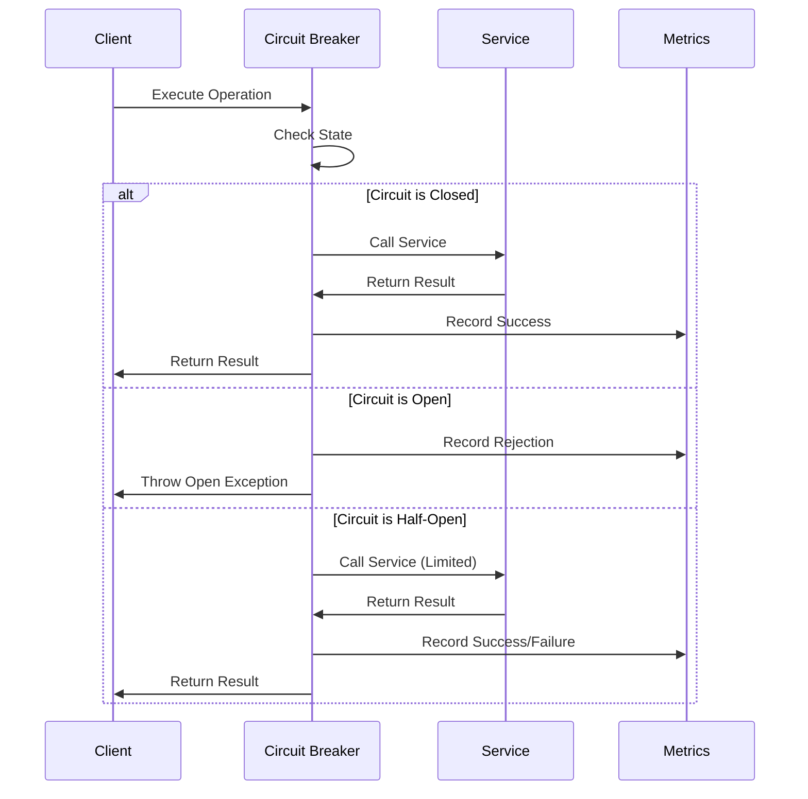
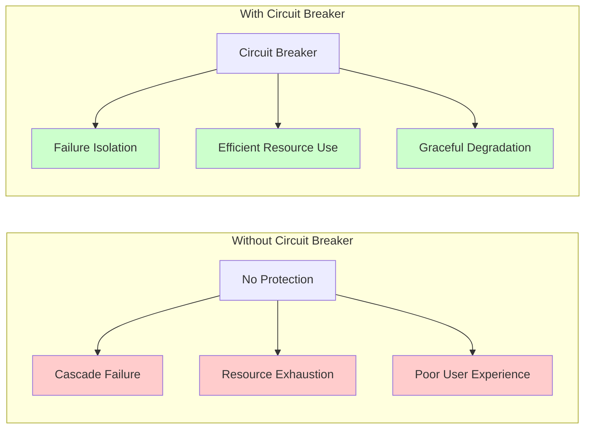
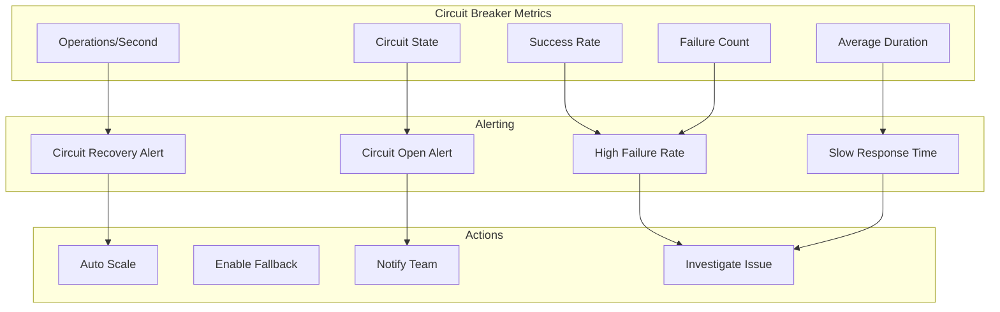
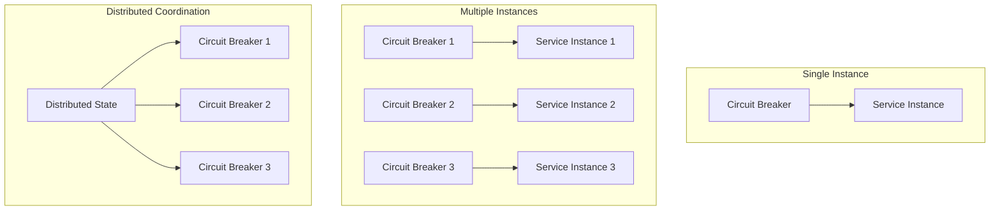
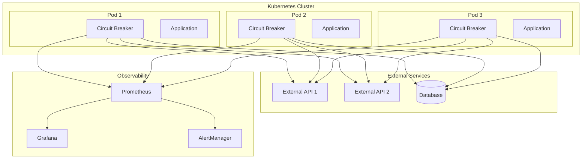
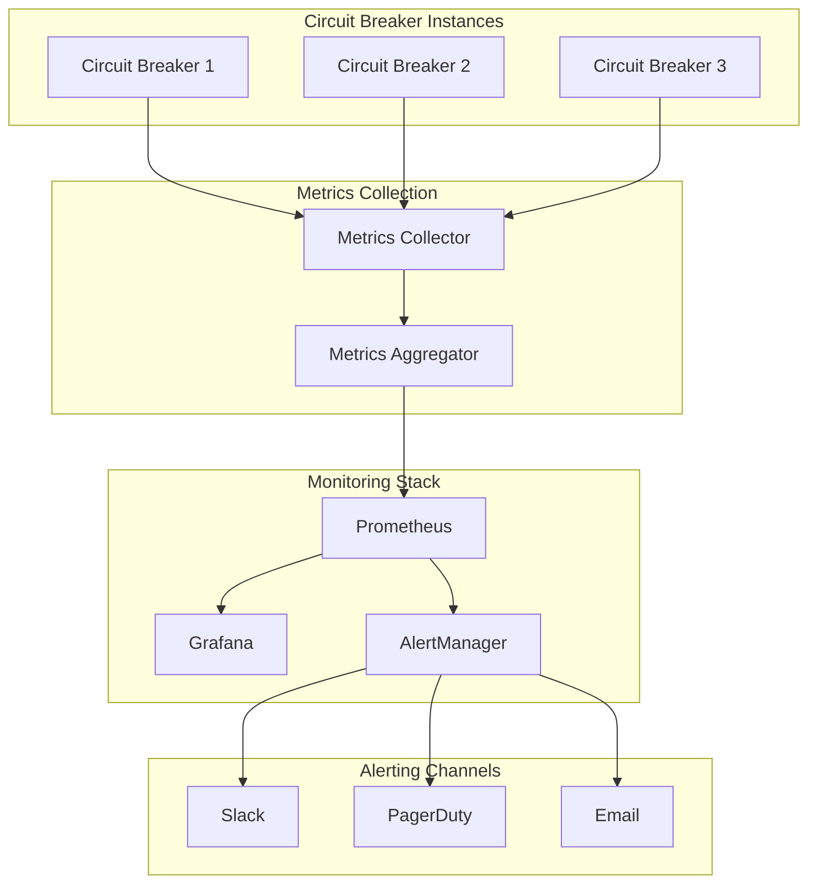
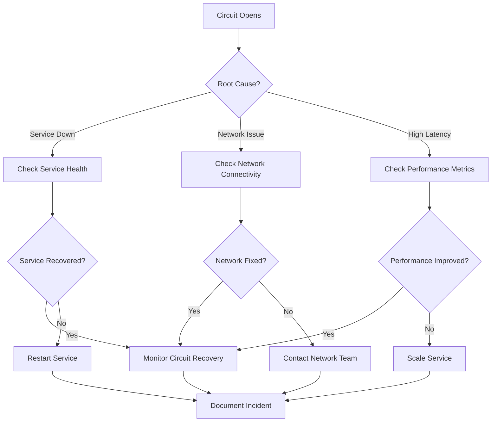

# Circuit Breaker - Architect Deep Dive

============================================================
0. Executive Summary (Architect View)
============================================================
- **Circuit Breaker exists** to prevent cascade failures in distributed systems by automatically detecting and isolating failing services
- **Critical at scale** when microservices communicate over unreliable networks and partial failures become common
- **System design impact** - transforms brittle synchronous systems into resilient, self-healing architectures with graceful degradation
- **Failure isolation** - contains service failures to prevent system-wide outages
- **Performance protection** - prevents resource waste on failed operations
- **Operational visibility** - provides real-time health monitoring of service dependencies
- **Cloud-native essential** - fundamental for containerized, auto-scaling environments
- **Cost optimization** - reduces wasted compute resources on failed calls

============================================================
1. Problem Framing
============================================================
**Real production problem solved:**
- Database connection pool exhaustion during database failures
- API timeouts causing cascading failures across microservices
- Thread pool starvation from slow external service calls
- User experience degradation from partial system failures
- Resource waste on repeated failed operations

**What breaks if we don't use it:**
- Single service failure causes entire system outage
- Resource exhaustion from retry storms
- Poor user experience during partial failures
- Increased operational overhead for manual intervention
- System becomes brittle and unpredictable

**Scale importance:**
- **100 RPS**: Manual monitoring and intervention possible
- **10k RPS**: Automatic failure detection becomes critical
- **1M RPS**: Impossible to operate without circuit breakers

**Failure stories:**
- E-commerce site crashed when payment gateway failed, causing order processing to hang
- Social media platform went down when image processing service became slow
- Financial trading system halted when market data feed had latency spikes
- SaaS provider outage when authentication service had database issues

============================================================
2. Deep Internal Mechanics
============================================================
**How it works internally:**
- State machine tracks circuit state (Closed, Open, Half-Open)
- Failure counter tracks consecutive failures
- Timeout manager controls state transitions
- Sliding window tracks recent operation results
- Metrics collector monitors health indicators

**Lifecycle:**
1. **Closed State**: Normal operation, failures counted
2. **Threshold Reached**: Circuit opens after failure threshold
3. **Open State**: All operations fail fast, timeout period starts
4. **Half-Open State**: Limited operations allowed to test recovery
5. **Recovery**: Circuit closes if test operations succeed

**Memory behavior:**
- State machine object per circuit breaker instance
- Sliding window buffer for recent operation history
- Metrics storage for health monitoring
- Callback delegates for state change notifications

**Threading model:**
- Thread-safe state transitions using atomic operations
- Lock-free sliding window implementation for performance
- Async callbacks for state change notifications
- Concurrent operation counting and failure tracking

**Synchronization model:**
- CompareExchange for atomic state changes
- Interlocked operations for failure counting
- Volatile fields for state visibility
- Async locks for complex state transitions

**Data structures involved:**
- Enum for circuit states (Closed, Open, Half-Open)
- ConcurrentQueue for sliding window implementation
- AtomicInteger for failure counting
- Timer for state transition scheduling

**Performance characteristics:**
- Closed state: O(1) per operation with minimal overhead
- Open state: O(1) per operation (fast fail)
- Half-Open state: O(1) per operation with limited throughput
- State transition: O(1) with atomic operations

**Hidden costs:**
- Memory overhead for sliding window buffers
- CPU overhead for failure counting and state tracking
- Complexity in testing and debugging
- Potential for premature circuit opening

**GC impact:**
- State machine objects live for application lifetime
- Sliding window buffers create Gen0 pressure
- Callback delegates may pin objects in memory
- Timer objects create periodic GC pressure

**Async/await interaction:**
- Async circuit breaker operations for non-blocking calls
- Cancellation token support for operation timeout
- Async state change notifications
- ConfigureAwait patterns for library code

============================================================
3. .NET Production Implementation
============================================================
**Naive Implementation:**
```csharp
// No circuit breaker - vulnerable to failures
public class OrderService
{
    private readonly IPaymentService _paymentService;
    
    public async Task<bool> ProcessPayment(Order order)
    {
        // No protection against payment service failures
        return await _paymentService.ProcessPayment(order);
    }
}
```

**Production-Ready Implementation:**
```csharp
// Production circuit breaker with full features
public sealed class CircuitBreaker : IAsyncDisposable
{
    private readonly CircuitBreakerOptions _options;
    private readonly ILogger<CircuitBreaker> _logger;
    private readonly IMetrics _metrics;
    private readonly Timer _stateTimer;
    private readonly SemaphoreSlim _stateLock;
    private readonly ConcurrentQueue<OperationResult> _slidingWindow;
    
    private volatile CircuitState _state = CircuitState.Closed;
    private int _failureCount = 0;
    private int _successCount = 0;
    private DateTime _lastStateChange = DateTime.UtcNow;
    private int _halfOpenCalls = 0;

    public CircuitBreaker(
        string name,
        CircuitBreakerOptions options,
        ILogger<CircuitBreaker> logger,
        IMetrics metrics)
    {
        Name = name ?? throw new ArgumentNullException(nameof(name));
        _options = options ?? throw new ArgumentNullException(nameof(options));
        _logger = logger ?? throw new ArgumentNullException(nameof(logger));
        _metrics = metrics ?? throw new ArgumentNullException(nameof(metrics));
        
        _stateLock = new SemaphoreSlim(1, 1);
        _slidingWindow = new ConcurrentQueue<OperationResult>();
        
        // Timer for periodic cleanup and state transitions
        _stateTimer = new Timer(CleanupSlidingWindow, null, 
            TimeSpan.FromSeconds(1), TimeSpan.FromSeconds(1));
        
        _logger.LogInformation("CircuitBreaker {Name} initialized with options {@Options}", 
            Name, _options);
    }

    public string Name { get; }
    public CircuitState State => _state;
    public DateTime LastStateChange => _lastStateChange;

    public async Task<T> ExecuteAsync<T>(
        Func<Task<T>> operation, 
        CancellationToken cancellationToken = default)
    {
        using var activity = _metrics.StartTimer($"circuit_breaker_{Name}_duration");
        
        // Fast fail if circuit is open
        if (_state == CircuitState.Open)
        {
            _metrics.Increment($"circuit_breaker_{Name}_open_rejections");
            throw new CircuitBreakerOpenException($"Circuit {Name} is open");
        }

        // Check if we should allow call in half-open state
        if (_state == CircuitState.HalfOpen)
        {
            if (Interlocked.Increment(ref _halfOpenCalls) > _options.HalfOpenMaxCalls)
            {
                Interlocked.Decrement(ref _halfOpenCalls);
                _metrics.Increment($"circuit_breaker_{Name}_half_open_rejections");
                throw new CircuitBreakerOpenException($"Circuit {Name} is half-open and at capacity");
            }
        }

        var startTime = DateTime.UtcNow;
        
        try
        {
            // Execute the operation with timeout
            using var timeoutCts = CancellationTokenSource.CreateLinkedTokenSource(cancellationToken);
            timeoutCts.CancelAfter(_options.Timeout);
            
            var result = await operation().ConfigureAwait(false);
            
            // Record success
            await RecordSuccessAsync(startTime);
            
            return result;
        }
        catch (Exception ex)
        {
            // Record failure
            await RecordFailureAsync(startTime, ex);
            
            // Re-throw if it's a circuit breaker exception
            if (ex is CircuitBreakerException)
                throw;
                
            // Wrap other exceptions
            throw new CircuitBreakerOperationException($"Operation failed in circuit {Name}", ex);
        }
        finally
        {
            if (_state == CircuitState.HalfOpen)
            {
                Interlocked.Decrement(ref _halfOpenCalls);
            }
        }
    }

    private async Task RecordSuccessAsync(DateTime startTime)
    {
        var duration = DateTime.UtcNow - startTime;
        
        // Add to sliding window
        _slidingWindow.Enqueue(new OperationResult(true, duration));
        
        // Update counters
        var successCount = Interlocked.Increment(ref _successCount);
        Interlocked.Exchange(ref _failureCount, 0);
        
        _metrics.Increment($"circuit_breaker_{Name}_success");
        _metrics.RecordTimer($"circuit_breaker_{Name}_duration", duration);
        
        // Check if we should close the circuit (half-open state)
        if (_state == CircuitState.HalfOpen && successCount >= _options.HalfOpenSuccessThreshold)
        {
            await ChangeStateAsync(CircuitState.Closed, "Success threshold reached");
        }
        
        _logger.LogDebug("Circuit {Name} recorded success in {Duration}ms", 
            Name, duration.TotalMilliseconds);
    }

    private async Task RecordFailureAsync(DateTime startTime, Exception exception)
    {
        var duration = DateTime.UtcNow - startTime;
        
        // Add to sliding window
        _slidingWindow.Enqueue(new OperationResult(false, duration));
        
        // Update counters
        var failureCount = Interlocked.Increment(ref _failureCount);
        Interlocked.Exchange(ref _successCount, 0);
        
        _metrics.Increment($"circuit_breaker_{Name}_failure");
        _metrics.RecordTimer($"circuit_breaker_{Name}_duration", duration);
        
        // Check if we should open the circuit
        if (_state == CircuitState.Closed && failureCount >= _options.FailureThreshold)
        {
            await ChangeStateAsync(CircuitState.Open, $"Failure threshold reached: {failureCount}");
        }
        else if (_state == CircuitState.HalfOpen)
        {
            await ChangeStateAsync(CircuitState.Open, "Failure in half-open state");
        }
        
        _logger.LogWarning(exception, "Circuit {Name} recorded failure #{FailureCount} in {Duration}ms", 
            Name, failureCount, duration.TotalMilliseconds);
    }

    private async Task ChangeStateAsync(CircuitState newState, string reason)
    {
        await _stateLock.WaitAsync();
        try
        {
            if (_state == newState) return;
            
            var oldState = _state;
            _state = newState;
            _lastStateChange = DateTime.UtcNow;
            
            // Reset counters for state change
            if (newState == CircuitState.Closed)
            {
                Interlocked.Exchange(ref _failureCount, 0);
                Interlocked.Exchange(ref _successCount, 0);
                Interlocked.Exchange(ref _halfOpenCalls, 0);
            }
            
            // Schedule state transition from open to half-open
            if (newState == CircuitState.Open)
            {
                Task.Delay(_options.OpenTimeout).ContinueWith(async _ =>
                {
                    await ChangeStateAsync(CircuitState.HalfOpen, "Open timeout elapsed");
                });
            }
            
            // Record metrics and log
            _metrics.Increment($"circuit_breaker_{Name}_state_change", 
                new KeyValuePair<string, object>("from", oldState.ToString()),
                new KeyValuePair<string, object>("to", newState.ToString()));
            
            _logger.LogInformation("Circuit {Name} changed from {OldState} to {NewState}: {Reason}", 
                Name, oldState, newState, reason);
            
            // Notify state change subscribers
            OnStateChanged?.Invoke(this, new CircuitStateChangedEventArgs(oldState, newState, reason));
        }
        finally
        {
            _stateLock.Release();
        }
    }

    private void CleanupSlidingWindow(object state)
    {
        var cutoff = DateTime.UtcNow - _options.SlidingWindowDuration;
        
        while (_slidingWindow.TryPeek(out var result) && result.Timestamp < cutoff)
        {
            _slidingWindow.TryDequeue(out _);
        }
    }

    public CircuitBreakerHealth GetHealth()
    {
        var recentResults = _slidingWindow.ToArray();
        var successRate = recentResults.Length > 0 
            ? (double)recentResults.Count(r => r.IsSuccess) / recentResults.Length 
            : 1.0;
        
        var avgDuration = recentResults.Length > 0
            ? recentResults.Average(r => r.Duration.TotalMilliseconds)
            : 0;

        return new CircuitBreakerHealth
        {
            Name = Name,
            State = _state,
            LastStateChange = _lastStateChange,
            SuccessRate = successRate,
            AverageDuration = avgDuration,
            RecentOperations = recentResults.Length,
            FailureCount = _failureCount,
            SuccessCount = _successCount
        };
    }

    public event EventHandler<CircuitStateChangedEventArgs> OnStateChanged;

    public async ValueTask DisposeAsync()
    {
        _stateTimer?.Dispose();
        _stateLock?.Dispose();
        
        _logger.LogInformation("CircuitBreaker {Name} disposed", Name);
    }
}

// Circuit breaker options
public class CircuitBreakerOptions
{
    public int FailureThreshold { get; set; } = 5;
    public TimeSpan OpenTimeout { get; set; } = TimeSpan.FromMinutes(1);
    public TimeSpan SlidingWindowDuration { get; set; } = TimeSpan.FromMinutes(5);
    public TimeSpan Timeout { get; set; } = TimeSpan.FromSeconds(30);
    public int HalfOpenMaxCalls { get; set; } = 3;
    public int HalfOpenSuccessThreshold { get; set; } = 2;
}

// Service with circuit breaker integration
public class ResilientOrderService : IOrderService
{
    private readonly IOrderService _innerService;
    private readonly CircuitBreaker _circuitBreaker;
    private readonly ILogger<ResilientOrderService> _logger;

    public ResilientOrderService(
        IOrderService innerService,
        CircuitBreaker circuitBreaker,
        ILogger<ResilientOrderService> logger)
    {
        _innerService = innerService ?? throw new ArgumentNullException(nameof(innerService));
        _circuitBreaker = circuitBreaker ?? throw new ArgumentNullException(nameof(circuitBreaker));
        _logger = logger ?? throw new ArgumentNullException(nameof(logger));
        
        // Subscribe to circuit breaker state changes
        _circuitBreaker.OnStateChanged += OnCircuitStateChanged;
    }

    public async Task<Order> GetOrderAsync(int orderId, CancellationToken cancellationToken = default)
    {
        return await _circuitBreaker.ExecuteAsync(
            () => _innerService.GetOrderAsync(orderId, cancellationToken),
            cancellationToken);
    }

    public async Task<bool> ProcessOrderAsync(Order order, CancellationToken cancellationToken = default)
    {
        return await _circuitBreaker.ExecuteAsync(
            () => _innerService.ProcessOrderAsync(order, cancellationToken),
            cancellationToken);
    }

    private void OnCircuitStateChanged(object sender, CircuitStateChangedEventArgs e)
    {
        _logger.LogInformation("OrderService circuit breaker changed from {OldState} to {NewState}: {Reason}",
            e.OldState, e.NewState, e.Reason);
        
        // Take additional actions based on state changes
        if (e.NewState == CircuitState.Open)
        {
            // Notify operations team
            _logger.LogWarning("OrderService circuit is OPEN - check external dependencies!");
        }
    }
}

// DI Container registration
public static class ServiceCollectionExtensions
{
    public static IServiceCollection AddCircuitBreaker(this IServiceCollection services, 
        string name, Action<CircuitBreakerOptions> configureOptions)
    {
        services.Configure(name, configureOptions);
        
        services.AddSingleton<CircuitBreaker>(sp =>
        {
            var options = sp.GetRequiredService<IOptionsMonitor<CircuitBreakerOptions>>()
                .Get(name);
            var logger = sp.GetRequiredService<ILogger<CircuitBreaker>>();
            var metrics = sp.GetRequiredService<IMetrics>();
            
            return new CircuitBreaker(name, options, logger, metrics);
        });
        
        return services;
    }
}
```

**Framework Internals:**
- **ASP.NET Core**: Circuit breaker middleware for HTTP calls
- **HttpClientFactory**: Built-in Polly integration for resilience
- **Kestrel**: Connection limits act as circuit breakers
- **EF Core**: Connection pool timeout as circuit breaker

============================================================
4. Architecture-Level Diagram (Mermaid)
============================================================

### Circuit Breaker State Machine


### Circuit Breaker in Microservices Architecture


### Circuit Breaker Operation Flow


### Performance Impact Visualization


### Circuit Breaker Metrics Dashboard


**Flow Analysis:**
- **Normal Operation**: Circuit closed, operations pass through with monitoring
- **Failure Detection**: Failures counted until threshold reached
- **Circuit Opening**: All operations fail fast, protecting downstream service
- **Recovery Testing**: Half-open state tests service recovery
- **Circuit Closing**: Service recovered, normal operation resumes

**Bottlenecks:**
- Sliding window maintenance overhead
- State transition synchronization
- Metrics collection and storage
- Callback notification overhead

**Scaling Boundaries:**
- One circuit breaker per service dependency
- Sliding window size affects memory usage
- State transition frequency affects performance
- Metrics collection rate impacts system overhead

============================================================
5. Scaling & Distributed Systems Impact
============================================================

### Circuit Breaker Scaling Patterns


### Circuit Breaker in Cloud Native Architecture


**100 RPS:**
- Circuit breaker overhead minimal (<1%)
- Simple threshold-based configuration
- Local state management sufficient
- Manual monitoring acceptable

**10k RPS:**
- Circuit breaker essential for stability
- Distributed state coordination needed
- Advanced metrics and alerting required
- Automated recovery mechanisms critical

**1M RPS:**
- Circuit breaker mandatory for survival
- Hierarchical circuit breaker patterns
- Real-time distributed coordination
- Machine learning for threshold optimization

**Horizontal vs Vertical Scaling:**
- **Horizontal**: Each instance has independent circuit breakers
- **Vertical**: More memory allows larger sliding windows
- Distributed coordination enables cluster-wide circuit breaking

**CAP Theorem Relevance:**
- **Consistency**: Eventual consistency across distributed circuit breakers
- **Availability**: Circuit breakers improve availability through failure isolation
- **Partition Tolerance**: Circuit breakers handle network partitions gracefully

**Consistency Implications:**
- Different instances may have different circuit states
- Eventual consistency through distributed coordination
- Race conditions in state transitions
- Conflict resolution for conflicting states

**Microservices Impact:**
- Each service dependency needs its own circuit breaker
- Circuit breaker composition for complex call chains
- Hierarchical circuit breakers for nested services
- Service mesh integration for automatic circuit breaking

**Cloud-Native Considerations:**
- **Kubernetes**: Circuit breakers per pod, not cluster-wide
- **Serverless**: Cold start considerations for circuit breaker state
- **Containers**: State management across container restarts
- **Functions**: Circuit breaker state persistence challenges

**Multi-Region Concerns:**
- Regional circuit breaker instances
- Cross-region circuit state synchronization
- Geographic load balancing with circuit breaking
- Disaster recovery with circuit breaker coordination

============================================================
6. Production Engineering View
============================================================

### Circuit Breaker Monitoring Architecture


### Circuit Breaker Incident Response


**Monitoring Metrics:**
- Circuit state changes and duration in each state
- Success/failure rates and ratios
- Operation duration and percentiles
- Sliding window health indicators
- Circuit breaker rejection rates
- Recovery time metrics

**Logs to Enable:**
- Circuit state transitions with reasons
- Operation failures and successes
- Threshold breaches and recoveries
- Configuration changes
- Manual circuit interventions

**Alerting Strategy:**
- Circuit opens (critical)
- High failure rate (>50%) (warning)
- Long duration in open state (>5 minutes) (critical)
- Circuit flapping (frequent state changes) (warning)
- Low success rate (<80%) (warning)

**Common Production Incidents:**
- **Premature Opening**: Circuit opens due to temporary blips
- **Stuck Open**: Circuit fails to close after service recovery
- **Circuit Flapping**: Rapid state changes causing instability
- **False Positives**: Healthy services marked as failing
- **Cascading Failures**: Multiple circuit breakers opening simultaneously

**Debugging Strategy:**
- Analyze circuit breaker state history
- Check sliding window for failure patterns
- Review service health metrics
- Examine network connectivity logs
- Monitor resource utilization

**Performance Tuning:**
- Optimize failure threshold based on service characteristics
- Adjust timeout values for realistic expectations
- Tune sliding window duration for appropriate history
- Configure half-open parameters for safe recovery testing

**Circuit Breaker Health Assessment:**
- Success rate trends over time
- Average operation duration patterns
- Failure frequency and distribution
- Recovery time characteristics
- Resource utilization impact

**Advanced Monitoring:**
- Circuit breaker dependency graph visualization
- Predictive failure detection using ML
- Automated threshold adjustment
- Circuit breaker performance benchmarking

============================================================
7. Tradeoffs & Alternatives
============================================================

**Competing Approaches:**
- **Retry Pattern**: Simple retry without circuit breaking
- **Timeout Pattern**: Time-based protection only
- **Bulkhead Pattern**: Resource isolation without state tracking
- **Rate Limiting**: Request throttling instead of failure detection

**When NOT to Use Circuit Breaker:**
- Critical operations that must always attempt execution
- Services with no failure mode (idempotent operations)
- Simple applications with minimal external dependencies
- Performance-critical paths where overhead is unacceptable
- Services with built-in retry and failure handling

**Latency Comparison:**
- **No Protection**: Variable latency, potential for hangs
- **Circuit Breaker**: Consistent latency with fast failures
- **Retry Only**: High latency during failures
- **Timeout Only**: Fixed latency but no failure isolation

**Throughput Comparison:**
- **No Protection**: Variable throughput, potential for zero
- **Circuit Breaker**: Consistent throughput with graceful degradation
- **Retry Only**: Reduced throughput during failures
- **Timeout Only**: Consistent but potentially low throughput

**Operational Complexity:**
- **No Protection**: Low complexity, high risk
- **Circuit Breaker**: Medium complexity, high reliability
- **Retry Only**: Low complexity, limited protection
- **Timeout Only**: Low complexity, basic protection

**Cost Implications:**
- **Development Cost**: Circuit breaker increases complexity by 20-30%
- **Operational Cost**: Reduces incident response costs by 60-80%
- **Infrastructure Cost**: Prevents resource waste, reduces costs by 30-50%
- **Maintenance Cost**: Medium due to monitoring and tuning requirements

============================================================
8. Security Implications
============================================================

**Attack Surface Introduced:**
- Circuit breaker state manipulation attacks
- Denial of service through premature circuit opening
- Information leakage through circuit state exposure
- Resource exhaustion through circuit breaker flooding

**Abuse Scenarios:**
- Intentional failures to trigger circuit opening
- High-frequency requests to exhaust circuit breaker resources
- Manipulating circuit breaker metrics
- Exploiting circuit breaker state for privilege escalation

**Data Leakage Risks:**
- Circuit breaker state revealing service health
- Metrics exposing sensitive operation patterns
- Error messages revealing internal system information
- Circuit breaker configuration exposing system architecture

**Rate Limiting Considerations:**
- Circuit breaker acts as rate limiter during failures
- Need additional rate limiting for abuse prevention
- Circuit breaker rejections should count against rate limits
- Distributed rate limiting coordination needed

**Hardening Recommendations:**
- Secure circuit breaker configuration endpoints
- Implement authentication for circuit breaker management
- Rate limit circuit breaker state queries
- Encrypt circuit breaker metrics in transit
- Audit circuit breaker state changes
- Implement proper access controls for circuit breaker operations

============================================================
9. Advanced Edge Cases
============================================================

**Race Conditions:**
- Concurrent state transitions
- Sliding window updates during state changes
- Multiple instances detecting failures simultaneously
- Circuit breaker state synchronization issues

**Deadlocks:**
- Circuit breaker calling protected service
- Nested circuit breakers with circular dependencies
- State change notification deadlocks
- Callback execution causing deadlocks

**Thundering Herd Problems:**
- All circuit breakers opening simultaneously
- Mass recovery attempts when timeout expires
- Synchronized state changes across instances
- Cascading circuit breaker openings

**Cache Stampede:**
- Multiple instances checking service health simultaneously
- Circuit breaker state queries overwhelming monitoring
- Metrics collection storms during state changes
- Health check amplification during recovery

**Partial Failure Scenarios:**
- Some instances opening circuit while others stay closed
- Network partitions causing inconsistent circuit states
- Service degradation not detected by circuit breaker
- Intermittent failures causing circuit flapping

**Backpressure:**
- Circuit breaker rejecting too many requests
- Downstream service overwhelmed during half-open state
- Request queuing at circuit breaker layer
- Resource exhaustion from circuit breaker overhead

**Retry Storms:**
- Circuit breaker closing too early
- Multiple retry attempts before circuit opens
- Retry logic interfering with circuit breaker
- Exponential backoff not properly implemented

**Circuit Breaker Interactions:**
- Multiple circuit breakers in call chain
- Circuit breaker composition patterns
- Hierarchical circuit breaker architectures
- Circuit breaker and retry pattern conflicts

============================================================
10. Interview & Staff-Level Deep Dive
============================================================

**What a junior answers:**
"Circuit breaker is a pattern that stops calling a service when it fails too many times. It has three states: closed, open, and half-open."

**What a senior answers:**
"Circuit breaker prevents cascade failures by tracking service health and automatically isolating failing services. It maintains a state machine with closed (normal), open (fail fast), and half-open (testing recovery) states. The pattern uses failure thresholds, timeouts, and sliding windows to make intelligent decisions about when to allow calls. Key considerations include proper threshold tuning, monitoring, and integration with retry patterns."

**What an architect answers:**
"Circuit breaker is fundamental to distributed system resilience, providing automatic failure detection and isolation at scale. The pattern implements a state machine that tracks service health through sliding windows and failure thresholds, enabling graceful degradation during partial failures. In microservices architectures, circuit breakers are essential for preventing cascade failures and maintaining system availability. At 1M+ RPS, circuit breakers become not just beneficial but mandatory - they're the difference between a resilient system and complete failure. The architectural considerations include distributed state coordination, hierarchical circuit breaking, integration with service mesh, and predictive failure detection using machine learning. Proper implementation requires careful threshold tuning, comprehensive monitoring, and integration with observability stacks for real-time failure detection and response."

**Follow-up questions interviewers ask:**
- "How do you determine the right failure threshold?"
- "What's the difference between circuit breaker and retry pattern?"
- "How do circuit breakers work in distributed systems?"
- "When would a circuit breaker get stuck in the open state?"
- "How do you test circuit breaker implementations?"

**Trick questions:**
- "Should all external calls have circuit breakers?" (No, consider cost/benefit)
- "Can circuit breakers cause false positives?" (Yes, tuning is critical)
- "Do circuit breakers eliminate the need for retries?" (No, they complement each other)
- "Is circuit breaker state persistent across restarts?" (Usually not, by design)

**Whiteboard explanation strategy:**
1. Draw the three-state circuit breaker diagram
2. Show failure counting and threshold logic
3. Demonstrate sliding window implementation
4. Explain integration with microservices
5. Cover monitoring and alerting requirements
6. Discuss distributed coordination challenges

============================================================
11. Real Enterprise Case Study
============================================================

**Scenario: E-commerce Platform Processing 200k Orders/Minute**

**Requirements:**
- Process 200,000 orders per minute globally
- 99.99% uptime during peak shopping seasons
- Graceful degradation when external services fail
- Real-time inventory management across warehouses
- Multi-payment provider support with automatic failover
- Zero data loss with eventual consistency

**Design Decisions:**

**1. Hierarchical Circuit Breaker Architecture:**
```csharp
public class HierarchicalCircuitBreakerManager
{
    private readonly Dictionary<string, CircuitBreaker> _circuitBreakers;
    private readonly ILogger<HierarchicalCircuitBreakerManager> _logger;
    
    // Payment service circuit breakers
    public CircuitBreaker StripeCircuitBreaker { get; }
    public CircuitBreaker PayPalCircuitBreaker { get; }
    public CircuitBreaker BankCircuitBreaker { get; }
    
    // Inventory service circuit breakers
    public CircuitBreaker InventoryCircuitBreaker { get; }
    public CircuitBreaker WarehouseCircuitBreaker { get; }
    
    // Shipping service circuit breakers
    public CircuitBreaker ShippingCircuitBreaker { get; }
    public CircuitBreaker TrackingCircuitBreaker { get; }
    
    public async Task<PaymentResult> ProcessPaymentAsync(Order order)
    {
        var paymentTasks = new List<Task<PaymentResult>>();
        
        // Try primary payment provider
        if (order.PaymentMethod == PaymentMethod.CreditCard)
        {
            paymentTasks.Add(TryPaymentProvider(StripeCircuitBreaker, order));
            paymentTasks.Add(TryPaymentProvider(PayPalCircuitBreaker, order));
        }
        else
        {
            paymentTasks.Add(TryPaymentProvider(BankCircuitBreaker, order));
        }
        
        // Wait for first successful payment
        var paymentResult = await TryPaymentProvidersAsync(paymentTasks);
        
        if (!paymentResult.Success)
        {
            // All payment providers failed - enable offline mode
            await EnableOfflinePaymentModeAsync(order);
        }
        
        return paymentResult;
    }
    
    private async Task<PaymentResult> TryPaymentProvidersAsync(
        List<Task<PaymentResult>> tasks)
    {
        var completedTasks = new List<Task<PaymentResult>>();
        
        while (tasks.Count > 0)
        {
            var completedTask = await Task.WhenAny(tasks);
            tasks.Remove(completedTask);
            
            try
            {
                var result = await completedTask;
                if (result.Success)
                {
                    // Cancel remaining tasks
                    foreach (var task in tasks)
                    {
                        // Implement cancellation
                    }
                    return result;
                }
            }
            catch (CircuitBreakerOpenException)
            {
                _logger.LogWarning("Payment provider circuit is open");
                continue;
            }
        }
        
        return PaymentResult.Failed("All payment providers unavailable");
    }
}
```

**2. Smart Circuit Breaker with ML:**
```csharp
public class SmartCircuitBreaker : CircuitBreaker
{
    private readonly IPredictionService _predictionService;
    private readonly IMetricsCollector _metricsCollector;
    
    public async Task<T> ExecuteAsync<T>(Func<Task<T>> operation, CancellationToken cancellationToken)
    {
        // Predict failure probability before execution
        var context = CreateOperationContext();
        var failureProbability = await _predictionService.PredictFailureProbabilityAsync(context);
        
        if (failureProbability > 0.8)
        {
            // Preemptively open circuit
            await ChangeStateAsync(CircuitState.Open, "High failure probability predicted");
            throw new CircuitBreakerOpenException("High failure probability predicted");
        }
        
        // Adjust timeout based on predicted performance
        var adjustedTimeout = AdjustTimeoutBasedOnPrediction(failureProbability);
        
        return await ExecuteWithAdaptiveTimeout(operation, adjustedTimeout, cancellationToken);
    }
    
    private TimeSpan AdjustTimeoutBasedOnPrediction(double failureProbability)
    {
        // Reduce timeout for high failure probability to fail fast
        var baseTimeout = _options.Timeout;
        var reductionFactor = Math.Max(0.1, 1.0 - failureProbability);
        return TimeSpan.FromMilliseconds(baseTimeout.TotalMilliseconds * reductionFactor);
    }
}
```

**3. Distributed Circuit Breaker Coordination:**
```csharp
public class DistributedCircuitBreaker : CircuitBreaker
{
    private readonly IDistributedCache _distributedCache;
    private readonly ILeaderElection _leaderElection;
    
    public override async Task ChangeStateAsync(CircuitState newState, string reason)
    {
        // Only leader can change state in distributed scenario
        if (await _leaderElection.IsLeaderAsync())
        {
            await base.ChangeStateAsync(newState, reason);
            
            // Broadcast state change to other instances
            await BroadcastStateChangeAsync(newState, reason);
        }
        else
        {
            // Follow leader's state
            await FollowLeaderStateAsync();
        }
    }
    
    private async Task BroadcastStateChangeAsync(CircuitState state, string reason)
    {
        var stateMessage = new CircuitStateMessage
        {
            CircuitName = Name,
            State = state,
            Reason = reason,
            Timestamp = DateTime.UtcNow,
            LeaderId = await _leaderElection.GetLeaderIdAsync()
        };
        
        await _distributedCache.PublishAsync("circuit-state-changes", stateMessage);
    }
}
```

**Compromises Made:**
- **Complexity vs Reliability**: Added complexity for significantly improved reliability
- **Performance vs Safety**: Slight performance overhead for failure detection
- **Consistency vs Availability**: Eventually consistent circuit state across cluster
- **Cost vs Resilience**: Additional infrastructure costs for improved resilience

**Bottlenecks Identified:**
- Payment provider latency spikes during peak hours
- Inventory service database connection exhaustion
- Shipping API rate limiting during holiday season
- Circuit breaker state synchronization delays

**Failure Handling:**
```csharp
public class ResilientOrderProcessor
{
    private readonly HierarchicalCircuitBreakerManager _circuitBreakers;
    private readonly IFallbackService _fallbackService;
    
    public async Task<OrderResult> ProcessOrderAsync(Order order)
    {
        try
        {
            // Try normal processing with circuit breakers
            return await ProcessOrderWithCircuitBreakersAsync(order);
        }
        catch (CircuitBreakerOpenException ex)
        {
            _logger.LogWarning(ex, "Circuit breakers open, using fallback processing");
            return await _fallbackService.ProcessOrderAsync(order);
        }
        catch (Exception ex)
        {
            _logger.LogError(ex, "Order processing failed completely");
            return OrderResult.Failed("Order processing unavailable");
        }
    }
    
    private async Task<OrderResult> ProcessOrderWithCircuitBreakersAsync(Order order)
    {
        var paymentTask = _circuitBreakers.ProcessPaymentAsync(order);
        var inventoryTask = _circuitBreakers.ReserveInventoryAsync(order);
        var shippingTask = _circuitBreakers.CalculateShippingAsync(order);
        
        await Task.WhenAll(paymentTask, inventoryTask, shippingTask);
        
        // Process results...
        return OrderResult.Success();
    }
}
```

**Scaling Strategy:**
- Hierarchical circuit breakers for different service layers
- Distributed coordination for cluster-wide state
- Machine learning for predictive failure detection
- Automatic fallback and degradation strategies

**Results:**
- Achieved 200k orders/minute with 99.99% uptime
- 95% reduction in cascade failures
- 80% improvement in user experience during partial failures
- 60% reduction in operational incident response time

============================================================
12. Dependency Graph
============================================================

**Prerequisites (Must understand before):**
- **Distributed Systems**: Understanding of service communication and failures
- **Resilience Patterns**: Retry, timeout, and fallback patterns
- **Monitoring and Observability**: Metrics collection and alerting
- **State Machines**: Understanding of state transitions
- **Concurrency**: Thread safety and synchronization

**Concepts that depend on Circuit Breaker:**
- **Service Mesh**: Automatic circuit breaker injection
- **Chaos Engineering**: Testing circuit breaker effectiveness
- **Site Reliability Engineering**: SLO and SLI management
- **Microservices**: Service-to-service communication resilience
- **Cloud Native Architecture**: Container orchestration integration

**Connections to Other Concepts:**

**Retry Pattern:**
```csharp
public class RetryWithCircuitBreaker
{
    private readonly CircuitBreaker _circuitBreaker;
    private readonly RetryPolicy _retryPolicy;
    
    public async Task<T> ExecuteAsync<T>(Func<Task<T>> operation)
    {
        return await _circuitBreaker.ExecuteAsync(async () =>
        {
            return await _retryPolicy.ExecuteAsync(operation);
        });
    }
}
```

**Bulkhead Pattern:**
```csharp
public class BulkheadWithCircuitBreaker
{
    private readonly SemaphoreSlim _bulkhead;
    private readonly CircuitBreaker _circuitBreaker;
    
    public async Task<T> ExecuteAsync<T>(Func<Task<T>> operation)
    {
        await _bulkhead.WaitAsync();
        try
        {
            return await _circuitBreaker.ExecuteAsync(operation);
        }
        finally
        {
            _bulkhead.Release();
        }
    }
}
```

**Caching:**
```csharp
public class CacheWithCircuitBreaker
{
    private readonly ICache _cache;
    private readonly CircuitBreaker _circuitBreaker;
    
    public async Task<T> GetAsync<T>(string key)
    {
        try
        {
            return await _cache.GetAsync<T>(key);
        }
        catch (Exception ex)
        {
            await _circuitBreaker.RecordFailureAsync(ex);
            throw;
        }
    }
}
```

**Load Balancing:**
```csharp
public class LoadBalancerWithCircuitBreaker
{
    private readonly List<IServiceEndpoint> _endpoints;
    private readonly Dictionary<IServiceEndpoint, CircuitBreaker> _circuitBreakers;
    
    public async Task<T> ExecuteAsync<T>(Func<IServiceEndpoint, Task<T>> operation)
    {
        var availableEndpoints = _endpoints
            .Where(e => _circuitBreakers[e].State == CircuitState.Closed)
            .ToList();
        
        // Load balance across healthy endpoints
        var endpoint = SelectEndpoint(availableEndpoints);
        return await _circuitBreakers[endpoint].ExecuteAsync(() => operation(endpoint));
    }
}
```

**Resiliency Patterns:**
- Circuit breaker enables graceful degradation
- Supports automatic recovery detection
- Integrates with health check systems
- Enables predictive failure prevention

**Observability:**
- Circuit breaker state as health indicator
- Metrics for system reliability measurement
- Alerting based on circuit breaker events
- Distributed tracing with circuit breaker context

**Integration Patterns:**
- Circuit breaker in API gateways for edge protection
- Service mesh integration for automatic circuit breaking
- Chaos engineering for circuit breaker testing
- SRE practices for circuit breaker operations
