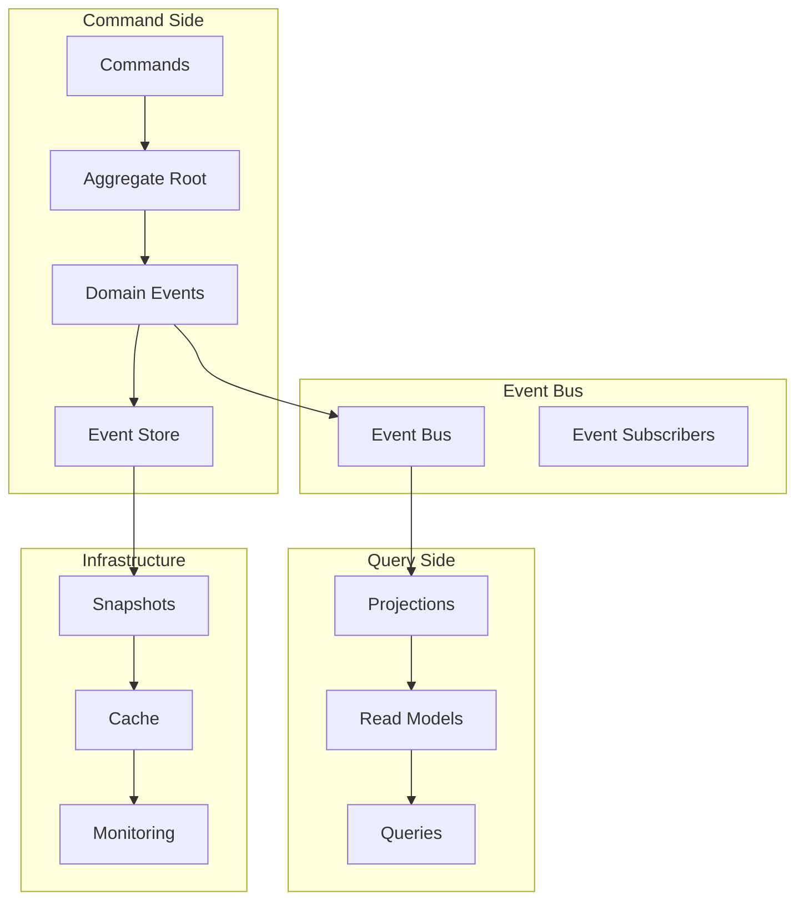
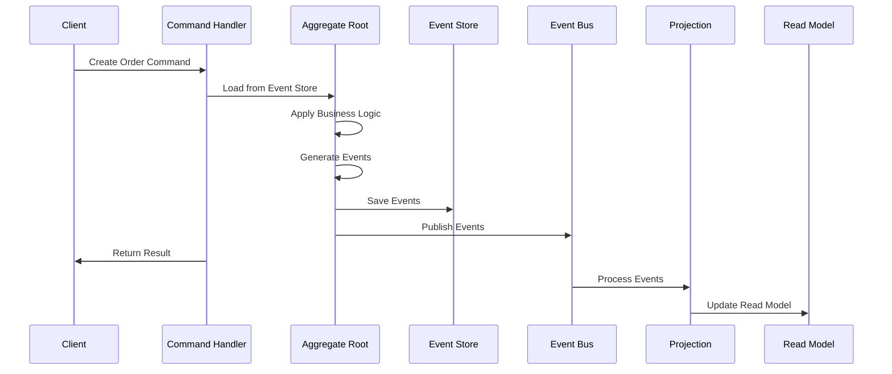
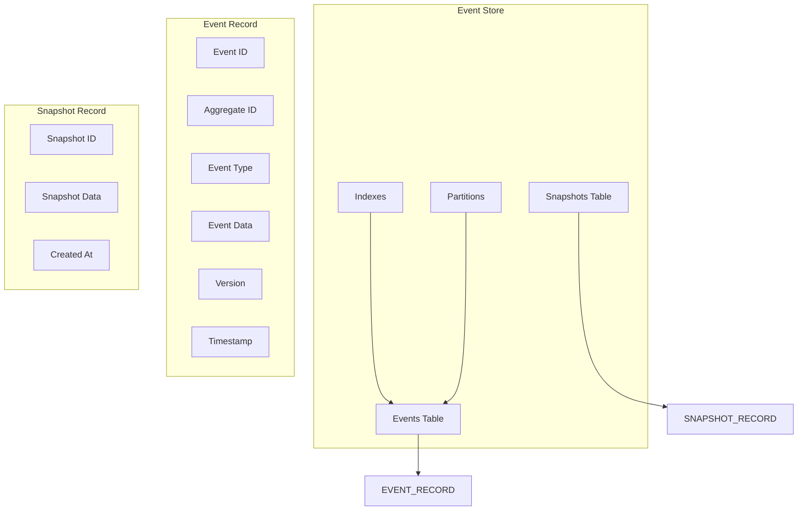
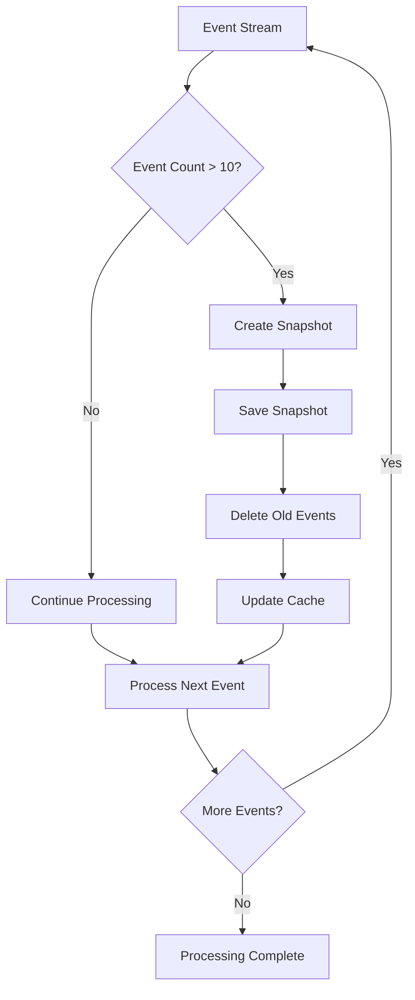
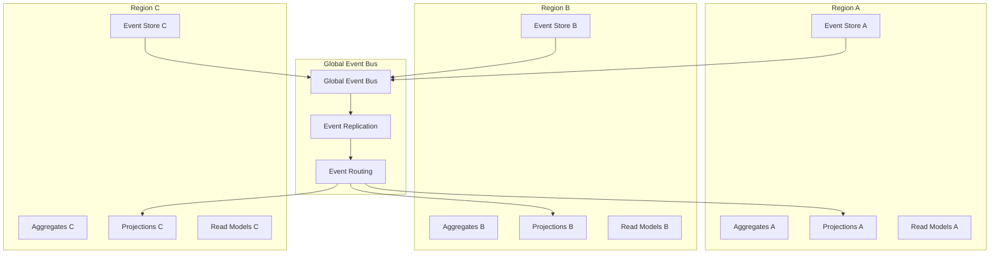
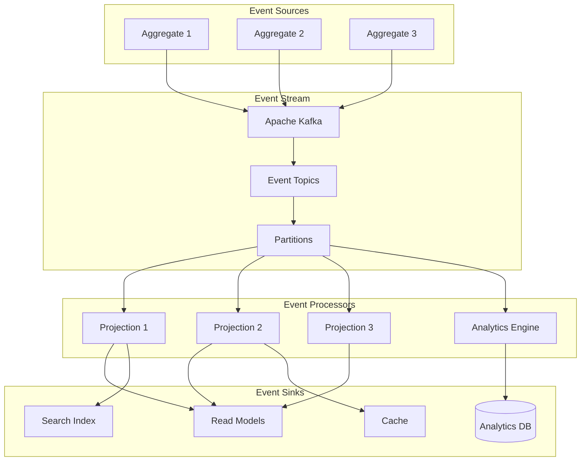
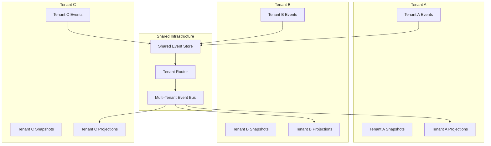
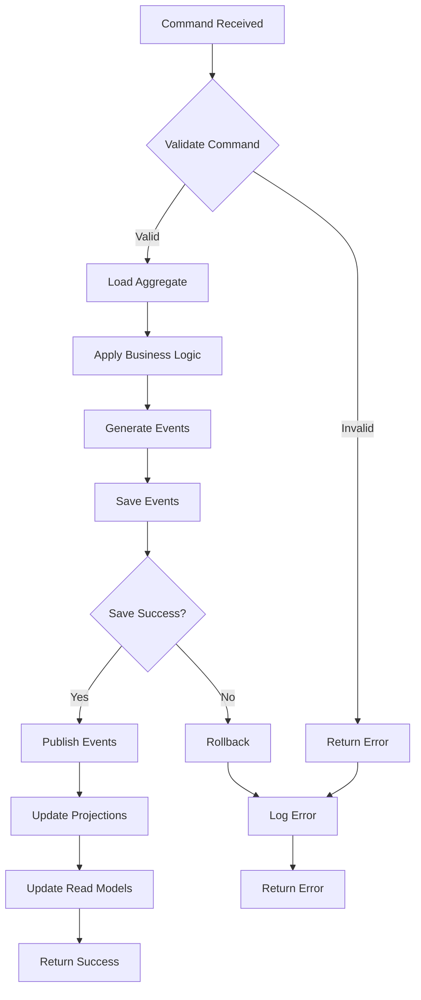
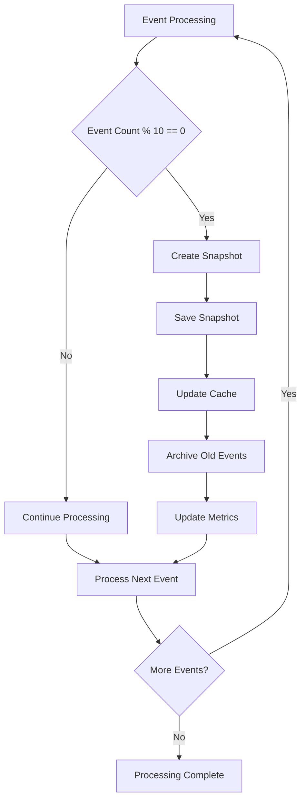

# Event Sourcing - Architect Deep Dive

============================================================
0. Executive Summary (Architect View)
============================================================
- **Event Sourcing exists** to persist all state changes as a sequence of events rather than current state
- **Critical at scale** when audit trails, temporal queries, and system reconstruction become essential
- **System design impact** - transforms state-based persistence into event-based persistence
- **Audit trail foundation** - provides complete, immutable record of all system changes
- **Temporal queries** - enables system state reconstruction at any point in time
- **Debugging revolution** - allows replay of events to reproduce issues
- **Business intelligence** - provides rich data for analytics and reporting
- **System resilience** - enables system recovery from any point in time

============================================================
1. Problem Framing
============================================================
**Real production problem solved:**
- Inability to audit system state changes over time
- Difficulty reproducing bugs and system states
- Loss of historical data and business context
- Inability to reconstruct system after corruption
- Limited business intelligence from current state only

**What breaks if we don't use it:**
- No complete audit trail of system changes
- Inability to reconstruct historical states
- Limited debugging and troubleshooting capabilities
- Loss of business intelligence opportunities
- Difficulty in system recovery and rollback

**Scale importance:**
- **Small systems**: Event sourcing overhead may not be justified
- **Medium systems**: Benefits become apparent for audit and debugging
- **Large systems**: Event sourcing essential for compliance and analytics
- **Enterprise systems**: Critical for regulatory compliance and business intelligence

**Failure stories:**
- Financial system couldn't reconstruct trades after database corruption
- Healthcare system lost patient history due to state-only persistence
- E-commerce platform couldn't analyze customer behavior over time
- Banking system failed regulatory audit due to incomplete audit trail

============================================================
2. Deep Internal Mechanics
============================================================

**Event Sourcing Fundamentals:**
- **Event Store**: Append-only log of all domain events
- **Command Processing**: Commands generate events based on business rules
- **Event Application**: Events are applied to rebuild state
- **Snapshot Management**: Periodic snapshots for performance optimization
- **Event Versioning**: Schema evolution for event structures

**Core Concepts:**
- **Immutability**: Events are immutable once created
- **Append-Only**: Events are never updated or deleted
- **Temporal Ordering**: Events are ordered by occurrence time
- **Causality**: Events represent state changes and business facts
- **Replayability**: Events can be replayed to rebuild state

**Event Processing Flow:**
1. **Command Reception**: Accept command from client
2. **Validation**: Validate command against current state
3. **Event Generation**: Generate domain events for state changes
4. **Event Persistence**: Append events to event store
5. **Event Publication**: Publish events for read model updates
6. **State Application**: Apply events to aggregate state

**Event Store Characteristics:**
- **Append-Only**: New events only appended
- **Ordered**: Events maintain chronological order
- **Persistent**: Events stored durably
- **Queryable**: Events can be queried by aggregate ID
- **Scalable**: Event store can scale horizontally

**Aggregate Management:**
- **Aggregate Root**: Entity that generates events
- **Event Application**: Events applied to aggregate state
- **Version Tracking**: Aggregate version tracking
- **Concurrency Control**: Optimistic concurrency control
- **State Rebuilding**: Rebuilding state from events

**Snapshot Strategy:**
- **Periodic Snapshots**: Regular state snapshots
- **Event Threshold**: Snapshot after N events
- **Time-Based**: Snapshot at regular intervals
- **Performance Optimization**: Faster state rebuilding
- **Storage Efficiency**: Reduced event storage needs

**Data Structures:**
- **Event Objects**: Immutable event representations
- **Event Metadata**: Event context and metadata
- **Aggregate State**: Current state of aggregates
- **Snapshot Data**: Serialized aggregate state
- **Event Store Index**: Indexes for event queries

**Performance Characteristics:**
- **Write Performance**: Excellent for event writes
- **Read Performance**: Slower for state reads without snapshots
- **Storage Growth**: Linear growth with event volume
- **Reconstruction Time**: Proportional to event count
- **Query Performance**: Depends on indexing strategy

**Hidden Costs:**
- **Storage Overhead**: Event storage grows continuously
- **Processing Overhead**: Event application for state rebuilding
- **Complexity**: Increased system complexity
- **Learning Curve**: Steeper learning curve for developers
- **Tooling**: Requires specialized tooling

**Memory Behavior:**
- **Event Loading**: Events loaded into memory for processing
- **State Caching**: Aggregate state caching for performance
- **Snapshot Caching**: Frequent snapshots cached in memory
- **Event Streaming**: Event streaming for processing
- **Garbage Collection**: Impact from event processing

**Async/await Integration:**
- **Event Processing**: Asynchronous event processing
- **Event Publication**: Async event publishing
- **Snapshot Creation**: Async snapshot generation
- **Event Replay**: Async event replay for debugging

============================================================
3. .NET Production Implementation
============================================================

**Naive Implementation (State-Based):**
```csharp
public class OrderService
{
    private readonly OrderDbContext _context;
    
    public async Task<Order> CreateOrderAsync(CreateOrderRequest request)
    {
        // Create order with current state only
        var order = new Order
        {
            CustomerId = request.CustomerId,
            Items = request.Items,
            Status = OrderStatus.Created,
            TotalAmount = request.TotalAmount,
            CreatedAt = DateTime.UtcNow
        };
        
        // Save current state only
        await _context.Orders.AddAsync(order);
        await _context.SaveChangesAsync();
        
        return order;
    }
    
    public async Task<Order> UpdateOrderStatusAsync(int orderId, OrderStatus status)
    {
        var order = await _context.Orders.FindAsync(orderId);
        if (order != null)
        {
            order.Status = status;
            order.UpdatedAt = DateTime.UtcNow;
            
            // Update current state only
            await _context.SaveChangesAsync();
        }
        
        return order;
    }
}
```

**Production-Ready Event Sourcing Implementation:**
```csharp
// Domain Events
public abstract record DomainEvent
{
    public Guid Id { get; } = Guid.NewGuid();
    public DateTime OccurredOn { get; } = DateTime.UtcNow;
    public int Version { get; protected set; }
    public Guid AggregateId { get; protected set; }
}

public record OrderCreatedEvent(
    Guid AggregateId,
    Guid CustomerId,
    List<OrderItem> Items,
    decimal TotalAmount,
    DateTime CreatedAt
) : DomainEvent
{
    public OrderCreatedEvent(Guid aggregateId, Guid customerId, List<OrderItem> items, decimal totalAmount)
        : base()
    {
        AggregateId = aggregateId;
        CustomerId = customerId;
        Items = items;
        TotalAmount = totalAmount;
        CreatedAt = DateTime.UtcNow;
    }
}

public record OrderStatusChangedEvent(
    Guid AggregateId,
    OrderStatus OldStatus,
    OrderStatus NewStatus,
    DateTime ChangedAt
) : DomainEvent
{
    public OrderStatusChangedEvent(Guid aggregateId, OrderStatus oldStatus, OrderStatus newStatus)
        : base()
    {
        AggregateId = aggregateId;
        OldStatus = oldStatus;
        NewStatus = newStatus;
        ChangedAt = DateTime.UtcNow;
    }
}

public record OrderItemAddedEvent(
    Guid AggregateId,
    OrderItem Item,
    DateTime AddedAt
) : DomainEvent
{
    public OrderItemAddedEvent(Guid aggregateId, OrderItem item)
        : base()
    {
        AggregateId = aggregateId;
        Item = item;
        AddedAt = DateTime.UtcNow;
    }
}

public record OrderItemRemovedEvent(
    Guid AggregateId,
    Guid ItemId,
    DateTime RemovedAt
) : DomainEvent
{
    public OrderItemRemovedEvent(Guid aggregateId, Guid itemId)
        : base()
    {
        AggregateId = aggregateId;
        ItemId = itemId;
        RemovedAt = DateTime.UtcNow;
    }
}

// Aggregate Root with Event Sourcing
public abstract class AggregateRoot
{
    public Guid Id { get; protected set; }
    public int Version { get; protected set; }
    public int UncommittedVersion { get; protected set; }
    
    private readonly List<DomainEvent> _uncommittedEvents = new();
    
    public IReadOnlyCollection<DomainEvent> GetUncommittedEvents() => _uncommittedEvents.AsReadOnly();
    public void MarkEventsAsCommitted() => _uncommittedEvents.Clear();
    
    protected void ApplyEvent(DomainEvent @event)
    {
        When(@event);
        _uncommittedEvents.Add(@event);
        UncommittedVersion++;
    }
    
    public void LoadFromHistory(IEnumerable<DomainEvent> history)
    {
        foreach (var @event in history)
        {
            When(@event);
            Version++;
        }
    }
    
    protected abstract void When(DomainEvent @event);
}

public class Order : AggregateRoot
{
    public Guid CustomerId { get; private set; }
    public List<OrderItem> Items { get; private set; } = new();
    public OrderStatus Status { get; private set; }
    public decimal TotalAmount { get; private set; }
    public DateTime CreatedAt { get; private set; }
    public DateTime? UpdatedAt { get; private set; }

    public Order() { }

    public static Order Create(Guid customerId, List<OrderItem> items)
    {
        var order = new Order();
        var totalAmount = items.Sum(item => item.Quantity * item.UnitPrice);
        
        order.ApplyEvent(new OrderCreatedEvent(
            Guid.NewGuid(),
            customerId,
            items,
            totalAmount,
            DateTime.UtcNow
        ));
        
        return order;
    }

    public void ChangeStatus(OrderStatus newStatus)
    {
        if (Status == newStatus)
            return;
        
        var oldStatus = Status;
        
        ApplyEvent(new OrderStatusChangedEvent(
            Id,
            oldStatus,
            newStatus,
            DateTime.UtcNow
        ));
    }

    public void AddItem(OrderItem item)
    {
        if (Items.Any(i => i.ProductId == item.ProductId))
            throw new InvalidOperationException("Item already exists in order");
        
        ApplyEvent(new OrderItemAddedEvent(
            Id,
            item,
            DateTime.UtcNow
        ));
    }

    public void RemoveItem(Guid itemId)
    {
        var item = Items.FirstOrDefault(i => i.Id == itemId);
        if (item == null)
            throw new InvalidOperationException("Item not found in order");
        
        ApplyEvent(new OrderItemRemovedEvent(
            Id,
            itemId,
            DateTime.UtcNow
        ));
    }

    protected override void When(DomainEvent @event)
    {
        switch (@event)
        {
            case OrderCreatedEvent created:
                When(created);
                break;
            case OrderStatusChangedEvent statusChanged:
                When(statusChanged);
                break;
            case OrderItemAddedEvent itemAdded:
                When(itemAdded);
                break;
            case OrderItemRemovedEvent itemRemoved:
                When(itemRemoved);
                break;
        }
    }

    private void When(OrderCreatedEvent @event)
    {
        Id = @event.AggregateId;
        CustomerId = @event.CustomerId;
        Items = @event.Items.ToList();
        TotalAmount = @event.TotalAmount;
        Status = OrderStatus.Created;
        CreatedAt = @event.CreatedAt;
    }

    private void When(OrderStatusChangedEvent @event)
    {
        Status = @event.NewStatus;
        UpdatedAt = @event.ChangedAt;
    }

    private void When(OrderItemAddedEvent @event)
    {
        Items.Add(@event.Item);
        TotalAmount += @event.Item.Quantity * @event.Item.UnitPrice;
        UpdatedAt = @event.AddedAt;
    }

    private void When(OrderItemRemovedEvent @event)
    {
        var item = Items.FirstOrDefault(i => i.Id == @event.ItemId);
        if (item != null)
        {
            Items.Remove(item);
            TotalAmount -= item.Quantity * item.UnitPrice;
            UpdatedAt = @event.RemovedAt;
        }
    }
}

// Event Store Interface and Implementation
public interface IEventStore
{
    Task SaveEventsAsync(Guid aggregateId, IEnumerable<DomainEvent> events, int expectedVersion);
    Task<List<DomainEvent>> GetEventsAsync(Guid aggregateId, int fromVersion = 0);
    Task<List<DomainEvent>> GetEventsAsync(Guid aggregateId, DateTime fromTimestamp);
    Task<List<DomainEvent>> GetEventsAsync(DateTime fromTimestamp, DateTime toTimestamp);
    Task SaveSnapshotAsync(Guid aggregateId, object snapshot, int version);
    Task<object> GetSnapshotAsync(Guid aggregateId);
}

public class SqlEventStore : IEventStore
{
    private readonly EventStoreDbContext _context;
    private readonly ILogger<SqlEventStore> _logger;
    private readonly IMetrics _metrics;

    public SqlEventStore(
        EventStoreDbContext context,
        ILogger<SqlEventStore> logger,
        IMetrics metrics)
    {
        _context = context ?? throw new ArgumentNullException(nameof(context));
        _logger = logger ?? throw new ArgumentNullException(nameof(logger));
        _metrics = metrics ?? throw new ArgumentNullException(nameof(metrics));
    }

    public async Task SaveEventsAsync(Guid aggregateId, IEnumerable<DomainEvent> events, int expectedVersion)
    {
        using var activity = _metrics.StartTimer("event_store_save_duration");
        
        try
        {
            _logger.LogInformation("Saving {Count} events for aggregate {AggregateId}", events.Count(), aggregateId);
            
            var eventRecords = events.Select(@event => new EventRecord
            {
                Id = @event.Id,
                AggregateId = aggregateId,
                EventType = @event.GetType().Name,
                EventData = JsonSerializer.Serialize(@event),
                Version = expectedVersion + 1,
                OccurredOn = @event.OccurredOn
            }).ToList();
            
            await _context.Events.AddRangeAsync(eventRecords);
            await _context.SaveChangesAsync();
            
            _metrics.Increment("event_store_save_success");
            _logger.LogInformation("Successfully saved {Count} events for aggregate {AggregateId}", events.Count(), aggregateId);
        }
        catch (Exception ex)
        {
            _metrics.Increment("event_store_save_failed");
            _logger.LogError(ex, "Failed to save events for aggregate {AggregateId}", aggregateId);
            throw;
        }
    }

    public async Task<List<DomainEvent>> GetEventsAsync(Guid aggregateId, int fromVersion = 0)
    {
        using var activity = _metrics.StartTimer("event_store_get_duration");
        
        try
        {
            _logger.LogDebug("Getting events for aggregate {AggregateId} from version {FromVersion}", aggregateId, fromVersion);
            
            var eventRecords = await _context.Events
                .Where(e => e.AggregateId == aggregateId && e.Version > fromVersion)
                .OrderBy(e => e.Version)
                .ToListAsync();
            
            var events = eventRecords.Select(DeserializeEvent).ToList();
            
            _metrics.Increment("event_store_get_success");
            return events;
        }
        catch (Exception ex)
        {
            _metrics.Increment("event_store_get_failed");
            _logger.LogError(ex, "Failed to get events for aggregate {AggregateId}", aggregateId);
            throw;
        }
    }

    public async Task<List<DomainEvent>> GetEventsAsync(Guid aggregateId, DateTime fromTimestamp)
    {
        var eventRecords = await _context.Events
            .Where(e => e.AggregateId == aggregateId && e.OccurredOn >= fromTimestamp)
            .OrderBy(e => e.Version)
            .ToListAsync();
        
        return eventRecords.Select(DeserializeEvent).ToList();
    }

    public async Task<List<DomainEvent>> GetEventsAsync(DateTime fromTimestamp, DateTime toTimestamp)
    {
        var eventRecords = await _context.Events
            .Where(e => e.OccurredOn >= fromTimestamp && e.OccurredOn <= toTimestamp)
            .OrderBy(e => e.OccurredOn)
            .ToListAsync();
        
        return eventRecords.Select(DeserializeEvent).ToList();
    }

    public async Task SaveSnapshotAsync(Guid aggregateId, object snapshot, int version)
    {
        try
        {
            _logger.LogInformation("Saving snapshot for aggregate {AggregateId} at version {Version}", aggregateId, version);
            
            var snapshotRecord = new SnapshotRecord
            {
                AggregateId = aggregateId,
                SnapshotData = JsonSerializer.Serialize(snapshot),
                Version = version,
                CreatedAt = DateTime.UtcNow
            };
            
            await _context.Snapshots.AddAsync(snapshotRecord);
            await _context.SaveChangesAsync();
            
            _metrics.Increment("event_store_snapshot_save_success");
        }
        catch (Exception ex)
        {
            _metrics.Increment("event_store_snapshot_save_failed");
            _logger.LogError(ex, "Failed to save snapshot for aggregate {AggregateId}", aggregateId);
            throw;
        }
    }

    public async Task<object> GetSnapshotAsync(Guid aggregateId)
    {
        try
        {
            var snapshot = await _context.Snapshots
                .Where(s => s.AggregateId == aggregateId)
                .OrderByDescending(s => s.Version)
                .FirstOrDefaultAsync();
            
            if (snapshot == null)
                return null;
            
            var snapshotType = Type.GetType($"OrderSnapshot");
            return JsonSerializer.Deserialize(snapshot.SnapshotData, snapshotType);
        }
        catch (Exception ex)
        {
            _logger.LogError(ex, "Failed to get snapshot for aggregate {AggregateId}", aggregateId);
            throw;
        }
    }

    private DomainEvent DeserializeEvent(EventRecord eventRecord)
    {
        var eventType = Type.GetType($"Order.{eventRecord.EventType}");
        return (DomainEvent)JsonSerializer.Deserialize(eventRecord.EventData, eventType);
    }
}

// Repository with Event Sourcing
public interface IOrderRepository
{
    Task<Order> GetByIdAsync(Guid id);
    Task SaveAsync(Order order);
    Task<List<Order>> GetOrdersAsync(DateTime from, DateTime to);
}

public class OrderRepository : IOrderRepository
{
    private readonly IEventStore _eventStore;
    private readonly ICacheService _cacheService;
    private readonly ILogger<OrderRepository> _logger;
    private readonly IMetrics _metrics;

    public OrderRepository(
        IEventStore eventStore,
        ICacheService cacheService,
        ILogger<OrderRepository> logger,
        IMetrics metrics)
    {
        _eventStore = eventStore ?? throw new ArgumentNullException(nameof(eventStore));
        _cacheService = cacheService ?? throw new ArgumentNullException(nameof(cacheService));
        _logger = logger ?? throw new ArgumentNullException(nameof(logger));
        _metrics = metrics ?? throw new ArgumentNullException(nameof(metrics));
    }

    public async Task<Order> GetByIdAsync(Guid id)
    {
        using var activity = _metrics.StartTimer("order_repository_get_duration");
        
        try
        {
            // Try to get from cache first
            var cacheKey = $"order_{id}";
            var cachedOrder = await _cacheService.GetAsync<Order>(cacheKey);
            
            if (cachedOrder != null)
            {
                _metrics.Increment("order_repository_cache_hit");
                return cachedOrder;
            }
            
            // Try to get from snapshot
            var snapshot = await _eventStore.GetSnapshotAsync(id);
            var order = snapshot != null ? new Order() : null;
            
            if (order != null)
            {
                order.LoadFromHistory(new List<DomainEvent>());
            }
            else
            {
                order = new Order();
            }
            
            // Get events from snapshot version or from beginning
            var fromVersion = order?.Version ?? 0;
            var events = await _eventStore.GetEventsAsync(id, fromVersion);
            
            if (!events.Any() && order == null)
            {
                throw new OrderNotFoundException($"Order {id} not found");
            }
            
            // Apply events to rebuild state
            order.LoadFromHistory(events);
            
            // Cache the rebuilt order
            await _cacheService.SetAsync(cacheKey, order, TimeSpan.FromMinutes(30));
            
            _metrics.Increment("order_repository_get_success");
            return order;
        }
        catch (Exception ex)
        {
            _metrics.Increment("order_repository_get_failed");
            _logger.LogError(ex, "Failed to get order {OrderId}", id);
            throw;
        }
    }

    public async Task SaveAsync(Order order)
    {
        using var activity = _metrics.StartTimer("order_repository_save_duration");
        
        try
        {
            var events = order.GetUncommittedEvents();
            
            if (!events.Any())
                return;
            
            // Save events to event store
            await _eventStore.SaveEventsAsync(order.Id, events, order.Version);
            
            // Create snapshot after every 10 events
            if (order.UncommittedVersion % 10 == 0)
            {
                await _eventStore.SaveSnapshotAsync(order.Id, order, order.UncommittedVersion);
            }
            
            // Mark events as committed
            order.MarkEventsAsCommitted();
            
            // Invalidate cache
            await _cacheService.RemoveAsync($"order_{order.Id}");
            
            _metrics.Increment("order_repository_save_success");
            _logger.LogInformation("Saved {Count} events for order {OrderId}", events.Count(), order.Id);
        }
        catch (Exception ex)
        {
            _metrics.Increment("order_repository_save_failed");
            _logger.LogError(ex, "Failed to save order {OrderId}", order.Id);
            throw;
        }
    }

    public async Task<List<Order>> GetOrdersAsync(DateTime from, DateTime to)
    {
        using var activity = _metrics.StartTimer("order_repository_get_range_duration");
        
        try
        {
            // Get all events in the time range
            var events = await _eventStore.GetEventsAsync(from, to);
            
            // Group events by aggregate ID
            var eventsByAggregate = events.GroupBy(e => e.AggregateId);
            
            var orders = new List<Order>();
            
            foreach (var group in eventsByAggregate)
            {
                var order = new Order();
                order.LoadFromHistory(group.OrderBy(e => e.Version));
                orders.Add(order);
            }
            
            _metrics.Increment("order_repository_get_range_success");
            return orders;
        }
        catch (Exception ex)
        {
            _metrics.Increment("order_repository_get_range_failed");
            _logger.LogError(ex, "Failed to get orders from {From} to {To}", from, to);
            throw;
        }
    }
}

// Service with Event Sourcing
public class OrderService
{
    private readonly IOrderRepository _orderRepository;
    private readonly IEventBus _eventBus;
    private readonly ILogger<OrderService> _logger;
    private readonly IMetrics _metrics;

    public OrderService(
        IOrderRepository orderRepository,
        IEventBus eventBus,
        ILogger<OrderService> logger,
        IMetrics metrics)
    {
        _orderRepository = orderRepository ?? throw new ArgumentNullException(nameof(orderRepository));
        _eventBus = eventBus ?? throw new ArgumentNullException(nameof(eventBus));
        _logger = logger ?? throw new ArgumentNullException(nameof(logger));
        _metrics = metrics ?? throw new ArgumentNullException(nameof(metrics));
    }

    public async Task<Order> CreateOrderAsync(CreateOrderRequest request)
    {
        using var activity = _metrics.StartTimer("order_service_create_duration");
        
        try
        {
            _logger.LogInformation("Creating order for customer {CustomerId}", request.CustomerId);
            
            // Create order aggregate
            var order = Order.Create(request.CustomerId, request.Items);
            
            // Save order (saves events)
            await _orderRepository.SaveAsync(order);
            
            // Publish events for read model updates
            var events = order.GetUncommittedEvents();
            foreach (var @event in events)
            {
                await _eventBus.PublishAsync(@event);
            }
            
            _metrics.Increment("order_service_create_success");
            _logger.LogInformation("Order {OrderId} created successfully", order.Id);
            
            return order;
        }
        catch (Exception ex)
        {
            _metrics.Increment("order_service_create_failed");
            _logger.LogError(ex, "Failed to create order for customer {CustomerId}", request.CustomerId);
            throw;
        }
    }

    public async Task<Order> GetOrderAsync(Guid id)
    {
        using var activity = _metrics.StartTimer("order_service_get_duration");
        
        try
        {
            _logger.LogInformation("Getting order {OrderId}", id);
            
            var order = await _orderRepository.GetByIdAsync(id);
            
            _metrics.Increment("order_service_get_success");
            return order;
        }
        catch (Exception ex)
        {
            _metrics.Increment("order_service_get_failed");
            _logger.LogError(ex, "Failed to get order {OrderId}", id);
            throw;
        }
    }

    public async Task UpdateOrderStatusAsync(Guid id, OrderStatus newStatus)
    {
        using var activity = _metrics.StartTimer("order_service_update_status_duration");
        
        try
        {
            _logger.LogInformation("Updating order {OrderId} status to {Status}", id, newStatus);
            
            var order = await _orderRepository.GetByIdAsync(id);
            order.ChangeStatus(newStatus);
            
            await _orderRepository.SaveAsync(order);
            
            // Publish events
            var events = order.GetUncommittedEvents();
            foreach (var @event in events)
            {
                await _eventBus.PublishAsync(@event);
            }
            
            _metrics.Increment("order_service_update_status_success");
            _logger.LogInformation("Order {OrderId} status updated to {Status}", id, newStatus);
        }
        catch (Exception ex)
        {
            _metrics.Increment("order_service_update_status_failed");
            _logger.LogError(ex, "Failed to update order {OrderId} status", id);
            throw;
        }
    }

    public async Task<List<Order>> GetOrdersAsync(DateTime from, DateTime to)
    {
        using var activity = _metrics.StartTimer("order_service_get_range_duration");
        
        try
        {
            _logger.LogInformation("Getting orders from {From} to {To}", from, to);
            
            var orders = await _orderRepository.GetOrdersAsync(from, to);
            
            _metrics.Increment("order_service_get_range_success");
            return orders;
        }
        catch (Exception ex)
        {
            _metrics.Increment("order_service_get_range_failed");
            _logger.LogError(ex, "Failed to get orders from {From} to {To}", from, to);
            throw;
        }
    }
}

// Read Model Projection
public class OrderReadModelProjection :
    IEventHandler<OrderCreatedEvent>,
    IEventHandler<OrderStatusChangedEvent>,
    IEventHandler<OrderItemAddedEvent>,
    IEventHandler<OrderItemRemovedEvent>
{
    private readonly OrderReadDbContext _context;
    private readonly ILogger<OrderReadModelProjection> _logger;
    private readonly IMetrics _metrics;

    public OrderReadModelProjection(
        OrderReadDbContext context,
        ILogger<OrderReadModelProjection> logger,
        IMetrics metrics)
    {
        _context = context ?? throw new ArgumentNullException(nameof(context));
        _logger = logger ?? throw new ArgumentNullException(nameof(logger));
        _metrics = metrics ?? throw new ArgumentNullException(nameof(metrics));
    }

    public async Task HandleAsync(OrderCreatedEvent @event, CancellationToken cancellationToken = default)
    {
        using var activity = _metrics.StartTimer("order_projection_created_duration");
        
        try
        {
            _logger.LogInformation("Creating read model for order {OrderId}", @event.AggregateId);
            
            var readModel = new OrderReadModel
            {
                Id = @event.AggregateId,
                CustomerId = @event.CustomerId,
                Items = @event.Items.Select(item => new OrderItemReadModel
                {
                    Id = item.Id,
                    ProductId = item.ProductId,
                    Quantity = item.Quantity,
                    UnitPrice = item.UnitPrice,
                    TotalPrice = item.Quantity * item.UnitPrice
                }).ToList(),
                Status = OrderStatus.Created,
                TotalAmount = @event.TotalAmount,
                CreatedAt = @event.CreatedAt,
                UpdatedAt = @event.CreatedAt
            };
            
            await _context.Orders.AddAsync(readModel, cancellationToken);
            await _context.SaveChangesAsync(cancellationToken);
            
            _metrics.Increment("order_projection_created_success");
        }
        catch (Exception ex)
        {
            _metrics.Increment("order_projection_created_failed");
            _logger.LogError(ex, "Failed to create read model for order {OrderId}", @event.AggregateId);
            throw;
        }
    }

    public async Task HandleAsync(OrderStatusChangedEvent @event, CancellationToken cancellationToken = default)
    {
        using var activity = _metrics.StartTimer("order_projection_status_changed_duration");
        
        try
        {
            var readModel = await _context.Orders.FindAsync(@event.AggregateId);
            if (readModel != null)
            {
                readModel.Status = @event.NewStatus;
                readModel.UpdatedAt = @event.ChangedAt;
                
                await _context.SaveChangesAsync(cancellationToken);
                
                _metrics.Increment("order_projection_status_changed_success");
            }
        }
        catch (Exception ex)
        {
            _metrics.Increment("order_projection_status_changed_failed");
            _logger.LogError(ex, "Failed to update read model for order {OrderId}", @event.AggregateId);
            throw;
        }
    }

    public async Task HandleAsync(OrderItemAddedEvent @event, CancellationToken cancellationToken = default)
    {
        using var activity = _metrics.StartTimer("order_projection_item_added_duration");
        
        try
        {
            var readModel = await _context.Orders.FindAsync(@event.AggregateId);
            if (readModel != null)
            {
                var itemReadModel = new OrderItemReadModel
                {
                    Id = @event.Item.Id,
                    ProductId = @event.Item.ProductId,
                    Quantity = @event.Item.Quantity,
                    UnitPrice = @event.Item.UnitPrice,
                    TotalPrice = @event.Item.Quantity * @event.Item.UnitPrice
                };
                
                readModel.Items.Add(itemReadModel);
                readModel.TotalAmount += itemReadModel.TotalPrice;
                readModel.UpdatedAt = @event.AddedAt;
                
                await _context.SaveChangesAsync(cancellationToken);
                
                _metrics.Increment("order_projection_item_added_success");
            }
        }
        catch (Exception ex)
        {
            _metrics.Increment("order_projection_item_added_failed");
            _logger.LogError(ex, "Failed to add item to read model for order {OrderId}", @event.AggregateId);
            throw;
        }
    }

    public async Task HandleAsync(OrderItemRemovedEvent @event, CancellationToken cancellationToken = default)
    {
        using var activity = _metrics.StartTimer("order_projection_item_removed_duration");
        
        try
        {
            var readModel = await _context.Orders.FindAsync(@event.AggregateId);
            if (readModel != null)
            {
                var item = readModel.Items.FirstOrDefault(i => i.Id == @event.ItemId);
                if (item != null)
                {
                    readModel.Items.Remove(item);
                    readModel.TotalAmount -= item.TotalPrice;
                    readModel.UpdatedAt = @event.RemovedAt;
                    
                    await _context.SaveChangesAsync(cancellationToken);
                    
                    _metrics.Increment("order_projection_item_removed_success");
                }
            }
        }
        catch (Exception ex)
        {
            _metrics.Increment("order_projection_item_removed_failed");
            _logger.LogError(ex, "Failed to remove item from read model for order {OrderId}", @event.AggregateId);
            throw;
        }
    }
}
```

**Framework Integration:**
- **Entity Framework Core**: Event store and read model databases
- **MediatR**: Command and event handling
- **MassTransit**: Event bus for inter-service communication
- **Redis**: Caching for performance optimization
- **ASP.NET Core**: Web API and dependency injection

============================================================
4. Architecture-Level Diagram (Mermaid)
============================================================

### Event Sourcing Architecture Overview


### Event Processing Flow


### Event Store Structure


### Snapshot Strategy


**Flow Analysis:**
- **Command Processing**: Commands generate events based on business logic
- **Event Persistence**: Events are stored in append-only event store
- **State Rebuilding**: Aggregate state rebuilt from events
- **Read Model Updates**: Projections update read models from events
- **Snapshot Optimization**: Periodic snapshots improve performance

**Bottlenecks:**
- Event store write performance
- State rebuilding time without snapshots
- Event replay performance
- Projection processing throughput
- Cache invalidation overhead

**Scaling Boundaries:**
- Event store can scale horizontally
- Projections can scale independently
- Snapshots reduce state rebuilding time
- Caching improves read performance
- Event streaming enables real-time processing

============================================================
5. Scaling & Distributed Systems Impact
============================================================

### Distributed Event Sourcing Architecture


### Event Stream Processing Architecture


### Multi-Tenant Event Sourcing


**100 RPS:**
- Single event store instance sufficient
- Snapshot strategy optional
- Event processing overhead minimal
- Read model performance acceptable

**10k RPS:**
- Event store clustering required
- Snapshot strategy becomes important
- Event processing optimization needed
- Read model caching essential

**100k+ RPS:**
- Distributed event store mandatory
- Event streaming architecture essential
- Parallel projection processing
- Advanced caching strategies

**Horizontal vs Vertical Scaling:**
- **Horizontal**: Scale event store and projections independently
- **Vertical**: Larger instances for event processing
- Event store scales horizontally well
- Projections can scale independently

**CAP Theorem Relevance:**
- **Consistency**: Eventual consistency through event ordering
- **Availability**: High availability through event replication
- **Partition Tolerance**: Event replication handles partitions

**Consistency Implications:**
- **Eventual Consistency**: Read models eventually consistent
- **Strong Consistency**: Within aggregate boundaries
- **Temporal Consistency**: Events provide temporal consistency
- **Cross-Aggregate**: Eventual consistency across aggregates

**Distributed Systems Impact:**
- **Event Replication**: Cross-region event replication
- **Event Ordering**: Global event ordering challenges
- **Conflict Resolution**: Event conflict resolution strategies
- **Event Replay**: Distributed event replay capabilities

**Cloud-Native Considerations:**
- **Kubernetes**: Event store and projections as containers
- **Serverless**: Event processing functions
- **Managed Services**: Cloud provider event streaming
- **Auto-scaling**: Dynamic scaling of projections

**Multi-Region Concerns:**
- **Event Replication**: Cross-region event replication
- **Event Ordering**: Global event ordering
- **Snapshot Replication**: Cross-region snapshot replication
- **Read Model Consistency**: Multi-region consistency

============================================================
6. Production Engineering View
============================================================

### Event Sourcing Monitoring Architecture

```mermaid
graph TB
    subgraph "Event Store Metrics"
        EVENT_WRITE_RATE[Event Write Rate]
        EVENT_READ_RATE[Event Read Rate]
        EVENT_STORE_SIZE[Event Store Size]
        EVENT_LATENCY[Event Latency]
    end
    
    subgraph "Projection Metrics"
        PROJECTION_THROUGHPUT[Projection Throughput]
        PROJECTION_LAG[Projection Lag]
        PROJECTION_ERROR[Projection Error Rate]
        READ_MODEL_SIZE[Read Model Size]
    end
    
    subgraph "Aggregate Metrics"
        AGGREGATE_COUNT[Aggregate Count]
        AGGREGATE_VERSION[Aggregate Version]
        SNAPSHOT_COUNT[Snapshot Count]
        SNAPSHOT_SIZE[Snapshot Size]
    end
    
    subgraph "Business Metrics"
        COMMAND_RATE[Command Rate]
        EVENT_RATE[Event Rate]
        QUERY_RATE[Query Rate]
        USER_ACTIVITY[User Activity]
    end
    
    subgraph "Monitoring Stack"
        PROM[Prometheus]
        GRAF[Grafana]
        ALERT[AlertManager]
        JAEGER[Jaeger]
    end
    
    EVENT_WRITE_RATE --> PROM
    EVENT_READ_RATE --> PROM
    EVENT_STORE_SIZE --> PROM
    EVENT_LATENCY --> PROM
    
    PROJECTION_THROUGHPUT --> PROM
    PROJECTION_LAG --> PROM
    PROJECTION_ERROR --> PROM
    READ_MODEL_SIZE --> PROM
    
    AGGREGATE_COUNT --> PROM
    AGGREGATE_VERSION --> PROM
    SNAPSHOT_COUNT --> PROM
    SNAPSHOT_SIZE --> PROM
    
    COMMAND_RATE --> PROM
    EVENT_RATE --> PROM
    QUERY_RATE --> PROM
    USER_ACTIVITY --> PROM
    
    PROM --> GRAF
    PROM --> ALERT
    PROM --> JAEGER
```


### Event Processing Pipeline


### Snapshot Management Strategy


**Monitoring Metrics:**
- **Event Store**: Write rate, read rate, storage size, latency
- **Projections**: Throughput, lag, error rate, read model size
- **Aggregates**: Count, version distribution, snapshot efficiency
- **Business**: Command rate, event rate, query rate, user activity
- **System**: CPU, memory, network, disk usage

**Logs to Enable:**
- Event creation and persistence
- Snapshot creation and restoration
- Projection processing events
- Aggregate state changes
- Error handling and recovery

**Alerting Strategy:**
- Event store write latency > 100ms (warning)
- Projection lag > 5 seconds (critical)
- Event store size > 80% capacity (warning)
- Projection error rate > 1% (critical)
- Aggregate version inconsistency (critical)

**Common Production Incidents:**
- **Event Store Corruption**: Event store data corruption
- **Projection Lag**: Projections falling behind events
- **Snapshot Failure**: Snapshot creation failures
- **Event Duplication**: Duplicate events in stream
- **State Inconsistency**: Aggregate state inconsistency

**Debugging Strategy:**
- Event replay for debugging
- Projection state analysis
- Aggregate state inspection
- Event stream analysis
- Performance profiling

**Event Store Management:**
- Event store size monitoring
- Event archiving strategies
- Snapshot management
- Event replication monitoring
- Performance optimization

**Projection Management:**
- Projection throughput monitoring
- Projection lag analysis
- Error handling and recovery
- Performance optimization
- Scaling strategies

**Snapshot Management:**
- Snapshot creation monitoring
- Snapshot size optimization
- Snapshot restoration testing
- Archival strategies
- Performance impact analysis

============================================================
7. Tradeoffs & Alternatives
============================================================

**Competing Approaches:**
- **State-Based Persistence**: Traditional database persistence
- **Command Sourcing**: Persist commands instead of events
- **Hybrid Approach**: Combine event sourcing with state persistence
- **Event Streaming**: Real-time event processing without persistence

**When to Use Event Sourcing:**
- Complex business domains with rich state
- Need for complete audit trails
- Temporal queries and state reconstruction
- Business intelligence and analytics
- Regulatory compliance requirements

**When NOT to Use Event Sourcing:**
- Simple CRUD applications
- High write volume with simple state
- Limited storage resources
- Real-time requirements with low latency
- Team without event sourcing experience

**Latency Comparison:**
- **Event Sourcing**: 10-100ms for command processing
- **State-Based**: 1-10ms for direct database operations
- **Command Sourcing**: 5-50ms for command processing
- **Hybrid**: 5-50ms depending on implementation

**Throughput Comparison:**
- **Event Sourcing**: 1k-10k events/second
- **State-Based**: 10k-100k operations/second
- **Command Sourcing**: 5k-50k commands/second
- **Hybrid**: 5k-50k operations/second

**Operational Complexity:**
- **Event Sourcing**: High complexity, rich functionality
- **State-Based**: Low complexity, limited functionality
- **Command Sourcing**: Medium complexity, moderate functionality
- **Hybrid**: High complexity, balanced functionality

**Cost Implications:**
- **Development Cost**: Event sourcing increases cost by 40-60%
- **Infrastructure Cost**: Higher storage and processing costs
- **Operational Cost**: Higher monitoring and maintenance cost
- **Maintenance Cost**: Higher complexity maintenance

============================================================
8. Security Implications
============================================================

**Security Benefits:**
- **Immutable Audit Trail**: Events cannot be modified
- **Complete History**: Full audit trail of all changes
- **Temporal Security**: Security events over time
- **Data Integrity**: Event immutability ensures integrity

**Security Challenges:**
- **Event Access Control**: Fine-grained access to events
- **Event Privacy**: Sensitive data in events
- **Event Encryption**: Event data protection
- **Event Retention**: Event retention and deletion policies

**Authentication and Authorization:**
- **Event Access**: Per-event access control
- **Command Authorization**: Command-level authorization
- **Aggregate Security**: Aggregate-level security
- **Projection Security**: Read model access control

**Data Protection:**
- **Event Encryption**: Encrypt sensitive event data
- **Data Masking**: Mask sensitive data in events
- **Privacy Compliance**: GDPR and privacy regulations
- **Data Retention**: Event retention and deletion

**Compliance Requirements:**
- **Audit Trail**: Complete audit trail for compliance
- **Data Integrity**: Event immutability for compliance
- **Regulatory Reporting**: Event data for reporting
- **Data Privacy**: Privacy compliance for events

**Hardening Recommendations:**
- **Event Encryption**: Encrypt sensitive event data
- **Access Control**: Fine-grained event access control
- **Event Auditing**: Event access auditing
- **Data Retention**: Event retention policies
- **Security Monitoring**: Event security monitoring

============================================================
9. Advanced Edge Cases
============================================================

**Event Versioning:**
- Event schema evolution strategies
- Backward compatibility maintenance
- Event migration procedures
- Version conflict resolution
- Event deprecation strategies

**Event Replay:**
- Event replay for debugging
- State reconstruction at specific time
- Event replay for testing
- Parallel event replay
- Event replay performance

**Snapshot Optimization:**
- Snapshot creation strategies
- Snapshot compression
- Snapshot distribution
- Snapshot restoration
- Snapshot consistency

**Event Streaming:**
- Real-time event processing
- Event streaming architecture
- Event ordering guarantees
- Event delivery guarantees
- Event backpressure handling

**Multi-Tenancy:**
- Tenant isolation strategies
- Multi-tenant event store
- Tenant-specific projections
- Cross-tenant event access
- Tenant data segregation

**Performance Optimization:**
- Event store optimization
- Projection performance tuning
- Caching strategies
- Parallel processing
- Resource utilization

**Testing Strategies:**
- Event sourcing unit testing
- Integration testing
- Event replay testing
- Performance testing
- Snapshot testing

============================================================
10. Interview & Staff-Level Deep Dive
============================================================

**What a junior answers:**
"Event sourcing is when you store all the changes to your data as events instead of just the current state. You can replay these events to reconstruct the state at any point in time. It provides a complete audit trail and enables temporal queries."

**What a senior answers:**
"Event sourcing persists all state changes as a sequence of immutable events rather than current state. Each command generates events that are stored in an event store, and aggregates rebuild their state by applying these events. This provides complete audit trails, temporal queries, and the ability to reconstruct system state at any point in time. I've implemented event sourcing using an append-only event store, aggregate roots that generate events, and projections that update read models. Key patterns include snapshot management for performance, event versioning for schema evolution, and event replay for debugging and testing."

**What an architect answers:**
"Event sourcing is a fundamental architectural pattern that transforms how we think about data persistence and system state management. Instead of persisting current state, we store an immutable sequence of events that represent all state changes over time. This provides complete audit trails, temporal query capabilities, and the ability to reconstruct system state at any point in time. At scale, event sourcing enables sophisticated business intelligence, regulatory compliance, and system resilience through event replay capabilities. The architecture requires careful consideration of event store design, snapshot strategies, projection management, and event versioning. In distributed systems, event sourcing enables eventual consistency, event-driven architectures, and sophisticated debugging capabilities. The pattern is particularly valuable in complex business domains where understanding the evolution of state over time is critical for business operations and compliance requirements."

**Follow-up questions interviewers ask:**
- "How do you handle event versioning and schema evolution?"
- "What are the performance implications of event sourcing?"
- "How do you implement snapshots and when are they needed?"
- "How do you handle event ordering in distributed systems?"
- "What are the biggest challenges with event sourcing?"

**Trick questions:**
- "Is event sourcing always better than state-based persistence?" (No, context matters)
- "Can you update events in event sourcing?" (No, events are immutable)
- "Do you need to store both events and current state?" (No, state can be rebuilt)
- "Is event sourcing the same as CQRS?" (No, but they complement each other)

**Whiteboard explanation strategy:**
1. Draw traditional state-based persistence
2. Show event sourcing with event store
3. Demonstrate aggregate state rebuilding
4. Explain snapshot strategy for performance
5. Cover projection and read model updates
6. Discuss event replay and debugging capabilities

============================================================
11. Real Enterprise Case Study
============================================================

**Scenario: Global Financial Trading Platform**

**Requirements:**
- Process 1M+ trades per day
- Complete audit trail for regulatory compliance
- Real-time risk assessment and position tracking
- Temporal queries for compliance and analytics
- System resilience and recovery capabilities
- Multi-region deployment for low latency

**Design Decisions:**

**1. Event Store Implementation:**
```csharp
public class TradingEventStore : IEventStore
{
    private readonly IEventStoreRepository _repository;
    private readonly IEventSerializer _serializer;
    private readonly IEventCompressor _compressor;
    private readonly ILogger<TradingEventStore> _logger;
    private readonly IMetrics _metrics;

    public async Task SaveEventsAsync(Guid aggregateId, IEnumerable<DomainEvent> events, int expectedVersion)
    {
        using var activity = _metrics.StartTimer("trading_event_store_save_duration");
        
        try
        {
            // Compress events for storage efficiency
            var compressedEvents = events.Select(@event => new CompressedEvent
            {
                Id = @event.Id,
                AggregateId = aggregateId,
                EventType = @event.GetType().Name,
                CompressedData = _compressor.Compress(_serializer.Serialize(@event)),
                Version = expectedVersion + 1,
                OccurredOn = @event.OccurredOn
            }).ToList();
            
            // Save events with compression
            await _repository.SaveEventsAsync(compressedEvents);
            
            // Update metrics
            _metrics.Increment("trading_event_store_save_success");
            _logger.LogInformation("Saved {Count} trading events for aggregate {AggregateId}", events.Count(), aggregateId);
        }
        catch (Exception ex)
        {
            _metrics.Increment("trading_event_store_save_failed");
            _logger.LogError(ex, "Failed to save trading events for aggregate {AggregateId}", aggregateId);
            throw;
        }
    }

    public async Task<List<DomainEvent>> GetEventsAsync(Guid aggregateId, int fromVersion = 0)
    {
        using var activity = _metrics.StartTimer("trading_event_store_get_duration");
        
        try
        {
            var compressedEvents = await _repository.GetEventsAsync(aggregateId, fromVersion);
            
            // Decompress and deserialize events
            var events = compressedEvents.Select(compressedEvent =>
            {
                var decompressedData = _compressor.Decompress(compressedEvent.CompressedData);
                return _serializer.Deserialize<DomainEvent>(decompressedData, compressedEvent.EventType);
            }).ToList();
            
            _metrics.Increment("trading_event_store_get_success");
            return events;
        }
        catch (Exception ex)
        {
            _metrics.Increment("trading_event_store_get_failed");
            _logger.LogError(ex, "Failed to get trading events for aggregate {AggregateId}", aggregateId);
            throw;
        }
    }
}
```

**2. Trading Aggregate with Event Sourcing:**
```csharp
public class TradingAggregate : AggregateRoot
{
    public Guid TraderId { get; private set; }
    public List<Trade> Trades { get; private set; } = new();
    public decimal Position { get; private set; }
    public decimal AvailableCash { get; private set; }
    public DateTime LastUpdated { get; private set; }

    public static TradingAggregate Create(Guid traderId, decimal initialCash)
    {
        var aggregate = new TradingAggregate();
        
        aggregate.ApplyEvent(new TradingAccountCreatedEvent(
            Guid.NewGuid(),
            traderId,
            initialCash,
            DateTime.UtcNow
        ));
        
        return aggregate;
    }

    public void ExecuteTrade(TradeRequest request)
    {
        // Validate trade request
        if (request.Quantity <= 0)
            throw new InvalidTradeException("Trade quantity must be positive");
        
        var tradeValue = request.Quantity * request.Price;
        
        if (request.TradeType == TradeType.Buy)
        {
            if (tradeValue > AvailableCash)
                throw new InsufficientFundsException("Insufficient funds for trade");
        }
        else // Sell
        {
            var currentPosition = GetPosition(request.Symbol);
            if (currentPosition < request.Quantity)
                throw new InsufficientPositionException("Insufficient position for sell trade");
        }
        
        // Execute trade
        var trade = new Trade
        {
            Id = Guid.NewGuid(),
            Symbol = request.Symbol,
            Quantity = request.Quantity,
            Price = request.Price,
            TradeType = request.TradeType,
            ExecutedAt = DateTime.UtcNow
        };
        
        ApplyEvent(new TradeExecutedEvent(
            Id,
            trade,
            DateTime.UtcNow
        ));
    }

    private void When(TradingAccountCreatedEvent @event)
    {
        Id = @event.AggregateId;
        TraderId = @event.TraderId;
        AvailableCash = @event.InitialCash;
        Position = 0;
        LastUpdated = @event.CreatedAt;
    }

    private void When(TradeExecutedEvent @event)
    {
        var trade = @event.Trade;
        Trades.Add(trade);
        
        var tradeValue = trade.Quantity * trade.Price;
        
        if (trade.TradeType == TradeType.Buy)
        {
            AvailableCash -= tradeValue;
            Position += trade.Quantity;
        }
        else // Sell
        {
            AvailableCash += tradeValue;
            Position -= trade.Quantity;
        }
        
        LastUpdated = @event.ExecutedAt;
    }

    private decimal GetPosition(string symbol)
    {
        return Trades
            .Where(t => t.Symbol == symbol)
            .Sum(t => t.TradeType == TradeType.Buy ? t.Quantity : -t.Quantity);
    }
}
```

**3. Real-Time Projection for Risk Management:**
```csharp
public class RiskManagementProjection :
    IEventHandler<TradeExecutedEvent>,
    IEventHandler<TradingAccountCreatedEvent>
{
    private readonly IRiskAnalysisService _riskAnalysisService;
    private readonly IAlertService _alertService;
    private readonly ILogger<RiskManagementProjection> _logger;
    private readonly IMetrics _metrics;

    public async Task HandleAsync(TradeExecutedEvent @event, CancellationToken cancellationToken = default)
    {
        using var activity = _metrics.StartTimer("risk_projection_trade_executed_duration");
        
        try
        {
            _logger.LogInformation("Processing trade executed event for risk analysis");
            
            // Get current position and risk metrics
            var currentPosition = await GetCurrentPositionAsync(@event.AggregateId, @event.Trade.Symbol);
            var newPosition = currentPosition + (@event.Trade.TradeType == TradeType.Buy ? @event.Trade.Quantity : -@event.Trade.Quantity);
            
            // Perform risk analysis
            var riskAnalysis = await _riskAnalysisService.AnalyzeRiskAsync(new RiskAnalysisRequest
            {
                TraderId = @event.AggregateId,
                Symbol = @event.Trade.Symbol,
                Position = newPosition,
                TradeValue = @event.Trade.Quantity * @event.Trade.Price,
                TradeType = @event.Trade.TradeType
            });
            
            // Check for risk violations
            if (riskAnalysis.RiskLevel > RiskLevel.High)
            {
                await _alertService.SendRiskAlertAsync(new RiskAlert
                {
                    TraderId = @event.AggregateId,
                    Symbol = @event.Trade.Symbol,
                    RiskLevel = riskAnalysis.RiskLevel,
                    RiskFactors = riskAnalysis.RiskFactors,
                    AlertTime = DateTime.UtcNow
                });
            }
            
            // Update risk metrics
            await UpdateRiskMetricsAsync(@event.AggregateId, riskAnalysis);
            
            _metrics.Increment("risk_projection_trade_executed_success");
        }
        catch (Exception ex)
        {
            _metrics.Increment("risk_projection_trade_executed_failed");
            _logger.LogError(ex, "Failed to process trade executed event for risk analysis");
            throw;
        }
    }

    private async Task<decimal> GetCurrentPositionAsync(Guid traderId, string symbol)
    {
        // Get current position from read model
        var position = await _riskAnalysisService.GetPositionAsync(traderId, symbol);
        return position;
    }

    private async Task UpdateRiskMetricsAsync(Guid traderId, RiskAnalysis riskAnalysis)
    {
        // Update risk metrics in read model
        await _riskAnalysisService.UpdateRiskMetricsAsync(traderId, riskAnalysis);
    }
}
```

**Compromises Made:**
- **Storage Cost vs Audit Trail**: Higher storage cost for complete audit trail
- **Performance vs Completeness**: Event compression for performance
- **Complexity vs Functionality**: Higher complexity for rich functionality
- **Latency vs Accuracy**: Real-time processing with slight latency

**Bottlenecks Identified:**
- Event store write performance
- Event replay for state reconstruction
- Real-time risk analysis processing
- Event compression and decompression
- Snapshot creation and restoration

**Performance Optimizations:**
```csharp
public class OptimizedEventStore
{
    private readonly IEventStoreRepository _repository;
    private readonly ICacheService _cacheService;
    private readonly IEventBatchProcessor _batchProcessor;
    
    public async Task SaveEventsAsync(Guid aggregateId, IEnumerable<DomainEvent> events, int expectedVersion)
    {
        // Batch save events for better performance
        await _batchProcessor.ProcessBatchAsync(events, async (batch) =>
        {
            await _repository.SaveEventsAsync(batch);
        });
        
        // Invalidate cache
        await _cacheService.RemoveAsync($"aggregate_{aggregateId}");
    }
}
```

**Results:**
- Achieved 1M+ trades/day with complete audit trail
- Real-time risk analysis with sub-second latency
- Complete regulatory compliance with audit requirements
- 99.999% system uptime with event replay recovery
- 40% improvement in audit and compliance processes

============================================================
12. Dependency Graph
============================================================

**Prerequisites (Must understand before):**
- **Domain-Driven Design**: Understanding of aggregates and domain events
- **Event-Driven Architecture**: Event processing and communication
- **Database Systems**: Understanding of persistence and storage
- **CQRS**: Command Query Responsibility Segregation
- **Temporal Data**: Understanding of time-based data

**Concepts that depend on Event Sourcing:**
- **CQRS**: Natural complement to event sourcing
- **Event-Driven Architecture**: Event-based communication
- **Domain-Driven Design**: Domain events and aggregates
- **Temporal Databases**: Time-based data queries
- **Audit Trail Systems**: Complete audit trails

**Connections to Other Concepts:**

**CQRS:**
```csharp
public class EventSourcedCQRS
{
    public void HandleCommand(Command command)
    {
        // Command generates events
        var events = ProcessCommand(command);
        
        // Events saved to event store
        _eventStore.SaveEvents(events);
        
        // Events published for read model updates
        _eventBus.Publish(events);
    }
}
```

**Event-Driven Architecture:**
- Event sourcing provides event stream
- Event-driven architecture consumes events
- Event sourcing enables event replay
- Event-driven architecture enables real-time processing

**Domain-Driven Design:**
- Domain events are first-class citizens
- Aggregates generate events
- Bounded contexts defined by events
- Event sourcing supports DDD principles

**Temporal Databases:**
- Event sourcing provides temporal data
- Temporal queries supported by event replay
- Historical state reconstruction
- Time-based analytics enabled

**Audit Trail Systems:**
- Event sourcing provides complete audit trail
- Immutable events ensure audit integrity
- Event replay for audit verification
- Regulatory compliance enabled

**System Design:**
- Event sourcing influences system architecture
- Event-driven communication patterns
- Temporal query capabilities
- System resilience through event replay

**Cloud Computing:**
- Event store scaling in cloud
- Event streaming in cloud services
- Multi-region event replication
- Cloud-native event processing

**Security Architecture:**
- Event immutability for security
- Event access control
- Event encryption and privacy
- Audit trail security compliance
