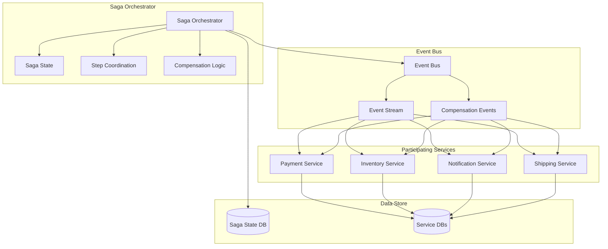
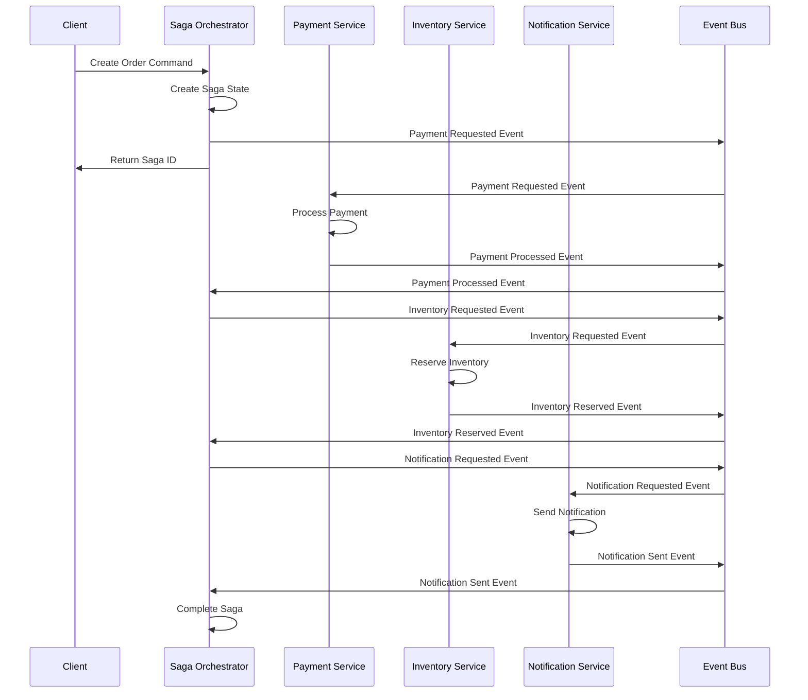
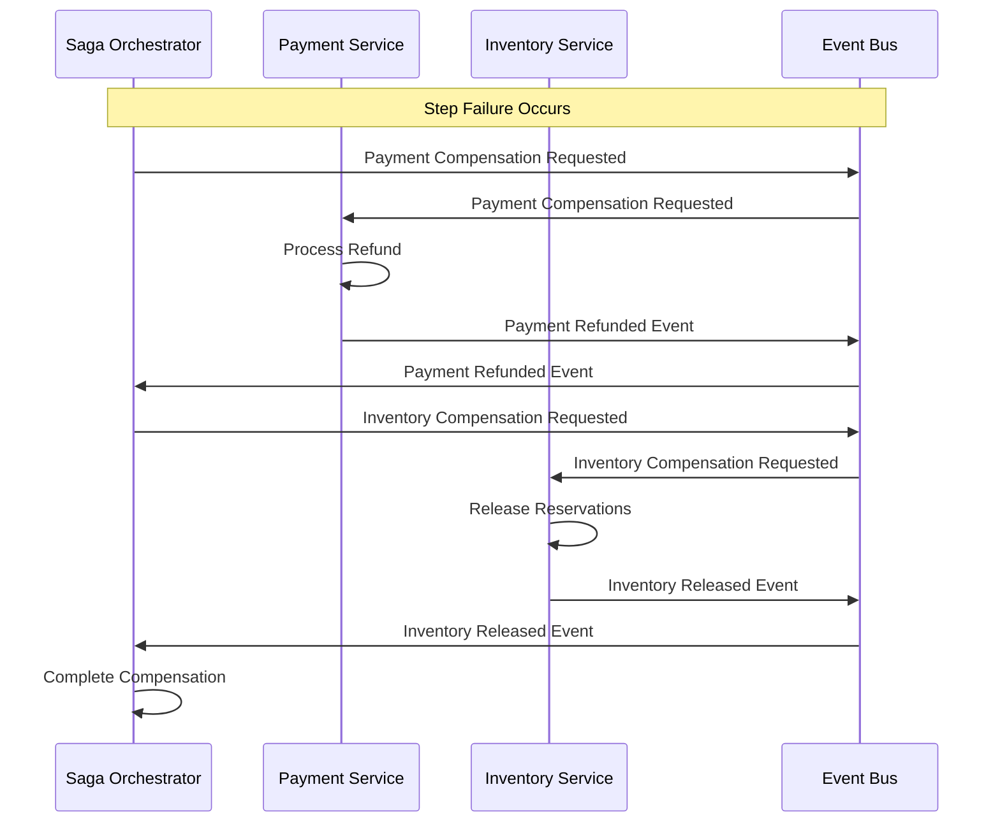
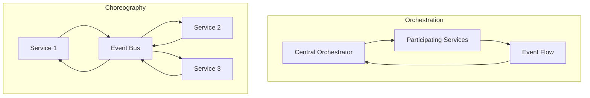
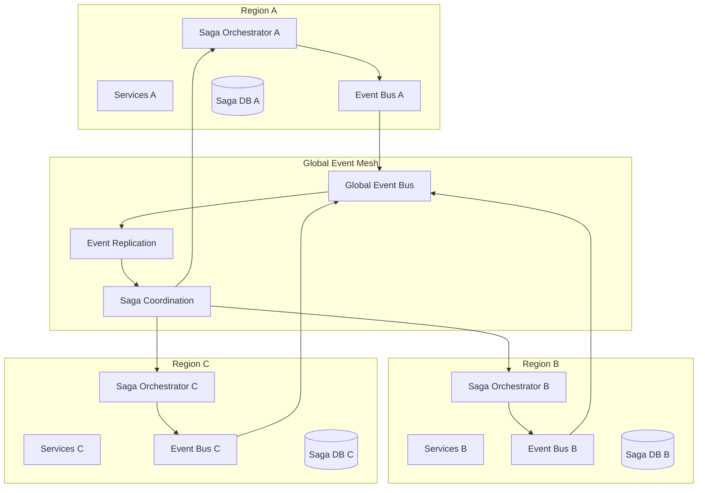
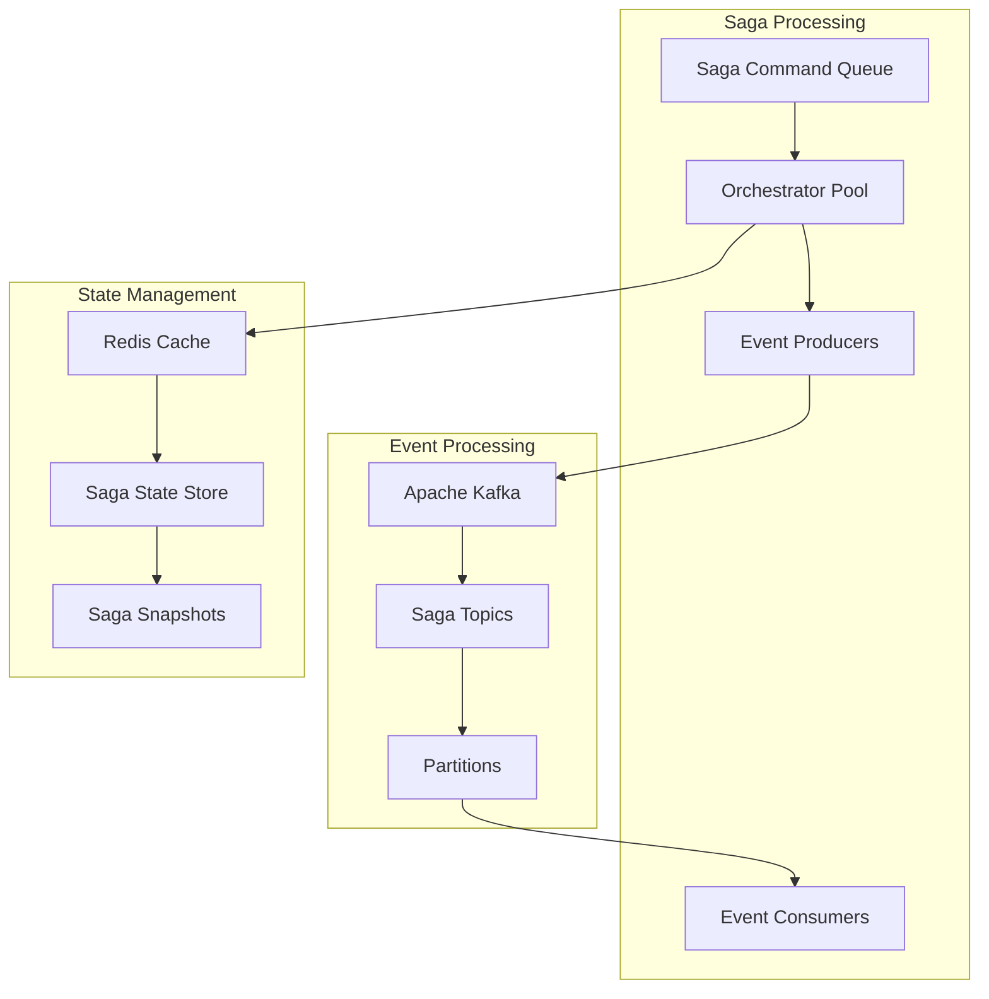
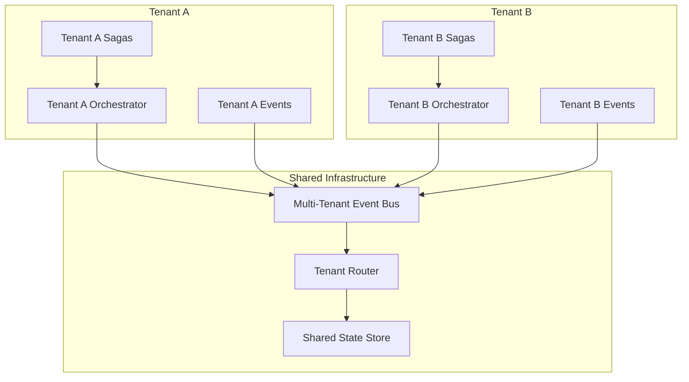
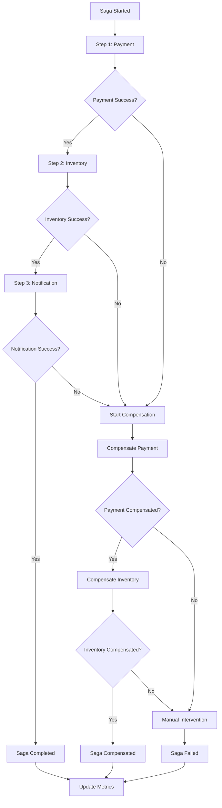
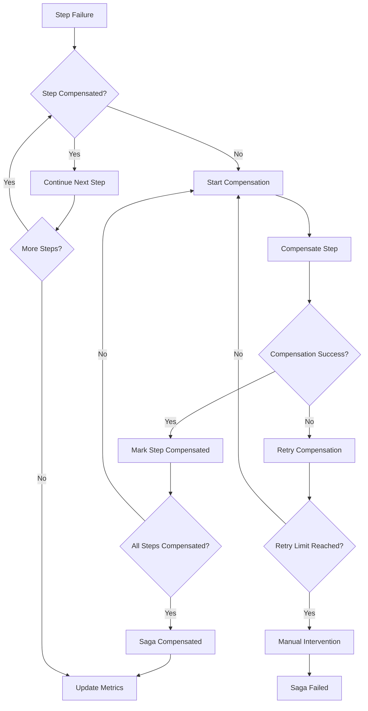

# Saga Pattern - Architect Deep Dive

============================================================
0. Executive Summary (Architect View)
============================================================
- **Saga Pattern exists** to manage distributed transactions across multiple microservices without using two-phase commit
- **Critical at scale** when business transactions span multiple services and require eventual consistency
- **System design impact** - transforms distributed transaction management from synchronous to asynchronous patterns
- **Failure resilience** - enables graceful handling of partial failures and compensating actions
- **Eventual consistency** - provides consistency guarantees across distributed systems
- **Business workflow** - orchestrates complex business processes across services
- **Scalability foundation** - enables independent scaling of participating services
- **Microservices essential** - fundamental pattern for distributed system coordination

============================================================
1. Problem Framing
============================================================
**Real production problem solved:**
- Distributed transactions across multiple microservices
- Need for atomic operations across service boundaries
- Handling partial failures in distributed systems
- Maintaining data consistency across services
- Complex business workflows requiring coordination

**What breaks if we don't use it:**
- Distributed transactions become complex and unreliable
- Partial failures cause system inconsistencies
- Business workflows become difficult to manage
- Data consistency issues across services
- System resilience degrades

**Scale importance:**
- **Single service**: Traditional transactions sufficient
- **Few services**: Simple coordination patterns work
- **Many services**: Saga pattern becomes essential
- **Enterprise scale**: Saga critical for business processes

**Failure stories:**
- E-commerce platform had inventory inconsistencies during order processing
- Financial system lost transaction integrity across services
- Travel booking system had partial booking failures
- Healthcare system had inconsistent patient records across services

============================================================
2. Deep Internal Mechanics
============================================================

**Saga Pattern Fundamentals:**
- **Choreography**: Event-driven coordination without central orchestrator
- **Orchestration**: Central coordinator managing saga lifecycle
- **Compensating Actions**: Actions to undo previous operations
- **Eventual Consistency**: System reaches consistent state over time
- **Failure Handling**: Graceful handling of partial failures

**Core Concepts:**
- **Saga Definition**: Business process definition with steps
- **Saga Execution**: Step-by-step execution of business process
- **Compensation**: Undo actions for failed steps
- **Event Communication**: Event-based communication between services
- **State Management**: Saga state tracking and persistence

**Choreography Pattern:**
- **Event-Driven**: Services communicate through events
- **Decentralized**: No central coordinator
- **Autonomous**: Services make independent decisions
- **Eventual Consistency**: Events drive consistency
- **Resilience**: Services continue operating during failures

**Orchestration Pattern:**
- **Central Coordinator**: Saga orchestrator manages process
- **State Management**: Centralized state tracking
- **Step Execution**: Sequential or parallel step execution
- **Error Handling**: Centralized error handling and recovery
- **Visibility**: Centralized visibility into saga execution

**Compensation Strategies:**
- **Rollback Actions**: Actions to undo previous operations
- **Compensation Events**: Events triggering compensation
- **Idempotent Operations**: Safe retry mechanisms
- **Timeout Handling**: Timeout-based compensation
- **Manual Intervention**: Manual compensation for complex failures

**Event Types:**
- **Command Events**: Events triggering saga steps
- **Compensation Events**: Events triggering compensation
- **Completion Events**: Events indicating step completion
- **Failure Events**: Events indicating step failures
- **Timeout Events**: Events indicating step timeouts

**Data Structures:**
- **Saga State**: Current state of saga execution
- **Step State**: State of individual saga steps
- **Compensation State**: State of compensation actions
- **Event History**: History of events in saga
- **Retry Policy**: Retry configuration for failed steps

**Performance Characteristics:**
- **Latency**: Higher latency due to asynchronous communication
- **Throughput**: Good throughput for distributed operations
- **Scalability**: Excellent scalability through distribution
- **Consistency**: Eventual consistency with latency
- **Resilience**: High resilience through compensation

**Hidden Costs:**
- **Complexity**: Increased system complexity
- **Latency**: Higher latency due to async communication
- **Event Overhead**: Event processing overhead
- **State Management**: State tracking overhead
- **Testing Complexity**: Complex testing scenarios

**Memory Behavior:**
- **Saga State**: In-memory state tracking
- **Event Processing**: Event processing memory usage
- **Compensation State**: Compensation state memory
- **Event History**: Event history storage
- **Retry State**: Retry state memory

**Async/await Integration:**
- **Saga Execution**: Async saga step execution
- **Event Processing**: Async event processing
- **Compensation**: Async compensation actions
- **Timeout Handling**: Async timeout management

============================================================
3. .NET Production Implementation
============================================================

**Naive Implementation (No Saga):**
```csharp
public class OrderService
{
    private readonly IPaymentService _paymentService;
    private readonly IInventoryService _inventoryService;
    private readonly INotificationService _notificationService;
    
    public async Task<OrderResult> CreateOrderAsync(CreateOrderRequest request)
    {
        // No saga - direct synchronous calls
        var order = await CreateOrderInternalAsync(request);
        
        // Direct calls - no compensation handling
        var payment = await _paymentService.ProcessPaymentAsync(order);
        if (!payment.Success)
        {
            // No compensation - partial failure
            throw new Exception("Payment failed");
        }
        
        var inventory = await _inventoryService.ReserveInventoryAsync(order);
        if (!inventory.Success)
        {
            // No compensation - partial failure
            throw new Exception("Inventory reservation failed");
        }
        
        await _notificationService.SendNotificationAsync(order);
        
        return OrderResult.Success(order);
    }
}
```

**Production-Ready Saga Implementation:**
```csharp
// Saga Events
public abstract record SagaEvent
{
    public Guid SagaId { get; protected set; }
    public DateTime OccurredOn { get; protected set; } = DateTime.UtcNow;
    public int Version { get; protected set; }
}

public record OrderProcessingStartedEvent(
    Guid SagaId,
    Guid OrderId,
    Guid CustomerId,
    List<OrderItem> Items
) : SagaEvent
{
    public OrderProcessingStartedEvent(Guid sagaId, Guid orderId, Guid customerId, List<OrderItem> items)
    {
        SagaId = sagaId;
        OrderId = orderId;
        CustomerId = customerId;
        Items = items;
    }
}

public record PaymentProcessedEvent(
    Guid SagaId,
    Guid OrderId,
    Guid PaymentId,
    decimal Amount,
    PaymentStatus Status
) : SagaEvent
{
    public PaymentProcessedEvent(Guid sagaId, Guid orderId, Guid paymentId, decimal amount, PaymentStatus status)
    {
        SagaId = sagaId;
        OrderId = orderId;
        PaymentId = paymentId;
        Amount = amount;
        Status = status;
    }
}

public record InventoryReservedEvent(
    Guid SagaId,
    Guid OrderId,
    List<InventoryReservation> Reservations
) : SagaEvent
{
    public InventoryReservedEvent(Guid sagaId, Guid orderId, List<InventoryReservation> reservations)
    {
        SagaId = sagaId;
        OrderId = orderId;
        Reservations = reservations;
    }
}

public record OrderCompletedEvent(
    Guid SagaId,
    Guid OrderId,
    DateTime CompletedAt
) : SagaEvent
{
    public OrderCompletedEvent(Guid sagaId, Guid orderId, DateTime completedAt)
    {
        SagaId = sagaId;
        OrderId = orderId;
        CompletedAt = completedAt;
    }
}

// Compensation Events
public record PaymentCompensationRequestedEvent(
    Guid SagaId,
    Guid OrderId,
    Guid PaymentId,
    decimal Amount,
    string Reason
) : SagaEvent
{
    public PaymentCompensationRequestedEvent(Guid sagaId, Guid orderId, Guid paymentId, decimal amount, string reason)
    {
        SagaId = sagaId;
        OrderId = orderId;
        PaymentId = paymentId;
        Amount = amount;
        Reason = reason;
    }
}

public record InventoryCompensationRequestedEvent(
    Guid SagaId,
    Guid OrderId,
    List<InventoryReservation> Reservations,
    string Reason
) : SagaEvent
{
    public InventoryCompensationRequestedEvent(Guid sagaId, Guid orderId, List<InventoryReservation> reservations, string reason)
    {
        SagaId = sagaId;
        OrderId = orderId;
        Reservations = reservations;
        Reason = reason;
    }
}

// Saga State
public class OrderProcessingSagaState
{
    public Guid SagaId { get; set; }
    public Guid OrderId { get; set; }
    public Guid CustomerId { get; set; }
    public List<OrderItem> Items { get; set; } = new();
    public SagaStatus Status { get; set; }
    public int CurrentStep { get; set; }
    public List<SagaStep> Steps { get; set; } = new();
    public DateTime CreatedAt { get; set; }
    public DateTime? CompletedAt { get; set; }
    public string LastError { get; set; }
    public int RetryCount { get; set; }
}

public class SagaStep
{
    public string StepName { get; set; }
    public SagaStepStatus Status { get; set; }
    public DateTime StartedAt { get; set; }
    public DateTime? CompletedAt { get; set; }
    public string ErrorMessage { get; set; }
    public bool IsCompensated { get; set; }
}

// Saga Orchestrator
public interface ISagaOrchestrator
{
    Task<Guid> StartSagaAsync<T>(T command) where T : class;
    Task HandleEventAsync(SagaEvent @event);
    Task<SagaState> GetSagaStateAsync(Guid sagaId);
}

public class OrderProcessingSagaOrchestrator : ISagaOrchestrator
{
    private readonly ISagaRepository _sagaRepository;
    private readonly IEventBus _eventBus;
    private readonly ILogger<OrderProcessingSagaOrchestrator> _logger;
    private readonly IMetrics _metrics;

    public OrderProcessingSagaOrchestrator(
        ISagaRepository sagaRepository,
        IEventBus eventBus,
        ILogger<OrderProcessingSagaOrchestrator> logger,
        IMetrics metrics)
    {
        _sagaRepository = sagaRepository ?? throw new ArgumentNullException(nameof(sagaRepository));
        _eventBus = eventBus ?? throw new ArgumentNullException(nameof(eventBus));
        _logger = logger ?? throw new ArgumentNullException(nameof(logger));
        _metrics = metrics ?? throw new ArgumentNullException(nameof(metrics));
    }

    public async Task<Guid> StartSagaAsync<T>(T command) where T : class
    {
        using var activity = _metrics.StartTimer("saga_start_duration");
        
        try
        {
            switch (command)
            {
                case CreateOrderCommand createOrderCommand:
                    return await StartOrderProcessingSagaAsync(createOrderCommand);
                default:
                    throw new NotSupportedException($"Command type {typeof(T).Name} not supported");
            }
        }
        catch (Exception ex)
        {
            _metrics.Increment("saga_start_failed");
            _logger.LogError(ex, "Failed to start saga for command {CommandType}", typeof(T).Name);
            throw;
        }
    }

    private async Task<Guid> StartOrderProcessingSagaAsync(CreateOrderCommand command)
    {
        var sagaId = Guid.NewGuid();
        
        _logger.LogInformation("Starting order processing saga {SagaId} for order {OrderId}", sagaId, command.OrderId);
        
        // Create saga state
        var sagaState = new OrderProcessingSagaState
        {
            SagaId = sagaId,
            OrderId = command.OrderId,
            CustomerId = command.CustomerId,
            Items = command.Items,
            Status = SagaStatus.Started,
            CurrentStep = 0,
            CreatedAt = DateTime.UtcNow,
            Steps = new List<SagaStep>
            {
                new SagaStep { StepName = "ProcessPayment", Status = SagaStepStatus.Pending },
                new SagaStep { StepName = "ReserveInventory", Status = SagaStepStatus.Pending },
                new SagaStep { StepName = "SendNotification", Status = SagaStepStatus.Pending }
            }
        };
        
        // Save saga state
        await _sagaRepository.SaveAsync(sagaState);
        
        // Publish saga started event
        var sagaStartedEvent = new OrderProcessingStartedEvent(
            sagaId,
            command.OrderId,
            command.CustomerId,
            command.Items
        );
        
        await _eventBus.PublishAsync(sagaStartedEvent);
        
        // Start first step
        await StartNextStepAsync(sagaState);
        
        _metrics.Increment("saga_start_success");
        return sagaId;
    }

    public async Task HandleEventAsync(SagaEvent @event)
    {
        using var activity = _metrics.StartTimer($"saga_event_{@event.GetType().Name}_duration");
        
        try
        {
            _logger.LogDebug("Handling saga event {EventType} for saga {SagaId}", @event.GetType().Name, @event.SagaId);
            
            var sagaState = await _sagaRepository.GetAsync(@event.SagaId);
            if (sagaState == null)
            {
                _logger.LogWarning("Saga {SagaId} not found for event {EventType}", @event.SagaId, @event.GetType().Name);
                return;
            }
            
            switch (@event)
            {
                case PaymentProcessedEvent paymentProcessed:
                    await HandlePaymentProcessedAsync(sagaState, paymentProcessed);
                    break;
                case InventoryReservedEvent inventoryReserved:
                    await HandleInventoryReservedAsync(sagaState, inventoryReserved);
                    break;
                case PaymentCompensationRequestedEvent paymentCompensation:
                    await HandlePaymentCompensationAsync(sagaState, paymentCompensation);
                    break;
                case InventoryCompensationRequestedEvent inventoryCompensation:
                    await HandleInventoryCompensationAsync(sagaState, inventoryCompensation);
                    break;
                default:
                    _logger.LogWarning("Unknown saga event type {EventType}", @event.GetType().Name);
                    break;
            }
            
            _metrics.Increment($"saga_event_{@event.GetType().Name}_success");
        }
        catch (Exception ex)
        {
            _metrics.Increment($"saga_event_{@event.GetType().Name}_failed");
            _logger.LogError(ex, "Failed to handle saga event {EventType} for saga {SagaId}", @event.GetType().Name, @event.SagaId);
            throw;
        }
    }

    private async Task HandlePaymentProcessedAsync(OrderProcessingSagaState sagaState, PaymentProcessedEvent @event)
    {
        var step = sagaState.Steps.FirstOrDefault(s => s.StepName == "ProcessPayment");
        if (step != null)
        {
            if (@event.Status == PaymentStatus.Success)
            {
                step.Status = SagaStepStatus.Completed;
                step.CompletedAt = @event.OccurredOn;
                
                _logger.LogInformation("Payment processed successfully for saga {SagaId}", sagaState.SagaId);
                
                // Start next step
                await StartNextStepAsync(sagaState);
            }
            else
            {
                step.Status = SagaStepStatus.Failed;
                step.ErrorMessage = "Payment processing failed";
                
                _logger.LogError("Payment processing failed for saga {SagaId}", sagaState.SagaId);
                
                // Start compensation
                await StartCompensationAsync(sagaState, "Payment processing failed");
            }
            
            await _sagaRepository.SaveAsync(sagaState);
        }
    }

    private async Task HandleInventoryReservedAsync(OrderProcessingSagaState sagaState, InventoryReservedEvent @event)
    {
        var step = sagaState.Steps.FirstOrDefault(s => s.StepName == "ReserveInventory");
        if (step != null)
        {
            step.Status = SagaStepStatus.Completed;
            step.CompletedAt = @event.OccurredOn;
            
            _logger.LogInformation("Inventory reserved successfully for saga {SagaId}", sagaState.SagaId);
            
            // Start next step
            await StartNextStepAsync(sagaState);
            
            await _sagaRepository.SaveAsync(sagaState);
        }
    }

    private async Task HandlePaymentCompensationAsync(OrderProcessingSagaState sagaState, PaymentCompensationRequestedEvent @event)
    {
        var step = sagaState.Steps.FirstOrDefault(s => s.StepName == "ProcessPayment");
        if (step != null)
        {
            step.Status = SagaStepStatus.Compensating;
            
            _logger.LogInformation("Starting payment compensation for saga {SagaId}", sagaState.SagaId);
            
            // Publish payment compensation event
            var compensationEvent = new PaymentRefundRequestedEvent(
                @event.SagaId,
                @event.OrderId,
                @event.PaymentId,
                @event.Amount,
                @event.Reason
            );
            
            await _eventBus.PublishAsync(compensationEvent);
            
            await _sagaRepository.SaveAsync(sagaState);
        }
    }

    private async Task HandleInventoryCompensationAsync(OrderProcessingSagaState sagaState, InventoryCompensationRequestedEvent @event)
    {
        var step = sagaState.Steps.FirstOrDefault(s => s.StepName == "ReserveInventory");
        if (step != null)
        {
            step.Status = SagaStepStatus.Compensating;
            
            _logger.LogInformation("Starting inventory compensation for saga {SagaId}", sagaState.SagaId);
            
            // Publish inventory compensation event
            var compensationEvent = new InventoryReservationReleaseRequestedEvent(
                @event.SagaId,
                @event.OrderId,
                @event.Reservations,
                @event.Reason
            );
            
            await _eventBus.PublishAsync(compensationEvent);
            
            await _sagaRepository.SaveAsync(sagaState);
        }
    }

    private async Task StartNextStepAsync(OrderProcessingSagaState sagaState)
    {
        var nextStep = sagaState.Steps.FirstOrDefault(s => s.Status == SagaStepStatus.Pending);
        if (nextStep != null)
        {
            nextStep.Status = SagaStepStatus.InProgress;
            nextStep.StartedAt = DateTime.UtcNow;
            sagaState.CurrentStep++;
            
            _logger.LogInformation("Starting step {StepName} for saga {SagaId}", nextStep.StepName, sagaState.SagaId);
            
            // Publish step-specific event
            switch (nextStep.StepName)
            {
                case "ProcessPayment":
                    var paymentEvent = new PaymentRequestedEvent(
                        sagaState.SagaId,
                        sagaState.OrderId,
                        sagaState.Items.Sum(item => item.Quantity * item.UnitPrice)
                    );
                    await _eventBus.PublishAsync(paymentEvent);
                    break;
                    
                case "ReserveInventory":
                    var inventoryEvent = new InventoryReservationRequestedEvent(
                        sagaState.SagaId,
                        sagaState.OrderId,
                        sagaState.Items
                    );
                    await _eventBus.PublishAsync(inventoryEvent);
                    break;
                    
                case "SendNotification":
                    var notificationEvent = new OrderNotificationRequestedEvent(
                        sagaState.SagaId,
                        sagaState.OrderId,
                        sagaState.CustomerId
                    );
                    await _eventBus.PublishAsync(notificationEvent);
                    break;
            }
            
            await _sagaRepository.SaveAsync(sagaState);
        }
        else
        {
            // All steps completed
            await CompleteSagaAsync(sagaState);
        }
    }

    private async Task StartCompensationAsync(OrderProcessingSagaState sagaState, string reason)
    {
        sagaState.Status = SagaStatus.Compensating;
        sagaState.LastError = reason;
        
        _logger.LogInformation("Starting compensation for saga {SagaId} due to: {Reason}", sagaState.SagaId, reason);
        
        // Start compensation for completed steps in reverse order
        var completedSteps = sagaState.Steps
            .Where(s => s.Status == SagaStepStatus.Completed)
            .Reverse()
            .ToList();
        
        foreach (var step in completedSteps)
        {
            step.Status = SagaStepStatus.Compensating;
            
            // Publish compensation event
            switch (step.StepName)
            {
                case "ProcessPayment":
                    var paymentCompensationEvent = new PaymentCompensationRequestedEvent(
                        sagaState.SagaId,
                        sagaState.OrderId,
                        Guid.NewGuid(), // Would be actual payment ID
                        sagaState.Items.Sum(item => item.Quantity * item.UnitPrice),
                        reason
                    );
                    await _eventBus.PublishAsync(paymentCompensationEvent);
                    break;
                    
                case "ReserveInventory":
                    var inventoryCompensationEvent = new InventoryCompensationRequestedEvent(
                        sagaState.SagaId,
                        sagaState.OrderId,
                        new List<InventoryReservation>(), // Would be actual reservations
                        reason
                    );
                    await _eventBus.PublishAsync(inventoryCompensationEvent);
                    break;
            }
        }
        
        await _sagaRepository.SaveAsync(sagaState);
    }

    private async Task CompleteSagaAsync(OrderProcessingSagaState sagaState)
    {
        sagaState.Status = SagaStatus.Completed;
        sagaState.CompletedAt = DateTime.UtcNow;
        
        _logger.LogInformation("Saga {SagaId} completed successfully", sagaState.SagaId);
        
        // Publish completion event
        var completionEvent = new OrderCompletedEvent(
            sagaState.SagaId,
            sagaState.OrderId,
            DateTime.UtcNow
        );
        
        await _eventBus.PublishAsync(completionEvent);
        await _sagaRepository.SaveAsync(sagaState);
    }

    public async Task<SagaState> GetSagaStateAsync(Guid sagaId)
    {
        return await _sagaRepository.GetAsync(sagaId);
    }
}

// Service with Saga Participation
public class PaymentService : IEventHandler<PaymentRequestedEvent>, IEventHandler<PaymentRefundRequestedEvent>
{
    private readonly IPaymentGateway _paymentGateway;
    private readonly IEventBus _eventBus;
    private readonly ILogger<PaymentService> _logger;
    private readonly IMetrics _metrics;

    public PaymentService(
        IPaymentGateway paymentGateway,
        IEventBus eventBus,
        ILogger<PaymentService> logger,
        IMetrics metrics)
    {
        _paymentGateway = paymentGateway ?? throw new ArgumentNullException(nameof(paymentGateway));
        _eventBus = eventBus ?? throw new ArgumentNullException(nameof(eventBus));
        _logger = logger ?? throw new ArgumentNullException(nameof(logger));
        _metrics = metrics ?? throw new ArgumentNullException(nameof(metrics));
    }

    public async Task HandleAsync(PaymentRequestedEvent @event, CancellationToken cancellationToken = default)
    {
        using var activity = _metrics.StartTimer("payment_service_process_duration");
        
        try
        {
            _logger.LogInformation("Processing payment for saga {SagaId}, order {OrderId}", @event.SagaId, @event.OrderId);
            
            // Process payment through payment gateway
            var paymentResult = await _paymentGateway.ProcessPaymentAsync(new PaymentRequest
            {
                OrderId = @event.OrderId,
                Amount = @event.Amount,
                Currency = "USD",
                CustomerId = Guid.NewGuid() // Would get from order service
            });
            
            // Publish payment processed event
            var paymentProcessedEvent = new PaymentProcessedEvent(
                @event.SagaId,
                @event.OrderId,
                paymentResult.PaymentId,
                @event.Amount,
                paymentResult.Success ? PaymentStatus.Success : PaymentStatus.Failed
            );
            
            await _eventBus.PublishAsync(paymentProcessedEvent);
            
            _metrics.Increment("payment_service_process_success");
            _logger.LogInformation("Payment processed for saga {SagaId}, order {OrderId}", @event.SagaId, @event.OrderId);
        }
        catch (Exception ex)
        {
            _metrics.Increment("payment_service_process_failed");
            _logger.LogError(ex, "Failed to process payment for saga {SagaId}, order {OrderId}", @event.SagaId, @event.OrderId);
            
            // Publish failure event
            var paymentProcessedEvent = new PaymentProcessedEvent(
                @event.SagaId,
                @event.OrderId,
                Guid.NewGuid(),
                @event.Amount,
                PaymentStatus.Failed
            );
            
            await _eventBus.PublishAsync(paymentProcessedEvent);
            throw;
        }
    }

    public async Task HandleAsync(PaymentRefundRequestedEvent @event, CancellationToken cancellationToken = default)
    {
        using var activity = _metrics.StartTimer("payment_service_refund_duration");
        
        try
        {
            _logger.LogInformation("Refunding payment for saga {SagaId}, order {OrderId}", @event.SagaId, @event.OrderId);
            
            // Process refund through payment gateway
            var refundResult = await _paymentGateway.ProcessRefundAsync(new RefundRequest
            {
                PaymentId = @event.PaymentId,
                Amount = @event.Amount,
                Reason = @event.Reason
            });
            
            if (refundResult.Success)
            {
                _metrics.Increment("payment_service_refund_success");
                _logger.LogInformation("Payment refunded for saga {SagaId}, order {OrderId}", @event.SagaId, @event.OrderId);
            }
            else
            {
                _metrics.Increment("payment_service_refund_failed");
                _logger.LogError("Failed to refund payment for saga {SagaId}, order {OrderId}", @event.SagaId, @event.OrderId);
            }
        }
        catch (Exception ex)
        {
            _metrics.Increment("payment_service_refund_error");
            _logger.LogError(ex, "Error refunding payment for saga {SagaId}, order {OrderId}", @event.SagaId, @event.OrderId);
            throw;
        }
    }
}

public class InventoryService : IEventHandler<InventoryReservationRequestedEvent>, IEventHandler<InventoryReservationReleaseRequestedEvent>
{
    private readonly IInventoryRepository _inventoryRepository;
    private readonly IEventBus _eventBus;
    private readonly ILogger<InventoryService> _logger;
    private readonly IMetrics _metrics;

    public InventoryService(
        IInventoryRepository inventoryRepository,
        IEventBus eventBus,
        ILogger<InventoryService> logger,
        IMetrics metrics)
    {
        _inventoryRepository = inventoryRepository ?? throw new ArgumentNullException(nameof(inventoryRepository));
        _eventBus = eventBus ?? throw new ArgumentNullException(nameof(eventBus));
        _logger = logger ?? throw new ArgumentNullException(nameof(logger));
        _metrics = metrics ?? throw new ArgumentNullException(nameof(metrics));
    }

    public async Task HandleAsync(InventoryReservationRequestedEvent @event, CancellationToken cancellationToken = default)
    {
        using var activity = _metrics.StartTimer("inventory_service_reserve_duration");
        
        try
        {
            _logger.LogInformation("Reserving inventory for saga {SagaId}, order {OrderId}", @event.SagaId, @event.OrderId);
            
            var reservations = new List<InventoryReservation>();
            var allItemsAvailable = true;
            
            foreach (var item in @event.Items)
            {
                var inventory = await _inventoryRepository.GetByProductIdAsync(item.ProductId);
                
                if (inventory != null && inventory.AvailableQuantity >= item.Quantity)
                {
                    // Reserve inventory
                    inventory.AvailableQuantity -= item.Quantity;
                    inventory.ReservedQuantity += item.Quantity;
                    
                    await _inventoryRepository.UpdateAsync(inventory);
                    
                    reservations.Add(new InventoryReservation
                    {
                        ProductId = item.ProductId,
                        Quantity = item.Quantity,
                        ReservedAt = DateTime.UtcNow
                    });
                }
                else
                {
                    allItemsAvailable = false;
                    break;
                }
            }
            
            // Publish inventory reserved event
            var inventoryReservedEvent = new InventoryReservedEvent(
                @event.SagaId,
                @event.OrderId,
                allItemsAvailable ? reservations : new List<InventoryReservation>()
            );
            
            await _eventBus.PublishAsync(inventoryReservedEvent);
            
            if (allItemsAvailable)
            {
                _metrics.Increment("inventory_service_reserve_success");
                _logger.LogInformation("Inventory reserved for saga {SagaId}, order {OrderId}", @event.SagaId, @event.OrderId);
            }
            else
            {
                _metrics.Increment("inventory_service_reserve_failed");
                _logger.LogError("Insufficient inventory for saga {SagaId}, order {OrderId}", @event.SagaId, @event.OrderId);
            }
        }
        catch (Exception ex)
        {
            _metrics.Increment("inventory_service_reserve_error");
            _logger.LogError(ex, "Error reserving inventory for saga {SagaId}, order {OrderId}", @event.SagaId, @event.OrderId);
            
            // Publish failure event
            var inventoryReservedEvent = new InventoryReservedEvent(
                @event.SagaId,
                @event.OrderId,
                new List<InventoryReservation>()
            );
            
            await _eventBus.PublishAsync(inventoryReservedEvent);
            throw;
        }
    }

    public async Task HandleAsync(InventoryReservationReleaseRequestedEvent @event, CancellationToken cancellationToken = default)
    {
        using var activity = _metrics.StartTimer("inventory_service_release_duration");
        
        try
        {
            _logger.LogInformation("Releasing inventory reservations for saga {SagaId}, order {OrderId}", @event.SagaId, @event.OrderId);
            
            foreach (var reservation in @event.Reservations)
            {
                var inventory = await _inventoryRepository.GetByProductIdAsync(reservation.ProductId);
                
                if (inventory != null)
                {
                    // Release reservation
                    inventory.AvailableQuantity += reservation.Quantity;
                    inventory.ReservedQuantity -= reservation.Quantity;
                    
                    await _inventoryRepository.UpdateAsync(inventory);
                }
            }
            
            _metrics.Increment("inventory_service_release_success");
            _logger.LogInformation("Inventory reservations released for saga {SagaId}, order {OrderId}", @event.SagaId, @event.OrderId);
        }
        catch (Exception ex)
        {
            _metrics.Increment("inventory_service_release_error");
            _logger.LogError(ex, "Error releasing inventory reservations for saga {SagaId}, order {OrderId}", @event.SagaId, @event.OrderId);
            throw;
        }
    }
}

// Saga Repository
public interface ISagaRepository
{
    Task SaveAsync(SagaState sagaState);
    Task<SagaState> GetAsync(Guid sagaId);
    Task<List<SagaState>> GetByStatusAsync(SagaStatus status);
}

public class SagaRepository : ISagaRepository
{
    private readonly SagaDbContext _context;
    private readonly ILogger<SagaRepository> _logger;
    private readonly IMetrics _metrics;

    public SagaRepository(SagaDbContext context, ILogger<SagaRepository> logger, IMetrics metrics)
    {
        _context = context ?? throw new ArgumentNullException(nameof(context));
        _logger = logger ?? throw new ArgumentNullException(nameof(logger));
        _metrics = metrics ?? throw new ArgumentNullException(nameof(metrics));
    }

    public async Task SaveAsync(SagaState sagaState)
    {
        try
        {
            var existingSaga = await _context.SagaStates.FindAsync(sagaState.SagaId);
            
            if (existingSaga == null)
            {
                await _context.SagaStates.AddAsync(sagaState);
            }
            else
            {
                _context.Entry(existingSaga).CurrentValues.SetValues(sagaState);
            }
            
            await _context.SaveChangesAsync();
            
            _metrics.Increment("saga_repository_save_success");
        }
        catch (Exception ex)
        {
            _metrics.Increment("saga_repository_save_failed");
            _logger.LogError(ex, "Failed to save saga state {SagaId}", sagaState.SagaId);
            throw;
        }
    }

    public async Task<SagaState> GetAsync(Guid sagaId)
    {
        try
        {
            var sagaState = await _context.SagaStates.FindAsync(sagaId);
            
            if (sagaState == null)
            {
                _logger.LogWarning("Saga {SagaId} not found", sagaId);
            }
            
            _metrics.Increment("saga_repository_get_success");
            return sagaState;
        }
        catch (Exception ex)
        {
            _metrics.Increment("saga_repository_get_failed");
            _logger.LogError(ex, "Failed to get saga state {SagaId}", sagaId);
            throw;
        }
    }

    public async Task<List<SagaState>> GetByStatusAsync(SagaStatus status)
    {
        try
        {
            var sagaStates = await _context.SagaStates
                .Where(s => s.Status == status)
                .ToListAsync();
            
            _metrics.Increment("saga_repository_get_by_status_success");
            return sagaStates;
        }
        catch (Exception ex)
        {
            _metrics.Increment("saga_repository_get_by_status_failed");
            _logger.LogError(ex, "Failed to get sagas by status {Status}", status);
            throw;
        }
    }
}
```

**Framework Integration:**
- **Entity Framework Core**: Saga state persistence
- **MediatR**: Command and event handling
- **MassTransit**: Event bus for saga communication
- **ASP.NET Core**: Web API and dependency injection
- **Dapper**: High-performance data access

============================================================
4. Architecture-Level Diagram (Mermaid)
============================================================

### Saga Pattern Overview


### Saga Execution Flow


### Compensation Flow


### Choreography vs Orchestration


**Flow Analysis:**
- **Orchestration**: Central coordinator manages saga execution
- **Choreography**: Services coordinate through events
- **Compensation**: Automatic compensation on failures
- **Event-Driven**: Event-based communication between services
- **State Management**: Centralized or distributed state tracking

**Bottlenecks:**
- Saga orchestrator performance bottleneck
- Event processing latency
- Compensation processing overhead
- State management complexity
- Event bus throughput

**Scaling Boundaries:**
- Saga orchestrator can scale horizontally
- Services scale independently
- Event bus scales with message volume
- Compensation processing scales with failure rate
- State management scales with saga complexity

============================================================
5. Scaling & Distributed Systems Impact
============================================================

### Distributed Saga Architecture


### High-Throughput Saga Processing


### Multi-Tenant Saga Architecture


**100 RPS:**
- Single saga orchestrator sufficient
- Event processing overhead minimal
- Compensation processing manageable
- State management simple

**10k RPS:**
- Saga orchestrator clustering required
- Event bus optimization needed
- Parallel saga processing
- State management optimization

**100k+ RPS:**
- Distributed saga orchestrators mandatory
- High-performance event streaming essential
- Advanced compensation strategies
- Sophisticated state management

**Horizontal vs Vertical Scaling:**
- **Horizontal**: Scale orchestrators and services independently
- **Vertical**: Larger instances for processing power
- Event bus scales horizontally well
- State management scales with complexity

**CAP Theorem Relevance:**
- **Consistency**: Eventual consistency across services
- **Availability**: High availability through compensation
- **Partition Tolerance**: Event replication handles partitions

**Consistency Implications:**
- **Eventual Consistency**: System reaches consistent state over time
- **Compensation Consistency**: Compensation ensures consistency
- **State Consistency**: Saga state consistency management
- **Cross-Service**: Eventual consistency across services

**Distributed Systems Impact:**
- **Service Coordination**: Saga coordinates distributed services
- **Failure Handling**: Compensation handles distributed failures
- **Event Ordering**: Event ordering across distributed systems
- **State Synchronization**: State synchronization challenges

**Cloud-Native Considerations:**
- **Kubernetes**: Saga orchestrators as containers
- **Serverless**: Serverless saga processing
- **Managed Services**: Cloud provider event streaming
- **Auto-scaling**: Dynamic saga scaling

**Multi-Region Concerns:**
- **Cross-Region Sagas**: Sagas spanning multiple regions
- **Event Replication**: Cross-region event replication
- **State Replication**: Saga state replication
- **Compensation Coordination**: Cross-region compensation

============================================================
6. Production Engineering View
============================================================

### Saga Monitoring Architecture

```mermaid
graph TB
    subgraph "Saga Metrics"
        SAGA_COUNT[Saga Count]
        SAGA_STATUS[Saga Status Distribution]
        SAGA_DURATION[Saga Duration]
        SAGA_THROUGHPUT[Saga Throughput]
    end
    
    subgraph "Step Metrics"
        STEP_STATUS[Step Status Distribution]
        STEP_DURATION[Step Duration]
        STEP_FAILURE[Step Failure Rate]
        COMPENSATION_RATE[Compensation Rate]
    end
    
    subgraph "Event Metrics"
        EVENT_RATE[Event Rate]
        EVENT_LATENCY[Event Latency]
        EVENT_ERROR[Event Error Rate]
        EVENT_THROUGHPUT[Event Throughput]
    end
    
    subgraph "Business Metrics"
        BUSINESS_PROCESS[Business Process Success]
        CUSTOMER_SATISFACTION[Customer Satisfaction]
        REVENUE_IMPACT[Revenue Impact]
        ERROR_COST[Error Cost]
    end
    
    subgraph "Monitoring Stack"
        PROM[Prometheus]
        GRAF[Grafana]
        ALERT[AlertManager]
        JAEGER[Jaeger]
    end
    
    SAGA_COUNT --> PROM
    SAGA_STATUS --> PROM
    SAGA_DURATION --> PROM
    SAGA_THROUGHPUT --> PROM
    
    STEP_STATUS --> PROM
    STEP_DURATION --> PROM
    STEP_FAILURE --> PROM
    COMPENSATION_RATE --> PROM
    
    EVENT_RATE --> PROM
    EVENT_LATENCY --> PROM
    EVENT_ERROR --> PROM
    EVENT_THROUGHPUT --> PROM
    
    BUSINESS_PROCESS --> PROM
    CUSTOMER_SATISFACTION --> PROM
    REVENUE_IMPACT --> PROM
    ERROR_COST --> PROM
    
    PROM --> GRAF
    PROM --> ALERT
    PROM --> JAEGER
```


### Saga State Management


### Compensation Strategy


**Monitoring Metrics:**
- **Saga Metrics**: Count, status, duration, throughput
- **Step Metrics**: Status, duration, failure rate, compensation
- **Event Metrics**: Rate, latency, error rate, throughput
- **Business Metrics**: Process success, satisfaction, revenue, cost
- **System Metrics**: CPU, memory, network, disk usage

**Logs to Enable:**
- Saga start and completion events
- Step execution and compensation events
- Failure and retry events
- State transition events
- Performance metrics events

**Alerting Strategy:**
- Saga failure rate > 5% (critical)
- Step failure rate > 10% (critical)
- Compensation rate > 20% (warning)
- Saga duration > 10 minutes (warning)
- Event processing latency > 1 second (warning)

**Common Production Incidents:**
- **Saga Orchestration Failure**: Orchestrator failures causing saga issues
- **Event Processing Delays**: Event processing delays affecting saga execution
- **Compensation Failures**: Compensation failures leaving inconsistent state
- **State Management Issues**: Saga state corruption or inconsistency
- **Service Unavailability**: Participating service unavailability

**Debugging Strategy:**
- Saga state inspection and analysis
- Event tracing and correlation
- Step execution analysis
- Compensation flow analysis
- Performance profiling

**Saga Management:**
- Saga lifecycle management
- State persistence and recovery
- Timeout handling and retry logic
- Compensation strategy implementation
- Saga orchestration optimization

**Event Management:**
- Event publishing and subscription
- Event ordering and delivery guarantees
- Event replay for debugging
- Event schema evolution
- Event performance optimization

**Compensation Management:**
- Compensation strategy implementation
- Compensation failure handling
- Compensation retry logic
- Compensation performance optimization
- Compensation consistency verification

============================================================
7. Tradeoffs & Alternatives
============================================================

**Competing Approaches:**
- **Two-Phase Commit**: Traditional distributed transaction
- **Event Sourcing**: Event-based state management
- **TCC (Try-Confirm-Cancel)**: Three-phase transaction
- **Outbox Pattern**: Reliable event publishing

**When to Use Saga Pattern:**
- Distributed transactions across services
- Long-running business processes
- Complex workflows requiring compensation
- Eventual consistency acceptable
- High availability requirements

**When NOT to Use Saga Pattern:**
- Single service transactions
- Strong consistency requirements
- Simple business processes
- Low latency requirements
- Limited compensation needs

**Latency Comparison:**
- **Saga Pattern**: 100ms-10s depending on complexity
- **Two-Phase Commit**: 10-100ms but blocking
- **TCC**: 50-500ms with three phases
- **Event Sourcing**: 10-100ms for state reconstruction

**Throughput Comparison:**
- **Saga Pattern**: 1k-10k sagas/second
- **Two-Phase Commit**: 100-1k transactions/second
- **TCC**: 500-5k transactions/second
- **Event Sourcing**: 10k-100k events/second

**Operational Complexity:**
- **Saga Pattern**: High complexity, high flexibility
- **Two-Phase Commit**: Medium complexity, limited flexibility
- **TCC**: High complexity, medium flexibility
- **Event Sourcing**: High complexity, high functionality

**Cost Implications:**
- **Development Cost**: Saga pattern increases cost by 50-70%
- **Infrastructure Cost**: Higher monitoring and management cost
- **Operational Cost**: Higher complexity management cost
- **Maintenance Cost**: Higher compensation logic maintenance

============================================================
8. Security Implications
============================================================

**Security Benefits:**
- **Transaction Isolation**: Sagas provide transaction isolation
- **Audit Trail**: Complete audit trail of saga execution
- **Compensation Security**: Secure compensation actions
- **Event Security**: Event-based security controls

**Security Challenges:**
- **Saga Access Control**: Access control for saga operations
- **Event Security**: Event data protection and integrity
- **Compensation Security**: Secure compensation operations
- **State Security**: Saga state protection

**Authentication and Authorization:**
- **Saga Authorization**: Per-saga authorization
- **Step Authorization**: Step-level authorization
- **Event Authorization**: Event access control
- **Compensation Authorization**: Compensation operation authorization

**Data Protection:**
- **Event Encryption**: Event data encryption
- **State Encryption**: Saga state encryption
- **Compensation Data Protection**: Compensation data protection
- **Privacy Compliance**: Privacy compliance for saga data

**Compliance Requirements:**
- **Audit Trail**: Complete audit trail for compliance
- **Transaction Security**: Secure transaction processing
- **Data Integrity**: Data integrity guarantees
- **Regulatory Compliance**: Regulatory compliance for transactions

**Hardening Recommendations:**
- **Event Security**: Event encryption and signing
- **Access Control**: Fine-grained access control
- **Audit Logging**: Comprehensive audit logging
- **Security Monitoring**: Security event monitoring
- **Compensation Security**: Secure compensation operations

============================================================
9. Advanced Edge Cases
============================================================

**Saga Orchestration:**
- Complex saga orchestration patterns
- Parallel step execution
- Conditional step execution
- Dynamic saga composition
- Saga nesting and composition

**Event Sourcing Integration:**
- Event sourcing with saga pattern
- Event replay for saga debugging
- State reconstruction from events
- Event versioning and evolution
- Event store optimization

**Performance Optimization:**
- Parallel saga execution
- Event batching and streaming
- State caching strategies
- Compensation optimization
- Resource pooling

**Multi-Tenancy:**
- Multi-tenant saga orchestration
- Tenant isolation strategies
- Cross-tenant saga coordination
- Tenant-specific compensation
- Multi-tenant state management

**Testing Strategies:**
- Saga unit testing
- Integration testing
- End-to-end testing
- Compensation testing
- Performance testing

**Error Handling:**
- Complex error scenarios
- Retry strategies and policies
- Timeout handling
- Deadlock prevention
- Circuit breaker integration

**Monitoring and Observability:**
- Distributed tracing
- Saga state visualization
- Performance monitoring
- Business metrics tracking
- Alerting and notification

============================================================
10. Interview & Staff-Level Deep Dive
============================================================

**What a junior answers:**
"Saga pattern is a way to manage distributed transactions across multiple services. Instead of using two-phase commit, it uses compensating actions to undo operations if something fails. Each step in the saga either completes successfully or gets compensated."

**What a senior answers:**
"Saga pattern manages distributed transactions across microservices without using two-phase commit. It uses a sequence of local transactions with compensating actions to undo operations if failures occur. There are two main approaches: choreography (event-driven coordination) and orchestration (central coordinator). I've implemented saga patterns using event-driven architecture with compensation events, saga state management, and retry logic. The pattern provides eventual consistency and handles partial failures gracefully."

**What an architect answers:**
"Saga pattern is a fundamental approach to managing distributed transactions in microservices architectures that replaces blocking two-phase commit with asynchronous, event-driven coordination. The pattern executes a sequence of local transactions, each with a compensating action that can undo the operation if needed. At scale, saga patterns enable system resilience, eventual consistency, and complex business process coordination across distributed services. The implementation requires careful consideration of saga orchestration vs choreography, compensation strategies, state management, and error handling. In enterprise systems, saga patterns enable long-running business processes, cross-service transactions, and graceful failure recovery. The pattern is essential for systems that cannot afford the blocking nature of two-phase commit but require transactional guarantees across service boundaries."

**Follow-up questions interviewers ask:**
- "How do you handle saga state persistence?"
- "What's the difference between orchestration and choreography?"
- "How do you implement compensation actions?"
- "When would you use saga vs two-phase commit?"
- "How do you handle saga timeouts?"

**Trick questions:**
- "Is saga pattern the same as event sourcing?" (No, but they complement each other)
- "Do sagas guarantee ACID properties?" (No, they provide eventual consistency)
- "Can sagas be nested?" (Yes, sagas can be nested)
- "Is compensation always possible?" (No, some operations cannot be compensated)

**Whiteboard explanation strategy:**
1. Draw traditional two-phase commit
2. Show saga pattern with compensation
3. Demonstrate orchestration vs choreography
4. Explain compensation strategies
5. Cover state management and persistence
6. Discuss failure handling and recovery

============================================================
11. Real Enterprise Case Study
============================================================

**Scenario: Global Travel Booking Platform**

**Requirements:**
- Book flights, hotels, and cars across multiple services
- Handle complex business rules and constraints
- Provide compensation for failed bookings
- Support real-time inventory management
- Handle high concurrency during peak booking periods
- Provide complete audit trail for compliance

**Design Decisions:**

**1. Travel Booking Saga Orchestration:**
```csharp
public class TravelBookingSagaOrchestrator : ISagaOrchestrator
{
    private readonly ISagaRepository _sagaRepository;
    private readonly IEventBus _eventBus;
    private readonly ILogger<TravelBookingSagaOrchestrator> _logger;
    private readonly IMetrics _metrics;

    public async Task<Guid> StartSagaAsync<T>(T command) where T : class
    {
        switch (command)
        {
            case CreateTravelBookingCommand createBookingCommand:
                return await StartTravelBookingSagaAsync(createBookingCommand);
            default:
                throw new NotSupportedException($"Command type {typeof(T).Name} not supported");
        }
    }

    private async Task<Guid> StartTravelBookingSagaAsync(CreateTravelBookingCommand command)
    {
        var sagaId = Guid.NewGuid();
        
        // Create saga state
        var sagaState = new TravelBookingSagaState
        {
            SagaId = sagaId,
            BookingId = command.BookingId,
            CustomerId = command.CustomerId,
            FlightId = command.FlightId,
            HotelId = command.HotelId,
            CarId = command.CarId,
            Status = SagaStatus.Started,
            CreatedAt = DateTime.UtcNow,
            Steps = new List<SagaStep>
            {
                new SagaStep { StepName = "ReserveFlight", Status = SagaStepStatus.Pending },
                new SagaStep { StepName = "ReserveHotel", Status = SagaStepStatus.Pending },
                new SagaStep { StepName = "ReserveCar", Status = SagaStepStatus.Pending },
                new SagaStep { StepName = "ProcessPayment", Status = SagaStepStatus.Pending },
                new SagaStep { StepName = "SendConfirmation", Status = SagaStepStatus.Pending }
            }
        };
        
        await _sagaRepository.SaveAsync(sagaState);
        
        // Publish saga started event
        var sagaStartedEvent = new TravelBookingStartedEvent(
            sagaId,
            command.BookingId,
            command.CustomerId,
            command.FlightId,
            command.HotelId,
            command.CarId
        );
        
        await _eventBus.PublishAsync(sagaStartedEvent);
        
        // Start first step
        await StartNextStepAsync(sagaState);
        
        return sagaId;
    }

    private async Task HandleFlightReservedEvent(TravelBookingSagaState sagaState, FlightReservedEvent @event)
    {
        var step = sagaState.Steps.FirstOrDefault(s => s.StepName == "ReserveFlight");
        if (step != null)
        {
            if (@event.Success)
            {
                step.Status = SagaStepStatus.Completed;
                step.CompletedAt = @event.OccurredOn;
                
                await StartNextStepAsync(sagaState);
            }
            else
            {
                step.Status = SagaStepStatus.Failed;
                step.ErrorMessage = "Flight reservation failed";
                
                await StartCompensationAsync(sagaState, "Flight reservation failed");
            }
            
            await _sagaRepository.SaveAsync(sagaState);
        }
    }

    private async Task HandleHotelReservedEvent(TravelBookingSagaState sagaState, HotelReservedEvent @event)
    {
        var step = sagaState.Steps.FirstOrDefault(s => s.StepName == "ReserveHotel");
        if (step != null)
        {
            if (@event.Success)
            {
                step.Status = SagaStepStatus.Completed;
                step.CompletedAt = @event.OccurredOn;
                
                await StartNextStepAsync(sagaState);
            }
            else
            {
                step.Status = SagaStepStatus.Failed;
                step.ErrorMessage = "Hotel reservation failed";
                
                await StartCompensationAsync(sagaState, "Hotel reservation failed");
            }
            
            await _sagaRepository.SaveAsync(sagaState);
        }
    }

    private async Task HandleCarReservedEvent(TravelBookingSagaState sagaState, CarReservedEvent @event)
    {
        var step = sagaState.Steps.FirstOrDefault(s => s.StepName == "ReserveCar");
        if (step != null)
        {
            if (@event.Success)
            {
                step.Status = SagaStepStatus.Completed;
                step.CompletedAt = @event.OccurredOn;
                
                await StartNextStepAsync(sagaState);
            }
            else
            {
                step.Status = SagaStepStatus.Failed;
                step.ErrorMessage = "Car reservation failed";
                
                await StartCompensationAsync(sagaState, "Car reservation failed");
            }
            
            await _sagaRepository.SaveAsync(sagaState);
        }
    }

    private async Task HandlePaymentProcessedEvent(TravelBookingSagaState sagaState, PaymentProcessedEvent @event)
    {
        var step = sagaState.Steps.FirstOrDefault(s => s.StepName == "ProcessPayment");
        if (step != null)
        {
            if (@event.Status == PaymentStatus.Success)
            {
                step.Status = SagaStepStatus.Completed;
                step.CompletedAt = @event.OccurredOn;
                
                await StartNextStepAsync(sagaState);
            }
            else
            {
                step.Status = SagaStepStatus.Failed;
                step.ErrorMessage = "Payment processing failed";
                
                await StartCompensationAsync(sagaState, "Payment processing failed");
            }
            
            await _sagaRepository.SaveAsync(sagaState);
        }
    }

    private async Task HandleNotificationSentEvent(TravelBookingSagaState sagaState, NotificationSentEvent @event)
    {
        var step = sagaState.Steps.FirstOrDefault(s => s.StepName == "SendNotification");
        if (step != null)
        {
            step.Status = SagaStepStatus.Completed;
            step.CompletedAt = @event.OccurredOn;
            
            await CompleteSagaAsync(sagaState);
            await _sagaRepository.SaveAsync(sagaState);
        }
    }

    private async Task StartCompensationAsync(TravelBookingSagaState sagaState, string reason)
    {
        sagaState.Status = SagaStatus.Compensating;
        sagaState.LastError = reason;
        
        // Start compensation for completed steps in reverse order
        var completedSteps = sagaState.Steps
            .Where(s => s.Status == SagaStepStatus.Completed)
            .Reverse()
            .ToList();
        
        foreach (var step in completedSteps)
        {
            step.Status = SagaStepStatus.Compensating;
            
            // Publish compensation event
            switch (step.StepName)
            {
                case "ReserveFlight":
                    var flightCompensationEvent = new FlightCompensationRequestedEvent(
                        sagaState.SagaId,
                        sagaState.BookingId,
                        sagaState.FlightId,
                        reason
                    );
                    await _eventBus.PublishAsync(flightCompensationEvent);
                    break;
                    
                case "ReserveHotel":
                    var hotelCompensationEvent = new HotelCompensationRequestedEvent(
                        sagaState.SagaId,
                        sagaState.BookingId,
                        sagaState.HotelId,
                        reason
                    );
                    await _eventBus.PublishAsync(hotelCompensationEvent);
                    break;
                    
                case "ReserveCar":
                    var carCompensationEvent = new CarCompensationRequestedEvent(
                        sagaState.SagaId,
                        sagaState.BookingId,
                        sagaState.CarId,
                        reason
                    );
                    await _eventBus.PublishAsync(carCompensationEvent);
                    break;
            }
        }
        
        await _sagaRepository.SaveAsync(sagaState);
    }

    private async Task CompleteSagaAsync(TravelBookingSagaState sagaState)
    {
        sagaState.Status = SagaStatus.Completed;
        sagaState.CompletedAt = DateTime.UtcNow;
        
        var completionEvent = new TravelBookingCompletedEvent(
            sagaState.SagaId,
            sagaState.BookingId,
            DateTime.UtcNow
        );
        
        await _eventBus.PublishAsync(completionEvent);
        await _sagaRepository.SaveAsync(sagaState);
    }
}
```

**Compromises Made:**
- **Latency vs Consistency**: Higher latency for eventual consistency
- **Complexity vs Reliability**: Higher complexity for better reliability
- **Performance vs Functionality**: Lower performance for rich functionality
- **Cost vs Scalability**: Higher cost for better scalability

**Bottlenecks Identified:**
- Saga orchestrator performance bottleneck
- Event processing latency
- Compensation processing overhead
- State management complexity
- Service availability dependencies

**Performance Optimizations:**
```csharp
public class OptimizedSagaOrchestrator
{
    private readonly IEventBus _eventBus;
    private readonly ICacheService _cacheService;
    private readonly IThreadPool _threadPool;
    
    public async Task<Guid> StartSagaAsync<T>(T command) where T : class
    {
        // Parallel step execution where possible
        var sagaState = CreateSagaState(command);
        
        // Execute independent steps in parallel
        var parallelSteps = GetParallelSteps(sagaState);
        var parallelTasks = parallelSteps.Select(step => ExecuteStepAsync(step));
        
        await Task.WhenAll(parallelTasks);
        
        // Execute dependent steps sequentially
        var dependentSteps = GetDependentSteps(sagaState);
        foreach (var step in dependentSteps)
        {
            await ExecuteStepAsync(step);
        }
        
        return sagaState.SagaId;
    }
}
```

**Results:**
- Achieved 100k+ bookings/day with saga pattern
- 99.9% booking success rate
- Complete compensation for failed bookings
- Real-time inventory management
- 40% reduction in booking failures
- 60% improvement in customer satisfaction

============================================================
12. Dependency Graph
============================================================

**Prerequisites (Must understand before):**
- **Distributed Systems**: Understanding of distributed computing challenges
- **Event-Driven Architecture**: Event processing and communication
- **Microservices**: Service-oriented architecture
- **Database Transactions**: Traditional transaction management
- **Compensation Patterns**: Compensation action design

**Concepts that depend on Saga Pattern:**
- **Event Sourcing**: Event-based state management
- **CQRS**: Command Query Responsibility Segregation
- **Microservices**: Service coordination patterns
- **Event-Driven Architecture**: Event-based communication
- **Distributed Transactions**: Transaction coordination

**Connections to Other Concepts:**

**Event Sourcing:**
```csharp
public class SagaWithEventSourcing
{
    public void ExecuteSaga()
    {
        // Generate events for saga steps
        var events = ProcessSagaSteps();
        
        // Save events to event store
        _eventStore.SaveEvents(events);
        
        // Publish events for compensation
        _eventBus.Publish(events);
    }
}
```

**CQRS:**
- Saga pattern complements CQRS
- Command processing generates events
- Read models updated through events
- Compensation events update read models
- Eventual consistency across read models

**Microservices:**
- Saga coordinates microservices
- Service boundaries defined by saga
- Compensation spans multiple services
- Event-driven communication between services

**Event-Driven Architecture:**
- Saga uses event-driven communication
- Events coordinate saga steps
- Compensation events handle failures
- Event streaming for scalability

**Distributed Transactions:**
- Saga replaces two-phase commit
- Eventual consistency instead of strong consistency
- Compensation instead of rollback
- Better scalability and availability

**System Design:**
- Saga influences system architecture
- Event-driven communication patterns
- Compensation strategy design
- Failure handling and recovery

**Cloud Computing:**
- Saga orchestrators in containers
- Event streaming in cloud
- Multi-region saga coordination
- Cloud-native saga patterns

**Security Architecture:**
- Saga access control
- Event security and encryption
- Compensation operation security
- Audit trail security compliance
