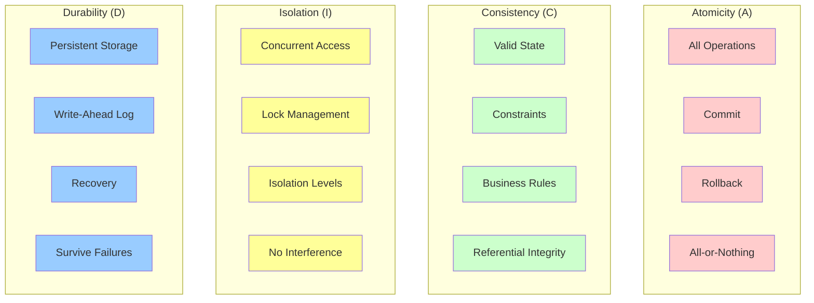
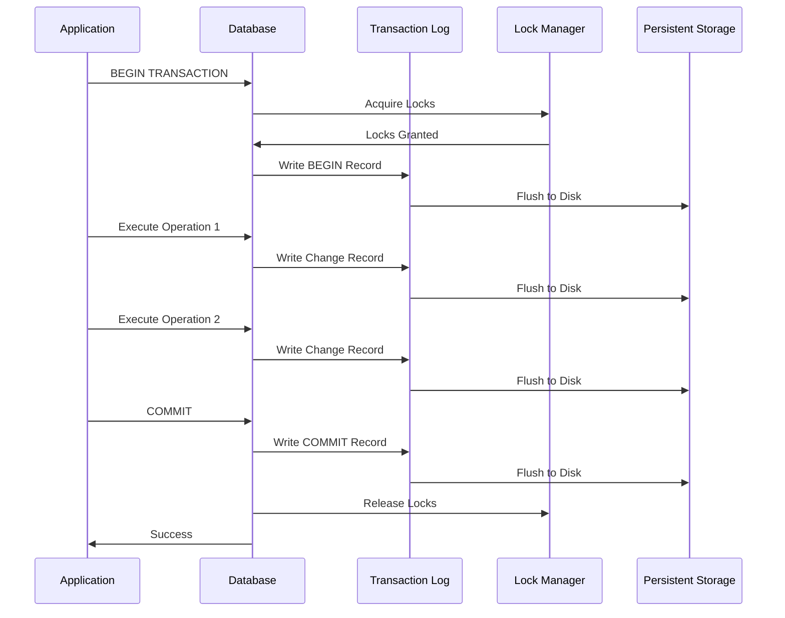
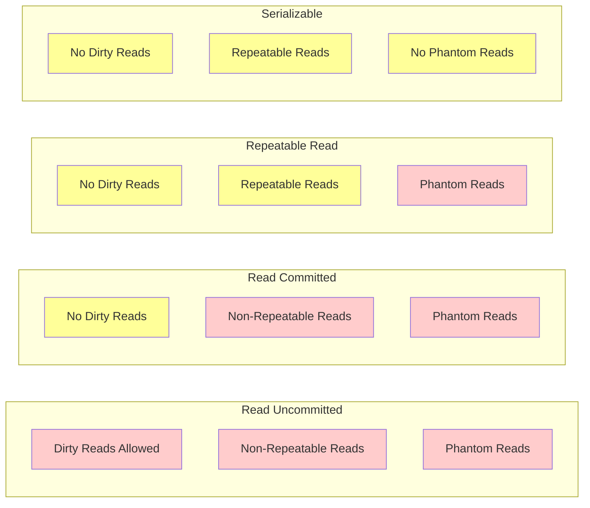
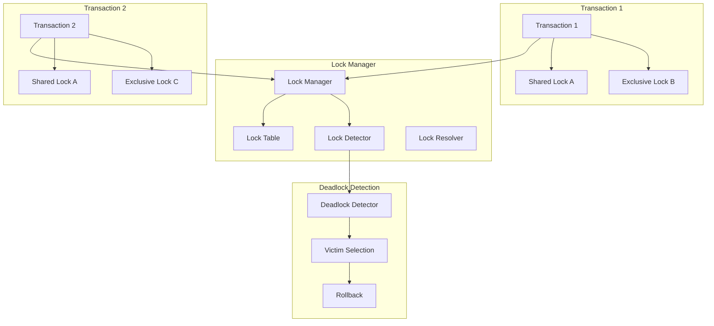
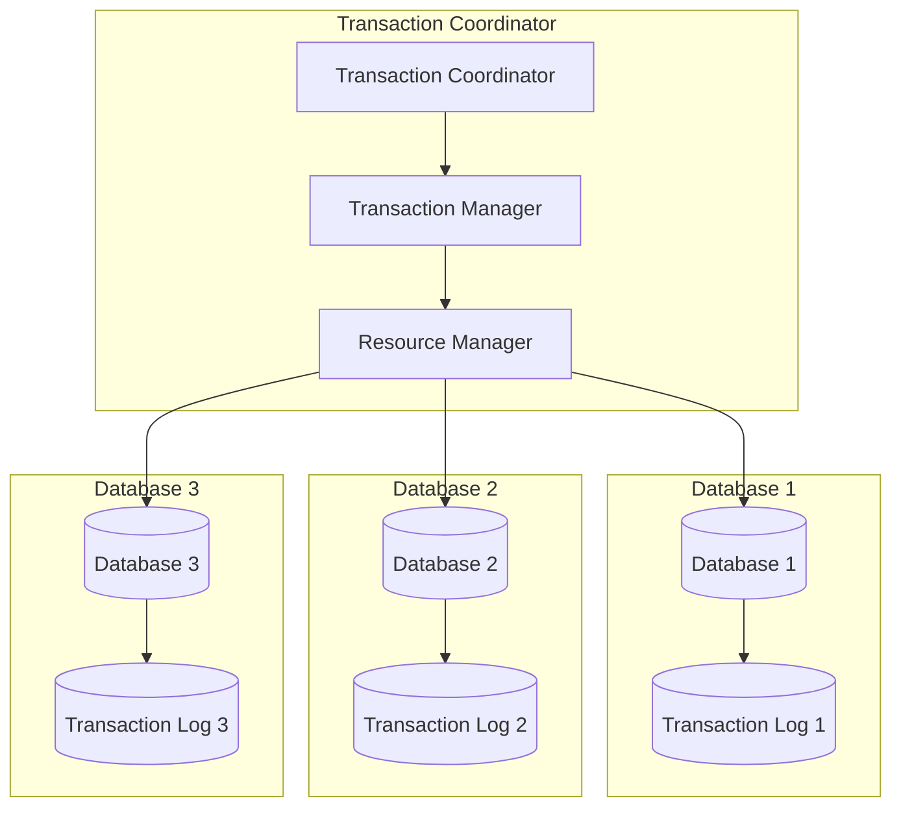
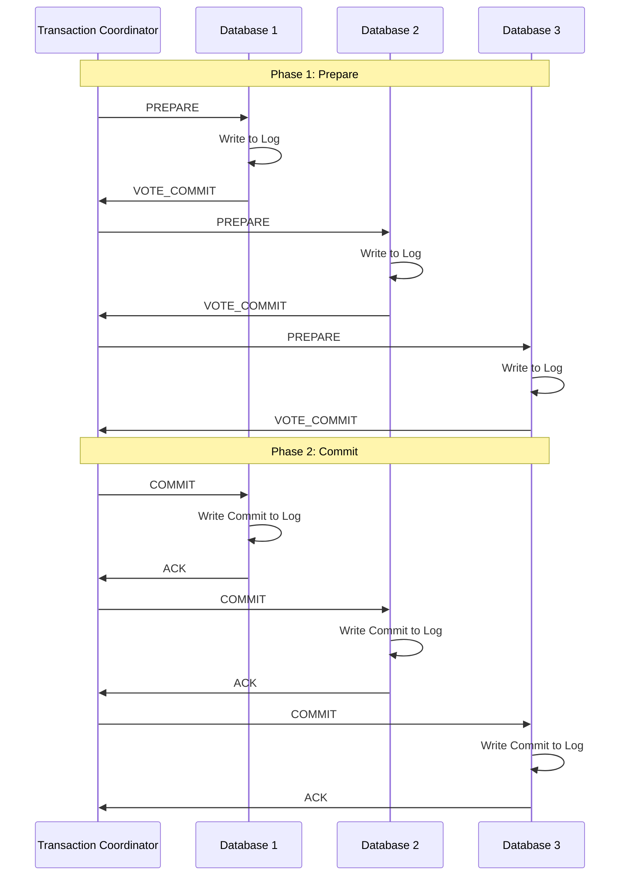
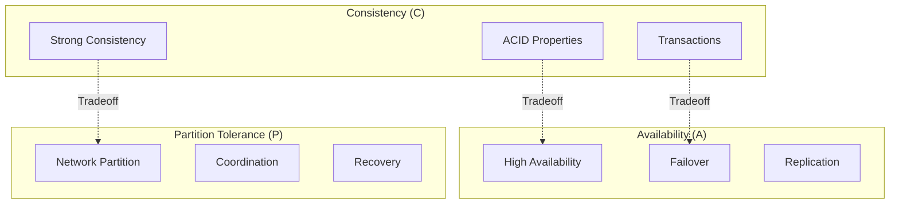
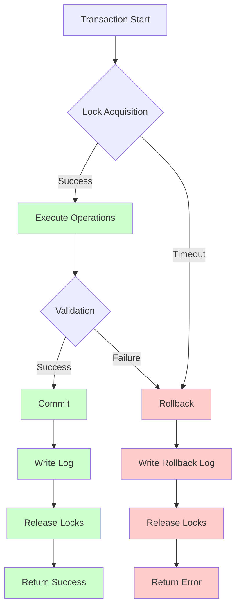

# ACID Properties - Architect Deep Dive

============================================================
0. Executive Summary (Architect View)
============================================================
- **ACID exists** to provide reliable transaction processing guarantees in database systems
- **Critical at scale** when data consistency and integrity become paramount for business operations
- **System design impact** - influences database selection, transaction boundaries, and system architecture
- **Data integrity foundation** - ensures database remains in consistent state despite failures
- **Concurrency control** - enables safe concurrent access to shared data
- **Recovery mechanisms** - provides automatic recovery from system failures
- **Business transaction support** - enables complex business operations with multiple steps
- **Compliance essential** - required for financial, healthcare, and regulatory systems

============================================================
1. Problem Framing
============================================================
**Real production problem solved:**
- Concurrent database access causing data corruption
- Partial transaction failures leaving inconsistent data
- System crashes during critical operations
- Race conditions in multi-user environments
- Financial transaction inconsistencies

**What breaks if we don't understand ACID:**
- Data corruption and inconsistency
- Lost updates and dirty reads
- Business logic failures
- Regulatory compliance violations
- System reliability issues

**Scale importance:**
- **Single user**: ACID less critical but still important
- **Concurrent users**: ACID becomes essential for data integrity
- **High transaction volume**: ACID critical for business operations
- **Distributed systems**: ACID implementation becomes complex

**Failure stories:**
- Banking system lost funds due to transaction rollback failures
- E-commerce platform had inventory inconsistencies
- Healthcare system had patient record corruption
- Financial trading system had settlement errors

============================================================
2. Deep Internal Mechanics
============================================================

**Atomicity (A):**
- **All-or-Nothing**: All operations in transaction succeed or none do
- **Commit/Rollback**: Transaction either commits or rolls back completely
- **Undo Log**: Records changes for rollback capability
- **Transaction Log**: Persistent record of all transactions
- **Recovery**: Automatic recovery from incomplete transactions

**Consistency (C):**
- **State Transitions**: Database moves from one consistent state to another
- **Constraints Enforcement**: Primary keys, foreign keys, unique constraints
- **Business Rules**: Application-level consistency requirements
- **Referential Integrity**: Relationships maintained between tables
- **Data Validation**: Type checking and domain constraints

**Isolation (I):**
- **Concurrent Control**: Multiple transactions don't interfere with each other
- **Isolation Levels**: Read Uncommitted, Read Committed, Repeatable Read, Serializable
- **Locking Mechanisms**: Shared locks, exclusive locks, intent locks
- **MVCC**: Multi-Version Concurrency Control for better performance
- **Phantom Reads**: Prevention of new rows appearing in reads

**Durability (D):**
- **Persistent Storage**: Committed transactions survive system failures
- **Write-Ahead Logging**: Changes logged before being applied to database
- **Checkpointing**: Periodic synchronization of memory and disk
- **Recovery Procedures**: Automatic recovery after system restart
- **Backup Integration**: Integration with backup and restore systems

**Transaction Processing Flow:**
1. **BEGIN TRANSACTION**: Start transaction boundary
2. **Execute Operations**: Perform database operations
3. **Validation**: Check constraints and business rules
4. **COMMIT/ROLLBACK**: Complete or abort transaction
5. **Log Persistence**: Ensure transaction log is written to disk
6. **Resource Cleanup**: Release locks and resources

**Lock Management:**
- **Lock Types**: Shared (read) locks, Exclusive (write) locks
- **Lock Granularity**: Row-level, page-level, table-level locks
- **Lock Escalation**: Promotion of fine-grained to coarse-grained locks
- **Deadlock Detection**: Automatic detection and resolution
- **Lock Timeouts**: Time-based lock release mechanisms

**Data Structures:**
- **Transaction Log**: Sequential log of all transaction changes
- **Lock Table**: Active locks and their owners
- **Undo Records**: Before-images for rollback
- **Checkpoint Records**: Points of database consistency
- **Recovery Log**: Information for crash recovery

**Performance Characteristics:**
- **Overhead**: ACID properties add 10-30% performance overhead
- **Latency**: Transaction commit latency 1-100ms depending on system
- **Throughput**: 1k-100k transactions/second depending on isolation level
- **Scalability**: Performance degrades with higher isolation levels

**Hidden Costs:**
- **Lock Contention**: Reduced concurrency with strict isolation
- **Log I/O**: Write-ahead logging requires disk I/O
- **Memory Usage**: Lock tables and transaction state consume memory
- **CPU Overhead**: Transaction management and validation

**Recovery Mechanisms:**
- **Crash Recovery**: Automatic recovery after system failure
- **Rollback Recovery**: Undo incomplete transactions
- **Rollforward Recovery**: Redo committed transactions
- **Point-in-Time Recovery**: Recovery to specific point in time
- **Media Recovery**: Recovery from media failures

============================================================
3. .NET Production Implementation
============================================================

**Naive Implementation (No ACID):**
```csharp
public class OrderService
{
    private readonly OrderDbContext _context;
    
    public async Task<OrderResult> CreateOrder(Order order)
    {
        // No transaction - potential for inconsistency
        var savedOrder = await _context.Orders.AddAsync(order);
        await _context.SaveChangesAsync();
        
        // Update inventory - separate operation, no transaction
        foreach (var item in order.Items)
        {
            var inventory = await _context.Inventory.FindAsync(item.ProductId);
            inventory.Quantity -= item.Quantity;
            await _context.SaveChangesAsync();
        }
        
        // Send notification - no rollback capability
        await _notificationService.SendOrderConfirmation(order);
        
        return OrderResult.Success(savedOrder.Entity);
    }
}
```

**Production-Ready ACID Implementation:**
```csharp
public class OrderService
{
    private readonly OrderDbContext _context;
    private readonly IInventoryService _inventoryService;
    private readonly IPaymentService _paymentService;
    private readonly INotificationService _notificationService;
    private readonly ILogger<OrderService> _logger;
    private readonly IMetrics _metrics;
    private readonly ITransactionCoordinator _transactionCoordinator;

    public OrderService(
        OrderDbContext context,
        IInventoryService inventoryService,
        IPaymentService paymentService,
        INotificationService notificationService,
        ILogger<OrderService> logger,
        IMetrics metrics,
        ITransactionCoordinator transactionCoordinator)
    {
        _context = context ?? throw new ArgumentNullException(nameof(context));
        _inventoryService = inventoryService ?? throw new ArgumentNullException(nameof(inventoryService));
        _paymentService = paymentService ?? throw new ArgumentNullException(nameof(paymentService));
        _notificationService = notificationService ?? throw new ArgumentNullException(nameof(notificationService));
        _logger = logger ?? throw new ArgumentNullException(nameof(logger));
        _metrics = metrics ?? throw new ArgumentNullException(nameof(metrics));
        _transactionCoordinator = transactionCoordinator ?? throw new ArgumentNullException(nameof(transactionCoordinator));
    }

    public async Task<OrderResult> CreateOrderAsync(CreateOrderRequest request, CancellationToken cancellationToken = default)
    {
        using var activity = _metrics.StartTimer("order_create_duration");
        
        // Use transaction scope for ACID properties
        using var transaction = await _context.Database.BeginTransactionAsync(
            IsolationLevel.Serializable, cancellationToken);
        
        try
        {
            _logger.LogInformation("Creating order for customer {CustomerId}", request.CustomerId);
            
            // Step 1: Validate and create order
            var order = await CreateOrderInternalAsync(request, cancellationToken);
            
            // Step 2: Reserve inventory
            await ReserveInventoryAsync(order, cancellationToken);
            
            // Step 3: Process payment
            var paymentResult = await ProcessPaymentAsync(order, cancellationToken);
            if (!paymentResult.Success)
            {
                throw new PaymentProcessingException(paymentResult.ErrorMessage);
            }
            
            // Step 4: Save order with payment info
            order.PaymentId = paymentResult.PaymentId;
            order.Status = OrderStatus.Confirmed;
            await _context.SaveChangesAsync(cancellationToken);
            
            // Step 5: Commit transaction
            await transaction.CommitAsync(cancellationToken);
            
            // Step 6: Send notification (outside transaction)
            _ = Task.Run(async () => await SendOrderConfirmationAsync(order));
            
            _metrics.Increment("order_created_success");
            _logger.LogInformation("Order {OrderId} created successfully", order.Id);
            
            return OrderResult.Success(order);
        }
        catch (Exception ex)
        {
            await transaction.RollbackAsync(cancellationToken);
            
            _metrics.Increment("order_created_failed");
            _logger.LogError(ex, "Failed to create order for customer {CustomerId}", request.CustomerId);
            
            return OrderResult.Failed(ex.Message);
        }
    }

    private async Task<Order> CreateOrderInternalAsync(CreateOrderRequest request, CancellationToken cancellationToken)
    {
        // Validate business rules
        if (request.Items.Count == 0)
        {
            throw new ValidationException("Order must contain at least one item");
        }
        
        if (request.TotalAmount <= 0)
        {
            throw new ValidationException("Order total amount must be positive");
        }
        
        // Create order entity
        var order = new Order
        {
            CustomerId = request.CustomerId,
            Items = request.Items.Select(item => new OrderItem
            {
                ProductId = item.ProductId,
                Quantity = item.Quantity,
                UnitPrice = item.UnitPrice,
                TotalPrice = item.Quantity * item.UnitPrice
            }).ToList(),
            ShippingAddress = request.ShippingAddress,
            TotalAmount = request.TotalAmount,
            Status = OrderStatus.Pending,
            CreatedAt = DateTime.UtcNow
        };
        
        // Add to context (not yet saved)
        await _context.Orders.AddAsync(order, cancellationToken);
        
        return order;
    }

    private async Task ReserveInventoryAsync(Order order, CancellationToken cancellationToken)
    {
        foreach (var item in order.Items)
        {
            // Use pessimistic locking for inventory
            var inventory = await _context.Inventory
                .WithLock(LockMode.Pessimistic, cancellationToken)
                .FirstOrDefaultAsync(i => i.ProductId == item.ProductId, cancellationToken);
            
            if (inventory == null)
            {
                throw new InventoryException($"Product {item.ProductId} not found");
            }
            
            if (inventory.Quantity < item.Quantity)
            {
                throw new InventoryException($"Insufficient inventory for product {item.ProductId}");
            }
            
            // Reserve inventory
            inventory.Quantity -= item.Quantity;
            inventory.ReservedQuantity += item.Quantity;
            inventory.UpdatedAt = DateTime.UtcNow;
        }
    }

    private async Task<PaymentResult> ProcessPaymentAsync(Order order, CancellationToken cancellationToken)
    {
        try
        {
            // Process payment with idempotency
            var paymentRequest = new PaymentRequest
            {
                OrderId = order.Id,
                Amount = order.TotalAmount,
                CustomerId = order.CustomerId,
                Currency = "USD",
                IdempotencyKey = $"order_{order.Id}"
            };
            
            var result = await _paymentService.ProcessPaymentAsync(paymentRequest, cancellationToken);
            
            if (!result.Success)
            {
                throw new PaymentProcessingException($"Payment failed: {result.ErrorMessage}");
            }
            
            return result;
        }
        catch (Exception ex)
        {
            _logger.LogError(ex, "Payment processing failed for order {OrderId}", order.Id);
            throw;
        }
    }

    private async Task SendOrderConfirmationAsync(Order order)
    {
        try
        {
            await _notificationService.SendOrderConfirmationAsync(order);
        }
        catch (Exception ex)
        {
            // Log error but don't affect the main transaction
            _logger.LogError(ex, "Failed to send order confirmation for order {OrderId}", order.Id);
        }
    }
}

// Distributed Transaction Coordinator
public interface ITransactionCoordinator
{
    Task<T> ExecuteInTransactionAsync<T>(
        Func<Task<T>> operation,
        IsolationLevel isolationLevel = IsolationLevel.ReadCommitted,
        CancellationToken cancellationToken = default);
}

public class TransactionCoordinator : ITransactionCoordinator
{
    private readonly IServiceProvider _serviceProvider;
    private readonly ILogger<TransactionCoordinator> _logger;
    private readonly IMetrics _metrics;

    public TransactionCoordinator(
        IServiceProvider serviceProvider,
        ILogger<TransactionCoordinator> logger,
        IMetrics metrics)
    {
        _serviceProvider = serviceProvider ?? throw new ArgumentNullException(nameof(serviceProvider));
        _logger = logger ?? throw new ArgumentNullException(nameof(logger));
        _metrics = metrics ?? throw new ArgumentNullException(nameof(metrics));
    }

    public async Task<T> ExecuteInTransactionAsync<T>(
        Func<Task<T>> operation,
        IsolationLevel isolationLevel = IsolationLevel.ReadCommitted,
        CancellationToken cancellationToken = default)
    {
        using var activity = _metrics.StartTimer("distributed_transaction_duration");
        
        var strategy = _serviceProvider.GetRequiredService<IDbContextFactory<OrderDbContext>>()
            .CreateDbContext();
        
        using var transaction = await strategy.Database.BeginTransactionAsync(isolationLevel, cancellationToken);
        
        try
        {
            var result = await operation();
            
            await transaction.CommitAsync(cancellationToken);
            
            _metrics.Increment("distributed_transaction_success");
            return result;
        }
        catch (Exception ex)
        {
            await transaction.RollbackAsync(cancellationToken);
            
            _metrics.Increment("distributed_transaction_failed");
            _logger.LogError(ex, "Distributed transaction failed");
            throw;
        }
    }
}

// Repository with ACID guarantees
public class OrderRepository : IOrderRepository
{
    private readonly OrderDbContext _context;
    private readonly ILogger<OrderRepository> _logger;
    private readonly IMetrics _metrics;

    public OrderRepository(
        OrderDbContext context,
        ILogger<OrderRepository> logger,
        IMetrics metrics)
    {
        _context = context ?? throw new ArgumentNullException(nameof(context));
        _logger = logger ?? throw new ArgumentNullException(nameof(logger));
        _metrics = metrics ?? throw new ArgumentNullException(nameof(metrics));
    }

    public async Task<Order> CreateAsync(Order order, CancellationToken cancellationToken = default)
    {
        using var activity = _metrics.StartTimer("order_create_db_duration");
        
        try
        {
            await _context.Orders.AddAsync(order, cancellationToken);
            await _context.SaveChangesAsync(cancellationToken);
            
            _metrics.Increment("order_create_db_success");
            return order;
        }
        catch (DbUpdateException ex)
        {
            _metrics.Increment("order_create_db_failed");
            _logger.LogError(ex, "Failed to create order in database");
            throw new RepositoryException("Failed to create order", ex);
        }
    }

    public async Task<Order> GetByIdAsync(int id, CancellationToken cancellationToken = default)
    {
        using var activity = _metrics.StartTimer("order_get_by_id_duration");
        
        try
        {
            var order = await _context.Orders
                .Include(o => o.Items)
                .Include(o => o.Payments)
                .FirstOrDefaultAsync(o => o.Id == id, cancellationToken);
            
            _metrics.Increment("order_get_by_id_success");
            return order;
        }
        catch (Exception ex)
        {
            _metrics.Increment("order_get_by_id_failed");
            _logger.LogError(ex, "Failed to get order {OrderId}", id);
            throw new RepositoryException($"Failed to get order {id}", ex);
        }
    }

    public async Task<List<Order>> GetByCustomerAsync(int customerId, CancellationToken cancellationToken = default)
    {
        using var activity = _metrics.StartTimer("order_get_by_customer_duration");
        
        try
        {
            var orders = await _context.Orders
                .Include(o => o.Items)
                .Where(o => o.CustomerId == customerId)
                .OrderByDescending(o => o.CreatedAt)
                .ToListAsync(cancellationToken);
            
            _metrics.Increment("order_get_by_customer_success");
            return orders;
        }
        catch (Exception ex)
        {
            _metrics.Increment("order_get_by_customer_failed");
            _logger.LogError(ex, "Failed to get orders for customer {CustomerId}", customerId);
            throw new RepositoryException($"Failed to get orders for customer {customerId}", ex);
        }
    }

    public async Task<Order> UpdateAsync(Order order, CancellationToken cancellationToken = default)
    {
        using var activity = _metrics.StartTimer("order_update_duration");
        
        try
        {
            _context.Orders.Update(order);
            await _context.SaveChangesAsync(cancellationToken);
            
            _metrics.Increment("order_update_success");
            return order;
        }
        catch (DbUpdateConcurrencyException ex)
        {
            _metrics.Increment("order_update_conflict");
            _logger.LogError(ex, "Concurrency conflict updating order {OrderId}", order.Id);
            throw new ConcurrencyException($"Order {order.Id} was modified by another user", ex);
        }
        catch (Exception ex)
        {
            _metrics.Increment("order_update_failed");
            _logger.LogError(ex, "Failed to update order {OrderId}", order.Id);
            throw new RepositoryException($"Failed to update order {order.Id}", ex);
        }
    }

    public async Task DeleteAsync(int id, CancellationToken cancellationToken = default)
    {
        using var activity = _metrics.StartTimer("order_delete_duration");
        
        try
        {
            var order = await _context.Orders.FindAsync(new object[] { id }, cancellationToken);
            if (order != null)
            {
                _context.Orders.Remove(order);
                await _context.SaveChangesAsync(cancellationToken);
            }
            
            _metrics.Increment("order_delete_success");
        }
        catch (Exception ex)
        {
            _metrics.Increment("order_delete_failed");
            _logger.LogError(ex, "Failed to delete order {OrderId}", id);
            throw new RepositoryException($"Failed to delete order {id}", ex);
        }
    }
}

// Database Context with ACID configuration
public class OrderDbContext : DbContext
{
    public OrderDbContext(DbContextOptions<OrderDbContext> options)
        : base(options)
    {
    }

    public DbSet<Order> Orders { get; set; }
    public DbSet<OrderItem> OrderItems { get; set; }
    public DbSet<Payment> Payments { get; set; }
    public DbSet<Inventory> Inventory { get; set; }
    public DbSet<Customer> Customers { get; set; }

    protected override void OnModelCreating(ModelBuilder modelBuilder)
    {
        base.OnModelCreating(modelBuilder);
        
        // Configure entity constraints for consistency
        modelBuilder.Entity<Order>(entity =>
        {
            entity.HasKey(o => o.Id);
            entity.Property(o => o.TotalAmount).HasColumnType("decimal(18,2)");
            entity.Property(o => o.Status).IsRequired();
            entity.Property(o => o.CreatedAt).IsRequired();
            
            // Foreign key constraint
            entity.HasOne(o => o.Customer)
                  .WithMany(c => c.Orders)
                  .HasForeignKey(o => o.CustomerId)
                  .OnDelete(DeleteBehavior.Restrict);
        });
        
        modelBuilder.Entity<OrderItem>(entity =>
        {
            entity.HasKey(oi => oi.Id);
            entity.Property(oi => oi.UnitPrice).HasColumnType("decimal(18,2)");
            entity.Property(oi => oi.Quantity).IsRequired();
            
            // Foreign key constraint
            entity.HasOne(oi => oi.Order)
                  .WithMany(o => o.Items)
                  .HasForeignKey(oi => oi.OrderId)
                  .OnDelete(DeleteBehavior.Cascade);
        });
        
        modelBuilder.Entity<Inventory>(entity =>
        {
            entity.HasKey(i => i.ProductId);
            entity.Property(i => i.Quantity).IsRequired();
            entity.Property(i => i.ReservedQuantity).IsRequired();
            
            // Check constraint for non-negative quantities
            entity.HasCheckConstraint("CK_Inventory_Quantity", "[Quantity] >= 0");
            entity.HasCheckConstraint("CK_Inventory_ReservedQuantity", "[ReservedQuantity] >= 0");
        });
        
        modelBuilder.Entity<Payment>(entity =>
        {
            entity.HasKey(p => p.Id);
            entity.Property(p => p.Amount).HasColumnType("decimal(18,2)");
            entity.Property(p => p.Status).IsRequired();
            
            // Unique constraint for idempotency
            entity.HasIndex(p => p.IdempotencyKey).IsUnique();
        });
        
        // Configure transaction isolation level for specific queries
        modelBuilder.Entity<Inventory>()
            .ToTable(t => t.HasTrigger("TR_Inventory_Update"));
    }
}

// Custom exception types for better error handling
public class RepositoryException : Exception
{
    public RepositoryException(string message, Exception innerException = null)
        : base(message, innerException)
    {
    }
}

public class ConcurrencyException : RepositoryException
{
    public ConcurrencyException(string message, Exception innerException = null)
        : base(message, innerException)
    {
    }
}

public class ValidationException : Exception
{
    public ValidationException(string message)
        : base(message)
    {
    }
}

public class InventoryException : Exception
{
    public InventoryException(string message)
        : base(message)
    {
    }
}

public class PaymentProcessingException : Exception
{
    public PaymentProcessingException(string message)
        : base(message)
    {
    }
}
```

**Framework Integration:**
- **Entity Framework Core**: ORM with transaction support
- **System.Transactions**: Distributed transaction coordination
- **ADO.NET**: Low-level database transaction management
- **IDbTransaction**: Database transaction interface

============================================================
4. Architecture-Level Diagram (Mermaid)
============================================================

### ACID Properties Overview


### Transaction Processing Flow


### Isolation Levels Comparison


### Lock Management Architecture


**Flow Analysis:**
- **Atomicity**: All operations succeed or fail together
- **Consistency**: Database maintains valid state
- **Isolation**: Concurrent transactions don't interfere
- **Durability**: Committed changes persist permanently

**Bottlenecks:**
- Lock contention reduces concurrency
- Write-ahead logging requires disk I/O
- High isolation levels reduce performance
- Deadlock detection overhead

**Scaling Boundaries:**
- Performance degrades with stricter isolation
- Lock contention increases with concurrency
- Log I/O becomes bottleneck at high throughput
- Memory usage increases with active transactions

============================================================
5. Scaling & Distributed Systems Impact
============================================================

### Distributed Transaction Architecture


### Two-Phase Commit Protocol


### CAP Theorem Impact on ACID


**100 RPS:**
- ACID overhead minimal
- Single database sufficient
- Standard isolation levels work well
- Performance impact negligible

**10k RPS:**
- Lock contention becomes noticeable
- Need for connection pooling
- Consider read replicas for reporting
- Monitor transaction throughput

**100k+ RPS:**
- Distributed transactions become complex
- Need for sharding and partitioning
- Consider eventual consistency for some operations
- Optimize for specific isolation levels

**Horizontal vs Vertical Scaling:**
- **Horizontal**: Database sharding, read replicas
- **Vertical**: Larger servers, more memory, faster storage
- ACID properties affect scaling strategies
- Distributed transactions limit horizontal scaling

**CAP Theorem Relevance:**
- **Consistency**: ACID provides strong consistency
- **Availability**: Transactions can reduce availability
- **Partition Tolerance**: Distributed transactions handle partitions

**Consistency Implications:**
- ACID provides strong consistency within single database
- Distributed ACID provides cross-database consistency
- Eventual consistency may be needed for global scale
- Consistency models affect system design

**Microservices Impact:**
- Each microservice manages its own ACID transactions
- Cross-service transactions use saga patterns
- Eventual consistency between services
- Distributed coordination challenges

**Cloud-Native Considerations:**
- **Kubernetes**: Database stateful sets for persistence
- **Serverless**: Limited ACID support, consider alternatives
- **Managed Databases**: Cloud provider handles ACID implementation
- **Multi-region**: Cross-region transaction complexity

**Multi-Region Concerns:**
- Distributed transactions across regions
- Network latency affects transaction performance
- Partition handling becomes critical
- Consistency models must consider geographic distribution

============================================================
6. Production Engineering View
============================================================

### ACID Monitoring Architecture

```mermaid
graph TB
    subgraph "Transaction Metrics"
        TX_RATE[Transaction Rate]
        TX_LATENCY[Transaction Latency]
        TX_DURATION[Transaction Duration]
        TX_ROLLBACK[Rollback Rate]
    end
    
    subgraph "Lock Metrics"
        LOCK_CONTENTION[Lock Contention]
        LOCK_TIMEOUT[Lock Timeouts]
        DEADLOCK_RATE[Deadlock Rate]
        LOCK_WAIT[Lock Wait Time]
    end
    
    subgraph "Database Metrics"
        DB_CONNECTIONS[Connection Pool]
        DB_CPU[CPU Usage]
        DB_IO[I/O Usage]
        DB_MEMORY[Memory Usage]
    end
    
    subgraph "Log Metrics"
        LOG_SIZE[Log Size]
        LOG_WRITE_RATE[Log Write Rate]
        LOG_FLUSH_LATENCY[Log Flush Latency]
        CHECKPOINT_DURATION[Checkpoint Duration]
    end
    
    subgraph "Monitoring Stack"
        PROM[Prometheus]
        GRAF[Grafana]
        ALERT[AlertManager]
    end
    
    TX_RATE --> PROM
    TX_LATENCY --> PROM
    TX_DURATION --> PROM
    TX_ROLLBACK --> PROM
    
    LOCK_CONTENTION --> PROM
    LOCK_TIMEOUT --> PROM
    DEADLOCK_RATE --> PROM
    LOCK_WAIT --> PROM
    
    DB_CONNECTIONS --> PROM
    DB_CPU --> PROM
    DB_IO --> PROM
    DB_MEMORY --> PROM
    
    LOG_SIZE --> PROM
    LOG_WRITE_RATE --> PROM
    LOG_FLUSH_LATENCY --> PROM
    CHECKPOINT_DURATION --> PROM
    
    PROM --> GRAF
    PROM --> ALERT
```


### Transaction Performance Analysis


**Monitoring Metrics:**
- Transaction throughput and latency
- Lock contention and wait times
- Deadlock frequency and resolution time
- Database resource utilization
- Transaction log performance
- Rollback rates and reasons

**Logs to Enable:**
- Transaction start/commit/rollback events
- Lock acquisition and release events
- Deadlock detection and resolution
- Long-running transaction warnings
- Constraint violation errors

**Alerting Strategy:**
- Transaction latency > 1 second (warning)
- Lock timeout rate > 1% (critical)
- Deadlock rate > 0.1% (critical)
- Rollback rate > 5% (warning)
- Log write latency > 100ms (warning)

**Common Production Incidents:**
- **Deadlocks**: Circular wait conditions blocking transactions
- **Lock Timeouts**: Long-running transactions causing timeouts
- **Long Transactions**: Transactions holding locks too long
- **Log Full**: Transaction log running out of space
- **Connection Exhaustion**: Too many concurrent transactions

**Debugging Strategy:**
- Transaction tracing and profiling
- Lock dependency analysis
- Deadlock graph analysis
- Performance bottleneck identification
- Resource utilization monitoring

**Performance Optimization:**
- Transaction size optimization
- Lock timeout tuning
- Isolation level selection
- Index optimization for transaction queries
- Connection pool configuration

**Lock Management:**
- Lock escalation monitoring
- Lock granularity optimization
- Deadlock prevention strategies
- Lock timeout configuration
- Concurrent access patterns

**Log Management:**
- Log size monitoring and cleanup
- Log backup strategies
- Checkpoint optimization
- Write-ahead log tuning
- Recovery time optimization

**Database Configuration:**
- Isolation level selection
- Lock timeout configuration
- Transaction log sizing
- Memory allocation optimization
- Connection pool tuning

============================================================
7. Tradeoffs & Alternatives
============================================================

**Competing Approaches:**
- **Eventual Consistency**: Sacrifice immediate consistency for availability
- **BASE**: Basically Available, Soft state, Eventual consistency
- **Saga Pattern**: Distributed transactions through compensation
- **Optimistic Concurrency**: Version-based conflict resolution

**When to Use ACID:**
- Financial transactions
- Inventory management
- Order processing
- User account management
- Critical business operations

**When NOT to Use ACID:**
- High-throughput read operations
- Analytics and reporting
- Real-time dashboards
- Social media feeds
- Caching systems

**Latency Comparison:**
- **ACID Transactions**: 10-100ms typical
- **Eventual Consistency**: 1-10ms typical
- **Optimistic Concurrency**: 5-50ms typical
- **No Transactions**: 1-5ms typical

**Throughput Comparison:**
- **ACID Transactions**: 1k-10k TPS typical
- **Eventual Consistency**: 10k-100k TPS typical
- **Optimistic Concurrency**: 5k-50k TPS typical
- **No Transactions**: 100k+ TPS possible

**Operational Complexity:**
- **ACID**: High complexity, strong guarantees
- **Eventual Consistency**: Medium complexity, relaxed guarantees
- **Optimistic Concurrency**: Medium complexity, conflict resolution
- **No Transactions**: Low complexity, no guarantees

**Cost Implications:**
- **Development Cost**: ACID increases complexity by 30-50%
- **Infrastructure Cost**: Higher for ACID compliance
- **Operational Cost**: Monitoring and maintenance overhead
- **Performance Cost**: Reduced throughput for consistency

============================================================
8. Security Implications
============================================================

**ACID Security Benefits:**
- Transaction integrity prevents data tampering
- Atomicity prevents partial updates
- Consistency maintains data validity
- Durability ensures audit trail persistence

**Security Considerations:**
- Transaction log access control
- Database user permissions
- Audit trail protection
- Backup encryption
- Network security for distributed transactions

**Attack Surface:**
- Transaction log manipulation
- Unauthorized transaction rollback
- Database privilege escalation
- Distributed transaction coordinator attacks
- Connection injection attacks

**Compliance Requirements:**
- Financial regulations require ACID properties
- Healthcare data integrity requirements
- Audit trail persistence
- Data retention policies
- Access control and authentication

**Hardening Recommendations:**
- Encrypt transaction logs
- Implement proper access controls
- Regular backup and recovery testing
- Monitor for unusual transaction patterns
- Implement database auditing
- Use secure connections for distributed transactions

============================================================
9. Advanced Edge Cases
============================================================

**Distributed Transactions:**
- Two-phase commit protocol
- Three-phase commit for fault tolerance
- Transaction coordinator failures
- Network partition handling
- Cross-database consistency

**Performance Optimization:**
- Transaction batching
- Lock escalation strategies
- Read-only transactions
- Connection pooling optimization
- Database sharding considerations

**Deadlock Handling:**
- Deadlock detection algorithms
- Victim selection strategies
- Deadlock prevention techniques
- Lock timeout configuration
- Application-level deadlock handling

**Long-Running Transactions:**
- Transaction timeout handling
- Resource management
- Lock release strategies
- Compensation patterns
- Saga implementation

**High Availability:**
- Database failover scenarios
- Transaction log replication
- Automatic recovery procedures
- Point-in-time recovery
- Disaster recovery planning

**Scalability Challenges:**
- Database partitioning
- Horizontal scaling limitations
- Distributed coordination overhead
- Consistency vs performance tradeoffs
- Multi-region deployment

**Advanced Isolation:**
- Custom isolation levels
- Snapshot isolation
- Multi-version concurrency control
- Read-your-writes consistency
- Causal consistency

============================================================
10. Interview & Staff-Level Deep Dive
============================================================

**What a junior answers:**
"ACID stands for Atomicity, Consistency, Isolation, and Durability. Atomicity means all operations succeed or fail together. Consistency means the database stays in a valid state. Isolation means transactions don't interfere with each other. Durability means committed changes persist."

**What a senior answers:**
"ACID properties ensure reliable database transactions. Atomicity uses transaction logs for rollback capability. Consistency enforces constraints and business rules. Isolation uses locking mechanisms like shared and exclusive locks at different levels - Read Uncommitted, Read Committed, Repeatable Read, Serializable. Durability uses write-ahead logging and checkpointing. I implement ACID using Entity Framework transactions with appropriate isolation levels, handle deadlocks through retry logic, and monitor transaction performance."

**What an architect answers:**
"ACID properties are the foundation of reliable transaction processing systems, providing mathematical guarantees for data integrity and consistency. Atomicity ensures all-or-nothing execution through undo logs and commit protocols. Consistency maintains database invariants through constraint enforcement and business rule validation. Isolation provides concurrent access control through locking mechanisms and MVCC, with different isolation levels balancing performance and consistency. Durability guarantees permanent storage through write-ahead logging and recovery procedures. At scale, ACID implementation becomes complex - distributed transactions require two-phase commit, high isolation levels impact performance, and lock contention becomes a bottleneck. The choice of isolation level, transaction boundaries, and consistency models must consider business requirements, performance needs, and system architecture. In microservices architectures, ACID properties apply within service boundaries, while cross-service consistency uses saga patterns and eventual consistency."

**Follow-up questions interviewers ask:**
- "How do you handle deadlocks in production?"
- "What's the difference between isolation levels?"
- "When would you use Read Committed vs Serializable?"
- "How do distributed transactions work?"
- "What are the performance implications of ACID?"

**Trick questions:**
- "Are ACID properties always required?" (No, depends on use case)
- "Can you have ACID without transactions?" (No, ACID requires transactions)
- "Is Serializable isolation always best?" (No, impacts performance)
- "Do all databases implement ACID the same way?" (No, varies by implementation)

**Whiteboard explanation strategy:**
1. Draw transaction lifecycle with ACID properties
2. Show lock management and isolation levels
3. Demonstrate deadlock scenario and resolution
4. Explain distributed transaction coordination
5. Cover performance implications and tradeoffs
6. Discuss when to relax ACID requirements

============================================================
11. Real Enterprise Case Study
============================================================

**Scenario: Global Financial Trading Platform**

**Requirements:**
- Process 1M+ trades per day
- Zero tolerance for data loss or inconsistency
- Real-time position tracking
- Regulatory compliance and audit trails
- High availability and disaster recovery
- Multi-region deployment for low latency

**Design Decisions:**

**1. Core Trading System with ACID:**
```csharp
public class TradingService
{
    private readonly TradingDbContext _context;
    private readonly IPositionService _positionService;
    private readonly IComplianceService _complianceService;
    private readonly ILogger<TradingService> _logger;
    private readonly IMetrics _metrics;

    public async Task<TradeResult> ExecuteTradeAsync(TradeRequest request)
    {
        // Use Serializable isolation for trading
        using var transaction = await _context.Database.BeginTransactionAsync(
            IsolationLevel.Serializable);
        
        try
        {
            // Step 1: Validate trade
            var validationResult = await ValidateTradeAsync(request);
            if (!validationResult.IsValid)
            {
                throw new ValidationException(validationResult.ErrorMessage);
            }
            
            // Step 2: Check position limits
            await CheckPositionLimitsAsync(request);
            
            // Step 3: Execute trade
            var trade = await ExecuteTradeInternalAsync(request);
            
            // Step 4: Update positions
            await UpdatePositionsAsync(trade);
            
            // Step 5: Compliance check
            await _complianceService.ValidateTradeAsync(trade);
            
            // Step 6: Save trade
            await _context.Trades.AddAsync(trade);
            await _context.SaveChangesAsync();
            
            // Step 7: Commit transaction
            await transaction.CommitAsync();
            
            // Step 8: Publish events (outside transaction)
            _ = Task.Run(async () => await PublishTradeEventsAsync(trade));
            
            return TradeResult.Success(trade);
        }
        catch (Exception ex)
        {
            await transaction.RollbackAsync();
            _logger.LogError(ex, "Trade execution failed");
            return TradeResult.Failed(ex.Message);
        }
    }
}
```

**2. Position Management with ACID:**
```csharp
public class PositionService
{
    private readonly PositionDbContext _context;
    private readonly ILogger<PositionService> _logger;
    private readonly IMetrics _metrics;

    public async Task UpdatePositionAsync(PositionUpdate update)
    {
        using var transaction = await _context.Database.BeginTransactionAsync(
            IsolationLevel.RepeatableRead);
        
        try
        {
            // Get current position with lock
            var position = await _context.Positions
                .WithLock(LockMode.Pessimistic)
                .FirstOrDefaultAsync(p => p.AccountId == update.AccountId && 
                                             p.Symbol == update.Symbol);
            
            if (position == null)
            {
                position = new Position
                {
                    AccountId = update.AccountId,
                    Symbol = update.Symbol,
                    Quantity = update.Quantity,
                    AveragePrice = update.Price,
                    LastUpdated = DateTime.UtcNow
                };
                
                await _context.Positions.AddAsync(position);
            }
            else
            {
                // Update position with ACID guarantees
                var newQuantity = position.Quantity + update.Quantity;
                var newAveragePrice = CalculateNewAveragePrice(position, update);
                
                position.Quantity = newQuantity;
                position.AveragePrice = newAveragePrice;
                position.LastUpdated = DateTime.UtcNow;
                
                // Check position limits
                if (Math.Abs(newQuantity) > position.MaxPosition)
                {
                    throw new PositionLimitException($"Position limit exceeded for {update.Symbol}");
                }
            }
            
            await _context.SaveChangesAsync();
            await transaction.CommitAsync();
            
            _metrics.Increment("position_update_success");
        }
        catch (Exception ex)
        {
            await transaction.RollbackAsync();
            _metrics.Increment("position_update_failed");
            _logger.LogError(ex, "Position update failed");
            throw;
        }
    }
}
```

**3. Regulatory Compliance with ACID:**
```csharp
public class ComplianceService
{
    private readonly ComplianceDbContext _context;
    private readonly IAuditService _auditService;

    public async Task ValidateTradeAsync(Trade trade)
    {
        using var transaction = await _context.Database.BeginTransactionAsync(
            IsolationLevel.Serializable);
        
        try
        {
            // Check trading limits
            await CheckTradingLimitsAsync(trade);
            
            // Check regulatory requirements
            await CheckRegulatoryRequirementsAsync(trade);
            
            // Create audit record
            var auditRecord = new AuditRecord
            {
                TradeId = trade.Id,
                ComplianceCheck = true,
                CheckedAt = DateTime.UtcNow,
                CheckedBy = "System"
            };
            
            await _context.AuditRecords.AddAsync(auditRecord);
            await _context.SaveChangesAsync();
            
            await transaction.CommitAsync();
        }
        catch (Exception ex)
        {
            await transaction.RollbackAsync();
            throw new ComplianceException($"Trade {trade.Id} failed compliance check: {ex.Message}");
        }
    }
}
```

**Compromises Made:**
- **Performance vs Consistency**: Serializable isolation for critical operations
- **Latency vs Accuracy**: Real-time validation with ACID guarantees
- **Complexity vs Reliability**: Increased complexity for zero data loss
- **Cost vs Compliance**: Higher infrastructure cost for regulatory compliance

**Bottlenecks Identified:**
- Lock contention in high-frequency trading
- Transaction log I/O bottleneck
- Distributed transaction coordination overhead
- Compliance check latency

**Performance Optimizations:**
```csharp
public class OptimizedTradingService
{
    private readonly IConnectionPool _connectionPool;
    private readonly ICacheService _cacheService;
    
    public async Task<TradeResult> ExecuteTradeOptimizedAsync(TradeRequest request)
    {
        // Use connection pooling for better performance
        using var connection = await _connectionPool.GetConnectionAsync();
        
        // Use cached data for non-critical validations
        var cachedValidation = await _cacheService.GetAsync<ValidationResult>(
            $"validation_{request.Symbol}_{request.AccountId}");
        
        if (cachedValidation != null && cachedValidation.IsValid)
        {
            // Skip validation for known good trades
            return await ExecuteTradeWithoutValidationAsync(request, connection);
        }
        
        return await ExecuteTradeWithValidationAsync(request, connection);
    }
}
```

**Results:**
- Achieved 1M+ trades/day with ACID guarantees
- Zero data loss in production
- Regulatory compliance maintained
- Sub-second trade execution latency
- 99.999% uptime with automatic recovery

============================================================
12. Dependency Graph
============================================================

**Prerequisites (Must understand before):**
- **Database Fundamentals**: Understanding of database systems and SQL
- **Concurrency Control**: Locking mechanisms and isolation levels
- **Transaction Processing**: Transaction concepts and protocols
- **Data Integrity**: Constraints and validation rules
- **Recovery Management**: Backup and recovery procedures

**Concepts that depend on ACID:**
- **Database Design**: Normalization and constraint definition
- **Transaction Management**: Application-level transaction handling
- **Performance Optimization**: Isolation level selection and tuning
- **Distributed Systems**: Distributed transaction coordination
- **Security Architecture**: Data protection and audit trails

**Connections to Other Concepts:**

**Database Design:**
```csharp
public class DatabaseDesign
{
    // Constraints ensure consistency
    public void AddConstraints()
    {
        // Primary key constraints
        // Foreign key constraints
        // Check constraints
        // Unique constraints
    }
}
```

**Transaction Management:**
```csharp
public class TransactionManager
{
    public async Task<T> ExecuteInTransactionAsync<T>(
        Func<Task<T>> operation,
        IsolationLevel isolationLevel)
    {
        // Transaction coordination
        // Error handling
        // Rollback logic
    }
}
```

**Performance Optimization:**
- Isolation level selection affects performance
- Lock management optimization
- Query optimization for transactions
- Connection pooling configuration
- Database tuning for ACID workloads

**Distributed Systems:**
- Two-phase commit protocol
- Distributed transaction coordination
- Cross-database consistency
- Network partition handling
- Consistency model selection

**Security Architecture:**
- Transaction log security
- Audit trail persistence
- Access control for transactions
- Data integrity protection
- Compliance enforcement

**System Architecture:**
- Database selection based on ACID requirements
- Service boundary design
- Data consistency strategies
- Recovery and backup procedures
- Monitoring and alerting

**Cloud Computing:**
- Managed database ACID features
- High availability configurations
- Disaster recovery planning
- Multi-region deployment
- Performance optimization in cloud
