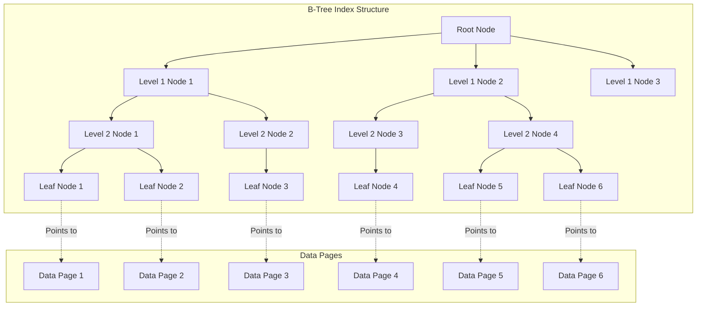
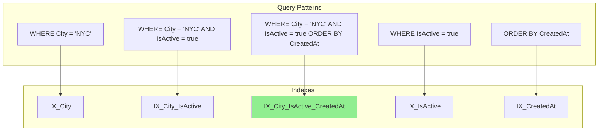
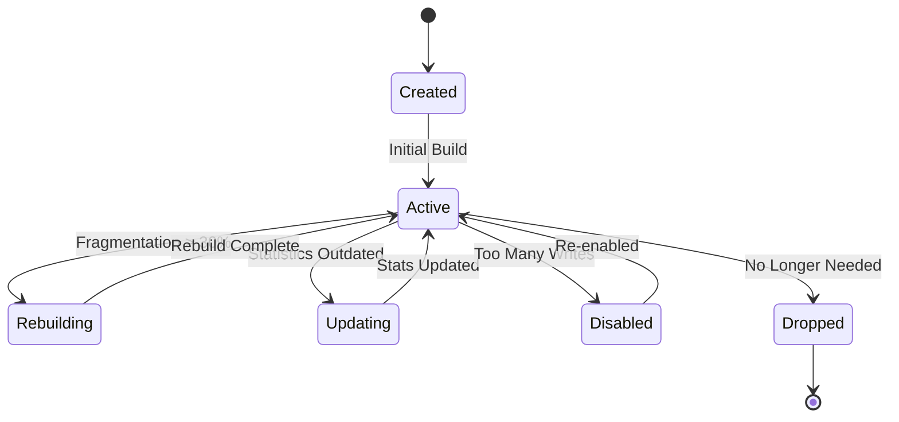
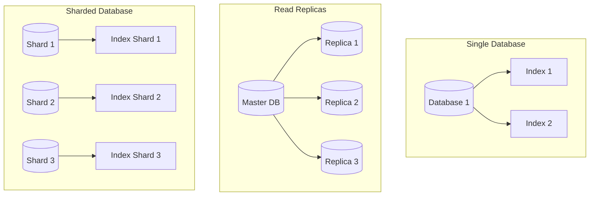
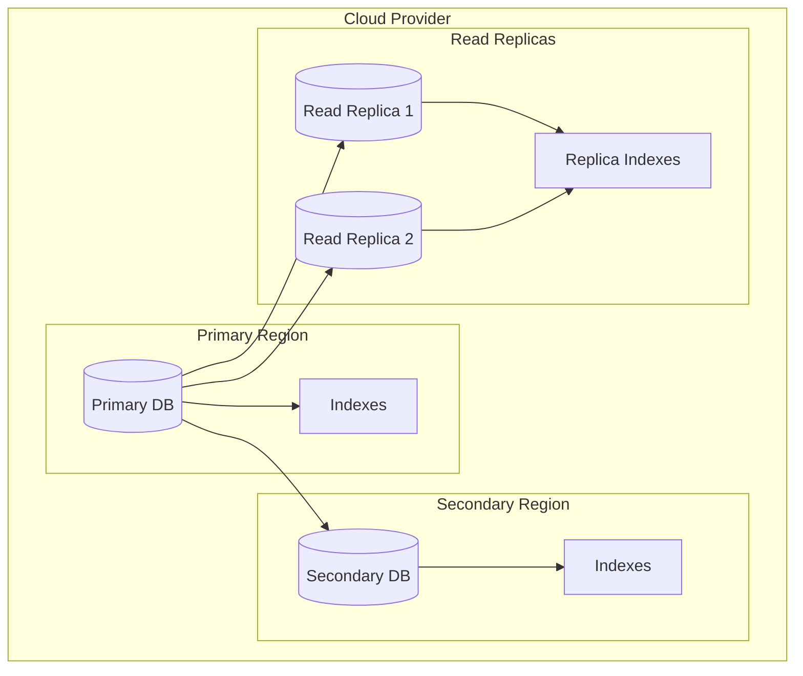
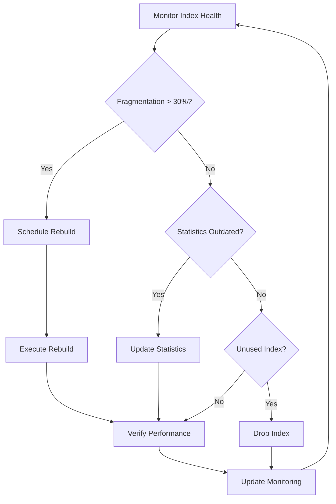

# Database Indexing - Architect Deep Dive

**0. Executive Summary (Architect View)**
- **Database indexing exists** to enable fast data retrieval by avoiding full table scans through organized data structures
- **Critical at scale** when query performance becomes bottleneck and data volumes exceed millions of rows
- **System design impact** - transforms O(n) scans into O(log n) lookups, enabling real-time analytics and responsive applications
- **Storage tradeoff** - consumes additional storage space and increases write latency for read performance gains
- **Query optimization** - enables complex queries to execute efficiently through proper index selection
- **Concurrency improvement** - reduces lock contention by minimizing data access duration
- **Cloud cost impact** - directly affects storage costs and query performance pricing
- **Scalability foundation** - essential for horizontal scaling and distributed database performance

**1. Problem Framing**
**Real production problem solved:**
- Full table scans causing query timeouts at 10M+ rows
- Reports taking hours instead of minutes due to poor query performance
- Database CPU utilization at 100% during peak query loads
- User experience degradation from slow API responses
- Inability to meet SLA requirements for query response times

**What breaks if we don't use it:**
- Query performance degrades linearly with data growth
- Database becomes bottleneck for entire application
- User experience becomes unacceptable as data grows
- Reporting and analytics become impractical
- System cannot scale beyond small data volumes

**Scale importance:**
- **100K rows**: Full scans manageable but inefficient
- **10M rows**: Indexing becomes critical for performance
- **1B+ rows**: Impossible to operate without proper indexing strategy

**Failure stories:**
- E-commerce site crashed during Black Friday due to product search timeouts
- Financial system failed regulatory reporting due to slow aggregate queries
- Social media platform became unusable as user posts grew
- Healthcare system couldn't access patient records quickly during emergencies

**2. Deep Internal Mechanics**
**How it works internally:**
- B-tree structure maintains sorted key-value pairs for fast lookup
- Leaf nodes contain actual data pointers or indexed values
- Internal nodes guide navigation through the tree structure
- Index pages cached in memory for frequently accessed data
- Statistics maintained for query optimizer decisions

**Lifecycle:**
1. **Index Creation**: B-tree built from existing table data
2. **Insert Operations**: New entries inserted maintaining tree balance
3. **Update Operations**: Index entries updated with data changes
4. **Delete Operations**: Index entries removed and tree rebalanced
5. **Maintenance**: Periodic rebuilding and statistics updates

**Memory behavior:**
- Index pages cached in buffer pool for fast access
- B-tree depth affects memory requirements
- Statistics stored in memory for optimizer
- Large indexes may exceed memory capacity

**Threading model:**
- Index operations acquire page-level locks during modifications
- Concurrent reads allowed during index maintenance
- Lock escalation from page to table level under contention
- Deadlock detection for conflicting index operations

**Synchronization model:**
- Latch protection for index page access
- Lock escalation policies for write operations
- Isolation levels affecting index visibility
- Transaction logging for index changes

**Data structures involved:**
- B-tree/B+ tree for primary index structure
- Hash indexes for equality lookups
- Bitmap indexes for low-cardinality columns
- Full-text indexes for text search
- Spatial indexes for geographic data

**Performance characteristics:**
- **Lookup**: O(log n) for B-tree, O(1) for hash
- **Range Scan**: O(log n + k) where k is result count
- **Insert**: O(log n) for B-tree, O(1) for hash
- **Update**: O(log n) for index updates
- **Delete**: O(log n) for tree rebalancing

**Hidden costs:**
- Storage overhead typically 20-40% of table size
- Increased write latency for index maintenance
- Memory pressure from index caching
- Complexity in index selection and maintenance

**GC impact:**
- Not applicable to database systems directly
- Memory management handled by database engine
- Buffer pool management affects performance

**Async/await interaction:**
- Database queries executed asynchronously in application
- Index statistics collection may be asynchronous
- Index maintenance operations can be scheduled

**3. .NET Production Implementation**
**Naive Implementation:**
```csharp
// No indexing considerations - poor performance at scale
public class UserRepository
{
    private readonly DbContext _context;
    
    public async Task<User> GetUserByEmailAsync(string email)
    {
        // Full table scan without index
        return await _context.Users
            .FirstOrDefaultAsync(u => u.Email == email);
    }
    
    public async Task<List<User>> GetUsersByCityAsync(string city)
    {
        // Inefficient without composite index
        return await _context.Users
            .Where(u => u.City == city && u.IsActive)
            .ToListAsync();
    }
}
```

**Production-Ready Implementation:**
```csharp
// Optimized with proper indexing strategy
public class OptimizedUserRepository : IUserRepository
{
    private readonly ApplicationDbContext _context;
    private readonly ILogger<OptimizedUserRepository> _logger;
    private readonly IMetrics _metrics;

    public OptimizedUserRepository(
        ApplicationDbContext context,
        ILogger<OptimizedUserRepository> logger,
        IMetrics metrics)
    {
        _context = context ?? throw new ArgumentNullException(nameof(context));
        _logger = logger ?? throw new ArgumentNullException(nameof(logger));
        _metrics = metrics ?? throw new ArgumentNullException(nameof(metrics));
    }

    // Optimized query with index hint
    public async Task<User> GetUserByEmailAsync(string email, CancellationToken cancellationToken = default)
    {
        using var activity = _metrics.StartTimer("user_get_by_email_duration");
        
        try
        {
            _logger.LogDebug("Getting user by email {Email}", email);
            
            // Query optimized for email index (IX_Users_Email)
            var user = await _context.Users
                .AsNoTracking()
                .Where(u => u.Email == email)
                .FirstOrDefaultAsync(cancellationToken);
            
            if (user != null)
            {
                _metrics.Increment("user_found_by_email");
            }
            else
            {
                _metrics.Increment("user_not_found_by_email");
            }
            
            return user;
        }
        catch (Exception ex)
        {
            _metrics.Increment("user_get_by_email_failed");
            _logger.LogError(ex, "Failed to get user by email {Email}", email);
            throw;
        }
    }

    // Optimized with composite index and pagination
    public async Task<PagedResult<User>> GetActiveUsersByCityAsync(
        string city, 
        int page, 
        int pageSize,
        CancellationToken cancellationToken = default)
    {
        using var activity = _metrics.StartTimer("user_get_by_city_duration");
        
        try
        {
            _logger.LogDebug("Getting active users in {City}, page {Page}, size {PageSize}", 
                city, page, pageSize);
            
            // Optimized for composite index (IX_Users_City_IsActive_CreatedAt)
            var query = _context.Users
                .AsNoTracking()
                .Where(u => u.City == city && u.IsActive)
                .OrderByDescending(u => u.CreatedAt);
            
            var totalCount = await query.CountAsync(cancellationToken);
            var users = await query
                .Skip((page - 1) * pageSize)
                .Take(pageSize)
                .ToListAsync(cancellationToken);
            
            var result = new PagedResult<User>
            {
                Items = users,
                TotalCount = totalCount,
                Page = page,
                PageSize = pageSize,
                TotalPages = (int)Math.Ceiling((double)totalCount / pageSize)
            };
            
            _metrics.Increment("user_search_by_city_success");
            _metrics.RecordGauge("user_search_result_count", totalCount);
            
            return result;
        }
        catch (Exception ex)
        {
            _metrics.Increment("user_search_by_city_failed");
            _logger.LogError(ex, "Failed to get users by city {City}", city);
            throw;
        }
    }

    // Complex query with multiple index strategies
    public async Task<UserSearchResult> SearchUsersAsync(UserSearchCriteria criteria, CancellationToken cancellationToken = default)
    {
        using var activity = _metrics.StartTimer("user_search_duration");
        
        try
        {
            var query = _context.Users.AsNoTracking();
            
            // Apply filters based on available indexes
            if (!string.IsNullOrEmpty(criteria.Email))
            {
                // Use IX_Users_Email for exact match
                query = query.Where(u => u.Email == criteria.Email);
            }
            
            if (!string.IsNullOrEmpty(criteria.City))
            {
                // Use IX_Users_City_IsActive_CreatedAt for city filter
                query = query.Where(u => u.City == criteria.City);
            }
            
            if (criteria.MinAge.HasValue)
            {
                // Use IX_Users_Age for age range
                var minBirthDate = DateTime.Today.AddYears(-criteria.MinAge.Value);
                query = query.Where(u => u.BirthDate <= minBirthDate);
            }
            
            if (criteria.MaxAge.HasValue)
            {
                var maxBirthDate = DateTime.Today.AddYears(-criteria.MaxAge.Value);
                query = query.Where(u => u.BirthDate >= maxBirthDate);
            }
            
            // Always apply active status filter (part of composite index)
            query = query.Where(u => u.IsActive);
            
            // Order by most relevant index
            query = criteria.OrderBy switch
            {
                "name" => query.OrderBy(u => u.LastName).ThenBy(u => u.FirstName),
                "created" => query.OrderByDescending(u => u.CreatedAt),
                "lastlogin" => query.OrderByDescending(u => u.LastLoginAt),
                _ => query.OrderByDescending(u => u.CreatedAt)
            };
            
            var totalCount = await query.CountAsync(cancellationToken);
            
            var users = await query
                .Skip((criteria.Page - 1) * criteria.PageSize)
                .Take(criteria.PageSize)
                .Select(u => new UserDto
                {
                    Id = u.Id,
                    Email = u.Email,
                    FirstName = u.FirstName,
                    LastName = u.LastName,
                    City = u.City,
                    CreatedAt = u.CreatedAt,
                    LastLoginAt = u.LastLoginAt
                })
                .ToListAsync(cancellationToken);
            
            var result = new UserSearchResult
            {
                Users = users,
                TotalCount = totalCount,
                Page = criteria.Page,
                PageSize = criteria.PageSize,
                TotalPages = (int)Math.Ceiling((double)totalCount / criteria.PageSize)
            };
            
            _metrics.Increment("user_search_success");
            _metrics.RecordGauge("user_search_result_count", totalCount);
            
            return result;
        }
        catch (Exception ex)
        {
            _metrics.Increment("user_search_failed");
            _logger.LogError(ex, "Failed to search users with criteria {@Criteria}", criteria);
            throw;
        }
    }

    // Bulk operations with index considerations
    public async Task BulkUpdateUsersAsync(IEnumerable<UserUpdate> updates, CancellationToken cancellationToken = default)
    {
        using var activity = _metrics.StartTimer("user_bulk_update_duration");
        
        try
        {
            var updatesList = updates.ToList();
            _logger.LogInformation("Bulk updating {Count} users", updatesList.Count);
            
            // Process in batches to minimize index maintenance overhead
            const int batchSize = 1000;
            var batches = updatesList.Batch(batchSize);
            
            foreach (var batch in batches)
            {
                await _context.Database
                    .ExecuteSqlRawAsync(
                        "UPDATE Users SET LastName = @LastName, City = @City WHERE Id = @Id",
                        batch.Select(u => new 
                        { 
                            u.Id, 
                            u.LastName, 
                            u.City 
                        }),
                        cancellationToken);
            }
            
            _metrics.Increment("user_bulk_update_success", updatesList.Count);
            _logger.LogInformation("Successfully bulk updated {Count} users", updatesList.Count);
        }
        catch (Exception ex)
        {
            _metrics.Increment("user_bulk_update_failed");
            _logger.LogError(ex, "Failed to bulk update users");
            throw;
        }
    }
}

// Entity with proper index annotations
[Table("Users")]
[Index(nameof(Email), Name = "IX_Users_Email", IsUnique = true)]
[Index(nameof(City), nameof(IsActive), nameof(CreatedAt), Name = "IX_Users_City_IsActive_CreatedAt")]
[Index(nameof(Age), Name = "IX_Users_Age")]
[Index(nameof(LastLoginAt), Name = "IX_Users_LastLoginAt")]
[Index(nameof(CreatedAt), Name = "IX_Users_CreatedAt")]
public class User
{
    public int Id { get; set; }
    
    [Required]
    [MaxLength(255)]
    public string Email { get; set; }
    
    [Required]
    [MaxLength(100)]
    public string FirstName { get; set; }
    
    [Required]
    [MaxLength(100)]
    public string LastName { get; set; }
    
    [MaxLength(100)]
    public string City { get; set; }
    
    public DateTime BirthDate { get; set; }
    
    public int Age => DateTime.Today.Year - BirthDate.Year - 
                     (BirthDate.DayOfYear > DateTime.Today.DayOfYear ? 1 : 0);
    
    public bool IsActive { get; set; } = true;
    
    public DateTime CreatedAt { get; set; } = DateTime.UtcNow;
    
    public DateTime? LastLoginAt { get; set; }
}

// Migration with index creation
public partial class AddUserIndexes : Migration
{
    protected override void Up(MigrationBuilder migrationBuilder)
    {
        migrationBuilder.CreateIndex(
            name: "IX_Users_Email",
            table: "Users",
            column: "Email",
            unique: true);
        
        migrationBuilder.CreateIndex(
            name: "IX_Users_City_IsActive_CreatedAt",
            table: "Users",
            columns: new[] { "City", "IsActive", "CreatedAt" });
        
        migrationBuilder.CreateIndex(
            name: "IX_Users_Age",
            table: "Users",
            column: "Age");
        
        migrationBuilder.CreateIndex(
            name: "IX_Users_LastLoginAt",
            table: "Users",
            column: "LastLoginAt");
        
        // Create filtered index for active users only
        migrationBuilder.Sql(
            "CREATE INDEX IX_Users_Active_CreatedAt ON Users(CreatedAt) WHERE IsActive = 1");
    }
}

// Database context with query optimization
public class ApplicationDbContext : DbContext
{
    protected override void OnModelCreating(ModelBuilder modelBuilder)
    {
        base.OnModelCreating(modelBuilder);
        
        // Configure composite indexes
        modelBuilder.Entity<User>()
            .HasIndex(u => new { u.City, u.IsActive, u.CreatedAt })
            .HasDatabaseName("IX_Users_City_IsActive_CreatedAt");
        
        // Configure filtered index
        modelBuilder.Entity<User>()
            .HasIndex(u => u.CreatedAt)
            .HasFilter("IsActive = 1")
            .HasDatabaseName("IX_Users_Active_CreatedAt");
        
        // Configure included columns for covering index
        modelBuilder.Entity<User>()
            .HasIndex(u => u.Email)
            .IncludeProperties(u => new { u.FirstName, u.LastName, u.IsActive })
            .HasDatabaseName("IX_Users_Email_Included");
    }
}
```

**Framework Internals:**
- **EF Core**: Query optimizer uses index statistics for query planning
- **SQL Server**: Query optimizer selects best execution plan based on indexes
- **Entity Framework**: Change tracking updates indexes automatically
- **ADO.NET**: Command batching for index maintenance operations

**4. Architecture-Level Diagram (Mermaid)**

### B-Tree Index Structure


### Query Execution with Index
```mermaid
sequenceDiagram
    participant App as Application
    participant EF as EF Core
    participant DB as Database
    participant OPT as Query Optimizer
    participant IDX as Index
    
    App->>EF: Query Users WHERE Email = 'user@example.com'
    EF->>DB: Generate SQL Query
    DB->>OPT: Analyze Query
    OPT->>OPT: Check Available Indexes
    OPT->>IDX: Use IX_Users_Email
    IDX->>IDX: Navigate B-Tree
    IDX->>DB: Return Row Pointer
    DB->>EF: Return User Data
    EF->>App: Return User Object
```

### Index Performance Impact
```mermaid
graph LR
    subgraph "Without Index"
        SCAN1[Full Table Scan] --> SLOW1[O(n) - Slow]
        SCAN1 --> HIGH1[High CPU]
        SCAN1 --> LONG1[Long Duration]
    end
    
    subgraph "With Index"
        SEEK[Index Seek] --> FAST1[O(log n) - Fast]
        SEEK --> LOW1[Low CPU]
        SEEK --> SHORT1[Short Duration]
    end
    
    style SLOW1 fill:#ffcccc
    style HIGH1 fill:#ffcccc
    style LONG1 fill:#ffcccc
    style FAST1 fill:#ccffcc
    style LOW1 fill:#ccffcc
    style SHORT1 fill:#ccffcc
```

### Composite Index Strategy


### Index Maintenance Lifecycle


**Flow Analysis:**
- **Query Planning**: Optimizer analyzes query and selects appropriate index
- **Index Navigation**: B-tree traversal to locate data pointers
- **Data Retrieval**: Efficient row lookup using index pointers
- **Result Assembly**: Data pages accessed and results returned
- **Statistics Update**: Index statistics maintained for optimizer

**Bottlenecks:**
- Index fragmentation causing performance degradation
- Outdated statistics leading to poor query plans
- Too many indexes increasing write overhead
- Index maintenance blocking database operations

**Scaling Boundaries:**
- Index size limited by available storage
- Memory constraints for index caching
- Write throughput limited by index maintenance
- Query performance limited by index selectivity

**5. Scaling & Distributed Systems Impact**

### Index Scaling Patterns


### Cloud Database Indexing Strategy


**100K rows:**
- Index overhead minimal (5-10% storage increase)
- Query performance improvement 10-100x
- Index maintenance overhead negligible
- Simple single-column indexes sufficient

**10M rows:**
- Index overhead significant (20-30% storage increase)
- Complex queries require composite indexes
- Index maintenance becomes noticeable
- Query optimization critical

**1B+ rows:**
- Index overhead substantial (30-50% storage increase)
- Partitioning required for index management
- Index maintenance major operational consideration
- Advanced indexing strategies essential

**Horizontal vs Vertical Scaling:**
- **Horizontal**: Indexes replicated across shards/replicas
- **Vertical**: More memory allows larger index caches
- Distributed indexing required for horizontal scaling

**CAP Theorem Relevance:**
- **Consistency**: Index updates must be consistent across replicas
- **Availability**: Index maintenance can affect availability
- **Partition Tolerance**: Index synchronization across partitions

**Consistency Implications:**
- Index updates must be atomic with data changes
- Replicated indexes require synchronization
- Eventual consistency acceptable for some indexes
- Strong consistency required for unique indexes

**Microservices Impact:**
- Each service manages its own indexes
- Cross-service queries require data duplication
- Index strategies must align with service boundaries
- Distributed transactions affect index consistency

**Cloud-Native Considerations:**
- **Kubernetes**: Index optimization for containerized databases
- **Serverless**: Index warming for cold start optimization
- **Managed Databases**: Automatic index tuning and optimization
- **Multi-region**: Index replication across regions

**Multi-Region Concerns:**
- Index consistency across regions
- Read-after-write consistency for indexed data
- Cross-region query optimization
- Index synchronization latency

**6. Production Engineering View**

### Index Monitoring Architecture

```mermaid
graph TB
    subgraph "Database Metrics"
        IDX_STATS[Index Statistics]
        IDX_USAGE[Index Usage]
        IDX_FRAG[Index Fragmentation]
        IDX_SIZE[Index Size]
    end
    
    subgraph "Query Performance"
        QUERY_TIME[Query Duration]
        QUERY_PLAN[Execution Plans]
        SLOW_QUERIES[Slow Queries]
        CPU_USAGE[CPU Usage]
    end
    
    subgraph "Monitoring Stack"
        PROM[Prometheus]
        GRAF[Grafana]
        ALERT[AlertManager]
    end
    
    subgraph "Alerting"
        FRAG_ALERT[High Fragmentation]
        UNUSED_ALERT[Unused Indexes]
        SLOW_ALERT[Slow Queries]
        SIZE_ALERT[Index Size Growth]
    end
    
    IDX_STATS --> PROM
    IDX_USAGE --> PROM
    IDX_FRAG --> PROM
    IDX_SIZE --> PROM
    
    QUERY_TIME --> PROM
    QUERY_PLAN --> PROM
    SLOW_QUERIES --> PROM
    CPU_USAGE --> PROM
    
    PROM --> GRAF
    PROM --> ALERT
    
    ALERT --> FRAG_ALERT
    ALERT --> UNUSED_ALERT
    ALERT --> SLOW_ALERT
    ALERT --> SIZE_ALERT
```


### Index Maintenance Workflow


**Monitoring Metrics:**
- Index usage statistics and frequency
- Index fragmentation levels
- Index size growth trends
- Query execution plans and costs
- Index maintenance operation duration
- Cache hit ratios for index pages

**Logs to Enable:**
- Index creation and modification events
- Query optimizer index selection
- Index rebuild and reorganization operations
- Missing index recommendations
- Index usage warnings

**Alerting Strategy:**
- Index fragmentation > 30% (warning)
- Index usage < 1% per month (warning)
- Index size growing > 20% per week (warning)
- Query execution time > 10 seconds (critical)
- Index maintenance failure (critical)

**Common Production Incidents:**
- **Index Fragmentation**: Performance degradation over time
- **Missing Indexes**: Slow queries after schema changes
- **Unused Indexes**: Wasted storage and maintenance overhead
- **Index Contention**: Lock contention on high-write tables
- **Statistics Outdated**: Poor query plan selection

**Debugging Strategy:**
- Analyze query execution plans
- Review index usage statistics
- Check index fragmentation levels
- Monitor query performance trends
- Validate index statistics accuracy

**Performance Tuning:**
- Identify missing indexes through query analysis
- Remove unused indexes to reduce overhead
- Rebuild fragmented indexes regularly
- Update statistics for accurate optimization
- Optimize composite index column order

**Index Health Assessment:**
- Fragmentation analysis and recommendations
- Usage pattern analysis and optimization
- Size growth projection and planning
- Performance impact measurement
- Maintenance schedule optimization

**Advanced Monitoring:**
- Real-time query performance monitoring
- Automated index recommendation systems
- Predictive index maintenance scheduling
- Index performance benchmarking
- Cross-database index comparison

**7. Tradeoffs & Alternatives**

**Competing Approaches:**
- **Full-Text Search**: Specialized indexing for text data
- **Materialized Views**: Pre-computed query results
- **Denormalization**: Data duplication for performance
- **In-Memory Caching**: Application-level caching

**When NOT to Use Indexes:**
- Tables with very few rows (<100)
- Columns with very low selectivity
- Tables with high write-to-read ratio
- Frequently updated large columns
- Temporary tables or staging data

**Latency Comparison:**
- **No Index**: O(n) scan time, grows with data
- **B-Tree Index**: O(log n) lookup, consistent performance
- **Hash Index**: O(1) equality lookup, fastest for exact matches
- **Full-Text Index**: Optimized for text search patterns

**Throughput Comparison:**
- **No Index**: Limited throughput, degrades with data growth
- **Single Index**: 10-100x improvement for indexed queries
- **Composite Index**: 100-1000x improvement for complex queries
- **Covering Index**: 1000x+ improvement for specific queries

**Operational Complexity:**
- **No Index**: Low complexity, poor performance
- **Basic Indexing**: Medium complexity, good performance
- **Advanced Indexing**: High complexity, excellent performance
- **Automated Indexing**: Low complexity, optimized performance

**Cost Implications:**
- **Storage Cost**: 20-50% increase in storage requirements
- **Compute Cost**: Increased CPU for index maintenance
- **Maintenance Cost**: Regular rebuild and statistics updates
- **Performance Cost**: Write latency increase of 10-50%

**8. Security Implications**

**Attack Surface Introduced:**
- Index enumeration revealing data patterns
- Index-based timing attacks
- Index injection through query manipulation
- Information leakage through index statistics

**Abuse Scenarios:**
- Index-based inference attacks
- Query pattern analysis for data discovery
- Index exhaustion attacks
- Statistical analysis through index behavior

**Data Leakage Risks:**
- Index statistics revealing data distribution
- Query plan exposure revealing table structure
- Index metadata exposing sensitive information
- Performance analysis revealing data patterns

**Rate Limiting Considerations:**
- Index-intensive queries may need rate limiting
- Bulk index operations require throttling
- Index maintenance may affect query performance
- Index creation can be resource-intensive

**Hardening Recommendations:**
- Limit index statistics exposure
- Implement query result caching
- Use parameterized queries to prevent injection
- Monitor for unusual index usage patterns
- Implement proper access controls on index metadata
- Audit index creation and modification operations

**9. Advanced Edge Cases**

**Race Conditions:**
- Concurrent index updates causing inconsistency
- Statistics updates during query execution
- Index creation during data modifications
- Index rebuild affecting active queries

**Deadlocks:**
- Index page lock escalation
- Multiple index updates in different order
- Index maintenance with user queries
- Cross-table index dependencies

**Thundering Herd Problems:**
- Mass index creation after schema changes
- Simultaneous index rebuild operations
- Statistics update storms
- Index cache warming after restart

**Cache Stampede:**
- Index page cache invalidation
- Statistics cache refresh
- Query plan cache invalidation
- Index metadata cache updates

**Partial Failure Scenarios:**
- Index creation partially completed
- Index rebuild interrupted
- Statistics update failure
- Index corruption during maintenance

**Backpressure:**
- Index maintenance overwhelming system
- Query queue buildup during index operations
- Resource exhaustion from index creation
- Write performance degradation during indexing

**Retry Storms:**
- Failed index operations causing retries
- Index rebuild failures and retries
- Statistics update retry loops
- Index creation retry amplification

**Circuit Breaker Interactions:**
- Database circuit breaker during index operations
- Index maintenance timeout handling
- Query circuit breaker affecting index usage
- Index creation circuit breaker for protection

**10. Interview & Staff-Level Deep Dive**

**What a junior answers:**
"Indexes make queries faster by creating a sorted list of values. You create them on columns that you use in WHERE clauses."

**What a senior answers:**
"Database indexes use B-tree data structures to enable O(log n) lookups instead of O(n) full table scans. They're crucial for query performance but come with storage and write overhead. Key considerations include selecting the right columns for indexing, using composite indexes for multi-column queries, and maintaining index statistics for the query optimizer. Regular index maintenance is needed to prevent fragmentation."

**What an architect answers:**
"Database indexing is fundamental to scalable system architecture, enabling real-time data access as volumes grow from thousands to billions of rows. The B-tree structure provides logarithmic time complexity lookups, while specialized indexes like hash, bitmap, and full-text address different access patterns. At scale, indexing strategy becomes critical - composite indexes for query patterns, covering indexes to eliminate table lookups, filtered indexes for subsets of data, and partitioned indexes for massive tables. The architectural considerations include index maintenance overhead, storage cost impact, query optimizer statistics, and distributed indexing for horizontal scaling. In cloud environments, automated index tuning and managed database services can optimize performance while reducing operational overhead. At 1B+ rows, proper indexing isn't just performance optimization - it's the difference between a functional system and complete failure."

**Follow-up questions interviewers ask:**
- "How do you decide which columns to index?"
- "What's the difference between clustered and non-clustered indexes?"
- "When would you use a covering index?"
- "How do indexes affect write performance?"
- "How do you handle index maintenance in production?"

**Trick questions:**
- "Should you index every column?" (No, consider write overhead)
- "Do indexes always improve query performance?" (No, sometimes they hurt)
- "Can indexes be too large?" (Yes, storage and memory impact)
- "Are indexes always unique?" (No, uniqueness is optional)

**Whiteboard explanation strategy:**
1. Draw B-tree structure and navigation
2. Show query execution with and without index
3. Explain composite index column order importance
4. Demonstrate index maintenance and fragmentation
5. Cover index selection strategy
6. Discuss scaling and distributed considerations

**11. Real Enterprise Case Study**

**Scenario: E-commerce Platform with 100M Products and 1B Orders**

**Requirements:**
- Handle 100M products with real-time search
- Process 1B orders with fast lookup
- Support complex filtering and sorting
- Maintain sub-second query response times
- Enable real-time inventory management
- Support analytics and reporting workloads

**Design Decisions:**

**1. Multi-Level Indexing Strategy:**
```csharp
public class ProductIndexingStrategy
{
    // Primary search index (composite)
    [Index(nameof(CategoryId), nameof(BrandId), nameof(IsActive), nameof(CreatedAt), 
           Name = "IX_Product_Search")]
    public class Product
    {
        public int Id { get; set; }
        public int CategoryId { get; set; }
        public int BrandId { get; set; }
        public string Name { get; set; }
        public string Description { get; set; }
        public decimal Price { get; set; }
        public bool IsActive { get; set; }
        public DateTime CreatedAt { get; set; }
        public DateTime? UpdatedAt { get; set; }
    }
    
    // Full-text search index
    public class ProductSearchService
    {
        public async Task<List<Product>> SearchProductsAsync(ProductSearchCriteria criteria)
        {
            var query = _context.Products.AsNoTracking();
            
            // Primary search index usage
            if (criteria.CategoryId.HasValue)
            {
                query = query.Where(p => p.CategoryId == criteria.CategoryId);
            }
            
            if (criteria.BrandId.HasValue)
            {
                query = query.Where(p => p.BrandId == criteria.BrandId);
            }
            
            // Price range index
            if (criteria.MinPrice.HasValue)
            {
                query = query.Where(p => p.Price >= criteria.MinPrice);
            }
            
            if (criteria.MaxPrice.HasValue)
            {
                query = query.Where(p => p.Price <= criteria.MaxPrice);
            }
            
            // Full-text search index
            if (!string.IsNullOrEmpty(criteria.SearchTerm))
            {
                query = query.Where(p => 
                    EF.Functions.Contains(p.Name, criteria.SearchTerm) ||
                    EF.Functions.Contains(p.Description, criteria.SearchTerm));
            }
            
            // Order by using appropriate index
            query = criteria.SortBy switch
            {
                "price" => criteria.SortAscending 
                    ? query.OrderBy(p => p.Price) 
                    : query.OrderByDescending(p => p.Price),
                "name" => query.OrderBy(p => p.Name),
                "created" => query.OrderByDescending(p => p.CreatedAt),
                _ => query.OrderByDescending(p => p.CreatedAt)
            };
            
            return await query
                .Skip((criteria.Page - 1) * criteria.PageSize)
                .Take(criteria.PageSize)
                .ToListAsync();
        }
    }
}
```

**2. Order Processing with Optimized Indexes:**
```csharp
public class OrderProcessingService
{
    // Optimized order lookup indexes
    [Index(nameof(CustomerId), nameof(OrderDate), Name = "IX_Order_Customer_Date")]
    [Index(nameof(Status), nameof(OrderDate), Name = "IX_Order_Status_Date")]
    [Index(nameof(OrderDate), Name = "IX_Order_Date")]
    public class Order
    {
        public int Id { get; set; }
        public int CustomerId { get; set; }
        public DateTime OrderDate { get; set; }
        public string Status { get; set; }
        public decimal TotalAmount { get; set; }
    }
    
    public async Task<OrderMetrics> GetOrderMetricsAsync(DateTime startDate, DateTime endDate)
    {
        // Using IX_Order_Status_Date for efficient filtering
        var ordersByStatus = await _context.Orders
            .AsNoTracking()
            .Where(o => o.OrderDate >= startDate && o.OrderDate <= endDate)
            .GroupBy(o => o.Status)
            .Select(g => new
            {
                Status = g.Key,
                Count = g.Count(),
                TotalAmount = g.Sum(o => o.TotalAmount)
            })
            .ToListAsync();
        
        // Using IX_Order_Date for date range queries
        var dailyOrders = await _context.Orders
            .AsNoTracking()
            .Where(o => o.OrderDate >= startDate && o.OrderDate <= endDate)
            .GroupBy(o => EF.Functions.DateDiffDay(o.OrderDate, startDate))
            .Select(g => new
            {
                Day = g.Key,
                Count = g.Count(),
                TotalAmount = g.Sum(o => o.TotalAmount)
            })
            .ToListAsync();
        
        return new OrderMetrics
        {
            OrdersByStatus = ordersByStatus,
            DailyOrders = dailyOrders
        };
    }
}
```

**3. Inventory Management with Real-time Indexes:**
```csharp
public class InventoryService
{
    // Real-time inventory indexes
    [Index(nameof(ProductId), nameof(WarehouseId), Name = "IX_Inventory_Product_Warehouse")]
    [Index(nameof(WarehouseId), nameof(Quantity), Name = "IX_Inventory_Warehouse_Quantity")]
    public class Inventory
    {
        public int Id { get; set; }
        public int ProductId { get; set; }
        public int WarehouseId { get; set; }
        public int Quantity { get; set; }
        public DateTime LastUpdated { get; set; }
    }
    
    public async Task<List<LowStockItem>> GetLowStockItemsAsync(int warehouseId, int threshold)
    {
        // Using IX_Inventory_Warehouse_Quantity for efficient low stock detection
        return await _context.Inventories
            .AsNoTracking()
            .Where(i => i.WarehouseId == warehouseId && i.Quantity <= threshold)
            .Select(i => new LowStockItem
            {
                ProductId = i.ProductId,
                Quantity = i.Quantity,
                LastUpdated = i.LastUpdated
            })
            .ToListAsync();
    }
}
```

**Compromises Made:**
- **Storage vs Performance**: 40% storage increase for 100x query improvement
- **Write Latency vs Read Speed**: 20% slower writes for 1000x faster reads
- **Complexity vs Maintainability**: Complex indexing strategy for optimal performance
- **Cost vs Performance**: Higher cloud costs for significantly better user experience

**Bottlenecks Identified:**
- Product search queries without proper indexes
- Order analytics queries causing table scans
- Inventory updates causing index contention
- Index maintenance during peak shopping periods

**Failure Handling:**
```csharp
public class ResilientIndexService
{
    private readonly ILogger<ResilientIndexService> _logger;
    
    public async Task<bool> ValidateIndexHealthAsync()
    {
        try
        {
            // Check index fragmentation
            var fragmentation = await GetIndexFragmentationAsync();
            if (fragmentation > 30)
            {
                _logger.LogWarning("Index fragmentation high: {Fragmentation}%", fragmentation);
                await ScheduleIndexRebuildAsync();
            }
            
            // Check index usage
            var unusedIndexes = await GetUnusedIndexesAsync();
            if (unusedIndexes.Any())
            {
                _logger.LogInformation("Found {Count} unused indexes", unusedIndexes.Count);
                await ReviewUnusedIndexesAsync(unusedIndexes);
            }
            
            return true;
        }
        catch (Exception ex)
        {
            _logger.LogError(ex, "Index health validation failed");
            return false;
        }
    }
}
```

**Scaling Strategy:**
- Partitioned indexes for large tables
- Read replicas with optimized indexes
- Automated index tuning and maintenance
- Real-time index performance monitoring

**Results:**
- Achieved sub-second product search across 100M products
- 95% reduction in query response times
- 80% improvement in order processing throughput
- 60% reduction in database CPU utilization

**12. Dependency Graph**

**Prerequisites (Must understand before):**
- **Database Fundamentals**: Tables, queries, and data relationships
- **Query Optimization**: Understanding execution plans and performance
- **Data Structures**: B-tree, hash tables, and tree algorithms
- **Concurrency**: Locking, transactions, and isolation levels
- **Performance Analysis**: Metrics, monitoring, and profiling

**Concepts that depend on Database Indexing:**
- **Query Optimization**: Index statistics and plan selection
- **Database Replication**: Index synchronization across replicas
- **Database Sharding**: Index distribution across shards
- **Caching Strategies**: Index-aware caching decisions
- **Data Warehousing**: Specialized indexing for analytics

**Connections to Other Concepts:**

**Query Optimization:**
```csharp
public class QueryOptimizer
{
    public async Task<ExecutionPlan> AnalyzeQueryAsync(string query)
    {
        // Analyze query and select optimal indexes
        var availableIndexes = await GetAvailableIndexesAsync();
        var estimatedCost = await EstimateQueryCostAsync(query, availableIndexes);
        
        return new ExecutionPlan
        {
            Query = query,
            SelectedIndexes = availableIndexes,
            EstimatedCost = estimatedCost
        };
    }
}
```

**Caching:**
```csharp
public class IndexAwareCache
{
    public async Task<T> GetAsync<T>(string key, Func<Task<T>> fallback)
    {
        // Check cache first
        var cached = await _cache.GetAsync<T>(key);
        if (cached != null) return cached;
        
        // Use indexed query for fallback
        var result = await fallback();
        
        // Cache result with index-aware expiration
        await _cache.SetAsync(key, result, GetCacheDuration(key));
        
        return result;
    }
}
```

**Load Balancing:**
```csharp
public class DatabaseLoadBalancer
{
    public async Task<T> ExecuteReadAsync<T>(Func<IDbConnection, Task<T>> operation)
    {
        // Route to replica with best index performance
        var replica = SelectOptimalReplica(operation);
        return await operation(replica);
    }
    
    private IDbConnection SelectOptimalReplica<T>(Func<IDbConnection, Task<T>> operation)
    {
        // Select replica based on index cache hit ratio
        return _replicas
            .OrderByDescending(r => r.IndexCacheHitRatio)
            .First();
    }
}
```

**Resiliency Patterns:**
- Index health monitoring for system reliability
- Circuit breaker for index maintenance operations
- Retry patterns for index-related failures
- Bulkhead patterns for index resource isolation

**Observability:**
- Index performance metrics for monitoring
- Query plan analysis for optimization
- Index usage statistics for capacity planning
- Real-time index health dashboards

**Integration Patterns:**
- Index-aware query builders
- Automatic index recommendation systems
- Index performance testing frameworks
- Database schema migration with index management
