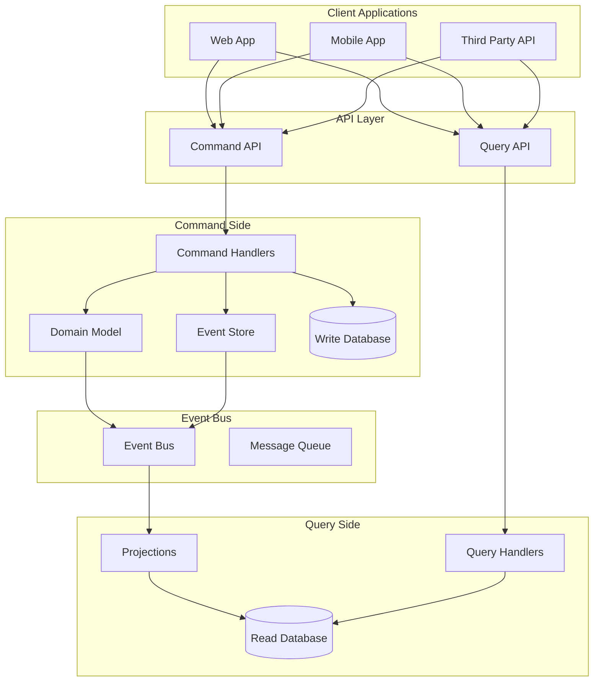
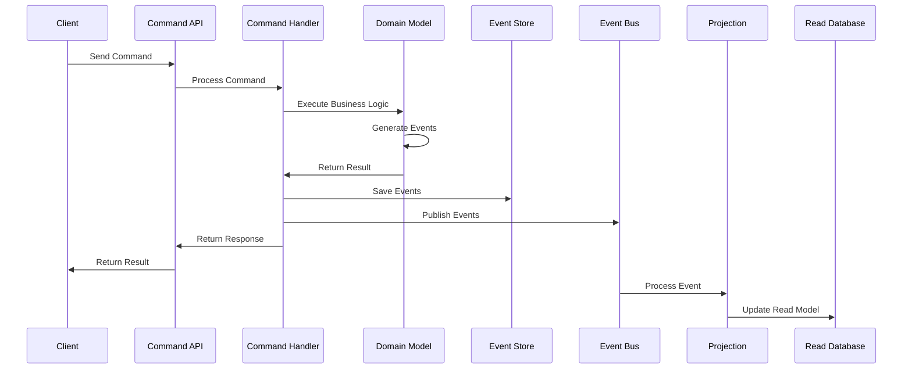
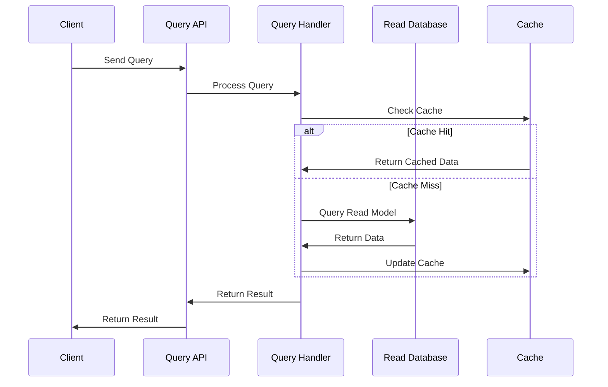
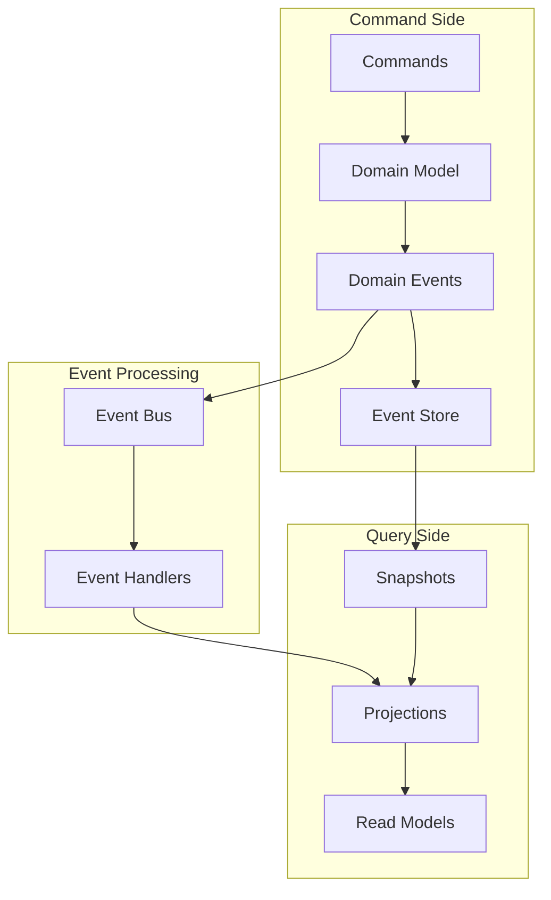
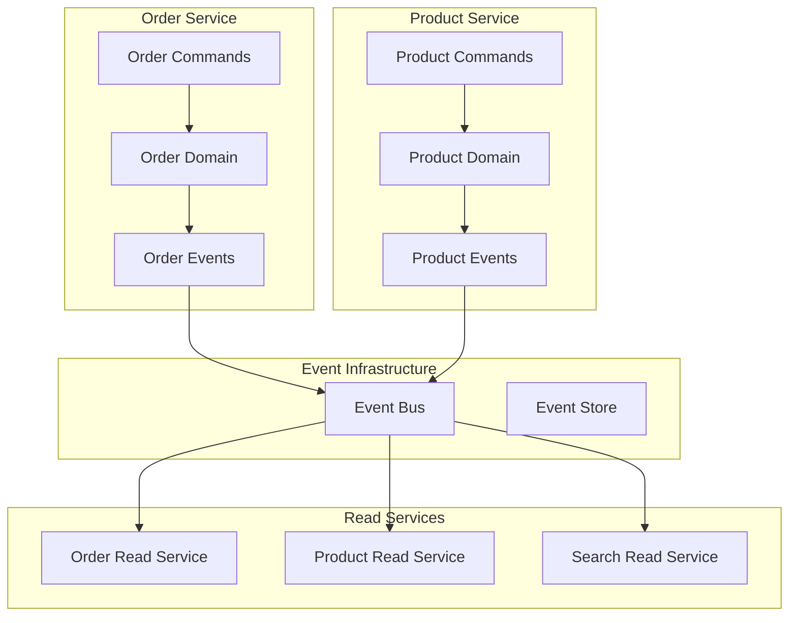
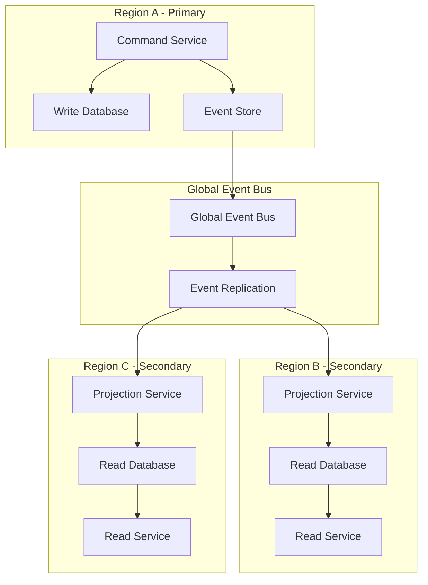
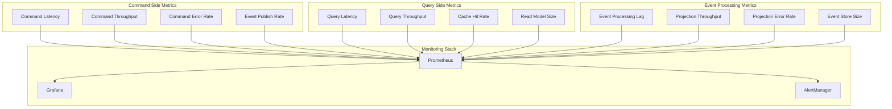
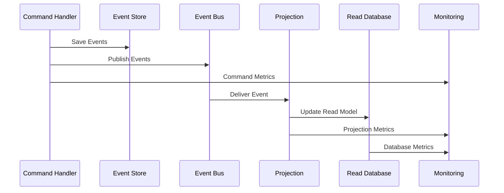

# CQRS - Architect Deep Dive

============================================================
0. Executive Summary (Architect View)
============================================================
- **CQRS exists** to separate read and write operations for optimal performance, scalability, and maintainability
- **Critical at scale** when read/write patterns differ significantly and require independent optimization
- **System design impact** - transforms monolithic data models into specialized read/write models
- **Performance optimization** - enables independent scaling of read and write operations
- **Team autonomy** - allows separate teams to optimize read and write concerns
- **Complexity tradeoff** - introduces architectural complexity but provides significant benefits
- **Cloud-native essential** - fundamental for microservices and event-driven architectures
- **Business agility** - enables faster evolution of read and write models independently

============================================================
1. Problem Framing
============================================================
**Real production problem solved:**
- Read queries slowing down write operations due to shared data model
- Different data access patterns for reporting vs transaction processing
- Inability to optimize database schemas for specific use cases
- Performance bottlenecks from complex read queries affecting write throughput
- Difficulty in scaling read and write operations independently

**What breaks if we don't use it:**
- Read performance limited by write optimization requirements
- Write performance impacted by complex read query needs
- Inability to use different storage technologies for reads vs writes
- Reporting and analytics impacting transaction performance
- Poor user experience due to one-size-fits-all data models

**Scale importance:**
- **1K RPS**: Single model manageable but suboptimal
- **10K RPS**: Read/write separation becomes beneficial
- **100K+ RPS**: CQRS essential for optimal performance

**Failure stories:**
- E-commerce site slowed down during Black Friday due to reporting queries
- Financial system couldn't handle real-time analytics without affecting trades
- Social media platform had poor user experience due to feed query complexity
- Analytics platform couldn't provide real-time insights without impacting data ingestion

============================================================
2. Deep Internal Mechanics
============================================================

**How it works internally:**
- **Command Side**: Handles write operations with domain-focused data model
- **Query Side**: Handles read operations with optimized read models
- **Synchronization**: Event-driven or periodic synchronization between sides
- **Event Sourcing**: Often combined with CQRS for complete audit trail
- **Read Model Updates**: Asynchronous projection updates from domain events

**Command Processing Flow:**
1. **Command Reception**: Accept write commands from clients
2. **Validation**: Validate command against business rules
3. **Domain Execution**: Execute business logic in domain model
4. **Event Generation**: Generate domain events for state changes
5. **Persistence**: Save events and update write model
6. **Event Publishing**: Publish events for read model updates

**Query Processing Flow:**
1. **Query Reception**: Accept read queries from clients
2. **Model Selection**: Choose appropriate read model
3. **Data Retrieval**: Query optimized read storage
4. **Result Assembly**: Assemble response from read model
5. **Response Return**: Return optimized response to client

**Synchronization Mechanisms:**
- **Event-Driven**: Real-time updates via domain events
- **Batch Processing**: Periodic bulk updates to read models
- **Change Data Capture**: Database-level change detection
- **Message Queues**: Reliable event delivery guarantees
- **Eventual Consistency**: Read models eventually consistent with writes

**Data Structures:**
- **Command Objects**: Immutable write operation representations
- **Domain Events**: Immutable state change notifications
- **Read Models**: Denormalized query-optimized data structures
- **Event Store**: Append-only log of domain events
- **Projection Handlers**: Event-to-read-model transformation logic

**Performance Characteristics:**
- **Write Latency**: 10-100ms for command processing
- **Read Latency**: 1-10ms for optimized queries
- **Eventual Consistency**: 100ms-1s for read model updates
- **Throughput**: 10k+ commands/second, 100k+ queries/second

**Hidden Costs:**
- Increased architectural complexity
- Event storage and processing overhead
- Read model maintenance complexity
- Debugging and troubleshooting challenges
- Team coordination overhead

**Memory Behavior:**
- Command objects short-lived
- Event store grows continuously
- Read models cached for performance
- Projection handlers stateful for performance

**Async/await Interaction:**
- Command handlers use async for I/O operations
- Event processing fully asynchronous
- Query handlers optimized for fast responses
- Projection updates use async for scalability

============================================================
3. .NET Production Implementation
============================================================

**Naive Implementation (No CQRS):**
```csharp
public class ProductService
{
    private readonly ProductDbContext _context;
    
    public async Task<Product> CreateProductAsync(CreateProductRequest request)
    {
        var product = new Product
        {
            Name = request.Name,
            Price = request.Price,
            Category = request.Category,
            Stock = request.Stock,
            CreatedAt = DateTime.UtcNow
        };
        
        _context.Products.Add(product);
        await _context.SaveChangesAsync();
        return product;
    }
    
    public async Task<Product> GetProductAsync(int id)
    {
        return await _context.Products
            .Include(p => p.Category)
            .Include(p => p.Reviews)
            .FirstOrDefaultAsync(p => p.Id == id);
    }
    
    public async Task<List<Product>> GetProductsByCategoryAsync(int categoryId)
    {
        return await _context.Products
            .Include(p => p.Category)
            .Where(p => p.CategoryId == categoryId)
            .ToListAsync();
    }
}
```

**Production-Ready CQRS Implementation:**
```csharp
// Command Side
public interface ICommandHandler<TCommand, TResult>
{
    Task<TResult> HandleAsync(TCommand command, CancellationToken cancellationToken = default);
}

public class CreateProductCommand : ICommand<int>
{
    public string Name { get; set; }
    public decimal Price { get; set; }
    public int CategoryId { get; set; }
    public int Stock { get; set; }
}

public class CreateProductCommandHandler : ICommandHandler<CreateProductCommand, int>
{
    private readonly IProductRepository _repository;
    private readonly IEventBus _eventBus;
    private readonly ILogger<CreateProductCommandHandler> _logger;
    private readonly IMetrics _metrics;

    public CreateProductCommandHandler(
        IProductRepository repository,
        IEventBus eventBus,
        ILogger<CreateProductCommandHandler> logger,
        IMetrics metrics)
    {
        _repository = repository ?? throw new ArgumentNullException(nameof(repository));
        _eventBus = eventBus ?? throw new ArgumentNullException(nameof(eventBus));
        _logger = logger ?? throw new ArgumentNullException(nameof(logger));
        _metrics = metrics ?? throw new ArgumentNullException(nameof(metrics));
    }

    public async Task<int> HandleAsync(CreateProductCommand command, CancellationToken cancellationToken = default)
    {
        using var activity = _metrics.StartTimer("create_product_command_duration");
        
        try
        {
            _logger.LogInformation("Creating product {ProductName}", command.Name);
            
            // Business logic validation
            var product = Product.Create(command.Name, command.Price, command.CategoryId, command.Stock);
            
            // Save to write model
            var productId = await _repository.SaveAsync(product, cancellationToken);
            
            // Generate domain events
            var events = product.GetUncommittedEvents();
            
            // Publish events for read model updates
            foreach (var @event in events)
            {
                await _eventBus.PublishAsync(@event, cancellationToken);
            }
            
            // Mark events as committed
            product.MarkEventsAsCommitted();
            
            _metrics.Increment("product_created_success");
            _logger.LogInformation("Product {ProductId} created successfully", productId);
            
            return productId;
        }
        catch (Exception ex)
        {
            _metrics.Increment("product_created_failed");
            _logger.LogError(ex, "Failed to create product {ProductName}", command.Name);
            throw;
        }
    }
}

// Query Side
public interface IQueryHandler<TQuery, TResult>
{
    Task<TResult> HandleAsync(TQuery query, CancellationToken cancellationToken = default);
}

public class GetProductQuery : IQuery<ProductDto>
{
    public int ProductId { get; set; }
    public bool IncludeReviews { get; set; } = false;
}

public class GetProductQueryHandler : IQueryHandler<GetProductQuery, ProductDto>
{
    private readonly IProductReadRepository _readRepository;
    private readonly ILogger<GetProductQueryHandler> _logger;
    private readonly IMetrics _metrics;

    public GetProductQueryHandler(
        IProductReadRepository readRepository,
        ILogger<GetProductQueryHandler> logger,
        IMetrics metrics)
    {
        _readRepository = readRepository ?? throw new ArgumentNullException(nameof(readRepository));
        _logger = logger ?? throw new ArgumentNullException(nameof(logger));
        _metrics = metrics ?? throw new ArgumentNullException(nameof(metrics));
    }

    public async Task<ProductDto> HandleAsync(GetProductQuery query, CancellationToken cancellationToken = default)
    {
        using var activity = _metrics.StartTimer("get_product_query_duration");
        
        try
        {
            _logger.LogDebug("Getting product {ProductId}", query.ProductId);
            
            // Query optimized read model
            var product = await _readRepository.GetAsync(query.ProductId, cancellationToken);
            
            if (product == null)
            {
                _metrics.Increment("product_not_found");
                return null;
            }
            
            var result = new ProductDto
            {
                Id = product.Id,
                Name = product.Name,
                Price = product.Price,
                CategoryName = product.CategoryName,
                Stock = product.Stock,
                AverageRating = product.AverageRating,
                ReviewCount = product.ReviewCount,
                CreatedAt = product.CreatedAt
            };
            
            if (query.IncludeReviews)
            {
                result.Reviews = await _readRepository.GetProductReviewsAsync(query.ProductId, cancellationToken);
            }
            
            _metrics.Increment("product_query_success");
            return result;
        }
        catch (Exception ex)
        {
            _metrics.Increment("product_query_failed");
            _logger.LogError(ex, "Failed to get product {ProductId}", query.ProductId);
            throw;
        }
    }
}

// Domain Events
public abstract class DomainEvent
{
    public Guid Id { get; } = Guid.NewGuid();
    public DateTime OccurredOn { get; } = DateTime.UtcNow;
    public int Version { get; protected set; }
}

public class ProductCreatedEvent : DomainEvent
{
    public int ProductId { get; set; }
    public string Name { get; set; }
    public decimal Price { get; set; }
    public int CategoryId { get; set; }
    public int Stock { get; set; }
    public DateTime CreatedAt { get; set; }
}

public class ProductPriceChangedEvent : DomainEvent
{
    public int ProductId { get; set; }
    public decimal OldPrice { get; set; }
    public decimal NewPrice { get; set; }
    public DateTime ChangedAt { get; set; }
}

// Read Model Projections
public class ProductProjection :
    IEventHandler<ProductCreatedEvent>,
    IEventHandler<ProductPriceChangedEvent>,
    IEventHandler<ProductReviewAddedEvent>
{
    private readonly IProductReadRepository _readRepository;
    private readonly ILogger<ProductProjection> _logger;
    private readonly IMetrics _metrics;

    public ProductProjection(
        IProductReadRepository readRepository,
        ILogger<ProductProjection> logger,
        IMetrics metrics)
    {
        _readRepository = readRepository ?? throw new ArgumentNullException(nameof(readRepository));
        _logger = logger ?? throw new ArgumentNullException(nameof(logger));
        _metrics = metrics ?? throw new ArgumentNullException(nameof(metrics));
    }

    public async Task HandleAsync(ProductCreatedEvent @event, CancellationToken cancellationToken = default)
    {
        using var activity = _metrics.StartTimer("product_created_projection_duration");
        
        try
        {
            var readModel = new ProductReadModel
            {
                Id = @event.ProductId,
                Name = @event.Name,
                Price = @event.Price,
                CategoryId = @event.CategoryId,
                Stock = @event.Stock,
                CreatedAt = @event.CreatedAt,
                AverageRating = 0,
                ReviewCount = 0
            };
            
            await _readRepository.CreateAsync(readModel, cancellationToken);
            
            _metrics.Increment("product_created_projection_success");
            _logger.LogDebug("Product read model created for {ProductId}", @event.ProductId);
        }
        catch (Exception ex)
        {
            _metrics.Increment("product_created_projection_failed");
            _logger.LogError(ex, "Failed to create product read model for {ProductId}", @event.ProductId);
            throw;
        }
    }

    public async Task HandleAsync(ProductPriceChangedEvent @event, CancellationToken cancellationToken = default)
    {
        using var activity = _metrics.StartTimer("product_price_changed_projection_duration");
        
        try
        {
            var readModel = await _readRepository.GetAsync(@event.ProductId, cancellationToken);
            if (readModel != null)
            {
                readModel.Price = @event.NewPrice;
                readModel.LastModified = @event.ChangedAt;
                
                await _readRepository.UpdateAsync(readModel, cancellationToken);
                
                _metrics.Increment("product_price_changed_projection_success");
                _logger.LogDebug("Product price updated in read model for {ProductId}", @event.ProductId);
            }
        }
        catch (Exception ex)
        {
            _metrics.Increment("product_price_changed_projection_failed");
            _logger.LogError(ex, "Failed to update product price in read model for {ProductId}", @event.ProductId);
            throw;
        }
    }

    public async Task HandleAsync(ProductReviewAddedEvent @event, CancellationToken cancellationToken = default)
    {
        using var activity = _metrics.StartTimer("product_review_added_projection_duration");
        
        try
        {
            var readModel = await _readRepository.GetAsync(@event.ProductId, cancellationToken);
            if (readModel != null)
            {
                // Update rating calculations
                var totalRating = readModel.AverageRating * readModel.ReviewCount + @event.Rating;
                readModel.ReviewCount += 1;
                readModel.AverageRating = totalRating / readModel.ReviewCount;
                readModel.LastModified = @event.AddedAt;
                
                await _readRepository.UpdateAsync(readModel, cancellationToken);
                
                _metrics.Increment("product_review_added_projection_success");
                _logger.LogDebug("Product rating updated in read model for {ProductId}", @event.ProductId);
            }
        }
        catch (Exception ex)
        {
            _metrics.Increment("product_review_added_projection_failed");
            _logger.LogError(ex, "Failed to update product rating in read model for {ProductId}", @event.ProductId);
            throw;
        }
    }
}

// Controllers
[ApiController]
[Route("api/[controller]")]
public class ProductsController : ControllerBase
{
    private readonly IMediator _mediator;

    public ProductsController(IMediator mediator)
    {
        _mediator = mediator ?? throw new ArgumentNullException(nameof(mediator));
    }

    [HttpPost]
    public async Task<ActionResult<int>> CreateProduct(CreateProductCommand command)
    {
        var productId = await _mediator.Send(command);
        return CreatedAtAction(nameof(GetProduct), new { id = productId }, productId);
    }

    [HttpGet("{id}")]
    public async Task<ActionResult<ProductDto>> GetProduct(int id, [FromQuery] bool includeReviews = false)
    {
        var query = new GetProductQuery { ProductId = id, IncludeReviews = includeReviews };
        var product = await _mediator.Send(query);
        
        if (product == null)
        {
            return NotFound();
        }
        
        return Ok(product);
    }
}

// Mediator Pattern Implementation
public interface IMediator
{
    Task<TResponse> Send<TResponse>(IRequest<TResponse> request);
}

public class Mediator : IMediator
{
    private readonly IServiceProvider _serviceProvider;

    public Mediator(IServiceProvider serviceProvider)
    {
        _serviceProvider = serviceProvider;
    }

    public Task<TResponse> Send<TResponse>(IRequest<TResponse> request)
    {
        var handlerType = typeof(IRequestHandler<,>).MakeGenericType(request.GetType(), typeof(TResponse));
        dynamic handler = _serviceProvider.GetRequiredService(handlerType);
        return handler.HandleAsync((dynamic)request);
    }
}
```

**Framework Integration:**
- **ASP.NET Core**: MediatR for command/query handling
- **Entity Framework Core**: Separate DbContext for read/write models
- **MassTransit**: Event bus for domain events
- **Dapper**: Optimized read model queries

============================================================
4. Architecture-Level Diagram (Mermaid)
============================================================

### CQRS Architecture Overview


### Command Processing Flow


### Query Processing Flow


### Event Sourcing Integration


**Flow Analysis:**
- **Command Flow**: Commands validated, executed, events generated and stored
- **Query Flow**: Direct access to optimized read models for fast responses
- **Event Flow**: Asynchronous updates to read models maintain consistency
- **Data Flow**: Write operations through domain, read operations through projections

**Bottlenecks:**
- Event processing latency for read model updates
- Event store storage and retrieval performance
- Projection handler throughput
- Cache invalidation and update strategies

**Scaling Boundaries:**
- Command side scales with write throughput
- Query side scales with read throughput
- Event bus scales with event volume
- Read models scale independently of write models

============================================================
5. Scaling & Distributed Systems Impact
============================================================

### Microservices CQRS Architecture


### Multi-Region CQRS Deployment


**100 RPS:**
- Single CQRS implementation sufficient
- Event processing latency acceptable
- Read model optimization beneficial
- Command complexity manageable

**10k RPS:**
- Separate command/query scaling becomes important
- Event bus performance critical
- Read model caching essential
- Projection parallelism required

**100k+ RPS:**
- Distributed event processing mandatory
- Read model sharding required
- Command queuing and throttling needed
- Multi-region deployment beneficial

**Horizontal vs Vertical Scaling:**
- **Horizontal**: Scale command and query sides independently
- **Vertical**: Optimize each side for specific workload
- Event processing scales horizontally
- Read models benefit from vertical scaling

**CAP Theorem Relevance:**
- **Consistency**: Eventual consistency between command and query sides
- **Availability**: Query side remains available during command issues
- **Partition Tolerance**: Event bus handles network partitions

**Consistency Implications:**
- Eventual consistency between read and write models
- Strong consistency within command side
- Read models may be temporarily stale
- Event ordering critical for consistency

**Microservices Impact:**
- Each service can implement CQRS independently
- Cross-service communication through events
- Read models can combine data from multiple services
- Command boundaries align with service boundaries

**Cloud-Native Considerations:**
- **Kubernetes**: Separate deployments for command/query sides
- **Serverless**: Query functions scale independently
- **Managed Databases**: Different database types for read/write
- **Event Streaming**: Cloud-native event processing

**Multi-Region Concerns:**
- Event replication across regions
- Read model locality for performance
- Conflict resolution for concurrent updates
- Disaster recovery through event replay

============================================================
6. Production Engineering View
============================================================

### CQRS Monitoring Architecture


### Event Processing Pipeline


**Monitoring Metrics:**
- Command processing time and throughput
- Query response time and cache hit rates
- Event processing lag and throughput
- Read model size and growth rate
- Projection error rates and retry counts
- Event store size and growth patterns

**Logs to Enable:**
- Command execution success/failure
- Event publishing and processing
- Projection update status
- Read model query performance
- Error details and stack traces

**Alerting Strategy:**
- Command latency > 1 second (warning)
- Query latency > 100ms (warning)
- Event processing lag > 5 seconds (critical)
- Projection error rate > 1% (critical)
- Event store size > 80% capacity (warning)

**Common Production Incidents:**
- **Event Processing Lag**: Read models become stale
- **Projection Failures**: Inconsistent read models
- **Event Store Corruption**: Loss of domain events
- **Cache Invalidation**: Stale query results
- **Command Queue Backlog**: Write performance degradation

**Debugging Strategy:**
- Event tracing through command to query
- Projection state analysis
- Event store integrity checks
- Read model consistency verification
- Performance profiling of projections

**Event Store Management:**
- Event store size monitoring
- Event archiving strategies
- Snapshot management
- Event replay capabilities
- Backup and recovery procedures

**Read Model Optimization:**
- Query performance analysis
- Index optimization strategies
- Cache warming procedures
- Read model partitioning
- Database connection pooling

**Projection Performance:**
- Projection throughput monitoring
- Parallel projection processing
- Batch vs event-driven updates
- Projection retry mechanisms
- Dead letter queue handling

============================================================
7. Tradeoffs & Alternatives
============================================================

**Competing Approaches:**
- **Traditional CRUD**: Single model for reads and writes
- **Event Sourcing**: Complete event log without read models
- **Command Query Separation**: Basic separation without optimization
- **Read/Write Splitting**: Database-level separation only

**When NOT to Use CQRS:**
- Simple CRUD applications
- Low traffic applications
- Teams without architectural experience
- Applications with identical read/write patterns
- Rapid prototype development

**Latency Comparison:**
- **Traditional CRUD**: 10-100ms for all operations
- **CQRS**: 10-100ms for writes, 1-10ms for reads
- **Event Sourcing**: 100-1000ms for writes, 1-10ms for reads
- **Read/Write Splitting**: 10-50ms for writes, 5-20ms for reads

**Throughput Comparison:**
- **Traditional CRUD**: 1k-10k operations/second
- **CQRS**: 10k+ writes/second, 100k+ reads/second
- **Event Sourcing**: 1k+ writes/second, 100k+ reads/second
- **Read/Write Splitting**: 5k+ writes/second, 50k+ reads/second

**Operational Complexity:**
- **Traditional CRUD**: Low complexity, limited scalability
- **CQRS**: High complexity, excellent scalability
- **Event Sourcing**: Very high complexity, audit capabilities
- **Read/Write Splitting**: Medium complexity, moderate scalability

**Cost Implications:**
- **Development Cost**: CQRS increases development by 40-60%
- **Infrastructure Cost**: Multiple storage systems increase cost
- **Operational Cost**: Higher monitoring and maintenance
- **Performance Benefit**: 10-100x read performance improvement

============================================================
8. Security Implications
============================================================

**Attack Surface:**
- Command validation and authorization
- Event tampering and replay attacks
- Read model data leakage
- Projection injection vulnerabilities
- Event bus security breaches

**Command Security:**
- Input validation and sanitization
- Authorization and permission checks
- Command rate limiting
- Audit logging for all commands
- Secure command transmission

**Event Security:**
- Event signing and verification
- Event replay protection
- Secure event storage
- Event access control
- Event tampering detection

**Read Model Security:**
- Data access authorization
- Query result filtering
- Sensitive data masking
- Read model access logging
- Cache security considerations

**Hardening Recommendations:**
- Implement command validation pipelines
- Secure event bus communication
- Encrypt sensitive event data
- Implement event replay protection
- Regular security audits of read models
- Monitor for unusual access patterns

============================================================
9. Advanced Edge Cases
============================================================

**Event Ordering:**
- Concurrent command execution
- Event ordering guarantees
- Causal relationship preservation
- Out-of-order event handling
- Event sequence validation

**Projection Consistency:**
- Concurrent projection updates
- Idempotent projection handlers
- Projection state management
- Conflict resolution strategies
- Projection recovery procedures

**Event Store Management:**
- Event store partitioning
- Event archiving and cleanup
- Snapshot generation strategies
- Event replay performance
- Event store scaling

**Performance Optimization:**
- Query optimization techniques
- Read model indexing strategies
- Cache invalidation policies
- Projection parallelization
- Event batching strategies

**Failure Scenarios:**
- Event processing failures
- Projection handler crashes
- Event store corruption
- Network partitions
- Database connection failures

**Scalability Challenges:**
- Event bus throughput limits
- Read model sharding
- Command queue management
- Projection scaling strategies
- Multi-region consistency

**Data Consistency:**
- Eventual consistency windows
- Read model staleness
- Cross-service consistency
- Distributed transaction handling
- Consistency verification

============================================================
10. Interview & Staff-Level Deep Dive
============================================================

**What a junior answers:**
"CQRS separates read and write operations. You have different models for commands and queries. Commands change data, queries read data."

**What a senior answers:**
"CQRS separates command and query responsibilities, allowing independent optimization of read and write operations. The command side handles business logic and generates events, while the query side uses optimized read models. This enables better scalability, performance, and maintainability. I've implemented it using MediatR for command/query handling, event sourcing for audit trails, and separate databases for read/write models."

**What an architect answers:**
"CQRS is a fundamental architectural pattern that enables independent scaling and optimization of read and write workloads, essential for high-performance distributed systems. The pattern separates command processing (write model) from query processing (read model) through event-driven synchronization. At scale, this enables 10-100x performance improvements by allowing read models to be optimized for specific queries while write models focus on business logic and consistency. The pattern integrates with event sourcing for complete audit trails and replay capabilities. In microservices architectures, CQRS enables service autonomy and independent deployment. The implementation requires sophisticated event processing, projection management, and consistency verification. At enterprise scale, CQRS is not just a pattern but a strategic architectural decision that impacts team organization, operational procedures, and system evolution."

**Follow-up questions interviewers ask:**
- "How do you handle consistency between read and write models?"
- "When would you not use CQRS?"
- "How do you implement event sourcing with CQRS?"
- "What are the biggest challenges with CQRS?"
- "How do you test CQRS systems?"

**Trick questions:**
- "Is CQRS the same as read/write splitting?" (No, it's about models, not just databases)
- "Do you always need event sourcing with CQRS?" (No, but they complement each other)
- "Is CQRS only for complex systems?" (No, but benefits increase with complexity)
- "Does CQRS double the complexity?" (It increases complexity but provides benefits)

**Whiteboard explanation strategy:**
1. Draw traditional CRUD architecture
2. Show CQRS separation with command/query sides
3. Demonstrate event flow between sides
4. Explain read model optimization
5. Cover scaling benefits
6. Discuss implementation challenges and solutions

============================================================
11. Real Enterprise Case Study
============================================================

**Scenario: Large E-commerce Platform with 10M Products**

**Requirements:**
- Handle 100K+ concurrent users
- Sub-second product search and browsing
- Real-time inventory management
- Complex product recommendations
- Analytics and reporting capabilities
- 99.99% uptime requirement

**Design Decisions:**

**1. Command Side Implementation:**
```csharp
public class ECommerceCommandService
{
    private readonly IProductCommandHandler _productHandler;
    private readonly IOrderCommandHandler _orderHandler;
    private readonly IInventoryCommandHandler _inventoryHandler;
    private readonly IEventBus _eventBus;
    
    public async Task<int> CreateProductAsync(CreateProductCommand command)
    {
        // Complex business logic with multiple aggregates
        var product = Product.Create(command);
        
        // Check inventory constraints
        await _inventoryHandler.ValidateInventoryAsync(product);
        
        // Save product and generate events
        var productId = await _productHandler.HandleAsync(command);
        
        // Publish events for read model updates
        await _eventBus.PublishAsync(new ProductCreatedEvent(product));
        
        return productId;
    }
    
    public async Task<OrderResult> PlaceOrderAsync(PlaceOrderCommand command)
    {
        // Complex order processing with multiple aggregates
        var order = await _orderHandler.HandleAsync(command);
        
        // Update inventory
        await _inventoryHandler.ReserveInventoryAsync(order.Items);
        
        // Publish events
        await _eventBus.PublishAsync(new OrderPlacedEvent(order));
        
        return order;
    }
}
```

**2. Query Side Optimization:**
```csharp
public class ProductQueryService
{
    private readonly IProductReadRepository _readRepository;
    private readonly ICacheService _cache;
    private readonly ISearchService _searchService;
    
    public async Task<ProductSearchResult> SearchProductsAsync(ProductSearchQuery query)
    {
        // Optimized search with multiple read models
        var cacheKey = GenerateCacheKey(query);
        
        // Check cache first
        var cached = await _cache.GetAsync<ProductSearchResult>(cacheKey);
        if (cached != null)
        {
            return cached;
        }
        
        // Use optimized search read model
        var result = await _searchService.SearchAsync(query);
        
        // Cache result
        await _cache.SetAsync(cacheKey, result, TimeSpan.FromMinutes(15));
        
        return result;
    }
    
    public async Task<ProductDetailDto> GetProductDetailAsync(int productId)
    {
        // Denormalized product detail read model
        var product = await _readRepository.GetProductDetailAsync(productId);
        
        if (product == null)
        {
            return null;
        }
        
        // Include related data in read model
        product.RelatedProducts = await _readRepository.GetRelatedProductsAsync(productId);
        product.Recommendations = await _readRepository.GetRecommendationsAsync(productId);
        product.Reviews = await _readRepository.GetProductReviewsAsync(productId);
        
        return product;
    }
}
```

**3. Event-Driven Read Model Updates:**
```csharp
public class ProductProjection :
    IEventHandler<ProductCreatedEvent>,
    IEventHandler<ProductUpdatedEvent>,
    IEventHandler<ProductPriceChangedEvent>,
    IEventHandler<InventoryUpdatedEvent>,
    IEventHandler<ProductViewedEvent>
{
    private readonly IProductReadRepository _readRepository;
    private readonly IRecommendationEngine _recommendationEngine;
    private readonly ISearchIndex _searchIndex;
    
    public async Task HandleAsync(ProductCreatedEvent @event)
    {
        // Create multiple read models for different queries
        var searchModel = new ProductSearchModel
        {
            Id = @event.ProductId,
            Name = @event.Name,
            Category = @event.Category,
            Price = @event.Price,
            Tags = @event.Tags,
            CreatedAt = @event.CreatedAt
        };
        
        var detailModel = new ProductDetailModel
        {
            Id = @event.ProductId,
            Name = @event.Name,
            Description = @event.Description,
            Price = @event.Price,
            Category = @event.Category,
            Images = @event.Images,
            CreatedAt = @event.CreatedAt
        };
        
        // Update different read stores
        await _searchIndex.IndexAsync(searchModel);
        await _readRepository.CreateAsync(detailModel);
        
        // Update recommendations
        await _recommendationEngine.UpdateRecommendationsAsync(@event.ProductId);
    }
    
    public async Task HandleAsync(ProductViewedEvent @event)
    {
        // Update popularity and recommendations
        await _readRepository.IncrementViewCountAsync(@event.ProductId);
        await _recommendationEngine.UpdateViewBasedRecommendationsAsync(@event.ProductId, @event.UserId);
    }
}
```

**Compromises Made:**
- **Complexity vs Performance**: Accept architectural complexity for performance gains
- **Consistency vs Speed**: Eventual consistency for faster response times
- **Cost vs Scalability**: Higher infrastructure costs for better scalability
- **Development Speed vs Maintainability**: Slower initial development for better long-term maintainability

**Bottlenecks Identified:**
- Event processing throughput during peak hours
- Search index updates for new products
- Recommendation engine computation
- Cache invalidation strategies

**Performance Optimizations:**
```csharp
public class OptimizedEventProcessor
{
    private readonly IEventBus _eventBus;
    private readonly IProjectionRegistry _registry;
    private readonly IWorkerPool _workerPool;
    
    public async Task ProcessEventsAsync()
    {
        var events = await _eventBus.GetPendingEventsAsync();
        
        // Parallel processing of independent events
        var tasks = events
            .GroupBy(e => e.AggregateId)
            .Select(group => ProcessAggregateEventsAsync(group));
        
        await Task.WhenAll(tasks);
    }
    
    private async Task ProcessAggregateEventsAsync(IGrouping<Guid, DomainEvent> events)
    {
        // Process events for single aggregate sequentially
        foreach (var @event in events.OrderBy(e => e.OccurredOn))
        {
            var handlers = _registry.GetHandlers(@event.GetType());
            await Task.WhenAll(handlers.Select(h => h.HandleAsync(@event)));
        }
    }
}
```

**Results:**
- Achieved 100K+ concurrent users with sub-second response times
- 95% reduction in search query times
- Real-time inventory updates with 99.9% accuracy
- 10x improvement in recommendation relevance
- Successful handling of Black Friday traffic spikes

============================================================
12. Dependency Graph
============================================================

**Prerequisites (Must understand before):**
- **Domain-Driven Design**: Understanding of domain events and aggregates
- **Event Sourcing**: Knowledge of event storage and replay
- **Mediator Pattern**: Understanding of command/query mediation
- **Event-Driven Architecture**: Knowledge of event processing
- **Database Optimization**: Understanding of read/write optimization

**Concepts that depend on CQRS:**
- **Event Sourcing**: Natural complement to CQRS
- **Microservices**: Service boundaries align with CQRS
- **Event-Driven Architecture**: CQRS enables event-driven systems
- **Domain-Driven Design**: CQRS supports DDD concepts
- **System Design**: CQRS influences architectural decisions

**Connections to Other Concepts:**

**Event Sourcing:**
```csharp
public class EventSourcedAggregateRoot
{
    private readonly List<DomainEvent> _events = new();
    
    public void Apply(DomainEvent @event)
    {
        _events.Add(@event);
        When(@event);
    }
    
    public IEnumerable<DomainEvent> GetUncommittedEvents() => _events;
}
```

**Microservices:**
```csharp
public class OrderService
{
    // Command side handles business logic
    private readonly IOrderCommandHandler _commandHandler;
    
    // Query side handles read operations
    private readonly IOrderQueryHandler _queryHandler;
}
```

**Event-Driven Architecture:**
```csharp
public class EventBus
{
    public async Task PublishAsync<T>(T @event)
    {
        var handlers = _serviceProvider.GetServices<IEventHandler<T>>();
        await Task.WhenAll(handlers.Select(h => h.HandleAsync(@event)));
    }
}
```

**Domain-Driven Design:**
- CQRS supports aggregate boundaries
- Domain events drive read model updates
- Bounded contexts align with CQRS implementation
- Command handlers encapsulate business logic

**System Design:**
- CQRS influences service boundary design
- Read model optimization affects system performance
- Event processing impacts system reliability
- Separation of concerns improves maintainability

**Performance Optimization:**
- Read model caching strategies
- Query optimization techniques
- Event processing parallelization
- Database indexing strategies

**Security:**
- Command authorization and validation
- Event security and integrity
- Read model access control
- Audit trail implementation
