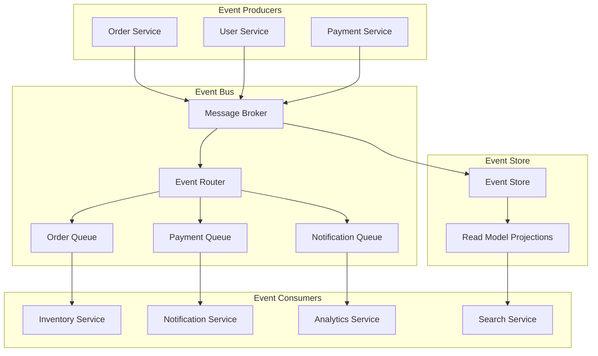
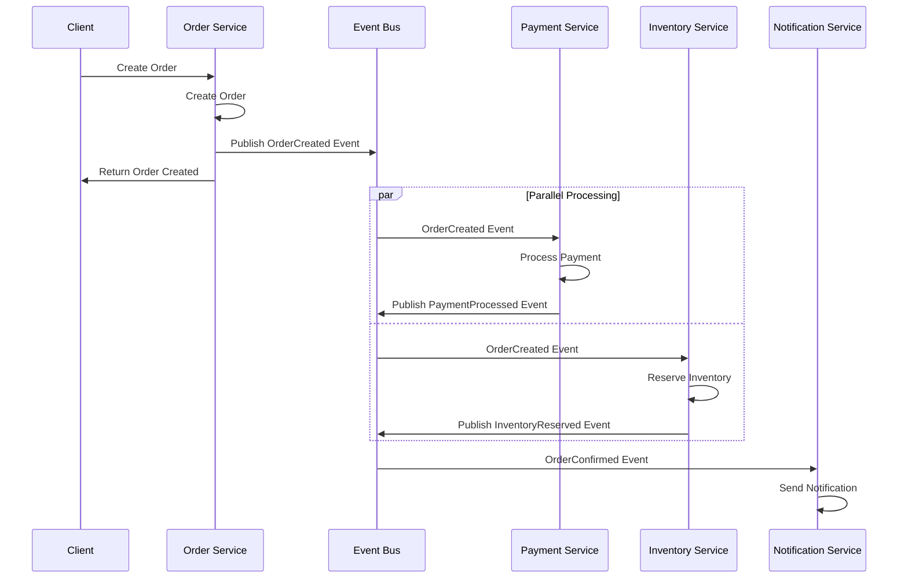
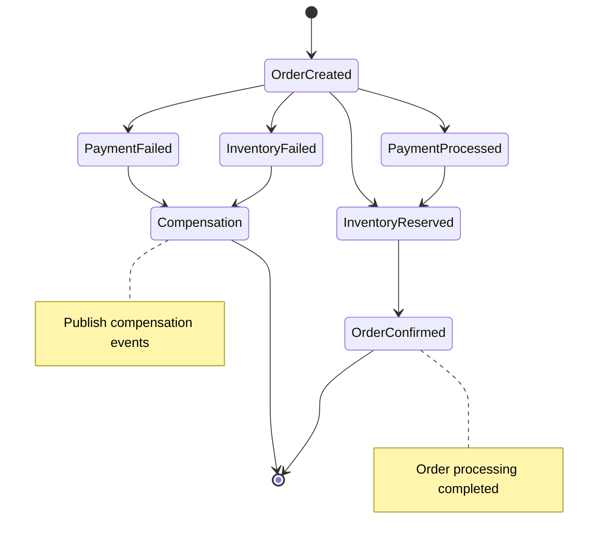
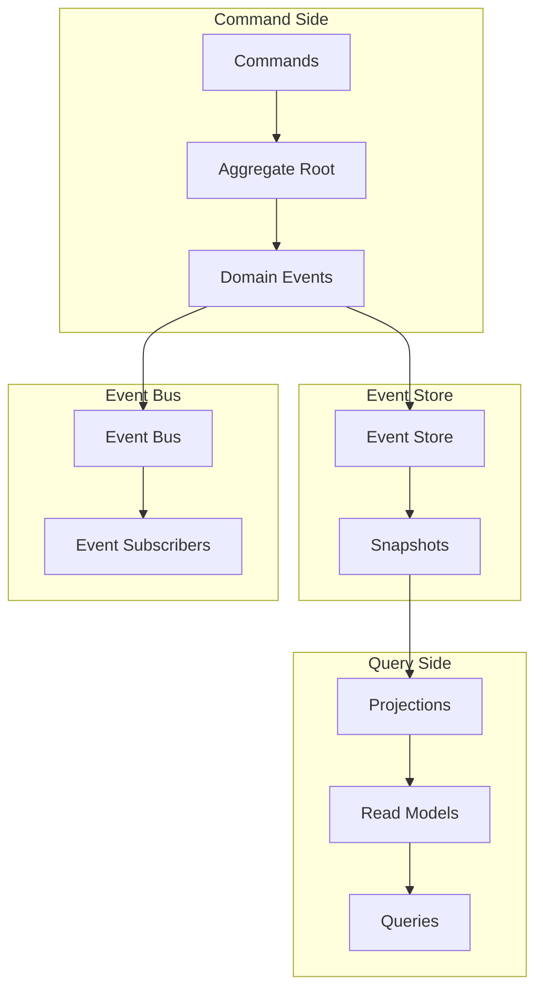
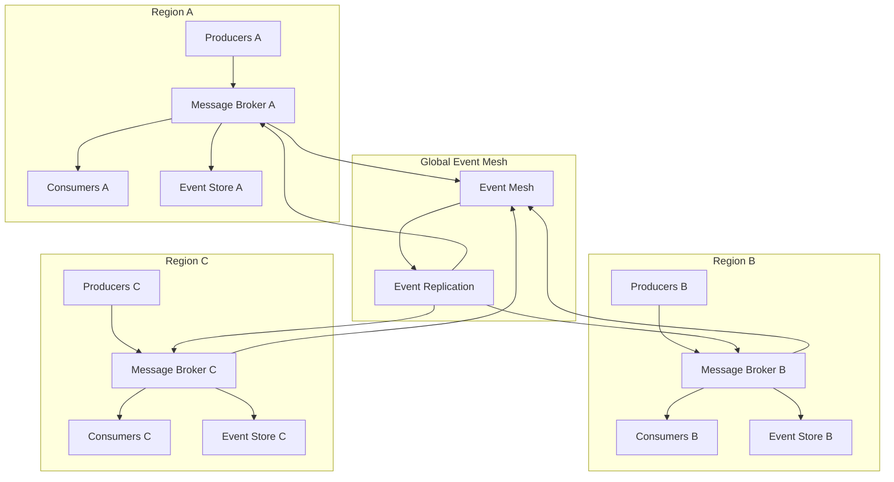
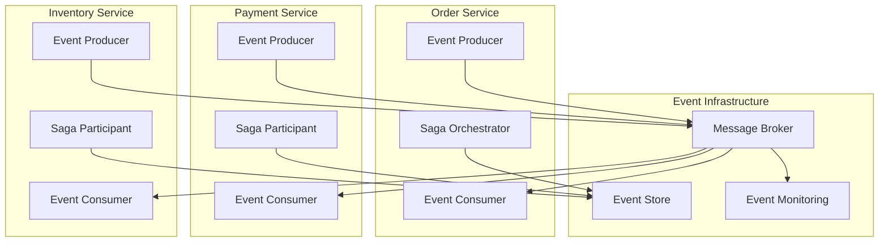
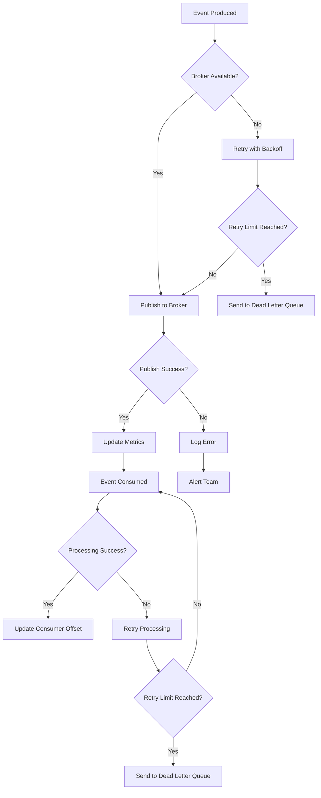

# Event-Driven Architecture - Architect Deep Dive

**0. Executive Summary (Architect View)**
- **Event-Driven Architecture exists** to enable loose coupling between services through asynchronous event communication
- **Critical at scale** when systems need to handle high throughput, maintain resilience, and support independent scaling
- **System design impact** - transforms synchronous request/response systems into asynchronous, event-based ecosystems
- **Scalability revolution** - enables independent scaling of producers and consumers
- **Resilience foundation** - systems can continue operating when components fail
- **Real-time capabilities** - enables immediate reaction to business events
- **Microservices essential** - fundamental pattern for distributed system communication
- **Business agility** - enables rapid addition of new event consumers and producers

**1. Problem Framing**
**Real production problem solved:**
- Tight coupling between services causing cascading failures
- Synchronous communication creating bottlenecks and latency
- Difficulty in adding new functionality without affecting existing systems
- Poor resilience when components fail or become unavailable
- Inability to scale different parts of the system independently

**What breaks if we don't use it:**
- Systems become brittle and tightly coupled
- Single component failures cascade through the system
- Scaling becomes expensive and inefficient
- Adding new features requires coordinated deployments
- Real-time processing becomes impossible

**Scale importance:**
- **Few services**: Synchronous communication manageable
- **Many services**: Event-driven becomes beneficial
- **High throughput**: Event-driven essential for performance
- **Global deployment**: Event-driven critical for resilience

**Failure stories:**
- E-commerce platform crashed during product launch due to synchronous order processing
- Financial system lost trades due to tightly coupled payment processing
- Social media platform became unavailable when notification service failed
- Logistics system couldn't handle peak season due to synchronous inventory updates

**2. Deep Internal Mechanics**

**How it works internally:**
- **Event Producers**: Generate events when state changes occur
- **Event Consumers**: React to events and perform business logic
- **Event Bus/Message Broker**: Routes events from producers to consumers
- **Event Store**: Persists events for audit and replay capabilities
- **Event Schemas**: Define event structure and evolution

**Core Concepts:**
- **Events**: Immutable records of things that happened
- **Event Streams**: Ordered sequences of events
- **Event Handlers**: Functions that process specific event types
- **Event Routing**: Mechanisms to deliver events to appropriate handlers
- **Event Versioning**: Strategies for evolving event schemas

**Event Processing Patterns:**
- **Event Notification**: Simple fire-and-forget events
- **Event-Carried State Transfer**: Include data needed for processing
- **Event Sourcing**: Store all events as system state
- **CQRS**: Separate read/write models through events
- **Saga Pattern**: Distributed transactions through events

**Message Delivery Guarantees:**
- **At-Least-Once**: Events delivered but may be duplicated
- **At-Most-Once**: Events delivered once but may be lost
- **Exactly-Once**: Events delivered exactly once (complex to implement)
- **Ordering**: Events delivered in the order they were produced

**Data Structures:**
- **Event Objects**: Immutable event data structures
- **Event Headers**: Metadata for routing and processing
- **Event Schemas**: Contract definitions for event structure
- **Event Streams**: Ordered collections of events
- **Event Projections**: Read models built from events

**Performance Characteristics:**
- **Latency**: Milliseconds to seconds depending on processing
- **Throughput**: Thousands to millions of events per second
- **Scalability**: Linear scaling with proper partitioning
- **Durability**: Persistent storage ensures no event loss

**Hidden Costs:**
- Increased system complexity
- Debugging and monitoring challenges
- Event schema evolution overhead
- Event ordering and duplication handling
- Operational complexity of message brokers

**Memory Behavior:**
- Event buffers in memory for performance
- Consumer offset tracking
- Event serialization overhead
- Backpressure handling mechanisms

**Async/await Integration:**
- Event handlers naturally asynchronous
- Non-blocking event processing
- Async event publishing
- Parallel event consumption

**3. .NET Production Implementation**

**Naive Implementation (Synchronous):**
```csharp
public class OrderService
{
    private readonly PaymentService _paymentService;
    private readonly InventoryService _inventoryService;
    private readonly NotificationService _notificationService;
    
    public async Task<OrderResult> CreateOrderAsync(Order order)
    {
        // Synchronous coupling - tight dependencies
        var paymentResult = await _paymentService.ProcessPaymentAsync(order.Payment);
        if (!paymentResult.Success)
        {
            return OrderResult.Failed("Payment failed");
        }
        
        var inventoryResult = await _inventoryService.ReserveInventoryAsync(order.Items);
        if (!inventoryResult.Success)
        {
            await _paymentService.RefundAsync(order.Payment.Id);
            return OrderResult.Failed("Insufficient inventory");
        }
        
        await _notificationService.SendOrderConfirmationAsync(order);
        
        return OrderResult.Success(order);
    }
}
```

**Production-Ready Event-Driven Implementation:**
```csharp
// Event definitions
public abstract record DomainEvent
{
    public Guid Id { get; } = Guid.NewGuid();
    public DateTime OccurredOn { get; } = DateTime.UtcNow;
    public int Version { get; protected set; }
}

public record OrderCreatedEvent(
    Guid OrderId,
    Guid CustomerId,
    List<OrderItem> Items,
    decimal TotalAmount,
    DateTime CreatedAt
) : DomainEvent;

public record PaymentProcessedEvent(
    Guid OrderId,
    Guid PaymentId,
    decimal Amount,
    PaymentStatus Status,
    DateTime ProcessedAt
) : DomainEvent;

public record InventoryReservedEvent(
    Guid OrderId,
    List<InventoryReservation> Reservations,
    DateTime ReservedAt
) : DomainEvent;

public record OrderConfirmedEvent(
    Guid OrderId,
    DateTime ConfirmedAt
) : DomainEvent;

// Event Producer
public class OrderService
{
    private readonly IOrderRepository _orderRepository;
    private readonly IEventBus _eventBus;
    private readonly ILogger<OrderService> _logger;
    private readonly IMetrics _metrics;

    public OrderService(
        IOrderRepository orderRepository,
        IEventBus eventBus,
        ILogger<OrderService> logger,
        IMetrics metrics)
    {
        _orderRepository = orderRepository ?? throw new ArgumentNullException(nameof(orderRepository));
        _eventBus = eventBus ?? throw new ArgumentNullException(nameof(eventBus));
        _logger = logger ?? throw new ArgumentNullException(nameof(logger));
        _metrics = metrics ?? throw new ArgumentNullException(nameof(metrics));
    }

    public async Task<OrderResult> CreateOrderAsync(CreateOrderRequest request, CancellationToken cancellationToken = default)
    {
        using var activity = _metrics.StartTimer("order_create_duration");
        
        try
        {
            _logger.LogInformation("Creating order for customer {CustomerId}", request.CustomerId);
            
            // Create order (no external dependencies)
            var order = Order.Create(request.CustomerId, request.Items, request.ShippingAddress);
            
            // Save order
            await _orderRepository.SaveAsync(order, cancellationToken);
            
            // Publish domain event
            var orderCreatedEvent = new OrderCreatedEvent(
                order.Id,
                order.CustomerId,
                order.Items,
                order.TotalAmount,
                order.CreatedAt
            );
            
            await _eventBus.PublishAsync(orderCreatedEvent, cancellationToken);
            
            _metrics.Increment("order_created_success");
            _logger.LogInformation("Order {OrderId} created and event published", order.Id);
            
            return OrderResult.Success(order);
        }
        catch (Exception ex)
        {
            _metrics.Increment("order_created_failed");
            _logger.LogError(ex, "Failed to create order for customer {CustomerId}", request.CustomerId);
            throw;
        }
    }
}

// Event Consumers
public class PaymentEventHandler :
    IEventHandler<OrderCreatedEvent>,
    IEventHandler<PaymentProcessedEvent>
{
    private readonly IPaymentService _paymentService;
    private readonly IEventBus _eventBus;
    private readonly ILogger<PaymentEventHandler> _logger;
    private readonly IMetrics _metrics;

    public PaymentEventHandler(
        IPaymentService paymentService,
        IEventBus eventBus,
        ILogger<PaymentEventHandler> logger,
        IMetrics metrics)
    {
        _paymentService = paymentService ?? throw new ArgumentNullException(nameof(paymentService));
        _eventBus = eventBus ?? throw new ArgumentNullException(nameof(eventBus));
        _logger = logger ?? throw new ArgumentNullException(nameof(logger));
        _metrics = metrics ?? throw new ArgumentNullException(nameof(metrics));
    }

    public async Task HandleAsync(OrderCreatedEvent @event, CancellationToken cancellationToken = default)
    {
        using var activity = _metrics.StartTimer("payment_process_duration");
        
        try
        {
            _logger.LogInformation("Processing payment for order {OrderId}", @event.OrderId);
            
            // Process payment
            var paymentRequest = new PaymentRequest
            {
                OrderId = @event.OrderId,
                Amount = @event.TotalAmount,
                CustomerId = @event.CustomerId
            };
            
            var paymentResult = await _paymentService.ProcessPaymentAsync(paymentRequest, cancellationToken);
            
            // Publish payment processed event
            var paymentProcessedEvent = new PaymentProcessedEvent(
                @event.OrderId,
                paymentResult.PaymentId,
                @event.TotalAmount,
                paymentResult.Status,
                DateTime.UtcNow
            );
            
            await _eventBus.PublishAsync(paymentProcessedEvent, cancellationToken);
            
            _metrics.Increment("payment_processed_success");
            _logger.LogInformation("Payment processed for order {OrderId}", @event.OrderId);
        }
        catch (Exception ex)
        {
            _metrics.Increment("payment_processed_failed");
            _logger.LogError(ex, "Failed to process payment for order {OrderId}", @event.OrderId);
            throw;
        }
    }

    public async Task HandleAsync(PaymentProcessedEvent @event, CancellationToken cancellationToken = default)
    {
        // Handle payment processed event (e.g., update order status)
        _logger.LogInformation("Payment processed event received for order {OrderId}", @event.OrderId);
        
        if (@event.Status == PaymentStatus.Failed)
        {
            // Publish payment failed event for other consumers
            var paymentFailedEvent = new PaymentFailedEvent(@event.OrderId, @event.PaymentId, @event.Amount);
            await _eventBus.PublishAsync(paymentFailedEvent, cancellationToken);
        }
    }
}

public class InventoryEventHandler :
    IEventHandler<OrderCreatedEvent>,
    IEventHandler<PaymentProcessedEvent>
{
    private readonly IInventoryService _inventoryService;
    private readonly IEventBus _eventBus;
    private readonly ILogger<InventoryEventHandler> _logger;
    private readonly IMetrics _metrics;

    public InventoryEventHandler(
        IInventoryService inventoryService,
        IEventBus eventBus,
        ILogger<InventoryEventHandler> logger,
        IMetrics metrics)
    {
        _inventoryService = inventoryService ?? throw new ArgumentNullException(nameof(inventoryService));
        _eventBus = eventBus ?? throw new ArgumentNullException(nameof(eventBus));
        _logger = logger ?? throw new ArgumentNullException(nameof(logger));
        _metrics = metrics ?? throw new ArgumentNullException(nameof(metrics));
    }

    public async Task HandleAsync(OrderCreatedEvent @event, CancellationToken cancellationToken = default)
    {
        using var activity = _metrics.StartTimer("inventory_reserve_duration");
        
        try
        {
            _logger.LogInformation("Reserving inventory for order {OrderId}", @event.OrderId);
            
            // Reserve inventory
            var reservationRequest = new InventoryReservationRequest
            {
                OrderId = @event.OrderId,
                Items = @event.Items
            };
            
            var reservationResult = await _inventoryService.ReserveInventoryAsync(reservationRequest, cancellationToken);
            
            // Publish inventory reserved event
            var inventoryReservedEvent = new InventoryReservedEvent(
                @event.OrderId,
                reservationResult.Reservations,
                DateTime.UtcNow
            );
            
            await _eventBus.PublishAsync(inventoryReservedEvent, cancellationToken);
            
            _metrics.Increment("inventory_reserved_success");
            _logger.LogInformation("Inventory reserved for order {OrderId}", @event.OrderId);
        }
        catch (Exception ex)
        {
            _metrics.Increment("inventory_reserved_failed");
            _logger.LogError(ex, "Failed to reserve inventory for order {OrderId}", @event.OrderId);
            throw;
        }
    }

    public async Task HandleAsync(PaymentProcessedEvent @event, CancellationToken cancellationToken = default)
    {
        // Handle payment processed event (e.g., confirm inventory reservation)
        if (@event.Status == PaymentStatus.Success)
        {
            await _inventoryService.ConfirmReservationAsync(@event.OrderId, cancellationToken);
        }
        else
        {
            await _inventoryService.ReleaseReservationAsync(@event.OrderId, cancellationToken);
        }
    }
}

public class NotificationEventHandler :
    IEventHandler<OrderConfirmedEvent>,
    IEventHandler<PaymentFailedEvent>,
    IEventHandler<InventoryReservationFailedEvent>
{
    private readonly INotificationService _notificationService;
    private readonly ILogger<NotificationEventHandler> _logger;
    private readonly IMetrics _metrics;

    public NotificationEventHandler(
        INotificationService notificationService,
        ILogger<NotificationEventHandler> logger,
        IMetrics metrics)
    {
        _notificationService = notificationService ?? throw new ArgumentNullException(nameof(notificationService));
        _logger = logger ?? throw new ArgumentNullException(nameof(logger));
        _metrics = metrics ?? throw new ArgumentNullException(nameof(metrics));
    }

    public async Task HandleAsync(OrderConfirmedEvent @event, CancellationToken cancellationToken = default)
    {
        using var activity = _metrics.StartTimer("notification_send_duration");
        
        try
        {
            _logger.LogInformation("Sending order confirmation for order {OrderId}", @event.OrderId);
            
            await _notificationService.SendOrderConfirmationAsync(@event.OrderId, cancellationToken);
            
            _metrics.Increment("notification_sent_success");
            _logger.LogInformation("Order confirmation sent for order {OrderId}", @event.OrderId);
        }
        catch (Exception ex)
        {
            _metrics.Increment("notification_sent_failed");
            _logger.LogError(ex, "Failed to send order confirmation for order {OrderId}", @event.OrderId);
            throw;
        }
    }

    public async Task HandleAsync(PaymentFailedEvent @event, CancellationToken cancellationToken = default)
    {
        await _notificationService.SendPaymentFailedNotificationAsync(@event.OrderId, cancellationToken);
    }

    public async Task HandleAsync(InventoryReservationFailedEvent @event, CancellationToken cancellationToken = default)
    {
        await _notificationService.SendInventoryFailedNotificationAsync(@event.OrderId, cancellationToken);
    }
}

// Event Bus Interface and Implementation
public interface IEventBus
{
    Task PublishAsync<T>(T @event, CancellationToken cancellationToken = default) where T : DomainEvent;
    Task SubscribeAsync<T>(IEventHandler<T> handler, CancellationToken cancellationToken = default) where T : DomainEvent;
}

public class MessageBrokerEventBus : IEventBus
{
    private readonly IMessageBroker _messageBroker;
    private readonly IEventSerializer _serializer;
    private readonly ILogger<MessageBrokerEventBus> _logger;
    private readonly IMetrics _metrics;
    private readonly ConcurrentDictionary<Type, List<object>> _handlers;

    public MessageBrokerEventBus(
        IMessageBroker messageBroker,
        IEventSerializer serializer,
        ILogger<MessageBrokerEventBus> logger,
        IMetrics metrics)
    {
        _messageBroker = messageBroker ?? throw new ArgumentNullException(nameof(messageBroker));
        _serializer = serializer ?? throw new ArgumentNullException(nameof(serializer));
        _logger = logger ?? throw new ArgumentNullException(nameof(logger));
        _metrics = metrics ?? throw new ArgumentNullException(nameof(metrics));
        _handlers = new ConcurrentDictionary<Type, List<object>>();
    }

    public async Task PublishAsync<T>(T @event, CancellationToken cancellationToken = default) where T : DomainEvent
    {
        using var activity = _metrics.StartTimer("event_publish_duration");
        
        try
        {
            var eventName = typeof(T).Name;
            var serializedEvent = _serializer.Serialize(@event);
            
            await _messageBroker.PublishAsync(eventName, serializedEvent, cancellationToken);
            
            _metrics.Increment("event_published_success");
            _logger.LogDebug("Event {EventType} published for {EventId}", eventName, @event.Id);
        }
        catch (Exception ex)
        {
            _metrics.Increment("event_published_failed");
            _logger.LogError(ex, "Failed to publish event {EventType}", typeof(T).Name);
            throw;
        }
    }

    public async Task SubscribeAsync<T>(IEventHandler<T> handler, CancellationToken cancellationToken = default) where T : DomainEvent
    {
        var eventType = typeof(T);
        var handlers = _handlers.GetOrAdd(eventType, _ => new List<object>());
        
        lock (handlers)
        {
            handlers.Add(handler);
        }
        
        // Subscribe to message broker
        await _messageBroker.SubscribeAsync(eventType.Name, async message =>
        {
            try
            {
                var @event = _serializer.Deserialize<T>(message);
                await handler.HandleAsync(@event, cancellationToken);
            }
            catch (Exception ex)
            {
                _logger.LogError(ex, "Failed to handle event {EventType}", eventType.Name);
                throw;
            }
        }, cancellationToken);
        
        _logger.LogInformation("Subscribed to event {EventType}", eventType.Name);
    }
}

// Saga Pattern for Distributed Transactions
public class OrderProcessingSaga :
    ISaga,
    IEventHandler<OrderCreatedEvent>,
    IEventHandler<PaymentProcessedEvent>,
    IEventHandler<InventoryReservedEvent>,
    IEventHandler<PaymentFailedEvent>,
    IEventHandler<InventoryReservationFailedEvent>
{
    private readonly ISagaStateRepository _stateRepository;
    private readonly IEventBus _eventBus;
    private readonly ILogger<OrderProcessingSaga> _logger;
    private readonly IMetrics _metrics;

    public Guid SagaId { get; private set; }
    public SagaStatus Status { get; private set; }
    private readonly Dictionary<string, object> _state = new();

    public OrderProcessingSaga(
        ISagaStateRepository stateRepository,
        IEventBus eventBus,
        ILogger<OrderProcessingSaga> logger,
        IMetrics metrics)
    {
        _stateRepository = stateRepository ?? throw new ArgumentNullException(nameof(stateRepository));
        _eventBus = eventBus ?? throw new ArgumentNullException(nameof(eventBus));
        _logger = logger ?? throw new ArgumentNullException(nameof(logger));
        _metrics = metrics ?? throw new ArgumentNullException(nameof(metrics));
    }

    public async Task HandleAsync(OrderCreatedEvent @event, CancellationToken cancellationToken = default)
    {
        SagaId = @event.OrderId;
        Status = SagaStatus.Started;
        _state["OrderId"] = @event.OrderId;
        _state["CustomerId"] = @event.CustomerId;
        _state["TotalAmount"] = @event.TotalAmount;
        
        await SaveStateAsync(cancellationToken);
        
        _logger.LogInformation("Order processing saga started for order {OrderId}", @event.OrderId);
    }

    public async Task HandleAsync(PaymentProcessedEvent @event, CancellationToken cancellationToken = default)
    {
        if (@event.Status == PaymentStatus.Success)
        {
            _state["PaymentStatus"] = "Success";
            _state["PaymentId"] = @event.PaymentId;
        }
        else
        {
            _state["PaymentStatus"] = "Failed";
            await HandleFailureAsync("Payment failed", cancellationToken);
        }
        
        await CheckCompletionAsync(cancellationToken);
    }

    public async Task HandleAsync(InventoryReservedEvent @event, CancellationToken cancellationToken = default)
    {
        _state["InventoryStatus"] = "Reserved";
        _state["Reservations"] = @event.Reservations;
        
        await CheckCompletionAsync(cancellationToken);
    }

    public async Task HandleAsync(PaymentFailedEvent @event, CancellationToken cancellationToken = default)
    {
        await HandleFailureAsync("Payment failed", cancellationToken);
    }

    public async Task HandleAsync(InventoryReservationFailedEvent @event, CancellationToken cancellationToken = default)
    {
        await HandleFailureAsync("Inventory reservation failed", cancellationToken);
    }

    private async Task CheckCompletionAsync(CancellationToken cancellationToken)
    {
        if (_state.ContainsKey("PaymentStatus") && _state.ContainsKey("InventoryStatus"))
        {
            if (_state["PaymentStatus"].ToString() == "Success" && 
                _state["InventoryStatus"].ToString() == "Reserved")
            {
                // Order processing completed successfully
                Status = SagaStatus.Completed;
                
                var orderConfirmedEvent = new OrderConfirmedEvent(
                    (Guid)_state["OrderId"],
                    DateTime.UtcNow
                );
                
                await _eventBus.PublishAsync(orderConfirmedEvent, cancellationToken);
                
                _logger.LogInformation("Order processing saga completed for order {OrderId}", _state["OrderId"]);
            }
        }
        
        await SaveStateAsync(cancellationToken);
    }

    private async Task HandleFailureAsync(string reason, CancellationToken cancellationToken)
    {
        Status = SagaStatus.Failed;
        _state["FailureReason"] = reason;
        
        // Publish compensation events
        await PublishCompensationEventsAsync(cancellationToken);
        
        await SaveStateAsync(cancellationToken);
        
        _logger.LogError("Order processing saga failed for order {OrderId}: {Reason}", _state["OrderId"], reason);
    }

    private async Task PublishCompensationEventsAsync(CancellationToken cancellationToken)
    {
        var orderId = (Guid)_state["OrderId"];
        
        // Compensate payment if it was processed
        if (_state.ContainsKey("PaymentId"))
        {
            var paymentId = (Guid)_state["PaymentId"];
            var refundEvent = new PaymentRefundRequestedEvent(orderId, paymentId, (decimal)_state["TotalAmount"]);
            await _eventBus.PublishAsync(refundEvent, cancellationToken);
        }
        
        // Release inventory reservation
        if (_state.ContainsKey("Reservations"))
        {
            var releaseEvent = new InventoryReservationReleaseRequestedEvent(orderId);
            await _eventBus.PublishAsync(releaseEvent, cancellationToken);
        }
    }

    private async Task SaveStateAsync(CancellationToken cancellationToken)
    {
        var sagaState = new SagaState
        {
            SagaId = SagaId,
            SagaType = nameof(OrderProcessingSaga),
            Status = Status,
            State = _state,
            UpdatedAt = DateTime.UtcNow
        };
        
        await _stateRepository.SaveAsync(sagaState, cancellationToken);
    }
}
```

**Framework Integration:**
- **MassTransit**: Message broker abstraction for event-driven architecture
- **ASP.NET Core**: Background services for event processing
- **Entity Framework Core**: Event store and saga state persistence
- **System.Reactive**: Reactive extensions for event streams

**4. Architecture-Level Diagram (Mermaid)**

### Event-Driven Architecture Overview


### Event Flow Sequence


### Saga Pattern for Distributed Transactions


### Event Sourcing Architecture


**Flow Analysis:**
- **Event Production**: Services publish events when state changes occur
- **Event Routing**: Message broker routes events to appropriate consumers
- **Event Processing**: Consumers process events asynchronously
- **Event Persistence**: Events stored for audit and replay capabilities
- **Saga Coordination**: Distributed transactions coordinated through events

**Bottlenecks:**
- Message broker throughput and latency
- Event serialization/deserialization overhead
- Consumer processing capacity
- Event store write performance
- Saga state management complexity

**Scaling Boundaries:**
- Event producers scale independently
- Event consumers scale independently
- Message broker scales horizontally
- Event store scales with partitioning
- Read models scale independently

**5. Scaling & Distributed Systems Impact**

### Distributed Event-Driven Architecture


### Microservices Event-Driven Communication


**100 RPS:**
- Single message broker sufficient
- Event processing overhead minimal
- Latency acceptable for most use cases
- Simple deployment architecture

**10k RPS:**
- Message broker clustering required
- Event partitioning becomes important
- Consumer scaling essential
- Monitoring and observability critical

**100k+ RPS:**
- Distributed message brokers mandatory
- Event sharding and partitioning essential
- Global event mesh for multi-region
- Advanced monitoring and alerting

**Horizontal vs Vertical Scaling:**
- **Horizontal**: Scale producers, consumers, and brokers independently
- **Vertical**: Larger brokers handle more throughput
- Event partitioning enables horizontal scaling
- Consumer groups enable parallel processing

**CAP Theorem Relevance:**
- **Consistency**: Eventual consistency through event ordering
- **Availability**: System remains available during broker failures
- **Partition Tolerance**: Event replication handles network partitions

**Consistency Implications:**
- Eventual consistency between services
- Event ordering critical for consistency
- Saga patterns ensure distributed consistency
- Compensation events handle rollbacks

**Microservices Impact:**
- Loose coupling through event communication
- Independent deployment and scaling
- Service autonomy and resilience
- Event-driven business processes

**Cloud-Native Considerations:**
- **Kubernetes**: Event brokers as stateful services
- **Serverless**: Event-driven functions scale automatically
- **Managed Services**: Cloud provider event streaming services
- **Service Mesh**: Event routing and observability

**Multi-Region Concerns:**
- Event replication across regions
- Event ordering in distributed systems
- Cross-region saga coordination
- Disaster recovery through event replay

**6. Production Engineering View**

### Event-Driven System Monitoring

```mermaid
graph TB
    subgraph "Producer Metrics"
        PRODUCER_RATE[Event Production Rate]
        PRODUCER_LATENCY[Publish Latency]
        PRODUCER_ERRORS[Publish Error Rate]
        PRODUCER_QUEUE[Producer Queue Size]
    end
    
    subgraph "Broker Metrics"
        BROKER_THROUGHPUT[Broker Throughput]
        BROKER_LATENCY[Broker Latency]
        BROKER_QUEUE[Queue Depth]
        BROKER_PARTITIONS[Partition Status]
    end
    
    subgraph "Consumer Metrics"
        CONSUMER_RATE[Event Consumption Rate]
        CONSUMER_LATENCY[Processing Latency]
        CONSUMER_ERRORS[Processing Error Rate]
        CONSUMER_LAG[Consumer Lag]
    end
    
    subgraph "Saga Metrics"
        SAGA_STATE[Saga State Distribution]
        SAGA_TIMEOUT[Saga Timeouts]
        SAGA_COMPENSATION[Compensation Events]
        SAGA_COMPLETION[Saga Completion Rate]
    end
    
    subgraph "Monitoring Stack"
        PROM[Prometheus]
        GRAF[Grafana]
        ALERT[AlertManager]
    end
    
    PRODUCER_RATE --> PROM
    PRODUCER_LATENCY --> PROM
    PRODUCER_ERRORS --> PROM
    PRODUCER_QUEUE --> PROM
    
    BROKER_THROUGHPUT --> PROM
    BROKER_LATENCY --> PROM
    BROKER_QUEUE --> PROM
    BROKER_PARTITIONS --> PROM
    
    CONSUMER_RATE --> PROM
    CONSUMER_LATENCY --> PROM
    CONSUMER_ERRORS --> PROM
    CONSUMER_LAG --> PROM
    
    SAGA_STATE --> PROM
    SAGA_TIMEOUT --> PROM
    SAGA_COMPENSATION --> PROM
    SAGA_COMPLETION --> PROM
    
    PROM --> GRAF
    PROM --> ALERT
```


### Event Processing Pipeline


**Monitoring Metrics:**
- Event production rate and latency
- Message broker throughput and queue depth
- Consumer processing rate and lag
- Saga state distribution and completion rates
- Error rates and retry patterns
- Event store performance and size

**Logs to Enable:**
- Event publication success/failure
- Event processing errors and retries
- Saga state transitions
- Consumer group rebalancing
- Broker connectivity issues

**Alerting Strategy:**
- Event production failure rate > 5% (critical)
- Consumer lag > 1000 events (warning)
- Saga timeout rate > 1% (warning)
- Broker queue depth > 80% capacity (critical)
- Event processing error rate > 2% (critical)

**Common Production Incidents:**
- **Message Broker Outage**: Complete event flow failure
- **Consumer Lag**: Events not processed fast enough
- **Event Duplication**: Duplicate processing due to at-least-once delivery
- **Saga Timeout**: Distributed transactions stuck in intermediate state
- **Event Schema Evolution**: Compatibility issues between producers and consumers

**Debugging Strategy:**
- Event tracing through the system
- Consumer lag analysis
- Saga state inspection
- Event replay for debugging
- Dead letter queue analysis

**Event Store Management:**
- Event store size monitoring
- Event archiving and cleanup
- Snapshot management
- Event replay capabilities
- Backup and recovery procedures

**Consumer Performance:**
- Consumer group optimization
- Parallel processing configuration
- Backpressure handling
- Error handling and retry strategies
- Consumer offset management

**Saga Management:**
- Saga state monitoring
- Timeout handling
- Compensation event tracking
- Saga completion analysis
- Distributed transaction debugging

**7. Tradeoffs & Alternatives**

**Competing Approaches:**
- **Request/Response**: Synchronous communication patterns
- **Message Queuing**: Simple point-to-point messaging
- **Publish/Subscribe**: Event broadcasting without persistence
- **Streaming Platforms**: Real-time event processing

**When NOT to Use Event-Driven Architecture:**
- Simple CRUD applications
- Real-time requirements for immediate consistency
- Small teams with limited distributed systems experience
- Systems requiring transactional consistency
- Low-latency requirements (<10ms)

**Latency Comparison:**
- **Event-Driven**: 100ms-1s for end-to-end processing
- **Request/Response**: 10-100ms for direct calls
- **Message Queuing**: 50-200ms for queue processing
- **Streaming Platforms**: 10-100ms for real-time processing

**Throughput Comparison:**
- **Event-Driven**: 10k-1M events/second
- **Request/Response**: 1k-10k requests/second
- **Message Queuing**: 5k-100k messages/second
- **Streaming Platforms**: 100k-10M events/second

**Operational Complexity:**
- **Event-Driven**: High complexity, excellent scalability
- **Request/Response**: Low complexity, limited scalability
- **Message Queuing**: Medium complexity, moderate scalability
- **Streaming Platforms**: High complexity, excellent real-time performance

**Cost Implications:**
- **Development Cost**: Event-driven increases development by 40-60%
- **Infrastructure Cost**: Message brokers and event stores
- **Operational Cost**: Monitoring and management overhead
- **Maintenance Cost**: Event schema evolution and consumer management

**8. Security Implications**

**Attack Surface:**
- Event injection and tampering
- Unauthorized event publishing
- Event replay attacks
- Message broker security breaches
- Saga state manipulation

**Security Controls:**
- Event authentication and authorization
- Event encryption and signing
- Message broker security
- Event schema validation
- Access control for event publishing/consuming

**Data Protection:**
- Sensitive data in events
- Event encryption at rest and in transit
- Event retention policies
- Privacy compliance for event data
- Data minimization in events

**Compliance Requirements:**
- Audit trails through event logs
- Event retention for regulatory compliance
- Data protection through event encryption
- Privacy controls for personal data
- Event processing compliance

**Hardening Recommendations:**
- Event signing and verification
- Message broker authentication
- Event schema validation
- Network security for event communication
- Regular security audits of event flows

**9. Advanced Edge Cases**

**Event Ordering:**
- Maintaining order across partitions
- Out-of-order event handling
- Event sequencing strategies
- Temporal consistency requirements
- Ordering guarantees in distributed systems

**Event Schema Evolution:**
- Backward compatibility strategies
- Forward compatibility considerations
- Schema versioning approaches
- Event transformation and migration
- Consumer compatibility management

**Event Duplication:**
- Idempotent event processing
- Duplicate detection strategies
- Exactly-once delivery semantics
- Deduplication mechanisms
- Consumer-side deduplication

**Performance Optimization:**
- Event batching strategies
- Compression for large events
- Event partitioning optimization
- Consumer parallelization
- Broker tuning and optimization

**Failure Handling:**
- Dead letter queue management
- Retry strategies and backoff
- Circuit breaker patterns
- Fallback mechanisms
- Graceful degradation strategies

**Saga Patterns:**
- Complex saga orchestration
- Nested saga patterns
- Saga compensation strategies
- Distributed timeout handling
- Saga state recovery

**Event Replay:**
- Event replay for debugging
- System recovery through replay
- Read model rebuilding
- Event archiving and replay
- Replay performance optimization

**10. Interview & Staff-Level Deep Dive**

**What a junior answers:**
"Event-driven architecture is when services send events to each other instead of calling each other directly. It uses a message broker to route events. Services can process events asynchronously."

**What a senior answers:**
"Event-driven architecture enables loose coupling between services through asynchronous event communication. Services publish events when state changes occur, and other services subscribe to relevant events. This provides resilience, scalability, and independent deployment. I've implemented it using message brokers like Kafka or RabbitMQ, with event sourcing for audit trails and saga patterns for distributed transactions. Key considerations include event ordering, exactly-once delivery, and schema evolution."

**What an architect answers:**
"Event-driven architecture is a fundamental pattern for building scalable, resilient distributed systems that transforms synchronous, tightly-coupled systems into asynchronous, loosely-coupled ecosystems. At scale, it enables independent scaling of producers and consumers, fault isolation, and real-time processing capabilities. The architecture requires careful consideration of event design, message delivery guarantees, consumer scaling, and saga patterns for distributed transactions. In microservices architectures, event-driven communication enables service autonomy, independent deployment, and business process orchestration. The implementation must address event schema evolution, ordering guarantees, replay capabilities, and comprehensive monitoring. At enterprise scale, event-driven architecture is not just a pattern but a strategic approach to system design that impacts organizational structure, operational procedures, and business agility."

**Follow-up questions interviewers ask:**
- "How do you handle event ordering in distributed systems?"
- "What's the difference between event sourcing and event-driven architecture?"
- "How do you implement exactly-once delivery?"
- "When would you use saga pattern?"
- "How do you handle event schema evolution?"

**Trick questions:**
- "Is event-driven architecture the same as microservices?" (No, but they complement each other)
- "Do events guarantee delivery?" (Depends on the message broker configuration)
- "Is event-driven architecture always asynchronous?" (Yes, by definition)
- "Can you have transactions in event-driven systems?" (Through saga patterns)

**Whiteboard explanation strategy:**
1. Draw traditional request/response architecture
2. Show event-driven architecture transformation
3. Demonstrate event flow through message broker
4. Explain saga pattern for distributed transactions
5. Cover event sourcing and replay capabilities
6. Discuss scaling and resilience benefits

**11. Real Enterprise Case Study**

**Scenario: Global E-commerce Platform with 10M Daily Orders**

**Requirements:**
- Process 10M+ orders per day globally
- Real-time inventory management across warehouses
- Complex order processing with multiple steps
- High availability and fault tolerance
- Real-time analytics and reporting
- Multi-region deployment for low latency

**Design Decisions:**

**1. Event-Driven Order Processing:**
```csharp
public class GlobalOrderProcessor
{
    private readonly IEventBus _eventBus;
    private readonly IOrderRepository _orderRepository;
    private readonly ILogger<GlobalOrderProcessor> _logger;
    private readonly IMetrics _metrics;

    public async Task<OrderResult> CreateOrderAsync(CreateOrderRequest request)
    {
        // Create order without external dependencies
        var order = Order.Create(request.CustomerId, request.Items, request.ShippingAddress);
        
        // Save order
        await _orderRepository.SaveAsync(order);
        
        // Publish order created event
        var orderCreatedEvent = new OrderCreatedEvent(
            order.Id,
            order.CustomerId,
            order.Items,
            order.TotalAmount,
            order.CreatedAt,
            request.Region
        );
        
        await _eventBus.PublishAsync(orderCreatedEvent);
        
        return OrderResult.Success(order);
    }
}
```

**2. Multi-Region Event Processing:**
```csharp
public class RegionalInventoryEventHandler
{
    private readonly IInventoryService _inventoryService;
    private readonly IEventBus _eventBus;
    private readonly string _region;

    public async Task HandleAsync(OrderCreatedEvent @event)
    {
        // Only process events for this region
        if (@event.Region != _region)
        {
            return;
        }
        
        // Reserve inventory in regional warehouses
        var reservationResult = await _inventoryService.ReserveInventoryAsync(@event.OrderId, @event.Items);
        
        // Publish inventory reserved event
        var inventoryReservedEvent = new InventoryReservedEvent(
            @event.OrderId,
            reservationResult.Reservations,
            _region,
            DateTime.UtcNow
        );
        
        await _eventBus.PublishAsync(inventoryReservedEvent);
    }
}
```

**3. Global Saga Orchestration:**
```csharp
public class GlobalOrderSaga
{
    private readonly Dictionary<string, SagaStep> _steps = new();
    private readonly IEventBus _eventBus;
    private readonly ILogger<GlobalOrderSaga> _logger;

    public GlobalOrderSaga()
    {
        // Define saga steps
        _steps["Payment"] = new SagaStep("Payment", "PaymentProcessed", "PaymentFailed");
        _steps["Inventory"] = new SagaStep("Inventory", "InventoryReserved", "InventoryFailed");
        _steps["Shipping"] = new SagaStep("Shipping", "ShippingScheduled", "ShippingFailed");
    }

    public async Task HandleAsync(OrderCreatedEvent @event)
    {
        // Start saga
        await StartSagaAsync(@event.OrderId);
        
        // Trigger first step
        await TriggerStepAsync(@event.OrderId, "Payment");
    }

    public async Task HandleAsync(PaymentProcessedEvent @event)
    {
        await CompleteStepAsync(@event.OrderId, "Payment");
        await TriggerNextStepAsync(@event.OrderId);
    }

    private async Task TriggerNextStepAsync(Guid orderId)
    {
        var nextStep = GetNextStep(orderId);
        if (nextStep != null)
        {
            await TriggerStepAsync(orderId, nextStep);
        }
        else
        {
            // Saga completed
            await CompleteSagaAsync(orderId);
        }
    }
}
```

**Compromises Made:**
- **Consistency vs Availability**: Eventual consistency for better availability
- **Latency vs Scalability**: Higher latency for better scalability
- **Complexity vs Flexibility**: Increased complexity for system flexibility
- **Cost vs Performance**: Higher infrastructure costs for better performance

**Bottlenecks Identified:**
- Message broker throughput during peak hours
- Event serialization/deserialization overhead
- Cross-region event replication latency
- Saga state management complexity

**Performance Optimizations:**
```csharp
public class OptimizedEventPublisher
{
    private readonly IEventBus _eventBus;
    private readonly IEventBatcher _batcher;
    
    public async Task PublishBatchAsync(IEnumerable<DomainEvent> events)
    {
        // Batch events for better throughput
        var batches = _batcher.CreateBatches(events);
        
        var tasks = batches.Select(batch => _eventBus.PublishBatchAsync(batch));
        await Task.WhenAll(tasks);
    }
}
```

**Results:**
- Achieved 10M+ orders/day processing
- 99.99% uptime with event-driven resilience
- Real-time inventory management across regions
- Sub-second event processing latency
- Successful handling of peak season traffic

**12. Dependency Graph**

**Prerequisites (Must understand before):**
- **Message Queuing**: Understanding of message brokers and queues
- **Asynchronous Programming**: Non-blocking processing patterns
- **Distributed Systems**: Understanding of distributed computing challenges
- **Domain-Driven Design**: Domain events and bounded contexts
- **Microservices**: Service communication patterns

**Concepts that depend on Event-Driven Architecture:**
- **Event Sourcing**: Complete event log for state management
- **CQRS**: Command/Query separation through events
- **Saga Pattern**: Distributed transactions through events
- **Microservices**: Loose coupling through events
- **Reactive Programming**: Event streams and reactive patterns

**Connections to Other Concepts:**

**Event Sourcing:**
```csharp
public class EventSourcedAggregate
{
    private readonly List<DomainEvent> _events = new();
    
    public void Apply(DomainEvent @event)
    {
        _events.Add(@event);
        When(@event);
    }
    
    public IEnumerable<DomainEvent> GetUncommittedEvents() => _events;
}
```

**CQRS:**
```csharp
public class CommandHandler
{
    public async Task HandleAsync(Command command)
    {
        // Process command
        var events = ProcessCommand(command);
        
        // Publish events
        foreach (var @event in events)
        {
            await _eventBus.PublishAsync(@event);
        }
    }
}
```

**Saga Pattern:**
```csharp
public class SagaOrchestrator
{
    public async Task HandleAsync(DomainEvent @event)
    {
        var saga = GetSaga(@event.SagaId);
        await saga.HandleAsync(@event);
    }
}
```

**Microservices:**
- Event-driven communication enables service autonomy
- Loose coupling through event contracts
- Independent deployment and scaling
- Business process orchestration through events

**Domain-Driven Design:**
- Domain events capture business events
- Bounded contexts communicate through events
- Event storming for domain modeling
- Ubiquitous language in event schemas

**System Design:**
- Event-driven architecture influences system boundaries
- Event flow defines system interactions
- Event stores provide audit trails
- Event replay enables system recovery

**Cloud Computing:**
- Managed message broker services
- Event-driven serverless functions
- Cloud-native event streaming
- Multi-region event replication
