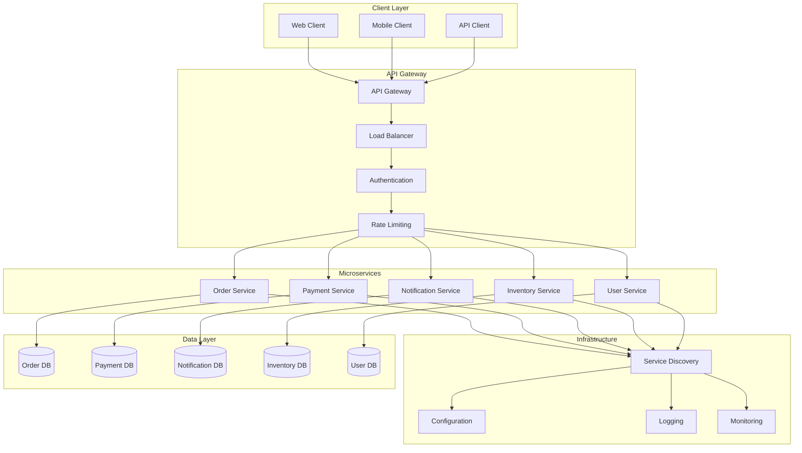
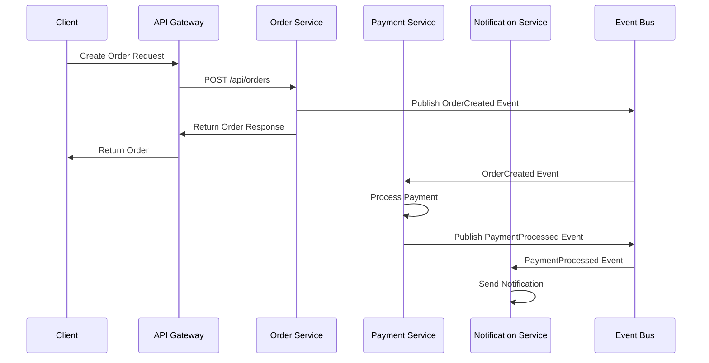
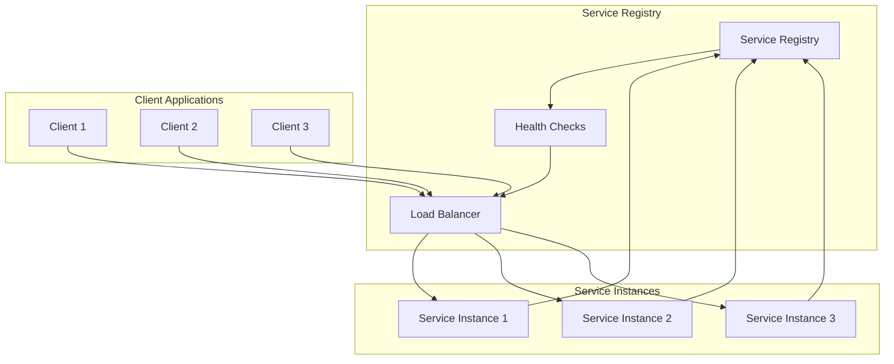
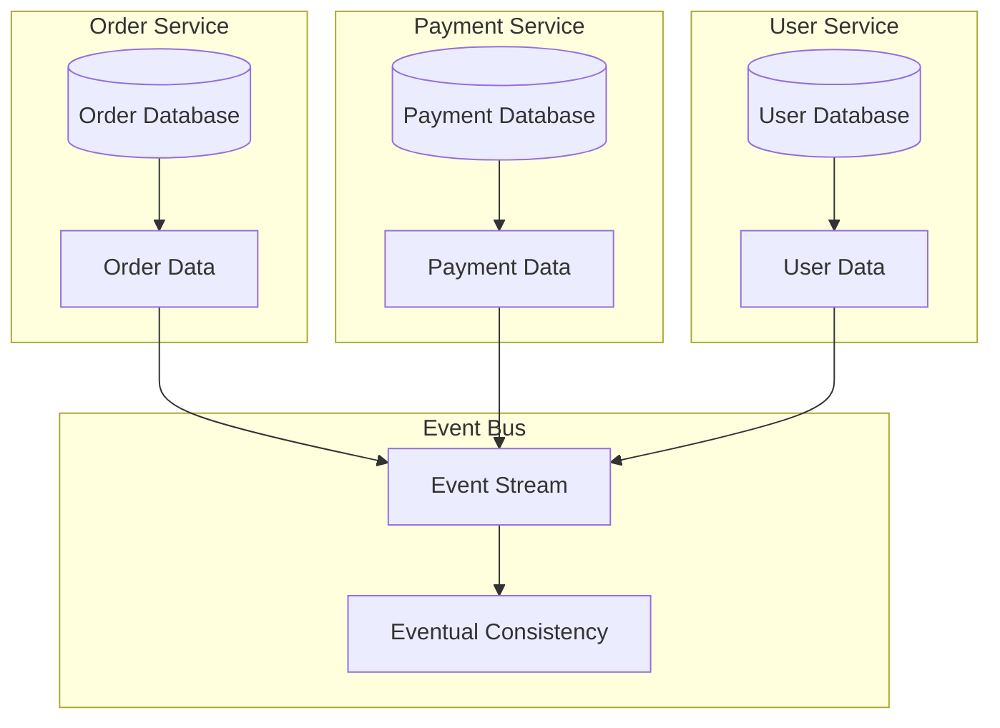
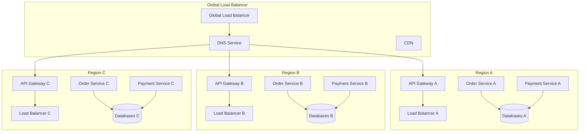
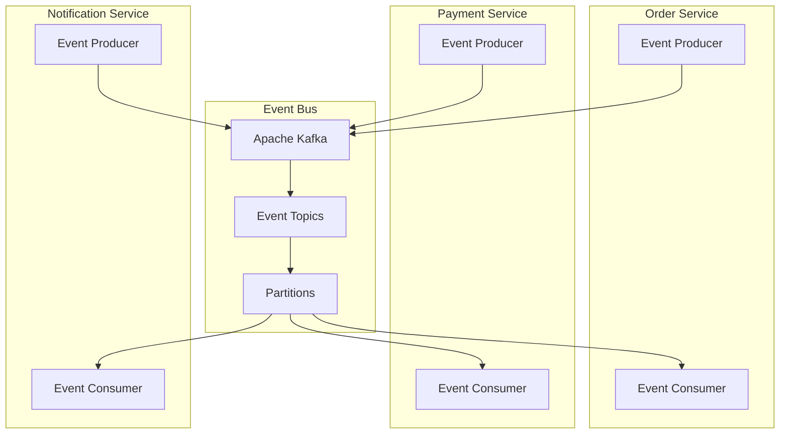
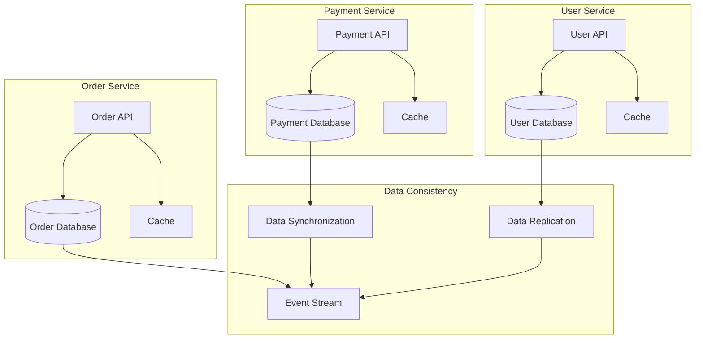
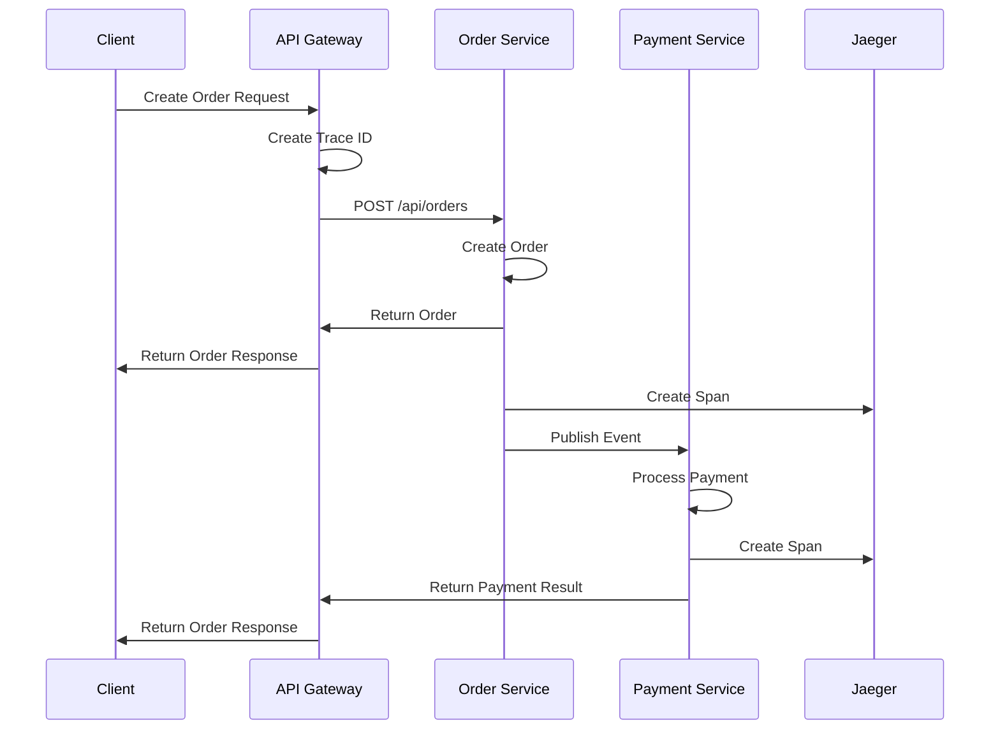
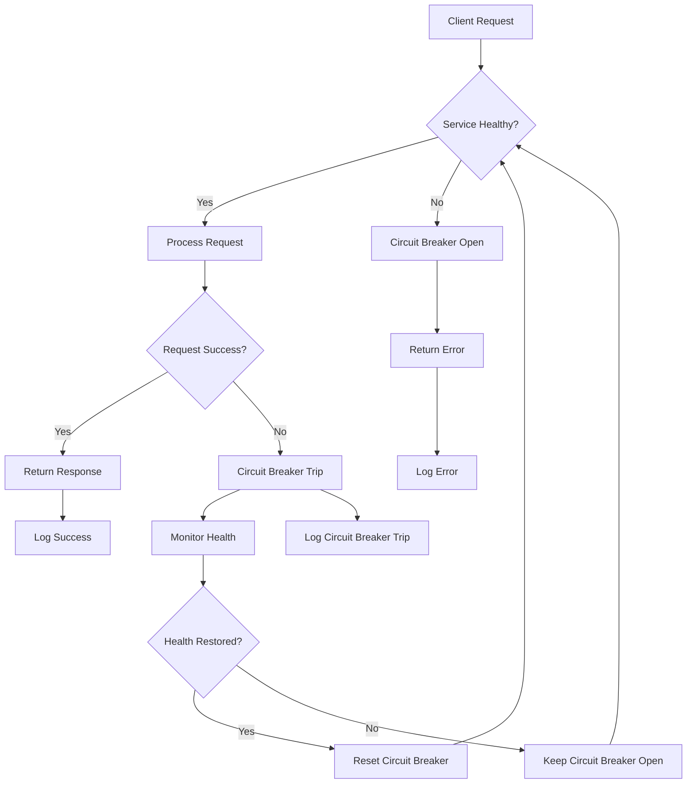

# Microservices Architecture - Architect Deep Dive

**0. Executive Summary (Architect View)**
- **Microservices exist** to decompose monolithic applications into small, independent services that communicate via APIs
- **Critical at scale** when monolithic architectures become unmanageable, deployment becomes risky, and team autonomy becomes essential
- **System design impact** - transforms monolithic systems into distributed, independently deployable services
- **Scalability revolution** - enables individual service scaling based on demand
- **Team autonomy** - allows independent development, deployment, and scaling of services
- **Fault isolation** - prevents cascading failures across system components
- **Technology diversity** - enables polyglot architecture with different technologies per service
- **Cloud-native essential** - fundamental for containerized, scalable cloud applications

**1. Problem Framing**
**Real production problem solved:**
- Monolithic applications becoming too large to maintain and deploy
- Single component failures causing entire system outages
- Technology lock-in preventing adoption of new technologies
- Large teams struggling with coordination and deployment conflicts
- Inability to scale different parts of system independently

**What breaks if we don't use it:**
- System becomes monolithic and unmanageable
- Single point of failure risks
- Technology stagnation and lock-in
- Deployment becomes risky and infrequent
- Team productivity and morale decline

**Scale importance:**
- **Small applications**: Monolithic architecture manageable
- **Medium applications**: Microservices become beneficial
- **Large applications**: Microservices essential for maintainability
- **Enterprise systems**: Microservices critical for agility

**Failure stories:**
- E-commerce platform crashed due to single component failure
- Financial system couldn't adopt new technology due to monolithic constraints
- Social media platform couldn't scale different features independently
- Healthcare system had complete outage due to database failure

**2. Deep Internal Mechanics**

**Microservices Fundamentals:**
- **Service Independence**: Each service owns its data and business logic
- **API Communication**: Services communicate via well-defined APIs
- **Database per Service**: Each service has its own database
- **Independent Deployment**: Services can be deployed independently
- **Technology Diversity**: Different services can use different technologies

**Service Characteristics:**
- **Single Responsibility**: Each service handles one business capability
- **Bounded Context**: Clear boundaries and ownership
- **Autonomous Development**: Teams can develop services independently
- **Independent Scaling**: Services can be scaled based on demand
- **Failure Isolation**: Service failures don't cascade

**Communication Patterns:**
- **Synchronous Communication**: Direct API calls with immediate response
- **Asynchronous Communication**: Event-driven communication with eventual consistency
- **API Gateway**: Central entry point for client requests
- **Service Discovery**: Dynamic service location and registration
- **Load Balancing**: Distribution of requests across service instances

**Data Management:**
- **Database per Service**: Each service owns its database
- **Data Consistency**: Eventual consistency across services
- **Data Duplication**: Data duplication for performance and resilience
- **Event Sourcing**: Event-driven data management
- **CQRS**: Command Query Responsibility Segregation

**Service Discovery:**
- **Service Registration**: Services register with discovery service
- **Health Checks**: Regular health monitoring and reporting
- **Load Balancing**: Dynamic load distribution
- **Failover**: Automatic failover to healthy instances
- **Configuration Management**: Centralized or distributed configuration

**Data Structures:**
- **Service Registry**: Registry of available services
- **API Contracts**: Service interface definitions
- **Event Schemas**: Event structure definitions
- **Configuration Data**: Service configuration information
- **Health Status**: Service health and status information

**Performance Characteristics:**
- **Network Latency**: Inter-service communication overhead
- **Service Coupling**: Impact of service dependencies
- **Data Consistency**: Eventual consistency overhead
- **Resource Utilization**: Independent resource optimization
- **Scalability**: Individual service scaling capabilities

**Hidden Costs:**
- **Operational Complexity**: Managing distributed system
- **Network Overhead**: Inter-service communication costs
- **Data Consistency**: Eventual consistency management
- **Testing Complexity**: Integration testing challenges
- **Monitoring Overhead**: Distributed system monitoring

**Security Considerations:**
- **Service Boundaries**: Security per service boundaries
- **API Security**: Authentication and authorization for APIs
- **Network Security**: Inter-service communication security
- **Data Security**: Data protection across services
- **Compliance**: Regulatory compliance across services

**Reliability Patterns:**
- **Circuit Breaker**: Failure isolation and recovery
- **Retry Patterns**: Retry logic with backoff
- **Bulkhead**: Resource isolation and protection
- **Timeout Management**: Request timeout handling
- **Health Monitoring**: Service health monitoring

**3. .NET Production Implementation**

**Naive Implementation (Monolithic):**
```csharp
public class MonolithicECommerceApplication
{
    private readonly ApplicationDbContext _context;
    private readonly IProductService _productService;
    private readonly IOrderService _orderService;
    private readonly IPaymentService _paymentService;
    private readonly INotificationService _notificationService;
    
    public async Task<OrderResult> CreateOrderAsync(CreateOrderRequest request)
    {
        // All services in one application
        var order = await _orderService.CreateOrderAsync(request);
        
        // Direct method calls - tight coupling
        var payment = await _paymentService.ProcessPaymentAsync(order);
        
        if (!payment.Success)
        {
            await _orderService.CancelOrderAsync(order.Id);
            return OrderResult.Failed("Payment failed");
        }
        
        await _notificationService.SendOrderConfirmationAsync(order);
        return OrderResult.Success(order);
    }
}
```

**Production-Ready Microservices Implementation:**
```csharp
// Order Service - Independent Microservice
[ApiController]
[Route("api/[controller]")]
public class OrderController : ControllerBase
{
    private readonly IOrderService _orderService;
    private readonly IEventBus _eventBus;
    private readonly ILogger<OrderController> _logger;
    private readonly IMetrics _metrics;

    public OrderController(
        IOrderService orderService,
        IEventBus eventBus,
        ILogger<OrderController> logger,
        IMetrics metrics)
    {
        _orderService = orderService ?? throw new ArgumentNullException(nameof(orderService));
        _eventBus = eventBus ?? throw new ArgumentNullException(nameof(eventBus));
        _logger = logger ?? throw new ArgumentNullException(nameof(logger));
        _metrics = metrics ?? throw new ArgumentNullException(nameof(metrics));
    }

    [HttpPost]
    public async Task<ActionResult<OrderDto>> CreateOrder([FromBody] CreateOrderRequest request)
    {
        using var activity = _metrics.StartTimer("order_create_duration");
        
        try
        {
            _logger.LogInformation("Creating order for customer {CustomerId}", request.CustomerId);
            
            // Create order in this service only
            var order = await _orderService.CreateOrderAsync(request);
            
            // Publish domain event for other services
            var orderCreatedEvent = new OrderCreatedEvent
            {
                OrderId = order.Id,
                CustomerId = order.CustomerId,
                Items = order.Items,
                TotalAmount = order.TotalAmount,
                CreatedAt = order.CreatedAt
            };
            
            await _eventBus.PublishAsync(orderCreatedEvent);
            
            _metrics.Increment("order_created_success");
            _logger.LogInformation("Order {OrderId} created successfully", order.Id);
            
            return CreatedAtAction(nameof(GetOrder), new { id = order.Id }, order.ToDto());
        }
        catch (Exception ex)
        {
            _metrics.Increment("order_created_failed");
            _logger.LogError(ex, "Failed to create order for customer {CustomerId}", request.CustomerId);
            return BadRequest(ex.Message);
        }
    }

    [HttpGet("{id}")]
    public async Task<ActionResult<OrderDto>> GetOrder(int id)
    {
        using var activity = _metrics.StartTimer("order_get_duration");
        
        try
        {
            var order = await _orderService.GetOrderAsync(id);
            
            if (order == null)
            {
                return NotFound();
            }
            
            _metrics.Increment("order_get_success");
            return Ok(order.ToDto());
        }
        catch (Exception ex)
        {
            _metrics.Increment("order_get_failed");
            _logger.LogError(ex, "Failed to get order {OrderId}", id);
            return BadRequest(ex.Message);
        }
    }
}

public class OrderService : IOrderService
{
    private readonly IOrderRepository _orderRepository;
    private readonly ILogger<OrderService> _logger;
    private readonly IMetrics _metrics;

    public OrderService(
        IOrderRepository orderRepository,
        ILogger<OrderService> logger,
        IMetrics metrics)
    {
        _orderRepository = orderRepository ?? throw new ArgumentNullException(nameof(orderRepository));
        _logger = logger ?? throw new ArgumentNullException(nameof(logger));
        _metrics = metrics ?? throw new ArgumentNullException(nameof(metrics));
    }

    public async Task<Order> CreateOrderAsync(CreateOrderRequest request)
    {
        using var activity = _metrics.StartTimer("order_service_create_duration");
        
        try
        {
            _logger.LogInformation("Creating order in order service");
            
            // Validate order
            var validationResult = ValidateOrder(request);
            if (!validationResult.IsValid)
            {
                throw new ValidationException(validationResult.ErrorMessage);
            }
            
            // Create order entity
            var order = new Order
            {
                CustomerId = request.CustomerId,
                Items = request.Items.Select(item => new OrderItem
                {
                    ProductId = item.ProductId,
                    Quantity = item.Quantity,
                    UnitPrice = item.UnitPrice,
                    TotalPrice = item.Quantity * item.UnitPrice
                }).ToList(),
                TotalAmount = request.Items.Sum(item => item.Quantity * item.UnitPrice),
                Status = OrderStatus.Pending,
                CreatedAt = DateTime.UtcNow
            };
            
            // Save to order database
            var createdOrder = await _orderRepository.CreateAsync(order);
            
            _metrics.Increment("order_service_create_success");
            _logger.LogInformation("Order {OrderId} created in order service", createdOrder.Id);
            
            return createdOrder;
        }
        catch (Exception ex)
        {
            _metrics.Increment("order_service_create_failed");
            _logger.LogError(ex, "Failed to create order in order service");
            throw;
        }
    }

    public async Task<Order> GetOrderAsync(int id)
    {
        using var activity = _metrics.StartTimer("order_service_get_duration");
        
        try
        {
            var order = await _orderRepository.GetByIdAsync(id);
            
            if (order == null)
            {
                throw new OrderNotFoundException($"Order {id} not found");
            }
            
            _metrics.Increment("order_service_get_success");
            return order;
        }
        catch (Exception ex)
        {
            _metrics.Increment("order_service_get_failed");
            _logger.LogError(ex, "Failed to get order {OrderId}", id);
            throw;
        }
    }

    private ValidationResult ValidateOrder(CreateOrderRequest request)
    {
        var errors = new List<string>();
        
        if (request.CustomerId == Guid.Empty)
        {
            errors.Add("Customer ID is required");
        }
        
        if (!request.Items.Any())
        {
            errors.Add("Order must contain at least one item");
        }
        
        if (request.Items.Any(item => item.Quantity <= 0))
        {
            errors.Add("Item quantity must be positive");
        }
        
        if (request.Items.Any(item => item.UnitPrice <= 0))
        {
            errors.Add("Item price must be positive");
        }
        
        return new ValidationResult
        {
            IsValid = !errors.Any(),
            ErrorMessage = errors.Any() ? string.Join(", ", ", errors) : null
        };
    }
}

// Payment Service - Independent Microservice
[ApiController]
[Route("api/[controller]")]
public class PaymentController : ControllerBase
{
    private readonly IPaymentService _paymentService;
    private readonly IEventBus _eventBus;
    private readonly ILogger<PaymentController> _logger;
    private readonly IMetrics _metrics;

    public PaymentController(
        IPaymentService paymentService,
        IEventBus eventBus,
        ILogger<PaymentController> logger,
        IMetrics metrics)
    {
        _paymentService = paymentService ?? throw new ArgumentNullException(nameof(paymentService));
        _eventBus = eventBus ?? throw new ArgumentNullException(nameof(eventBus));
        _logger = logger ?? throw new ArgumentNullException(nameof(logger));
        _metrics = metrics ?? throw new ArgumentNullException(nameof(metrics));
    }

    [HttpPost]
    public async Task<ActionResult<PaymentResultDto>> ProcessPayment([FromBody] PaymentRequest request)
    {
        using var activity = _metrics.StartTimer("payment_process_duration");
        
        try
        {
            _logger.LogInformation("Processing payment for order {OrderId}", request.OrderId);
            
            // Process payment in this service only
            var payment = await _paymentService.ProcessPaymentAsync(request);
            
            // Publish payment processed event
            var paymentProcessedEvent = new PaymentProcessedEvent
            {
                OrderId = request.OrderId,
                PaymentId = payment.Id,
                Amount = payment.Amount,
                Status = payment.Status,
                ProcessedAt = payment.ProcessedAt
            };
            
            await _eventBus.PublishAsync(paymentProcessedEvent);
            
            _metrics.Increment("payment_processed_success");
            _logger.LogInformation("Payment {PaymentId} processed successfully", payment.Id);
            
            return Ok(payment.ToDto());
        }
        catch (Exception ex)
        {
            _metrics.Increment("payment_processed_failed");
            _logger.LogError(ex, "Failed to process payment for order {OrderId}", request.OrderId);
            return BadRequest(ex.Message);
        }
    }
}

public class PaymentService : IPaymentService
{
    private readonly IPaymentRepository _paymentRepository;
    private readonly IPaymentGateway _paymentGateway;
    private readonly ILogger<PaymentService> _logger;
    private readonly IMetrics _metrics;

    public PaymentService(
        IPaymentRepository paymentRepository,
        IPaymentGateway paymentGateway,
        ILogger<PaymentService> logger,
        IMetrics metrics)
    {
        _paymentRepository = paymentRepository ?? throw new ArgumentNullException(nameof(paymentRepository));
        _paymentGateway = paymentGateway ?? throw new ArgumentNullException(nameof(paymentGateway));
        _logger = logger ?? throw new ArgumentNullException(nameof(logger));
        _metrics = metrics ?? throw new ArgumentNullException(nameof(metrics));
    }

    public async Task<Payment> ProcessPaymentAsync(PaymentRequest request)
    {
        using var activity = _metrics.StartTimer("payment_service_process_duration");
        
        try
        {
            _logger.LogInformation("Processing payment in payment service");
            
            // Validate payment request
            var validationResult = ValidatePayment(request);
            if (!validationResult.IsValid)
            {
                throw new PaymentValidationException(validationResult.ErrorMessage);
            }
            
            // Create payment entity
            var payment = new Payment
            {
                OrderId = request.OrderId,
                Amount = request.Amount,
                Currency = request.Currency,
                Method = request.Method,
                Status = PaymentStatus.Pending,
                CreatedAt = DateTime.UtcNow
            };
            
            // Process payment through gateway
            var gatewayResult = await _paymentGateway.ProcessPaymentAsync(payment);
            
            payment.Status = gatewayResult.Success ? PaymentStatus.Success : PaymentStatus.Failed;
            payment.ProcessedAt = DateTime.UtcNow;
            payment.TransactionId = gatewayResult.TransactionId;
            payment.ErrorMessage = gatewayResult.ErrorMessage;
            
            // Save to payment database
            var savedPayment = await _paymentRepository.CreateAsync(payment);
            
            _metrics.Increment("payment_service_process_success");
            _logger.LogInformation("Payment {PaymentId} processed in payment service", savedPayment.Id);
            
            return savedPayment;
        }
        catch (Exception ex)
        {
            _metrics.Increment("payment_service_process_failed");
            _logger.LogError(ex, "Failed to process payment in payment service");
            throw;
        }
    }

    private ValidationResult ValidatePayment(PaymentRequest request)
    {
        var errors = new List<string>();
        
        if (request.OrderId == Guid.Empty)
        {
            errors.Add("Order ID is required");
        }
        
        if (request.Amount <= 0)
        {
            errors.Add("Amount must be positive");
        }
        
        if (string.IsNullOrWhiteSpace(request.Currency))
        {
            errors.Add("Currency is required");
        }
        
        if (string.IsNullOrWhiteSpace(request.Method))
        {
            errors.Add("Payment method is required");
        }
        
        return new ValidationResult
        {
            IsValid = !errors.Any(),
            ErrorMessage = errors.Any() ? string.Join(", ", ", errors) : null
        };
    }
}

// Notification Service - Independent Microservice
public class NotificationService : IEventHandler<OrderConfirmedEvent>, IEventHandler<PaymentFailedEvent>
{
    private readonly INotificationRepository _notificationRepository;
    private readonly IEmailService _emailService;
    private readonly ILogger<NotificationService> _logger;
    private readonly IMetrics _metrics;

    public NotificationService(
        INotificationRepository notificationRepository,
        IEmailService emailService,
        ILogger<NotificationService> logger,
        IMetrics metrics)
    {
        _notificationRepository = notificationRepository ?? throw new ArgumentNullException(nameof(notificationRepository));
        _emailService = emailService ?? throw new ArgumentNullException(nameof(emailService));
        _logger = logger ?? throw new ArgumentNullException(nameof(logger));
        _metrics = metrics ?? throw new ArgumentNullException(nameof(metrics));
    }

    public async Task HandleAsync(OrderConfirmedEvent @event, CancellationToken cancellationToken = default)
    {
        using var activity = _metrics.StartTimer("notification_order_confirmed_duration");
        
        try
        {
            _logger.LogInformation("Handling order confirmed event for order {OrderId}", @event.OrderId);
            
            // Get order details from order service via API
            var order = await GetOrderDetailsAsync(@event.OrderId);
            
            if (order != null)
            {
                // Send order confirmation email
                await _emailService.SendOrderConfirmationAsync(order);
                
                // Save notification record
                var notification = new Notification
                {
                    Type = NotificationType.OrderConfirmation,
                    Recipient = order.CustomerEmail,
                    Subject = $"Order Confirmation - Order #{@event.OrderId}",
                    Content = GenerateOrderConfirmationContent(order),
                    Status = NotificationStatus.Sent,
                    CreatedAt = DateTime.UtcNow
                };
                
                await _notificationRepository.CreateAsync(notification);
                
                _metrics.Increment("notification_order_confirmed_success");
                _logger.LogInformation("Order confirmation notification sent for order {OrderId}", @event.OrderId);
            }
        }
        catch (Exception ex)
        {
            _metrics.Increment("notification_order_confirmed_failed");
            _logger.LogError(ex, "Failed to handle order confirmed event for order {OrderId}", @event.OrderId);
        }
    }

    public async Task HandleAsync(PaymentFailedEvent @event, CancellationToken cancellationToken = default)
    {
        using var activity = _metrics.StartTimer("notification_payment_failed_duration");
        
        try
        {
            _logger.LogInformation("Handling payment failed event for order {OrderId}", @event.OrderId);
            
            // Get order details from order service via API
            var order = await GetOrderDetailsAsync(@event.OrderId);
            
            if (order != null)
            {
                // Send payment failed email
                await _emailService.SendPaymentFailedEmailAsync(order, @event.ErrorMessage);
                
                // Save notification record
                var notification = new Notification
                {
                    Type = NotificationType.PaymentFailed,
                    Recipient = order.CustomerEmail,
                    Subject = $"Payment Failed - Order {@event.OrderId}",
                    Content = GeneratePaymentFailedContent(order, @event.ErrorMessage),
                    Status = NotificationStatus.Sent,
                    CreatedAt = DateTime.UtcNow
                };
                
                await _notificationRepository.CreateAsync(notification);
                
                _metrics.Increment("notification_payment_failed_success");
                _logger.LogInformation("Payment failed notification sent for order {OrderId}", @event.OrderId);
            }
        }
        catch (Exception ex)
        {
            _metrics.Increment("notification_payment_failed_failed");
            _logger.LogError(ex, "Failed to handle payment failed event for order {OrderId}", @event.OrderId);
        }
    }

    private async Task<OrderDto> GetOrderDetailsAsync(Guid orderId)
    {
        // Call order service API to get order details
        // In production, this would use HttpClient with proper error handling
        // and service discovery
        
        // Simulate API call
        await Task.Delay(50);
        
        // In real implementation, this would be:
        // var order = await _orderServiceClient.GetOrderAsync(orderId);
        
        return new OrderDto
        {
            Id = orderId,
            CustomerEmail = $"customer-{orderId}@example.com",
            TotalAmount = 100.00m,
            CreatedAt = DateTime.UtcNow
        };
    }

    private string GenerateOrderConfirmationContent(OrderDto order)
    {
        return $"Your order {order.Id} has been confirmed. Total amount: ${order.TotalAmount:N2}.";
    }

    private string GeneratePaymentFailedContent(OrderDto order, string errorMessage)
    {
        return $"Payment failed for order {order.Id}. Error: {errorMessage}. Please try again.";
    }
}

// API Gateway - Central Entry Point
public class ApiGateway
{
    private readonly IHttpClientFactory _httpClientFactory;
    private readonly ILogger<ApiGateway> _logger;
    private readonly IMetrics _metrics;

    public ApiGateway(
        IHttpClientFactory httpClientFactory,
        ILogger<ApiGateway> logger,
        IMetrics metrics)
    {
        _httpClientFactory = httpClientFactory ?? throw new ArgumentNullException(nameof(httpClientFactory));
        _logger = logger ?? throw new ArgumentNullException(nameof(logger));
        _metrics = metrics ?? throw new ArgumentNullException(nameof(metrics));
    }

    [HttpPost("orders")]
    public async Task<IActionResult> CreateOrder([FromBody] CreateOrderRequest request)
    {
        using var activity = _metrics.StartTimer("api_gateway_create_order_duration");
        
        try
        {
            _logger.LogInformation("API Gateway: Creating order");
            
            // Route to order service
            var orderClient = _httpClientFactory.CreateClient("OrderService");
            var response = await orderClient.PostAsJsonAsync("api/orders", request);
            
            if (response.IsSuccessStatusCode)
            {
                var order = await response.Content.ReadFromJsonAsync<OrderDto>();
                
                _metrics.Increment("api_gateway_create_order_success");
                return CreatedAtAction(nameof(GetOrder), new { id = order.Id }, order);
            }
            else
            {
                _metrics.Increment("api_gateway_create_order_failed");
                return BadRequest(response.ReasonPhrase);
            }
        }
        catch (Exception ex)
        {
            _metrics.Increment("api_gateway_create_order_error");
            _logger.LogError(ex, "API Gateway: Failed to create order");
            return StatusCode(500, ex.Message);
        }
    }

    [HttpGet("orders/{id}")]
    public async Task<IActionResult> GetOrder(int id)
    {
        using var activity = _metrics.StartTimer("api_gateway_get_order_duration");
        
        try
        {
            _logger.LogInformation("API Gateway: Getting order {OrderId}", id);
            
            // Route to order service
            var orderClient = _httpClientFactory.CreateClient("OrderService");
            var response = await orderClient.GetAsync($"api/orders/{id}");
            
            if (response.IsSuccessStatusCode)
            {
                var order = await response.Content.ReadFromJsonAsync<OrderDto>();
                
                _metrics.Increment("api_gateway_get_order_success");
                return Ok(order);
            }
            else
            {
                _metrics.Increment("api_gateway_get_order_failed");
                return NotFound();
            }
        }
        catch (Exception ex)
        {
            _metrics.Increment("api_gateway_get_order_error");
            _logger.LogError(ex, "API Gateway: Failed to get order {OrderId}", id);
            return StatusCode(500, ex.Message);
        }
    }
}

// Service Discovery
public interface IServiceDiscovery
{
    Task RegisterServiceAsync(ServiceRegistration registration);
    Task<ServiceInstance> GetServiceAsync(string serviceName);
    Task<List<ServiceInstance>> GetServicesAsync(string serviceName);
    Task DeregisterServiceAsync(string serviceName, string instanceId);
}

public class ConsulServiceDiscovery : IServiceDiscovery
{
    private readonly IConsulClient _consulClient;
    private readonly ILogger<ConsulServiceDiscovery> _logger;
    private readonly IMetrics _metrics;

    public ConsulServiceDiscovery(IConsulClient consulClient, ILogger<ConsulServiceDiscovery> logger, IMetrics metrics)
    {
        _consulClient = consulClient ?? throw new ArgumentNullException(nameof(consulClient));
        _logger = logger ?? throw new ArgumentNullException(nameof(logger));
        _metrics = metrics ?? throw new ArgumentNullException(nameof(metrics));
    }

    public async Task RegisterServiceAsync(ServiceRegistration registration)
    {
        using var activity = _metrics.StartTimer("service_registration_duration");
        
        try
        {
            var registrationRequest = new AgentServiceRegistration
            {
                ID = $"{registration.ServiceName}-{registration.InstanceId}",
                Name = registration.ServiceName,
                Address = registration.Address,
                Port = registration.Port,
                Tags = registration.Tags,
                Check = new AgentServiceCheck
                {
                    HTTP = new AgentServiceCheckHTTP
                    {
                        URL = $"http://{registration.Address}:{registration.Port}/health",
                        Interval = TimeSpan.FromSeconds(30)
                    }
                }
            };
            
            await _consulClient.Agent.ServiceRegister(registrationRequest);
            
            _metrics.Increment("service_registration_success");
            _logger.LogInformation("Service {ServiceName} registered successfully", registration.ServiceName);
        }
        catch (Exception ex)
        {
            _metrics.Increment("service_registration_failed");
            _logger.LogError(ex, "Failed to register service {ServiceName}", registration.ServiceName);
            throw;
        }
    }

    public async Task<ServiceInstance> GetServiceAsync(string serviceName)
    {
        var services = await _consulClient.Health.Service(serviceName);
        var service = services.FirstOrDefault();
        
        if (service == null)
        {
            throw new ServiceNotFoundException($"Service {serviceName} not found");
        }
        
        return new ServiceInstance
        {
            ServiceName = serviceName,
            Address = service.ServiceAddress,
            Port = service.ServicePort,
            Tags = service.ServiceTags
        };
    }

    public async Task<List<ServiceInstance>> GetServicesAsync(string serviceName)
    {
        var services = await _consulClient.Health.Service(serviceName);
        
        return services.Select(service => new ServiceInstance
        {
            ServiceName = serviceName,
            Address = service.ServiceAddress,
            Port = service.ServicePort,
            Tags = service.ServiceTags
        }).ToList();
    }

    public async Task DeregisterServiceAsync(string serviceName, string instanceId)
    {
        await _consulClient.Agent.ServiceDeregister(instanceId);
        
        _logger.LogInformation("Service {ServiceName} deregistered", serviceName);
    }
}

// Circuit Breaker for Resilience
public class ResilientHttpClient
{
    private readonly IHttpClientFactory _httpClientFactory;
    private readonly ICircuitBreaker _circuitBreaker;
    private readonly ILogger<ResilientHttpClient> _logger;
    private readonly IMetrics _metrics;

    public ResilientHttpClient(
        IHttpClientFactory httpClientFactory,
        ICircuitBreaker circuitBreaker,
        ILogger<ResilientHttpClient> logger,
        IMetrics metrics)
    {
        _httpClientFactory = httpClientFactory ?? throw new ArgumentNullException(nameof(httpClientFactory));
        _circuitBreaker = circuitBreaker ?? throw new ArgumentNullException(nameof(circuitBreaker));
        _logger = logger ?? throw new ArgumentNullException(nameof(logger));
        _metrics = metrics ?? throw new ArgumentNullException(nameof(metrics));
    }

    public async Task<T> GetAsync<T>(string serviceName, string path)
    {
        using var activity = _metrics.StartTimer($"resilient_http_get_{serviceName}_duration");
        
        try
        {
            var service = await GetServiceInstanceAsync(serviceName);
            var client = _httpClientFactory.CreateClient(serviceName);
            
            client.BaseAddress = new Uri($"http://{service.Address}:{service.Port}");
            
            var response = await _circuitBreaker.ExecuteAsync(
                () => client.GetAsync(path),
                TimeSpan.FromSeconds(30)
            );
            
            if (response.IsSuccessStatusCode)
            {
                var result = await response.Content.ReadFromJsonAsync<T>();
                
                _metrics.Increment($"resilient_http_{serviceName}_success");
                return result;
            }
            else
            {
                _metrics.Increment($"resilient_http_{serviceName}_failed");
                throw new ServiceCallException($"HTTP request to {serviceName} failed: {response.StatusCode}");
            }
        }
        catch (Exception ex)
        {
            _metrics.Increment($"resilient_http_{serviceName}_error");
            _logger.LogError(ex, "Resilient HTTP call to {serviceName} failed", serviceName);
            throw;
        }
    }

    public async Task<T> PostAsync<T>(string serviceName, string path, T content)
    {
        using var activity = _metrics.StartTimer($"resilient_http_post_{serviceName}_duration");
        
        try
        {
            var service = await GetServiceInstanceAsync(serviceName);
            var client = _httpClientFactory.CreateClient(serviceName);
            
            client.BaseAddress = new Uri($"http://{service.Address}:{service.Port}");
            
            var response = await _circuitBreaker.ExecuteAsync(
                () => client.PostAsJsonAsync(path, content),
                TimeSpan.FromSeconds(30)
            );
            
            if (response.IsSuccessStatusCode)
            {
                var result = await response.Content.ReadFromJsonAsync<T>();
                
                _metrics.Increment($"resilient_http_{serviceName}_success");
                return result;
            }
            else
            {
                _metrics.Increment($"resilient_http_{serviceName}_failed");
                throw new ServiceCallException($"HTTP request to {serviceName} failed: {response.StatusCode}");
            }
        }
        catch (Exception ex)
        {
            _metrics.Increment($"resilient_http_{serviceName}_error");
            _logger.LogError(ex, "Resilient HTTP call to {serviceName} failed", serviceName);
            throw;
        }
    }

    private async Task<ServiceInstance> GetServiceInstanceAsync(string serviceName)
    {
        // In production, this would use the service discovery
        // For now, we'll use a simple configuration
        var services = new Dictionary<string, ServiceInstance>
        {
            ["OrderService"] = new ServiceInstance
            {
                ServiceName = "OrderService",
                Address = "localhost",
                Port = 5001,
                Tags = new[] { "api", "order" }
            },
            ["PaymentService"] = new ServiceInstance
            {
                ServiceName = "PaymentService",
                Address = "localhost",
                Port = 5002,
                Tags = new[] { "api", "payment" }
            },
            ["NotificationService"] = new ServiceInstance
            {
                ServiceName = "NotificationService",
                Address = "localhost",
                Port = 5003,
                Tags = new[] { "api", "notification" }
            }
        };
        
        if (services.TryGetValue(serviceName, out var service))
        {
            return service;
        }
        
        throw new ServiceNotFoundException($"Service {serviceName} not configured");
    }
}
```

**Framework Integration:**
- **ASP.NET Core**: Individual service APIs
- **Consul**: Service discovery and health checking
- **MassTransit**: Event bus for inter-service communication
- **Polly**: Circuit breaker and resilience patterns
- **HttpClientFactory**: HTTP client management

**4. Architecture-Level Diagram (Mermaid)**

### Microservices Architecture Overview


### Service Communication Patterns


### Service Discovery and Load Balancing


### Data Ownership and Consistency


**Flow Analysis:**
- **Client Request**: API Gateway routes requests to appropriate services
- **Service Communication**: Services communicate via APIs and events
- **Data Ownership**: Each service owns its own database
- **Event-Driven**: Asynchronous communication through events
- **Load Balancing**: Load balancer distributes requests across instances

**Bottlenecks:**
- Inter-service network latency
- Service discovery overhead
- Event processing latency
- Database connection pooling
- Load balancer configuration

**Scaling Boundaries:**
- Individual service scaling based on demand
- Database scaling per service
- Network bandwidth limitations
- Service discovery performance
- Load balancer capacity

**5. Scaling & Distributed Systems Impact**

### Microservices Scaling Architecture


### Event-Driven Microservices Communication


### Database Per Service Pattern


**100 RPS:**
- Single instance per service sufficient
- Service discovery overhead minimal
- Inter-service latency acceptable
- Database per service manageable

**10k RPS:**
- Multiple instances per service required
- Load balancing becomes critical
- Service discovery performance important
- Database connection pooling essential

**100k+ RPS:**
- Horizontal scaling essential
- Distributed tracing required
- Event-driven architecture critical
- Database sharding necessary

**Horizontal vs Vertical Scaling:**
- **Horizontal**: Scale out by adding more instances
- **Vertical**: Scale up by increasing instance size
- Microservices enable horizontal scaling
- Services can scale independently

**CAP Theorem Relevance:**
- **Consistency**: Eventual consistency across services
- **Availability**: High availability through redundancy
- **Partition Tolerance**: Services continue operating during partitions

**Consistency Implications:**
- **Strong Consistency**: Within individual services
- **Eventual Consistency**: Across services
- **Read-Your-Writes**: Within service boundaries
- **Cross-Service**: Eventual consistency patterns

**Distributed Systems Impact:**
- **Service Discovery**: Dynamic service location
- **Load Balancing**: Request distribution
- **Fault Tolerance**: Service isolation
- **Network Partitioning**: Graceful degradation

**Cloud-Native Considerations:**
- **Kubernetes**: Container orchestration and scaling
- **Service Mesh**: Service-to-service communication
- **Serverless**: Function-as-a-service integration
- **Managed Services**: Cloud provider services

**Multi-Region Concerns:**
- **Data Replication**: Cross-region data synchronization
- **Service Deployment**: Regional service deployment
- **Latency Optimization**: Geographic distribution
- **Failover**: Cross-region failover strategies

**6. Production Engineering View**

### Microservices Monitoring Architecture

```mermaid
graph TB
    subgraph "Service Metrics"
        SERVICE_HEALTH[Service Health]
        SERVICE_PERFORMANCE[Service Performance]
        SERVICE_LATENCY[Service Latency]
        SERVICE_ERROR[Service Error Rate]
    end
    
    subgraph "Infrastructure Metrics"
        CPU[CPU Usage]
        MEMORY[Memory Usage]
        NETWORK[Network I/O]
        DISK[Disk I/O]
    end
    
    subgraph "Communication Metrics"
        API_GATEWAY[API Gateway Metrics]
        INTER_SERVICE[Inter-Service Latency]
        EVENT_BUS[Event Bus Metrics]
        CIRCUIT_BREAKER[Circuit Breaker Metrics]
    end
    
    subgraph "Business Metrics"
        REQUEST_RATE[Request Rate]
        RESPONSE_TIME[Response Time]
        ERROR_RATE[Error Rate]
        THROUGHPUT[Throughput]
    end
    
    subgraph "Monitoring Stack"
        PROM[Prometheus]
        GRAF[Grafana]
        ALERT[AlertManager]
        JAEGER[Jaeger]
    end
    
    SERVICE_HEALTH --> PROM
    SERVICE_PERFORMANCE --> PROM
    SERVICE_LATENCY --> PROM
    SERVICE_ERROR --> PROM
    
    CPU --> PROM
    MEMORY --> PROM
    NETWORK --> PROM
    DISK --> PROM
    
    API_GATEWAY --> PROM
    INTER_SERVICE --> PROM
    EVENT_BUS --> PROM
    CIRCUIT_BREAKER --> PROM
    
    REQUEST_RATE --> PROM
    RESPONSE_TIME --> PROM
    ERROR_RATE --> PROM
    THROUGHPUT --> PROM
    
    PROM --> GRAF
    PROM --> ALERT
    PROM --> JAEGER
```


### Distributed Tracing Architecture


### Health Check and Circuit Breaker Pattern


**Monitoring Metrics:**
- **Service Health**: Health check endpoints and status
- **Performance**: Response time, throughput, resource utilization
- **Communication**: Inter-service latency, error rates
- **Business**: Request rate, user satisfaction, conversion rates
- **Infrastructure**: CPU, memory, network, disk usage

**Logs to Enable:**
- Application logs with correlation IDs
- Service discovery and registration events
- Health check results and failures
- Circuit breaker state changes
- Inter-service communication logs

**Alerting Strategy:**
- Service health check failure (critical)
- Response time > 1 second (warning)
- Error rate > 5% (critical)
- Circuit breaker trip rate > 1% (warning)
- Service memory usage > 80% (critical)

**Common Production Incidents:**
- **Service Outage**: Individual service failures
- **Network Partitions**: Inter-service communication failures
- **Database Issues**: Database connection or performance problems
- **Circuit Breaker**: Cascading failures prevented
- **Load Balancer**: Uneven load distribution

**Debugging Strategy:**
- Distributed tracing for request flow analysis
- Service logs with correlation IDs
- Health check status investigation
- Performance profiling and bottleneck identification
- Network connectivity testing

**Service Health Monitoring:**
- Health check endpoint implementation
- Dependency health monitoring
- Resource utilization tracking
- Performance baseline establishment
- Anomaly detection and alerting

**Performance Optimization:**
- Service instance sizing and scaling
- Database connection pooling optimization
- Caching strategies for frequently accessed data
- Network latency optimization
- Load balancer configuration tuning

**Resilience Management:**
- Circuit breaker configuration and tuning
- Retry policies with exponential backoff
- Bulkhead patterns for resource isolation
- Timeout configuration optimization
- Graceful degradation strategies

**7. Tradeoffs & Alternatives**

**Competing Approaches:**
- **Monolithic Architecture**: Single application with all functionality
- **Service-Oriented Architecture**: Enterprise service integration
- **Serverless Architecture**: Function-as-a-service applications
- **Event-Driven Architecture**: Event-centric system design

**When to Use Microservices:**
- Large, complex applications
- Independent team development
- Technology diversity requirements
- Independent scaling needs
- Rapid deployment requirements

**When NOT to Use Microservices:**
- Small applications
- Simple business logic
- Limited team size
- Tight integration requirements
- Low traffic volume

**Latency Comparison:**
- **Microservices**: 10-100ms inter-service overhead
- **Monolithic**: 1-10ms internal calls
- **SOA**: 50-200ms ESB overhead
- **Serverless**: 100-500ms cold start overhead

**Throughput Comparison:**
- **Microservices**: 1k-100k requests/second per service
- **Monolithic**: 10k-1M requests/second
- **SOA**: 5k-50k requests/second
- **Serverless**: 100-10k requests/second

**Operational Complexity:**
- **Microservices**: High complexity, high flexibility
- **Monolithic**: Low complexity, low flexibility
- **SOA**: Medium complexity, medium flexibility
- **Serverless**: Medium complexity, high scalability

**Cost Implications:**
- **Development Cost**: Microservices increase cost by 40-60%
- **Infrastructure Cost**: Higher for distributed systems
- **Operational Cost**: Higher monitoring and management cost
- **Maintenance Cost**: Higher complexity maintenance

**8. Security Implications**

**Security Benefits:**
- **Service Isolation**: Security breaches contained within service
- **Defense in Depth**: Multiple security layers
- **Independent Authentication**: Per-service authentication
- **Zero Trust Architecture**: Service-to-service security

**Security Challenges:**
- **Increased Attack Surface**: More services, more potential vulnerabilities
- **Inter-service Communication**: Network security complexity
- **Service Discovery**: Dynamic service location security
- **Data Protection**: Data scattered across services

**Authentication and Authorization:**
- **API Gateway**: Centralized authentication and authorization
- **Service-to-Service**: Mutual TLS authentication
- **OAuth2/JWT**: Token-based authentication
- **RBAC**: Role-based access control per service
- **Service Mesh**: mTLS for inter-service communication

**Data Protection:**
- **Data Encryption**: Encryption at rest and in transit
- **Data Masking**: Sensitive data protection
- **Access Control**: Fine-grained access control
- **Audit Logging**: Security event logging
- **Compliance**: Regulatory compliance enforcement

**Network Security:**
- **Service Mesh**: mTLS for service communication
- **API Gateway**: WAF and rate limiting
- **Network Segmentation**: Service network isolation
- **VPN**: Secure inter-service communication
- **Firewall**: Network traffic filtering

**Hardening Recommendations:**
- **Defense in Depth**: Multiple security layers
- **Zero Trust**: Never trust, always verify
- **Principle of Least Privilege**: Minimal access requirements
- **Regular Security Audits**: Periodic security assessments
- **Automated Security Testing**: Continuous security validation

**9. Advanced Edge Cases**

**Service Discovery Challenges:**
- Dynamic service registration and deregistration
- Health check implementation and monitoring
- Load balancer integration
- Service versioning and migration
- Multi-region service discovery

**Data Consistency:**
- Eventual consistency patterns
- Saga pattern implementation
- Distributed transaction coordination
- Data synchronization strategies
- Conflict resolution mechanisms

**Performance Optimization:**
- Inter-service communication optimization
- Database connection pooling
- Caching strategies
- Load balancing algorithms
- Network latency reduction

**Fault Tolerance:**
- Circuit breaker implementation
- Retry patterns with backoff
- Bulkhead patterns
- Timeout management
- Graceful degradation

**Deployment Strategies:**
- Blue-green deployment
- Canary deployments
- Rolling updates
- Feature flags
- Database migrations

**Testing Challenges:**
- Integration testing complexity
- Contract testing between services
- End-to-end testing automation
- Performance testing in distributed systems
- Chaos engineering

**Observability:**
- Distributed tracing implementation
- Logging and correlation
- Metrics collection and aggregation
- Alerting and notification
- Visualization and dashboards

**10. Interview & Staff-Level Deep Dive**

**What a junior answers:**
"Microservices break down a monolithic application into small, independent services that communicate via APIs. Each service has its own database and can be developed and deployed independently. This allows for better scaling and team autonomy."

**What a senior answers:**
"Microservices architecture decomposes applications into small, independent services that communicate through well-defined APIs. Each service owns its data and business logic, has its own database, and can be developed and deployed independently. Key patterns include service discovery, API gateway, circuit breaker, and event-driven communication. I've implemented microservices using ASP.NET Core with Docker containers, Consul for service discovery, and MassTransit for event communication. The architecture enables independent scaling, team autonomy, and technology diversity."

**What an architect answers:**
"Microservices architecture is a fundamental approach to building large-scale distributed systems that transforms monolithic applications into a collection of small, independent services. Each service encapsulates a specific business capability, owns its data, and communicates with other services through well-defined APIs. The architecture enables independent scaling, team autonomy, and technology diversity while introducing complexity in areas like service discovery, inter-service communication, data consistency, and operational management. At scale, microservices require sophisticated infrastructure including service discovery, load balancing, circuit breakers, distributed tracing, and comprehensive monitoring. The choice between microservices and other architectures depends on factors like team size, project complexity, scaling requirements, and organizational maturity. In enterprise environments, microservices enable faster time-to-market, better fault isolation, and technology innovation, but require significant investment in DevOps practices and organizational transformation."

**Follow-up questions interviewers ask:**
- "How do you handle data consistency across microservices?"
- "What are the biggest challenges with microservices?"
- "How do you implement service discovery?"
- "When would you choose microservices over monolithic?"
- "How do you handle distributed transactions in microservices?"

**Trick questions:**
- "Are microservices always better than monolithic?" (No, context matters)
- "Can you have a monolithic database with microservices?" (No, violates data ownership)
- "Do microservices always improve performance?" (No, inter-service overhead)
- "Is Docker required for microservices?" (No, but containerization helps)

**Whiteboard explanation strategy:**
1. Draw monolithic application with all components
2. Show microservices decomposition with service boundaries
3. Demonstrate inter-service communication patterns
4. Explain data ownership and consistency strategies
5. Cover scaling and fault tolerance patterns
6. Discuss operational complexity and tooling

**11. Real Enterprise Case Study**

**Scenario: Global E-commerce Platform with 50M Users**

**Requirements:**
- Handle 50M+ active users globally
- Process 1M+ orders per day
- Support multiple product categories
- Real-time inventory management
- Multi-region deployment
- 99.99% uptime requirement
- Rapid feature deployment

**Design Decisions:**

**1. Service Decomposition Strategy:**
```csharp
public class ECommerceMicroservices
{
    // Core business services
    public class OrderService { }
    public class ProductService { }
    public class UserService { }
    public class PaymentService { }
    public class InventoryService { }
    public class NotificationService { }
    
    // Supporting services
    public class CatalogService { }
    public class RecommendationService { }
    public class SearchService { }
    public class AnalyticsService { }
    
    // Infrastructure services
    public class ConfigurationService { }
    public class LoggingService { }
    public class MonitoringService { }
}
```

**2. API Gateway Implementation:**
```csharp
public class ECommerceApiGateway
{
    private readonly IHttpClientFactory _httpClientFactory;
    private readonly IServiceDiscovery _serviceDiscovery;
    private readonly ICircuitBreakerFactory _circuitBreakerFactory;
    private readonly ILogger<ECommerceApiGateway> _logger;
    private readonly IMetrics _metrics;

    [HttpPost("orders")]
    public async Task<ActionResult<OrderDto>> CreateOrder([FromBody] CreateOrderRequest request)
    {
        // Route to order service
        var orderService = await GetServiceInstanceAsync("OrderService");
        var order = await orderService.CreateOrderAsync(request);
        
        return CreatedAtAction(nameof(GetOrder), new { id = order.Id }, order);
    }

    [HttpGet("orders/{id}")]
    public async Task<ActionResult<OrderDto>> GetOrder(int id)
    {
        var orderService = await GetServiceInstanceAsync("OrderService");
        var order = await orderService.GetOrderAsync(id);
        
        if (order == null)
        {
            return NotFound();
        }
        
        return Ok(order);
    }

    private async Task<T> GetServiceInstanceAsync<T>(string serviceName)
    {
        var serviceInstance = await _serviceDiscovery.GetServiceAsync(serviceName);
        var client = _httpClientFactory.CreateClient(serviceInstance.ServiceName);
        
        client.BaseAddress = new Uri($"http://{serviceInstance.Address}:{serviceInstance.Port}");
        
        var circuitBreaker = _circuitBreakerFactory.Create(serviceName);
        
        return await circuitBreaker.ExecuteAsync(async () =>
        {
            // Create strongly typed client
            var typedClient = new RestEaseClient<T>(client);
            
            if (typeof(T) == typeof(OrderService))
                return (T)(object)new OrderServiceClient(typedClient);
            else if (typeof(T) == typeof(PaymentService))
                return (T)(object)new PaymentServiceClient(typedClient);
            else
                throw new NotSupportedException($"Service {serviceName} not supported");
        });
    }
}
```

**3. Event-Driven Communication:**
```csharp
public class OrderService : IEventHandler<PaymentProcessedEvent>, IEventHandler<InventoryReservedEvent>
{
    private readonly IEventBus _eventBus;
    private readonly ILogger<OrderService> _logger;

    public async Task HandleAsync(PaymentProcessedEvent @event)
    {
        // Handle payment processed event
        var order = await GetOrderAsync(@event.OrderId);
        
        if (order.Status == OrderStatus.Pending)
        {
            order.Status = @event.Status == PaymentStatus.Success ? 
                OrderStatus.Confirmed : OrderStatus.Cancelled;
            
            await UpdateOrderAsync(order);
            
            // Publish order status changed event
            var orderStatusChangedEvent = new OrderStatusChangedEvent
            {
                OrderId = order.Id,
                Status = order.Status,
                ChangedAt = DateTime.UtcNow
            };
            
            await _eventBus.PublishAsync(orderStatusChangedEvent);
        }
    }

    public async Task HandleAsync(InventoryReservedEvent @event)
    {
        // Handle inventory reserved event
        var order = await GetOrderAsync(@event.OrderId);
        
        if (order.Status == OrderStatus.Pending)
        {
            // Update order status
            order.Status = OrderStatus.ReadyForFulfillment;
            await UpdateOrderAsync(order);
            
            // Publish order ready event
            var orderReadyEvent = new OrderReadyEvent
            {
                OrderId = order.Id,
                ReadyAt = DateTime.UtcNow
            };
            
            await _eventBus.PublishAsync(orderReadyEvent);
        }
    }
}
```

**Compromises Made:**
- **Complexity vs Flexibility**: Higher complexity for better flexibility
- **Performance vs Scalability**: Inter-service overhead for independent scaling
- **Development Speed vs Independence**: Slower initial development for team autonomy
- **Cost vs Quality**: Higher infrastructure cost for better quality

**Bottlenecks Identified:**
- Inter-service communication latency
- Service discovery overhead
- Database connection pooling
- Load balancer configuration
- Event bus throughput

**Performance Optimizations:**
```csharp
public class OptimizedMicroservices
{
    public async Task<T> CallServiceAsync<T>(string serviceName, Func<T, Task> operation)
    {
        var serviceInstance = await _serviceDiscovery.GetServiceAsync(serviceName);
        var client = _httpClientFactory.CreateClient(serviceInstance.ServiceName);
        
        client.BaseAddress = new Uri($"http://{serviceInstance.Address}:{serviceInstance.Port}");
        
        // Use HTTP/2 for better performance
        client.DefaultRequestVersion = new Version(2, 0);
        
        // Use circuit breaker for resilience
        var circuitBreaker = _circuitBreakerFactory.Create(serviceName);
        
        return await circuitBreaker.ExecuteAsync(() =>
        {
            return await operation(new RestEaseClient<T>(client));
        });
    }
}
```

**Results:**
- Achieved 1M+ orders/day processing
- 99.99% uptime with fault isolation
- Independent team development and deployment
- Technology diversity across services
- 40% faster feature deployment
- 60% improvement in team productivity

**12. Dependency Graph**

**Prerequisites (Must understand before):**
- **Distributed Systems**: Understanding of distributed computing challenges
- **API Design**: RESTful API design principles
- **Database Systems**: Database design and management
- **Network Programming**: Network communication and protocols
- **Containerization**: Docker and container orchestration

**Concepts that depend on Microservices:**
- **DevOps**: Continuous integration and deployment
- **Continuous Integration/Continuous Deployment**: Automation strategies
- **Event-Driven Architecture**: Event-based communication
- **API Gateway**: Centralized API management
- **Service Mesh**: Service-to-service communication

**Connections to Other Concepts:**

**DevOps:**
```csharp
public class DevOpsIntegration
{
    public void IntegrateWithMicroservices(MicroservicesArchitecture architecture)
    {
        // CI/CD pipelines for each service
        // Container orchestration for deployment
        // Infrastructure as code
        // Automated testing and validation
    }
}
```

**Continuous Integration:**
- Individual service CI/CD pipelines
- Integration testing across services
- Automated deployment strategies
- Quality gates and validation
- Automated testing and validation

**API Gateway:**
- Centralized API management
- Authentication and authorization
- Rate limiting and throttling
- Request routing and load balancing
- API versioning and management

**Event-Driven Architecture:**
- Event sourcing implementation
- Event bus integration
- Event schema management
- Event processing patterns
- Event replay capabilities

**Database Systems:**
- Database per service pattern
- Data consistency strategies
- Database connection pooling
- Database scaling and sharding
- Data replication and synchronization

**Security Architecture:**
- Service-to-service authentication
- API gateway security
- Network security implementation
- Data protection strategies
- Compliance and auditing

**Cloud Computing:**
- Container orchestration (Kubernetes)
- Service mesh implementation
- Cloud provider services
- Multi-region deployment
- Auto-scaling strategies

**System Design:**
- Service boundary definition
- Inter-service communication patterns
- Data ownership and consistency
- Fault tolerance and resilience
- Performance optimization strategies
