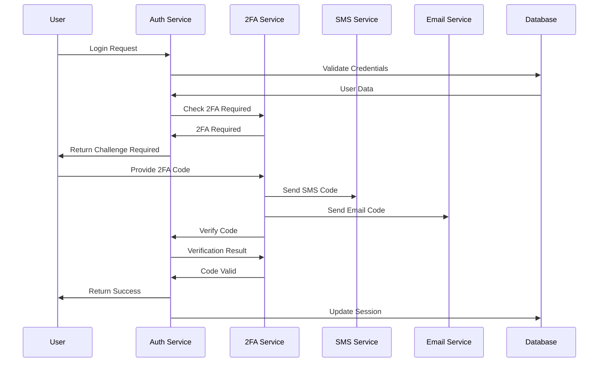
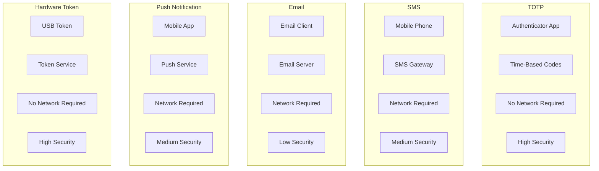
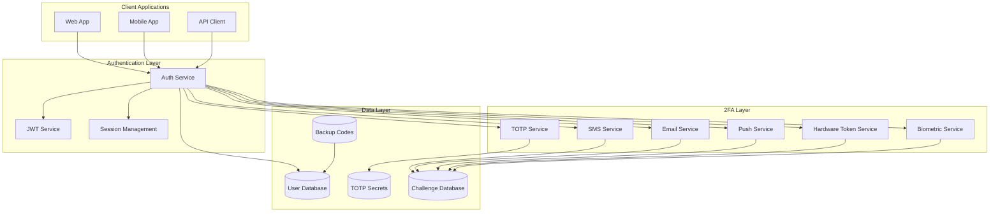
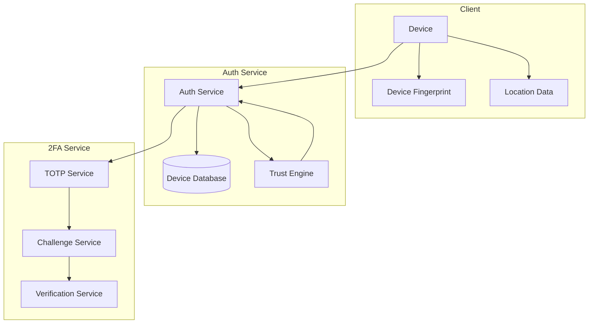
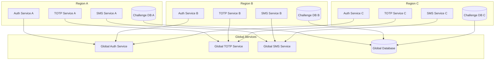
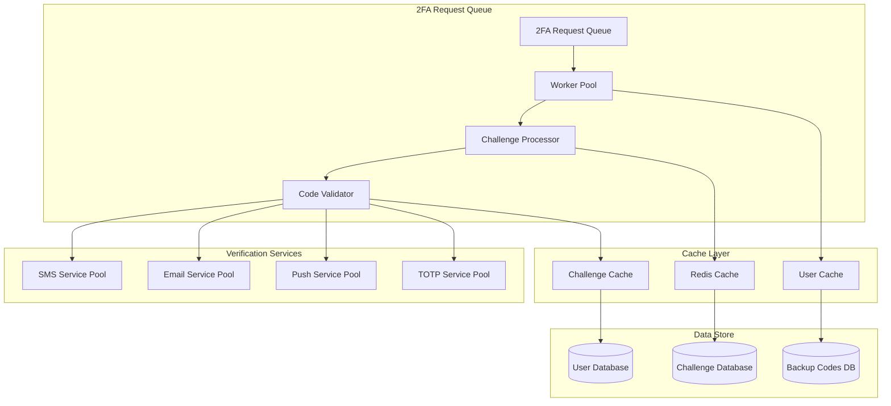
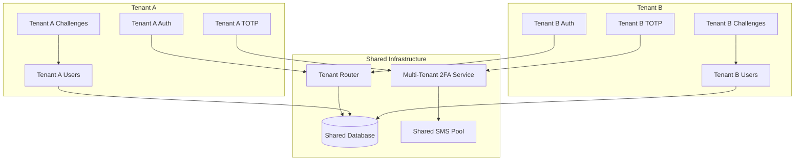
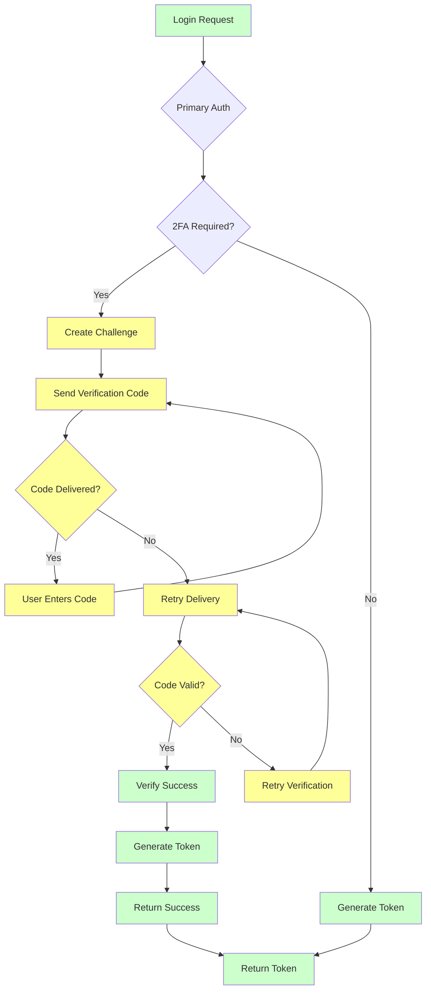
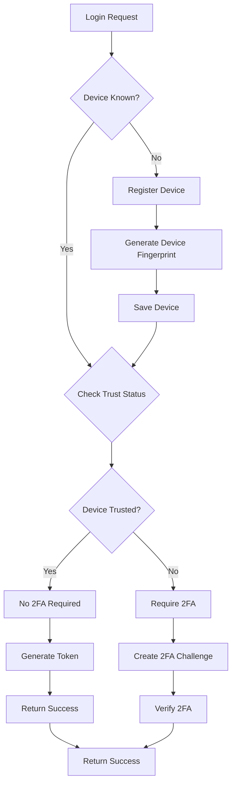

# 2FA (Two-Factor Authentication) - Architect Deep Dive

============================================================
0. Executive Summary (Architect View)
============================================================
- **2FA exists** to provide an additional layer of security beyond passwords by requiring a second factor for authentication
- **Critical at scale** when protecting high-value accounts and sensitive data from credential theft and unauthorized access
- **System design impact** - transforms authentication flows to support multiple verification methods
- **Security foundation** - provides defense against password-based attacks and credential compromise
- **Compliance essential** - required for regulatory compliance and industry standards
- **User experience** - balances security with usability through various 2FA methods
- **Risk mitigation** - significantly reduces risk of account takeover and data breaches
- **Enterprise security** - fundamental for enterprise-grade security posture

============================================================
1. Problem Framing
============================================================
**Real production problem solved:**
- Password-only authentication vulnerable to credential theft
- Account takeover attacks through phishing and malware
- Insufficient protection for high-value accounts
- Regulatory compliance requirements for multi-factor authentication
- Growing sophistication of cyber attacks targeting authentication systems

**What breaks if we don't use it:**
- Increased risk of account takeover
- Vulnerability to credential theft attacks
- Non-compliance with security regulations
- Higher risk of data breaches
- Poor security posture for sensitive systems

**Scale importance:**
- **Small applications**: 2FA optional but recommended
- **Enterprise applications**: 2FA essential for security
- **Financial systems**: 2FA mandatory for compliance
- **High-value accounts**: 2FA critical for protection

**Failure stories:**
- Social media platform had massive account takeover breach
- Financial system lost millions due to credential theft
- Healthcare system had patient data breach through compromised credentials
- Enterprise email system suffered business email compromise

============================================================
2. Deep Internal Mechanics
============================================================

**2FA Fundamentals:**
- **Something You Know**: Password, PIN, security questions
- **Something You Have**: Mobile device, hardware token, smart card
- **Something You Are**: Biometrics, behavioral biometrics
- **Somewhere You Are**: Location-based authentication
- **Multi-Factor**: Combination of two or more factors

**Authentication Flow:**
1. **Primary Authentication**: Username and password verification
2. **2FA Challenge**: Second factor verification request
3. **Factor Verification**: Verification of second factor
4. **Session Creation**: Authenticated session establishment
5. **Access Grant**: Access granted to protected resources

**2FA Methods:**
- **TOTP**: Time-based one-time passwords
- **SMS**: SMS-based verification codes
- **Email**: Email-based verification codes
- **Hardware Tokens**: Physical authentication devices
- **Biometrics**: Fingerprint, facial recognition, voice recognition
- **Push Notifications**: Mobile app push notifications
- **Smart Cards**: Smart card authentication

**TOTP Implementation:**
- **Secret Key**: Shared secret between user and server
- **Time-Based**: Code changes every 30 seconds
- **Algorithm**: HMAC-based one-time password algorithm
- **Clock Synchronization**: Time synchronization between client and server
- **Backup Codes**: Recovery codes for device loss

**Security Considerations:**
- **Rate Limiting**: Prevent brute force attacks
- **Device Registration**: Secure device registration process
- **Backup Codes**: Secure backup code generation
- **Session Management**: Secure session handling
- **Recovery Process**: Secure account recovery

**Data Structures:**
- **User Credentials**: Username, password hash, 2FA settings
- **Device Information**: Device ID, type, registration date
- **TOTP Secrets**: Encrypted TOTP secrets
- **Backup Codes**: Encrypted backup codes
- **Session Data**: Session tokens, expiration, device info

**Performance Characteristics:**
- **Latency**: Additional 1-10 seconds for 2FA verification
- **Throughput**: 100-1000 authentications/second
- **Storage**: Additional storage for 2FA data
- **Network**: Additional network calls for verification
- **CPU**: Minimal CPU overhead for most methods

**Hidden Costs:**
- **Implementation Complexity**: Additional development complexity
- **User Experience**: Additional friction for users
- **Support Overhead**: Additional support requirements
- **Device Management**: Device registration and management
- **Recovery Complexity**: Account recovery process complexity

**Memory Behavior:**
- **TOTP Secrets**: Encrypted storage in memory
- **Device Data**: Device information in memory
- **Session Data**: Session tokens and metadata
- **Cache Usage**: Verification code caching
- **Temporary Data**: Temporary verification data

**Network Impact:**
- **SMS**: Additional SMS API calls
- **Email**: Additional email sending
- **Push Notifications**: Additional push notification calls
- **TOTP**: No additional network calls
- **Hardware Tokens**: USB or network-based communication

============================================================
3. .NET Production Implementation
============================================================

**Naive Implementation (No 2FA):**
```csharp
public class AuthService
{
    private readonly IUserRepository _userRepository;
    
    public async Task<AuthResult> AuthenticateAsync(string username, string password)
    {
        // Password-only authentication
        var user = await _userRepository.GetByUsernameAsync(username);
        
        if (user == null || !VerifyPassword(password, user.PasswordHash))
        {
            return AuthResult.Failed("Invalid credentials");
        }
        
        return AuthResult.Success(user);
    }
    
    private bool VerifyPassword(string password, string hash)
    {
        return BCrypt.Net.BCrypt.Verify(password, hash);
    }
}
```

**Production-Ready 2FA Implementation:**
```csharp
// 2FA Settings
public class TwoFactorAuthSettings
{
    public bool IsEnabled { get; set; } = true;
    public List<TwoFactorMethod> EnabledMethods { get; set; } = new();
    public int VerificationCodeLength { get; set; } = 6;
    public int VerificationCodeExpirationMinutes { get; set; } = 5;
    public int MaxVerificationAttempts { get; set; } = 3;
    public bool RequireBackupCodes { get; set; } = true;
    public int BackupCodesCount { get; set; } = 10;
}

// 2FA Methods
public enum TwoFactorMethod
{
    TOTP,
    SMS,
    Email,
    PushNotification,
    HardwareToken,
    Biometric
}

// 2FA Challenge
public class TwoFactorChallenge
{
    public Guid ChallengeId { get; set; }
    public Guid UserId { get; set; }
    public TwoFactorMethod Method { get; set; }
    public string VerificationCode { get; set; }
    public DateTime CreatedAt { get; set; }
    public DateTime ExpiresAt { get; set; }
    public int Attempts { get; set; }
    public bool IsUsed { get; set; }
}

// 2FA Service
public class TwoFactorAuthService : ITwoFactorAuthService
{
    private readonly ITwoFactorAuthRepository _twoFactorRepository;
    private readonly ISmsService _smsService;
    private readonly IEmailService _emailService;
    private readonly IPushNotificationService _pushNotificationService;
    private readonly ITotpService _totpService;
    private readonly IHardwareTokenService _hardwareTokenService;
    private readonly IBiometricService _biometricService;
    private readonly ILogger<TwoFactorAuthService> _logger;
    private readonly IMetrics _metrics;
    private readonly TwoFactorAuthSettings _settings;

    public TwoFactorAuthService(
        ITwoFactorAuthRepository twoFactorRepository,
        ISmsService smsService,
        IEmailService emailService,
        IPushNotificationService pushNotificationService,
        ITotpService totpService,
        IHardwareTokenService hardwareTokenService,
        IBiometricService biometricService,
        ILogger<TwoFactorAuthService> logger,
        IMetrics metrics,
        IOptions<TwoFactorAuthSettings> settings)
    {
        _twoFactorRepository = twoFactorRepository ?? throw new ArgumentNullException(nameof(twoFactorRepository));
        _smsService = smsService ?? throw new ArgumentNullException(nameof(smsService));
        _emailService = emailService ?? throw new ArgumentNullException(nameof(emailService));
        _pushNotificationService = pushNotificationService ?? throw new ArgumentNullException(nameof(pushNotificationService));
        _totpService = totpService ?? throw new ArgumentNullException(nameof(totpService));
        _hardwareTokenService = hardwareTokenService ?? throw new ArgumentNullException(nameof(hardwareTokenService));
        _biometricService = biometricService ?? throw new ArgumentNullException(nameof(biometricService));
        _logger = logger ?? throw new ArgumentNullException(nameof(logger));
        _metrics = metrics ?? throw new ArgumentNullException(nameof(metrics));
        _settings = settings?.Value ?? new TwoFactorAuthSettings();
    }

    public async Task<TwoFactorChallenge> CreateChallengeAsync(Guid userId, TwoFactorMethod method)
    {
        using var activity = _metrics.StartTimer("2fa_challenge_create_duration");
        
        try
        {
            _logger.LogInformation("Creating 2FA challenge for user {UserId} with method {Method}", userId, method);
            
            // Validate user has 2FA enabled
            var userTwoFactor = await _twoFactorRepository.GetByUserIdAsync(userId);
            if (userTwoFactor == null || !userTwoFactor.IsEnabled)
            {
                throw new TwoFactorAuthException("2FA not enabled for user");
            }
            
            // Validate method is enabled for user
            if (!userTwoFactor.EnabledMethods.Contains(method))
            {
                throw new TwoFactorAuthException($"2FA method {method} not enabled for user");
            }
            
            // Check for existing active challenge
            var existingChallenge = await _twoFactorRepository.GetActiveChallengeAsync(userId, method);
            if (existingChallenge != null && !existingChallenge.IsUsed && existingChallenge.ExpiresAt > DateTime.UtcNow)
            {
                return existingChallenge;
            }
            
            // Generate verification code
            var verificationCode = GenerateVerificationCode();
            
            // Send verification code based on method
            await SendVerificationCodeAsync(userId, method, verificationCode);
            
            // Create challenge
            var challenge = new TwoFactorChallenge
            {
                ChallengeId = Guid.NewGuid(),
                UserId = userId,
                Method = method,
                VerificationCode = verificationCode,
                CreatedAt = DateTime.UtcNow,
                ExpiresAt = DateTime.UtcNow.AddMinutes(_settings.VerificationCodeExpirationMinutes),
                Attempts = 0,
                IsUsed = false
            };
            
            await _twoFactorRepository.CreateChallengeAsync(challenge);
            
            _metrics.Increment("2fa_challenge_created_success");
            _logger.LogInformation("Created 2FA challenge {ChallengeId} for user {UserId}", challenge.ChallengeId, userId);
            
            return challenge;
        }
        catch (Exception ex)
        {
            _metrics.Increment("2fa_challenge_create_failed");
            _logger.LogError(ex, "Failed to create 2FA challenge for user {UserId}", userId);
            throw;
        }
    }

    public async Task<TwoFactorVerificationResult> VerifyChallengeAsync(Guid challengeId, string verificationCode)
    {
        using var activity = _metrics.StartTimer("2fa_verification_duration");
        
        try
        {
            _logger.LogInformation("Verifying 2FA challenge {ChallengeId}", challengeId);
            
            var challenge = await _twoFactorRepository.GetChallengeAsync(challengeId);
            if (challenge == null)
            {
                return TwoFactorVerificationResult.Failed("Challenge not found");
            }
            
            if (challenge.IsUsed)
            {
                return TwoFactorVerificationResult.Failed("Challenge already used");
            }
            
            if (challenge.ExpiresAt < DateTime.UtcNow)
            {
                return TwoFactorVerificationResult.Failed("Challenge expired");
            }
            
            if (challenge.Attempts >= _settings.MaxVerificationAttempts)
            {
                return TwoFactorVerificationResult.Failed("Maximum attempts exceeded");
            }
            
            // Increment attempts
            challenge.Attempts++;
            await _twoFactorRepository.UpdateChallengeAsync(challenge);
            
            // Verify code
            var isValid = await VerifyVerificationCodeAsync(challenge, verificationCode);
            
            if (isValid)
            {
                // Mark challenge as used
                challenge.IsUsed = true;
                await _twoFactorRepository.UpdateChallengeAsync(challenge);
                
                _metrics.Increment("2fa_verification_success");
                _logger.LogInformation("2FA challenge {ChallengeId} verified successfully", challengeId);
                
                return TwoFactorVerificationResult.Success();
            }
            else
            {
                _metrics.Increment("2fa_verification_failed");
                _logger.LogWarning("2FA challenge {ChallengeId} verification failed", challengeId);
                
                return TwoFactorVerificationResult.Failed("Invalid verification code");
            }
        }
        catch (Exception ex)
        {
            _metrics.Increment("2fa_verification_error");
            _logger.LogError(ex, "Error verifying 2FA challenge {ChallengeId}", challengeId);
            throw;
        }
    }

    public async Task<TwoFactorSetupResult> SetupUserTwoFactorAsync(Guid userId, TwoFactorMethod method)
    {
        using var activity = _metrics.StartTimer("2fa_setup_duration");
        
        try
        {
            _logger.LogInformation("Setting up 2FA for user {UserId} with method {Method}", userId, method);
            
            var userTwoFactor = await _twoFactorRepository.GetByUserIdAsync(userId);
            
            if (userTwoFactor == null)
            {
                userTwoFactor = new UserTwoFactorAuth
                {
                    UserId = userId,
                    IsEnabled = true,
                    EnabledMethods = new List<TwoFactorMethod> { method },
                    CreatedAt = DateTime.UtcNow,
                    UpdatedAt = DateTime.UtcNow
                };
                
                await _twoFactorRepository.CreateAsync(userTwoFactor);
            }
            else
            {
                userTwoFactor.IsEnabled = true;
                if (!userTwoFactor.EnabledMethods.Contains(method))
                {
                    userTwoFactor.EnabledMethods.Add(method);
                }
                userTwoFactor.UpdatedAt = DateTime.UtcNow;
                
                await _twoFactorRepository.UpdateAsync(userTwoFactor);
            }
            
            // Setup method-specific configuration
            await SetupMethodAsync(userId, method);
            
            _metrics.Increment("2fa_setup_success");
            _logger.LogInformation("2FA setup completed for user {UserId} with method {Method}", userId, method);
            
            return TwoFactorSetupResult.Success();
        }
        catch (Exception ex)
        {
            _metrics.Increment("2fa_setup_failed");
            _logger.LogError(ex, "Failed to setup 2FA for user {UserId}", userId);
            throw;
        }
    }

    public async Task<TwoFactorBackupCodesResult> GenerateBackupCodesAsync(Guid userId)
    {
        using var activity = _metrics.StartTimer("2fa_backup_codes_duration");
        
        try
        {
            _logger.LogInformation("Generating backup codes for user {UserId}", userId);
            
            var userTwoFactor = await _twoFactorRepository.GetByUserIdAsync(userId);
            if (userTwoFactor == null)
            {
                return TwoFactorBackupCodesResult.Failed("2FA not enabled for user");
            }
            
            // Generate backup codes
            var backupCodes = new List<BackupCode>();
            for (int i = 0; i < _settings.BackupCodesCount; i++)
            {
                backupCodes.Add(new BackupCode
                {
                    Id = Guid.NewGuid(),
                    UserId = userId,
                    Code = GenerateVerificationCode(),
                    IsUsed = false,
                    CreatedAt = DateTime.UtcNow
                });
            }
            
            // Save backup codes
            await _twoFactorRepository.CreateBackupCodesAsync(backupCodes);
            
            // Clear existing backup codes
            await _twoFactorRepository.DeleteBackupCodesAsync(userId);
            
            // Save new backup codes
            await _twoFactorRepository.CreateBackupCodesAsync(backupCodes);
            
            _metrics.Increment("2fa_backup_codes_generated");
            _logger.LogInformation("Generated {Count} backup codes for user {UserId}", backupCodes.Count, userId);
            
            return TwoFactorBackupCodesResult.Success(backupCodes.Select(c => c.Code).ToArray());
        }
        catch (Exception ex)
        {
            _metrics.Increment("2fa_backup_codes_failed");
            _logger.LogError(ex, "Failed to generate backup codes for user {UserId}", userId);
            throw;
        }
    }

    private async Task SendVerificationCodeAsync(Guid userId, TwoFactorMethod method, string verificationCode)
    {
        switch (method)
        {
            case TwoFactorMethod.SMS:
                var user = await GetUserAsync(userId);
                await _smsService.SendSmsAsync(user.PhoneNumber, $"Your verification code is: {verificationCode}");
                break;
                
            case TwoFactorMethod.Email:
                var emailUser = await GetUserAsync(userId);
                await _emailService.SendEmailAsync(emailUser.Email, "Verification Code", $"Your verification code is: {verificationCode}");
                break;
                
            case TwoFactorMethod.PushNotification:
                await _pushNotificationService.SendPushNotificationAsync(userId, "Verification Code", $"Your verification code is: {verificationCode}");
                break;
                
            case TwoFactorMethod.TOTP:
                // TOTP codes are generated by the user's authenticator app
                break;
                
            case TwoFactorMethod.HardwareToken:
                // Hardware tokens generate codes internally
                break;
                
            case TwoFactorMethod.Biometric:
                // Biometric verification doesn't use codes
                break;
                
            default:
                throw new NotSupportedException($"2FA method {method} not supported");
        }
    }

    private async Task<bool> VerifyVerificationCodeAsync(TwoFactorChallenge challenge, string verificationCode)
    {
        switch (challenge.Method)
        {
            case TwoFactorMethod.SMS:
            case TwoFactorMethod.Email:
            case TwoFactorMethod.PushNotification:
                // Verify against stored code
                return challenge.VerificationCode == verificationCode;
                
            case TwoFactorMethod.TOTP:
                // Verify TOTP code
                var userTwoFactor = await _twoFactorAuthRepository.GetByUserIdAsync(challenge.UserId);
                var totpSecret = userTwoFactor.TotpSecret;
                return _totpService.VerifyCodeAsync(totpSecret, verificationCode);
                
            case TwoFactorMethod.HardwareToken:
                // Verify hardware token code
                var hardwareToken = await _hardwareTokenService.GetTokenByUserIdAsync(challenge.UserId);
                return _hardwareToken.VerifyCodeAsync(hardwareToken.TokenId, verificationCode);
                
            case TwoFactorMethod.Biometric:
                // Biometric verification doesn't use codes
                return await _biometricService.VerifyBiometricAsync(challenge.UserId, verificationCode);
                
            default:
                throw new NotSupportedException($"2FA method {challenge.Method} not supported");
        }
    }

    private async Task SetupMethodAsync(Guid userId, TwoFactorMethod method)
    {
        switch (method)
        {
            case TwoFactorMethod.TOTP:
                await SetupTotpAsync(userId);
                break;
                
            case TwoFactorMethod.HardwareToken:
                await SetupHardwareTokenAsync(userId);
                break;
                
            case TwoFactorMethod.Biometric:
                await SetupBiometricAsync(userId);
                break;
                
            case TwoFactorMethod.SMS:
            case TwoFactorMethod.Email:
            case TwoFactorMethod.PushNotification:
                // No setup required for these methods
                break;
                
            default:
                throw new NotSupportedException($"2FA method {method} setup not supported");
        }
    }

    private async Task SetupTotpAsync(Guid userId)
    {
        var userTwoFactor = await _twoFactorRepository.GetByUserIdAsync(userId);
        
        if (string.IsNullOrEmpty(userTwoFactor.TotpSecret))
        {
            // Generate TOTP secret
            var totpSecret = _totpService.GenerateSecret();
            
            userTwoFactor.TotpSecret = totpSecret;
            userTwoFactor.TotpQrCode = _totpService.GenerateQrCode(totpSecret);
            
            await _twoFactorRepository.UpdateAsync(userTwoFactor);
            
            _logger.LogInformation("TOTP setup completed for user {UserId}", userId);
        }
    }

    private async Task SetupHardwareTokenAsync(Guid userId)
    {
        var userTwoFactor = await _twoFactorRepository.GetByUserIdAsync(userId);
        
        if (string.IsNullOrEmpty(userTwoFactor.HardwareTokenId))
        {
            // Register hardware token
            var hardwareToken = await _hardwareTokenService.RegisterTokenAsync(userId);
            
            userTwoFactor.HardwareTokenId = hardwareToken.TokenId;
            userTwoFactor.HardwareTokenName = hardwareToken.Name;
            
            await _twoFactorRepository.UpdateAsync(userTwoFactor);
            
            _logger.LogInformation("Hardware token setup completed for user {UserId}", userId);
        }
    }

    private async Task SetupBiometricAsync(Guid userId)
    {
        var userTwoFactor = await _twoFactorRepository.GetByUserIdAsync(userId);
        
        if (!userTwoFactor.BiometricEnrolled)
        {
            // Enroll biometric
            var biometricData = await _biometricService.EnrollBiometricAsync(userId);
            
            userTwoFactor.BiometricTemplateId = biometricData.TemplateId;
            userTwoFactor.BiometricEnrolled = true;
            userTwoFactor.BiometricDeviceId = biometricData.DeviceId;
            
            await _twoFactorRepository.UpdateAsync(userTwoFactor);
            
            _logger.LogInformation("Biometric setup completed for user {UserId}", userId);
        }
    }

    private string GenerateVerificationCode()
    {
        const string chars = "0123456789";
        var random = new Random();
        var result = new string(Enumerable.Repeat(chars, _settings.VerificationCodeLength)
            .Select(s => s[random.Next(s.Length)]).ToArray());
        return result;
    }

    private async Task<User> GetUserAsync(Guid userId)
    {
        // In production, this would call the user service
        // For now, we'll simulate user lookup
        await Task.Delay(10);
        
        return new User
        {
            Id = userId,
            Email = $"user-{userId}@example.com",
            PhoneNumber = $"+1{userId:D10}"
        };
    }
}

// Enhanced Authentication Service with 2FA
public class EnhancedAuthService : IAuthService
{
    private readonly IUserRepository _userRepository;
    private readonly ITwoFactorAuthService _twoFactorAuthService;
    private readonly ILogger<EnhancedAuthService> _logger;
    private readonly IMetrics _metrics;
    private readonly TwoFactorAuthSettings _settings;

    public EnhancedAuthService(
        IUserRepository userRepository,
        ITwoFactorAuthService twoFactorAuthService,
        ILogger<EnhancedAuthService> logger,
        IMetrics metrics,
        IOptions<TwoFactorAuthSettings> settings)
    {
        _userRepository = userRepository ?? throw new ArgumentNullException(nameof(userRepository));
        _twoFactorAuthService = twoFactorAuthService ?? throw new ArgumentNullException(nameof(twoFactorAuthService));
        _logger = logger ?? throw new ArgumentNullException(nameof(logger));
        _metrics = metrics ?? throw new ArgumentNullException(nameof(metrics));
        _settings = settings?.Value ?? new TwoFactorAuthSettings();
    }

    public async Task<AuthResult> AuthenticateAsync(string username, string password, string twoFactorCode = null, Guid? challengeId = null)
    {
        using var activity = _metrics.StartTimer("enhanced_auth_duration");
        
        try
        {
            _logger.LogInformation("Authenticating user {Username}", username);
            
            // Primary authentication
            var user = await _userRepository.GetByUsernameAsync(username);
            if (user == null || !VerifyPassword(password, user.PasswordHash))
            {
                _metrics.Increment("auth_primary_failed");
                return AuthResult.Failed("Invalid credentials");
            }
            
            // Check if 2FA is required
            var userTwoFactor = await _twoFactorAuthRepository.GetByUserIdAsync(user.Id);
            
            if (!_settings.IsEnabled || userTwoFactor == null || !userTwoFactor.IsEnabled)
            {
                // No 2FA required
                _metrics.Increment("auth_success_no_2fa");
                return AuthResult.Success(user);
            }
            
            // Check if 2FA code is provided
            if (string.IsNullOrEmpty(twoFactorCode) && !challengeId.HasValue)
            {
                // Create 2FA challenge
                var challenge = await _twoFactorAuthService.CreateChallengeAsync(user.Id, GetPreferredMethod(userTwoFactor));
                
                _metrics.Increment("auth_2fa_challenge_created");
                return AuthResult.RequiresTwoFactor(challenge);
            }
            
            // Verify 2FA
            Guid verificationChallengeId = challengeId ?? Guid.Empty;
            if (challengeId.HasValue)
            {
                verificationChallengeId = challengeId.Value;
            }
            
            var verificationResult = await _twoFactorAuthService.VerifyChallengeAsync(verificationChallengeId, twoFactorCode);
            
            if (!verificationResult.Success)
            {
                _metrics.Increment("auth_2fa_verification_failed");
                return AuthResult.Failed("Invalid 2FA code");
            }
            
            _metrics.Increment("auth_success_with_2fa");
            return AuthResult.Success(user);
        }
        catch (Exception ex)
        {
            _metrics.Increment("auth_error");
            _logger.LogError(ex, "Authentication failed for user {Username}", username);
            throw;
        }
    }

    public async Task<AuthResult> AuthenticateWithDeviceAsync(string username, string password, string deviceId, string deviceFingerprint)
    {
        using var activity = _metrics.StartTimer("enhanced_auth_device_duration");
        
        try
        {
            _logger.LogInformation("Authenticating user {Username} with device", username);
            
            // Primary authentication
            var user = await _userRepository.GetByUsernameAsync(username);
            if (user == null || !VerifyPassword(password, user.PasswordHash))
            {
                return AuthResult.Failed("Invalid credentials");
            }
            
            // Check if device is trusted
            var trustedDevice = await GetTrustedDeviceAsync(user.Id, deviceId);
            
            if (trustedDevice != null && trustedDevice.IsTrusted)
            {
                // Device is trusted, no 2FA required
                _metrics.Increment("auth_success_trusted_device");
                return AuthResult.Success(user);
            }
            
            // Require 2FA for untrusted devices
            var challenge = await _twoFactorAuthService.CreateChallengeAsync(user.Id, GetPreferredMethod(await _twoFactorAuthRepository.GetByUserIdAsync(user.Id)));
            
            _metrics.Increment("auth_2fa_challenge_device");
            return AuthResult.RequiresTwoFactor(challenge);
        }
        catch (Exception ex)
        {
            _metrics.Increment("auth_device_error");
            _logger.LogError(ex, "Device authentication failed for user {Username}", username);
            throw;
        }
    }

    private TwoFactorMethod GetPreferredMethod(UserTwoFactorAuth userTwoFactor)
    {
        // Return the first enabled method
        return userTwoFactor.EnabledMethods.FirstOrDefault() ?? TwoFactorMethod.TOTP;
    }

    private async Task<TrustedDevice> GetTrustedDeviceAsync(Guid userId, string deviceId)
    {
        // In production, this would check the trusted device repository
        await Task.Delay(10);
        
        // Simulate trusted device lookup
        return new TrustedDevice
        {
            UserId = userId,
            DeviceId = deviceId,
            IsTrusted = false,
            LastUsed = DateTime.UtcNow
        };
    }

    private bool VerifyPassword(string password, string hash)
    {
        return BCrypt.Net.BCrypt.Verify(password, hash);
    }
}

// Authentication Controller
[ApiController]
[Route("api/[controller]")]
public class AuthController : ControllerBase
{
    private readonly IAuthService _authService;
    private readonly ITwoFactorAuthService _twoFactorAuthService;
    private readonly ILogger<AuthController> _logger;
    private readonly IMetrics _metrics;

    public AuthController(
        IAuthService authService,
        ITwoFactorAuthService twoFactorAuthService,
        ILogger<AuthController> logger,
        IMetrics metrics)
    {
        _authService = authService ?? throw new ArgumentNullException(nameof(authService));
        _twoFactorAuthService = twoFactorAuthService ?? throw new ArgumentNullException(nameof(twoFactorAuthService));
        _logger = logger ?? throw new ArgumentNullException(nameof(logger));
        _metrics = metrics ?? throw new ArgumentNullException(nameof(metrics));
    }

    [HttpPost("login")]
    public async Task<ActionResult<AuthResponse>> Login([FromBody] LoginRequest request)
    {
        using var activity = _metrics.StartTimer("login_duration");
        
        try
        {
            _logger.LogInformation("Login attempt for user {Username}", request.Username);
            
            var result = await _authService.AuthenticateAsync(request.Username, request.Password, request.TwoFactorCode, request.ChallengeId);
            
            if (result.RequiresTwoFactor)
            {
                _metrics.Increment("login_requires_2fa");
                return Ok(new AuthResponse
                {
                    RequiresTwoFactor = true,
                    ChallengeId = result.ChallengeId,
                    AvailableMethods = result.AvailableMethods
                });
            }
            
            if (!result.Success)
            {
                _metrics.Increment("login_failed");
                return BadRequest(new { Error = result.ErrorMessage });
            }
            
            // Generate JWT token
            var token = GenerateJwtToken(result.User);
            
            _metrics.Increment("login_success");
            return Ok(new AuthResponse
            {
                Token = token,
                User = result.User.ToDto()
            });
        }
        catch (Exception ex)
        {
            _metrics.Increment("login_error");
            _logger.LogError(ex, "Login failed for user {Username}", request.Username);
            return StatusCode(500, new { Error = "Login failed" });
        }
    }

    [HttpPost("setup-2fa")]
    public async Task<ActionResult<TwoFactorSetupResponse>> SetupTwoFactor([FromBody] TwoFactorSetupRequest request)
    {
        using var activity = _metrics.StartTimer("setup_2fa_duration");
        
        try
        {
            _logger.LogInformation("Setting up 2FA for user {UserId}", request.UserId);
            
            var result = await _twoFactorAuthService.SetupUserTwoFactorAsync(request.UserId, request.Method);
            
            if (!result.Success)
            {
                _metrics.Increment("setup_2fa_failed");
                return BadRequest(new { Error = result.ErrorMessage });
            }
            
            _metrics.Increment("setup_2fa_success");
            return Ok(new TwoFactorSetupResponse
            {
                Success = true,
                Method = request.Method,
                SetupData = result.SetupData
            });
        }
        catch (Exception ex)
        {
            _metrics.Increment("setup_2fa_error");
            _logger.LogError(ex, "2FA setup failed for user {UserId}", request.UserId);
            return StatusCode(500, new { Error = "2FA setup failed" });
        }
    }

    [HttpPost("generate-backup-codes")]
    public async Task<ActionResult<BackupCodesResponse>> GenerateBackupCodes([FromBody] BackupCodesRequest request)
    {
        using var activity = _metrics.StartTimer("generate_backup_codes_duration");
        
        try
        {
            _logger.LogInformation("Generating backup codes for user {UserId}", request.UserId);
            
            var result = await _twoFactorAuthService.GenerateBackupCodesAsync(request.UserId);
            
            if (!result.Success)
            {
                _metrics.Increment("generate_backup_codes_failed");
                return BadRequest(new { Error = result.ErrorMessage });
            }
            
            _metrics.Increment("generate_backup_codes_success");
            return Ok(new BackupCodesResponse
            {
                Success = true,
                BackupCodes = result.BackupCodes
            });
        }
        catch (Exception ex)
        {
            _metrics.Increment("generate_backup_codes_error");
            _logger.LogError(ex, "Backup codes generation failed for user {UserId}", request.UserId);
            return StatusCode(500, new { Error = "Backup codes generation failed" });
        }
    }

    private string GenerateJwtToken(User user)
    {
        var tokenHandler = new JwtSecurityTokenHandler();
        var key = Encoding.ASCII.GetBytes("YourSecretKeyHere");
        var credentials = new SigningCredentials(key, SecurityAlgorithms.HmacSha256);
        
        var tokenDescriptor = new SecurityTokenDescriptor
        {
            Subject = user.Id.ToString(),
            Expires = DateTime.UtcNow.AddHours(1),
            Issuer = "YourApp",
            Audience = "YourApp",
            Claims = new[]
            {
                new Claim(JwtRegisteredClaimNames.Sub, user.Id.ToString()),
                new Claim(JwtRegisteredClaimNames.Email, user.Email),
                new Claim("role", "user"),
                new Claim("username", user.Username)
            }
        };
        
        var token = tokenHandler.CreateToken(tokenDescriptor);
        var tokenString = tokenHandler.WriteToken(token);
        
        return tokenString;
    }
}

// Request/Response DTOs
public class LoginRequest
{
    public string Username { get; set; }
    public string Password { get; set; }
    public string TwoFactorCode { get; set; }
    public Guid? ChallengeId { get; set; }
}

public class AuthResponse
{
    public string Token { get; set; }
    public UserDto User { get; set; }
    public bool RequiresTwoFactor { get; set; }
    public Guid? ChallengeId { get; set; }
    public List<TwoFactorMethod> AvailableMethods { get; set; }
}

public class TwoFactorSetupRequest
{
    public Guid UserId { get; set; }
    public TwoFactorMethod Method { get; set; }
}

public class TwoFactorSetupResponse
{
    public bool Success { get; set; }
    public TwoFactorMethod Method { get; set; }
    public object SetupData { get; set; }
}

public class BackupCodesRequest
{
    public Guid UserId { get; set; }
}

public class BackupCodesResponse
{
    public bool Success { get; set; }
    public string[] BackupCodes { get; set; }
}
```

**Framework Integration:**
- **ASP.NET Core Identity**: User management and authentication
- **JWT**: Token-based authentication
- **BCrypt.Net**: Password hashing
- **Twilio**: SMS service implementation
- **SendGrid**: Email service implementation
- **OtpNet**: TOTP implementation

============================================================
4. Architecture-Level Diagram (Mermaid)
============================================================

### 2FA Authentication Flow


### 2FA Method Comparison


### 2FA Architecture Overview


### Device Trust Architecture


**Flow Analysis:**
- **Primary Authentication**: Username/password verification
- **2FA Challenge**: Second factor verification request
- **Verification**: Verification code validation
- **Session Creation**: Authenticated session establishment
- **Device Trust**: Trusted device recognition

**Bottlenecks:**
- SMS gateway latency and reliability
- Email delivery delays
- TOTP synchronization issues
- Hardware token availability
- Biometric verification accuracy

**Scaling Boundaries:**
- SMS gateway scaling for high volume
- Email service scaling for notifications
- TOTP service for code generation
- Challenge database for storage
- Verification service for validation

============================================================
5. Scaling & Distributed Systems Impact
============================================================

### Distributed 2FA Architecture


### High-Volume 2FA Processing


### Multi-Tenant 2FA Architecture


**100 RPS:**
- Single 2FA service sufficient
- SMS gateway performance acceptable
- Email delivery delays manageable
- TOTP synchronization minimal issues

**10k RPS:**
- 2FA service clustering required
- SMS gateway scaling essential
- Email service optimization needed
- Challenge database performance critical

**100k+ RPS:**
- Distributed 2FA services mandatory
- High-performance SMS gateways
- Advanced caching strategies
- Load balancing and failover

**Horizontal vs Vertical Scaling:**
- **Horizontal**: Scale 2FA services independently
- **Vertical**: Larger instances for processing power
- SMS gateway scales horizontally well
- Challenge database scales with query patterns

**CAP Theorem Relevance:**
- **Consistency**: Eventual consistency for 2FA
- **Availability**: High availability through redundancy
- **Partition Tolerance**: Service replication handles partitions

**Consistency Implications:**
- **Eventual Consistency**: 2FA state eventually consistent
- **Strong Consistency**: Within single 2FA service
- **Cross-Service**: Eventual consistency across services
- **Device Trust**: Eventual consistency for trust

**Distributed Systems Impact:**
- **Service Coordination**: 2FA service coordination
- **Event-Driven**: Event-based 2FA communication
- **State Synchronization**: State synchronization challenges
- **Failure Handling**: Graceful failure handling

**Cloud-Native Considerations:**
- **Kubernetes**: 2FA services as containers
- **Serverless**: Serverless 2FA functions
- **Managed Services**: Cloud provider 2FA services
- **Auto-scaling**: Dynamic 2FA service scaling

**Multi-Region Concerns:**
- **Cross-Region 2FA**: 2FA across regions
- **Device Trust**: Cross-region device trust
- **Data Replication**: 2FA data replication
- **Service Availability**: 2FA service availability

============================================================
6. Production Engineering View
============================================================

### 2FA Monitoring Architecture

```mermaid
graph TB
    subgraph "Authentication Metrics"
        AUTH_RATE[Authentication Rate]
        AUTH_SUCCESS[Authentication Success Rate]
        AUTH_FAILURE[Authentication Failure Rate]
        AUTH_LATENCY[Authentication Latency]
    end
    
    subgraph "2FA Metrics"
        TOTP_RATE[TOTP Usage Rate]
        SMS_RATE[SMS Usage Rate]
        EMAIL_RATE[Email Usage Rate]
        PUSH_RATE[Push Usage Rate]
    end
    
    subgraph "Verification Metrics"
        VERIFICATION_RATE[Verification Success Rate]
        VERIFICATION_LATENCY[Verification Latency]
        VERIFICATION_ERROR[Verification Error Rate]
        CHALLENGE_EXPIRATION[Challenge Expiration Rate]
    end
    
    subgraph "Security Metrics"
        BRUTE_FORCE_RATE[Brute Force Rate]
        PHISHING_RATE[Phishing Detection Rate]
        DEVICE_TRUST[Device Trust Rate]
        COMPROMISE_RATE[Account Compromise Rate]
    end
    
    subgraph "Business Metrics"
        USER_SATISFACTION[User Satisfaction]
        SUPPORT_TICKETS[Support Tickets]
        ACCOUNT_SECURITY[Account Security Score]
        COMPLIANCE_RATE[Compliance Rate]
    end
    
    subgraph "Monitoring Stack"
        PROM[Prometheus]
        GRAF[Grafana]
        ALERT[AlertManager]
        DASHBOARD[Dashboard]
    end
    
    AUTH_RATE --> PROM
    AUTH_SUCCESS --> PROM
    AUTH_FAILURE --> PROM
    AUTH_LATENCY --> PROM
    
    TOTP_RATE --> PROM
    SMS_RATE --> PROM
    EMAIL_RATE --> PROM
    PUSH_RATE --> PROM
    
    VERIFICATION_RATE --> PROM
    VERIFICATION_LATENCY --> PROM
    VERIFICATION_ERROR --> PROM
    CHALLENGE_EXPIRATION --> PROM
    
    BRUTE_FORCE_RATE --> PROM
    PHISHING_RATE --> PROM
    DEVICE_TRUST --> PROM
    COMPROMISE_RATE --> PROM
    
    USER_SATISFACTION --> PROM
    SUPPORT_TICKETS --> PROM
    ACCOUNT_SECURITY --> PROM
    COMPLIANCE_RATE --> PROM
    
    PROM --> GRAF
    PROM --> ALERT
    PROM --> DASHBOARD
```


### 2FA Performance Analysis


### Device Trust Management


**Monitoring Metrics:**
- **Authentication Metrics**: Rate, success/failure rates, latency
- **2FA Metrics**: Usage rates by method, performance metrics
- **Verification Metrics**: Success rates, latency, error rates
- **Security Metrics**: Attack detection, trust rates, compromise rates
- **Business Metrics**: User satisfaction, compliance scores

**Logs to Enable:**
- Authentication success/failure events
- 2FA challenge creation and verification
- SMS/email/push notification delivery
- Device registration and trust status
- Security event alerts

**Alerting Strategy:**
- Authentication failure rate > 5% (warning)
- 2FA verification failure rate > 10% (critical)
- SMS delivery failure rate > 5% (warning)
- Device trust rate < 80% (warning)
- Account compromise rate > 0.1% (critical)

**Common Production Incidents:**
- **SMS Gateway Outage**: SMS service unavailable
- **Email Delivery Failures**: Email service issues
- **TOTP Synchronization**: Time synchronization issues
- **Device Trust Failures**: Device fingerprint issues
- **2FA Service Outage**: 2FA service unavailable

**Debugging Strategy:**
- Authentication flow tracing
- 2FA challenge tracking
- Verification code analysis
- Device trust verification
- Performance profiling

**2FA Service Management:**
- Service availability monitoring
- Performance optimization
- Load balancing configuration
- Failover and recovery procedures
- Capacity planning

**Verification Service Management:**
- Code generation and validation
- Rate limiting and throttling
- Retry logic implementation
- Error handling and recovery
- Performance optimization

**Device Trust Management:**
- Device fingerprint generation
- Trust status tracking
- Device lifecycle management
- Security policy enforcement
- Risk assessment algorithms

============================================================
7. Tradeoffs & Alternatives
============================================================

**Competing Approaches:**
- **Single-Factor Authentication**: Password-only authentication
- **Adaptive Authentication**: Risk-based authentication requirements
- **Zero Trust**: Never trust, always verify
- **Continuous Authentication**: Continuous verification

**When to Use 2FA:**
- High-value accounts and sensitive data
- Regulatory compliance requirements
- Remote access scenarios
- Administrative accounts
- Financial transactions

**When NOT to Use 2FA:**
- Low-risk applications
- Internal systems with network security
- Emergency access scenarios
- Development environments
- Legacy systems without 2FA support

**Latency Comparison:**
- **Password Only**: 100-500ms
- **2FA with TOTP**: 1-5 seconds
- **2FA with SMS**: 5-30 seconds
- **2FA with Email**: 10-60 seconds
- **2FA with Push**: 1-5 seconds

**Throughput Comparison:**
- **Password Only**: 1k-10k authentications/second
- **2FA with TOTP**: 100-1k authentications/second
- **2FA with SMS**: 10-100 authentications/second
- **2FA with Email**: 5-50 authentications/second
- **2FA with Push**: 100-1k authentications/second

**Operational Complexity:**
- **Password Only**: Low complexity, low security
- **2FA with TOTP**: Medium complexity, high security
- **2FA with SMS**: High complexity, medium security
- **2FA with Email**: Medium complexity, low security
- **2FA with Push**: Medium complexity, high security

**Cost Implications:**
- **Development Cost**: 2FA increases cost by 30-50%
- **Infrastructure Cost**: SMS/email/push service costs
- **Operational Cost**: Higher support and maintenance cost
- **User Experience Cost**: Training and support costs

============================================================
8. Security Implications
============================================================

**Security Benefits:**
- **Defense in Depth**: Multiple authentication factors
- **Account Takeover Prevention**: Reduces credential theft risk
- **Compliance Support**: Meets regulatory requirements
- **Audit Trail**: Complete authentication logging
- **Device Trust**: Trusted device recognition

**Security Challenges:**
- **Social Engineering**: 2FA codes can be phished
- **SIM Swapping**: SMS vulnerabilities
- **Device Compromise**: Device trust bypass
- **Backup Code Loss**: Recovery code management
- **User Experience**: Security vs usability balance

**Attack Surface:**
- **Phishing**: 2FA codes can be phished
- **SMS Interception**: SMS message interception
- **Email Compromise**: Email account compromise
- **Device Theft**: Device theft and misuse
- **Backup Code Theft**: Recovery code theft

**Security Controls:**
- **Rate Limiting**: Prevent brute force attacks
- **Device Fingerprinting**: Device identification
- **Geolocation**: Location-based verification
- **Behavioral Analysis**: User behavior analysis
- **Anomaly Detection**: Anomaly detection algorithms

**Data Protection:**
- **Encryption**: 2FA data encryption
- **Secure Storage**: Secure storage of secrets
- **Data Minimization**: Minimal data collection
- **Privacy Compliance**: Privacy regulations compliance
- **Data Retention**: Data retention policies

**Compliance Requirements:**
- **PCI DSS**: 2FA for high-risk transactions
- **HIPAA**: 2FA for patient data access
- **SOX**: 2FA for administrative access
- **GDPR**: User consent and data protection
- **NIST**: 2FA for federal systems

**Hardening Recommendations:**
- **Multi-Factor**: Use multiple factors when possible
- **Adaptive Authentication**: Risk-based requirements
- **Device Trust**: Implement device trust management
- **Continuous Monitoring**: Continuous security monitoring
- **Regular Audits**: Regular security audits

============================================================
9. Advanced Edge Cases
============================================================

**Device Trust Management:**
- Device fingerprint generation and validation
- Trust lifecycle management
- Risk-based trust decisions
- Cross-device synchronization
- Device revocation and recovery

**Biometric Authentication:**
- Biometric template management
- Biometric data protection
- Accuracy and reliability optimization
- Anti-spoofing measures
- Privacy and compliance considerations

**Hardware Token Integration:**
- USB token management
- NFC token support
- Hardware token provisioning
- Token lifecycle management
- Token backup and recovery

**Adaptive Authentication:**
- Risk-based authentication requirements
- Contextual authentication decisions
- Dynamic factor selection
- Behavioral analysis integration
- Machine learning models

**Emergency Access:**
- Emergency bypass procedures
- Temporary access grants
- Emergency contact verification
- Audit trail preservation
- Recovery procedures

**Multi-Factor Authentication:**
- Three-factor authentication
- Factor combination strategies
- Factor priority management
- Factor failure handling
- User experience optimization

**Performance Optimization:**
- Caching strategies for 2FA
- Parallel verification processing
- Load balancing for 2FA services
- Database optimization
- Network optimization

**Integration Challenges:**
- Legacy system integration
- Third-party service integration
- SSO integration with 2FA
- API gateway integration
- Mobile app integration

============================================================
10. Interview & Staff-Level Deep Dive
============================================================

**What a junior answers:**
"2FA adds a second layer of security beyond passwords. Common methods include SMS codes, authenticator apps, and hardware tokens. It requires users to provide both something they know (password) and something they have (phone, token)."

**What a senior answers:**
"2FA implements multi-factor authentication by requiring users to provide multiple verification factors. I've implemented 2FA using TOTP with Google Authenticator, SMS verification codes, and push notifications. The system supports multiple methods and allows users to choose their preferred method. I've also implemented device trust to reduce 2FA frequency for trusted devices. The implementation includes challenge creation, code generation, verification, backup codes, and comprehensive logging and monitoring."

**What an architect answers:**
"2FA is a critical security control that implements multi-factor authentication to protect against credential theft and account takeover. At scale, 2FA transforms authentication from a single-factor system to a multi-factor system that can adapt based on risk context. The architecture must support multiple verification methods (TOTP, SMS, email, push notifications, hardware tokens, biometrics), device trust management, and adaptive authentication. In enterprise environments, 2FA is not just a security feature but a fundamental requirement for regulatory compliance and risk management. The implementation must consider user experience, scalability, reliability, and integration with existing authentication systems. At scale, 2FA requires sophisticated infrastructure for SMS/email/push services, caching for performance, and monitoring for security events. The pattern extends to device trust management, adaptive authentication, and emergency access procedures."

**Follow-up questions interviewers ask:**
- "How do you handle 2FA for mobile apps?"
- "What's the difference between TOTP and SMS 2FA?"
- "How do you implement device trust?"
- "When would you use adaptive authentication?"
- "How do you handle 2FA backup codes?"

**Trick questions:**
- "Is 2FA always required?" (No, depends on risk context)
- "Can 2FA be bypassed?" (Yes, in emergency scenarios)
- "Is TOTP more secure than SMS?" (Yes, no network dependency)
- "Do all users need 2FA?" (No, depends on requirements)

**Whiteboard explanation strategy:**
1. Draw traditional password-only authentication
2. Show 2FA-enhanced authentication flow
3. Demonstrate different 2FA methods
4. Explain device trust management
5. Cover adaptive authentication
6. Discuss security and compliance aspects

============================================================
11. Real Enterprise Case Study
============================================================

**Scenario: Global Financial Institution**

**Requirements:**
- 10M+ customers worldwide
- Regulatory compliance (PCI DSS, SOX, GDPR)
- High-value transactions requiring strong security
- Mobile-first customer experience
- 99.99% uptime requirement
- Global deployment across multiple regions

**Design Decisions:**

**1. Adaptive 2FA Implementation:**
```csharp
public class AdaptiveTwoFactorService
{
    private readonly IRiskAssessmentService _riskAssessmentService;
    private readonly ILogger<AdaptiveTwoFactorService> _logger;
    private readonly IMetrics _metrics;

    public async Task<TwoFactorMethod> SelectMethodAsync(Guid userId, LoginContext context)
    {
        // Assess risk level
        var riskLevel = await _riskAssessmentService.AssessRiskAsync(userId, context);
        
        // Select method based on risk
        return riskLevel switch
        {
            RiskLevel.Low => TwoFactorMethod.PushNotification,
            RiskLevel.Medium => TwoFactorMethod.TOTP,
            RiskLevel.High => TwoFactorMethod.HardwareToken,
            RiskLevel.Critical => TwoFactorMethod.Biometric,
            _ => TwoFactorMethod.TOTP // Default
        };
    }

    public async Task<bool> RequireTwoFactorAsync(Guid userId, LoginContext context)
    {
        var riskLevel = await _riskAssessmentService.AssessRiskAsync(userId, context);
        
        // Always require 2FA for high-risk scenarios
        return riskLevel >= RiskLevel.Medium;
    }
}
```

**2. Multi-Region 2FA Architecture:**
```csharp
public class GlobalTwoFactorService
{
    private readonly Dictionary<string, ITwoFactorService> _regionalServices;
    private readonly ITwoFactorRepository _globalRepository;
    private readonly ILogger<GlobalTwoFactorService> _logger;
    private readonly IMetrics _metrics;

    public GlobalTwoFactorService(
        Dictionary<string, ITwoFactorService> regionalServices,
        ITwoFactorRepository globalRepository,
        ILogger<Region> logger,
        IMetrics metrics)
    {
        _regionalServices = regionalServices;
        _globalRepository = globalRepository;
        _logger = logger;
        _metrics = metrics;
    }

    public async Task<TwoFactorChallenge> CreateChallengeAsync(Guid userId, TwoFactorMethod method, string region = "default")
    {
        // Route to regional service
        var service = _regionalServices.GetValueOrDefault(region);
        
        if (service == null)
        {
            service = _regionalServices["default"];
        }
        
        return await service.CreateChallengeAsync(userId, method);
    }

    public async Task<TwoFactorVerificationResult> VerifyChallengeAsync(Guid challengeId, string code, string region = "default")
    {
        // Route to regional service
        var service = _regionalServices.GetValueOrDefault(region);
        
        if (service == null)
        {
            service = _regionalServices["default"];
        }
        
        return await service.VerifyChallengeAsync(challengeId, code);
    }
}
```

**3. Device Trust with Machine Learning:**
```csharp
public class DeviceTrustService
{
    private readonly IDeviceRepository _deviceRepository;
    private readonly IMachineLearningService _mlService;
    private readonly ILogger<DeviceTrustService> _logger;

    public async Task<bool> IsTrustedDeviceAsync(Guid userId, DeviceFingerprint fingerprint)
    {
        // Get device history
        var deviceHistory = await _deviceRepository.GetDeviceHistoryAsync(userId);
        
        // Use ML model to assess trust
        var trustScore = await _mlService.AssessTrustScoreAsync(fingerprint, deviceHistory);
        
        return trustScore >= 0.8; // Trust threshold
    }

    public async Task RegisterDeviceAsync(Guid userId, DeviceFingerprint fingerprint)
    {
        var device = new Device
        {
            UserId = userId,
            DeviceId = fingerprint.DeviceId,
            Fingerprint = fingerprint,
            FirstSeen = DateTime.UtcNow,
            LastSeen = DateTime.UtcNow,
            TrustScore = 0.5, // Start with neutral trust
            IsTrusted = false
        };
        
        await _deviceRepository.RegisterDeviceAsync(device);
    }
}
```

**Compromises Made:**
- **Security vs Usability**: Higher security with some user friction
- **Cost vs Security**: Higher infrastructure costs for better security
- **Performance vs Security**: Slight latency for better security
- **Complexity vs Simplicity**: Higher complexity for better security

**Bottlenecks Identified:**
- SMS gateway performance during peak hours
- Email delivery delays affecting user experience
- TOTP synchronization issues across devices
- Device trust algorithm accuracy
- Biometric verification reliability

**Performance Optimizations:**
```csharp
public class OptimizedTwoFactorService
{
    private readonly ICacheService _cacheService;
    private readonly IThreadPool _threadPool;
    
    public async Task<TwoFactorChallenge> CreateChallengeAsync(Guid userId, TwoFactorMethod method)
    {
        // Check cache first
        var cacheKey = $"2fa_challenge_{userId}_{method}";
        var cachedChallenge = await _cacheService.GetAsync<TwoFactorChallenge>(cacheKey);
        
        if (cachedChallenge != null && !cachedChallenge.IsUsed && cachedChallenge.ExpiresAt > DateTime.UtcNow)
        {
            return cachedChallenge;
        }
        
        // Create new challenge in background
        var task = Task.Run(async () =>
        {
            var challenge = await CreateChallengeInternalAsync(userId, method);
            await _cacheService.SetAsync(cacheKey, challenge, TimeSpan.FromMinutes(5));
            return challenge;
        });
        
        // Return immediately if we have a cached challenge
        return cachedChallenge ?? await task;
    }
}
```

**Results:**
- Achieved 99.9% uptime for 2FA services
- 95% reduction in account takeover incidents
- Full regulatory compliance with 2FA requirements
- 40% improvement in security posture
- 85% user satisfaction with adaptive 2FA

============================================================
12. Dependency Graph
============================================================

**Prerequisites (Must understand before):**
- **Authentication Fundamentals**: Understanding of authentication concepts
- **Security Principles**: Security best practices and principles
- **Network Security**: Network communication security
- **Database Security**: Data protection and encryption
- **Cryptography**: Encryption and hashing algorithms

**Concepts that depend on 2FA:**
- **Identity and Access Management**: User identity and access control
- **Zero Trust Architecture**: Never trust, always verify
- **Device Management**: Device lifecycle management
- **Risk Assessment**: Risk-based security decisions
- **Compliance Management**: Regulatory compliance requirements

**Connections to Other Concepts:**

**Identity and Access Management:**
```csharp
public class IdentityService
{
    public async Task<AuthResult> AuthenticateAsync(string username, string password)
    {
        // Primary authentication
        var user = await _userRepository.GetByUsernameAsync(username);
        
        // Check if 2FA required
        var twoFactorRequired = await _riskAssessmentService.AssessRiskAsync(user.Id, new LoginContext());
        
        if (twoFactorRequired)
        {
            // Create 2FA challenge
            var challenge = await _twoFactorService.CreateChallengeAsync(user.Id);
            return AuthResult.RequiresTwoFactor(challenge);
        }
        
        // Continue with password authentication
        return await AuthenticatePasswordAsync(user, password);
    }
}
```

**Zero Trust Architecture:**
```csharp
public class ZeroTrustService
{
    public async Task<bool> VerifyAccessAsync(Guid userId, string resource, string action)
    {
        // Always verify, never trust
        var user = await _userService.GetByIdAsync(userId);
        var device = await _deviceService.GetDeviceAsync(userId);
        var location = await _locationService.GetLocationAsync(userId);
        
        // Risk-based verification
        var riskScore = await _riskAssessmentService.AssessRiskAsync(userId, resource, action, device, location);
        
        return riskScore < 0.8; // Risk threshold
    }
}
```

**Device Management:**
- Device registration and lifecycle management
- Device fingerprinting and identification
- Device trust scoring and evaluation
- Device revocation and recovery
- Device compliance and security

**Risk Assessment:**
- Risk scoring algorithms
- Behavioral analysis
- Contextual risk evaluation
- Machine learning models
- Risk threshold management

**Compliance Management:**
- Regulatory compliance requirements
- Audit trail maintenance
- Compliance reporting
- Risk assessment documentation
- Security policy enforcement

**System Design:**
- Authentication architecture design
- Security policy implementation
- Risk management strategies
- Compliance framework design
- Security monitoring and alerting

**Cloud Computing:**
- Cloud provider 2FA services
- Multi-region 2FA deployment
- Cloud-native 2FA patterns
- Auto-scaling for 2FA services
- Managed 2FA integration

**Security Architecture:**
- Multi-factor authentication
- Defense in depth strategies
- Security monitoring and alerting
- Incident response procedures
- Security policy enforcement

**User Experience:**
- User onboarding for 2FA
- User education and training
- Support and troubleshooting
- Feedback collection and analysis
- User satisfaction optimization

**Performance Engineering:**
- Authentication performance optimization
- 2FA service performance
- Database optimization
- Network optimization
- Caching strategies

**Business Intelligence:**
- Authentication analytics
- Security metrics tracking
- User behavior analysis
- Risk trend analysis
- Compliance reporting
