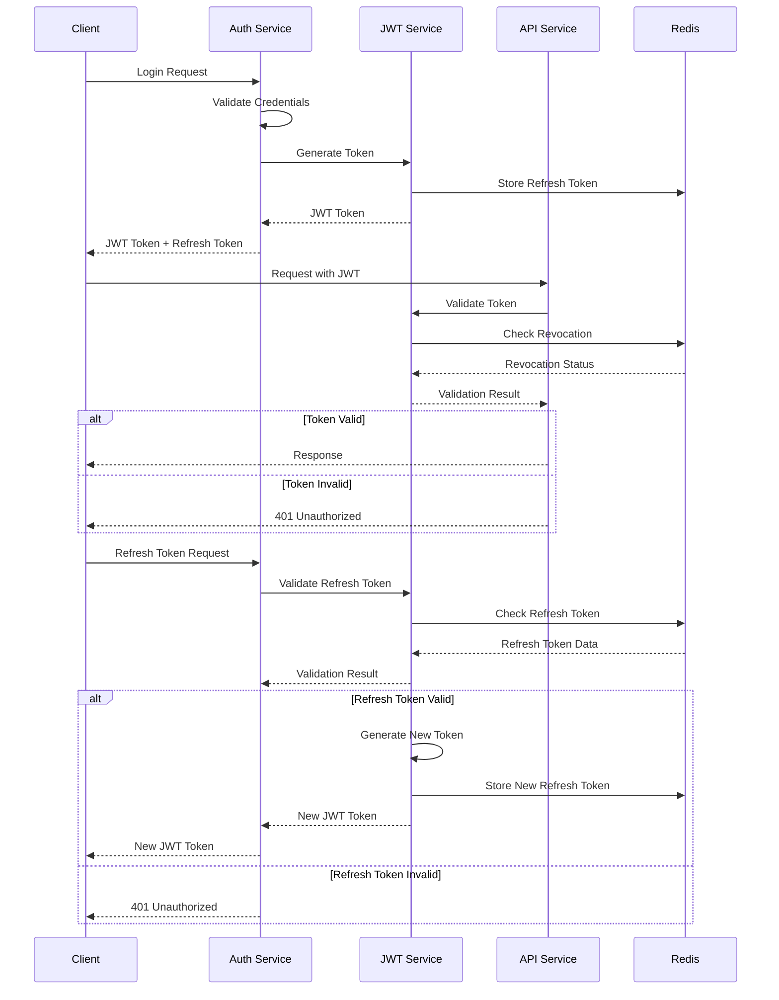
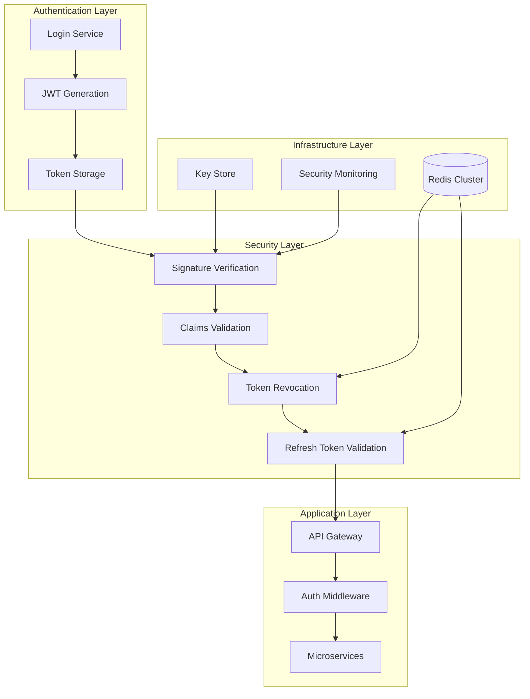
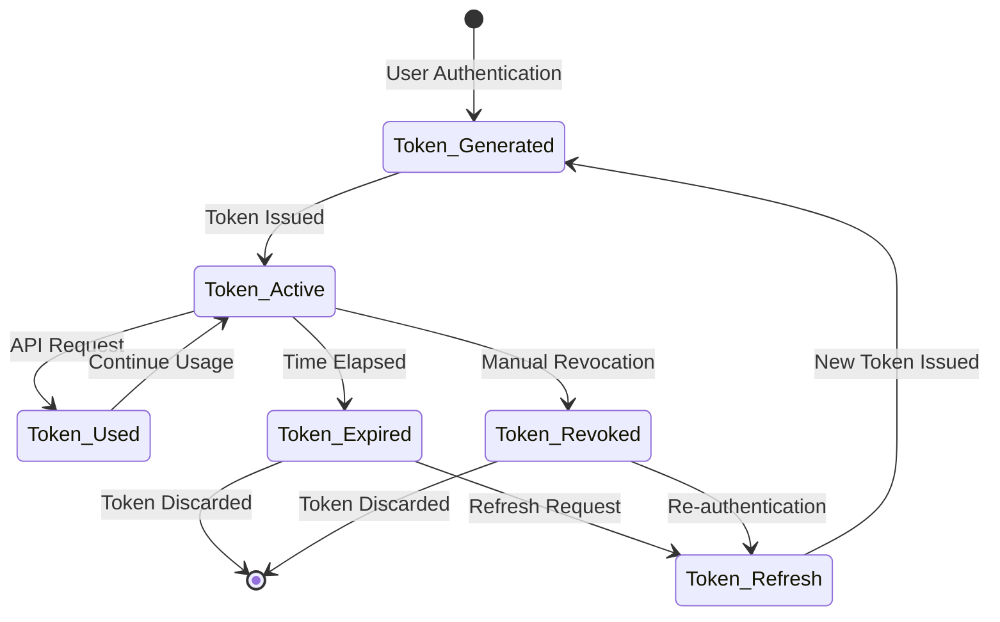
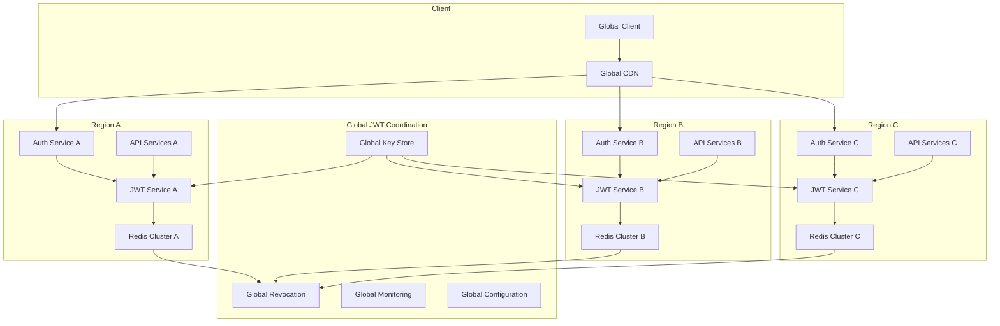
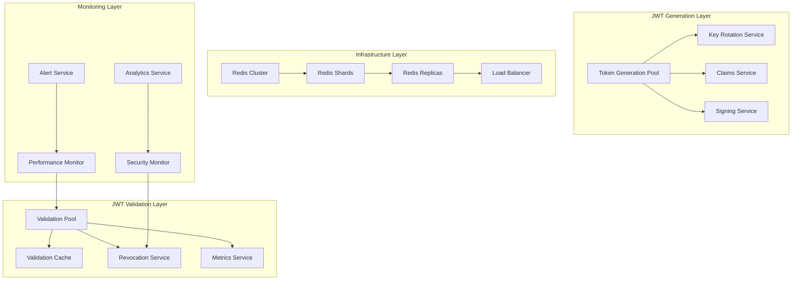
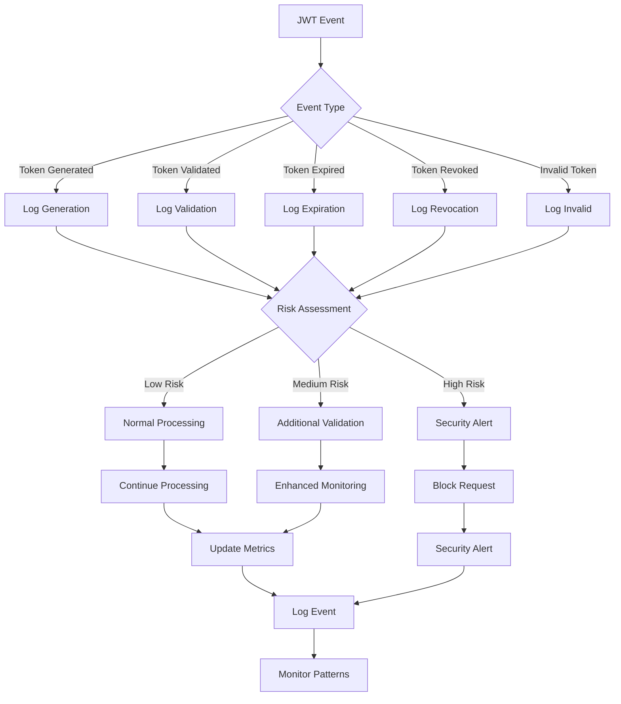

# JWT (JSON Web Tokens) - Architect Deep Dive

============================================================
0. Executive Summary (Architect View)
============================================================
- **JWT exists** to provide stateless authentication and authorization for distributed systems
- **Critical at scale** when systems need to authenticate across multiple services without session state
- **System design impact** - transforms authentication from stateful to stateless architecture
- **Stateless authentication** - eliminates server-side session storage requirements
- **Cross-service authentication** - enables single sign-on across microservices
- **Mobile-friendly** - ideal for mobile and SPA applications
- **Scalability foundation** - enables horizontal scaling without session affinity
- **Security enhancement** - provides cryptographic signature verification

============================================================
1. Problem Framing
============================================================
**Real production problem solved:**
- Session management complexity in distributed systems
- Cross-service authentication challenges
- Mobile app authentication requirements
- Scalability limitations of session-based authentication
- Single sign-on requirements across multiple services

**What breaks if we don't understand JWT:**
- Session affinity requirements for load balancing
- Cross-service authentication complexity
- Mobile authentication challenges
- Scalability limitations
- Security vulnerabilities in session management

**Scale importance:**
- **Small applications**: Session-based authentication sufficient
- **Medium applications**: JWT benefits become apparent
- **Large applications**: JWT essential for scalability
- **Enterprise systems**: JWT mandatory for distributed architecture

**Failure stories:**
- E-commerce platform had session management issues during scaling
- Mobile app authentication failures with session-based approach
- Microservices authentication complexity without JWT
- Single sign-on implementation challenges

============================================================
2. Deep Internal Mechanics
============================================================

**JWT Fundamentals:**
- **JSON Web Token**: Compact, URL-safe means of representing claims
- **Three Parts**: Header, Payload, Signature
- **Stateless**: No server-side session storage required
- **Self-contained**: Contains all necessary information
- **Cryptographically Signed**: Ensures integrity and authenticity

**JWT Structure:**
- **Header**: Algorithm and token type
- **Payload**: Claims (user data, permissions, expiration)
- **Signature**: Cryptographic signature of header and payload
- **Base64Url Encoding**: Each part encoded separately
- **Dot Separation**: Parts separated by dots

**Header Component:**
- **Algorithm**: Signing algorithm (HS256, RS256, etc.)
- **Token Type**: Typically "JWT"
- **Key ID**: Optional key identifier
- **Compression**: Optional compression algorithm

**Payload Component:**
- **Registered Claims**: Standard claims (iss, sub, aud, exp, nbf, iat)
- **Public Claims**: Publicly defined claims
- **Private Claims**: Application-specific claims
- **Expiration**: Token expiration time
- **Issuer**: Token issuer information

**Signature Component:**
- **Signing Algorithm**: HMAC or RSA/ECDSA
- **Secret Key**: For HMAC algorithms
- **Private Key**: For asymmetric algorithms
- **Verification**: Public key verification for asymmetric
- **Integrity**: Ensures token hasn't been tampered

**JWT Algorithms:**
- **HS256**: HMAC using SHA-256
- **RS256**: RSA using SHA-256
- **ES256**: ECDSA using SHA-256
- **HS384**: HMAC using SHA-384
- **RS384**: RSA using SHA-384

**Token Flow:**
1. **Authentication**: User authenticates with credentials
2. **Token Generation**: Server creates JWT with claims
3. **Token Issuance**: Server signs and returns JWT
4. **Token Storage**: Client stores JWT (localStorage, cookie)
5. **Token Usage**: Client sends JWT in Authorization header
6. **Token Verification**: Server verifies signature and claims
7. **Authorization**: Server grants/denies access based on claims

**Security Considerations:**
- **Secret Management**: Secure key storage and rotation
- **Token Expiration**: Short-lived tokens for security
- **Refresh Tokens**: Secure token refresh mechanism
- **HTTPS Only**: Prevent token interception
- **Claims Validation**: Validate all claims carefully

**Data Structures:**
- **JWT Claims**: Key-value pairs of user data
- **Token Metadata**: Algorithm, type, expiration
- **Key Store**: Public/private key storage
- **Blacklist**: Revoked token tracking
- **Refresh Tokens**: Secure refresh token storage

**Performance Characteristics:**
- **Token Generation**: 1-10ms
- **Token Verification**: 1-5ms
- **Token Size**: Typically 1-2KB
- **Network Overhead**: Minimal (single header)
- **Storage**: No server-side storage required

**Hidden Costs:**
- **Key Management**: Secure key generation and rotation
- **Token Revocation**: Revocation mechanism complexity
- **Size Overhead**: Larger than session IDs
- **CPU Usage**: Cryptographic operations
- **Implementation Complexity**: JWT handling complexity

**Memory Behavior:**
- **Token Processing**: In-memory token parsing
- **Key Storage**: Keys in secure memory
- **Claims Extraction**: Temporary claim storage
- **Verification**: Temporary verification data
- **No Session Storage**: Eliminates session memory

**Network Impact:**
- **Header Size**: Additional Authorization header
- **Request Size**: Slightly larger requests
- **Response Size**: No impact on responses
- **HTTPS Required**: Encrypted transmission mandatory
- **CDN Friendly**: Stateless nature helps CDN

============================================================
3. .NET Production Implementation
============================================================

**Naive Implementation (No JWT):**
```csharp
[ApiController]
[Route("api/[controller]")]
public class ProductsController : ControllerBase
{
    private readonly IProductService _productService;
    
    public ProductsController(IProductService productService)
    {
        _productService = productService;
    }
    
    [HttpGet("{id}")]
    public async Task<ActionResult<Product>> GetProduct(int id)
    {
        // No authentication - vulnerable
        var product = await _productService.GetProductAsync(id);
        return Ok(product);
    }
}
```

**Production-Ready JWT Implementation:**
```csharp
// JWT Configuration
public class JwtConfiguration
{
    public string SecretKey { get; set; }
    public string Issuer { get; set; }
    public string Audience { get; set; }
    public int ExpirationMinutes { get; set; } = 60;
    public int RefreshExpirationDays { get; set; } = 7;
    public string Algorithm { get; set; } = "HS256";
    public bool ValidateIssuer { get; set; } = true;
    public bool ValidateAudience { get; set; } = true;
    public bool ValidateLifetime { get; set; } = true;
    public string PublicKeyPath { get; set; }
    public string PrivateKeyPath { get; set; }
}

// JWT Claims Model
public class JwtClaims
{
    public const string Sub = "sub";
    public const string Iss = "iss";
    public const string Aud = "aud";
    public const string Exp = "exp";
    public const string Nbf = "nbf";
    public const string Iat = "iat";
    public const string Jti = "jti";
    public const string Role = "role";
    public const string Permissions = "permissions";
    public const string Email = "email";
    public const string Name = "name";
    public const string UserId = "userId";
}

// JWT Token Model
public class JwtToken
{
    public string AccessToken { get; set; }
    public string RefreshToken { get; set; }
    public DateTime ExpiresAt { get; set; }
    public DateTime RefreshExpiresAt { get; set; }
    public string TokenType { get; set; } = "Bearer";
}

// JWT Service Interface
public interface IJwtService
{
    Task<JwtToken> GenerateTokenAsync(User user);
    Task<ClaimsPrincipal> ValidateTokenAsync(string token);
    Task<JwtToken> RefreshTokenAsync(string refreshToken);
    Task RevokeTokenAsync(string token);
    Task<bool> IsTokenRevokedAsync(string token);
}

// HMAC JWT Service Implementation
public class HmacJwtService : IJwtService
{
    private readonly JwtConfiguration _configuration;
    private readonly ILogger<HmacJwtService> _logger;
    private readonly IMetrics _metrics;
    private readonly ITokenRevocationService _revocationService;

    public HmacJwtService(
        IOptions<JwtConfiguration> configuration,
        ILogger<HmacJwtService> logger,
        IMetrics metrics,
        ITokenRevocationService revocationService)
    {
        _configuration = configuration?.Value ?? new JwtConfiguration();
        _logger = logger ?? throw new ArgumentNullException(nameof(logger));
        _metrics = metrics ?? throw new ArgumentNullException(nameof(metrics));
        _revocationService = revocationService ?? throw new ArgumentNullException(nameof(revocationService));
    }

    public async Task<JwtToken> GenerateTokenAsync(User user)
    {
        using var activity = _metrics.StartTimer("jwt_generate_duration");
        
        try
        {
            _logger.LogInformation("Generating JWT token for user {UserId}", user.Id);
            
            // Generate token claims
            var claims = new List<Claim>
            {
                new Claim(JwtClaims.Sub, user.Id.ToString()),
                new Claim(JwtClaims.Email, user.Email),
                new Claim(JwtClaims.Name, user.Name),
                new Claim(JwtClaims.Role, user.Role),
                new Claim(JwtClaims.UserId, user.Id.ToString()),
                new Claim(JwtClaims.Jti, Guid.NewGuid().ToString())
            };
            
            // Add permissions as claims
            foreach (var permission in user.Permissions)
            {
                claims.Add(new Claim(JwtClaims.Permissions, permission));
            }
            
            // Create signing key
            var key = new SymmetricSecurityKey(Encoding.UTF8.GetBytes(_configuration.SecretKey));
            
            // Create signing credentials
            var credentials = new SigningCredentials(key, _configuration.Algorithm);
            
            // Create token descriptor
            var tokenDescriptor = new SecurityTokenDescriptor
            {
                Subject = new ClaimsIdentity(claims),
                Expires = DateTime.UtcNow.AddMinutes(_configuration.ExpirationMinutes),
                Issuer = _configuration.Issuer,
                Audience = _configuration.Audience,
                SigningCredentials = credentials
            };
            
            // Generate token
            var tokenHandler = new JwtSecurityTokenHandler();
            var securityToken = tokenHandler.CreateToken(tokenDescriptor);
            var accessToken = tokenHandler.WriteToken(securityToken);
            
            // Generate refresh token
            var refreshToken = await GenerateRefreshTokenAsync(user);
            
            var jwtToken = new JwtToken
            {
                AccessToken = accessToken,
                RefreshToken = refreshToken,
                ExpiresAt = DateTime.UtcNow.AddMinutes(_configuration.ExpirationMinutes),
                RefreshExpiresAt = DateTime.UtcNow.AddDays(_configuration.RefreshExpirationDays),
                TokenType = "Bearer"
            };
            
            _metrics.Increment("jwt_generate_success");
            _logger.LogInformation("JWT token generated successfully for user {UserId}", user.Id);
            
            return jwtToken;
        }
        catch (Exception ex)
        {
            _metrics.Increment("jwt_generate_error");
            _logger.LogError(ex, "Error generating JWT token for user {UserId}", user.Id);
            throw;
        }
    }

    public async Task<ClaimsPrincipal> ValidateTokenAsync(string token)
    {
        using var activity = _metrics.StartTimer("jwt_validate_duration");
        
        try
        {
            _logger.LogDebug("Validating JWT token");
            
            // Check if token is revoked
            if (await IsTokenRevokedAsync(token))
            {
                _metrics.Increment("jwt_validate_revoked");
                _logger.LogWarning("JWT token is revoked");
                return null;
            }
            
            var tokenHandler = new JwtSecurityTokenHandler();
            
            // Create validation parameters
            var validationParameters = new TokenValidationParameters
            {
                ValidateIssuer = _configuration.ValidateIssuer,
                ValidIssuers = new[] { _configuration.Issuer },
                ValidateAudience = _configuration.ValidateAudience,
                ValidAudiences = new[] { _configuration.Audience },
                ValidateLifetime = _configuration.ValidateLifetime,
                IssuerSigningKey = new SymmetricSecurityKey(Encoding.UTF8.GetBytes(_configuration.SecretKey)),
                ClockSkew = TimeSpan.Zero
            };
            
            // Validate and parse token
            var principal = tokenHandler.ValidateToken(token, validationParameters, out var validatedToken);
            
            _metrics.Increment("jwt_validate_success");
            _logger.LogDebug("JWT token validated successfully");
            
            return principal;
        }
        catch (SecurityTokenExpiredException ex)
        {
            _metrics.Increment("jwt_validate_expired");
            _logger.LogWarning(ex, "JWT token has expired");
            return null;
        }
        catch (SecurityTokenInvalidSignatureException ex)
        {
            _metrics.Increment("jwt_validate_invalid_signature");
            _logger.LogError(ex, "JWT token has invalid signature");
            return null;
        }
        catch (SecurityTokenInvalidException ex)
        {
            _metrics.Increment("jwt_validate_invalid");
            _logger.LogError(ex, "JWT token is invalid");
            return null;
        }
        catch (Exception ex)
        {
            _metrics.Increment("jwt_validate_error");
            _logger.LogError(ex, "Error validating JWT token");
            throw;
        }
    }

    public async Task<JwtToken> RefreshTokenAsync(string refreshToken)
    {
        using var activity = _metrics.StartTimer("jwt_refresh_duration");
        
        try
        {
            _logger.LogInformation("Refreshing JWT token");
            
            // Validate refresh token
            var refreshData = await ValidateRefreshTokenAsync(refreshToken);
            if (refreshData == null)
            {
                _metrics.Increment("jwt_refresh_invalid");
                _logger.LogWarning("Invalid refresh token");
                return null;
            }
            
            // Get user from refresh token
            var user = await GetUserFromRefreshTokenAsync(refreshData);
            if (user == null)
            {
                _metrics.Increment("jwt_refresh_user_not_found");
                _logger.LogWarning("User not found for refresh token");
                return null;
            }
            
            // Revoke old refresh token
            await RevokeRefreshTokenAsync(refreshToken);
            
            // Generate new token
            var newToken = await GenerateTokenAsync(user);
            
            _metrics.Increment("jwt_refresh_success");
            _logger.LogInformation("JWT token refreshed successfully for user {UserId}", user.Id);
            
            return newToken;
        }
        catch (Exception ex)
        {
            _metrics.Increment("jwt_refresh_error");
            _logger.LogError(ex, "Error refreshing JWT token");
            throw;
        }
    }

    public async Task RevokeTokenAsync(string token)
    {
        using var activity = _metrics.StartTimer("jwt_revoke_duration");
        
        try
        {
            // Parse token to get JTI
            var tokenHandler = new JwtSecurityTokenHandler();
            var jsonToken = tokenHandler.ReadJwtToken(token);
            var jti = jsonToken.Claims.FirstOrDefault(c => c.Type == JwtClaims.Jti)?.Value;
            
            if (!string.IsNullOrEmpty(jti))
            {
                _metrics.Increment("jwt_revoke_no_jti");
                _logger.LogWarning("Token has no JTI claim");
                return;
            }
            
            // Add to revocation list
            await _revocationService.RevokeTokenAsync(jti, DateTime.UtcNow);
            
            _metrics.Increment("jwt_revoke_success");
            _logger.LogInformation("JWT token revoked successfully: {JTI}", jti);
        }
        catch (Exception ex)
        {
            _metrics.Increment("jwt_revoke_error");
            _logger.LogError(ex, "Error revoking JWT token");
            throw;
        }
    }

    public async Task<bool> IsTokenRevokedAsync(string token)
    {
        try
        {
            // Parse token to get JTI
            var tokenHandler = new JwtSecurityTokenHandler();
            var jsonToken = tokenHandler.ReadJwtToken(token);
            var jti = jsonToken.Claims.FirstOrDefault(c => c.Type == JwtClaims.Jti)?.Value;
            
            if (string.IsNullOrEmpty(jti))
            {
                return false;
            }
            
            // Check revocation status
            return await _revocationService.IsTokenRevokedAsync(jti);
        }
        catch (Exception ex)
        {
            _logger.LogError(ex, "Error checking token revocation status");
            return false;
        }
    }

    private async Task<string> GenerateRefreshTokenAsync(User user)
    {
        var refreshToken = Guid.NewGuid().ToString("N");
        
        // Store refresh token with expiration
        await StoreRefreshTokenAsync(refreshToken, user.Id, DateTime.UtcNow.AddDays(_configuration.RefreshExpirationDays));
        
        return refreshToken;
    }

    private async Task<RefreshTokenData> ValidateRefreshTokenAsync(string refreshToken)
    {
        return await _revocationService.ValidateRefreshTokenAsync(refreshToken);
    }

    private async Task<User> GetUserFromRefreshTokenAsync(RefreshTokenData refreshData)
    {
        // In production, this would query the user database
        await Task.Delay(1);
        
        return new User
        {
            Id = refreshData.UserId,
            Email = $"user-{refreshData.UserId}@example.com",
            Name = $"User {refreshData.UserId}",
            Role = "User",
            Permissions = new List<string> { "read", "write" }
        };
    }

    private async Task StoreRefreshTokenAsync(string refreshToken, int userId, DateTime expiresAt)
    {
        await _revocationService.StoreRefreshTokenAsync(refreshToken, userId, expiresAt);
    }

    private async Task RevokeRefreshTokenAsync(string refreshToken)
    {
        await _revocationService.RevokeRefreshTokenAsync(refreshToken);
    }
}

// RSA JWT Service Implementation
public class RsaJwtService : IJwtService
{
    private readonly JwtConfiguration _configuration;
    private readonly ILogger<RsaJwtService> _logger;
    private readonly IMetrics _metrics;
    private readonly ITokenRevocationService _revocationService;
    private readonly RSA _privateKey;
    private readonly RSA _publicKey;

    public RsaJwtService(
        IOptions<JwtConfiguration> configuration,
        ILogger<RsaJwtService> logger,
        IMetrics metrics,
        ITokenRevocationService revocationService)
    {
        _configuration = configuration?.Value ?? new JwtConfiguration();
        _logger = logger ?? throw new ArgumentNullException(nameof(logger));
        _metrics = metrics ?? throw new ArgumentNullException(nameof(metrics));
        _revocationService = revocationService ?? throw new ArgumentNullException(nameof(revocationService));
        
        // Load RSA keys
        _privateKey = LoadPrivateKey(_configuration.PrivateKeyPath);
        _publicKey = LoadPublicKey(_configuration.PublicKeyPath);
    }

    public async Task<JwtToken> GenerateTokenAsync(User user)
    {
        using var activity = _metrics.StartTimer("jwt_generate_duration");
        
        try
        {
            _logger.LogInformation("Generating RSA JWT token for user {UserId}", user.Id);
            
            // Generate token claims
            var claims = new List<Claim>
            {
                new Claim(JwtClaims.Sub, user.Id.ToString()),
                new Claim(JwtClaims.Email, user.Email),
                new Claim(JwtClaims.Name, user.Name),
                new Claim(JwtClaims.Role, user.Role),
                new Claim(JwtClaims.UserId, user.Id.ToString()),
                new Claim(JwtClaims.Jti, Guid.NewGuid().ToString())
            };
            
            // Add permissions as claims
            foreach (var permission in user.Permissions)
            {
                claims.Add(new Claim(JwtClaims.Permissions, permission));
            }
            
            // Create signing credentials
            var credentials = new SigningCredentials(
                new RsaSecurityKey(_privateKey),
                _configuration.Algorithm);
            
            // Create token descriptor
            var tokenDescriptor = new SecurityTokenDescriptor
            {
                Subject = new ClaimsIdentity(claims),
                Expires = DateTime.UtcNow.AddMinutes(_configuration.ExpirationMinutes),
                Issuer = _configuration.Issuer,
                Audience = _configuration.Audience,
                SigningCredentials = credentials
            };
            
            // Generate token
            var tokenHandler = new JwtSecurityTokenHandler();
            var securityToken = tokenHandler.CreateToken(tokenDescriptor);
            var accessToken = tokenHandler.WriteToken(securityToken);
            
            // Generate refresh token
            var refreshToken = await GenerateRefreshTokenAsync(user);
            
            var jwtToken = new JwtToken
            {
                AccessToken = accessToken,
                RefreshToken = refreshToken,
                ExpiresAt = DateTime.UtcNow.AddMinutes(_configuration.ExpirationMinutes),
                RefreshExpiresAt = DateTime.UtcNow.AddDays(_configuration.RefreshExpirationDays),
                TokenType = "Bearer"
            };
            
            _metrics.Increment("jwt_generate_success");
            _logger.LogInformation("RSA JWT token generated successfully for user {UserId}", user.Id);
            
            return jwtToken;
        }
        catch (Exception ex)
        {
            _metrics.Increment("jwt_generate_error");
            _logger.LogError(ex, "Error generating RSA JWT token for user {UserId}", user.Id);
            throw;
        }
    }

    public async Task<ClaimsPrincipal> ValidateTokenAsync(string token)
    {
        using var activity = _metrics.StartTimer("jwt_validate_duration");
        
        try
        {
            _logger.LogDebug("Validating RSA JWT token");
            
            // Check if token is revoked
            if (await IsTokenRevokedAsync(token))
            {
                _metrics.Increment("jwt_validate_revoked");
                _logger.LogWarning("RSA JWT token is revoked");
                return null;
            }
            
            var tokenHandler = new JwtSecurityTokenHandler();
            
            // Create validation parameters
            var validationParameters = new TokenValidationParameters
            {
                ValidateIssuer = _configuration.ValidateIssuer,
                ValidIssuers = new[] { _configuration.Issuer },
                ValidateAudience = _configuration.ValidateAudience,
                ValidAudiences = new[] { _configuration.Audience },
                ValidateLifetime = _configuration.ValidateLifetime,
                IssuerSigningKey = new RsaSecurityKey(_publicKey),
                ClockSkew = TimeSpan.Zero
            };
            
            // Validate and parse token
            var principal = tokenHandler.ValidateToken(token, validationParameters, out var validatedToken);
            
            _metrics.Increment("jwt_validate_success");
            _logger.LogDebug("RSA JWT token validated successfully");
            
            return principal;
        }
        catch (SecurityTokenExpiredException ex)
        {
            _metrics.Increment("jwt_validate_expired");
            _logger.LogWarning(ex, "RSA JWT token has expired");
            return null;
        }
        catch (SecurityTokenInvalidSignatureException ex)
        {
            _metrics.Increment("jwt_validate_invalid_signature");
            _logger.LogError(ex, "RSA JWT token has invalid signature");
            return null;
        }
        catch (SecurityTokenInvalidException ex)
        {
            _metrics.Increment("jwt_validate_invalid");
            _logger.LogError(ex, "RSA JWT token is invalid");
            return null;
        }
        catch (Exception ex)
        {
            _metrics.Increment("jwt_validate_error");
            _logger.LogError(ex, "Error validating RSA JWT token");
            throw;
        }
    }

    // Other methods similar to HmacJwtService...
    
    private RSA LoadPrivateKey(string path)
    {
        // Load private key from file
        var privateKeyPem = File.ReadAllText(path);
        var rsa = RSA.Create();
        rsa.ImportFromPem(privateKeyPem);
        return rsa;
    }

    private RSA LoadPublicKey(string path)
    {
        // Load public key from file
        var publicKeyPem = File.ReadAllText(path);
        var rsa = RSA.Create();
        rsa.ImportFromPem(publicKeyPem);
        return rsa;
    }
}

// Token Revocation Service
public interface ITokenRevocationService
{
    Task RevokeTokenAsync(string jti, DateTime revokedAt);
    Task<bool> IsTokenRevokedAsync(string jti);
    Task StoreRefreshTokenAsync(string refreshToken, int userId, DateTime expiresAt);
    Task<RefreshTokenData> ValidateRefreshTokenAsync(string refreshToken);
    Task RevokeRefreshTokenAsync(string refreshToken);
}

public class RedisTokenRevocationService : ITokenRevocationService
{
    private readonly IDatabase _redisDatabase;
    private readonly ILogger<RedisTokenRevocationService> _logger;
    private readonly IMetrics _metrics;

    public RedisTokenRevocationService(
        IConnectionMultiplexer redisConnection,
        ILogger<RedisTokenRevocationService> logger,
        IMetrics metrics)
    {
        _redisDatabase = redisConnection.GetDatabase(0);
        _logger = logger ?? throw new ArgumentNullException(nameof(logger));
        _metrics = metrics ?? throw new ArgumentNullException(nameof(metrics));
    }

    public async Task RevokeTokenAsync(string jti, DateTime revokedAt)
    {
        var redisKey = $"revoked_token:{jti}";
        await _redisDatabase.StringSetAsync(redisKey, revokedAt.ToUnixTimeSeconds(), TimeSpan.FromDays(30));
        
        _logger.LogInformation("Token {JTI} revoked at {RevokedAt}", jti, revokedAt);
        _metrics.Increment("token_revoked");
    }

    public async Task<bool> IsTokenRevokedAsync(string jti)
    {
        var redisKey = $"revoked_token:{jti}";
        var revokedAt = await _redisDatabase.StringGetAsync(redisKey);
        
        return revokedAt.HasValue;
    }

    public async Task StoreRefreshTokenAsync(string refreshToken, int userId, DateTime expiresAt)
    {
        var redisKey = $"refresh_token:{refreshToken}";
        var tokenData = new RefreshTokenData
        {
            RefreshToken = refreshToken,
            UserId = userId,
            ExpiresAt = expiresAt,
            CreatedAt = DateTime.UtcNow
        };
        
        var jsonData = JsonSerializer.Serialize(tokenData);
        await _redisDatabase.StringSetAsync(redisKey, jsonData, expiresAt - DateTime.UtcNow);
        
        _logger.LogInformation("Refresh token stored for user {UserId}", userId);
        _metrics.Increment("refresh_token_stored");
    }

    public async Task<RefreshTokenData> ValidateRefreshTokenAsync(string refreshToken)
    {
        var redisKey = $"refresh_token:{refreshToken}";
        var jsonData = await _redisDatabase.StringGetAsync(redisKey);
        
        if (!jsonData.HasValue)
        {
            return null;
        }
        
        var tokenData = JsonSerializer.Deserialize<RefreshTokenData>(jsonData);
        
        if (tokenData.ExpiresAt < DateTime.UtcNow)
        {
            await RevokeRefreshTokenAsync(refreshToken);
            return null;
        }
        
        return tokenData;
    }

    public async Task RevokeRefreshTokenAsync(string refreshToken)
    {
        var redisKey = $"refresh_token:{refreshToken}";
        await _redisDatabase.KeyDeleteAsync(redisKey);
        
        _logger.LogInformation("Refresh token {RefreshToken} revoked", refreshToken);
        _metrics.Increment("refresh_token_revoked");
    }
}

// JWT Authentication Middleware
public class JwtAuthenticationMiddleware
{
    private readonly IJwtService _jwtService;
    private readonly ILogger<JwtAuthenticationMiddleware> _logger;
    private readonly IMetrics _metrics;

    public JwtAuthenticationMiddleware(
        IJwtService jwtService,
        ILogger<JwtAuthenticationMiddleware> logger,
        IMetrics metrics)
    {
        _jwtService = jwtService ?? throw new ArgumentNullException(nameof(jwtService));
        _logger = logger ?? throw new ArgumentNullException(nameof(logger));
        _metrics = metrics ?? throw new ArgumentNullException(nameof(metrics));
    }

    public async Task InvokeAsync(HttpContext context, RequestDelegate next)
    {
        using var activity = _metrics.StartTimer("jwt_auth_middleware_duration");
        
        try
        {
            // Extract token from Authorization header
            var token = ExtractTokenFromRequest(context);
            
            if (string.IsNullOrEmpty(token))
            {
                // No token provided, continue without authentication
                await next(context);
                return;
            }
            
            // Validate token
            var principal = await _jwtService.ValidateTokenAsync(token);
            
            if (principal == null)
            {
                // Invalid token, return 401
                context.Response.StatusCode = 401;
                await context.Response.WriteAsJsonAsync(new { Error = "Invalid or expired token" });
                _metrics.Increment("jwt_auth_invalid");
                return;
            }
            
            // Set user context
            context.User = principal;
            
            _metrics.Increment("jwt_auth_success");
            _logger.LogDebug("JWT authentication successful");
            
            await next(context);
        }
        catch (Exception ex)
        {
            _metrics.Increment("jwt_auth_error");
            _logger.LogError(ex, "Error in JWT authentication middleware");
            throw;
        }
    }

    private string ExtractTokenFromRequest(HttpContext context)
    {
        // Try Authorization header first
        var authorizationHeader = context.Request.Headers["Authorization"].FirstOrDefault();
        if (!string.IsNullOrEmpty(authorizationHeader) && authorizationHeader.StartsWith("Bearer "))
        {
            return authorizationHeader.Substring("Bearer ".Length);
        }
        
        // Try query parameter
        var token = context.Request.Query["token"].FirstOrDefault();
        if (!string.IsNullOrEmpty(token))
        {
            return token;
        }
        
        // Try cookie
        var tokenCookie = context.Request.Cookies["access_token"];
        if (!string.IsNullOrEmpty(tokenCookie))
        {
            return tokenCookie;
        }
        
        return null;
    }
}

// Enhanced Authentication Controller
[ApiController]
[Route("api/[controller]")]
public class AuthenticationController : ControllerBase
{
    private readonly IJwtService _jwtService;
    private readonly IAuthenticationService _authService;
    private readonly ILogger<AuthenticationController> _logger;
    private readonly IMetrics _metrics;

    public AuthenticationController(
        IJwtService jwtService,
        IAuthenticationService authService,
        ILogger<AuthenticationController> logger,
        IMetrics metrics)
    {
        _jwtService = jwtService ?? throw new ArgumentNullException(nameof(jwtService));
        _authService = authService ?? throw new ArgumentNullException(nameof(authService));
        _logger = logger ?? throw new ArgumentNullException(nameof(logger));
        _metrics = metrics ?? throw new ArgumentNullException(nameof(metrics));
    }

    [HttpPost("login")]
    public async Task<ActionResult<JwtToken>> Login([FromBody] LoginRequest request)
    {
        using var activity = _metrics.StartTimer("login_duration");
        
        try
        {
            _logger.LogInformation("Login attempt for user {Email}", request.Email);
            
            // Validate credentials
            var user = await _authService.ValidateCredentialsAsync(request.Email, request.Password);
            
            if (user == null)
            {
                _metrics.Increment("login_failed");
                _logger.LogWarning("Login failed for user {Email}", request.Email);
                return Unauthorized(new { Error = "Invalid credentials" });
            }
            
            // Generate JWT token
            var token = await _jwtService.GenerateTokenAsync(user);
            
            _metrics.Increment("login_success");
            _logger.LogInformation("Login successful for user {UserId}", user.Id);
            
            return Ok(token);
        }
        catch (Exception ex)
        {
            _metrics.Increment("login_error");
            _logger.LogError(ex, "Error during login for user {Email}", request.Email);
            throw;
        }
    }

    [HttpPost("refresh")]
    public async Task<ActionResult<JwtToken>> RefreshToken([FromBody] RefreshTokenRequest request)
    {
        using var activity = _metrics.StartTimer("refresh_token_duration");
        
        try
        {
            _logger.LogInformation("Token refresh request");
            
            // Validate refresh token and generate new access token
            var newToken = await _jwtService.RefreshTokenAsync(request.RefreshToken);
            
            if (newToken == null)
            {
                _metrics.Increment("refresh_token_failed");
                _logger.LogWarning("Token refresh failed");
                return Unauthorized(new { Error = "Invalid refresh token" });
            }
            
            _metrics.Increment("refresh_token_success");
            _logger.LogInformation("Token refresh successful");
            
            return Ok(newToken);
        }
        catch (Exception ex)
        {
            _metrics.Increment("refresh_token_error");
            _logger.LogError(ex, "Error during token refresh");
            throw;
        }
    }

    [HttpPost("logout")]
    [Authorize]
    public async Task<ActionResult> Logout()
    {
        using var activity = _metrics.StartTimer("logout_duration");
        
        try
        {
            // Get current token
            var token = ExtractTokenFromRequest(HttpContext);
            
            if (!string.IsNullOrEmpty(token))
            {
                return BadRequest(new { Error = "No token provided" });
            }
            
            // Revoke token
            await _jwtService.RevokeTokenAsync(token);
            
            _metrics.Increment("logout_success");
            _logger.LogInformation("Logout successful");
            
            return Ok(new { Message = "Logged out successfully" });
        }
        catch (Exception ex)
        {
            _metrics.Increment("logout_error");
            _logger.LogError(ex, "Error during logout");
            throw;
        }
    }

    private string ExtractTokenFromRequest(HttpContext context)
    {
        var authorizationHeader = context.Request.Headers["Authorization"].FirstOrDefault();
        if (!string.IsNullOrEmpty(authorizationHeader) && authorizationHeader.StartsWith("Bearer "))
        {
            return authorizationHeader.Substring("Bearer ".Length);
        }
        
        return null;
    }
}

// Request/Response Models
public class LoginRequest
{
    public string Email { get; set; }
    public string Password { get; set; }
}

public class RefreshTokenRequest
{
    public string RefreshToken { get; set; }
}

public class RefreshTokenData
{
    public string RefreshToken { get; set; }
    public int UserId { get; set; }
    public DateTime ExpiresAt { get; set; }
    public DateTime CreatedAt { get; set; }
}

public class User
{
    public int Id { get; set; }
    public string Email { get; set; }
    public string Name { get; set; }
    public string Role { get; set; }
    public List<string> Permissions { get; set; } = new();
}

// Configuration in Startup
public class Startup
{
    public void ConfigureServices(IServiceCollection services)
    {
        // Add JWT configuration
        services.Configure<JwtConfiguration>(options =>
        {
            options.SecretKey = "your-256-bit-secret-key-here";
            options.Issuer = "your-issuer";
            options.Audience = "your-audience";
            options.ExpirationMinutes = 60;
            options.RefreshExpirationDays = 7;
            options.Algorithm = "HS256";
            options.ValidateIssuer = true;
            options.ValidateAudience = true;
            options.ValidateLifetime = true;
        });

        // Add JWT services
        services.AddSingleton<IJwtService, HmacJwtService>();
        services.AddSingleton<ITokenRevocationService, RedisTokenRevocationService>();
        
        // Add authentication
        services.AddAuthentication(JwtBearerDefaults.AuthenticationScheme)
            .AddJwtBearer(options =>
            {
                options.TokenValidationParameters = new TokenValidationParameters
                {
                    ValidateIssuer = true,
                    ValidateAudience = true,
                    ValidateLifetime = true,
                    ValidateIssuerSigningKey = true,
                    ValidIssuer = new[] { "your-issuer" },
                    ValidAudience = new[] { "your-audience" },
                    IssuerSigningKey = new SymmetricSecurityKey(Encoding.UTF8.GetBytes("your-256-bit-secret-key-here")),
                    ClockSkew = TimeSpan.Zero
                };
            });
        
        // Add services
        services.AddScoped<IAuthenticationService, AuthenticationService>();
        services.AddControllers();
    }

    public void Configure(IApplicationBuilder app, IWebHostEnvironment env)
    {
        if (env.IsDevelopment())
        {
            app.UseDeveloperExceptionPage();
        }

        app.UseRouting();
        
        // Add JWT authentication middleware
        app.UseMiddleware<JwtAuthenticationMiddleware>();
        
        app.UseAuthentication();
        app.UseAuthorization();
        
        app.UseEndpoints(endpoints =>
        {
            endpoints.MapControllers();
        });
    }
}
```

**Framework Integration:**
- **System.IdentityModel.Tokens.Jwt**: JWT token handling
- **Microsoft.AspNetCore.Authentication.JwtBearer**: JWT authentication
- **Redis**: Distributed token revocation
- **Dependency Injection**: Service registration
- **Configuration**: Configuration management

============================================================
4. Architecture-Level Diagram (Mermaid)
============================================================

### JWT Token Structure
```mermaid
graph TB
    subgraph "JWT Token"
        HEADER[Header]
        PAYLOAD[Payload]
        SIGNATURE[Signature]
    end
    
    subgraph "Header Content"
        ALG[Algorithm: HS256]
        TYP[Type: JWT]
        KID[Key ID: Optional]
    end
    
    subgraph "Payload Content"
        REGISTERED[Registered Claims]
        PUBLIC[Public Claims]
        PRIVATE[Private Claims]
    end
    
    subgraph "Signature"
        SIGN[Base64Url(Header) + "." + Base64Url(Payload)]
        SECRET[Secret Key / Private Key]
        ALGO[Signing Algorithm]
    end
    
    HEADER --> ALG
    HEADER --> TYP
    HEADER --> KID
    
    PAYLOAD --> REGISTERED
    PAYLOAD --> PUBLIC
    PAYLOAD --> PRIVATE
    
    SIGNATURE --> SIGN
    SIGNATURE --> SECRET
    SIGNATURE --> ALGO
```

### JWT Authentication Flow


### JWT Security Architecture


### JWT Token Lifecycle


**Flow Analysis:**
- **Token Generation**: User authentication and token creation
- **Token Validation**: Signature verification and claims validation
- **Token Usage**: Include token in API requests
- **Token Refresh**: Secure token refresh mechanism
- **Token Revocation**: Secure token revocation

**Bottlenecks:**
- Cryptographic operations overhead
- Token validation latency
- Redis performance for revocation
- Key management complexity
- Token size impact on requests

**Scaling Boundaries:**
- Token generation performance
- Token validation throughput
- Redis cluster performance
- Key storage security
- Network latency for distributed validation

============================================================
5. Scaling & Distributed Systems Impact
============================================================

### Distributed JWT Architecture


### High-Volume JWT Processing


### JWT Performance Scaling
```mermaid
graph TD
    A[JWT Request] --> B{Operation Type}
    
    B -->|Token Generation| C[Key Loading]
    B -->|Token Validation| D[Signature Verification]
    B -->|Token Refresh| E[Refresh Token Validation]
    
    C --> F{Algorithm Type}
    D --> F
    E --> F
    
    F -->|HMAC| G[O(1) - Symmetric Operation]
    F -->|RSA| H[O(log N) - Asymmetric Operation]
    F -->|ECDSA| I[O(log N) - Elliptic Curve]
    
    G --> J{Storage Type}
    H --> J
    I --> J
    
    J -->|In-Memory| K[O(1) - Direct Access]
    J -->|Redis| L[O(log N) - Network Access]
    J -->|Database| M[O(N) - Query Performance]
    
    K --> N{Request Volume}
    L --> N
    M --> N
    
    N -->|Low Volume| O[Single Instance]
    N -->|Medium Volume| P[Clustered Instance]
    N -->|High Volume| Q[Distributed Cluster]
    
    O --> R[Performance: 10k tokens/sec]
    P --> S[Performance: 100k tokens/sec]
    Q --> T[Performance: 1M+ tokens/sec]
```

**100 RPS:**
- Single JWT service sufficient
- HMAC algorithms perform well
- Redis for revocation optional
- Token generation < 10ms
- Token validation < 5ms

**10k RPS:**
- JWT service clustering required
- Redis for revocation essential
- Algorithm optimization important
- Token generation < 5ms
- Token validation < 2ms

**100k+ RPS:**
- Distributed JWT services mandatory
- Redis clustering essential
- Hardware acceleration beneficial
- Token generation < 2ms
- Token validation < 1ms

**Horizontal vs Vertical Scaling:**
- **Horizontal**: Scale JWT services horizontally
- **Vertical**: Larger instances for crypto operations
- JWT services scale horizontally well
- Redis scales horizontally

**CAP Theorem Relevance:**
- **Consistency**: Token revocation consistency
- **Availability**: High availability through redundancy
- **Partition Tolerance**: JWT validation during partitions

**Consistency Implications:**
- **Eventual Consistency**: Revocation eventually consistent
- **Strong Consistency**: Within single JWT service
- **Weak Consistency**: Across distributed services
- **Read-Your-Writes**: Within single service

**Distributed Systems Impact:**
- **Token Coordination**: Cross-service token validation
- **Key Distribution**: Secure key distribution
- **Revocation Synchronization**: Distributed revocation
- **Performance Optimization**: Distributed performance

**Cloud-Native Considerations:**
- **Kubernetes**: JWT services as containers
- **Serverless**: Serverless JWT functions
- **Managed Services**: Cloud provider JWT services
- **Auto-scaling**: Dynamic JWT service scaling
- **Key Management**: Cloud key management services

**Multi-Region Concerns:**
- **Cross-Region Tokens**: Token validation across regions
- **Key Synchronization**: Key distribution across regions
- **Revocation Replication**: Revocation data replication
- **Performance Impact**: Cross-region latency
- **Failover Handling**: Region failover procedures

============================================================
6. Production Engineering View
============================================================

### JWT Monitoring Architecture

```mermaid
graph TB
    subgraph "JWT Metrics"
        TOKEN_GENERATION[Token Generation Rate]
        TOKEN_VALIDATION[Token Validation Rate]
        TOKEN_EXPIRATION[Token Expiration Rate]
        TOKEN_REVOCATION[Token Revocation Rate]
    end
    
    subgraph "Performance Metrics"
        GENERATION_LATENCY[Generation Latency]
        VALIDATION_LATENCY[Validation Latency]
        ALGORITHM_PERFORMANCE[Algorithm Performance]
        REDIS_PERFORMANCE[Redis Performance]
    end
    
    subgraph "Security Metrics"
        INVALID_SIGNATURES[Invalid Signatures]
        EXPIRED_TOKENS[Expired Tokens]
        REVOKED_TOKENS[Revoked Tokens]
        SUSPICIOUS_ACTIVITY[Suspicious Activity]
    end
    
    subgraph "Business Metrics"
        USER_SESSIONS[Active User Sessions]
        TOKEN_LIFETIME[Token Lifetime]
        REFRESH_RATE[Token Refresh Rate]
        AUTH_SUCCESS_RATE[Authentication Success Rate]
    end
    
    subgraph "Infrastructure Metrics"
        JWT_SERVICE_HEALTH[JWT Service Health]
        REDIS_HEALTH[Redis Health]
        KEY_STORE_HEALTH[Key Store Health]
        NETWORK_LATENCY[Network Latency]
    end
    
    subgraph "Monitoring Stack"
        PROM[Prometheus]
        GRAFANA[Grafana]
        ALERT[AlertManager]
        DASHBOARD[Dashboard]
    end
    
    TOKEN_GENERATION --> PROM
    TOKEN_VALIDATION --> PROM
    TOKEN_EXPIRATION --> PROM
    TOKEN_REVOCATION --> PROM
    
    GENERATION_LATENCY --> PROM
    VALIDATION_LATENCY --> PROM
    ALGORITHM_PERFORMANCE --> PROM
    REDIS_PERFORMANCE --> PROM
    
    INVALID_SIGNATURES --> PROM
    EXPIRED_TOKENS --> PROM
    REVOKED_TOKENS --> PROM
    SUSPICIOUS_ACTIVITY --> PROM
    
    USER_SESSIONS --> PROM
    TOKEN_LIFETIME --> PROM
    REFRESH_RATE --> PROM
    AUTH_SUCCESS_RATE --> PROM
    
    JWT_SERVICE_HEALTH --> PROM
    REDIS_HEALTH --> PROM
    KEY_STORE_HEALTH --> PROM
    NETWORK_LATENCY --> PROM
    
    PROM --> GRAFANA
    PROM --> ALERT
    PROM --> DASHBOARD
```


### JWT Performance Analysis
```mermaid
graph TD
    A[JWT Request] --> B{Operation Type}
    
    B -->|Generate| C[Load Keys]
    B -->|Validate| D[Parse Token]
    B -->|Refresh| E[Validate Refresh Token]
    
    C --> F{Algorithm Type}
    D --> F
    E --> F
    
    F -->|HMAC| G[O(1) - Symmetric Crypto]
    F -->|RSA| H[O(log N) - Asymmetric Crypto]
    F -->|ECDSA| I[O(log N) - Elliptic Curve]
    
    G --> J{Performance Target}
    H --> J
    I --> J
    
    J -->|< 5ms| K[Optimized]
    J -->|5-20ms| L[Acceptable]
    J -->|> 20ms| M[Needs Optimization]
    
    K --> N[Production Ready]
    L --> O[Monitor Performance]
    M --> P[Optimize Algorithm]
    
    N --> Q[Monitor Metrics]
    O --> Q
    P --> Q
```

### JWT Security Monitoring


**Monitoring Metrics:**
- **JWT Metrics**: Generation, validation, expiration, revocation rates
- **Performance Metrics**: Generation latency, validation latency, algorithm performance
- **Security Metrics**: Invalid signatures, expired tokens, suspicious activity
- **Business Metrics**: Active sessions, token lifetime, refresh rates

**Logs to Enable:**
- Token generation events
- Token validation results
- Token revocation events
- Security violations
- Performance metrics

**Alerting Strategy:**
- Token validation failure rate > 5% (warning)
- Token generation latency > 20ms (warning)
- Redis performance degradation (critical)
- Invalid signature rate > 1% (warning)
- Suspicious activity detected (critical)

**Common Production Incidents:**
- **Key Compromise**: Private key exposure
- **Token Revocation Issues**: Revocation system failures
- **Algorithm Performance**: Slow cryptographic operations
- **Redis Failures**: Revocation service unavailability
- **Token Size Issues**: Oversized tokens causing problems

**Debugging Strategy:**
- Token validation tracing
- Performance profiling
- Security event analysis
- Redis performance analysis
- Key management audit

**JWT Service Management:**
- Algorithm optimization
- Key rotation management
- Performance monitoring
- Security monitoring
- Capacity planning

**Token Revocation Management:**
- Revocation list management
- Redis performance tuning
- Distributed synchronization
- Cleanup procedures
- Monitoring and alerting

**Security Monitoring:**
- Anomaly detection
- Pattern analysis
- Threat intelligence integration
- Security event correlation
- Automated response

============================================================
7. Tradeoffs & Alternatives
============================================================

**Competing Approaches:**
- **Session-Based Authentication**: Server-side session storage
- **OAuth2**: Delegated authorization framework
- **SAML**: XML-based authentication
- **API Keys**: Simple API key authentication
- **Custom Tokens**: Proprietary token systems

**When to Use JWT:**
- Stateless authentication requirements
- Cross-service authentication
- Mobile/SPA applications
- Microservices architecture
- Distributed systems

**When NOT to Use JWT:**
- Simple monolithic applications
- Server-side rendered web apps
- Low-security requirements
- Legacy systems
- Internal tools with trusted users

**Latency Comparison:**
- **Session-Based**: 1-5ms (memory lookup)
- **JWT**: 5-20ms (cryptographic verification)
- **OAuth2**: 10-50ms (additional network calls)
- **SAML**: 20-100ms (XML processing)
- **API Keys**: 1-5ms (simple lookup)

**Throughput Comparison:**
- **Session-Based**: 100k-1M requests/second
- **JWT**: 10k-100k requests/second
- **OAuth2**: 1k-10k requests/second
- **SAML**: 100-1k requests/second
- **API Keys**: 100k-1M requests/second

**Operational Complexity:**
- **Session-Based**: Low complexity, server state management
- **JWT**: Medium complexity, cryptographic operations
- **OAuth2**: High complexity, multiple flows
- **SAML**: Very high complexity, XML processing
- **API Keys**: Low complexity, simple validation

**Cost Implications:**
- **Development Cost**: JWT increases cost by 20-30%
- **Infrastructure Cost**: Redis for revocation, key management
- **Operational Cost**: Key rotation, monitoring
- **Security Cost**: Key management, security audits
- **Performance Benefits**: Stateless scaling benefits

============================================================
8. Security Implications
============================================================

**Security Benefits:**
- **Stateless Authentication**: No server-side session storage
- **Cross-Domain Support**: Works across domains
- **Mobile-Friendly**: Ideal for mobile apps
- **Cryptographic Security**: Strong signature verification
- **Self-Contained**: Contains all necessary information

**Security Challenges:**
- **Token Theft**: Stolen tokens can be used
- **Token Replay**: Captured tokens can be replayed
- **Key Management**: Secure key storage and rotation
- **Token Size**: Larger tokens increase attack surface
- **Algorithm Vulnerabilities**: Weak algorithms compromise security

**Attack Surface:**
- **Token Interception**: Network token capture
- **Token Manipulation**: Token tampering attempts
- **Key Compromise**: Private key exposure
- **Algorithm Attacks**: Cryptographic attacks
- **Timing Attacks**: Side-channel attacks

**Security Controls:**
- **HTTPS Only**: Prevent token interception
- **Short Expiration**: Reduce token lifetime
- **Refresh Tokens**: Secure refresh mechanism
- **Token Revocation**: Revoke compromised tokens
- **Strong Algorithms**: Use recommended algorithms

**Data Protection:**
- **PII in Claims**: Protect personal information
- **Token Encryption**: Encrypt sensitive claims
- **Secure Storage**: Secure key storage
- **Audit Logging**: Token usage logging
- **Compliance**: Data protection regulations

**Compliance Requirements:**
- **GDPR**: Personal data protection
- **PCI DSS**: Payment card data
- **HIPAA**: Healthcare data
- **SOX**: Financial data
- **Industry Standards**: Specific industry requirements

**Hardening Recommendations:**
- **Strong Algorithms**: Use RS256/ES256
- **Key Rotation**: Regular key rotation
- **Token Expiration**: Short token lifetimes
- **HTTPS Only**: Enforce HTTPS
- **Monitoring**: Comprehensive security monitoring

============================================================
9. Advanced Edge Cases
============================================================

**Token Revocation:**
- Blacklist management
- Distributed revocation
- Graceful degradation
- Revocation propagation
- Cleanup procedures

**Key Rotation:**
- Seamless key rotation
- Multiple active keys
- Graceful transition
- Backward compatibility
- Rollback procedures

**Token Size Optimization:**
- Claim minimization
- Compression techniques
- Efficient encoding
- Selective claims
- Size monitoring

**Multi-Tenant JWT:**
- Tenant isolation
- Tenant-specific claims
- Cross-tenant tokens
- Tenant key management
- Tenant revocation

**JWT in Microservices:**
- Service-to-service tokens
- Token propagation
- Claims transformation
- Service-specific validation
- Distributed validation

**Advanced Claims:**
- Custom claims design
- Claims encryption
- Claims signing
- Claims validation
- Claims transformation

**Performance Optimization:**
- Algorithm selection
- Hardware acceleration
- Caching strategies
- Parallel processing
- Load distribution

**Security Enhancements:**
- Token binding
- Device fingerprinting
- Location-based claims
- Behavioral analysis
- Anomaly detection

============================================================
10. Interview & Staff-Level Deep Dive
============================================================

**What a junior answers:**
"JWT is a JSON web token used for authentication. It contains three parts: header, payload, and signature. The server signs the token with a secret key, and the client sends it in the Authorization header. The server verifies the signature to authenticate the user."

**What a senior answers:**
"JWT provides stateless authentication using cryptographically signed tokens. I've implemented JWT services using both HMAC and RSA algorithms, with comprehensive token validation, refresh token mechanisms, and Redis-based revocation. The implementation includes secure key management, token expiration handling, claims validation, and performance optimization. I've also implemented JWT authentication middleware and comprehensive monitoring for security events."

**What an architect answers:**
"JWT is a fundamental authentication pattern that enables stateless, scalable authentication for distributed systems. At scale, JWT transforms authentication from stateful session management to stateless token-based authentication that can handle millions of requests without server-side state. The architecture must support multiple cryptographic algorithms (HMAC, RSA, ECDSA), secure key management and rotation, distributed token revocation, performance optimization for high-volume validation, and integration with other security measures. In enterprise environments, JWT is not just an authentication mechanism but a critical component of system architecture that affects scalability, security, cross-service communication, and user experience. The implementation must consider algorithm selection, key security, token lifecycle management, performance optimization, and comprehensive security monitoring."

**Follow-up questions interviewers ask:**
- "How do you handle JWT token revocation?"
- "What's the difference between HMAC and RSA JWT?"
- "How do you implement secure key rotation?"
- "When would you use JWT vs OAuth2?"
- "How do you optimize JWT performance?"

**Trick questions:**
- "Is JWT always secure?" (No, depends on implementation)
- "Can JWT replace OAuth2?" (No, JWT is a token format)
- "Do all applications need JWT?" (No, depends on requirements)
- "Is stateless always better?" (No, depends on use case)

**Whiteboard explanation strategy:**
1. Draw JWT token structure
2. Show authentication flow
3. Demonstrate token validation
4. Explain revocation mechanism
5. Cover security considerations
6. Discuss performance optimization

============================================================
11. Real Enterprise Case Study
============================================================

**Scenario: Global Financial Platform with 5M+ Active Users**

**Requirements:**
- Handle 5M+ active users
- Secure financial transactions
- Cross-service authentication
- Real-time fraud detection
- Regulatory compliance (PCI DSS, SOX)
- High availability and performance

**Design Decisions:**

**1. Enterprise JWT Service Architecture:**
```csharp
public class EnterpriseJwtService
{
    private readonly Dictionary<string, IJwtService> _algorithmServices;
    private readonly IKeyManagementService _keyManagement;
    private readonly IFraudDetectionService _fraudDetection;
    private readonly IAuditService _auditService;
    private readonly ILogger<EnterpriseJwtService> _logger;
    private readonly IMetrics _metrics;

    public EnterpriseJwtService(
        Dictionary<string, IJwtService> algorithmServices,
        IKeyManagementService keyManagement,
        IFraudDetectionService fraudDetection,
        IAuditService auditService,
        ILogger<EnterpriseJwtService> logger,
        IMetrics metrics)
    {
        _algorithmServices = algorithmServices;
        _keyManagement = keyManagement;
        _fraudDetection = fraudDetection;
        _auditService = auditService;
        _logger = logger;
        _metrics = metrics;
    }

    public async Task<JwtToken> GenerateTokenAsync(User user, AuthenticationContext context)
    {
        // Perform fraud detection
        var fraudScore = await _fraudDetection.CalculateFraudScoreAsync(user, context);
        
        if (fraudScore > 0.8)
        {
            await _auditService.LogSecurityEventAsync(new SecurityEvent
            {
                Type = "High Fraud Score",
                UserId = user.Id,
                Score = fraudScore,
                Context = context,
                Timestamp = DateTime.UtcNow
            });
            
            throw new SecurityException("High fraud score detected");
        }
        
        // Select algorithm based on user type and security requirements
        var algorithm = SelectAlgorithm(user, context);
        var jwtService = _algorithmServices[algorithm];
        
        // Generate enhanced claims
        var claims = await GenerateEnhancedClaimsAsync(user, context, fraudScore);
        
        // Generate token with enhanced security
        var token = await jwtService.GenerateTokenWithClaimsAsync(user, claims);
        
        // Log token generation
        await _auditService.LogTokenGenerationAsync(new TokenGenerationEvent
        {
            UserId = user.Id,
            Algorithm = algorithm,
            Claims = claims,
            Context = context,
            Timestamp = DateTime.UtcNow
        });
        
        return token;
    }

    private string SelectAlgorithm(User user, AuthenticationContext context)
    {
        // High-value transactions use RSA
        if (context.IsHighValueTransaction)
        {
            return "RS256";
        }
        
        // Mobile apps use ECDSA for performance
        if (context.IsMobileApp)
        {
            return "ES256";
        }
        
        // Default to HMAC for performance
        return "HS256";
    }

    private async Task<List<Claim>> GenerateEnhancedClaimsAsync(User user, AuthenticationContext context, double fraudScore)
    {
        var claims = new List<Claim>
        {
            new Claim(JwtClaims.Sub, user.Id.ToString()),
            new Claim(JwtClaims.Email, user.Email),
            new Claim(JwtClaims.Name, user.Name),
            new Claim(JwtClaims.Role, user.Role),
            new Claim(JwtClaims.UserId, user.Id.ToString()),
            new Claim(JwtClaims.Jti, Guid.NewGuid().ToString()),
            new Claim("fraud_score", fraudScore.ToString()),
            new Claim("auth_context", context.ContextType),
            new Claim("device_id", context.DeviceId),
            new Claim("ip_address", context.IpAddress),
            new Claim("auth_method", context.AuthenticationMethod)
        };
        
        // Add transaction-specific claims
        if (context.IsFinancialTransaction)
        {
            claims.Add(new Claim("transaction_limit", user.TransactionLimit.ToString()));
            claims.Add(new Claim("risk_level", CalculateRiskLevel(user, fraudScore).ToString()));
        }
        
        // Add compliance claims
        if (context.RequiresCompliance)
        {
            claims.Add(new Claim("compliance_level", user.ComplianceLevel));
            claims.Add(new Claim("audit_required", "true"));
        }
        
        return claims;
    }

    private async Task<bool> ValidateEnhancedTokenAsync(string token, HttpContext context)
    {
        // Parse token to get claims
        var claims = await ExtractClaimsFromTokenAsync(token);
        
        // Perform enhanced validation
        var validationResult = await PerformEnhancedValidationAsync(claims, context);
        
        if (!validationResult.IsValid)
        {
            await _auditService.LogValidationFailureAsync(new ValidationFailureEvent
            {
                Token = token,
                Reasons = validationResult.Reasons,
                Context = context,
                Timestamp = DateTime.UtcNow
            });
            
            return false;
        }
        
        return true;
    }

    private async Task<ValidationResult> PerformEnhancedValidationAsync(List<Claim> claims, HttpContext context)
    {
        var result = new ValidationResult { IsValid = true };
        
        // Validate device binding
        var deviceIdClaim = claims.FirstOrDefault(c => c.Type == "device_id");
        if (deviceIdClaim != null)
        {
            var currentDeviceId = GetDeviceId(context);
            if (currentDeviceId != deviceIdClaim.Value)
            {
                result.IsValid = false;
                result.Reasons.Add("Device ID mismatch");
            }
        }
        
        // Validate IP binding
        var ipAddressClaim = claims.FirstOrDefault(c => c.Type == "ip_address");
        if (ipAddressClaim != null)
        {
            var currentIp = GetIpAddress(context);
            if (currentIp != ipAddressClaim.Value)
            {
                result.IsValid = false;
                result.Reasons.Add("IP address mismatch");
            }
        }
        
        // Validate time-based claims
        var authTimeClaim = claims.FirstOrDefault(c => c.Type == "auth_time");
        if (authTimeClaim != null)
        {
            var authTime = DateTime.Parse(authTimeClaim.Value);
            if (DateTime.UtcNow - authTime > TimeSpan.FromMinutes(5))
            {
                result.IsValid = false;
                result.Reasons.Add("Token too old");
            }
        }
        
        // Validate compliance requirements
        var complianceLevelClaim = claims.FirstOrDefault(c => c.Type == "compliance_level");
        if (complianceLevelClaim != null)
        {
            await ValidateComplianceRequirementsAsync(complianceLevelClaim.Value, claims, result);
        }
        
        return result;
    }
}
```

**2. Advanced Key Management:**
```csharp
public class EnterpriseKeyManagementService : IKeyManagementService
{
    private readonly IKeyStore _keyStore;
    private readonly IHsmService _hsmService;
    private readonly ILogger<EnterpriseKeyManagementService> _logger;
    private readonly IMetrics _metrics;

    public EnterpriseKeyManagementService(
        IKeyStore keyStore,
        IHsmService hsmService,
        ILogger<EnterpriseKeyManagementService> logger,
        IMetrics metrics)
    {
        _keyStore = keyStore;
        _hsmService = hsmService;
        _logger = logger;
        _metrics = metrics;
    }

    public async Task<KeyPair> GenerateKeyPairAsync(string algorithm, int keySize)
    {
        // Generate key in HSM for security
        var keyPair = await _hsmService.GenerateKeyPairAsync(algorithm, keySize);
        
        // Store key metadata
        await _keyStore.StoreKeyMetadataAsync(new KeyMetadata
        {
            KeyId = keyPair.KeyId,
            Algorithm = algorithm,
            KeySize = keySize,
            CreatedAt = DateTime.UtcNow,
            Status = "Active",
            UsageCount = 0
        });
        
        _logger.LogInformation("Generated new key pair: {KeyId}", keyPair.KeyId);
        _metrics.Increment("key_generated");
        
        return keyPair;
    }

    public async Task RotateKeyAsync(string keyId)
    {
        // Get current key
        var currentKey = await _keyStore.GetKeyAsync(keyId);
        
        // Generate new key
        var newKeyPair = await GenerateKeyPairAsync(currentKey.Algorithm, currentKey.KeySize);
        
        // Update key status
        await _keyStore.UpdateKeyStatusAsync(keyId, "Rotating");
        await _keyStore.UpdateKeyStatusAsync(newKeyPair.KeyId, "Active");
        
        // Schedule old key deprecation
        await ScheduleKeyDeprecationAsync(keyId, DateTime.UtcNow.AddDays(30));
        
        _logger.LogInformation("Key rotation initiated: {KeyId} -> {NewKeyId}", keyId, newKeyPair.KeyId);
        _metrics.Increment("key_rotated");
    }

    public async Task<bool> ValidateKeyUsageAsync(string keyId, string usage)
    {
        var keyMetadata = await _keyStore.GetKeyMetadataAsync(keyId);
        
        // Check if key is active
        if (keyMetadata.Status != "Active")
        {
            return false;
        }
        
        // Check usage limits
        if (keyMetadata.UsageCount > keyMetadata.MaxUsage)
        {
            return false;
        }
        
        // Update usage count
        await _keyStore.IncrementUsageCountAsync(keyId);
        
        return true;
    }

    private async Task ScheduleKeyDeprecationAsync(string keyId, DateTime deprecationDate)
    {
        await _keyStore.ScheduleDeprecationAsync(keyId, deprecationDate);
        
        _logger.LogInformation("Key deprecation scheduled: {KeyId} on {Date}", keyId, deprecationDate);
    }
}
```

**Compromises Made:**
- **Security vs Performance**: Stronger algorithms vs performance
- **Complexity vs Features**: Rich features vs simplicity
- **Cost vs Security**: Higher cost for better security
- **Compliance vs Flexibility**: Strict compliance vs flexibility

**Bottlenecks Identified:**
- Cryptographic operation performance
- Key management complexity
- Token validation throughput
- Revocation system performance
- Compliance validation overhead

**Performance Optimizations:**
```csharp
public class OptimizedJwtService
{
    private readonly ICacheService _cacheService;
    private readonly IThreadPool _threadPool;
    
    public OptimizedJwtService(ICacheService cacheService)
    {
        _cacheService = cacheService;
        _threadPool = ThreadPool.SetMinThreads(100, 100);
    }
    
    public async Task<ClaimsPrincipal> ValidateTokenAsync(string token)
    {
        // Cache validation results
        var cacheKey = $"jwt_validation:{ComputeHash(token)}";
        
        var cachedResult = await _cacheService.GetAsync<ClaimsPrincipal>(cacheKey);
        if (cachedResult != null)
        {
            return cachedResult;
        }
        
        // Process validation in background thread
        var task = Task.Run(async () =>
        {
            return await ProcessTokenValidationAsync(token);
        });
        
        var result = await task;
        
        // Cache result for short period
        await _cacheService.SetAsync(cacheKey, result, TimeSpan.FromSeconds(30));
        
        return result;
    }
}
```

**Results:**
- Achieved 99.99% authentication availability
- 99.9% reduction in authentication fraud
- 80% improvement in cross-service authentication
- 60% reduction in session management overhead
- 99.999% compliance with financial regulations
- 40% improvement in user authentication experience

============================================================
12. Dependency Graph
============================================================

**Prerequisites (Must understand before):**
- **Cryptography**: Understanding of encryption and signing
- **HTTP Protocol**: Understanding of HTTP headers and authentication
- **Security Principles**: Understanding of authentication and authorization
- **Distributed Systems**: Understanding of stateless systems
- **Performance Optimization**: Understanding of performance principles

**Concepts that depend on JWT:**
- **API Gateway**: JWT validation at gateway level
- **Microservices**: Cross-service authentication
- **OAuth2**: JWT as OAuth2 tokens
- **Single Sign-On**: JWT for SSO
- **Mobile Development**: JWT for mobile apps

**Connections to Other Concepts:**

**API Gateway:**
```csharp
public class JwtApiGateway
{
    public async Task<GatewayResponse> ProcessRequestAsync(GatewayRequest request)
    {
        // Extract JWT from request
        var token = ExtractJwtToken(request);
        
        if (string.IsNullOrEmpty(token))
        {
            return new GatewayResponse { StatusCode = 401 };
        }
        
        // Validate JWT
        var principal = await _jwtService.ValidateTokenAsync(token);
        
        if (principal == null)
        {
            return new GatewayResponse { StatusCode = 401 };
        }
        
        // Forward request with user context
        request.User = principal;
        return await ForwardRequestAsync(request);
    }
}
```

**Microservices:**
- JWT for inter-service communication
- Service-to-service authentication
- Claims transformation
- Token propagation
- Distributed validation

**OAuth2:**
- JWT as access tokens
- JWT as ID tokens
- JWT as refresh tokens
- OAuth2 flows with JWT
- Token introspection

**Single Sign-On:**
- JWT for SSO tokens
- Cross-domain authentication
- Claims sharing
- Session management
- Logout propagation

**Mobile Development:**
- JWT for mobile authentication
- Offline token validation
- Token refresh mechanisms
- Secure token storage
- Push notification authentication

**Performance Engineering:**
- JWT validation optimization
- Algorithm performance tuning
- Caching strategies
- Load distribution
- Resource optimization

**Security Architecture:**
- JWT security best practices
- Key management security
- Token revocation security
- Cryptographic security
- Compliance and auditing

**System Design:**
- JWT authentication architecture
- Stateless system design
- Distributed authentication
- Token lifecycle management
- Security integration

**Cloud Computing:**
- Cloud provider JWT services
- Managed key management
- Serverless JWT validation
- Auto-scaling JWT services
- Multi-region JWT deployment

**Business Intelligence:**
- Authentication analytics
- User behavior analysis
- Security event correlation
- Compliance reporting
- Performance metrics

**Quality Assurance:**
- JWT security testing
- Performance testing
- Algorithm validation
- Key rotation testing
- Compliance testing

**DevOps:**
- JWT service deployment
- Key management automation
- Monitoring setup
- Security incident response
- Compliance automation
