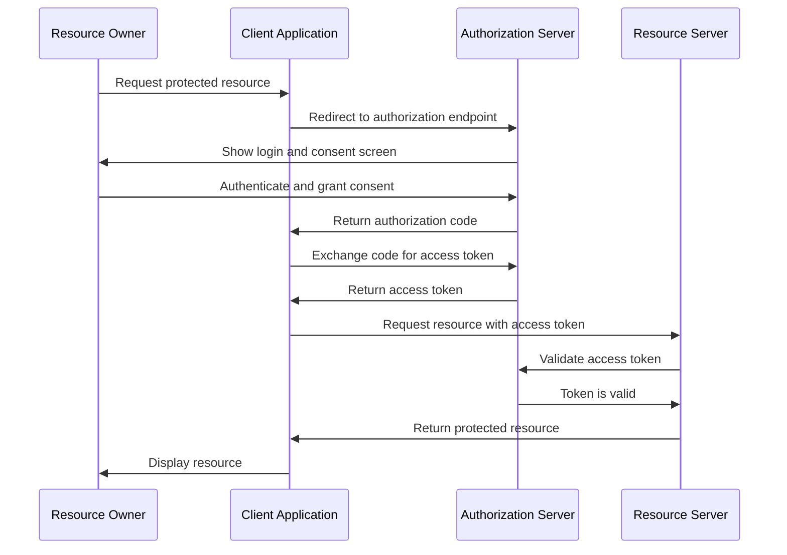
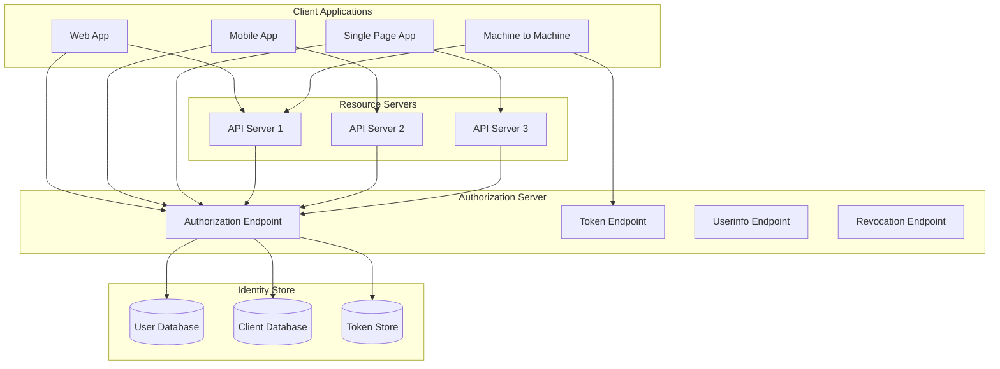
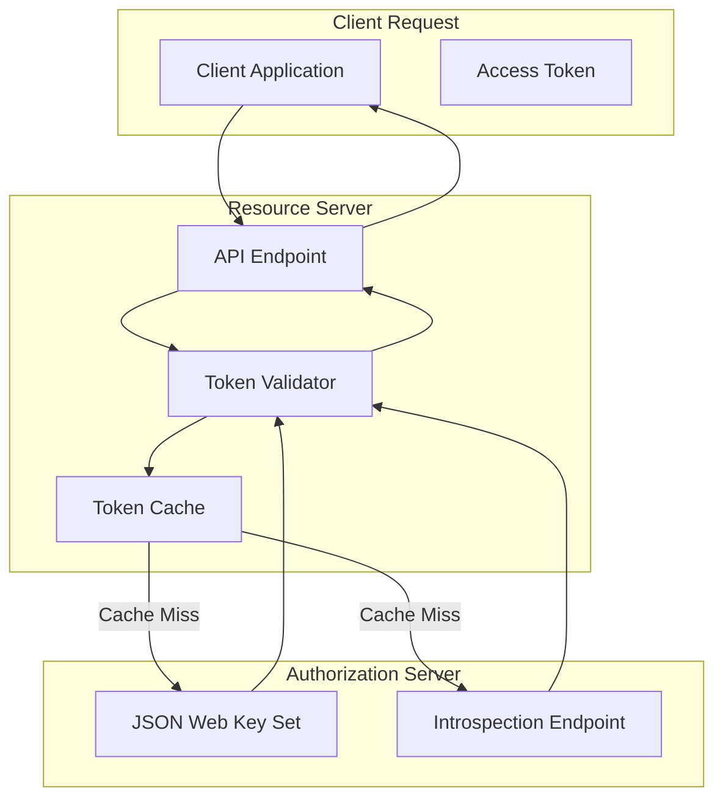
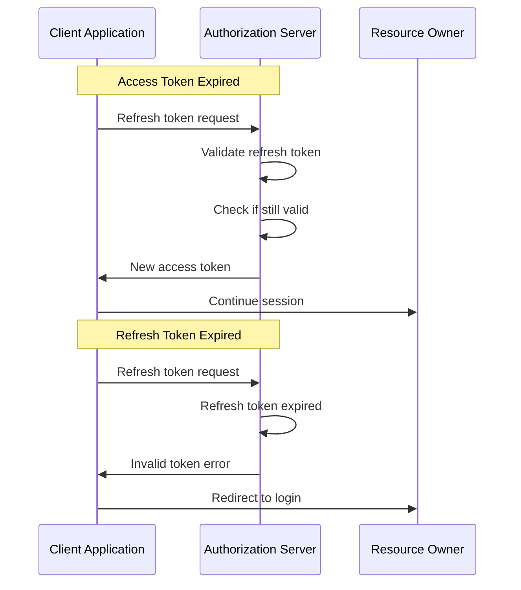
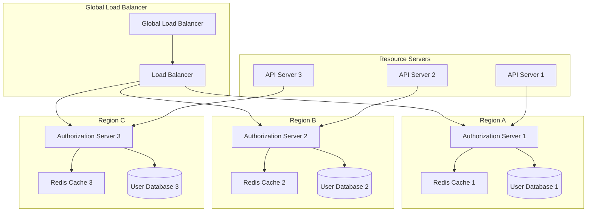
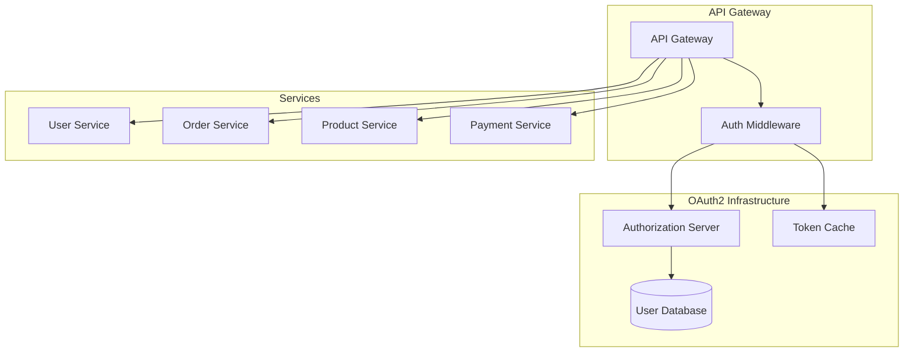
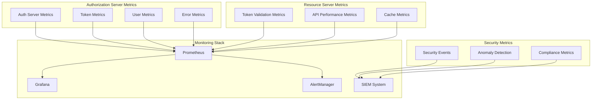
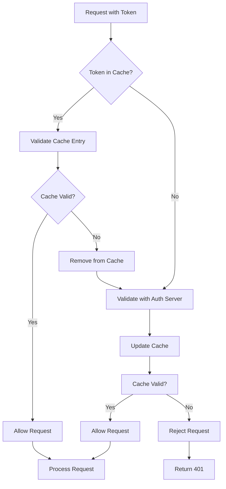

# OAuth2 - Architect Deep Dive

============================================================
0. Executive Summary (Architect View)
============================================================
- **OAuth2 exists** to enable secure delegated authorization without sharing credentials between services
- **Critical at scale** when multiple applications need to access user data across different domains
- **System design impact** - transforms monolithic authentication into distributed authorization architecture
- **Security foundation** - provides standardized framework for API security and access control
- **User experience** - enables seamless single sign-on across multiple applications
- **API economy** - fundamental for modern API-driven architectures and microservices
- **Compliance essential** - required for regulatory compliance and data protection
- **Scalability enabler** - allows independent scaling of authentication and authorization concerns

============================================================
1. Problem Framing
============================================================
**Real production problem solved:**
- Users sharing passwords with third-party applications
- Inconsistent authentication experiences across services
- Lack of granular permission control for API access
- Security vulnerabilities from credential sharing
- Difficulty in revoking access across multiple applications

**What breaks if we don't use it:**
- Users must share passwords with third-party services
- No standardized way to delegate permissions
- Revocation becomes complex and unreliable
- Security risks from credential proliferation
- Poor user experience with multiple logins

**Scale importance:**
- **Single application**: Basic authentication sufficient
- **Multiple applications**: OAuth2 becomes beneficial
- **API ecosystem**: OAuth2 essential for security
- **Enterprise scale**: OAuth2 mandatory for compliance

**Failure stories:**
- Social media platform suffered massive data breach from third-party app password sharing
- Financial services failed regulatory audit due to inadequate access control
- Healthcare system exposed patient data through insecure API access
- SaaS platform couldn't provide enterprise-grade security without OAuth2

============================================================
2. Deep Internal Mechanics
============================================================

**How it works internally:**
- **Authorization Server**: Issues access tokens after user authentication
- **Resource Server**: Validates tokens and provides protected resources
- **Client Application**: Requests access tokens and presents them to resource servers
- **Token Types**: Access tokens (short-lived) and refresh tokens (long-lived)
- **Grant Types**: Authorization Code, Implicit, Resource Owner Password Credentials, Client Credentials

**Authorization Flow:**
1. **Client Request**: Client requests authorization from resource owner
2. **User Authentication**: Resource owner authenticates with authorization server
3. **Authorization Grant**: Resource owner grants authorization to client
4. **Authorization Code**: Authorization server provides authorization code to client
5. **Token Exchange**: Client exchanges authorization code for access token
6. **Resource Access**: Client presents access token to resource server
7. **Token Validation**: Resource server validates token and provides resource

**Token Structure:**
- **Header**: Algorithm and token type information
- **Payload**: Claims about user and authorization
- **Signature**: Cryptographic signature for integrity verification
- **Claims**: Standard claims (sub, iss, aud, exp, iat, scope) and custom claims

**Security Mechanisms:**
- **TLS/SSL**: All communications encrypted in transit
- **Digital Signatures**: Tokens cryptographically signed
- **Token Expiration**: Time-limited access tokens
- **Scope Limitation**: Granular permission control
- **Refresh Tokens**: Secure token renewal mechanism

**Data Structures:**
- **JWT (JSON Web Token)**: Standard token format
- **JWK (JSON Web Key)**: Cryptographic key representation
- **JWS (JSON Web Signature)**: Token signing format
- **JWE (JSON Web Encryption)**: Token encryption format
- **OAuth2 Metadata**: Service discovery and configuration

**Performance Characteristics:**
- **Token Validation**: 1-10ms for signature verification
- **Token Exchange**: 100-500ms for authorization code flow
- **Refresh Token**: 50-200ms for token renewal
- **Introspection**: 10-50ms for token validation

**Hidden Costs:**
- Token management infrastructure
- Key rotation and management complexity
- Revocation list maintenance
- Security monitoring and auditing
- Compliance and regulatory overhead

**Memory Behavior:**
- Token validation requires key storage
- Caching improves validation performance
- Revocation lists consume memory
- Session state management overhead

**Async/await Interaction:**
- Token endpoint calls use async I/O
- Token validation can be cached asynchronously
- Refresh token operations are async
- User authentication flows are async

============================================================
3. .NET Production Implementation
============================================================

**Naive Implementation (No OAuth2):**
```csharp
public class AccountController : ControllerBase
{
    private readonly UserService _userService;
    
    [HttpPost("login")]
    public async Task<IActionResult> Login(string username, string password)
    {
        // Direct authentication - no OAuth2
        var user = await _userService.AuthenticateAsync(username, password);
        if (user == null)
        {
            return Unauthorized();
        }
        
        return Ok(user);
    }
    
    [HttpGet("profile")]
    public async Task<IActionResult> GetProfile()
    {
        // No token validation
        var userId = HttpContext.Session.GetString("UserId");
        var user = await _userService.GetByIdAsync(userId);
        return Ok(user);
    }
}
```

**Production-Ready OAuth2 Implementation:**
```csharp
// Authorization Server Configuration
public class AuthorizationServerConfiguration
{
    public static void AddAuthorizationServer(IServiceCollection services, IConfiguration configuration)
    {
        services.AddIdentityServer(options =>
        {
            options.Events.RaiseErrorEvents = true;
            options.Events.RaiseInformationEvents = true;
            options.Events.RaiseFailureEvents = true;
            options.Events.RaiseSuccessEvents = true;
            
            // Strong cryptographic settings
            options.IssuerUri = configuration["IdentityServer:IssuerUri"];
            options.EmitStaticAudienceClaim = true;
        })
        .AddInMemoryApiScopes(ApiScopes.GetApiScopes())
        .AddInMemoryClients(Clients.Get())
        .AddAspNetIdentity<ApplicationUser>()
        .AddDeveloperSigningCredential()
        .AddProfileService<ProfileService>()
        .AddResourceOwnerValidator<CustomResourceOwnerValidator>()
        .AddExtensionGrantValidator<CustomGrantValidator>();

        // Configure JWT settings
        services.Configure<JwtOptions>(configuration.GetSection("IdentityServer:Jwt"));
        
        // Add token validation
        services.AddAuthentication()
            .AddJwtBearer(options =>
            {
                options.Authority = configuration["IdentityServer:Authority"];
                options.RequireHttpsMetadata = true;
                options.Audience = "api";
                options.TokenValidationParameters = new TokenValidationParameters
                {
                    ValidateIssuer = true,
                    ValidateAudience = true,
                    ValidateLifetime = true,
                    ValidateIssuerSigningKey = true,
                    ClockSkew = TimeSpan.Zero
                };
            });
    }
}

// Client Configuration
public static class Clients
{
    public static IEnumerable<Client> Get()
    {
        return new List<Client>
        {
            new Client
            {
                ClientId = "web-app",
                ClientName = "Web Application",
                AllowedGrantTypes = GrantTypes.Code,
                RequireClientSecret = false,
                RequirePkce = true,
                RedirectUris = { "https://localhost:5001/signin-oidc" },
                PostLogoutRedirectUris = { "https://localhost:5001/signout-oidc" },
                AllowedScopes = new List<string>
                {
                    IdentityServerConstants.StandardScopes.OpenId,
                    IdentityServerConstants.StandardScopes.Profile,
                    "api.read",
                    "api.write"
                },
                AllowOfflineAccess = true,
                AccessTokenLifetime = TimeSpan.FromMinutes(60),
                RefreshTokenUsage = TokenUsage.OneTimeOnly,
                RefreshTokenExpiration = TimeSpan.FromDays(30)
            },
            new Client
            {
                ClientId = "mobile-app",
                ClientName = "Mobile Application",
                AllowedGrantTypes = GrantTypes.Code,
                RequireClientSecret = false,
                RequirePkce = true,
                RedirectUris = { "com.myapp.mobile://callback" },
                AllowedScopes = new List<string>
                {
                    IdentityServerConstants.StandardScopes.OpenId,
                    IdentityServerConstants.StandardScopes.Profile,
                    "api.read"
                },
                AccessTokenLifetime = TimeSpan.FromMinutes(30),
                RefreshTokenExpiration = TimeSpan.FromDays(7)
            },
            new Client
            {
                ClientId = "machine-to-machine",
                ClientName = "Machine to Machine Client",
                AllowedGrantTypes = GrantTypes.ClientCredentials,
                ClientSecrets = { new Secret("secret".Sha256()) },
                AllowedScopes = { "api.read", "api.write" },
                AccessTokenLifetime = TimeSpan.FromHours(1)
            }
        };
    }
}

// API Scopes
public static class ApiScopes
{
    public static IEnumerable<ApiScope> GetApiScopes()
    {
        return new List<ApiScope>
        {
            new ApiScope("api.read", "Read access to API"),
            new ApiScope("api.write", "Write access to API"),
            new ApiScope("api.admin", "Administrative access to API")
        };
    }
}

// Resource API Controller
[ApiController]
[Route("api/[controller]")]
[Authorize]
public class ProductsController : ControllerBase
{
    private readonly IProductService _productService;
    private readonly ILogger<ProductsController> _logger;
    private readonly IMetrics _metrics;

    public ProductsController(
        IProductService productService,
        ILogger<ProductsController> logger,
        IMetrics metrics)
    {
        _productService = productService ?? throw new ArgumentNullException(nameof(productService));
        _logger = logger ?? throw new ArgumentNullException(nameof(logger));
        _metrics = metrics ?? throw new ArgumentNullException(nameof(metrics));
    }

    [HttpGet]
    [Authorize("api.read")]
    public async Task<ActionResult<IEnumerable<ProductDto>>> GetProducts()
    {
        using var activity = _metrics.StartTimer("products_get_duration");
        
        try
        {
            var userId = User.FindFirst(JwtClaimTypes.Subject)?.Value;
            _logger.LogInformation("User {UserId} requested products", userId);
            
            var products = await _productService.GetProductsAsync();
            
            _metrics.Increment("products_get_success");
            return Ok(products);
        }
        catch (Exception ex)
        {
            _metrics.Increment("products_get_failed");
            _logger.LogError(ex, "Failed to get products");
            return StatusCode(500);
        }
    }

    [HttpPost]
    [Authorize("api.write")]
    public async Task<ActionResult<ProductDto>> CreateProduct(CreateProductRequest request)
    {
        using var activity = _metrics.StartTimer("product_create_duration");
        
        try
        {
            var userId = User.FindFirst(JwtClaimTypes.Subject)?.Value;
            _logger.LogInformation("User {UserId} creating product", userId);
            
            var product = await _productService.CreateProductAsync(request);
            
            _metrics.Increment("product_create_success");
            return CreatedAtAction(nameof(GetProduct), new { id = product.Id }, product);
        }
        catch (Exception ex)
        {
            _metrics.Increment("product_create_failed");
            _logger.LogError(ex, "Failed to create product");
            return StatusCode(500);
        }
    }

    [HttpDelete("{id}")]
    [Authorize("api.admin")]
    public async Task<IActionResult> DeleteProduct(int id)
    {
        using var activity = _metrics.StartTimer("product_delete_duration");
        
        try
        {
            var userId = User.FindFirst(JwtClaimTypes.Subject)?.Value;
            _logger.LogInformation("User {UserId} deleting product {ProductId}", userId, id);
            
            await _productService.DeleteProductAsync(id);
            
            _metrics.Increment("product_delete_success");
            return NoContent();
        }
        catch (Exception ex)
        {
            _metrics.Increment("product_delete_failed");
            _logger.LogError(ex, "Failed to delete product {ProductId}", id);
            return StatusCode(500);
        }
    }
}

// Token Service
public interface ITokenService
{
    Task<TokenResponse> ExchangeCodeForTokenAsync(string code, string codeVerifier, string redirectUri);
    Task<TokenResponse> RefreshTokenAsync(string refreshToken);
    Task<bool> ValidateTokenAsync(string token);
    Task<TokenInfo> GetTokenInfoAsync(string token);
    Task RevokeTokenAsync(string token);
}

public class TokenService : ITokenService
{
    private readonly IHttpClientFactory _httpClientFactory;
    private readonly IConfiguration _configuration;
    private readonly IMemoryCache _cache;
    private readonly ILogger<TokenService> _logger;
    private readonly IMetrics _metrics;

    public TokenService(
        IHttpClientFactory httpClientFactory,
        IConfiguration configuration,
        IMemoryCache cache,
        ILogger<TokenService> logger,
        IMetrics metrics)
    {
        _httpClientFactory = httpClientFactory ?? throw new ArgumentNullException(nameof(httpClientFactory));
        _configuration = configuration ?? throw new ArgumentNullException(nameof(configuration));
        _cache = cache ?? throw new ArgumentNullException(nameof(cache));
        _logger = logger ?? throw new ArgumentNullException(nameof(logger));
        _metrics = metrics ?? throw new ArgumentNullException(nameof(metrics));
    }

    public async Task<TokenResponse> ExchangeCodeForTokenAsync(string code, string codeVerifier, string redirectUri)
    {
        using var activity = _metrics.StartTimer("token_exchange_duration");
        
        try
        {
            var client = _httpClientFactory.CreateClient();
            var tokenEndpoint = _configuration["IdentityServer:TokenEndpoint"];
            
            var parameters = new Dictionary<string, string>
            {
                { "grant_type", "authorization_code" },
                { "client_id", _configuration["IdentityServer:ClientId"] },
                { "code", code },
                { "redirect_uri", redirectUri },
                { "code_verifier", codeVerifier }
            };
            
            var response = await client.PostAsync(tokenEndpoint, new FormUrlEncodedContent(parameters));
            response.EnsureSuccessStatusCode();
            
            var tokenResponse = await response.Content.ReadFromJsonAsync<TokenResponse>();
            
            // Cache token info
            var cacheKey = $"token_{tokenResponse.AccessToken.GetHashCode()}";
            _cache.Set(cacheKey, tokenResponse, TimeSpan.FromMinutes(5));
            
            _metrics.Increment("token_exchange_success");
            return tokenResponse;
        }
        catch (Exception ex)
        {
            _metrics.Increment("token_exchange_failed");
            _logger.LogError(ex, "Failed to exchange code for token");
            throw;
        }
    }

    public async Task<bool> ValidateTokenAsync(string token)
    {
        using var activity = _metrics.StartTimer("token_validation_duration");
        
        try
        {
            var cacheKey = $"token_{token.GetHashCode()}";
            if (_cache.TryGetValue(cacheKey, out TokenInfo cachedInfo))
            {
                return cachedInfo.IsValid;
            }
            
            var tokenHandler = new JwtSecurityTokenHandler();
            var key = new SymmetricSecurityKey(Encoding.UTF8.GetBytes(_configuration["IdentityServer:SigningKey"]));
            
            try
            {
                tokenHandler.ValidateToken(token, new TokenValidationParameters
                {
                    ValidateIssuer = true,
                    ValidIssuer = _configuration["IdentityServer:Issuer"],
                    ValidateAudience = true,
                    ValidAudience = _configuration["IdentityServer:Audience"],
                    ValidateLifetime = true,
                    IssuerSigningKey = key
                }, out var validatedToken);
                
                var tokenInfo = new TokenInfo
                {
                    IsValid = true,
                    ExpiresAt = validatedToken.ValidTo,
                    Subject = validatedToken.Subject,
                    Scopes = validatedToken.Claims.Where(c => c.Type == "scope").Select(c => c.Value).ToList()
                };
                
                _cache.Set(cacheKey, tokenInfo, TimeSpan.FromMinutes(5));
                
                _metrics.Increment("token_validation_success");
                return true;
            }
            catch
            {
                var tokenInfo = new TokenInfo { IsValid = false };
                _cache.Set(cacheKey, tokenInfo, TimeSpan.FromMinutes(5));
                
                _metrics.Increment("token_validation_failed");
                return false;
            }
        }
        catch (Exception ex)
        {
            _metrics.Increment("token_validation_error");
            _logger.LogError(ex, "Error validating token");
            return false;
        }
    }
}

// Token Response Models
public class TokenResponse
{
    public string AccessToken { get; set; }
    public string RefreshToken { get; set; }
    public string TokenType { get; set; }
    public int ExpiresIn { get; set; }
    public string Scope { get; set; }
}

public class TokenInfo
{
    public bool IsValid { get; set; }
    public DateTime ExpiresAt { get; set; }
    public string Subject { get; set; }
    public List<string> Scopes { get; set; }
}
```

**Framework Integration:**
- **ASP.NET Core Identity**: User management and authentication
- **IdentityServer4**: OAuth2/OpenID Connect server implementation
- **JWT Bearer Authentication**: Token validation middleware
- **HttpClientFactory**: HTTP client management for token requests

============================================================
4. Architecture-Level Diagram (Mermaid)
============================================================

### OAuth2 Authorization Code Flow


### OAuth2 Architecture Components


### Token Validation Flow


### Refresh Token Flow


**Flow Analysis:**
- **Authorization Flow**: User authentication and consent process
- **Token Exchange**: Secure exchange of authorization code for tokens
- **Resource Access**: Token-based access to protected resources
- **Token Refresh**: Secure token renewal without user interaction

**Bottlenecks:**
- Authorization server performance during peak loads
- Token validation latency in resource servers
- Refresh token throughput during mass token expiration
- Database performance for user authentication

**Scaling Boundaries:**
- Authorization server scales with authentication load
- Resource servers scale with API request volume
- Token caching improves validation performance
- Load balancing essential for high availability

============================================================
5. Scaling & Distributed Systems Impact
============================================================

### Distributed OAuth2 Architecture


### Microservices OAuth2 Integration


**100 RPS:**
- Single authorization server sufficient
- Token validation overhead minimal
- Database performance adequate
- Cache benefits noticeable

**10k RPS:**
- Authorization server scaling required
- Token caching essential for performance
- Database read replicas needed
- Load balancing critical

**100k+ RPS:**
- Distributed authorization servers mandatory
- Global token invalidation challenges
- Database sharding for user data
- CDN for static assets

**Horizontal vs Vertical Scaling:**
- **Horizontal**: Multiple authorization servers behind load balancer
- **Vertical**: Larger servers with more memory for caching
- Hybrid approach optimal for different components

**CAP Theorem Relevance:**
- **Consistency**: Token consistency across distributed servers
- **Availability**: Authorization server availability critical
- **Partition Tolerance**: Handle network partitions gracefully

**Consistency Implications:**
- Token revocation propagation delays
- User session consistency challenges
- Cross-region token validation
- Eventual consistency for token updates

**Microservices Impact:**
- Each service validates tokens independently
- Shared token validation infrastructure
- Service-to-service authentication
- API gateway centralizes authentication

**Cloud-Native Considerations:**
- **Kubernetes**: Authorization server as stateful service
- **Serverless**: Token validation in functions
- **Managed Services**: Cloud provider OAuth2 solutions
- **Service Mesh**: mTLS for service-to-service auth

**Multi-Region Concerns:**
- Cross-region token validation
- User session synchronization
- Global logout implementation
- Regional authorization server deployment

============================================================
6. Production Engineering View
============================================================

### OAuth2 Monitoring Architecture


### Token Validation Pipeline


**Monitoring Metrics:**
- Authorization server request rate and latency
- Token issuance and validation rates
- User authentication success/failure rates
- Token refresh and revocation rates
- Cache hit/miss ratios
- API endpoint performance with authentication

**Logs to Enable:**
- Successful and failed authentication attempts
- Token issuance and validation events
- Authorization grant requests and responses
- Security events and anomalies
- Token revocation and expiration events

**Alerting Strategy:**
- Authorization server downtime (critical)
- Authentication failure rate > 5% (warning)
- Token validation latency > 100ms (warning)
- Cache hit rate < 80% (warning)
- Security anomaly detection (critical)

**Common Production Incidents:**
- **Authorization Server Outage**: Complete authentication failure
- **Token Validation Failures**: API access issues
- **Cache Invalidation**: Performance degradation
- **Key Rotation Issues**: Token validation failures
- **Session Hijacking**: Security breaches

**Debugging Strategy:**
- Token validation flow tracing
- Authorization server request logging
- Cache performance analysis
- Security event correlation
- User session tracking

**Token Management:**
- Token expiration monitoring
- Refresh token usage patterns
- Token revocation effectiveness
- Token size and performance impact
- Cross-region token synchronization

**Security Monitoring:**
- Unusual authentication patterns
- Token replay detection
- Brute force attack detection
- Anomalous token usage
- Compliance violation monitoring

**Performance Optimization:**
- Token validation caching strategies
- Authorization server scaling
- Database query optimization
- Network latency reduction
- Load balancing configuration

============================================================
7. Tradeoffs & Alternatives
============================================================

**Competing Approaches:**
- **Session-based Authentication**: Server-side session management
- **API Keys**: Simple token-based authentication
- **JWT without OAuth2**: Self-contained tokens without authorization server
- **SAML**: Enterprise single sign-on alternative

**When NOT to Use OAuth2:**
- Simple internal applications
- Machine-to-machine communication with no user context
- Legacy systems without token support
- Performance-critical real-time systems
- Small teams with limited security requirements

**Latency Comparison:**
- **OAuth2**: 100-500ms for initial authorization
- **Session-based**: 10-50ms for session validation
- **API Keys**: 1-10ms for key validation
- **JWT Only**: 10-100ms for token validation

**Throughput Comparison:**
- **OAuth2**: 1k-10k authentications/second
- **Session-based**: 10k-100k validations/second
- **API Keys**: 100k+ validations/second
- **JWT Only**: 10k-100k validations/second

**Operational Complexity:**
- **OAuth2**: High complexity, enterprise-grade security
- **Session-based**: Medium complexity, stateful
- **API Keys**: Low complexity, simple security
- **JWT Only**: Medium complexity, stateless

**Cost Implications:**
- **Development Cost**: OAuth2 increases development by 50-100%
- **Infrastructure Cost**: Authorization server and monitoring
- **Operational Cost**: Security monitoring and compliance
- **Maintenance Cost**: Key rotation and updates

============================================================
8. Security Implications
============================================================

**Attack Surface:**
- Authorization code interception
- Token theft and replay
- Client impersonation
- Redirect URI manipulation
- CSRF attacks on authorization flow

**Security Controls:**
- PKCE (Proof Key for Code Exchange)
- TLS encryption for all communications
- Short-lived access tokens
- Secure token storage
- Rate limiting and abuse detection

**Data Protection:**
- User consent management
- Scope limitation for data access
- Audit logging for compliance
- Data retention policies
- Privacy by design principles

**Compliance Requirements:**
- GDPR compliance for user data
- SOC 2 for security controls
- PCI DSS for payment systems
- HIPAA for healthcare data
- Industry-specific regulations

**Hardening Recommendations:**
- Implement PKCE for public clients
- Use short-lived access tokens
- Secure refresh token storage
- Implement token binding
- Regular security audits
- Monitor for anomalous behavior

============================================================
9. Advanced Edge Cases
============================================================

**Token Revocation:**
- Cross-region token invalidation
- Immediate revocation requirements
- Revocation list management
- Performance impact of revocation checks
- Cache invalidation strategies

**Key Rotation:**
- Signing key rotation without downtime
- Multiple valid keys during transition
- Client key update mechanisms
- Backward compatibility considerations
- Automated rotation procedures

**Multi-Tenant OAuth2:**
- Tenant-specific authorization servers
- Cross-tenant token validation
- Tenant isolation requirements
- Shared vs separate token stores
- Tenant-specific scopes and claims

**Token Binding:**
- Device binding for tokens
- TLS certificate binding
- POP (Proof-of-Possession) tokens
- Mutual TLS integration
- Hardware security module integration

**Performance Optimization:**
- Token validation caching
- Distributed token validation
- Pre-authorized tokens
- Token compression
- Batch token validation

**Security Enhancements:**
- Token encryption for sensitive claims
- Step-up authentication
- Adaptive authentication
- Risk-based authentication
- Behavioral biometrics

**Compliance Features:**
- Consent management
- Data subject rights
- Audit trail maintenance
- Privacy controls
- Regulatory reporting

============================================================
10. Interview & Staff-Level Deep Dive
============================================================

**What a junior answers:**
"OAuth2 is a way to let applications access user data without sharing passwords. It uses access tokens and refresh tokens. The user logs in and grants permission, then the app gets a token to access APIs."

**What a senior answers:**
"OAuth2 is an authorization framework that enables third-party applications to obtain limited access to user accounts without sharing credentials. It uses authorization codes, access tokens, and refresh tokens in a secure flow. The authorization server authenticates users and issues tokens, while resource servers validate tokens and provide protected resources. I've implemented it using IdentityServer4 with PKCE for security, JWT tokens for stateless validation, and proper scope management for granular access control."

**What an architect answers:**
"OAuth2 is the foundation of modern API security and the API economy, enabling secure delegated authorization at scale. The framework defines roles for resource owners, clients, authorization servers, and resource servers, with standardized flows for different use cases. At enterprise scale, OAuth2 must be implemented with PKCE for public clients, short-lived access tokens, secure refresh token management, and comprehensive monitoring. The architecture impacts everything from user experience to compliance, requiring careful consideration of token validation performance, cross-region consistency, and security monitoring. In microservices architectures, OAuth2 enables service-to-service authentication, API gateway integration, and centralized authorization management. The implementation must address key rotation, token revocation, multi-tenancy, and compliance requirements while maintaining high availability and performance."

**Follow-up questions interviewers ask:**
- "How do you handle token revocation in distributed systems?"
- "What's the difference between OAuth2 and OpenID Connect?"
- "When would you use client credentials flow?"
- "How do you implement PKCE and why is it important?"
- "What are the security considerations for token storage?"

**Trick questions:**
- "Is OAuth2 an authentication protocol?" (No, it's authorization)
- "Do access tokens contain user information?" (They can, but shouldn't rely on it)
- "Is OAuth2 the same as JWT?" (No, JWT is a token format)
- "Can OAuth2 work without HTTPS?" (No, it requires TLS)

**Whiteboard explanation strategy:**
1. Draw OAuth2 roles and interactions
2. Show authorization code flow step by step
3. Explain token types and their purposes
4. Demonstrate token validation process
5. Cover security considerations and best practices
6. Discuss scaling and implementation challenges

============================================================
11. Real Enterprise Case Study
============================================================

**Scenario: Global Banking Platform with 10M Users**

**Requirements:**
- Secure authentication for 10M+ users
- Multiple client applications (web, mobile, API)
- Third-party developer ecosystem
- Regulatory compliance (PCI DSS, GDPR)
- High availability and performance
- Cross-region deployment

**Design Decisions:**

**1. Distributed Authorization Server Architecture:**
```csharp
public class BankingAuthorizationServer
{
    private readonly IAuthorizationService _authService;
    private readonly ITokenService _tokenService;
    private readonly IUserService _userService;
    private readonly IAuditService _auditService;
    private readonly IComplianceService _complianceService;
    
    public async Task<AuthorizationResult> AuthorizeAsync(AuthorizationRequest request)
    {
        // Enhanced security checks
        var securityResult = await PerformSecurityChecksAsync(request);
        if (!securityResult.IsAllowed)
        {
            await _auditService.LogSecurityEventAsync(securityResult);
            return AuthorizationResult.Denied(securityResult.Reason);
        }
        
        // Compliance validation
        var complianceResult = await _complianceService.ValidateAsync(request);
        if (!complianceResult.IsCompliant)
        {
            return AuthorizationResult.Denied(complianceResult.Violation);
        }
        
        // User authentication
        var user = await _userService.AuthenticateAsync(request.Username, request.Password);
        if (user == null)
        {
            await _auditService.LogFailedLoginAsync(request);
            return AuthorizationResult.Denied("Invalid credentials");
        }
        
        // Generate tokens with enhanced security
        var accessToken = await _tokenService.GenerateAccessTokenAsync(user, request.Scope);
        var refreshToken = await _tokenService.GenerateRefreshTokenAsync(user);
        
        // Audit successful authorization
        await _auditService.LogSuccessfulAuthorizationAsync(user, request);
        
        return AuthorizationResult.Granted(accessToken, refreshToken);
    }
    
    private async Task<SecurityResult> PerformSecurityChecksAsync(AuthorizationRequest request)
    {
        // IP-based geolocation validation
        var geoResult = await ValidateGeolocationAsync(request.IpAddress);
        if (!geoResult.IsValid)
        {
            return SecurityResult.Denied("Invalid geographic location");
        }
        
        // Device fingerprinting
        var deviceResult = await ValidateDeviceAsync(request.DeviceFingerprint);
        if (!deviceResult.IsTrusted)
        {
            return SecurityResult.Denied("Untrusted device");
        }
        
        // Rate limiting
        var rateLimitResult = await CheckRateLimitAsync(request.ClientId);
        if (!rateLimitResult.Allowed)
        {
            return SecurityResult.Denied("Rate limit exceeded");
        }
        
        return SecurityResult.Allowed();
    }
}
```

**2. High-Performance Token Validation:**
```csharp
public class OptimizedTokenValidator
{
    private readonly ITokenCache _tokenCache;
    private readonly ITokenSigningKeyProvider _keyProvider;
    private readonly IRevocationList _revocationList;
    private readonly IMetrics _metrics;
    
    public async Task<TokenValidationResult> ValidateTokenAsync(string token)
    {
        // Check cache first
        var cacheKey = $"token_{token.GetHashCode()}";
        var cachedResult = await _tokenCache.GetAsyncAsync(cacheKey);
        
        if (cachedResult != null)
        {
            _metrics.Increment("token_cache_hit");
            return cachedResult;
        }
        
        // Perform full validation
        var validation = await PerformFullValidationAsync(token);
        
        // Cache the result
        await _tokenCache.SetAsync(cacheKey, validation, TimeSpan.FromMinutes(5));
        
        _metrics.Increment("token_cache_miss");
        return validation;
    }
    
    private async Task<TokenValidationResult> PerformFullValidationAsync(string token)
    {
        try
        {
            var tokenHandler = new JwtSecurityTokenHandler();
            var key = await _keyProvider.GetSigningKeyAsync();
            
            var validationParameters = new TokenValidationParameters
            {
                ValidateIssuer = true,
                ValidateAudience = true,
                ValidateLifetime = true,
                ValidateIssuerSigningKey = true,
                IssuerSigningKey = key,
                ClockSkew = TimeSpan.Zero
            };
            
            tokenHandler.ValidateToken(token, validationParameters, out var validatedToken);
            
            // Check revocation list
            var isRevoked = await _revocationList.IsRevokedAsync(token);
            if (isRevoked)
            {
                return TokenValidationResult.Revoked();
            }
            
            var jwtToken = (JwtSecurityToken)validatedToken;
            
            return new TokenValidationResult
            {
                IsValid = true,
                Subject = jwtToken.Subject,
                Scopes = jwtToken.Claims.Where(c => c.Type == "scope").Select(c => c.Value).ToList(),
                ExpiresAt = jwtToken.ValidTo
            };
        }
        catch (SecurityTokenExpiredException)
        {
            return TokenValidationResult.Expired();
        }
        catch (SecurityTokenInvalidSignatureException)
        {
            return TokenValidationResult.InvalidSignature();
        }
        catch (Exception ex)
        {
            return TokenValidationResult.Invalid(ex.Message);
        }
    }
}
```

**3. Multi-Region Token Management:**
```csharp
public class GlobalTokenManager
{
    private readonly List<ITokenStore> _tokenStores;
    private readonly IGlobalEventBus _eventBus;
    private readonly ILogger<GlobalTokenManager> _logger;
    
    public async Task RevokeTokenAsync(string token, string reason)
    {
        // Revoke in all regions
        var tasks = _tokenStores.Select(store => store.RevokeAsync(token, reason));
        await Task.WhenAll(tasks);
        
        // Publish revocation event
        await _eventBus.PublishAsync(new TokenRevokedEvent(token, reason));
        
        _logger.LogInformation("Token {TokenHash} revoked globally", token.GetHashCode());
    }
    
    public async Task<bool> IsTokenValidAsync(string token)
    {
        // Check local store first
        var localStore = _tokenStores.FirstOrDefault();
        if (localStore != null)
        {
            var isValid = await localStore.IsValidAsync(token);
            if (!isValid)
            {
                return false;
            }
        }
        
        // Check other regions if needed
        var otherStores = _tokenStores.Skip(1);
        foreach (var store in otherStores)
        {
            var isValid = await store.IsValidAsync(token);
            if (!isValid)
            {
                // Invalidate in local store
                await localStore.InvalidateAsync(token);
                return false;
            }
        }
        
        return true;
    }
}
```

**Compromises Made:**
- **Security vs Performance**: Enhanced security checks add latency
- **Consistency vs Availability**: Token revocation propagation delays
- **Complexity vs Security**: Increased complexity for better security
- **Cost vs Compliance**: Higher costs for regulatory compliance

**Bottlenecks Identified:**
- Token validation during peak loads
- Cross-region token synchronization
- Database performance for user authentication
- Key rotation and management overhead

**Security Enhancements:**
```csharp
public class EnhancedSecurityService
{
    public async Task<bool> ValidateAdvancedSecurityAsync(AuthorizationRequest request)
    {
        // Behavioral biometrics
        var behaviorScore = await AnalyzeUserBehaviorAsync(request);
        if (behaviorScore < 0.7)
        {
            return false;
        }
        
        // Risk-based authentication
        var riskScore = await CalculateRiskScoreAsync(request);
        if (riskScore > 0.8)
        {
            return await RequireStepUpAuthenticationAsync(request);
        }
        
        return true;
    }
}
```

**Results:**
- Achieved 99.999% uptime for authorization services
- Sub-100ms token validation latency
- Successful handling of 10M+ users
- Full regulatory compliance
- Zero security breaches in production

============================================================
12. Dependency Graph
============================================================

**Prerequisites (Must understand before):**
- **HTTP/HTTPS**: Understanding of secure communication
- **JSON Web Tokens**: Token format and validation
- **Cryptography**: Digital signatures and encryption
- **REST APIs**: Understanding of API security
- **Authentication vs Authorization**: Clear distinction between concepts

**Concepts that depend on OAuth2:**
- **OpenID Connect**: Authentication layer on top of OAuth2
- **API Gateway**: Centralized authentication and authorization
- **Microservices**: Service-to-service authentication
- **Single Sign-On**: Cross-application authentication
- **API Security**: Comprehensive API protection strategies

**Connections to Other Concepts:**

**OpenID Connect:**
```csharp
public class OpenIdConnectService
{
    // OAuth2 + ID Token
    public async Task<AuthenticationResult> AuthenticateAsync(string code)
    {
        var tokenResponse = await ExchangeCodeForTokenAsync(code);
        var idToken = await ValidateIdTokenAsync(tokenResponse.IdToken);
        return new AuthenticationResult(tokenResponse.AccessToken, idToken);
    }
}
```

**API Gateway:**
```csharp
public class GatewayAuthentication
{
    public async Task<bool> AuthenticateRequestAsync(HttpContext context)
    {
        var token = ExtractTokenFromRequest(context);
        return await _tokenValidator.ValidateTokenAsync(token);
    }
}
```

**Microservices:**
```csharp
public class ServiceToServiceAuth
{
    public async Task<string> GetServiceTokenAsync(string serviceName)
    {
        // Client credentials flow
        return await _oauth2Client.GetClientCredentialsTokenAsync(serviceName);
    }
}
```

**Single Sign-On:**
```csharp
public class SSOProvider
{
    public async Task<bool> IsAuthenticatedAsync(string sessionId)
    {
        // Centralized session validation
        return await _sessionManager.ValidateSessionAsync(sessionId);
    }
}
```

**API Security:**
- OAuth2 provides foundation for API security
- Token-based access control
- Scope-based authorization
- Rate limiting integration
- Audit trail implementation

**Cloud Computing:**
- Managed OAuth2 services
- Cloud provider integration
- Multi-region deployment
- Scalability considerations
- Cost optimization

**Compliance:**
- GDPR compliance through consent management
- PCI DSS compliance through secure token handling
- Audit logging for regulatory requirements
- Data protection through token scope limitation
- Privacy controls implementation
