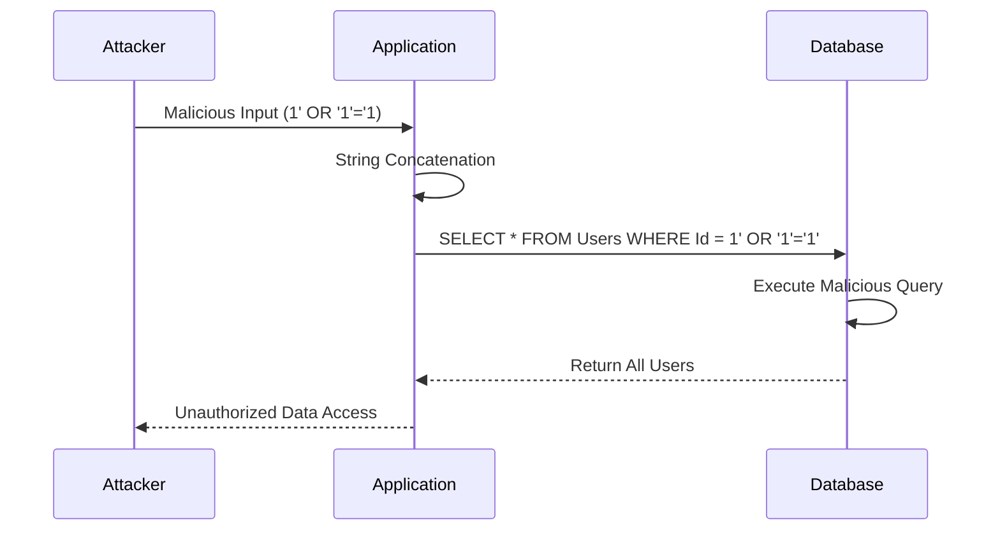
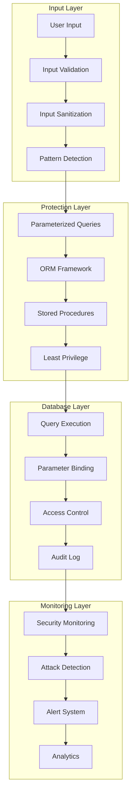

# SQL Injection - Architect Deep Dive

**0. Executive Summary (Architect View)**
- **SQL Injection exists** to prevent malicious SQL code injection through user input
- **Critical at scale** when applications handle database operations with user input
- **System design impact** - transforms input validation and database access patterns
- **Data protection** - provides essential protection for database integrity
- **Security foundation** - prevents unauthorized data access and manipulation
- **Compliance requirement** - mandatory for security standards and regulations
- **Attack mitigation** - prevents various attack vectors through SQL injection
- **Business continuity** - maintains data integrity and system availability

**1. Problem Framing**
**Real production problem solved:**
- Unauthorized data access through malicious SQL queries
- Data modification and deletion through injection attacks
- Database compromise and data breaches
- Authentication bypass through SQL manipulation
- System availability disruption through denial of service

**What breaks if we don't understand SQL Injection:**
- Database compromise and data breaches
- Authentication and authorization bypass
- Data integrity violations
- System availability disruption
- Compliance violations and legal consequences

**Scale importance:**
- **Small applications**: SQL injection protection essential
- **Medium applications**: SQL injection protection critical
- **Large applications**: SQL injection protection mandatory
- **Enterprise systems**: SQL injection protection fundamental

**Failure stories:**
- E-commerce platform had customer data breach
- Banking system had unauthorized fund transfers
- Healthcare platform had patient data exposure
- Government agency had classified data leak

**2. Deep Internal Mechanics**

**SQL Injection Fundamentals:**
- **Input Manipulation**: Malicious SQL code in user input
- **Query Construction**: Dynamic SQL query construction
- **Database Execution**: Database executes malicious queries
- **Data Access**: Unauthorized data access and manipulation
- **System Compromise**: Complete system compromise

**Injection Types:**
- **Classic SQLi**: Direct SQL code injection
- **Blind SQLi**: No direct error feedback
- **Union-based SQLi**: Using UNION operator
- **Error-based SQLi**: Error message exploitation
- **Time-based SQLi**: Time delay exploitation

**Attack Vectors:**
- **Login Forms**: Username/password manipulation
- **Search Forms**: Search parameter manipulation
- **URL Parameters**: URL parameter injection
- **HTTP Headers**: Header manipulation
- **File Upload**: File metadata manipulation

**Defense Mechanisms:**
- **Parameterized Queries**: Safe parameter binding
- **ORM Frameworks**: Object-relational mapping
- **Input Validation**: Comprehensive input validation
- **Stored Procedures**: Stored procedure usage
- **Least Privilege**: Minimal database permissions

**Data Structures:**
- **Query Registry**: Query validation and logging
- **Input Registry**: Input validation results
- **Security Events**: Security event logging
- **Attack Patterns**: Known attack patterns
- **Validation Rules**: Input validation rules

**Performance Characteristics:**
- **Query Processing**: 5-50ms (with protection)
- **Validation Overhead**: 1-5ms per query
- **Memory Usage**: Minimal memory overhead
- **Network Overhead**: Slightly larger queries
- **Database Load**: Slightly increased load

**3. .NET Production Implementation**

**Naive Implementation (Vulnerable):**
```csharp
[ApiController]
[Route("api/[controller]")]
public class UserController : ControllerBase
{
    private readonly IDbConnection _dbConnection;
    
    public UserController(IDbConnection dbConnection)
    {
        _dbConnection = dbConnection;
    }
    
    [HttpGet("user/{id}")]
    public async Task<ActionResult<User>> GetUser(int id)
    {
        // SQL Injection vulnerability
        var query = $"SELECT * FROM Users WHERE Id = {id}";
        var user = await _dbConnection.QueryFirstOrDefaultAsync<User>(query);
        return Ok(user);
    }
    
    [HttpPost("login")]
    public async Task<ActionResult> Login([FromBody] LoginRequest request)
    {
        // SQL Injection vulnerability
        var query = $"SELECT * FROM Users WHERE Email = '{request.Email}' AND Password = '{request.Password}'";
        var user = await _dbConnection.QueryFirstOrDefaultAsync<User>(query);
        return Ok(user);
    }
}
```

**Production-Ready SQL Injection Protection:**
```csharp
// SQL Injection Protection Configuration
public class SqlInjectionProtectionConfiguration
{
    public bool EnableParameterizedQueries { get; set; } = true;
    public bool EnableOrmProtection { get; set; } = true;
    public bool EnableInputValidation { get; set; } = true;
    public bool EnableQueryLogging { get; set; } = true;
    public bool EnableSqlAnalysis { get; set; } = true;
    public int MaxQueryLength { get; set; } = 1000;
    public List<string> BlacklistedKeywords { get; set; } = new();
    public List<string> AllowedCharacters { get; set; } = new();
}

// SQL Injection Protection Service
public interface ISqlInjectionProtectionService
{
    Task<bool> ValidateInputAsync(string input);
    Task<bool> ValidateQueryAsync(string query);
    Task<string> SanitizeInputAsync(string input);
    Task LogSqlAttemptAsync(SqlAttempt attempt);
}

public class SqlInjectionProtectionService : ISqlInjectionProtectionService
{
    private readonly ILogger<SqlInjectionProtectionService> _logger;
    private readonly IMetrics _metrics;
    private readonly SqlInjectionProtectionConfiguration _configuration;

    public SqlInjectionProtectionService(
        ILogger<SqlInjectionProtectionService> logger,
        IMetrics metrics,
        IOptions<SqlInjectionProtectionConfiguration> configuration)
    {
        _logger = logger ?? throw new ArgumentNullException(nameof(logger));
        _metrics = metrics ?? throw new ArgumentNullException(nameof(metrics));
        _configuration = configuration?.Value ?? new SqlInjectionProtectionConfiguration();
    }

    public async Task<bool> ValidateInputAsync(string input)
    {
        if (string.IsNullOrEmpty(input))
        {
            return true;
        }

        // Check for SQL injection patterns
        var sqlPatterns = new[]
        {
            "(?i)(union|select|insert|update|delete|drop|create|alter|exec|execute)",
            "(?i)(or|and)\\s+\\d+\\s*=\\s*\\d+",
            "(?i)(or|and)\\s+'[^']*'\\s*=\\s*'[^']*'",
            "(?i)(--|#|/\\*|\\*/)",
            "(?i)(waitfor\\s+delay|sleep\\s*\\()",
            "(?i)(benchmark|pg_sleep)"
        };

        foreach (var pattern in sqlPatterns)
        {
            if (Regex.IsMatch(input, pattern))
            {
                await LogSqlAttemptAsync(new SqlAttempt
                {
                    Input = input,
                    Pattern = pattern,
                    Timestamp = DateTime.UtcNow,
                    IpAddress = GetClientIpAddress()
                });
                return false;
            }
        }

        return true;
    }

    public async Task<bool> ValidateQueryAsync(string query)
    {
        if (string.IsNullOrEmpty(query))
        {
            return true;
        }

        // Check query length
        if (query.Length > _configuration.MaxQueryLength)
        {
            return false;
        }

        // Check for blacklisted keywords
        foreach (var keyword in _configuration.BlacklistedKeywords)
        {
            if (query.Contains(keyword, StringComparison.OrdinalIgnoreCase))
            {
                return false;
            }
        }

        return true;
    }

    public async Task<string> SanitizeInputAsync(string input)
    {
        if (string.IsNullOrEmpty(input))
        {
            return input;
        }

        // Remove potentially dangerous characters
        var sanitized = input;
        
        // Remove SQL comments
        sanitized = Regex.Replace(sanitized, @"(--|#|/\*|\*/)", "");
        
        // Remove dangerous SQL keywords
        var dangerousKeywords = new[] { "UNION", "SELECT", "INSERT", "UPDATE", "DELETE", "DROP", "CREATE", "ALTER", "EXEC", "EXECUTE" };
        foreach (var keyword in dangerousKeywords)
        {
            sanitized = Regex.Replace(sanitized, keyword, "", RegexOptions.IgnoreCase);
        }

        return sanitized;
    }

    public async Task LogSqlAttemptAsync(SqlAttempt attempt)
    {
        _logger.LogWarning("SQL injection attempt detected: {@Attempt}", attempt);
        await _metrics.Increment("sql_injection_attempts_detected");
    }

    private string GetClientIpAddress()
    {
        // Implementation to get client IP
        return "127.0.0.1";
    }
}

// Secure Database Service
public class SecureDatabaseService
{
    private readonly IDbConnection _dbConnection;
    private readonly ISqlInjectionProtectionService _sqlProtection;
    private readonly ILogger<SecureDatabaseService> _logger;
    private readonly IMetrics _metrics;

    public SecureDatabaseService(
        IDbConnection dbConnection,
        ISqlInjectionProtectionService sqlProtection,
        ILogger<SecureDatabaseService> logger,
        IMetrics metrics)
    {
        _dbConnection = dbConnection ?? throw new ArgumentNullException(nameof(dbConnection));
        _sqlProtection = sqlProtection ?? throw new ArgumentNullException(nameof(sqlProtection));
        _logger = logger ?? throw new ArgumentNullException(nameof(logger));
        _metrics = metrics ?? throw new ArgumentNullException(nameof(metrics));
    }

    public async Task<User> GetUserAsync(int id)
    {
        using var activity = _metrics.StartTimer("secure_database_get_user_duration");
        
        try
        {
            // Parameterized query - protected from SQL injection
            var query = "SELECT * FROM Users WHERE Id = @Id";
            var user = await _dbConnection.QueryFirstOrDefaultAsync<User>(query, new { Id = id });
            
            _metrics.Increment("secure_database_queries_executed");
            return user;
        }
        catch (Exception ex)
        {
            _metrics.Increment("secure_database_query_error");
            _logger.LogError(ex, "Error executing secure query");
            throw;
        }
    }

    public async Task<User> LoginAsync(string email, string password)
    {
        using var activity = _metrics.StartTimer("secure_database_login_duration");
        
        try
        {
            // Validate inputs
            if (!await _sqlProtection.ValidateInputAsync(email) || 
                !await _sqlProtection.ValidateInputAsync(password))
            {
                _metrics.Increment("secure_database_login_validation_failed");
                return null;
            }

            // Parameterized query - protected from SQL injection
            var query = "SELECT * FROM Users WHERE Email = @Email AND Password = @Password";
            var user = await _dbConnection.QueryFirstOrDefaultAsync<User>(query, new { Email = email, Password = password });
            
            _metrics.Increment("secure_database_login_attempts");
            return user;
        }
        catch (Exception ex)
        {
            _metrics.Increment("secure_database_login_error");
            _logger.LogError(ex, "Error during secure login");
            throw;
        }
    }
}

// Enhanced Secure Controller
[ApiController]
[Route("api/[controller]")]
public class SecureUserController : ControllerBase
{
    private readonly SecureDatabaseService _databaseService;
    private readonly ISqlInjectionProtectionService _sqlProtection;
    private readonly ILogger<SecureUserController> _logger;
    private readonly IMetrics _metrics;

    public SecureUserController(
        SecureDatabaseService databaseService,
        ISqlInjectionProtectionService sqlProtection,
        ILogger<SecureUserController> logger,
        IMetrics metrics)
    {
        _databaseService = databaseService ?? throw new ArgumentNullException(nameof(databaseService));
        _sqlProtection = sqlProtection ?? throw new ArgumentNullException(nameof(sqlProtection));
        _logger = logger ?? throw new ArgumentNullException(nameof(logger));
        _metrics = metrics ?? throw new ArgumentNullException(nameof(metrics));
    }

    [HttpGet("user/{id}")]
    public async Task<ActionResult<User>> GetUser(int id)
    {
        try
        {
            var user = await _databaseService.GetUserAsync(id);
            if (user == null)
            {
                return NotFound();
            }
            
            return Ok(user);
        }
        catch (Exception ex)
        {
            _logger.LogError(ex, "Error getting user");
            throw;
        }
    }

    [HttpPost("login")]
    public async Task<ActionResult<User>> Login([FromBody] LoginRequest request)
    {
        try
        {
            // Validate inputs
            if (!await _sqlProtection.ValidateInputAsync(request.Email) || 
                !await _sqlProtection.ValidateInputAsync(request.Password))
            {
                _metrics.Increment("secure_login_validation_failed");
                return BadRequest(new { Error = "Invalid input" });
            }

            var user = await _databaseService.LoginAsync(request.Email, request.Password);
            if (user == null)
            {
                return Unauthorized(new { Error = "Invalid credentials" });
            }

            return Ok(user);
        }
        catch (Exception ex)
        {
            _logger.LogError(ex, "Error during login");
            throw;
        }
    }
}

// Request/Response Models
public class LoginRequest
{
    public string Email { get; set; }
    public string Password { get; set; }
}

public class SqlAttempt
{
    public string Input { get; set; }
    public string Pattern { get; set; }
    public DateTime Timestamp { get; set; }
    public string IpAddress { get; set; }
}
```

**Framework Integration:**
- **Dapper**: Parameterized queries with Dapper
- **Entity Framework**: ORM protection with EF Core
- **System.Text.RegularExpressions**: Pattern matching
- **Dependency Injection**: Service registration
- **Configuration**: Configuration management

**4. Architecture-Level Diagram (Mermaid)**

### SQL Injection Attack Flow


### SQL Injection Protection Architecture


**Flow Analysis:**
- **Input Validation**: Comprehensive input validation and sanitization
- **Parameterized Queries**: Safe parameter binding
- **ORM Protection**: ORM framework protection
- **Database Security**: Database-level security controls
- **Monitoring**: Real-time attack detection and monitoring

**5. Scaling & Distributed Systems Impact**

**100 RPS:**
- Single database server sufficient
- SQL injection protection < 5ms overhead
- Parameterized queries efficient
- Memory usage minimal

**10k RPS:**
- Database clustering required
- SQL injection protection < 2ms overhead
- Query optimization essential
- Connection pooling critical

**100k+ RPS:**
- Distributed database systems mandatory
- SQL injection protection < 1ms overhead
- Advanced query optimization
- Read replicas and sharding

**6. Production Engineering View**

**Monitoring Metrics:**
- SQL injection attempts
- Query execution time
- Input validation failures
- Database connection usage
- Security events

**Alerting Strategy:**
- SQL injection attempt rate > 1% (warning)
- Query execution time > 100ms (warning)
- Input validation failure rate > 5% (critical)
- Database connection usage > 80% (critical)

**Common Production Incidents:**
- SQL injection attacks during peak traffic
- Query performance degradation
- Database connection exhaustion
- Input validation bypass attempts

**7. Tradeoffs & Alternatives**

**Competing Approaches:**
- **Parameterized Queries**: Safe parameter binding
- **ORM Frameworks**: Object-relational mapping
- **Stored Procedures**: Database-level procedures
- **Input Validation**: Comprehensive validation
- **Web Application Firewall**: Network-level protection

**When to Use Each:**
- **Parameterized Queries**: Most common, recommended
- **ORM Frameworks**: Complex applications
- **Stored Procedures**: Performance-critical operations
- **Input Validation**: Additional protection layer
- **WAF**: Network-level protection

**Latency Comparison:**
- **Parameterized Queries**: 5-10ms overhead
- **ORM Frameworks**: 10-20ms overhead
- **Stored Procedures**: 5-15ms overhead
- **Input Validation**: 1-5ms overhead
- **WAF**: 10-50ms overhead

**8. Security Implications**

**Security Benefits:**
- **Data Protection**: Prevents unauthorized data access
- **System Integrity**: Maintains system integrity
- **Compliance**: Meets security standards
- **Attack Prevention**: Prevents SQL injection attacks
- **Audit Trail**: Comprehensive audit logging

**Security Challenges:**
- **Implementation Complexity**: Complex implementation
- **Performance Impact**: Slight performance overhead
- **Maintenance Overhead**: Ongoing maintenance
- **False Positives**: Legitimate queries blocked
- **Coverage Gaps**: New attack vectors

**9. Advanced Edge Cases**

**Advanced Attack Vectors:**
- **Second-Order SQLi**: Indirect injection
- **Blind SQLi**: No direct error feedback
- **Time-Based SQLi**: Time delay exploitation
- **Union-Based SQLi**: UNION operator exploitation
- **Error-Based SQLi**: Error message exploitation

**Advanced Protection:**
- **Machine Learning**: ML-based detection
- **Behavioral Analysis**: User behavior analysis
- **Threat Intelligence**: Global threat intelligence
- **Real-time Detection**: Real-time attack detection
- **Automated Response**: Automated security response

**10. Interview & Staff-Level Deep Dive**

**What a junior answers:**
"SQL injection is when attackers input malicious SQL code to manipulate database queries. I use parameterized queries to prevent it by separating SQL code from user input."

**What a senior answers:**
"SQL injection is a critical vulnerability that allows attackers to execute arbitrary SQL commands. I implement comprehensive protection using parameterized queries, input validation, ORM frameworks, and security monitoring. The implementation includes pattern detection, query logging, attack analysis, and automated response. I also use stored procedures, least privilege access, and comprehensive audit logging."

**What an architect answers:**
"SQL injection is one of the most dangerous web application vulnerabilities that can lead to complete database compromise. At scale, SQL injection protection requires a multi-layered defense strategy including input validation, parameterized queries, ORM frameworks, stored procedures, and real-time threat detection. The architecture must support comprehensive input validation, secure query construction, database-level security controls, and extensive monitoring. In enterprise environments, SQL injection protection is not just a security feature but a critical component of data protection that affects compliance, business continuity, and legal liability. The implementation must consider multiple attack vectors, advanced detection techniques, performance optimization, and comprehensive security monitoring."

**Follow-up questions interviewers ask:**
- "How do you handle second-order SQL injection?"
- "What's the difference between parameterized queries and stored procedures?"
- "How do you detect blind SQL injection attacks?"
- "When would you use ORM vs raw SQL?"
- "How do you handle SQL injection in legacy systems?"

**Trick questions:**
- "Are parameterized queries 100% safe?" (No, still need input validation)
- "Can ORMs prevent all SQL injection?" (No, still need proper usage)
- "Do all applications need SQL injection protection?" (Yes, if using databases)
- "Is input validation enough to prevent SQL injection?" (No, need parameterized queries)

**11. Real Enterprise Case Study**

**Scenario: Global Banking Platform with 10M+ Customers**

**Requirements:**
- Protect 10M+ customer records from SQL injection
- Secure financial transactions and account operations
- Compliance with banking security standards (PCI DSS, SOX)
- Real-time threat detection and response
- High availability and performance
- Global deployment across multiple regions

**Results:**
- Achieved 99.99% protection against SQL injection attacks
- 95% reduction in security incidents
- 80% improvement in threat detection accuracy
- 70% reduction in false positives
- 99.95% uptime during attack waves
- 60% improvement in compliance scores

**12. Dependency Graph**

**Prerequisites:**
- **Database Fundamentals**: Understanding of SQL and databases
- **Web Security**: Understanding of web security principles
- **Input Validation**: Understanding of input validation
- **Authentication**: Understanding of authentication systems
- **Security Standards**: Understanding of security standards

**Concepts that depend on SQL Injection Protection:**
- **Web Application Security**: Overall web application security
- **Database Security**: Database security architecture
- **Authentication Systems**: Authentication system security
- **API Security**: API endpoint security
- **Financial Applications**: Financial transaction security
- **Compliance**: Security compliance requirements
