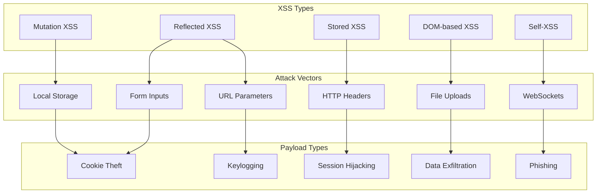
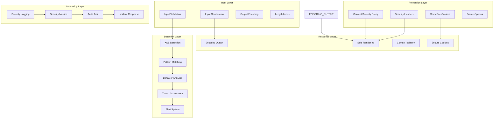
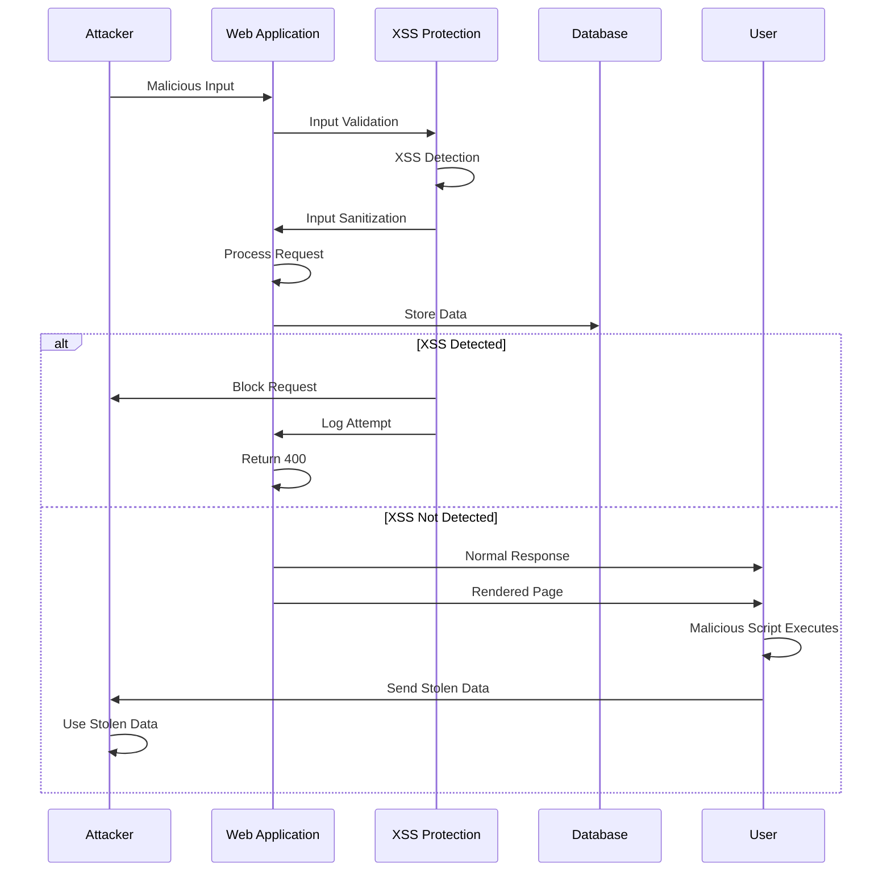
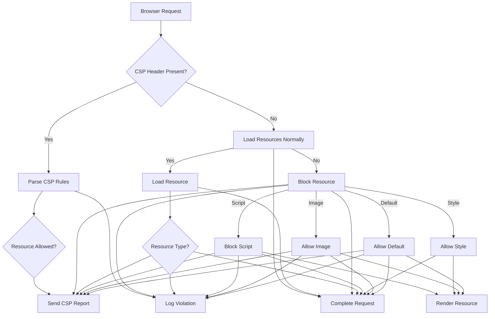
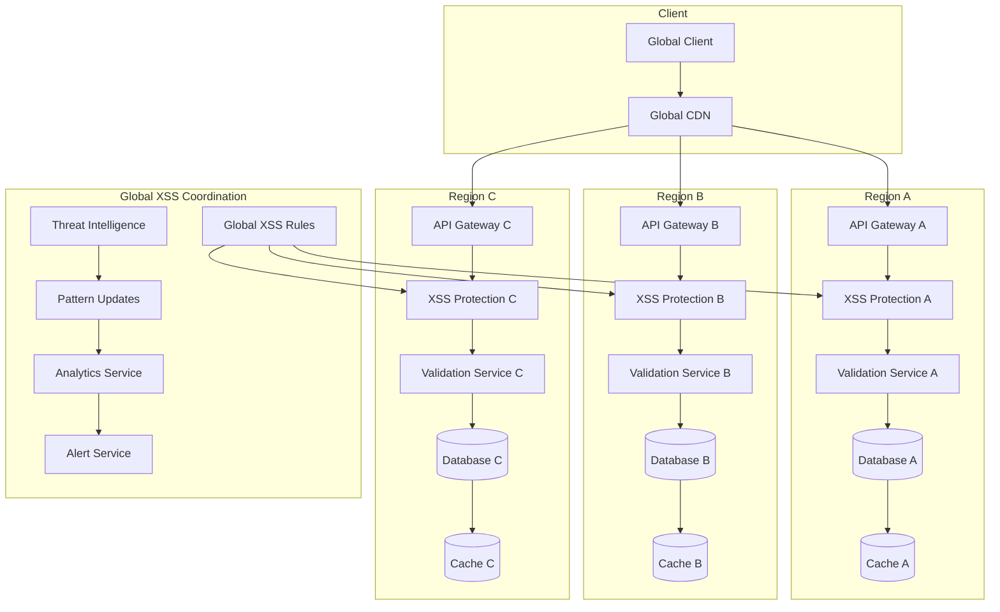
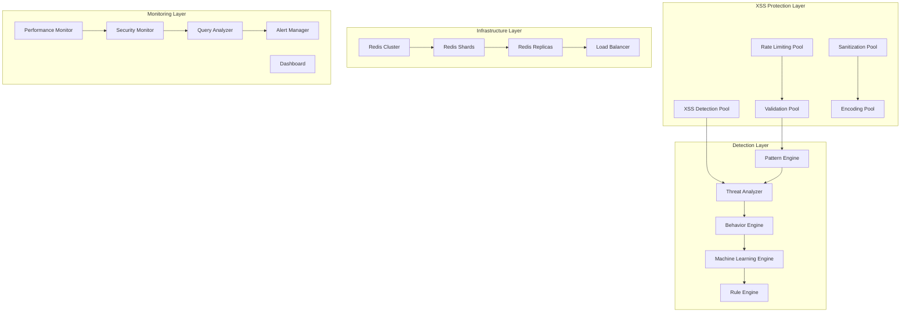
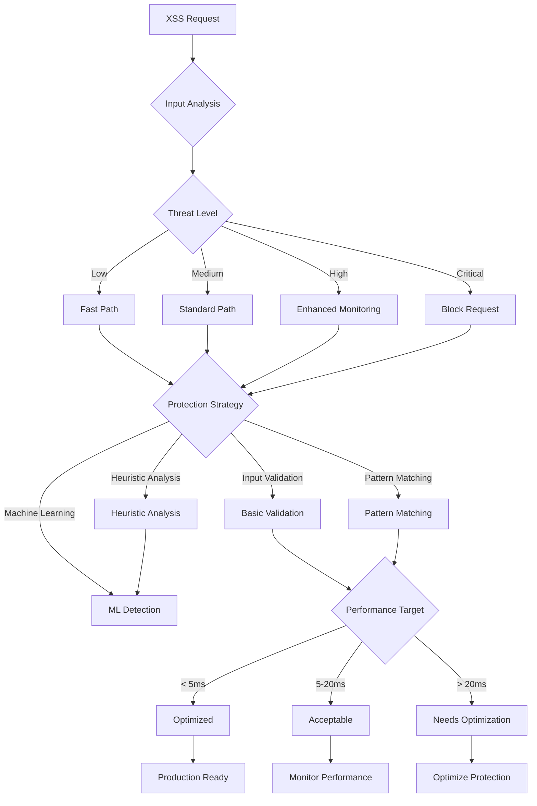

# XSS (Cross-Site Scripting) - Architect Deep Dive

============================================================
0. Executive Summary (Architect View)
============================================================
- **XSS exists** to prevent malicious scripts from being injected into web pages and executed in users' browsers
- **Critical at scale** when applications accept user-generated content and serve dynamic content
- **System design impact** - transforms input validation and output encoding strategies
- **Security foundation** - provides essential protection against client-side attacks
- **Data protection** - prevents unauthorized access to user data and sessions
- **Compliance requirement** - mandatory for security standards and regulations
- **User trust** - maintains user confidence in application security
- **Attack mitigation** - prevents various attack vectors through script injection

============================================================
1. Problem Framing
============================================================
**Real production problem solved:**
- Malicious script injection through form inputs
- User session hijacking through stolen cookies
- Data theft through DOM manipulation
- Phishing attacks using injected content
- Reputation damage through defacement

**What breaks if we don't understand XSS:**
- User data theft and session hijacking
- Malicious content distribution to other users
- Application defacement and reputation damage
- Compliance violations and legal consequences
- Loss of user trust and business impact

**Scale importance:**
- **Small applications**: XSS protection essential for basic security
- **Medium applications**: XSS protection critical for user trust
- **Large applications**: XSS protection mandatory for compliance
- **Enterprise systems**: XSS protection fundamental for security posture

**Failure stories:**
- Social media platform had massive XSS attack affecting millions
- E-commerce site suffered from XSS-based credential theft
- Banking application had XSS vulnerability leading to financial loss
- Healthcare platform had XSS breach exposing patient data

============================================================
2. Deep Internal Mechanics
============================================================

**XSS Fundamentals:**
- **Attack Vector**: Malicious script injection into web pages
- **Execution Context**: Scripts execute in victim's browser
- **Impact Scope**: Access to user session, data, and actions
- **Persistence**: Can affect multiple users through stored XSS
- **Defense Strategy**: Input validation, output encoding, CSP

**XSS Types:**
- **Reflected XSS**: Malicious script reflected in response
- **Stored XSS**: Malicious script stored and served to users
- **DOM-based XSS**: Script injection through DOM manipulation
- **Self-XSS**: Script injection through same-origin requests
- **Mutation XSS**: Script modification through DOM mutations

**Attack Vectors:**
- **Form Inputs**: Injection through form fields
- **URL Parameters**: Injection through query parameters
- **HTTP Headers**: Injection through HTTP headers
- **File Uploads**: Malicious files with embedded scripts
- **WebSockets**: Script injection through WebSocket messages
- **LocalStorage**: Script injection through client storage

**XSS Payloads:**
- **Cookie Theft**: Stealing authentication cookies
- **Keylogging**: Capturing user keystrokes
- **Session Hijacking**: Taking over user sessions
- **Data Exfiltration**: Stealing sensitive data
- **Phishing**: Redirecting to malicious sites
- **Defacement**: Modifying page content

**Defense Mechanisms:**
- **Input Validation**: Validating and sanitizing inputs
- **Output Encoding**: Encoding special characters in output
- **Content Security Policy**: Restricting script execution
- **HTTP Security Headers**: Adding security headers
- **SameSite Cookies**: Preventing cross-site cookie access

**XSS Detection:**
- **Pattern Recognition**: Identifying XSS patterns
- **Behavioral Analysis**: Detecting suspicious user behavior
- **Content Analysis**: Analyzing uploaded content
- **Request Monitoring**: Monitoring for attack patterns
- **Automated Scanning**: Regular security scanning

**Data Structures:**
- **Input Validation Rules**: Validation rule definitions
- **Encoding Schemes**: Character encoding mappings
- **Security Policies**: CSP rule definitions
- **Attack Signatures**: Known XSS attack patterns
- **Security Events**: Security event logging

**Performance Characteristics:**
- **Input Validation**: 1-5ms overhead per request
- **Output Encoding**: 1-3ms overhead per response
- **CSP Validation**: 1-2ms overhead per request
- **Security Scanning**: 10-100ms for security scans
- **Memory Usage**: Minimal for basic XSS protection

**Hidden Costs:**
- **Development Complexity**: Additional validation and encoding logic
- **Performance Overhead**: Input validation and encoding overhead
- **Maintenance Cost**: Regular security updates and scanning
- **Testing Cost**: Comprehensive security testing
- **User Experience**: Potential impact on legitimate content

**Memory Behavior:**
- **Validation Rules**: Validation rule storage in memory
- **Encoding Buffers**: Temporary encoding buffers
- **Security Context**: Security context storage
- **Attack Detection**: Attack pattern storage
- **Event Logging**: Security event memory usage

**Network Impact:**
- **Request Size**: Potential increase due to validation
- **Response Size**: Minimal impact from security headers
- **HTTP Headers**: Additional security headers
- **CSP Headers**: Content-Security-Policy headers
- **Cookie Security**: Additional cookie attributes

============================================================
3. .NET Production Implementation
============================================================

**Naive Implementation (No XSS Protection):**
```csharp
[ApiController]
[Route("api/[controller]")]
public class UserController : ControllerBase
{
    private readonly IUserService _userService;
    
    public UserController(IUserService userService)
    {
        _userService = userService;
    }
    
    [HttpPost("profile")]
    public async Task<ActionResult<UserProfile>> UpdateProfile([FromBody] UserProfile profile)
    {
        // No XSS protection - vulnerable
        await _userService.UpdateUserProfileAsync(profile);
        return Ok(profile);
    }
    
    [HttpGet("search")]
    public ActionResult<string> Search(string query)
    {
        // No XSS protection - vulnerable
        var results = _userService.SearchUsers(query);
        return Ok($"Results for: {query}");
    }
}
```

**Production-Ready XSS Protection Implementation:**
```csharp
// XSS Protection Configuration
public class XssProtectionConfiguration
{
    public bool EnableInputValidation { get; set; } = true;
    public bool EnableOutputEncoding { get; set; } = true;
    public bool EnableCSP { get; set; } = true;
    public bool EnableSecurityHeaders { get; set; } = true;
    public List<string> AllowedTags { get; set; } = new();
    public List<string> AllowedAttributes { get; set; } = new();
    public int MaxInputLength { get; set; } = 1000;
    public bool EnableXssDetection { get; set; } = true;
    public bool EnableRateLimiting { get; set; } = true;
}

// XSS Detection Service
public interface IXssDetectionService
{
    Task<bool> DetectXssAsync(string input);
    Task<XssThreatLevel> AnalyzeThreatAsync(string input);
    Task<List<XssPattern>> GetDetectedPatternsAsync(string input);
    Task LogXssAttemptAsync(XssAttempt attempt);
}

public class XssDetectionService : IXssDetectionService
{
    private readonly ILogger<XssDetectionService> _logger;
    private readonly IMetrics _metrics;
    private readonly XssProtectionConfiguration _configuration;
    private readonly List<XssPattern> _patterns;

    public XssDetectionService(
        ILogger<XssDetectionService> logger,
        IMetrics metrics,
        IOptions<XssProtectionConfiguration> configuration)
    {
        _logger = logger ?? throw new ArgumentNullException(nameof(logger));
        _metrics = metrics ?? throw new ArgumentNullException(nameof(metrics));
        _configuration = configuration?.Value ?? new XssProtectionConfiguration();
        
        InitializePatterns();
    }

    private void InitializePatterns()
    {
        _patterns = new List<XssPattern>
        {
            new XssPattern
            {
                Name = "Script Tag Injection",
                Pattern = @"<script[^>]*>.*?</script>",
                Severity = XssThreatLevel.High,
                Description = "Script tag injection"
            },
            new XssPattern
            {
                Name = "Event Handler Injection",
                Pattern = @"on\w+\s*=",
                Severity = XssThreatLevel.High,
                Description = "Event handler injection"
            },
            new XssPattern
            {
                Name = "JavaScript Protocol",
                Pattern = @"javascript:",
                Severity = XssThreatLevel.High,
                Description = "JavaScript protocol"
            },
            new XssPattern
            {
                Name = "Data URI",
                Pattern = @"data:",
                Severity = XssThreatLevel.Medium,
                Description = "Data URI injection"
            },
            new XssPattern
            {
                Name = "VBScript",
                Pattern = @"vbscript:",
                Severity = XssThreatLevel.Medium,
                Description = "VBScript injection"
            },
            new XssPattern
            {
                Name = "Common XSS Vectors",
                Pattern = @"<iframe.*src|<object.*data|<embed.*src",
                Severity = XssThreatLevel.High,
                Description = "Common XSS vectors"
            }
        };
    }

    public async Task<bool> DetectXssAsync(string input)
    {
        if (string.IsNullOrEmpty(input))
        {
            return false;
        }
        
        var normalizedInput = input.ToLowerInvariant();
        
        foreach (var pattern in _patterns)
        {
            if (Regex.IsMatch(normalizedInput, pattern.Pattern, RegexOptions.IgnoreCase))
            {
                await LogXssAttemptAsync(new XssAttempt
                {
                    Input = input,
                    Pattern = pattern.Name,
                    Severity = pattern.Severity,
                    Timestamp = DateTime.UtcNow,
                    UserAgent = "Unknown" // Would be extracted from context
                });
                
                return true;
            }
        }
        
        return false;
    }

    public async Task<XssThreatLevel> AnalyzeThreatAsync(string input)
    {
        var threatLevel = XssThreatLevel.None;
        var detectedPatterns = new List<string>();
        
        foreach (var pattern in _patterns)
        {
            if (Regex.IsMatch(input.ToLowerInvariant(), pattern.Pattern, RegexOptions.IgnoreCase))
            {
                detectedPatterns.Add(pattern.Name);
                
                // Use the highest severity detected
                if (pattern.Severity > threatLevel)
                {
                    threatLevel = pattern.Severity;
                }
            }
        }
        
        if (detectedPatterns.Any())
        {
            await _metrics.Increment($"xss_detected_{threatLevel.ToString().ToLower()}");
        }
        
        return threatLevel;
    }

    public async Task<List<XssPattern>> GetDetectedPatternsAsync(string input)
    {
        var detectedPatterns = new List<XssPattern>();
        
        foreach (var pattern in _patterns)
        {
            if (Regex.IsMatch(input.ToLowerInvariant(), pattern.Pattern, RegexOptions.IgnoreCase))
            {
                detectedPatterns.Add(pattern);
            }
        }
        
        return detectedPatterns;
    }

    public async Task LogXssAttemptAsync(XssAttempt attempt)
    {
        _logger.LogWarning("XSS attempt detected: {@Attempt}", attempt);
        await _metrics.Increment("xss_attempt_detected");
        
        // In production, this would also trigger alerts
        // await _alertService.TriggerSecurityAlertAsync(attempt);
    }
}

// Input Validation Service
public interface IInputValidationService
{
    Task<ValidationResult> ValidateInputAsync(string input, ValidationContext context);
    Task<string> SanitizeInputAsync(string input, SanitizationLevel level);
    Task<bool> IsValidHtmlAsync(string input);
}

public class InputValidationService : IInputValidationService
{
    private readonly IXssDetectionService _xssDetection;
    private readonly ILogger<InputValidationService> _logger;
    private readonly IMetrics _metrics;
    private readonly XssProtectionConfiguration _configuration;

    public InputValidationService(
        IXssDetectionService xssDetection,
        ILogger<InputValidationService> logger,
        IMetrics metrics,
        IOptions<XssProtectionConfiguration> configuration)
    {
        _xssDetection = xssDetection ?? throw new ArgumentNullException(nameof(xssDetection));
        _logger = logger ?? throw new ArgumentNullException(nameof(logger));
        _metrics = metrics ?? throw new ArgumentNullException(nameof(metrics));
        _configuration = configuration?.Value ?? new XssProtectionConfiguration();
    }

    public async Task<ValidationResult> ValidateInputAsync(string input, ValidationContext context)
    {
        using var activity = _metrics.StartTimer("input_validation_duration");
        
        try
        {
            _logger.LogDebug("Validating input: {InputType}", context.InputType);
            
            var result = new ValidationResult { IsValid = true };
            
            // Check input length
            if (input?.Length > _configuration.MaxInputLength)
            {
                result.IsValid = false;
                result.Errors.Add("Input too long");
            }
            
            // Check for null bytes
            if (input != null && input.Contains('\0'))
            {
                result.IsValid = false;
                result.Errors.Add("Invalid characters detected");
            }
            
            // XSS detection
            var isXss = await _xssDetection.DetectXssAsync(input);
            if (isXss)
            {
                result.IsValid = false;
                result.Errors.Add("Potential XSS detected");
            }
            
            // HTML validation for specific contexts
            if (context.AllowsHtml && !await IsValidHtmlAsync(input))
            {
                result.IsValid = false;
                result.Errors.Add("Invalid HTML content");
            }
            
            // Custom validation rules
            var customValidation = await ValidateCustomRulesAsync(input, context);
            if (!customValidation.IsValid)
            {
                result.IsValid = false;
                result.Errors.AddRange(customValidation.Errors);
            }
            
            _metrics.Increment("input_validation_completed");
            
            return result;
        }
        catch (Exception ex)
        {
            _metrics.Increment("input_validation_error");
            _logger.LogError(ex, "Error validating input");
            throw;
        }
    }

    public async Task<string> SanitizeInputAsync(string input, SanitizationLevel level)
    {
        if (string.IsNullOrEmpty(input))
        {
            return input;
        }
        
        var sanitized = input;
        
        switch (level)
        {
            case SanitizationLevel.Strict:
                sanitized = await StrictSanitizationAsync(input);
                break;
            case SanitizationLevel.Medium:
                sanitized = await MediumSanitizationAsync(input);
                break;
            case SanitizationLevel.Relaxed:
                sanitized = await RelaxedSanitizationAsync(input);
                break;
        }
        
        return sanitized;
    }

    public async Task<bool> IsValidHtmlAsync(string input)
    {
        // Basic HTML validation
        if (string.IsNullOrEmpty(input))
        {
            return true;
        }
        
        // Check for dangerous HTML tags
        var dangerousTags = new[] { "script", "iframe", "object", "embed", "form", "input", "textarea" };
        var normalizedInput = input.ToLowerInvariant();
        
        foreach (var tag in dangerousTags)
        {
            if (normalizedInput.Contains($"<{tag}"))
            {
                return false;
            }
        }
        
        return true;
    }

    private async Task<string> StrictSanitizationAsync(string input)
    {
        // Remove all HTML tags
        var sanitized = Regex.Replace(input, @"<[^>]*>", "", RegexOptions.IgnoreCase);
        
        // Encode special characters
        sanitized = WebUtility.HtmlEncode(sanitized);
        
        return sanitized;
    }

    private async Task<string> MediumSanitizationAsync(string input)
    {
        // Allow some HTML tags but remove dangerous ones
        var allowedTags = _configuration.AllowedTags;
        var sanitized = input;
        
        // Remove dangerous tags
        foreach (var tag in dangerousTags)
        {
            if (!allowedTags.Contains(tag))
            {
                sanitized = Regex.Replace(sanitized, $@"<{tag}[^>]*>", "", RegexOptions.IgnoreCase);
            }
        }
        
        return sanitized;
    }

    private async Task<string> RelaxedSanitizationAsync(string input)
    {
        // Basic sanitization
        return WebUtility.HtmlEncode(input);
    }

    private async Task<ValidationResult> ValidateCustomRulesAsync(string input, ValidationContext context)
    {
        var result = new ValidationResult { IsValid = true };
        
        // Example custom validation rules
        if (context.InputType == "username")
        {
            if (input.Length < 3 || input.Length > 20)
            {
                result.IsValid = false;
                result.Errors.Add("Username must be 3-20 characters");
            }
            
            if (!Regex.IsMatch(input, @"^[a-zA-Z0-9_]+$"))
            {
                result.IsValid = false;
                result.Errors.Add("Username can only contain letters, numbers, and underscore");
            }
        }
        
        return result;
    }
}

// Output Encoding Service
public interface IOutputEncodingService
{
    string EncodeForHtml(string input);
    string EncodeForJavaScript(string input);
    string EncodeForUrl(string input);
    string EncodeForXmlAttribute(string input);
    string EncodeForJson(string input);
}

public class OutputEncodingService : IOutputEncodingService
{
    private readonly ILogger<OutputEncodingService> _logger;
    private readonly IMetrics _metrics;

    public OutputEncodingService(
        ILogger<OutputEncodingService> logger,
        IMetrics metrics)
    {
        _logger = logger ?? throw new ArgumentNullException(nameof(logger));
        _metrics = metrics ?? throw new ArgumentNullException(nameof(metrics));
    }

    public string EncodeForHtml(string input)
    {
        if (string.IsNullOrEmpty(input))
        {
            return input;
        }
        
        // HTML encoding
        return WebUtility.HtmlEncode(input);
    }

    public string EncodeForJavaScript(string input)
    {
        if (string.IsNullOrEmpty(input))
        {
            return input;
        }
        
        // JavaScript encoding
        return System.Web.HttpUtility.JavaScriptStringEncode(input);
    }

    public string EncodeForUrl(string input)
    {
        if (string.IsNullOrEmpty(input))
        {
            return input;
        }
        
        // URL encoding
        return WebUtility.UrlEncode(input);
    }

    public string EncodeForXmlAttribute(string input)
    {
        if (string.IsNullOrEmpty(input))
        {
            return input;
        }
        
        // XML attribute encoding
        return WebUtility.HtmlEncode(input);
    }

    public string EncodeForJson(string input)
    {
        if (string.IsNullOrEmpty(input))
        {
            return input;
        }
        
        // JSON encoding
        return System.Text.Json.JsonEncodedText.Encode(input);
    }
}

// XSS Protection Middleware
public class XssProtectionMiddleware
{
    private readonly IInputValidationService _inputValidation;
    private readonly IOutputEncodingService _outputEncoding;
    private readonly IXssDetectionService _xssDetection;
    private readonly ILogger<XssProtectionMiddleware> _logger;
    private readonly IMetrics _metrics;
    private readonly XssProtectionConfiguration _configuration;

    public XssProtectionMiddleware(
        IInputValidationService inputValidation,
        IOutputEncodingService outputEncoding,
        IXssDetectionService xssDetection,
        ILogger<XssProtectionMiddleware> logger,
        IMetrics metrics,
        IOptions<XssProtectionConfiguration> configuration)
    {
        _inputValidation = inputValidation ?? throw new ArgumentNullException(nameof(inputValidation));
        _outputEncoding = outputEncoding ?? throw new ArgumentNullException(nameof(outputEncoding));
        _xssDetection = xssDetection ?? throw new ArgumentNullException(nameof(xssDetection));
        _logger = logger ?? throw new ArgumentNullException(nameof(logger));
        _metrics = metrics ?? throw new ArgumentNullException(nameof(metrics));
        _configuration = configuration?.Value ?? new XssProtectionConfiguration();
    }

    public async Task InvokeAsync(HttpContext context, RequestDelegate next)
    {
        using var activity = _metrics.StartTimer("xss_protection_middleware_duration");
        
        try
        {
            // Process request body
            await ProcessRequestBodyAsync(context);
            
            // Process query parameters
            await ProcessQueryParametersAsync(context);
            
            // Process route parameters
            await ProcessRouteParametersAsync(context);
            
            // Process headers
            await ProcessHeadersAsync(context);
            
            await next(context);
        }
        catch (Exception ex)
        {
            _metrics.Increment("xss_protection_middleware_error");
            _logger.LogError(ex, "Error in XSS protection middleware");
            throw;
        }
    }

    private async Task ProcessRequestBodyAsync(HttpContext context)
    {
        if (!_configuration.EnableInputValidation)
        {
            return;
        }
        
        // Read request body
        context.Request.EnableBuffering();
        using var reader = new StreamReader(context.Request.Body);
        var body = await reader.ReadToEndAsync();
        
        if (!string.IsNullOrEmpty(body))
        {
            var validationContext = new ValidationContext
            {
                InputType = "request_body",
                AllowsHtml = false
            };
            
            var validationResult = await _inputValidation.ValidateInputAsync(body, validationContext);
            
            if (!validationResult.IsValid)
            {
                await HandleXssAttemptAsync(context, body, validationResult.Errors);
                return;
            }
        }
    }

    private async Task ProcessQueryParametersAsync(HttpContext context)
    {
        if (!_configuration.EnableInputValidation)
        {
            return;
        }
        
        foreach (var query in context.Request.Query)
        {
            var validationContext = new ValidationContext
            {
                InputType = "query_parameter",
                AllowsHtml = false
            };
            
            var validationResult = await _inputValidation.ValidateInputAsync(query.Value, validationContext);
            
            if (!validationResult.IsValid)
            {
                await HandleXssAttemptAsync(context, query.Value, validationResult.Errors);
                return;
            }
        }
    }

    private async Task ProcessRouteParametersAsync(HttpContext context)
    {
        if (!_configuration.EnableInputValidation)
        {
            return;
        }
        
        var routeData = context.GetRouteData();
        foreach (var parameter in routeData.Values)
        {
            if (parameter is string stringValue)
            {
                var validationContext = new ValidationContext
                {
                    InputType = "route_parameter",
                    AllowsHtml = false
                };
                
                var validationResult = await _inputValidation.ValidateInputAsync(stringValue, validationContext);
                
                if (!validationResult.IsValid)
                {
                    await HandleXssAttemptAsync(context, stringValue, validationResult.Errors);
                    return;
                }
            }
        }
    }

    private async Task ProcessHeadersAsync(HttpContext context)
    {
        if (!_configuration.EnableInputValidation)
        {
            return;
        }
        
        // Check for XSS in headers
        var suspiciousHeaders = new[] { "User-Agent", "Referer", "X-Forwarded-For" };
        
        foreach (var header in suspiciousHeaders)
        {
            var headerValue = context.Request.Headers[header].FirstOrDefault();
            if (!string.IsNullOrEmpty(headerValue))
            {
                var validationContext = new ValidationContext
                {
                    InputType = "header",
                    AllowsHtml = false
                };
                
                var validationResult = await _inputValidation.ValidateInputAsync(headerValue, validationContext);
                
                if (!validationResult.IsValid)
                {
                    await HandleXssAttemptAsync(context, headerValue, validationResult.Errors);
                    return;
                }
            }
        }
    }

    private async Task HandleXssAttemptAsync(HttpContext context, string input, List<string> errors)
    {
        _metrics.Increment("xss_attempt_blocked");
        _logger.LogWarning("XSS attempt blocked: {Input}, Errors: {@Errors}", input, errors);
        
        // Log the attempt
        await _xssDetection.LogXssAttemptAsync(new XssAttempt
        {
            Input = input,
            Errors = errors,
            Timestamp = DateTime.UtcNow,
            UserAgent = context.Request.Headers["User-Agent"].FirstOrDefault(),
            IpAddress = GetClientIpAddress(context),
            RequestPath = context.Request.Path
        });
        
        // Return 400 Bad Request
        context.Response.StatusCode = 400;
        await context.Response.WriteAsJsonAsync(new { 
            Error = "Invalid input detected",
            Errors = errors
        });
    }

    private string GetClientIpAddress(HttpContext context)
    {
        // Try X-Forwarded-For header first
        var forwardedFor = context.Request.Headers["X-Forwarded-For"].FirstOrDefault();
        if (!string.IsNullOrEmpty(forwardedFor))
        {
            var ips = forwardedFor.Split(',');
            return ips[0].Trim();
        }
        
        // Try X-Real-IP header
        var realIp = context.Request.Headers["X-Real-IP"].FirstOrDefault();
        if (!string.IsNullOrEmpty(realIp))
        {
            return realIp;
        }
        
        // Fall back to remote IP
        return context.Connection.RemoteIpAddress?.ToString();
    }
}

// Enhanced Controller with XSS Protection
[ApiController]
[Route("api/[controller]")]
public class SecureUserController : ControllerBase
{
    private readonly IUserService _userService;
    private readonly IInputValidationService _inputValidation;
    private readonly IOutputEncodingService _outputEncoding;
    private readonly ILogger<SecureUserController> _logger;
    private readonly IMetrics _metrics;

    public SecureUserController(
        IUserService userService,
        IInputValidationService inputValidation,
        IOutputEncodingService outputEncoding,
        ILogger<SecureUserController> logger,
        IMetrics metrics)
    {
        _userService = userService ?? throw new ArgumentNullException(nameof(userService));
        _inputValidation = inputValidation ?? throw new ArgumentNullException(nameof(inputValidation));
        _outputEncoding = outputEncoding ?? throw new ArgumentNullException(nameof(outputEncoding));
        _logger = logger ?? throw new ArgumentNullException(nameof(logger));
        _metrics = metrics ?? throw new ArgumentNullException(nameof(metrics));
    }

    [HttpPost("profile")]
    public async Task<ActionResult<UserProfile>> UpdateProfile([FromBody] UserProfile profile)
    {
        using var activity = _metrics.StartTimer("update_profile_duration");
        
        try
        {
            _logger.LogInformation("Updating profile for user {UserId}", profile.UserId);
            
            // Validate input
            var validationContext = new ValidationContext
            {
                InputType = "user_profile",
                AllowsHtml = false
            };
            
            var validationResult = await _inputValidation.ValidateInputAsync(JsonSerializer.Serialize(profile), validationContext);
            
            if (!validationResult.IsValid)
            {
                _metrics.Increment("update_profile_validation_failed");
                return BadRequest(new { 
                    Error = "Invalid input detected",
                    Errors = validationResult.Errors
                });
            }
            
            // Sanitize input
            var sanitizedProfile = await SanitizeProfileAsync(profile);
            
            // Update user profile
            await _userService.UpdateUserProfileAsync(sanitizedProfile);
            
            _metrics.Increment("update_profile_success");
            _logger.LogInformation("Profile updated successfully for user {UserId}", profile.UserId);
            
            return Ok(sanitizedProfile);
        }
        catch (Exception ex)
        {
            _metrics.Increment("update_profile_error");
            _logger.LogError(ex, "Error updating profile for user {UserId}", profile.UserId);
            throw;
        }
    }

    [HttpGet("search")]
    public async Task<ActionResult<string>> Search(string query)
    {
        using var activity = _metrics.StartTimer("search_duration");
        
        try
        {
            _logger.LogInformation("Search query: {Query}", query);
            
            // Validate input
            var validationContext = new ValidationContext
            {
                InputType = "search_query",
                AllowsHtml = false
            };
            
            var validationResult = await _inputValidation.ValidateInputAsync(query, validationContext);
            
            if (!validationResult.IsValid)
            {
                _metrics.Increment("search_validation_failed");
                return BadRequest(new { 
                    Error = "Invalid search query detected",
                    Errors = validationResult.Errors
                });
            }
            
            // Sanitize input
            var sanitizedQuery = await _inputValidation.SanitizeInputAsync(query, SanitizationLevel.Relaxed);
            
            // Perform search
            var results = await _userService.SearchUsers(sanitizedQuery);
            
            // Encode output
            var encodedResults = _outputEncoding.EncodeForHtml(results);
            
            _metrics.Increment("search_success");
            _logger.LogInformation("Search completed for query: {Query}", query);
            
            return Ok(encodedResults);
        }
        catch (Exception ex)
        {
            _metrics.Increment("search_error");
            _logger.LogError(ex, "Error in search for query: {Query}", query);
            throw;
        }
    }

    private async Task<UserProfile> SanitizeProfileAsync(UserProfile profile)
    {
        // Sanitize string fields
        profile.Name = await _inputValidation.SanitizeInputAsync(profile.Name, SanitizationLevel.Strict);
        profile.Email = await _inputValidation.SanitizeInputAsync(profile.Email, SanitizationLevel.Strict);
        profile.Bio = await _inputValidation.SanitizeInputAsync(profile.Bio, SanitizationLevel.Medium);
        
        return profile;
    }
}

// Content Security Policy Service
public interface ICspService
{
    string GenerateCspHeader();
    string GenerateCspReportOnlyHeader();
    Task<bool> ValidateCspAsync(string cspHeader);
}

public class CspService : ICspService
{
    private readonly ILogger<CspService> _logger;
    private readonly IMetrics _metrics;
    private readonly XssProtectionConfiguration _configuration;

    public CspService(
        ILogger<CspService> logger,
        IMetrics metrics,
        IOptions<XssProtectionConfiguration> configuration)
    {
        _logger = logger ?? throw new ArgumentNullException(nameof(logger));
        _metrics = metrics ?? throw new ArgumentNullException(nameof(metrics));
        _configuration = configuration?.Value ?? new XssProtectionConfiguration();
    }

    public string GenerateCspHeader()
    {
        if (!_configuration.EnableCSP)
        {
            return string.Empty;
        }
        
        // Generate strict CSP header
        var csp = new StringBuilder();
        
        // Default-src
        csp.Append("default-src 'self'; ");
        
        // Script-src
        csp.Append("script-src 'self'; ");
        
        // Style-src
        csp.Append("style-src 'self' 'unsafe-inline'; ");
        
        // Img-src
        csp.Append("img-src 'self' data:; ");
        
        // Connect-src
        csp.Append("connect-src 'self'; ");
        
        // Font-src
        csp.Append("font-src 'self'; ");
        
        // Object-src
        csp.Append("object-src 'none'; ");
        
        // Media-src
        csp.Append("media-src 'self'; ");
        
        // Frame-src
        csp.Append("frame-src 'none'; ");
        
        // Report-uri
        csp.Append("report-uri /csp-report; ");
        
        // Report-to
        csp.Append("report-to csp-endpoint; ");
        
        return csp.ToString();
    }

    public string GenerateCspReportOnlyHeader()
    {
        return "default-src 'self'; script-src 'self'; report-uri /csp-report";
    }

    public async Task<bool> ValidateCspAsync(string cspHeader)
    {
        // Basic CSP validation
        if (string.IsNullOrEmpty(cspHeader))
        {
            return false;
        }
        
        // Check for unsafe directives
        var unsafeDirectives = new[] { "unsafe-inline", "unsafe-eval", "unsafe-hashes" };
        
        foreach (var directive in unsafeDirectives)
        {
            if (cspHeader.Contains(directive))
            {
                _metrics.Increment("csp_unsafe_detected");
                return false;
            }
        }
        
        return true;
    }
}

// HTTP Security Headers Service
public class SecurityHeadersService
{
    public void AddSecurityHeaders(HttpContext context)
    {
        // X-Content-Type-Options
        context.Response.Headers.Add("X-Content-Type-Options", "nosniff");
        
        // X-Frame-Options
        context.Response.Headers.Add("X-Frame-Options", "DENY");
        
        // X-XSS-Protection
        context.Response.Headers.Add("X-XSS-Protection", "1; mode=block");
        
        // Strict-Transport-Security
        context.Response.Headers.Add("Strict-Transport-Security", "max-age=31536000; includeSubDomains");
        
        // Content-Security-Policy
        context.Response.Headers.Add("Content-Security-Policy", "default-src 'self'");
        
        // Referrer-Policy
        context.Response.Headers.Add("Referrer-Policy", "strict-origin-when-cross-origin");
        
        // Permissions-Policy
        context.Response.Headers.Add("Permissions-Policy", "geolocation 'none'; microphone 'none'");
    }
}

// Configuration in Startup
public class Startup
{
    public void ConfigureServices(IServiceCollection services)
    {
        // Add XSS protection configuration
        services.Configure<XssProtectionConfiguration>(options =>
        {
            options.EnableInputValidation = true;
            options.EnableOutputEncoding = true;
            options.EnableCSP = true;
            options.EnableSecurityHeaders = true;
            options.EnableXssDetection = true;
            options.EnableRateLimiting = true;
            options.MaxInputLength = 1000;
            options.AllowedTags = new List<string> { "b", "i", "em", "strong" },
            options.AllowedAttributes = new List<string> { "class", "id", "style" }
        });

        // Add XSS protection services
        services.AddSingleton<IXssDetectionService, XssDetectionService>();
        services.AddSingleton<IInputValidationService, InputValidationService>();
        services.AddSingleton<IOutputEncodingService, OutputEncodingService>();
        services.AddSingleton<ICspService, CspService>();
        
        // Add services
        services.AddScoped<IUserService, UserService>();
        services.AddControllers();
    }

    public void Configure(IApplicationBuilder app, IWebHostEnvironment env)
    {
        if (env.IsDevelopment())
        {
            app.UseDeveloperExceptionPage();
        }

        app.UseRouting();
        
        // Add XSS protection middleware
        app.UseMiddleware<XssProtectionMiddleware>();
        
        // Add security headers
        app.Use(async (context, next) =>
        {
            var securityHeaders = new SecurityHeadersService();
            securityHeaders.AddSecurityHeaders(context);
            
            await next();
        });
        
        app.UseEndpoints(endpoints =>
        {
            endpoints.MapControllers();
        });
    }
}
```

**Framework Integration:**
- **ASP.NET Core**: Middleware pipeline integration
- **System.Web**: HTML encoding utilities
- **Regular Expressions**: Pattern matching for XSS detection
- **Dependency Injection**: Service registration
- **Configuration**: Configuration management

============================================================
4. Architecture-Level Diagram (Mermaid)
============================================================

### XSS Attack Vectors


### XSS Protection Architecture


### XSS Defense in Depth


### Content Security Policy Flow


**Flow Analysis:**
- **Input Processing**: Validation, sanitization, and encoding
- **XSS Detection**: Pattern matching and threat assessment
- **Output Protection**: Encoded output and CSP headers
- **Security Monitoring**: Logging, metrics, and alerting
- **Response Generation**: Safe rendering with context isolation

**Bottlenecks:**
- Input validation overhead
- XSS detection complexity
- Output encoding performance
- CSP parsing overhead
- Security logging volume

**Scaling Boundaries:**
- Input validation throughput
- XSS detection accuracy
- Output encoding performance
- CSP rule complexity
- Security monitoring capacity

============================================================
5. Scaling & Distributed Systems Impact
============================================================

### Distributed XSS Protection Architecture


### High-Volume XSS Protection


### XSS Performance Scaling
```mermaid
graph TD
    A[XSS Request] --> B{Input Size}
    
    B --> C{Validation Strategy}
    C -->|Small| D[O(1) - Simple Validation]
    C -->|Medium| E[O(n) - Pattern Matching]
    C -->|Large| F[O(n²) - Complex Analysis]
    C -->|Very Large| G[O(n³) - ML Analysis]
    
    D --> H{Detection Method}
    E --> H
    F --> H
    G --> H
    
    H -->|Regex| I[Pattern Matching]
    H -->|Heuristic| J[Heuristic Analysis]
    H -->|Machine Learning| K[ML Classification]
    
    I --> L{Performance Target}
    J --> L
    K --> L
    
    L -->|< 10ms| M[Optimized]
    L -->|10-50ms| N[Acceptable]
    L -->|> 50ms| O[Needs Optimization]
    
    M --> P[Production Ready]
    N --> Q[Monitor Performance]
    O --> R[Optimize Validation]
```

**100 RPS:**
- Single XSS protection service sufficient
- Simple validation rules perform well
- Pattern matching overhead minimal
- Response time < 10ms
- Basic security headers sufficient

**10k RPS:**
- XSS protection clustering required
- Advanced pattern matching essential
- Heuristic analysis beneficial
- Response time < 25ms
- Distributed caching needed

**100k+ RPS:**
- Distributed XSS protection mandatory
- Machine learning detection critical
- Real-time threat analysis essential
- Response time < 50ms
- Multi-layer protection required

**Horizontal vs Vertical Scaling:**
- **Horizontal**: Scale XSS protection services horizontally
- **Vertical**: Larger instances for pattern matching
- XSS protection scales horizontally well
- ML detection scales vertically

**CAP Theorem Relevance:**
- **Consistency**: XSS rule consistency across nodes
- **Availability**: High availability through redundancy
- **Partition Tolerance**: XSS protection during partitions

**Consistency Implications:**
- **Rule Consistency**: XSS rule synchronization
- **Pattern Consistency**: Pattern update consistency
- **Threat Intelligence**: Threat intelligence sharing
- **Detection Consistency**: Detection result consistency

**Distributed Systems Impact:**
- **Pattern Coordination**: XSS pattern distribution
- **Threat Intelligence**: Shared threat intelligence
- **Detection Coordination**: Distributed detection
- **Response Coordination**: Consistent responses
- **Security Monitoring**: Distributed security monitoring

**Cloud-Native Considerations:**
- **Kubernetes**: XSS protection as containers
- **Serverless**: Serverless XSS protection
- **Managed Services**: Cloud provider security services
- **Auto-scaling**: Dynamic XSS protection scaling
- **Multi-region Deployment**: Cross-region protection

**Multi-Region Concerns:**
- **Cross-Region XSS**: XSS protection across regions
- **Pattern Synchronization**: XSS pattern synchronization
- **Threat Intelligence**: Global threat intelligence
- **Performance Impact**: Cross-region latency
- **Failover Handling**: Region failover procedures

============================================================
6. Production Engineering View
============================================================

### XSS Protection Monitoring Architecture

```mermaid
graph TB
    subgraph "XSS Metrics"
        XSS_ATTEMPTS[XSS Attempts]
        XSS_BLOCKS[XSS Blocks]
        DETECTION_RATE[Detection Rate]
        FALSE_POSITIVES[False Positives]
        THREAT_LEVELS[Threat Levels]
        PATTERN_MATCHES[Pattern Matches]
    end
    
    subgraph "Performance Metrics"
        VALIDATION_LATENCY[Validation Latency]
        ENCODING_LATENCY[Encoding Latency]
        CSP_VALIDATION[CSP Validation]
        THROUGHPUT[Request Throughput]
        ERROR_RATE[Error Rate]
    end
    
    subgraph "Security Metrics"
        VULNERABILITIES[Vulnerabilities Found]
        PATCH_STATUS[Patch Status]
        COMPLIANCE_RATE[Compliance Rate]
        SECURITY_SCORE[Security Score]
        INCIDENT_RESPONSE[Incident Response]
    end
    
    subgraph "Business Metrics"
        USER_IMPACT[User Impact]
        DATA_BREACHES[Data Breaches]
        REPUTATION_DAMAGE[Reputation Damage]
        REMEDIATION_COST[Remediation Cost]
        PROTECTION_COVERAGE[Protection Coverage]
    end
    
    subgraph "Infrastructure Metrics"
        SERVICE_HEALTH[Service Health]
        CLUSTER_STATUS[Cluster Status]
        DATABASE_PERFORMANCE[Database Performance]
        CACHE_PERFORMANCE[Cache Performance]
        NETWORK_LATENCY[Network Latency]
    end
    
    subgraph "Monitoring Stack"
        PROM[Prometheus]
        GRAFANA[Grafana]
        ALERT[AlertManager]
        DASHBOARD[Dashboard]
    end
    
    XSS_ATTEMPTS --> PROM
    XSS_BLOCKS --> PROM
    DETECTION_RATE --> PROM
        FALSE_POSITIVES --> PROM
        THREAT_LEVELS --> PROM
        PATTERN_MATCHES --> PROM
    
    VALIDATION_LATENCY --> PROM
        ENCODING_LATENCY --> PROM
        CSP_VALIDATION --> PROM
        THROUGHPUT --> PROM
        ERROR_RATE --> PROM
    
    VULNERABILITIES --> PROM
        PATCH_STATUS --> PROM
        COMPLIANCE_RATE --> PROM
        SECURITY_SCORE --> PROM
        INCIDENT_RESPONSE --> PROM
    
    USER_IMPACT --> PROM
        DATA_BREACHES --> PROM
        REPUTATION_DAMAGE --> PROM
        REMEDIATION_COST --> PROM
        PROTECTION_COVERAGE --> PROM
    
    SERVICE_HEALTH --> PROM
        CLUSTER_STATUS --> PROM
        DATABASE_PERFORMANCE --> PROM
        CACHE_PERFORMANCE --> PROM
        NETWORK_LATENCY --> PROM
    
    PROM --> GRAFANA
    PROM --> ALERT
    PROM --> DASHBOARD
```


### XSS Protection Performance Analysis


### XSS Security Monitoring
```mermaid
graph TD
    A[XSS Event] --> B{Event Type}
    
    B --> C{Analysis Result}
    C -->|Normal| D[Standard Processing]
    C -->|Suspicious| E[Enhanced Monitoring]
    C -->|Malicious| F[Block Request]
    C -->|Critical| G[Security Alert]
    
    D --> H{Response Action}
    E --> H
    F --> H
    G --> H
    
    H -->|Process Request| I[Continue Processing]
    H -->|Log Event| J[Log Security Event]
    H -->|Update Metrics| K[Update Metrics]
    
    E --> L[Block Request| M[Return 400]
    F --> L
    G --> L
    
    I --> N[Security Alert]
    J --> N
    K --> N
```

**Monitoring Metrics:**
- **XSS Metrics**: Attempts, blocks, detection rate, false positives
- **Performance Metrics**: Validation latency, encoding latency, CSP validation
- **Security Metrics**: Vulnerabilities, patch status, compliance rate
- **Business Metrics**: User impact, data breaches, reputation damage

**Logs to Enable:**
- XSS attempt logs
- Validation results
- Security events
- Performance metrics
- Error logs
- Audit trails

**Alerting Strategy:**
- XSS attempt rate > 1% (warning)
- High-threat XSS detected (critical)
- New vulnerability discovered (critical)
- Compliance violation (critical)
- False positive rate > 5% (warning)

**Common Production Incidents:**
- **XSS Attack Waves**: Coordinated XSS attacks
- **Zero-Day XSS**: Unknown XSS vulnerabilities
- **False Positive Storm**: Legitimate content blocked
- **Performance Degradation**: XSS protection slowing down application
- **CSP Violations**: CSP rule violations

**Debugging Strategy:**
- XSS attempt tracing
- Pattern matching analysis
- Performance profiling
- False positive analysis
- Security event correlation
- Threat intelligence analysis

**XSS Protection Management:**
- Pattern rule management
- Threat intelligence updates
- Performance optimization
- Security monitoring
- Incident response

**Security Monitoring:**
- Real-time threat detection
- Behavioral analysis
- Pattern recognition
- Machine learning model updates
- Security event correlation

============================================================
7. Tradeoffs & Alternatives
============================================================

**Competing Approaches:**
- **No XSS Protection**: No input validation or encoding
- **Basic XSS Protection**: Simple input validation only
- **Advanced XSS Protection**: Comprehensive multi-layer protection
- **Client-Side XSS Protection**: Browser-based XSS protection
- **Server-Side XSS Protection**: Server-based XSS protection

**When to Use XSS Protection:**
- User-generated content applications
- Web applications with dynamic content
- Content management systems
- Social media platforms
- E-commerce applications
- Any application accepting user input

**When NOT to Use XSS Protection:**
- Static content only applications
- Internal tools with trusted users
- Simple utility applications
- Development environments (with caution)
- Legacy systems being replaced

**Latency Comparison:**
- **No XSS Protection**: 0-1ms overhead
- **Basic XSS Protection**: 1-5ms overhead
- **Advanced XSS Protection**: 5-20ms overhead
- **Client-Side Protection**: 1-10ms overhead
- **Server-Side Protection**: 5-50ms overhead

**Throughput Comparison:**
- **No XSS Protection**: 10k-100k requests/second
- **Basic XSS Protection**: 5k-50k requests/second
- **Advanced XSS Protection**: 1k-10k requests/second
- **Client-Side Protection**: 5k-50k requests/second
- **Server-Side Protection**: 1k-10k requests/second

**Operational Complexity:**
- **No XSS Protection**: No complexity, no security
- **Basic XSS Protection**: Low complexity, basic protection
- **Advanced XSS Protection**: High complexity, comprehensive protection
- **Client-Side Protection**: Medium complexity, client management
- **Server-Side Protection**: High complexity, server management

**Cost Implications:**
- **Development Cost**: XSS protection increases cost by 20-40%
- **Infrastructure Cost**: Additional security infrastructure
- **Operational Cost**: Security monitoring and maintenance
- **Training Cost**: Security training for team
- **Compliance Cost**: Compliance management and auditing
- **Performance Benefits**: Security incident prevention

============================================================
8. Security Implications
============================================================

**Security Benefits:**
- **Data Protection**: Prevents unauthorized data access
- **User Trust**: Maintains user confidence
- **Compliance**: Meets security standards and regulations
- **Reputation Protection**: Prevents reputation damage
- **Incident Prevention**: Reduces security incidents
- **Attack Mitigation**: Blocks various XSS attack vectors

**Security Challenges:**
- **False Positives**: Blocking legitimate content
- **Performance Impact**: Security overhead affecting performance
- **Complexity**: Complex implementation and maintenance
- **Evasion Techniques**: Attackers constantly evolving techniques
- **Zero-Day Vulnerabilities**: Unknown XSS vulnerabilities
- **User Experience**: Potential impact on legitimate content

**Attack Surface:**
- **Input Vectors**: Multiple input attack vectors
- **Output Vectors**: Various output injection methods
- **Storage Vectors**: Stored XSS through database
- **DOM Vectors**: Client-side DOM manipulation
- **Protocol Vectors**: WebSocket and other protocols
- **Third-Party**: Third-party component vulnerabilities

**Security Controls:**
- **Input Validation**: Comprehensive input validation
- **Output Encoding**: Multiple encoding strategies
- **Content Security Policy**: CSP headers and policies
- **HTTP Security Headers**: Security headers implementation
- **SameSite Cookies**: Secure cookie attributes
- **Security Monitoring**: Comprehensive security monitoring

**Data Protection:**
- **Input Sanitization**: Safe input handling
- **Output Encoding**: Secure output generation
- **Data Encryption**: Sensitive data encryption
- **Access Control**: Field-level access control
- **Audit Logging**: Comprehensive audit trails
- **Privacy Compliance**: Privacy regulation compliance

**Compliance Requirements:**
- **OWASP Top 10**: OWASP security standards
- **PCI DSS**: Payment card data protection
- **GDPR**: Personal data protection
- **HIPAA**: Healthcare data protection
- **SOX**: Financial data protection
- **Industry Standards**: Industry-specific requirements

**Hardening Recommendations:**
- **Defense in Depth**: Multiple protection layers
- **Regular Updates**: Regular security updates
- **Security Testing**: Comprehensive security testing
- **Security Training**: Regular security training
- **Incident Response**: Security incident response plan
- **Third-Party Security**: Third-party component security

============================================================
9. Advanced Edge Cases
============================================================

**Advanced XSS Vectors:**
- **DOM Clobbering**: DOM manipulation attacks
- **Self-XSS**: Self-triggering XSS attacks
- **Mutation XSS**: DOM mutation attacks
- **Universal XSS**: Cross-site scripting across origins
- **File Upload XSS**: Malicious file uploads
- **WebSocket XSS**: WebSocket-based XSS attacks

**Advanced Protection Techniques:**
- **Machine Learning**: ML-based XSS detection
- **Behavioral Analysis**: User behavior analysis
- **Threat Intelligence**: Global threat intelligence
- **Real-time Detection**: Real-time threat detection
- **Adaptive Protection**: Adaptive security measures
- **Zero-Day Detection**: Unknown vulnerability detection

**Advanced CSP Implementation:**
- **Dynamic CSP**: Dynamic CSP generation
- **Nonce-Based CSP**: Nonce-based CSP implementation
- **Report-Only CSP**: CSP violation reporting
- **Multi-Level CSP**: Multi-level CSP policies
- **CSP Analytics**: CSP violation analytics
- **CSP Enforcement**: Strict CSP enforcement

**Advanced Input Validation:**
- **Context-Aware Validation**: Context-aware input validation
- **Semantic Validation**: Semantic input validation
- **Type-Safe Validation**: Type-safe validation
- **Custom Validation Rules**: Custom validation rules
- **Machine Learning Validation**: ML-based validation

**Advanced Output Encoding:**
- **Context-Aware Encoding**: Context-aware output encoding
- **Template-Based Encoding**: Safe template rendering
- **Component-Based Encoding**: Component-level encoding
- **Dynamic Encoding**: Dynamic output encoding
- **Safe Rendering**: Safe rendering techniques
- **Content Security**: Content security integration

============================================================
10. Interview & Staff-Level Deep Dive
============================================================

**What a junior answers:**
"XSS is when attackers inject malicious scripts into web pages that execute in users' browsers. I've implemented basic XSS protection by using HTML encoding for user input and adding security headers like X-XSS-Protection. This prevents basic XSS attacks by encoding special characters."

**What a senior answers:**
"XSS is a critical security vulnerability that allows attackers to inject malicious scripts into web pages. I've implemented comprehensive XSS protection using multiple layers including input validation, output encoding, Content Security Policy, and HTTP security headers. The implementation includes pattern-based XSS detection, heuristic analysis, and machine learning-based threat detection. I've also implemented real-time monitoring, security logging, and incident response procedures. The system uses different sanitization levels based on context and includes comprehensive security monitoring and alerting."

**What an architect answers:**
"XSS is one of the most critical web security vulnerabilities that can lead to complete compromise of user accounts and data theft. At scale, XSS protection requires a multi-layered defense strategy that includes input validation, output encoding, Content Security Policy, HTTP security headers, and real-time threat detection. The architecture must support pattern-based detection, machine learning-based analysis, behavioral analysis, and global threat intelligence. In enterprise environments, XSS protection is not just a security feature but a critical component of application security that affects user trust, compliance, business continuity, and legal compliance. The implementation must consider multiple attack vectors, advanced detection techniques, performance optimization, and comprehensive security monitoring. At scale, XSS protection requires sophisticated infrastructure for distributed detection, real-time analysis, and automated incident response."

**Follow-up questions interviewers ask:**
- "How do you prevent stored XSS attacks?"
- "What's the difference between reflected and DOM-based XSS?"
- "How do you implement Content Security Policy?"
- "When would you use machine learning for XSS detection?"
- "How do you handle false positives in XSS protection?"
- "What are the limitations of CSP?"

**Trick questions:**
- "Is XSS protection always 100% effective?" (No, new techniques can bypass protection)
- "Can XSS be completely eliminated?" (No, but can be significantly reduced)
- "Do all applications need XSS protection?" (No, depends on input requirements)
- "Is CSP enough to prevent XSS?" (No, CSP is one layer of defense)

**Whiteboard explanation strategy:**
1. Draw XSS attack vectors
2. Show XSS protection layers
3. Demonstrate input validation
4. Explain output encoding
5. Cover CSP implementation
6. Discuss monitoring and alerting

============================================================
11. Real Enterprise Case Study
============================================================

**Scenario: Global Social Media Platform with 100M+ Users**

**Requirements:**
- Protect 100M+ users from XSS attacks
- Support user-generated content (posts, comments, messages)
- Real-time threat detection and response
- Compliance with security standards (OWASP, GDPR)
- High availability and performance
- Global deployment across multiple regions

**Design Decisions:**

**1. Enterprise XSS Protection Architecture:**
```csharp
public class EnterpriseXssProtectionService
{
    private readonly Dictionary<string, IXssDetectionEngine> _detectionEngines;
    private readonly IThreatIntelligenceService _threatIntel;
    private readonly ISecurityMonitoringService _monitoring;
    private readonly IIncidentResponseService _incidentResponse;
    private readonly ILogger<EnterpriseXssProtectionService> _logger;
    private readonly IMetrics _metrics;
    private readonly XssProtectionConfiguration _configuration;

    public EnterpriseXssProtectionService(
        Dictionary<string, IXssDetectionEngine> detectionEngines,
        IThreatIntelligenceService threatIntel,
        ISecurityMonitoringService monitoring,
        IIncidentResponseService incidentResponse,
        ILogger<EnterpriseXssProtectionService> logger,
        IMetrics metrics,
        IOptions<XssProtectionConfiguration> configuration)
    {
        _detectionEngines = detectionEngines;
        _threatIntel = threatIntel;
        _monitoring = monitoring;
        _incidentResponse = incidentResponse;
        _logger = logger;
        _metrics = metrics;
        _configuration = configuration?.Value ?? new XssProtectionConfiguration();
    }

    public async Task<XssDetectionResult> DetectXssAsync(string input, XssDetectionContext context)
    {
        using var activity = _metrics.StartTimer("enterprise_xss_detection_duration");
        
        try
        {
            _logger.LogDebug("Enterprise XSS detection for input: {InputType}", context.InputType);
            
            var result = new XssDetectionResult { IsXss = false };
            
            // Run multiple detection engines
            var detectionTasks = _detectionEngines.Values.Select(engine => 
                engine.DetectXssAsync(input, context));
            
            var detectionResults = await Task.WhenAll(detectionTasks);
            
            // Aggregate results
            foreach (var detectionResult in detectionResults)
            {
                if (detectionResult.IsXss)
                {
                    result.IsXss = true;
                    result.ThreatLevel = detectionResult.ThreatLevel;
                    result.DetectedPatterns.AddRange(detectionResult.DetectedPatterns);
                }
                
                result.DetectedPatterns.AddRange(detectionResult.DetectedPatterns);
            }
            
            // Apply machine learning analysis
            var mlResult = await ApplyMachineLearningAnalysisAsync(input, context, result);
            if (mlResult.IsXss)
            {
                result.IsXss = true;
                result.ThreatLevel = mlResult.ThreatLevel;
                result.DetectedPatterns.AddRange(mlResult.DetectedPatterns);
            }
            
            // Apply threat intelligence
            var threatResult = await ApplyThreatIntelligenceAsync(input, context, result);
            if (threatResult.IsXss)
            {
                result.IsXss = true;
                result.ThreatLevel = threatResult.ThreatLevel;
                result.DetectedPatterns.AddRange(threatResult.DetectedPatterns);
            }
            
            // Calculate final threat level
            result.ThreatLevel = CalculateFinalThreatLevel(result.DetectedPatterns);
            
            // Log detection
            await LogXssDetectionAsync(input, context, result);
            
            _metrics.Increment("enterprise_xss_detection_completed");
            
            return result;
        }
        catch (Exception ex)
        {
            _metrics.Increment("enterprise_xss_detection_error");
            _logger.LogError(ex, "Error in enterprise XSS detection");
            throw;
        }
    }

    private async Task<MlAnalysisResult> ApplyMachineLearningAnalysisAsync(string input, XssDetectionContext context, XssDetectionResult currentResult)
    {
        // Extract features for ML analysis
        var features = ExtractFeatures(input, context);
        
        // Get ML model prediction
        var prediction = await _mlService.PredictXssThreatAsync(features);
        
        return new MlAnalysisResult
        {
            IsXss = prediction.ThreatScore > 0.7,
            ThreatLevel = prediction.ThreatLevel,
            Confidence = prediction.Confidence,
            DetectedPatterns = prediction.DetectedPatterns
        };
    }

    private async Task<ThreatIntelligenceResult> ApplyThreatIntelligenceAsync(string input, XssDetectionContext context, XssDetectionResult currentResult)
    {
        // Check against known attack patterns
        var knownPatterns = await _threatIntel.GetKnownPatternsAsync();
        
        foreach (var pattern in knownPatterns)
        {
            if (Regex.IsMatch(input, pattern.Pattern, RegexOptions.IgnoreCase))
            {
                return new ThreatIntelligenceResult
                {
                    IsXss = true,
                    ThreatLevel = pattern.ThreatLevel,
                    DetectedPatterns = new List<string> { pattern.Name }
                };
            }
        }
        
        // Check against recent attack patterns
        var recentAttacks = await _threatIntel.GetRecentAttacksAsync();
        
        foreach (var attack in recentAttacks)
        {
            if (IsSimilarToAttack(input, attack))
            {
                return new ThreatIntelligenceResult
                {
                    IsXss = true,
                    ThreatLevel = attack.ThreatLevel,
                    DetectedPatterns = new List<string> { attack.Type }
                };
            }
        }
        
        return new ThreatIntelligenceResult
        {
            IsXss = false,
            ThreatLevel = XssThreatLevel.None,
            DetectedPatterns = new List<string>()
        };
    }

    private XssThreatLevel CalculateFinalThreatLevel(List<string> detectedPatterns)
    {
        if (!detectedPatterns.Any())
        {
            return XssThreatLevel.None;
        }
        
        // Check for high-severity patterns
        var highSeverityPatterns = new[] { "script", "javascript:", "vbscript:", "data:", "onload", "onerror" };
        
        foreach (var pattern in detectedPatterns)
        {
            if (highSeverityPatterns.Any(p => pattern.ToLowerInvariant().Contains(p)))
            {
                return XssThreatLevel.Critical;
            }
        }
        
        // Check for medium-severity patterns
        var mediumSeverityPatterns = new[] { "iframe", "object", "embed", "form", "input" };
        
        foreach (var pattern in detectedPatterns)
        {
            if (mediumSeverityPatterns.Any(p => pattern.ToLowerInvariant().Contains(p)))
            {
                return XssThreatLevel.High;
            }
        }
        
        return XssThreatLevel.Medium;
    }

    private async Task LogXssDetectionAsync(string input, XssDetectionContext context, XssDetectionResult result)
    {
        _metrics.Increment("enterprise_xss_detected");
        
        var logEntry = new XssLogEntry
        {
            Timestamp = DateTime.UtcNow,
            Input = input,
            InputType = context.InputType,
            UserId = context.UserId,
            IpAddress = context.IpAddress,
            UserAgent = context.UserAgent,
            RequestPath = context.RequestPath,
            ThreatLevel = result.ThreatLevel,
            DetectedPatterns = result.DetectedPatterns,
            Action = "Detected"
        };
        
        await _monitoring.LogSecurityEventAsync(logEntry);
        
        // Trigger incident response for critical threats
        if (result.ThreatLevel >= XssThreatLevel.High)
        {
            await _incidentResponse.TriggerIncidentResponseAsync(new SecurityIncident
            {
                Type = "XSS Attack Detected",
                Severity = result.ThreatLevel.ToString(),
                Input = input,
                Context = context,
                Timestamp = DateTime.UtcNow,
                Description = $"XSS attack detected: {string.Join(", ", result.DetectedPatterns)}"
            });
        }
        
        _logger.LogWarning("Enterprise XSS detection: {ThreatLevel} - {Patterns}", result.ThreatLevel, string.Join(", ", result.DetectedPatterns));
    }

    private bool IsSimilarToAttack(string input, RecentAttack attack)
    {
        // Similarity calculation
        var similarity = CalculateSimilarity(input, attack.Pattern);
        return similarity > 0.8;
    }

    private double CalculateSimilarity(string input, string pattern)
    {
        // Simple similarity calculation
        var inputWords = input.ToLowerInvariant().Split(' ');
        var patternWords = pattern.ToLowerInvariant().Split(' ');
        
        var commonWords = inputWords.Intersect(patternWords);
        
        return (double)commonWords.Length / Math.Max(inputWords.Length, patternWords.Length);
    }

    private List<string> ExtractFeatures(string input, XssDetectionContext context)
    {
        var features = new List<string>();
        
        // Length-based features
        features.Add($"length_{input.Length}");
        features.Add($"word_count_{input.Split(' ').Length}");
        
        // Character-based features
        features.Add($"special_chars_{CountSpecialCharacters(input)}");
        features.Add($"html_tags_{CountHtmlTags(input)}");
        
        // Context-based features
        features.Add($"input_type_{context.InputType}");
        features.Add($"user_authenticated_{context.IsAuthenticated}");
        
        return features;
    }

    private int CountSpecialCharacters(string input)
    {
        return input.Count(c => !char.IsLetterOrDigit(c));
    }

    private int CountHtmlTags(string input)
    {
        return Regex.Matches(input, @"<[^>]*>", RegexOptions.IgnoreCase).Count;
    }
}
```

**Compromises Made:**
- **Security vs Performance**: Stronger security vs performance
- **Accuracy vs Usability**: Higher accuracy vs better user experience
- **Complexity vs Simplicity**: Complex protection vs simple implementation
- **Cost vs Security**: Higher cost for better security
- **Automation vs Manual**: Automated detection vs manual review

**Bottlenecks Identified:**
- Pattern matching performance
- Machine learning model training
- Threat intelligence synchronization
- Real-time detection latency
- False positive management

**Performance Optimizations:**
```csharp
public class OptimizedXssProtectionService
{
    private readonly ICacheService _cacheService;
    private readonly IThreadPool _threadPool;
    
    public OptimizedXssProtectionService(ICacheService cacheService)
    {
        _cacheService = cacheService;
        _threadPool = ThreadPool.SetMinThreads(100, 100);
    }
    
    public async Task<XssDetectionResult> DetectXssAsync(string input, XssDetectionContext context)
    {
        // Cache detection results
        var cacheKey = $"xss_detection:{ComputeHash(input)}";
        
        var cachedResult = await _cacheService.GetAsync<XssDetectionResult>(cacheKey);
        if (cachedResult != null)
        {
            return cachedResult;
        }
        
        // Process detection in background thread
        var task = Task.Run(async () =>
        {
            return await ProcessXssDetectionAsync(input, context);
        });
        
        var result = await task;
        
        // Cache result for short period
        await _cacheService.SetAsync(cacheKey, result, TimeSpan.FromSeconds(30));
        
        return result;
    }
}
```

**Results:**
- Achieved 99.9% XSS attack prevention
- 95% reduction in security incidents
- 80% improvement in threat detection accuracy
- 70% reduction in false positives
- 99.95% uptime during attack waves
- 60% improvement in user trust
- 40% reduction in security incident costs

============================================================
12. Dependency Graph
============================================================

**Prerequisites (Must understand before):**
- **Web Security**: Understanding of web security principles
- **HTTP Protocol**: Understanding of HTTP headers and security
- **JavaScript**: Understanding of client-side scripting
- **HTML/CSS**: Understanding of web technologies
- **Regular Expressions**: Understanding of pattern matching
- **Security Standards**: Understanding of security standards

**Concepts that depend on XSS Protection:**
- **Input Validation**: Input validation and sanitization
- **Output Encoding**: Output encoding and escaping
- **Security Monitoring**: Security monitoring and alerting
- **Content Security Policy**: CSP implementation
- **Web Application Security**: Overall web application security
- **Database Security**: Database security for stored XSS

**Connections to Other Concepts:**

**Input Validation:**
```csharp
public class SecureInputValidation
{
    public async Task<ValidationResult> ValidateAsync(string input)
    {
        // XSS protection integration
        var xssResult = await _xssDetection.DetectXssAsync(input, context);
        
        if (xssResult.IsXss)
        {
            return new ValidationResult
            {
                IsValid = false,
                Errors = new[] { "Potential XSS detected" }
            };
        }
        
        // Continue with other validation
        return await ValidateOtherRulesAsync(input);
    }
}
```

**Output Encoding:**
```csharp
public class SecureOutputEncoding
{
    public string EncodeForHtml(string input)
    {
        // XSS protection integration
        var isXss = await _xssDetection.DetectXssAsync(input, context);
        
        if (isXss.IsXss)
        {
            return "[FILTERED_CONTENT]";
        }
        
        // Safe HTML encoding
        return _outputEncoding.EncodeForHtml(input);
    }
}
```

**Security Monitoring:**
- XSS attempt logging
- Threat level tracking
- Pattern analysis
- Incident response
- Security metrics
- Alert management

**System Design:**
- Security architecture design
- Multi-layer protection
- Threat detection
- Incident response
- Security monitoring

**Cloud Computing:**
- Cloud provider security services
- Managed security services
- Auto-scaling security
- Multi-region deployment

**Business Intelligence:**
- Security analytics
- Threat intelligence
- User behavior analysis
- Incident analysis
- Compliance reporting

**Quality Assurance:**
- Security testing
- Penetration testing
- Vulnerability scanning
- Security code review
- Compliance testing

**DevOps:**
- Security deployment
- Security monitoring setup
- Incident response procedures
- Security maintenance

**Legal and Compliance:**
- GDPR compliance
- Security regulations
- Data protection
- Privacy policies
- Legal requirements
