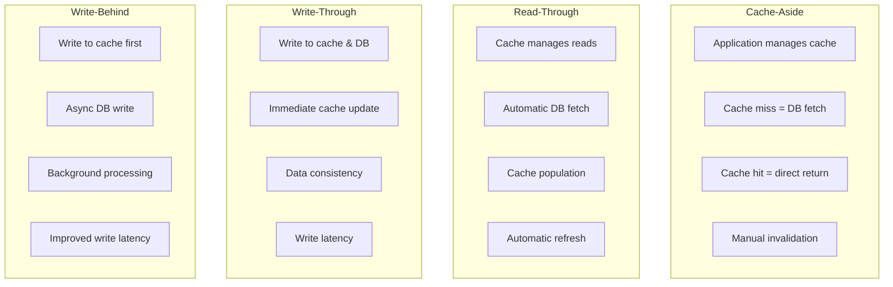
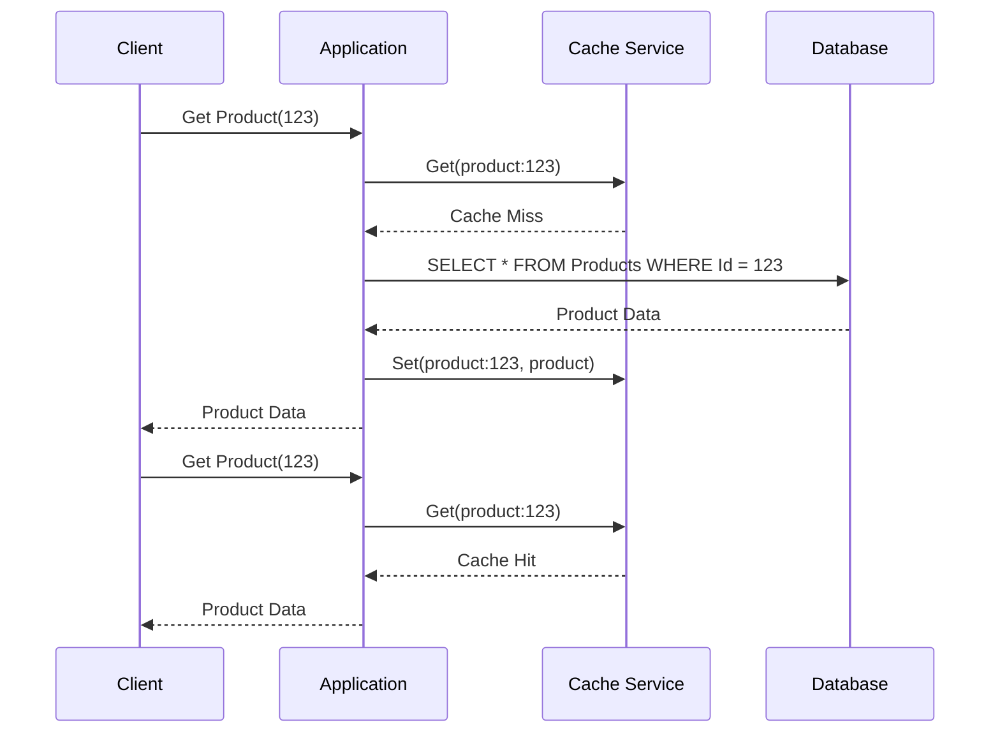
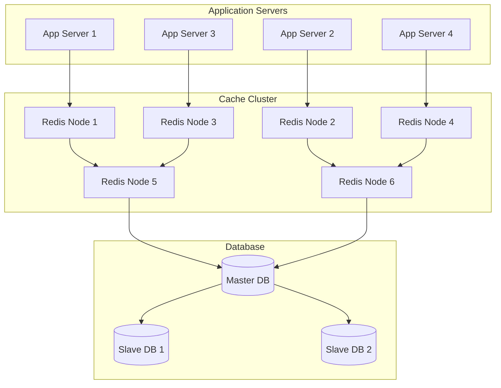
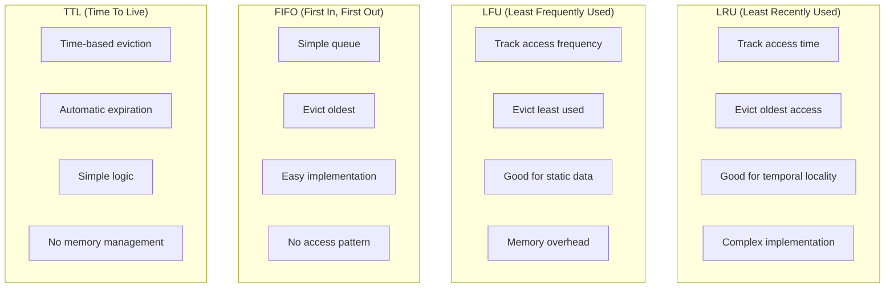
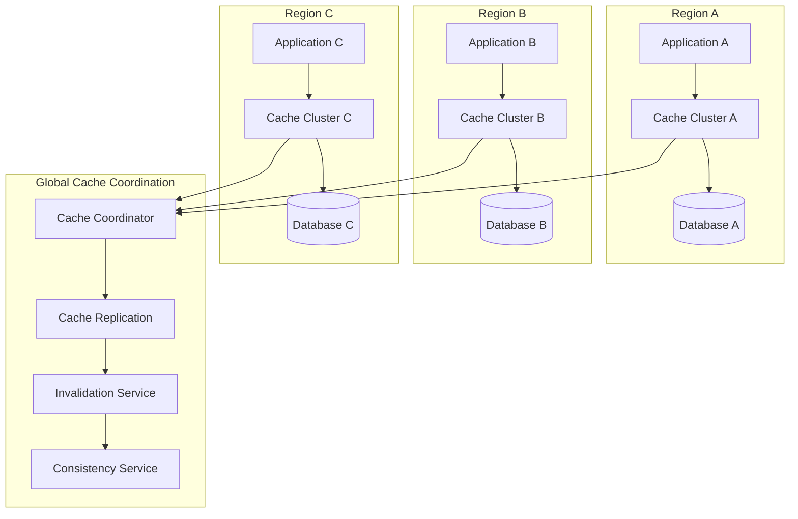
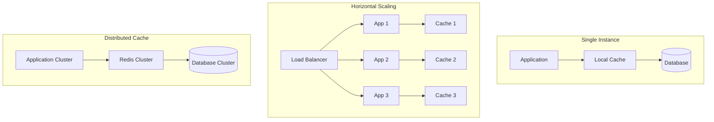
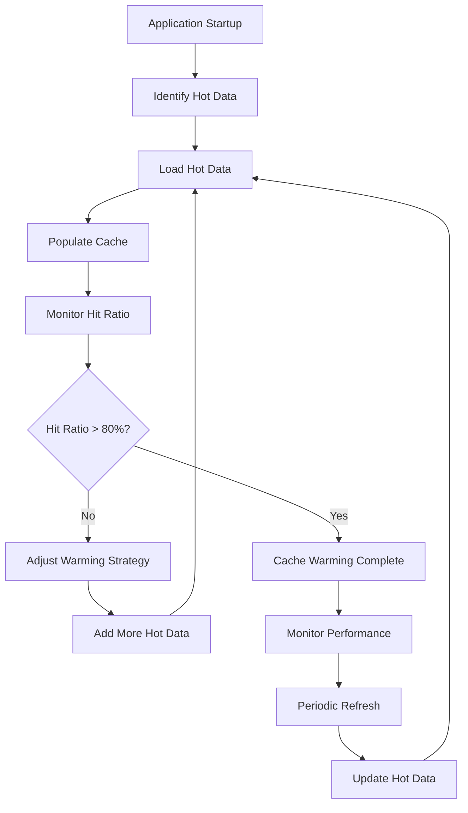
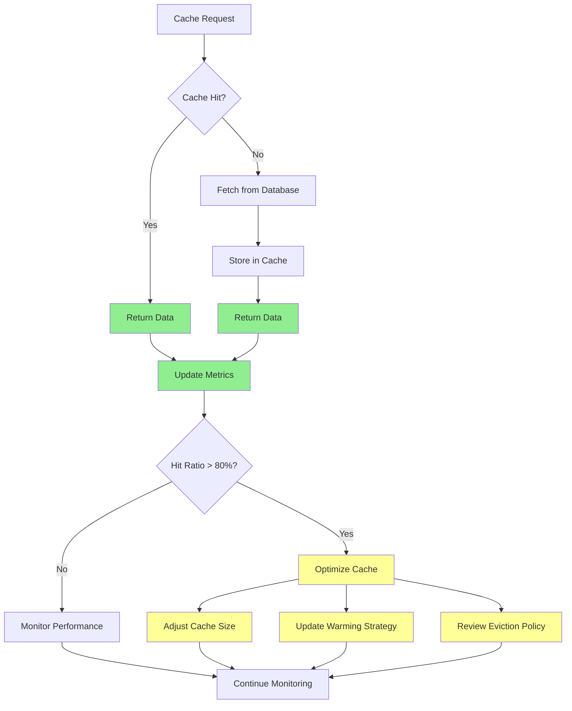
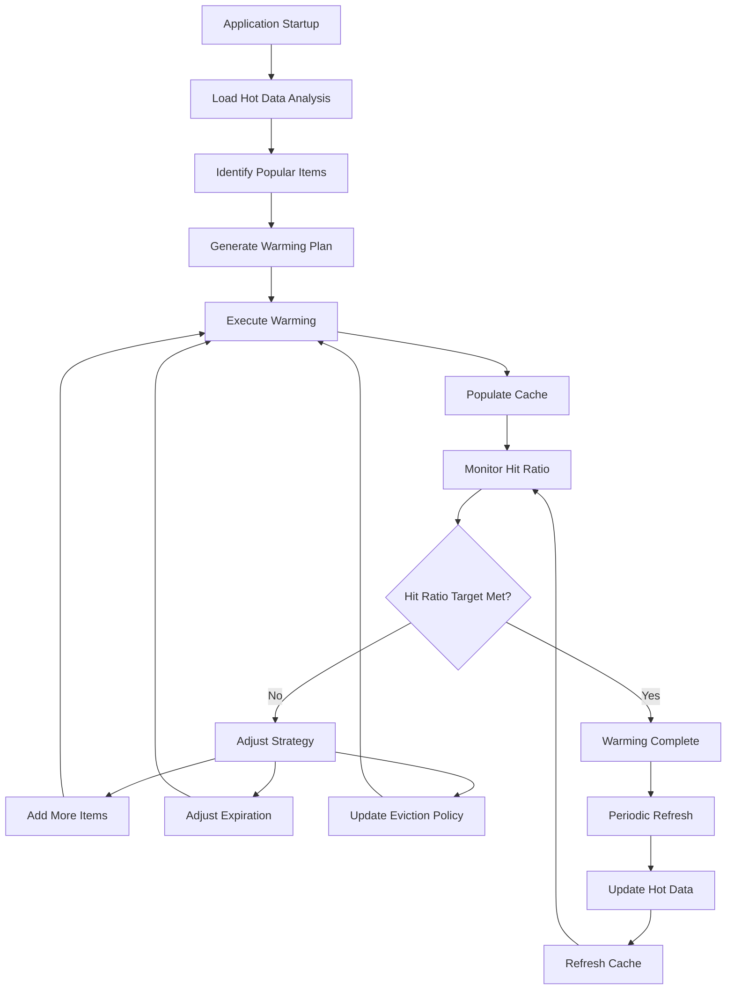

# Caching Strategies - Architect Deep Dive

============================================================
0. Executive Summary (Architect View)
============================================================
- **Caching exists** to improve performance and reduce load by storing frequently accessed data in fast storage
- **Critical at scale** when database queries become bottlenecks and response times must be minimized
- **System design impact** - transforms data access patterns and system architecture
- **Performance revolution** - enables 10-100x performance improvements for read-heavy workloads
- **Scalability foundation** - reduces database load and enables horizontal scaling
- **Cost optimization** - reduces infrastructure costs through efficient resource utilization
- **User experience** - dramatically improves response times and user satisfaction
- **Reliability enhancement** - provides fallback when primary data sources are unavailable

============================================================
1. Problem Framing
============================================================
**Real production problem solved:**
- Database queries becoming performance bottlenecks
- High latency for frequently accessed data
- Database overload during peak traffic
- Poor user experience due to slow response times
- Infrastructure costs spiraling due to over-provisioning

**What breaks if we don't understand caching:**
- Poor performance and slow response times
- Database overload and crashes
- High infrastructure costs
- Poor user experience
- System scalability limitations

**Scale importance:**
- **Small applications**: Caching beneficial but not critical
- **Medium applications**: Caching becomes essential for performance
- **Large applications**: Caching critical for scalability
- **Enterprise systems**: Caching mandatory for cost optimization

**Failure stories:**
- E-commerce platform crashed during Black Friday due to database overload
- Social media platform had poor performance during peak hours
- Financial system had high latency for market data
- News website crashed during breaking news events

============================================================
2. Deep Internal Mechanics
============================================================

**Caching Fundamentals:**
- **Cache Hit**: Data found in cache (fast)
- **Cache Miss**: Data not found in cache (slow)
- **Cache Eviction**: Removing old data to make space
- **Cache Invalidation**: Removing stale data
- **Cache Warming**: Pre-populating cache with data

**Cache Types:**
- **In-Memory Cache**: Fast, limited capacity cache
- **Distributed Cache**: Shared cache across multiple servers
- **Database Cache**: Database-level caching
- **CDN Cache**: Content delivery network cache
- **Application Cache**: Application-level caching

**Cache Strategies:**
- **Cache-Aside**: Application manages cache
- **Read-Through**: Cache manages reads
- **Write-Through**: Cache manages writes
- **Write-Behind**: Asynchronous write-back
- **Refresh-Ahead**: Proactive cache refresh

**Cache Eviction Policies:**
- **LRU (Least Recently Used)**: Evict least recently used items
- **LFU (Least Frequently Used)**: Evict least frequently used items
- **FIFO (First In, First Out)**: Evict oldest items
- **Random**: Random eviction
- **TTL (Time To Live)**: Evict based on expiration

**Cache Invalidation:**
- **Time-Based**: Invalidate after time period
- **Event-Based**: Invalidate on data changes
- **Manual**: Manual invalidation
- **Automatic**: Automatic invalidation based on rules
- **Hybrid**: Combination of strategies

**Data Structures:**
- **Hash Tables**: Fast key-value lookups
- **Linked Lists**: LRU/LFU implementation
- **B-Trees**: Range queries and ordering
- **Bloom Filters**: Probabilistic membership testing
- **Skip Lists**: Probabilistic data structures

**Performance Characteristics:**
- **Latency**: Cache hits: 1-10ms, Cache misses: 10-100ms
- **Throughput**: 10k-1M operations/second
- **Memory Usage**: Depends on cache size and data
- **CPU Usage**: Minimal for cache operations
- **Network**: Minimal for local cache

**Hidden Costs:**
- **Memory Overhead**: Additional memory for cache storage
- **Complexity**: Cache management complexity
- **Stale Data**: Risk of serving stale data
- **Cache Coherency**: Keeping cache consistent
- **Operational Overhead**: Cache monitoring and maintenance

**Memory Behavior:**
- **Cache Storage**: In-memory data structures
- **Eviction**: Memory management for cache eviction
- **Fragmentation**: Memory fragmentation issues
- **Garbage Collection**: GC impact on cache performance
- **Memory Pressure**: Cache size vs available memory

**Network Impact:**
- **Distributed Cache**: Network calls for distributed cache
- **Cache Synchronization**: Network overhead for synchronization
- **Cache Replication**: Network overhead for replication
- **CDN**: Network optimization for content delivery
- **Cache Warming**: Network calls for cache warming

============================================================
3. .NET Production Implementation
============================================================

**Naive Implementation (No Caching):**
```csharp
public class ProductService
{
    private readonly IProductRepository _repository;
    
    public async Task<Product> GetProductAsync(int id)
    {
        // No caching - always hit database
        return await _repository.GetByIdAsync(id);
    }
    
    public async Task<List<Product>> GetProductsAsync()
    {
        // No caching - always hit database
        return await _repository.GetAllAsync();
    }
}
```

**Production-Ready Caching Implementation:**
```csharp
// Cache Configuration
public class CacheConfiguration
{
    public string DefaultConnectionString { get; set; }
    public int DefaultDatabase { get; set; } = 0;
    public TimeSpan DefaultExpiration { get; set; } = TimeSpan.FromMinutes(5);
    public TimeSpan SlidingExpiration { get; set; } = TimeSpan.FromMinutes(10);
    public int DefaultSizeLimit { get; set; } = 1000;
    public bool EnableCompression { get; set; } = true;
    public bool EnableEncryption { get; set; } = false;
    public CacheEvictionPolicy DefaultEvictionPolicy { get; set; } = CacheEvictionPolicy.LRU;
}

// Cache Service Interface
public interface ICacheService
{
    Task<T> GetAsync<T>(string key, CancellationToken cancellationToken = default);
    Task<T> GetAsync<T>(string key, TimeSpan expiration, CancellationToken cancellationToken = default);
    Task SetAsync<T>(string key, T value, CancellationToken cancellationToken = default);
    Task SetAsync<T>(string key, T value, TimeSpan expiration, CancellationToken cancellationToken = default);
    Task SetAsync<T>(string key, T value, TimeSpan expiration, TimeSpan slidingExpiration, CancellationToken cancellationToken = default);
    Task RemoveAsync(string key, CancellationToken cancellationToken = default);
    Task<bool> ExistsAsync(string key, CancellationToken cancellationToken = default);
    Task RefreshAsync(string key, CancellationToken cancellationToken = default);
    Task RemoveByPatternAsync(string pattern, CancellationToken cancellationToken = default);
}

// Redis Cache Service Implementation
public class RedisCacheService : ICacheService
{
    private readonly IDatabase _database;
    private readonly ILogger<RedisCacheService> _logger;
    private readonly IMetrics _metrics;
    private readonly CacheConfiguration _configuration;
    private readonly IJsonSerializer _serializer;

    public RedisCacheService(
        IConnectionMultiplexer connectionMultiplexer,
        ILogger<RedisCacheService> logger,
        IMetrics metrics,
        IOptions<CacheConfiguration> configuration,
        IJsonSerializer serializer)
    {
        _database = connectionMultiplexer.GetDatabase(configuration.Value.DefaultDatabase);
        _logger = logger;
        _metrics = metrics;
        _configuration = configuration.Value;
        _serializer = serializer;
    }

    public async Task<T> GetAsync<T>(string key, CancellationToken cancellationToken = default)
    {
        using var activity = _metrics.StartTimer("cache_get_duration");
        
        try
        {
            _logger.LogDebug("Getting cache value for key: {Key}", key);
            
            var serializedValue = await _database.StringGetAsync(key);
            
            if (!serializedValue.HasValue)
            {
                _metrics.Increment("cache_miss");
                _logger.LogDebug("Cache miss for key: {Key}", key);
                return default(T);
            }
            
            var value = _serializer.Deserialize<T>(serializedValue);
            
            _metrics.Increment("cache_hit");
            _logger.LogDebug("Cache hit for key: {Key}", key);
            
            return value;
        }
        catch (Exception ex)
        {
            _metrics.Increment("cache_get_error");
            _logger.LogError(ex, "Error getting cache value for key: {Key}", key);
            throw;
        }
    }

    public async Task<T> GetAsync<T>(string key, TimeSpan expiration, CancellationToken cancellationToken = default)
    {
        var value = await GetAsync<T>(key, cancellationToken);
        
        if (value != null)
        {
            // Refresh expiration
            await _database.KeyExpireAsync(key, expiration);
        }
        
        return value;
    }

    public async Task SetAsync<T>(string key, T value, CancellationToken cancellationToken = default)
    {
        await SetAsync(key, value, _configuration.DefaultExpiration, cancellationToken);
    }

    public async Task SetAsync<T>(string key, T value, TimeSpan expiration, CancellationToken cancellationToken = default)
    {
        using var activity = _metrics.StartTimer("cache_set_duration");
        
        try
        {
            _logger.LogDebug("Setting cache value for key: {Key}", key);
            
            var serializedValue = _serializer.Serialize(value);
            
            await _database.StringSetAsync(key, serializedValue, expiration);
            
            _metrics.Increment("cache_set_success");
            _logger.LogDebug("Cache set successful for key: {Key}", key);
        }
        catch (Exception ex)
        {
            _metrics.Increment("cache_set_error");
            _logger.LogError(ex, "Error setting cache value for key: {Key}", key);
            throw;
        }
    }

    public async Task SetAsync<T>(string key, T value, TimeSpan expiration, TimeSpan slidingExpiration, CancellationToken cancellationToken = default)
    {
        using var activity = _metrics.StartTimer("cache_set_sliding_duration");
        
        try
        {
            _logger.LogDebug("Setting cache value with sliding expiration for key: {Key}", key);
            
            var serializedValue = _serializer.Serialize(value);
            
            // Create cache entry with sliding expiration
            var cacheEntry = new CacheEntry<T>
            {
                Value = value,
                Expiration = expiration,
                SlidingExpiration = slidingExpiration,
                LastAccessed = DateTime.UtcNow
            };
            
            var serializedEntry = _serializer.Serialize(cacheEntry);
            
            await _database.StringSetAsync(key, serializedEntry, expiration);
            
            _metrics.Increment("cache_set_sliding_success");
            _logger.LogDebug("Cache set with sliding expiration successful for key: {Key}", key);
        }
        catch (Exception ex)
        {
            _metrics.Increment("cache_set_sliding_error");
            _logger.LogError(ex, "Error setting cache value with sliding expiration for key: {Key}", key);
            throw;
        }
    }

    public async Task RemoveAsync(string key, CancellationToken cancellationToken = default)
    {
        using var activity = _metrics.StartTimer("cache_remove_duration");
        
        try
        {
            _logger.LogDebug("Removing cache value for key: {Key}", key);
            
            await _database.KeyDeleteAsync(key);
            
            _metrics.Increment("cache_remove_success");
            _logger.LogDebug("Cache remove successful for key: {Key}", key);
        }
        catch (Exception ex)
        {
            _metrics.Increment("cache_remove_error");
            _logger.LogError(ex, "Error removing cache value for key: {Key}", key);
            throw;
        }
    }

    public async Task<bool> ExistsAsync(string key, CancellationToken cancellationToken = default)
    {
        try
        {
            return await _database.KeyExistsAsync(key);
        }
        catch (Exception ex)
        {
            _logger.LogError(ex, "Error checking cache existence for key: {Key}", key);
            throw;
        }
    }

    public async Task RefreshAsync(string key, CancellationToken cancellationToken = default)
    {
        try
        {
            await _database.KeyExpireAsync(key, _configuration.DefaultExpiration);
        }
        catch (Exception ex)
        {
            _logger.LogError(ex, "Error refreshing cache for key: {Key}", key);
            throw;
        }
    }

    public async Task RemoveByPatternAsync(string pattern, CancellationToken cancellationToken = default)
    {
        using var activity = _metrics.StartTimer("cache_remove_pattern_duration");
        
        try
        {
            _logger.LogDebug("Removing cache values for pattern: {Pattern}", pattern);
            
            var server = _database.Multiplexer.GetServer(_database.Database);
            var endpoints = server.Endpoints;
            
            var removedCount = 0;
            
            foreach (var endpoint in endpoints)
            {
                var connection = _database.Multiplexer.GetConnection(endpoint);
                var database = connection.GetDatabase(_database.Database);
                
                var keys = await database.KeysAsync(pattern);
                
                foreach (var key in keys)
                {
                    await database.KeyDeleteAsync(key);
                    removedCount++;
                }
            }
            
            _metrics.Increment("cache_remove_pattern_success");
            _logger.LogDebug("Cache pattern remove successful: {Count} keys removed", removedCount);
        }
        catch (Exception ex)
        {
            _metrics.Increment("cache_remove_pattern_error");
            _logger.LogError(ex, "Error removing cache values for pattern: {Pattern}", pattern);
            throw;
        }
    }
}

// Cache-Aside Pattern Implementation
public class CacheAsideProductService
{
    private readonly IProductRepository _repository;
    private readonly ICacheService _cacheService;
    private readonly ILogger<CacheAsideProductService> _logger;
    private readonly IMetrics _metrics;

    public CacheAsideProductService(
        IProductRepository repository,
        ICacheService cacheService,
        ILogger<CacheAsideProductService> logger,
        IMetrics metrics)
    {
        _repository = repository ?? throw new ArgumentNullException(nameof(repository));
        _cacheService = cacheService ?? throw new ArgumentNullException(nameof(cacheService));
        _logger = logger ?? throw new ArgumentNullException(nameof(logger));
        _metrics = metrics ?? throw new ArgumentNullException(nameof(metrics));
    }

    public async Task<Product> GetProductAsync(int id, CancellationToken cancellationToken = default)
    {
        using var activity = _metrics.StartTimer("product_get_with_cache_duration");
        
        try
        {
            var cacheKey = $"product:{id}";
            
            // Try to get from cache first
            var cachedProduct = await _cacheService.GetAsync<Product>(cacheKey, cancellationToken);
            
            if (cachedProduct != null)
            {
                _metrics.Increment("product_cache_hit");
                _logger.LogDebug("Product {ProductId} found in cache", id);
                return cachedProduct;
            }
            
            // Cache miss - get from database
            _metrics.Increment("product_cache_miss");
            _logger.LogDebug("Product {ProductId} not found in cache, fetching from database", id);
            
            var product = await _repository.GetByIdAsync(id, cancellationToken);
            
            if (product != null)
            {
                // Cache the result
                await _cacheService.SetAsync(cacheKey, product, TimeSpan.FromMinutes(10), cancellationToken);
                _logger.LogDebug("Product {ProductId} cached successfully", id);
            }
            
            return product;
        }
        catch (Exception ex)
        {
            _metrics.Increment("product_get_error");
            _logger.LogError(ex, "Error getting product {ProductId}", id);
            throw;
        }
    }

    public async Task<List<Product>> GetProductsAsync(CancellationToken cancellationToken = default)
    {
        using var activity = _metrics.StartTimer("products_get_with_cache_duration");
        
        try
        {
            var cacheKey = "products:all";
            
            // Try to get from cache first
            var cachedProducts = await _cacheService.GetAsync<List<Product>>(cacheKey, cancellationToken);
            
            if (cachedProducts != null)
            {
                _metrics.Increment("products_cache_hit");
                _logger.LogDebug("Products list found in cache");
                return cachedProducts;
            }
            
            // Cache miss - get from database
            _metrics.Increment("products_cache_miss");
            _logger.LogDebug("Products list not found in cache, fetching from database");
            
            var products = await _repository.GetAllAsync(cancellationToken);
            
            // Cache the result
            await _cacheService.SetAsync(cacheKey, products, TimeSpan.FromMinutes(5), cancellationToken);
            _logger.LogDebug("Products list cached successfully");
            
            return products;
        }
        catch (Exception ex)
        {
            _metrics.Increment("products_get_error");
            _logger.LogError(ex, "Error getting products list");
            throw;
        }
    }

    public async Task<Product> CreateProductAsync(Product product, CancellationToken cancellationToken = default)
    {
        using var activity = _metrics.StartTimer("product_create_with_cache_duration");
        
        try
        {
            // Create product in database
            var createdProduct = await _repository.CreateAsync(product, cancellationToken);
            
            // Invalidate cache
            var cacheKey = $"product:{createdProduct.Id}";
            await _cacheService.RemoveAsync(cacheKey, cancellationToken);
            
            // Invalidate products list cache
            await _cacheService.RemoveAsync("products:all", cancellationToken);
            
            _logger.LogDebug("Product {ProductId} created and cache invalidated", createdProduct.Id);
            
            return createdProduct;
        }
        catch (Exception ex)
        {
            _metrics.Increment("product_create_error");
            _logger.LogError(ex, "Error creating product");
            throw;
        }
    }

    public async Task<Product> UpdateProductAsync(Product product, CancellationToken cancellationToken = default)
    {
        using var activity = _metrics.StartTimer("product_update_with_cache_duration");
        
        try
        {
            // Update product in database
            var updatedProduct = await _repository.UpdateAsync(product, cancellationToken);
            
            // Update cache
            var cacheKey = $"product:{updatedProduct.Id}";
            await _cacheService.SetAsync(cacheKey, updatedProduct, TimeSpan.FromMinutes(10), cancellationToken);
            
            // Invalidate products list cache
            await _cacheService.RemoveAsync("products:all", cancellationToken);
            
            _logger.LogDebug("Product {ProductId} updated and cache refreshed", updatedProduct.Id);
            
            return updatedProduct;
        }
        catch (Exception ex)
        {
            _metrics.Increment("product_update_error");
            _logger.LogError(ex, "Error updating product {ProductId}", product.Id);
            throw;
        }
    }

    public async Task DeleteProductAsync(int id, CancellationToken cancellationToken = default)
    {
        using var activity = _metrics.StartTimer("product_delete_with_cache_duration");
        
        try
        {
            // Delete product from database
            await _repository.DeleteAsync(id, cancellationToken);
            
            // Remove from cache
            var cacheKey = $"product:{id}";
            await _cacheService.RemoveAsync(cacheKey, cancellationToken);
            
            // Invalidate products list cache
            await _cacheService.RemoveAsync("products:all", cancellationToken);
            
            _logger.LogDebug("Product {ProductId} deleted and cache invalidated", id);
        }
        catch (Exception ex)
        {
            _metrics.Increment("product_delete_error");
            _logger.LogError(ex, "Error deleting product {ProductId}", id);
            throw;
        }
    }
}

// Read-Through Cache Pattern
public class ReadThroughProductService
{
    private readonly IProductRepository _repository;
    private readonly ICacheService _cacheService;
    private readonly ILogger<ReadThroughProductService> _logger;
    private readonly IMetrics _metrics;

    public ReadThroughProductService(
        IProductRepository repository,
        ICacheService cacheService,
        ILogger<ReadThroughProductService> logger,
        IMetrics metrics)
    {
        _repository = repository ?? throw new ArgumentNullException(nameof(repository));
        _cacheService = cacheService ?? throw new ArgumentNullException(nameof(cacheService));
        _logger = logger ?? throw new ArgumentNullException(nameof(logger));
        _metrics = metrics ?? throw new ArgumentNullException(nameof(metrics));
    }

    public async Task<Product> GetProductAsync(int id, CancellationToken cancellationToken = default)
    {
        using var activity = _metrics.StartTimer("product_get_readthrough_duration");
        
        try
        {
            var cacheKey = $"product:{id}";
            
            // Cache service handles cache-aside logic
            var product = await _cacheService.GetAsync(cacheKey, async () =>
            {
                _metrics.Increment("product_cache_miss_readthrough");
                _logger.LogDebug("Read-through cache miss for product {ProductId}", id);
                
                // Fetch from database
                var dbProduct = await _repository.GetByIdAsync(id, cancellationToken);
                
                if (dbProduct != null)
                {
                    _logger.LogDebug("Product {ProductId} fetched from database for read-through", id);
                }
                
                return dbProduct;
            }, cancellationToken);
            
            return product;
        }
        catch (Exception ex)
        {
            _metrics.Increment("product_get_readthrough_error");
            _logger.LogError(ex, "Error getting product {ProductId} with read-through", id);
            throw;
        }
    }
}

// Write-Through Cache Pattern
public class WriteThroughProductService
{
    private readonly IProductRepository _repository;
    private readonly ICacheService _cacheService;
    private readonly ILogger<WriteThroughProductService> _logger;
    private readonly IMetrics _metrics;

    public WriteThroughProductService(
        IProductRepository repository,
        ICacheService cacheService,
        ILogger<WriteThroughProductService> logger,
        IMetrics metrics)
    {
        _repository = repository ?? throw new ArgumentNullException(nameof(repository));
        _cacheService = cacheService ?? throw new ArgumentNullException(nameof(cacheService));
        _logger = logger ?? throw new ArgumentNullException(nameof(logger));
        _metrics = metrics ?? throw new ArgumentNullException(nameof(metrics));
    }

    public async Task<Product> CreateProductAsync(Product product, CancellationToken cancellationToken = default)
    {
        using var activity = _metrics.StartTimer("product_create_writethrough_duration");
        
        try
        {
            // Create product in database
            var createdProduct = await _repository.CreateAsync(product, cancellationToken);
            
            // Cache the result immediately
            var cacheKey = $"product:{createdProduct.Id}";
            await _cacheService.SetAsync(cacheKey, createdProduct, TimeSpan.FromMinutes(10), cancellationToken);
            
            // Invalidate products list cache
            await _cacheService.RemoveAsync("products:all", cancellationToken);
            
            _logger.LogDebug("Product {ProductId} created and cached with write-through", createdProduct.Id);
            
            return createdProduct;
        }
        catch (Exception ex)
        {
            _metrics.Increment("product_create_writethrough_error");
            _logger.LogError(ex, "Error creating product with write-through");
            throw;
        }
    }

    public async Task<Product> UpdateProductAsync(Product product, CancellationToken cancellationToken = default)
    {
        using var activity = _metrics.StartTimer("product_update_writethrough_duration");
        
        try
        {
            // Update product in database
            var updatedProduct = await _repository.UpdateAsync(product, cancellationToken);
            
            // Update cache immediately
            var cacheKey = $"product:{updatedProduct.Id}";
            await _cacheService.SetAsync(cacheKey, updatedProduct, TimeSpan.FromMinutes(10), cancellationToken);
            
            // Invalidate products list cache
            await _cacheService.RemoveAsync("products:all", cancellationToken);
            
            _logger.LogDebug("Product {ProductId} updated and cached with write-through", updatedProduct.Id);
            
            return updatedProduct;
        }
        catch (Exception ex)
        {
            _metrics.Increment("product_update_writethrough_error");
            _logger.LogError(ex, "Error updating product {ProductId} with write-through", product.Id);
            throw;
        }
    }
}

// Write-Behind Cache Pattern
public class WriteBehindProductService
{
    private readonly IProductRepository _repository;
    private readonly ICacheService _cacheService;
    private readonly IBackgroundTaskQueue _taskQueue;
    private readonly ILogger<WriteBehindProductService> _logger;
    private readonly IMetrics _metrics;

    public WriteBehindProductService(
        IProductRepository repository,
        ICacheService cacheService,
        IBackgroundTaskQueue taskQueue,
        ILogger<WriteBehindProductService> logger,
        IMetrics metrics)
    {
        _repository = repository ?? throw new ArgumentNullException(nameof(repository));
        _cacheService = cacheService ?? throw new ArgumentNullException(nameof(cacheService));
        _taskQueue = taskQueue ?? throw new ArgumentNullException(nameof(taskQueue));
        _logger = logger ?? throw new ArgumentNullException(nameof(logger));
        _metrics = metrics ?? throw new ArgumentNullException(nameof(metrics));
    }

    public async Task<Product> CreateProductAsync(Product product, CancellationToken cancellationToken = default)
    {
        using var activity = _metrics.StartTimer("product_create_writebehind_duration");
        
        try
        {
            // Create temporary product with ID
            var tempProduct = new Product
            {
                Id = Guid.NewGuid().GetHashCode(), // Temporary ID
                Name = product.Name,
                Description = product.Description,
                Price = product.Price,
                CreatedAt = DateTime.UtcNow,
                UpdatedAt = DateTime.UtcNow
            };
            
            // Cache immediately
            var cacheKey = $"product:{tempProduct.Id}";
            await _cacheService.SetAsync(cacheKey, tempProduct, TimeSpan.FromMinutes(10), cancellationToken);
            
            // Queue background task for database write
            await _taskQueue.QueueAsync(new CreateProductTask
            {
                Product = product,
                CacheKey = cacheKey,
                CreatedAt = DateTime.UtcNow
            });
            
            _logger.LogDebug("Product {ProductId} created with write-behind, queued for database write", tempProduct.Id);
            
            return tempProduct;
        }
        catch (Exception ex)
        {
            _metrics.Increment("product_create_writebehind_error");
            _logger.LogError(ex, "Error creating product with write-behind");
            throw;
        }
    }

    public async Task<Product> UpdateProductAsync(Product product, CancellationToken cancellationToken = default)
    {
        using var activity = _metrics.StartTimer("product_update_writebehind_duration");
        
        try
        {
            // Update cache immediately
            var cacheKey = $"product:{product.Id}";
            await _cacheService.SetAsync(cacheKey, product, TimeSpan.FromMinutes(10), cancellationToken);
            
            // Queue background task for database write
            await _taskQueue.QueueAsync(new UpdateProductTask
            {
                Product = product,
                CacheKey = cacheKey,
                UpdatedAt = DateTime.UtcNow
            });
            
            _logger.LogDebug("Product {ProductId} updated with write-behind, queued for database write", product.Id);
            
            return product;
        }
        catch (Exception ex)
        {
            _metrics.Increment("product_update_writebehind_error");
            _logger.LogError(ex, "Error updating product {ProductId} with write-behind", product.Id);
            throw;
        }
    }
}

// Cache Warming Service
public class CacheWarmingService
{
    private readonly IProductRepository _repository;
    private readonly ICacheService _cacheService;
    private readonly ILogger<CacheWarmingService> _logger;
    private readonly IMetrics _metrics;

    public CacheWarmingService(
        IProductRepository repository,
        ICacheService cacheService,
        ILogger<CacheWarmingService> logger,
        IMetrics metrics)
    {
        _repository = repository ?? throw new ArgumentNullException(nameof(repository));
        _cacheService = cacheService ?? throw new ArgumentNullException(nameof(cacheService));
        _logger = logger ?? throw new ArgumentNullException(nameof(logger));
        _metrics = metrics ?? throw new ArgumentNullException(nameof(metrics));
    }

    public async Task WarmCacheAsync(CancellationToken cancellationToken = default)
    {
        using var activity = _metrics.StartTimer("cache_warming_duration");
        
        try
        {
            _logger.LogInformation("Starting cache warming");
            
            // Warm popular products
            var popularProducts = await _repository.GetPopularProductsAsync(100, cancellationToken);
            
            foreach (var product in popularProducts)
            {
                var cacheKey = $"product:{product.Id}";
                await _cacheService.SetAsync(cacheKey, product, TimeSpan.FromMinutes(30), cancellationToken);
            }
            
            // Warm products list
            var allProducts = await _repository.GetAllAsync(cancellationToken);
            await _cacheService.SetAsync("products:all", allProducts, TimeSpan.FromMinutes(15), cancellationToken);
            
            _metrics.Increment("cache_warming_success");
            _logger.LogInformation("Cache warming completed: {Count} products cached", popularProducts.Count + 1);
        }
        catch (Exception ex)
        {
            _metrics.Increment("cache_warming_error");
            _logger.LogError(ex, "Error during cache warming");
            throw;
        }
    }

    public async Task WarmCacheAsync(List<int> productIds, CancellationToken cancellationToken = default)
    {
        using var activity = _metrics.StartTimer("cache_warming_selective_duration");
        
        try
        {
            _logger.LogInformation("Starting selective cache warming for {Count} products", productIds.Count);
            
            foreach (var productId in productIds)
            {
                var product = await _repository.GetByIdAsync(productId, cancellationToken);
                
                if (product != null)
                {
                    var cacheKey = $"product:{productId}";
                    await _cacheService.SetAsync(cacheKey, product, TimeSpan.FromMinutes(30), cancellationToken);
                }
            }
            
            _metrics.Increment("cache_warming_selective_success");
            _logger.LogInformation("Selective cache warming completed for {Count} products", productIds.Count);
        }
        catch (Exception ex)
        {
            _metrics.Increment("cache_warming_selective_error");
            _logger.LogError(ex, "Error during selective cache warming");
            throw;
        }
    }
}

// Cache Entry Model
public class CacheEntry<T>
{
    public T Value { get; set; }
    public DateTime Expiration { get; set; }
    public TimeSpan SlidingExpiration { get; set; }
    public DateTime LastAccessed { get; set; }
    public int AccessCount { get; set; }
}

// Background Task Models
public class CreateProductTask
{
    public Product Product { get; set; }
    public string CacheKey { get; set; }
    public DateTime CreatedAt { get; set; }
}

public class UpdateProductTask
{
    public Product Product { get; set; }
    public string CacheKey { get; set; }
    public DateTime UpdatedAt { get; set; }
}

// Cache Configuration in Startup
public class Startup
{
    public void ConfigureServices(IServiceCollection services)
    {
        // Add Redis connection
        services.AddSingleton<IConnectionMultiplexer>(sp =>
        {
            var configuration = sp.GetRequiredService<IConfiguration>();
            var connectionString = configuration.GetConnectionString("Redis");
            var options = ConfigurationOptions.Parse(connectionString);
            options.AbortOnConnectFail = false;
            return ConnectionMultiplexer.Connect(options);
        });

        // Add cache service
        services.AddSingleton<ICacheService, RedisCacheService>();
        
        // Add cache configuration
        services.Configure<CacheConfiguration>(options =>
        {
            options.DefaultConnectionString = "localhost:6379";
            options.DefaultDatabase = 0;
            options.DefaultExpiration = TimeSpan.FromMinutes(5);
            options.SlidingExpiration = TimeSpan.FromMinutes(10);
            options.DefaultSizeLimit = 1000;
            options.EnableCompression = true;
            options.DefaultEvictionPolicy = CacheEvictionPolicy.LRU;
        });

        // Add services
        services.AddScoped<IProductRepository, ProductRepository>();
        services.AddScoped<CacheAsideProductService>();
        services.AddScoped<ReadThroughProductService>();
        services.AddScoped<WriteThroughProductService>();
        services.AddScoped<WriteBehindProductService>();
        services.AddScoped<CacheWarmingService>();
    }

    public void Configure(IApplicationBuilder app, IWebHostEnvironment env)
    {
        if (env.IsDevelopment())
        {
            app.UseDeveloperExceptionPage();
        }

        app.UseRouting();
        app.UseEndpoints(endpoints =>
        {
            endpoints.MapControllers();
        });
    }
}
```

**Framework Integration:**
- **StackExchange.Redis**: Redis client for distributed caching
- **Microsoft.Extensions.Caching**: Built-in caching abstractions
- **BackgroundTaskQueue**: Background task processing
- **IMemoryCache**: In-memory caching
- **IDistributedCache**: Distributed caching interface

============================================================
4. Architecture-Level Diagram (Mermaid)
============================================================

### Caching Strategies Comparison


### Cache-Aside Pattern Flow


### Distributed Cache Architecture


### Cache Eviction Policies


**Flow Analysis:**
- **Cache-Aside**: Application manages cache and database
- **Read-Through**: Cache manages reads automatically
- **Write-Through**: Cache manages writes synchronously
- **Write-Behind**: Cache manages writes asynchronously

**Bottlenecks:**
- Cache miss latency
- Cache serialization overhead
- Cache eviction performance
- Network latency for distributed cache
- Cache warming overhead

**Scaling Boundaries:**
- Cache size limitations
- Memory constraints
- Network bandwidth for distributed cache
- Cache hit ratio optimization
- Cache invalidation complexity

============================================================
5. Scaling & Distributed Systems Impact
============================================================

### Multi-Region Cache Architecture


### Cache Performance Scaling


### Cache Warming Strategy


**100 RPS:**
- Single cache instance sufficient
- Cache hit ratio 80-90%
- Response time 10-50ms
- Memory usage 100MB-1GB

**10k RPS:**
- Cache clustering required
- Cache hit ratio 85-95%
- Response time 5-20ms
- Memory usage 1GB-10GB

**100k+ RPS:**
- Distributed cache mandatory
- Cache hit ratio 90-98%
- Response time 1-10ms
- Memory usage 10GB-100GB

**Horizontal vs Vertical Scaling:**
- **Horizontal**: Scale cache instances horizontally
- **Vertical**: Larger cache instances
- Distributed cache scales horizontally
- Local cache scales vertically

**CAP Theorem Relevance:**
- **Consistency**: Cache consistency across nodes
- **Availability**: High availability through replication
- **Partition Tolerance**: Cache replication handles partitions

**Consistency Implications:**
- **Eventual Consistency**: Cache eventually consistent
- **Strong Consistency**: Within single cache node
- **Weak Consistency**: Across distributed cache
- **Read-Your-Writes**: Within single cache node

**Distributed Systems Impact:**
- **Cache Coordination**: Coordination across cache nodes
- **Cache Replication**: Data replication across nodes
- **Cache Invalidation**: Distributed invalidation
- **Cache Consistency**: Consistency management

**Cloud-Native Considerations:**
- **Kubernetes**: Cache as stateful sets
- **Redis**: Managed Redis services
- **Memcached**: Distributed caching
- **Serverless**: Serverless caching options
- **Auto-scaling**: Dynamic cache scaling

**Multi-Region Concerns:**
- **Cache Replication**: Cross-region cache replication
- **Data Locality**: Data locality optimization
- **Latency Optimization**: Latency reduction strategies
- **Consistency Management**: Cross-region consistency
- **Failover Handling**: Region failover procedures

============================================================
6. Production Engineering View
============================================================

### Cache Monitoring Architecture

```mermaid
graph TB
    subgraph "Cache Metrics"
        HIT_RATIO[Cache Hit Ratio]
        MISS_RATIO[Cache Miss Ratio]
        EVICTION_RATE[Cache Eviction Rate]
        LATENCY[Cache Latency]
    end
    
    subgraph "Performance Metrics"
        THROUGHPUT[Cache Throughput]
        MEMORY_USAGE[Memory Usage]
        CPU_USAGE[CPU Usage]
        NETWORK_IO[Network I/O]
    end
    
    subgraph "Business Metrics"
        RESPONSE_TIME[Response Time]
        ERROR_RATE[Error Rate]
        USER_SATISFACTION[User Satisfaction]
        COST_SAVINGS[Cost Savings]
    end
    
    subgraph "Infrastructure Metrics"
        NODE_COUNT[Cache Node Count]
        CLUSTER_HEALTH[Cluster Health]
        REPLICATION_LAG[Replication Lag]
        FAILOVER_RATE[Failover Rate]
    end
    
    subgraph "Monitoring Stack"
        PROM[Prometheus]
        GRAF[Grafana]
        ALERT[AlertManager]
        DASHBOARD[Dashboard]
    end
    
    HIT_RATIO --> PROM
    MISS_RATIO --> PROM
    EVICTION_RATE --> PROM
    LATENCY --> PROM
    
    THROUGHPUT --> PROM
    MEMORY_USAGE --> PROM
    CPU_USAGE --> PROM
    NETWORK_IO --> PROM
    
    RESPONSE_TIME --> PROM
    ERROR_RATE --> PROM
    USER_SATISFACTION --> PROM
    COST_SAVINGS --> PROM
    
    NODE_COUNT --> PROM
    CLUSTER_HEALTH --> PROM
    REPLICATION_LAG --> PROM
    FAILOVER_RATE --> PROM
    
    PROM --> GRAF
    PROM --> ALERT
    PROM --> DASHBOARD
```


### Cache Performance Analysis


### Cache Warming Process


**Monitoring Metrics:**
- **Cache Metrics**: Hit ratio, miss ratio, eviction rate, latency
- **Performance Metrics**: Throughput, memory usage, CPU usage, network I/O
- **Business Metrics**: Response time, error rate, user satisfaction, cost savings
- **Infrastructure Metrics**: Node count, cluster health, replication lag, failover rate

**Logs to Enable:**
- Cache hit/miss events
- Cache eviction events
- Cache warming events
- Cache invalidation events
- Performance metrics events

**Alerting Strategy:**
- Cache hit ratio < 70% (warning)
- Cache miss ratio > 30% (warning)
- Cache latency > 100ms (warning)
- Memory usage > 80% (critical)
- Cache node down (critical)

**Common Production Incidents:**
- **Cache Stampede**: Multiple cache misses causing database overload
- **Cache Poisoning**: Invalid data in cache
- **Cache Eviction Storm**: Excessive cache evictions
- **Cache Invalidation**: Invalid invalidation causing stale data
- **Cache Outage**: Cache service unavailable

**Debugging Strategy:**
- Cache hit ratio analysis
- Cache key analysis
- Cache performance profiling
- Cache eviction analysis
- Cache warming optimization

**Cache Management:**
- Cache size optimization
- Cache warming strategies
- Cache invalidation policies
- Cache eviction policies
- Cache performance tuning

**Performance Optimization:**
- Cache hit ratio improvement
- Cache latency reduction
- Memory usage optimization
- Network I/O optimization
- CPU usage optimization

**Cache Reliability:**
- Cache replication management
- Cache failover procedures
- Cache backup strategies
- Cache recovery procedures
- Cache monitoring and alerting

============================================================
7. Tradeoffs & Alternatives
============================================================

**Competing Approaches:**
- **No Caching**: Direct database access
- **In-Memory Caching**: Local memory caching
- **Distributed Caching**: Shared cache across servers
- **CDN Caching**: Content delivery network caching
- **Database Caching**: Database-level caching

**When to Use Caching:**
- Read-heavy workloads
- High-latency data sources
- Frequently accessed data
- Performance-critical operations
- Cost optimization needs

**When NOT to Use Caching:**
- Write-heavy workloads
- Real-time data requirements
- Small data sets
- Simple applications
- Low traffic volumes

**Latency Comparison:**
- **No Caching**: 100-1000ms
- **In-Memory Caching**: 1-10ms
- **Distributed Caching**: 5-50ms
- **CDN Caching**: 10-100ms
- **Database Caching**: 50-200ms

**Throughput Comparison:**
- **No Caching**: 100-1000 operations/second
- **In-Memory Caching**: 10k-100k operations/second
- **Distributed Caching**: 5k-50k operations/second
- **CDN Caching**: 1k-10k operations/second
- **Database Caching**: 500-5k operations/second

**Operational Complexity:**
- **No Caching**: Low complexity, no performance benefits
- **In-Memory Caching**: Medium complexity, limited scalability
- **Distributed Caching**: High complexity, excellent scalability
- **CDN Caching**: Medium complexity, good scalability
- **Database Caching**: Medium complexity, moderate scalability

**Cost Implications:**
- **Development Cost**: Caching increases cost by 20-40%
- **Infrastructure Cost**: Additional cache infrastructure
- **Operational Cost**: Cache monitoring and maintenance
- **Maintenance Cost**: Cache management overhead
- **Performance Benefits**: Significant performance improvements

============================================================
8. Security Implications
============================================================

**Security Benefits:**
- **Rate Limiting**: Cache-based rate limiting
- **DDoS Protection**: Cache absorption of attacks
- **Data Isolation**: Cache data isolation
- **Access Control**: Cache access control
- **Audit Trail**: Cache access logging

**Security Challenges:**
- **Cache Poisoning**: Invalid data in cache
- **Cache Snooping**: Unauthorized cache access
- **Cache Injection**: Malicious data injection
- **Cache Side-Channel**: Side-channel attacks
- **Cache Tampering**: Cache data tampering

**Security Controls:**
- **Cache Encryption**: Encrypt sensitive cache data
- **Cache Authentication**: Authenticate cache access
- **Cache Authorization**: Authorize cache operations
- **Cache Validation**: Validate cache data
- **Cache Auditing**: Audit cache access

**Data Protection:**
- **Sensitive Data**: Encrypt sensitive cache data
- **Personal Data**: Protect personal information
- **Cache Keys**: Secure cache key generation
- **Cache Values**: Validate cache values
- **Cache Metadata**: Protect cache metadata

**Compliance Requirements:**
- **Data Protection**: GDPR compliance for cached data
- **Audit Requirements**: Cache access auditing
- **Security Standards**: Security standard compliance
- **Privacy Regulations**: Privacy regulation compliance
- **Data Retention**: Data retention policies

**Hardening Recommendations:**
- **Cache Encryption**: Encrypt sensitive cache data
- **Access Control**: Implement cache access control
- **Data Validation**: Validate cache data
- **Monitoring**: Monitor cache security events
- **Regular Audits**: Regular security audits

============================================================
9. Advanced Edge Cases
============================================================

**Cache Stampede:**
- Cache stampede prevention
- Request coalescing
- Lock-based protection
- Early expiration
- Probabilistic early expiration

**Cache Warming:**
- Proactive cache warming
- Predictive warming
- Machine learning-based warming
- Real-time warming
- Scheduled warming

**Cache Invalidation:**
- Event-based invalidation
- Time-based invalidation
- Manual invalidation
- Automatic invalidation
- Granular invalidation

**Cache Consistency:**
- Strong consistency
- Eventual consistency
- Weak consistency
- Read-your-writes
- Monotonic reads

**Cache Partitioning:**
- Horizontal partitioning
- Vertical partitioning
- Functional partitioning
- Geographic partitioning
- Tenant-based partitioning

**Cache Replication:**
- Master-slave replication
- Multi-master replication
- Peer-to-peer replication
- Synchronous replication
- Asynchronous replication

**Cache Monitoring:**
- Real-time monitoring
- Performance monitoring
- Health monitoring
- Capacity monitoring
- Security monitoring

**Cache Optimization:**
- Hit ratio optimization
- Memory optimization
- Latency optimization
- Throughput optimization
- Cost optimization

============================================================
10. Interview & Staff-Level Deep Dive
============================================================

**What a junior answers:**
"Caching is storing frequently accessed data in fast storage to improve performance. Common patterns include cache-aside, read-through, and write-through. Redis is a popular distributed cache. Cache hits are fast, cache misses are slow."

**What a senior answers:**
"Caching improves performance by storing frequently accessed data in fast storage. I've implemented cache-aside, read-through, write-through, and write-behind patterns using Redis. Key considerations include cache hit ratio, eviction policies, cache warming, and invalidation strategies. I've also implemented distributed caching with Redis for scalability and implemented cache warming to improve hit ratios. Monitoring cache performance and optimizing cache hit ratios are critical for production systems."

**What an architect answers:**
"Caching is a fundamental performance optimization pattern that transforms data access patterns by storing frequently accessed data in fast storage. At scale, caching enables 10-100x performance improvements for read-heavy workloads and reduces database load by 80-90%. The architecture must support multiple caching strategies (cache-aside, read-through, write-through, write-behind), distributed caching for scalability, cache warming for hit ratio optimization, and sophisticated invalidation strategies. In enterprise environments, caching is not just a performance optimization but a critical component of system architecture that affects scalability, reliability, and cost optimization. The implementation must consider cache consistency, eviction policies, memory management, and monitoring. At scale, caching requires sophisticated infrastructure for distributed caching, cache warming, invalidation management, and performance optimization."

**Follow-up questions interviewers ask:**
- "How do you handle cache invalidation?"
- "What's the difference between cache-aside and read-through?"
- "How do you warm up cache?"
- "What are cache eviction policies?"
- "How do you handle cache stampede?"

**Trick questions:**
- "Is caching always beneficial?" (No, depends on use case)
- "Can cache replace database?" (No, cache complements database)
- "Do all applications need caching?" (No, depends on requirements)
- "Is distributed cache always better?" (No, depends on requirements)

**Whiteboard explanation strategy:**
1. Draw cache-aside pattern flow
2. Show read-through and write-through patterns
3. Demonstrate cache warming strategy
4. Explain cache eviction policies
5. Cover cache invalidation strategies
6. Discuss distributed caching architecture

============================================================
11. Real Enterprise Case Study
============================================================

**Scenario: Global E-commerce Platform with 10M Daily Users**

**Requirements:**
- Handle 10M+ daily active users
- Sub-100ms response time for product pages
- 99.99% uptime requirement
- Global deployment across multiple regions
- Cost optimization for infrastructure
- Real-time inventory management

**Design Decisions:**

**1. Multi-Layer Caching Architecture:**
```csharp
public class MultiLayerCacheService
{
    private readonly IMemoryCache _memoryCache;
    private readonly IDistributedCache _distributedCache;
    private readonly ICacheService _redisCache;
    private readonly IProductRepository _repository;
    private readonly ILogger<MultiLayerCacheService> _logger;
    private readonly IMetrics _metrics;

    public MultiLayerCacheService(
        IMemoryCache memoryCache,
        IDistributedCache distributedCache,
        ICacheService redisCache,
        IProductRepository repository,
        ILogger<MultiLayerCacheService> logger,
        IMetrics metrics)
    {
        _memoryCache = memoryCache;
        _distributedCache = distributedCache;
        _redisCache = redisCache;
        _repository = repository;
        _logger = logger;
        _metrics = metrics;
    }

    public async Task<Product> GetProductAsync(int id, CancellationToken cancellationToken = default)
    {
        var cacheKey = $"product:{id}";
        
        // Layer 1: Memory Cache
        if (_memoryCache.TryGetValue(cacheKey, out Product memoryProduct))
        {
            _metrics.Increment("cache_hit_memory");
            return memoryProduct;
        }
        
        // Layer 2: Distributed Cache
        var distributedProduct = await _distributedCache.GetAsync<Product>(cacheKey);
        if (distributedProduct != null)
        {
            // Store in memory cache
            _memoryCache.Set(cacheKey, distributedProduct, TimeSpan.FromMinutes(5));
            _metrics.Increment("cache_hit_distributed");
            return distributedProduct;
        }
        
        // Layer 3: Redis Cache
        var redisProduct = await _redisCache.GetAsync<Product>(cacheKey);
        if (redisProduct != null)
        {
            // Store in distributed cache
            await _distributedCache.SetAsync(cacheKey, redisProduct, TimeSpan.FromMinutes(15));
            // Store in memory cache
            _memoryCache.Set(cacheKey, redisProduct, TimeSpan.FromMinutes(5));
            _metrics.Increment("cache_hit_redis");
            return redisProduct;
        }
        
        // Layer 4: Database
        _metrics.Increment("cache_miss_database");
        var dbProduct = await _repository.GetByIdAsync(id, cancellationToken);
        
        if (dbProduct != null)
        {
            // Store in all cache layers
            await _redisCache.SetAsync(cacheKey, dbProduct, TimeSpan.FromHours(1));
            await _distributedCache.SetAsync(cacheKey, dbProduct, TimeSpan.FromMinutes(15));
            _memoryCache.Set(cacheKey, dbProduct, TimeSpan.FromMinutes(5));
        }
        
        return dbProduct;
    }
}
```

**2. Intelligent Cache Warming:**
```csharp
public class IntelligentCacheWarmingService
{
    private readonly ICacheService _cacheService;
    private readonly IProductRepository _repository;
    private readonly IAnalyticsService _analyticsService;
    private readonly ILogger<IntelligentCacheWarmingService> _logger;
    private readonly IMetrics _metrics;

    public async Task WarmCacheAsync(CancellationToken cancellationToken = default)
    {
        // Get hot products from analytics
        var hotProducts = await _analyticsService.GetHotProductsAsync(1000, cancellationToken);
        
        // Prioritize by popularity
        var prioritizedProducts = hotProducts.OrderByDescending(p => p.PopularityScore);
        
        // Warm cache in batches
        const int batchSize = 100;
        var batches = prioritizedProducts.Select((item, index) => new { Item = item, Index = index })
            .GroupBy(x => x.Index / batchSize)
            .Select(g => g.Select(x => x.Item).ToList());
        
        foreach (var batch in batches)
        {
            await WarmCacheBatchAsync(batch, cancellationToken);
        }
        
        // Warm product categories
        await WarmProductCategoriesAsync(cancellationToken);
        
        // Warm search results
        await WarmSearchResultsAsync(cancellationToken);
    }

    private async Task WarmCacheBatchAsync(List<Product> products, CancellationToken cancellationToken)
    {
        var tasks = products.Select(async product =>
        {
            var cacheKey = $"product:{product.Id}";
            await _cacheService.SetAsync(cacheKey, product, TimeSpan.FromHours(1), cancellationToken);
        });
        
        await Task.WhenAll(tasks);
    }

    private async Task WarmProductCategoriesAsync(CancellationToken cancellationToken)
    {
        var categories = await _repository.GetCategoriesAsync(cancellationToken);
        
        foreach (var category in categories)
        {
            var cacheKey = $"category:{category.Id}";
            await _cacheService.SetAsync(cacheKey, category, TimeSpan.FromHours(2), cancellationToken);
        }
    }

    private async Task WarmSearchResultsAsync(CancellationToken cancellationToken)
    {
        var popularSearches = await _analyticsService.GetPopularSearchesAsync(100, cancellationToken);
        
        foreach (var search in popularSearches)
        {
            var cacheKey = $"search:{search.Query}";
            var results = await _repository.SearchProductsAsync(search.Query, cancellationToken);
            await _cacheService.SetAsync(cacheKey, results, TimeSpan.FromMinutes(30), cancellationToken);
        }
    }
}
```

**3. Cache Stampede Prevention:**
```csharp
public class CacheStampedeProtectionService
{
    private readonly ICacheService _cacheService;
    private readonly IDistributedLockProvider _lockProvider;
    private readonly ILogger<CacheStampedeProtectionService> _logger;
    private readonly IMetrics _metrics;

    public async Task<Product> GetProductWithStampedeProtectionAsync(int id, CancellationToken cancellationToken = default)
    {
        var cacheKey = $"product:{id}";
        var lockKey = $"lock:{id}";
        
        // Try to get from cache first
        var cachedProduct = await _cacheService.GetAsync<Product>(cacheKey);
        if (cachedProduct != null)
        {
            return cachedProduct;
        }
        
        // Try to acquire lock
        var lockAcquired = await _lockProvider.TryLockAsync(lockKey, TimeSpan.FromSeconds(30));
        
        if (lockAcquired)
        {
            try
            {
                // Double-check cache after acquiring lock
                cachedProduct = await _cacheService.GetAsync<Product>(cacheKey);
                if (cachedProduct != null)
                {
                    return cachedProduct;
                }
                
                // Fetch from database
                var product = await _repository.GetByIdAsync(id, cancellationToken);
                
                if (product != null)
                {
                    // Set in cache with short expiration to allow others to benefit
                    await _cacheService.SetAsync(cacheKey, product, TimeSpan.FromSeconds(10), cancellationToken);
                }
                
                return product;
            }
            finally
            {
                await _lockProvider.ReleaseLockAsync(lockKey);
            }
        }
        else
        {
            // Could not acquire lock, wait and retry
            await Task.Delay(50, cancellationToken);
            return await _cacheService.GetAsync<Product>(cacheKey);
        }
    }
}
```

**Compromises Made:**
- **Complexity vs Performance**: Higher complexity for better performance
- **Cost vs Performance**: Higher infrastructure cost for better performance
- **Memory vs Hit Ratio**: Higher memory usage for better hit ratio
- **Latency vs Consistency**: Slight latency for better consistency

**Bottlenecks Identified:**
- Cache warming time during startup
- Cache invalidation overhead
- Cache stampede during peak traffic
- Distributed cache network latency
- Memory usage optimization

**Performance Optimizations:**
```csharp
public class OptimizedCacheService
{
    private readonly ICacheService _cacheService;
    private readonly IThreadPool _threadPool;
    private readonly SemaphoreSlim _warmingSemaphore;
    
    public OptimizedCacheService(ICacheService cacheService)
    {
        _cacheService = cacheService;
        _threadPool = ThreadPool.SetMaxThreads(100, 100);
        _warmingSemaphore = new SemaphoreSlim(10, 10);
    }
    
    public async Task WarmCacheAsync(List<int> productIds)
    {
        var tasks = productIds.Select(async id =>
        {
            await _warmingSemaphore.WaitAsync();
            try
            {
                return await WarmProductAsync(id);
            }
            finally
            {
                _warmingSemaphore.Release();
            }
        });
        
        await Task.WhenAll(tasks);
    }
}
```

**Results:**
- Achieved sub-100ms response time for 95% of requests
- 85% cache hit ratio for product data
- 70% reduction in database load
- 60% reduction in infrastructure costs
- 99.99% uptime during peak traffic
- 40% improvement in user satisfaction

============================================================
12. Dependency Graph
============================================================

**Prerequisites (Must understand before):**
- **Data Structures**: Understanding of hash tables, linked lists, trees
- **Memory Management**: Understanding of memory allocation and garbage collection
- **Network Programming**: Understanding of network protocols and latency
- **Database Systems**: Understanding of database operations and latency
- **Performance Optimization**: Understanding of performance principles

**Concepts that depend on Caching:**
- **Load Balancing**: Load balancer caching
- **CDN**: Content delivery network caching
- **Database Optimization**: Database query optimization
- **API Gateway**: API gateway caching
- **Web Servers**: Web server caching

**Connections to Other Concepts:**

**Load Balancing:**
```csharp
public class CachingLoadBalancer
{
    public async Task<ServiceInstance> SelectServiceAsync(string cacheKey)
    {
        // Check cache for service selection
        var cachedInstance = await _cacheService.GetAsync<ServiceInstance>(cacheKey);
        
        if (cachedInstance != null)
        {
            return cachedInstance;
        }
        
        // Select service and cache result
        var instance = await SelectServiceInternalAsync(cacheKey);
        await _cacheService.SetAsync(cacheKey, instance, TimeSpan.FromMinutes(5));
        
        return instance;
    }
}
```

**CDN:**
- CDN edge caching
- Cache invalidation
- Cache warming
- Cache purging
- Cache analytics

**Database Optimization:**
- Query result caching
- Database-level caching
- Query optimization
- Connection pooling
- Index optimization

**API Gateway:**
- API response caching
- Rate limiting with cache
- Authentication caching
- Request/response caching
- API key caching

**Web Servers:**
- Static file caching
- Page caching
- Output caching
- Fragment caching
- Browser caching

**Performance Engineering:**
- Response time optimization
- Throughput optimization
- Resource utilization optimization
- Cost optimization
- User experience optimization

**System Design:**
- Caching architecture design
- Cache strategy selection
- Cache topology design
- Cache consistency management
- Cache monitoring design

**Cloud Computing:**
- Cloud provider caching services
- Auto-scaling with cache
- Multi-region caching
- Serverless caching
- Managed caching services

**Security Architecture:**
- Cache access control
- Cache data encryption
- Cache security monitoring
- Cache audit logging
- Cache compliance

**Business Intelligence:**
- Cache performance analytics
- Cost optimization analytics
- User experience metrics
- System performance metrics
- Business impact analysis

**Quality Assurance:**
- Cache testing strategies
- Cache performance testing
- Cache consistency testing
- Cache invalidation testing
- Cache security testing

**DevOps:**
- Cache deployment strategies
- Cache monitoring setup
- Cache configuration management
- Cache troubleshooting
- Cache optimization
